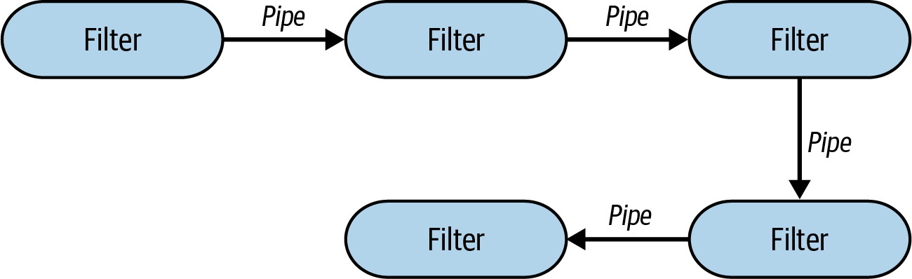
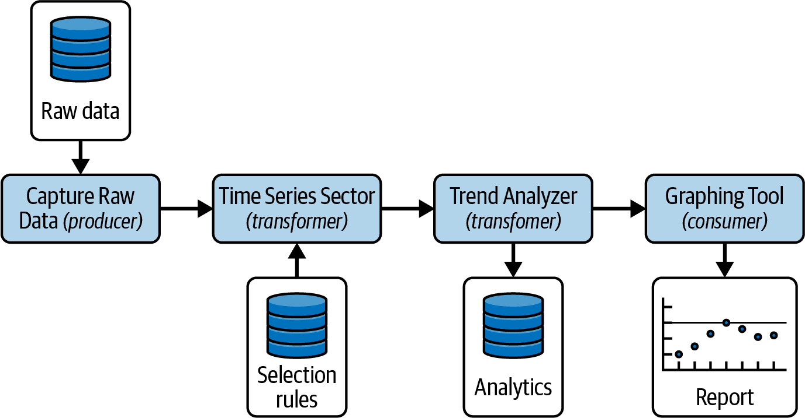
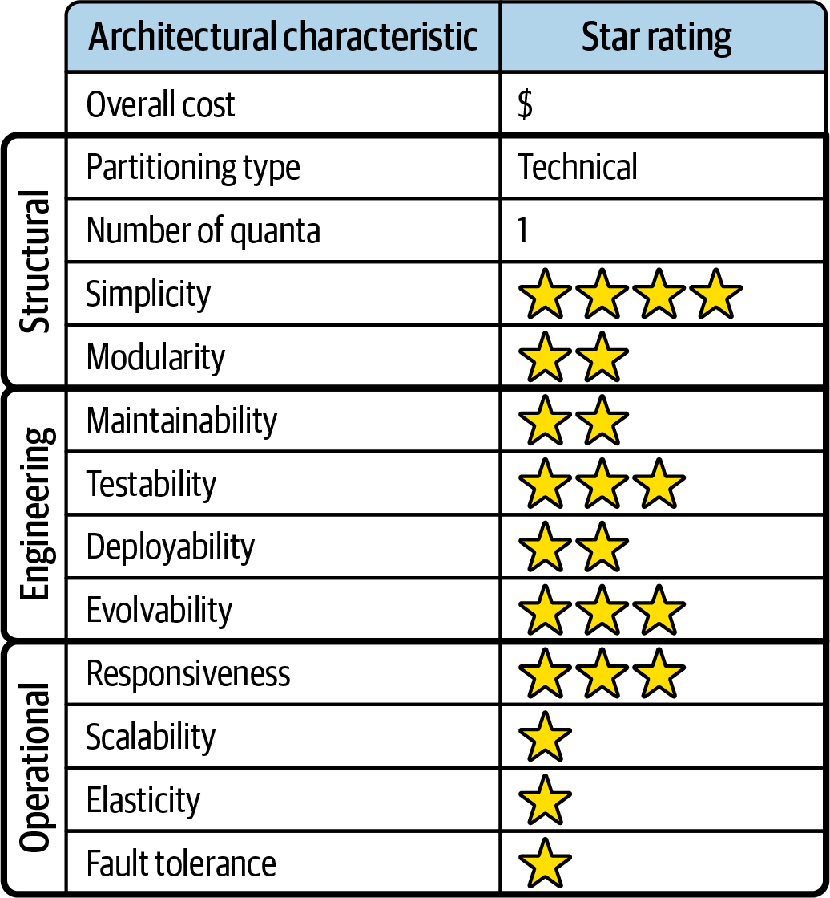
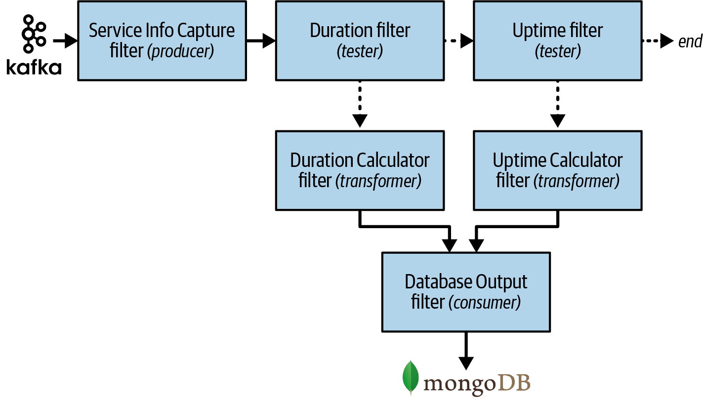

<a id="ch-style-pipeline"></a>

# Chương 12. Pipeline architecture style (Pipeline Architecture Style)

<a id="ix_ch12-style-pipeline-asciidoc0"></a>Một trong những style nền tảng trong software architecture là *pipeline* architecture (còn được biết đến là *pipes and filters* architecture). Ngay khi developer và kiến trúc sư quyết định chia chức năng thành các phần rời rạc, style architecture này đã theo sau. Hầu hết developer biết architecture này như nguyên lý nền tảng đằng sau các ngôn ngữ shell của terminal Unix, như [Bash](https://oreil.ly/uP2Bo) và [Zsh](https://oreil.ly/40UyF).

Developer trong nhiều ngôn ngữ lập trình hàm sẽ thấy sự tương đồng giữa các cấu trúc ngôn ngữ và các phần tử của architecture này. Thực tế, nhiều công cụ dùng mô hình lập trình [MapReduce](https://oreil.ly/veX6W) tuân theo topology cơ bản này. Dù các ví dụ trong chương này thể hiện các hiện thực low-level của pipeline architecture style, nó cũng có thể được dùng cho các ứng dụng nghiệp vụ higher-level.

<a id="id322"></a>

## Topology

<a id="id1168"></a>Topology của pipeline architecture gồm hai loại component chính, pipe và filter. *Filter* chứa chức năng hệ thống và thực hiện một chức năng nghiệp vụ cụ thể, còn *pipe* chuyển dữ liệu tới filter tiếp theo (hoặc các filter) trong chuỗi. Chúng phối hợp theo một cách cụ thể, với pipe tạo thành giao tiếp one-way, thường là point-to-point giữa các filter, như minh họa trong [Hình 12-1](#fig-fundamental-patterns-base).

<a id="fig-fundamental-patterns-base"></a>



*Hình 12-1. Topology cơ bản của pipeline architecture*

Do đó, “hình dạng” đẳng cấu của pipeline architecture là *một deployment unit duy nhất, với chức năng được chứa trong các filter kết nối với nhau bằng các pipe một chiều*.

<a id="id686"></a>

## Đặc thù của style (Style Specifics)

Dù hầu hết các hiện thực của pipeline architecture là monolith, có thể deploy mỗi filter (hoặc một tập filter) như một service, tạo ra một architecture phân tán với các lời gọi từ xa đồng bộ hoặc bất đồng bộ tới mỗi service. Bất kể topology deployment là gì, architecture này chỉ gồm hai component kiến trúc, filter và pipe, mà chúng tôi mô tả chi tiết trong các mục sau.

<a id="id102"></a>

### Filter (Filters)

<a id="id1169"></a><a id="id1170"></a>*Filter* là các mẩu chức năng self-contained, độc lập với các filter khác. Chúng nhìn chung là stateless, và chỉ nên thực hiện một tác vụ duy nhất. Các tác vụ tổng hợp thường được xử lý bởi một chuỗi filter thay vì một filter đơn lẻ.

Vì filter có thể được hiện thực bởi nhiều hơn một file class, chúng được coi là các *component* của architecture (xem [Chương 8](ch08_component_based_thinking.vi.md#ch08-component-based-thinking)). Ngay cả khi một filter đơn giản và chỉ được hiện thực bằng một file class duy nhất, nó vẫn là một component.

Có bốn loại filter trong pipeline architecture style:

**Producer**

<a id="id1171"></a>Là điểm khởi đầu của một quy trình, các producer filter chỉ có chiều đi ra. Chúng đôi khi được gọi là *source* (nguồn). Một giao diện người dùng và một request bên ngoài tới hệ thống đều là ví dụ về producer filter.

**Transformer**

<a id="id1172"></a>Các transformer filter chấp nhận đầu vào, tùy chọn thực hiện một phép biến đổi trên một phần hoặc toàn bộ dữ liệu, rồi chuyển tiếp dữ liệu tới pipe đi ra. Những người ủng hộ functional-programming sẽ nhận ra tính năng này là *map*. Ví dụ, transformer filter có thể làm giàu dữ liệu, biến đổi dữ liệu, hoặc thực hiện một loại tính toán nào đó.

**Tester**

<a id="id1173"></a>Các tester filter chấp nhận đầu vào, kiểm tra nó theo một hoặc nhiều tiêu chí, rồi tùy chọn tạo ra đầu ra dựa trên kết quả kiểm tra. Các lập trình viên hàm sẽ nhận ra điều này giống với *reduce*. Một tester filter có thể kiểm tra rằng mọi dữ liệu đều hợp lệ và được nhập đúng, hoặc đóng vai trò như một công tắc để xác định việc xử lý có nên tiếp tục hay không (ví dụ, “đừng chuyển dữ liệu tới filter tiếp theo nếu giá trị đơn hàng nhỏ hơn năm đô-la”).

**Consumer**

<a id="id1174"></a>Là điểm kết thúc của luồng pipeline, các consumer filter đôi khi lưu kết quả cuối cùng của quy trình pipeline vào một database hoặc hiển thị kết quả cuối cùng trên một màn hình UI.

Bản chất một chiều và sự đơn giản của pipe và filter khuyến khích tái sử dụng theo kiểu kết hợp. Nhiều developer đã khám phá ra khả năng này khi dùng shell. Một câu chuyện nổi tiếng từ blog [“More Shell, Less Egg”](https://oreil.ly/ljeb5) minh họa các trừu tượng này mạnh mẽ đến mức nào. Donald Knuth được yêu cầu viết một chương trình giải bài toán text-handling sau: đọc một file văn bản, xác định *n* từ được dùng thường xuyên nhất, và in ra danh sách các từ đó được sắp xếp theo tần suất. Ông đã viết một chương trình gồm hơn 10 trang Pascal, thiết kế (và ghi tài liệu) một thuật toán mới trong quá trình đó. Sau đó Doug McIlroy trình diễn một shell script đủ nhỏ để dễ dàng nằm gọn trong một bài đăng mạng xã hội, giải quyết bài toán một cách thanh lịch:

```shell
        tr -cs A-Za-z '\n' |
        tr A-Z a-z |
        sort |
        uniq -c |
        sort -rn |
        sed ${1}q
```

Ngay cả những nhà thiết kế shell Unix cũng thường ngạc nhiên trước những cách dùng sáng tạo mà developer tìm ra cho các trừu tượng tổng hợp đơn giản nhưng mạnh mẽ của họ.

<a id="id323"></a>

### Pipe (Pipes)

<a id="id1175"></a>*Pipe*, trong architecture này, tạo thành kênh giao tiếp giữa các filter. Mỗi pipe thường là một chiều và point-to-point, chấp nhận đầu vào từ một nguồn và hướng đầu ra tới một nơi khác. Payload của chúng có thể là bất kỳ định dạng dữ liệu nào, nhưng kiến trúc sư thường ưu tiên lượng dữ liệu nhỏ hơn để đạt performance cao.

Nếu một filter (hoặc nhóm filter) được deploy như một service riêng theo kiểu phân tán, các pipe sẽ phát ra một lời gọi từ xa một chiều dùng REST, messaging, streaming, hoặc một giao thức giao tiếp từ xa nào khác. Dù topology deployment của chúng là monolith hay phân tán, pipe có thể đồng bộ hoặc bất đồng bộ. Trong các deployment monolith, kiến trúc sư dùng thread hoặc messaging nhúng để giao tiếp bất đồng bộ tới một filter.

<a id="id324"></a>

## Topology dữ liệu (Data Topologies)

<a id="id1176"></a>Vì hầu hết các pipeline architecture được deploy dưới dạng monolith, chúng gắn với một monolithic database duy nhất. Tuy nhiên, không phải lúc nào cũng vậy. Topology database có thể thay đổi đáng kể với architectural style này, từ một database duy nhất đến một database cho mỗi filter.

Ví dụ trong [Hình 12-2](#fig-style-pipeline-data) thể hiện một pipeline architecture cho một continuous fitness function (bài test kiến trúc) điển hình chạy trong môi trường production, phân tích một characteristic vận hành cụ thể (như responsiveness hoặc scalability). Lưu ý rằng filter Capture Raw Data nạp một database riêng chứa dữ liệu thô. Filter này gửi dữ liệu thô qua một pipe tới filter Time Series Selector, filter này đọc thông tin cấu hình (như khoảng thời gian được phân tích) từ một database riêng. Dữ liệu đã biến đổi sau đó được gửi qua một pipe khác tới filter Trend Analyzer, filter này phân tích dữ liệu và lưu các kết quả phân tích đó vào một database riêng. Filter này sau đó gửi dữ liệu phân tích qua một pipe cuối cùng tới filter Graphing Tool, filter này kết thúc pipeline bằng cách tạo một báo cáo đồ họa về dữ liệu.

<a id="fig-style-pipeline-data"></a>



*Hình 12-2. Pipeline architecture có thể có một database duy nhất hoặc nhiều database*

<a id="id103"></a>

## Các cân nhắc về cloud (Cloud Considerations)

<a id="ix_ch12-style-pipeline-asciidoc1"></a><a id="ix_ch12-style-pipeline-asciidoc2"></a>Pipeline architecture style rất phù hợp cho các deployment cloud-based nhờ mức modularity cao và các loại filter tách biệt. Vì hầu hết các pipeline architecture không quá phức tạp và đồ sộ, chúng hoạt động tốt khi được deploy dưới dạng monolithic architecture, nơi tất cả các filter được deploy trong cùng một deployment unit.

Tuy nhiên, filter cũng hoạt động tốt trong môi trường cloud dưới dạng các hàm phân tán. <a id="id1177"></a>Trên AWS, pipeline architecture có thể được deploy dưới dạng [AWS Step Functions](https://oreil.ly/G-MYV), trong đó mỗi filter được deploy như một lambda riêng trong workflow. AWS Step Functions cung cấp hai loại workflow: *Standard*, trong đó mỗi bước được thực thi đúng một lần, và *Express*, trong đó mỗi bước có thể thực thi nhiều hơn một lần. Pipeline architecture style hoạt động với cả hai. Đoạn code sau minh họa ví dụ continuous fitness function trong [Hình 12-2](#fig-style-pipeline-data) như một deployment cloud điển hình cho pipeline architecture, được hiện thực dưới dạng một AWS Step Function:

```json
{
  "Comment": "Measure and analyze scalability trends.",
  "StartAt": "Capture Raw Data",
  "States": {
    "Capture Raw Data": {
    "Type": "Task",
    "Resource": "arn:aws:lambda:region:account_id:function:raw_data_capture",
    "Next": "Time Series Selector"
   },
    "Time Series Selector": {
    "Type": "Task",
    "Resource": "arn:aws:lambda:region:account_id:function:time_series_selector",
    "Next": "Trend Analyzer"
   },
    "Trend Analyzer": {
    "Type": "Task",
    "Resource": "arn:aws:lambda:region:account_id:function:trend_analyzer",
    "Next": "Graphing Tool"
    },
    "Graphing Tool": {
    "Type": "Task",
    "Resource": "arn:aws:lambda:region:account_id:function:graphing_tool",
    "End": true
    }
  }
}
```

Ví dụ này không phải là cách duy nhất để dùng pipeline architecture trong môi trường cloud. Filter cũng có thể được deploy dưới dạng các hàm serverless, các hàm được container hóa, hoặc thậm chí như một service duy nhất chứa cả bốn filter component trong một deployment monolith.<a id="id1178"></a><a id="id1179"></a>

<a id="id325"></a>

## Các rủi ro phổ biến (Common Risks)

<a id="id1180"></a>Mục tiêu chính đằng sau pipeline architecture là tách chức năng thành các filter single-purpose, trong đó mỗi filter thực hiện *một* hành động cụ thể trên dữ liệu rồi chuyển nó cho filter khác để xử lý tiếp. Do đó, một trong những rủi ro phổ biến nhất của nó là làm quá tải filter với quá nhiều trách nhiệm. Governance tốt, mà chúng tôi đề cập trong mục tiếp theo, giúp các team giảm thiểu rủi ro này bằng cách xác định mục đích đằng sau mỗi filter component.

Một rủi ro phổ biến khác với architecture style này là đưa vào giao tiếp hai chiều giữa các filter. Pipe được dự định là *chỉ một chiều*, cung cấp một sự tách biệt rõ ràng các mối quan tâm giữa các filter để tránh sự cộng tác giữa chúng. Nếu giao tiếp hai chiều hóa ra là cần thiết, đây là một dấu hiệu tốt cho thấy pipeline architecture có thể không phải là style đúng để dùng, hoặc các filter quá phức tạp; chức năng không được phân định đúng.

Xử lý các tình trạng lỗi là một sự phức tạp khác có thể đưa vào rủi ro đáng kể trong architectural style này. Nếu một lỗi xảy ra trong một pipeline, thường khó xác định cách thoát khỏi pipeline đúng cách và phục hồi một khi pipeline đã bắt đầu. Vì lý do này, điều quan trọng là kiến trúc sư phải xác định mọi tình trạng lỗi nghiêm trọng có thể xảy ra trong pipeline trước khi định nghĩa architecture.

Vùng rủi ro cuối cùng là quản lý các contract giữa các filter. Mỗi pipe có một contract đại diện cho dữ liệu (và có thể cả các kiểu tương ứng) mà nó gửi tới filter tiếp theo. Thay đổi một contract giữa các filter đòi hỏi governance và testing chặt chẽ để bảo đảm các filter khác nhận contract đó không bị hỏng.

<a id="sec-pipeline-governance"></a>

## Quản trị (Governance)

<a id="ix_ch12-style-pipeline-asciidoc3"></a><a id="ix_ch12-style-pipeline-asciidoc4"></a>Governance cho các characteristic vận hành chung—như responsiveness, scalability, availability, v.v.—là đặc thù cho từng use case riêng lẻ và có thể thay đổi rất nhiều. Tuy nhiên, từ góc nhìn *cấu trúc*, kiến trúc sư dùng vai trò và trách nhiệm của mỗi loại filter để quản trị các pipeline architecture.

Mỗi loại trong bốn loại filter cơ bản (producer, transformer, tester và consumer) thực hiện một vai trò cụ thể. Tuy nhiên, developer rất dễ làm quá tải filter với quá nhiều trách nhiệm, biến pipeline architecture thành một monolith phi cấu trúc.

Rất khó viết một fitness function tự động để quản trị việc một producer filter có thực sự là điểm khởi đầu của pipeline hay không, hoặc việc một tester filter có thực sự đang thực hiện một phép kiểm tra điều kiện để xác định tiếp tục hay kết thúc luồng hay không. Các kỹ thuật governance giúp kiến trúc sư hướng dẫn development team tuân thủ vai trò của mỗi loại filter và trách nhiệm của một loại filter cụ thể.

<a id="ix_ch12-style-pipeline-asciidoc5"></a>Một kỹ thuật như vậy là tận dụng *tag*. (Trong ngôn ngữ Java, tag được hiện thực dưới dạng *annotation*, và trong C# là *custom attribute*.) Tag không thực sự thực hiện chức năng nào; chúng cung cấp metadata về component hoặc service theo cách lập trình. Sử dụng tag trong class khởi đầu của filter component cho developer biết về loại filter họ đang tạo hoặc sửa đổi, giúp ngăn họ trao cho filter đó quá nhiều trách nhiệm hoặc thực hiện một chức năng không gắn với loại của nó.

Để minh họa kỹ thuật này, hãy xét source code sau định nghĩa tag cho bốn loại filter cơ bản. Đây là định nghĩa annotation tag bằng Java:

```java
@Retention(RetentionPolicy.RUNTIME)
@Target(ElementType.TYPE)
public @interface Filter {
   public FilterType[] value();

   public enum FilterType {
      PRODUCER,
      TESTER,
      TRANSFORMER,
      CONSUMER
   }
}
```

Và đây là định nghĩa custom attribute tag bằng C#:

```csharp
[System.AttributeUsage(System.AttributeTargets.Class)]
class Filter : System.Attribute {

   public FilterType[] filterType;

   public enum FilterType {
      PRODUCER,
      TESTER,
      TRANSFORMER,
      CONSUMER
   };
}
```

Vì filter về cơ bản là một component kiến trúc, chúng có thể được hiện thực thông qua nhiều file class. Ví dụ, trong ví dụ continuous fitness function ở [Hình 12-2](#fig-style-pipeline-data), filter Trend Analyzer khá phức tạp và có thể có nhiều file class. Vì vậy, chúng ta sẽ định nghĩa thêm một tag để xác định class đại diện cho điểm vào của filter, để có thể gắn các tag khác vào nó.

Đây là định nghĩa tag điểm vào bằng Java:

```java
@Retention(RetentionPolicy.RUNTIME)
@Target(ElementType.TYPE)
public @interface FilterEntrypoint {}
```

Và định nghĩa tag điểm vào bằng C#:

```csharp
[System.AttributeUsage(System.AttributeTargets.Class)]
class FilterEntrypoint : System.Attribute {}
```

Giờ developer có thể thêm tag `FilterType` vào class `Entrypoint`, xác định loại của nó và vai trò tương ứng của nó trong architecture. Ví dụ, các annotation sau xác định loại và vai trò của transformation filter Trend Analyzer. Bằng Java:

```java
@FilterEntrypoint
@Filter(FilterType.TRANSFORMER)
public class TrendAnalyzerFilter {
   ...
}
```

Và bằng C#:

```csharp
[FilterEntrypoint]
[Filter(FilterType.TRANSFORMER)]
class TrendAnalyzerFilter {
   ...
}
```

Dù kỹ thuật này có thể không ngăn được mọi developer khiến một filter loại transformer thực hiện logic kiểm tra (việc nên được thực hiện bởi một tester filter), ít nhất nó cung cấp thêm bối cảnh<a id="id1181"></a>.<a id="id1182"></a><a id="id1183"></a>

<a id="id326"></a>

## Các cân nhắc về team topology (Team Topology Considerations)

<a id="id1184"></a><a id="id1185"></a>Không giống một số architectural style được mô tả trong cuốn sách này, pipeline architecture style nhìn chung độc lập với team topologies và sẽ hoạt động với bất kỳ cấu hình team nào:

**Stream-aligned team**

Vì pipeline architecture thường nhỏ, self-contained và đại diện cho một hành trình hay luồng duy nhất qua hệ thống, nó hoạt động tốt với các stream-aligned team. Với team topology này, các team nhìn chung sở hữu luồng qua hệ thống từ đầu đến cuối, khớp một cách đẹp đẽ với hình dạng của pipeline architecture.

**Enabling team**

Vì pipeline architecture có tính module cao và được tách theo các mối quan tâm kỹ thuật, nó kết hợp tốt với enabling team topology. Các chuyên gia và thành viên team cross-cutting có thể đưa ra đề xuất và thực hiện thử nghiệm bằng cách đưa thêm filter vào pipeline, mà không ảnh hưởng đến phần còn lại của luồng. Ví dụ, trong ví dụ continuous fitness function của chúng ta, một enabling team có thể thêm một transformation filter sau filter Time Series Selector để thực hiện một phân tích xu hướng thay thế. Filter mới này sẽ dùng cùng dữ liệu như filter Trend Analyzer hiện có mà không làm gián đoạn luồng pipeline bình thường.

**Complicated-subsystem team**

Vì mỗi filter thực hiện một tác vụ rất cụ thể, pipeline architecture hoạt động tốt với complicated-subsystem team topology. Các thành viên team khác nhau có thể tập trung vào xử lý filter phức tạp một cách độc lập với nhau (và với các filter khác). Các lần chuyển giao một chiều trong architectural style này cho phép các thành viên của complicated-subsystem team tập trung hẹp vào độ phức tạp chứa trong xử lý filter cụ thể của họ.

**Platform team**

Các platform team làm việc trên một pipeline architecture có thể tận dụng mức modularity cao của nó bằng cách sử dụng các công cụ, service, API và tác vụ chung.

<a id="id105"></a>

## Các characteristic của style (Style Characteristics)

<a id="ix_ch12-style-pipeline-asciidoc6"></a>Đánh giá one-star (một sao) trong bảng đánh giá characteristic ([Hình 12-3](#fig-style-pipeline-ratings)) có nghĩa là architecture characteristic cụ thể không được hỗ trợ tốt trong architecture, trong khi đánh giá five-star (năm sao) có nghĩa là architecture characteristic đó là một trong những đặc điểm mạnh nhất của architecture style. Các characteristic có trong bảng điểm được mô tả và định nghĩa trong [Chương 4](ch04_architectural_characteristics_defined.vi.md#ch04-architecture-characteristics-defined).

<a id="id1186"></a>Pipeline architecture style là một architecture *được phân vùng theo kỹ thuật* (technically partitioned) vì logic ứng dụng của nó được tách thành các loại filter. Ngoài ra, vì pipeline architecture thường được hiện thực dưới dạng một deployment monolith, architectural quantum của nó luôn là 1.

<a id="fig-style-pipeline-ratings"></a>



*Hình 12-3. Đánh giá các characteristic của pipeline architecture*

Chi phí tổng thể, sự đơn giản và modularity là những điểm mạnh chính của pipeline architecture style. Là monolith, các pipeline architecture không có những độ phức tạp gắn với các architecture style phân tán—chúng đơn giản và dễ hiểu, và tương đối low-cost để xây dựng và bảo trì. Modularity kiến trúc đạt được thông qua việc tách biệt các mối quan tâm giữa các loại filter và transformer khác nhau: bất kỳ filter nào cũng có thể được sửa đổi hoặc thay thế mà không ảnh hưởng đến các filter khác. Chẳng hạn, trong ví dụ Kafka được minh họa ở [Hình 12-4](#fig-style-pipeline-example), `Duration Calculator` có thể được sửa đổi để thay đổi cách tính thời lượng mà không thay đổi bất kỳ filter nào khác.

Deployability và testability, dù chỉ ở mức trung bình, được đánh giá cao hơn một chút so với layered architecture nhờ mức modularity mà các filter có thể đạt được. Tuy nhiên, pipeline architecture vẫn *thường* là monolith, nên nhược điểm của chúng bao gồm thủ tục, rủi ro, tần suất deployment và mức độ đầy đủ của testing.

Elasticity và scalability được đánh giá rất thấp (một sao) trong pipeline architecture, chủ yếu do deployment dạng monolith. Hiện thực architecture style này dưới dạng một architecture phân tán dùng giao tiếp bất đồng bộ có thể cải thiện đáng kể các characteristic này, nhưng trade-off là một cú giáng vào chi phí tổng thể và sự đơn giản.

Pipeline architecture không hỗ trợ fault tolerance vì chúng thường được deploy dưới dạng các hệ thống monolith. Nếu một phần nhỏ của một pipeline architecture gây ra tình trạng out-of-memory, toàn bộ unit ứng dụng bị ảnh hưởng và crash. <a id="id1187"></a><a id="id1188"></a>Hơn nữa, availability tổng thể bị ảnh hưởng bởi mean time to recovery (MTTR) cao vốn phổ biến ở hầu hết các ứng dụng monolith, với thời gian khởi động được đo bằng phút. Như với elasticity và scalability, hiện thực architecture style này dưới dạng một architecture phân tán dùng giao tiếp bất đồng bộ có thể cải thiện đáng kể fault tolerance, một lần nữa phải trả giá bằng chi phí và độ phức tạp.

Như chúng tôi đã đề cập, hầu hết các characteristic vận hành low-scoring có thể được nâng lên bằng cách biến đây thành một architecture phân tán với giao tiếp bất đồng bộ, trong đó mỗi filter là một deployment unit riêng và các pipe là các lời gọi từ xa. Tuy nhiên, làm vậy sẽ ảnh hưởng tiêu cực đến các thuộc tính khác như sự đơn giản và chi phí, minh họa một trong những trade-offs kinh điển của software architecture.

<a id="id401"></a>

### Khi nào nên dùng (When to Use)

<a id="id1189"></a>Pipeline architecture phù hợp cho các hệ thống ở bất kỳ mức độ phức tạp nào có các bước xử lý one-way riêng biệt, có thứ tự và tất định. Sự đơn giản của style này cũng khiến nó rất phù hợp cho các tình huống có khung thời gian gấp và ràng buộc ngân sách.

<a id="id106"></a>

### Khi nào không nên dùng (When Not to Use)

<a id="id1190"></a>Do bản chất monolith của architectural style này, nó không phù hợp cho các hệ thống cần scalability, elasticity và fault tolerance cao. Tuy nhiên, dùng một cách tiếp cận architecture phân tán sẽ giúp giảm nhẹ những mối quan tâm này.

Pipeline architecture style cũng ill-suited (không phù hợp) cho các kịch bản có giao tiếp back-and-forth (qua lại) giữa các filter, vì các pipe được dự định là chỉ một chiều. Dù có thể dùng architecture style này cho các workflow không tất định bằng cách tận dụng nhiều tester filter trên khắp pipeline, chúng tôi không khuyến nghị làm vậy. Nó làm phức tạp quá mức architecture style tương đối đơn giản này và có thể ảnh hưởng tiêu cực đến maintainability, testability, deployability, và do đó reliability tổng thể. Event-driven architecture (xem [Chương 15](ch15_event_driven_architecture_style.vi.md#ch-style-eda)) phù hợp hơn nhiều cho các tình huống có workflow không tất định.

Pipeline architecture style xuất hiện trong nhiều loại ứng dụng, đặc biệt với các tác vụ hỗ trợ xử lý one-way đơn giản. <a id="id1191"></a><a id="id1192"></a>Ví dụ, nhiều công cụ trao đổi dữ liệu điện tử (EDI) dùng pattern này, xây dựng các phép biến đổi từ một loại tài liệu sang loại khác bằng pipe và filter. <a id="id1193"></a><a id="id1194"></a>Các công cụ extract, transform và load (ETL) của database tận dụng pipeline architecture để sửa đổi dữ liệu và chuyển nó từ một database hoặc nguồn dữ liệu sang nơi khác. Các orchestrator và mediator như [Apache Camel](https://camel.apache.org) dùng pipeline architecture để chuyển thông tin từ một bước trong quy trình nghiệp vụ sang bước khác.<a id="id1195"></a>

<a id="id107"></a>

## Ví dụ và use case (Examples and Use Cases)

<a id="ix_ch12-style-pipeline-asciidoc7"></a><a id="ix_ch12-style-pipeline-asciidoc8"></a>Để minh họa cách pipeline architecture có thể được dùng, hãy xét ví dụ sau, trong đó thông tin telemetry của service được gửi từ các service qua streaming tới [Apache Kafka](https://kafka.apache.org) ([Hình 12-4](#fig-style-pipeline-example)).

<a id="fig-style-pipeline-example"></a>



*Hình 12-4. Ví dụ pipeline architecture*

Hệ thống được mô tả trong [Hình 12-4](#fig-style-pipeline-example) dùng pipeline architecture style để xử lý các loại dữ liệu khác nhau được stream tới Kafka. Filter Service Info Capture (producer filter) subscribe vào Kafka topic và nhận thông tin service. Sau đó nó gửi dữ liệu thu được này tới một tester filter gọi là filter Duration để xác định xem nó có liên quan đến thời lượng (tính bằng mili giây) của request service hay không.

Hãy chú ý sự tách biệt các mối quan tâm giữa các filter; filter Service Info Capture chỉ quan tâm đến cách kết nối tới một Kafka topic và nhận dữ liệu streaming, trong khi filter Duration chỉ quan tâm đến việc đánh giá dữ liệu và xác định có định tuyến nó tới pipe tiếp theo hay không. Nếu dữ liệu liên quan đến thời lượng request service, nó được chuyển tới transformer filter Duration Calculator; nếu không, dữ liệu được chuyển tới tester filter Uptime để kiểm tra xem nó có liên quan đến các metric uptime không. Nếu không, pipeline kết thúc—dữ liệu không được luồng xử lý cụ thể này quan tâm. Nếu nó liên quan đến các metric uptime, tester filter Uptime chuyển nó tới `Uptime Calculator`, filter này dùng nó để tính các metric uptime. `Uptime Calculator` sau đó chuyển dữ liệu đã sửa đổi tới consumer Database Output, consumer này lưu nó vào một database [MongoDB](https://mongodb.com).

Ví dụ này cho thấy pipeline architecture có khả năng mở rộng đến mức nào. Ví dụ, trong [Hình 12-4](#fig-style-pipeline-example), một tester filter mới có thể dễ dàng được thêm vào sau filter Uptime để gửi dữ liệu dùng cho một metric mới, như thời gian chờ kết nối database.

Pipeline architectural style, dù thường là một monolithic architecture, vẫn thể hiện một mức modularity tốt nhờ việc dùng các filter được phân vùng theo kỹ thuật. Nó rất phù hợp cho các tình huống có cách tiếp cận workflow-based, step-by-step để xử lý dữ liệu trong một hệ thống<a id="id1196"></a><a id="id1197"></a>.<a id="id1198"></a>

Trước khi chuyển sang các architecture phân tán phức tạp hơn, chúng tôi còn một monolithic architecture nữa để mô tả trong chương tiếp theo, cũng hỗ trợ một mức modularity tốt thông qua việc dùng các plug-in component: *microkernel architecture*.
