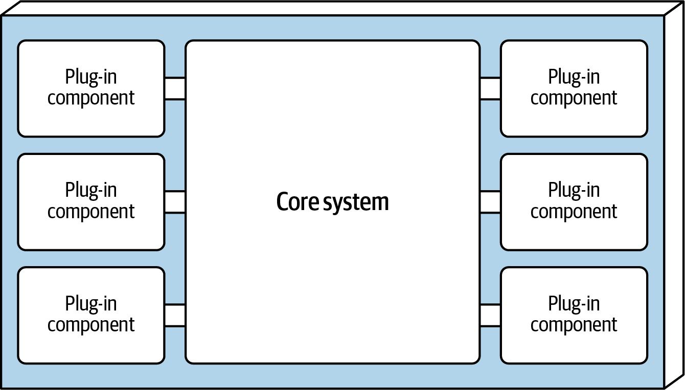
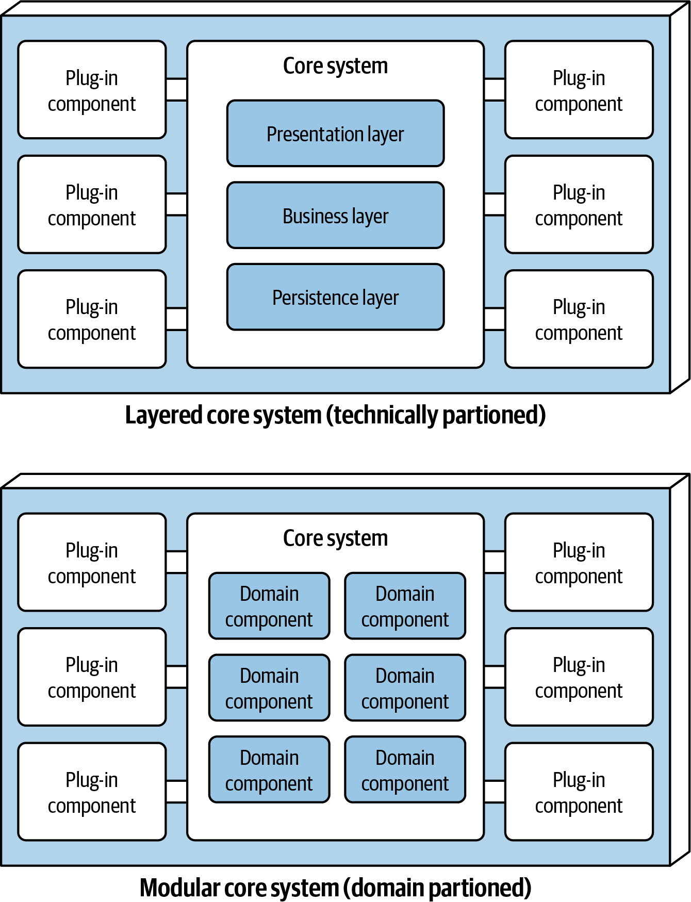
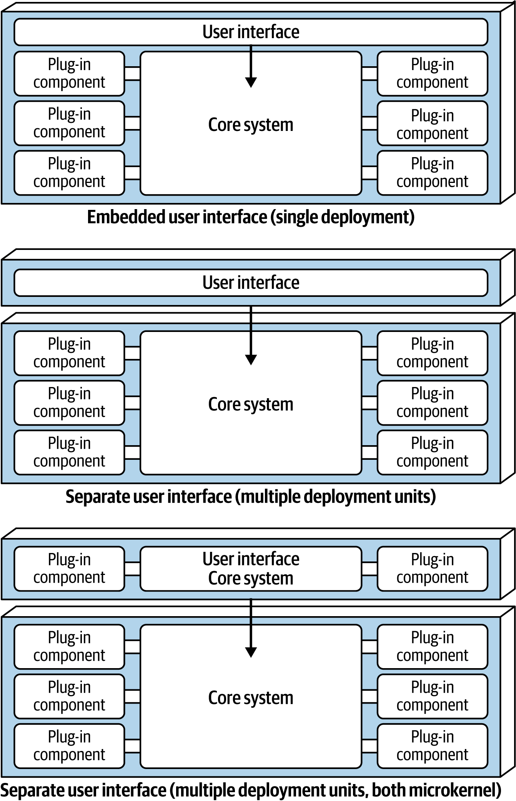
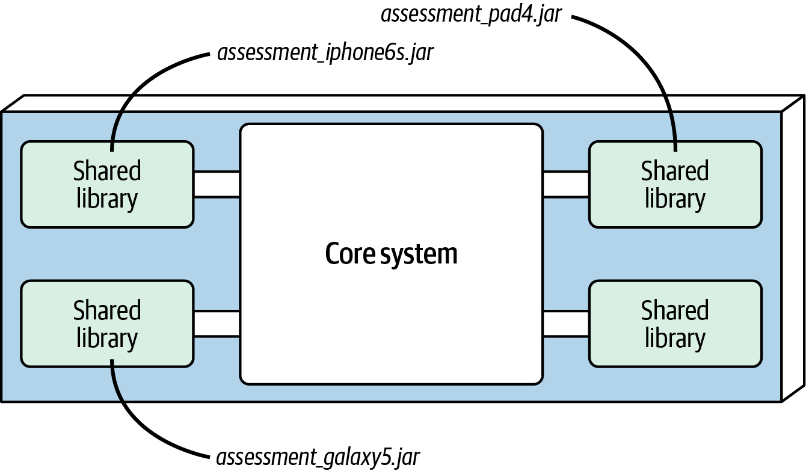
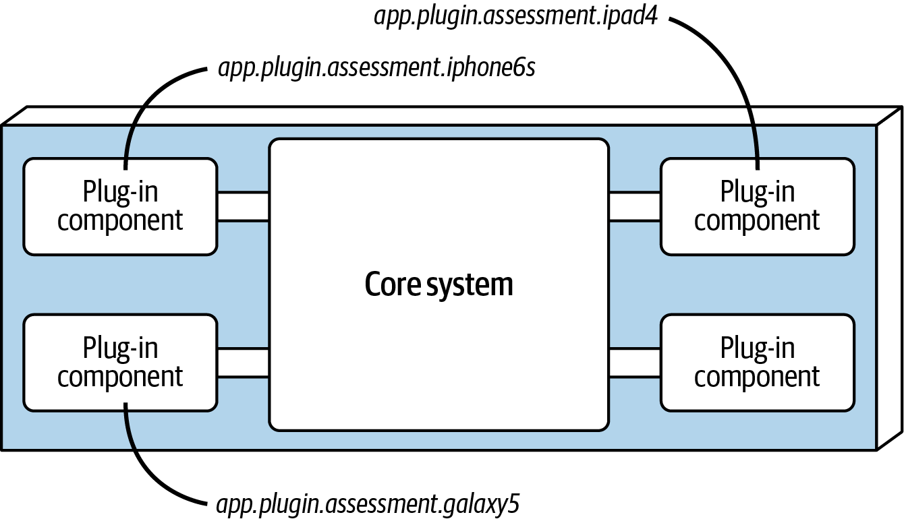
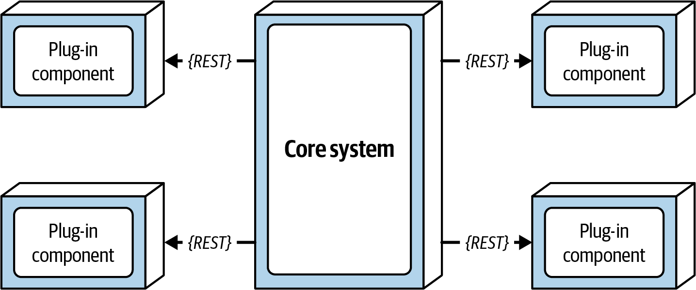
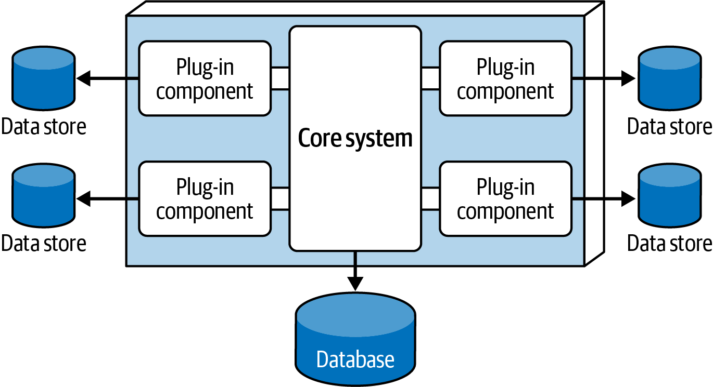
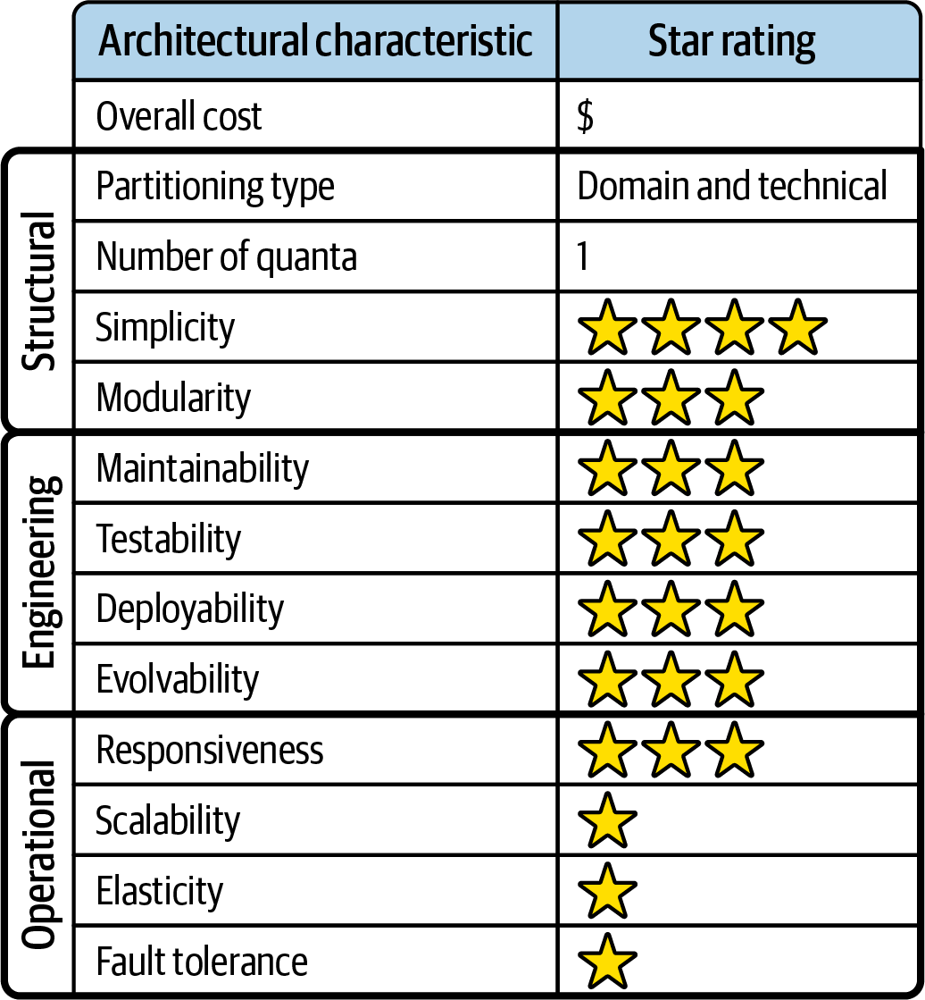

<a id="ch-style-microkernel"></a>

# Chương 13. Microkernel architecture style (Microkernel Architecture Style)

<a id="ix_ch13-style-microkernel-asciidoc0"></a>Architecture style *microkernel* (còn được gọi là architecture *plug-in*) được phát minh từ vài thập kỷ trước và ngày nay vẫn được dùng rộng rãi. <a id="id1199"></a>Architecture style này rất phù hợp một cách tự nhiên với các *ứng dụng product-based*: tức là các ứng dụng được đóng gói và cung cấp để tải về và cài đặt như một deployment monolith duy nhất, thường được cài đặt tại cơ sở của khách hàng như một sản phẩm third-party. Tuy nhiên, nó cũng được dùng rộng rãi trong các ứng dụng nghiệp vụ tùy biến không phải sản phẩm, đặc biệt là các problem domain đòi hỏi tùy biến. Ví dụ, một công ty bảo hiểm ở Mỹ có các quy tắc riêng cho mỗi bang, hoặc một công ty vận chuyển quốc tế phải tuân thủ nhiều biến thể pháp lý và hậu cần khác nhau, đều sẽ có lợi từ style này.

<a id="id327"></a>

## Topology

<a id="id1200"></a>Microkernel style là một monolithic architecture tương đối đơn giản gồm hai component: một core system và các plug-ins. Logic ứng dụng được chia giữa các plug-in component độc lập và core system cơ bản, điều này cô lập các tính năng của ứng dụng và mang lại khả năng mở rộng, khả năng thích ứng và logic xử lý tùy biến. [Hình 13-1](#fig-style-microkernel-topology) minh họa topology cơ bản của microkernel architecture style.

<a id="fig-style-microkernel-topology"></a>



*Hình 13-1. Các component cơ bản của microkernel architecture style*

<a id="id687"></a>

## Đặc thù của style (Style Specifics)

Bản chất của microkernel architecture gồm hai loại component: *core system* và *plug-ins*.

<a id="id109"></a>

### Core system (Core System)

<a id="ix_ch13-style-microkernel-asciidoc1"></a>*Core system* được định nghĩa chính thức là chức năng tối thiểu cần thiết để chạy hệ thống. Hãy xem Eclipse IDE như một ví dụ tốt cho điều này. Core system của Eclipse chỉ là một trình soạn thảo văn bản cơ bản: mở một file, thay đổi một ít văn bản, và lưu file. Chỉ khi bạn thêm plug-ins thì Eclipse mới bắt đầu trở thành một sản phẩm dùng được.

<a id="id1201"></a>Tuy nhiên, một định nghĩa khác của core system là *happy path*: một luồng xử lý chung qua ứng dụng, có ít hoặc không có xử lý tùy biến. Một microkernel architecture lấy cyclomatic complexity của ứng dụng, loại nó khỏi core system, và đặt nó vào các plug-in component riêng biệt. Điều này cho phép khả năng mở rộng và maintainability tốt hơn, cũng như testability tăng lên.

<a id="ix_ch13-style-microkernel-asciidoc2"></a>Để đi sâu hơn, chúng ta sẽ quay lại Going Green, ứng dụng tái chế thiết bị điện tử mà chúng tôi đã giới thiệu trong [Chương 7](ch07_the_scope_of_architectural_characteristics.vi.md#ch-scope). Giả sử bạn đang làm việc trên ứng dụng của Going Green, ứng dụng phải đánh giá mỗi thiết bị điện tử nhận được theo các quy tắc đánh giá tùy biến, cụ thể. Code Java cho loại xử lý này có thể trông như sau:

```java
public void assessDevice(String deviceID) {
   if (deviceID.equals("iPhone6s")) {
      assessiPhone6s();
   } else if (deviceID.equals("iPad1"))
      assessiPad1();
   } else if (deviceID.equals("Galaxy5"))
      assessGalaxy5();
   } else ...
      ...
   }
}
```

Thay vì đặt toàn bộ phần tùy biến client-specific này—vốn có rất nhiều cyclomatic complexity—vào core system, bạn có thể tạo một plug-in component riêng cho mỗi thiết bị điện tử được đánh giá. Các plug-in component client cụ thể không chỉ cô lập logic thiết bị độc lập khỏi phần còn lại của luồng xử lý, chúng còn cho phép mở rộng: thêm một thiết bị mới để đánh giá chỉ đơn giản là thêm một plug-in component mới và cập nhật registry. Với microkernel architecture style, đánh giá một thiết bị điện tử chỉ đòi hỏi core system định vị và gọi các plug-ins thiết bị tương ứng, như minh họa trong source code đã sửa đổi này:

```java
public void assessDevice(String deviceID) {
	String plugin = pluginRegistry.get(deviceID);
	Class<?> theClass = Class.forName(plugin);
	Constructor<?> constructor = theClass.getConstructor();
	DevicePlugin devicePlugin =
		(DevicePlugin)constructor.newInstance();
	devicePlugin.assess();
}
```

Trong ví dụ này, tất cả các quy tắc và chỉ dẫn phức tạp để đánh giá một thiết bị điện tử cụ thể đều self-contained trong một plug-in component độc lập, đứng riêng, có thể được thực thi một cách chung chung từ core system.

Tùy thuộc vào kích thước và độ phức tạp, bạn có thể triển khai core system dưới dạng một layered architecture hoặc một modular monolith (như minh họa trong [Hình 13-2](#fig-style-microkernel-core-system)). Trong một số trường hợp, bạn thậm chí có thể tách core system thành các domain service được deploy riêng, với mỗi domain service chứa các plug-in component đặc thù cho domain đó. Để phục vụ ví dụ này, chúng tôi giả định rằng bạn triển khai nó dưới dạng một layered architecture cho Going Green.

Giả sử `Payment Processing` là domain service đại diện cho core system. Mỗi phương thức thanh toán (thẻ tín dụng, PayPal, tín dụng cửa hàng, thẻ quà tặng và đơn đặt hàng) sẽ có một plug-in component riêng đặc thù cho domain thanh toán đó.

<a id="fig-style-microkernel-core-system"></a>



*Hình 13-2. Các biến thể của core system trong microkernel architecture*

Presentation layer của core system có thể được nhúng bên trong core system hoặc được triển khai như một giao diện người dùng riêng, với core system cung cấp các service backend. Thực tế, bạn cũng có thể triển khai một UI riêng bằng microkernel architecture style. [Hình 13-3](#fig-style-microkernel-ui-variants) minh họa các biến thể Presentation layer này trong mối quan hệ với core system<a id="id1202"></a>.<a id="id1203"></a>

<a id="fig-style-microkernel-ui-variants"></a>



*Hình 13-3. Các biến thể giao diện người dùng*

<a id="id110"></a>

### Các component cắm thêm (Plug-In Components)

<a id="ix_ch13-style-microkernel-asciidoc3"></a><a id="ix_ch13-style-microkernel-asciidoc4"></a>Plug-in component là các component độc lập, đứng riêng, chứa xử lý chuyên biệt, các tính năng bổ sung và code tùy biến nhằm nâng cao hoặc mở rộng core system. Ngoài ra, chúng cô lập code rất dễ biến động, tạo ra maintainability và testability tốt hơn trong ứng dụng. Lý tưởng là các plug-in component không nên có phụ thuộc lẫn nhau.

<a id="id1204"></a>Giao tiếp giữa các plug-in component và core system nhìn chung là *point-to-point*, nghĩa là “pipe” kết nối plug-in với core system thường là một lời gọi method hoặc lời gọi hàm tới class entry-point của plug-in component. Ngoài ra, plug-in component có thể dựa trên compile hoặc dựa trên runtime. <a id="id1205"></a>Các plug-in component *runtime* có thể được thêm hoặc gỡ bỏ tại runtime mà không cần deploy lại core system hay các plug-ins khác, và thường được quản lý thông qua các framework như [Open Service Gateway Initiative (OSGi) for Java](https://osgi.org), [Penrose (Java)](https://oreil.ly/J5XZw), [Jigsaw (Java)](https://oreil.ly/wv9bW), hoặc [Prism (.NET)](https://oreil.ly/xmrtY). <a id="id1206"></a>Các plug-in component *compile-based* đơn giản hơn nhiều để quản lý, nhưng sửa đổi, gỡ bỏ hoặc thêm chúng đòi hỏi toàn bộ ứng dụng monolith phải được deploy lại.

Các plug-in component point-to-point có thể được triển khai dưới dạng thư viện dùng chung (như JAR, DLL hoặc Gem), tên package trong Java, hoặc namespace trong C#. Trong ứng dụng Going Green của chúng ta, mỗi plug-in thiết bị điện tử có thể được viết và triển khai dưới dạng JAR, DLL hoặc Ruby Gem (hoặc bất kỳ thư viện dùng chung nào khác), với tên của thiết bị khớp với tên của thư viện dùng chung độc lập, như minh họa trong [Hình 13-4](#fig-style-microkernel-jar).

<a id="fig-style-microkernel-jar"></a>



*Hình 13-4. Bản triển khai plug-in bằng thư viện dùng chung*

Một cách tiếp cận dễ hơn, thể hiện trong [Hình 13-5](#fig-style-microkernel-package), là triển khai mỗi plug-in component như một namespace hoặc tên package riêng trong cùng code base hoặc dự án IDE. Khi tạo namespace, chúng tôi khuyến nghị ngữ nghĩa sau: *app.plug-in.\<domain>.\<context>*. Ví dụ, xét namespace *app.plug-in.assessment.iphone6s*. Nút thứ hai (`plug-in`) làm rõ rằng component này là một plug-in và do đó phải tuân thủ nghiêm ngặt các quy tắc cơ bản (chúng phải self-contained và tách biệt với các plug-ins khác). Nút thứ ba mô tả domain (trong trường hợp này là `assessment`), cho phép các plug-in component được tổ chức và gom nhóm theo một mục đích chung. Nút thứ tư (`iphone6s`) mô tả bối cảnh cụ thể của plug-in, giúp dễ dàng định vị plug-in thiết bị để sửa đổi hoặc test.

<a id="fig-style-microkernel-package"></a>



*Hình 13-5. Bản triển khai plug-in bằng package hoặc namespace*

Plug-in component không phải lúc nào cũng phải dùng giao tiếp point-to-point với core system. Các lựa chọn thay thế bao gồm dùng REST hoặc messaging để gọi chức năng plug-in, với mỗi plug-in là một service đứng riêng (hoặc thậm chí có thể là một microservice, được triển khai bằng container). Dù điều này nghe có vẻ là một cách tốt để tăng scalability tổng thể, lưu ý rằng topology này (minh họa trong [Hình 13-6](#fig-style-microkernel-remote)) vẫn chỉ là một architecture quantum duy nhất, do core system monolith. Mọi request đều phải đi qua core system trước để đến được plug-in service.

Lợi ích của cách tiếp cận remote-access đối với các plug-in component được triển khai như các service riêng lẻ là nó cho phép decoupling component tổng thể tốt hơn, scalability và throughput tốt hơn, và thay đổi tại runtime mà không cần framework đặc biệt nào (như OSGi, Jigsaw hoặc Prism). Nó cũng cho phép giao tiếp bất đồng bộ tới plug-ins, điều mà, tùy vào kịch bản, có thể cải thiện đáng kể responsiveness tổng thể đối với người dùng. Dùng ví dụ Going Green, thay vì phải chờ việc đánh giá thiết bị điện tử chạy xong, core system có thể gửi một *request* bất đồng bộ để khởi động việc đánh giá một thiết bị cụ thể. Khi việc đánh giá hoàn tất, plug-in có thể thông báo cho core system qua một kênh messaging bất đồng bộ khác, kênh này đến lượt nó thông báo cho người dùng rằng việc đánh giá đã hoàn tất.

<a id="fig-style-microkernel-remote"></a>



*Hình 13-6. Truy cập plug-in từ xa dùng REST*

Đi kèm những lợi ích này là các trade-offs. Truy cập plug-in từ xa biến microkernel architecture thành một architecture phân tán thay vì monolith, khiến việc triển khai và deploy trở nên khó khăn đối với hầu hết các sản phẩm on-prem third-party. Hơn nữa, nó tạo ra nhiều độ phức tạp và chi phí tổng thể hơn, và làm phức tạp topology deployment tổng thể. Nếu một plug-in trở nên không phản hồi hoặc ngừng chạy, đặc biệt nếu hệ thống đang dùng REST, request không thể được hoàn tất. Điều này sẽ không xảy ra với một deployment monolith. Việc chọn giữa giao tiếp point-to-point và giao tiếp từ xa nên dựa trên các yêu cầu cụ thể của dự án và một phân tích trade-off cẩn thận.<a id="id1207"></a><a id="id1208"></a>

<a id="id328"></a>

### Dải phổ “tính microkernel” (The Spectrum of “Microkern-ality”)

<a id="id1209"></a>Không phải mọi hệ thống hỗ trợ plug-ins đều là microkernel, nhưng mọi microkernel đều hỗ trợ plug-ins. Mức độ “microkern-ality” của một hệ thống, như cách chúng tôi gọi, phụ thuộc vào lượng chức năng đứng riêng tồn tại trong core system. Điều này được phản ánh trong dải phổ minh họa ở [Hình 13-7](#fosa_2e_new_13-mk-spectrum).

<a id="fosa_2e_new_13-mk-spectrum"></a>


*Hình 13-7. Dải phổ của “microkern-ality”*

Trong [Hình 13-7](#fosa_2e_new_13-mk-spectrum), các microkernel architecture “thuần” (như Eclipse IDE đã đề cập ở trên hoặc các công cụ linter) có rất ít chức năng core. Ví dụ, một linter phân tích cú pháp source code và cung cấp cây cú pháp trừu tượng để developer có thể viết các quy tắc về việc sử dụng ngôn ngữ. Core phân tích cú pháp code, nhưng cho đến khi ai đó viết một plug-in để tận dụng nó, nó ít có tác dụng. Đối chiếu điều đó với một trình duyệt web, vốn hỗ trợ plug-ins nhưng vẫn hoạt động hoàn hảo mà không cần chúng; các trình duyệt nằm ở phía bên phải của dải phổ.

Xác định tính dễ biến động của core giúp ích rất nhiều cho kiến trúc sư trong việc quyết định giữa một hệ thống chỉ hỗ trợ plug-ins hay một microkernel “thuần” hơn.

<a id="id111"></a>

### Registry

<a id="id1210"></a><a id="id1211"></a><a id="id1212"></a>Core system cần biết những plug-in module nào có sẵn và làm sao để truy cập chúng. Một cách phổ biến để triển khai điều này là thông qua một *plug-in registry*. Registry này chứa thông tin về mỗi plug-in module, bao gồm những thứ như tên, data contract, và chi tiết giao thức truy cập từ xa (tùy thuộc vào cách plug-in được kết nối với core system). Ví dụ, một plug-in cho phần mềm thuế gắn cờ các mục tax-audit high-risk có thể có một mục registry chứa tên của service (AuditChecker), data contract (dữ liệu đầu vào và dữ liệu đầu ra), và định dạng contract (XML).

Registry có thể đơn giản như một cấu trúc map nội bộ do core system sở hữu chứa một key và tham chiếu tới plug-in component, hoặc có thể phức tạp như một công cụ registry và discovery được nhúng trong core system hoặc được deploy bên ngoài (như [Apache ZooKeeper](https://zookeeper.apache.org) hoặc [Consul](https://www.consul.io)). Dùng ví dụ tái chế đồ điện tử, đoạn code Java sau triển khai một registry đơn giản trong core system, thể hiện ví dụ về một mục point-to-point, một mục messaging và một mục RESTful để đánh giá một thiết bị iPhone 6S:

```java
Map<String, String> registry = new HashMap<String, String>();
static {
  //point-to-point access example
  registry.put("iPhone6s", "Iphone6sPlugin");

  //messaging example
  registry.put("iPhone6s", "iphone6s.queue");

  //restful example
  registry.put("iPhone6s", "https://atlas:443/assess/iphone6s");
}
```

<a id="id329"></a>

### Contract (Contracts)

<a id="id1213"></a>Các contract giữa plug-in component và core system thường được chuẩn hóa trên một domain của các plug-in component và bao gồm hành vi, dữ liệu đầu vào, và dữ liệu đầu ra được trả về từ plug-in component. Các contract tùy biến thường được dùng trong các tình huống mà plug-in component được phát triển bởi một bên thứ ba, nên kiến trúc sư không kiểm soát được contract mà plug-in dùng. Trong những trường hợp như vậy, việc tạo một adapter giữa contract của plug-in và contract chuẩn của bạn là phổ biến, để core system không cần code chuyên biệt cho mỗi plug-in.

Plug-in contract có thể được triển khai bằng XML, bằng JSON, hoặc thậm chí bằng các đối tượng được truyền qua lại giữa plug-in và core system. Trong ứng dụng tái chế đồ điện tử, contract sau (được triển khai như một Java interface chuẩn tên là `AssessmentPlugin`) định nghĩa hành vi tổng thể (`assess()`, `register()` và `deregister()`), cùng với dữ liệu đầu ra tương ứng được kỳ vọng từ plug-in component (`AssessmentOutput`):

```java
public interface AssessmentPlugin {
	public AssessmentOutput assess();
	public String register();
	public String deregister();
}

public class AssessmentOutput {
	public String assessmentReport;
	public Boolean resell;
	public Double value;
	public Double resellPrice;
}
```

Trong ví dụ contract này, plug-in đánh giá thiết bị được kỳ vọng trả về báo cáo đánh giá với:

- Một chuỗi đã được định dạng
- Một cờ bán lại (true hoặc false) cho biết thiết bị này có thể được bán lại trên thị trường third-party hay được thải bỏ an toàn
- Nếu sản phẩm có thể được bán lại, giá trị đã tính và giá bán lại được khuyến nghị của nó

Hãy chú ý mô hình vai trò và trách nhiệm giữa core system và plug-in component trong ví dụ này, cụ thể là với trường `assessmentReport`. Core system không có trách nhiệm định dạng và hiểu chi tiết của báo cáo đánh giá, mà chỉ in nó ra hoặc hiển thị nó cho người dùng.

<a id="id330"></a>

## Topology dữ liệu (Data Topologies)

<a id="id1214"></a>Nhìn chung, các team triển khai microkernel architecture dưới dạng monolithic architecture, dùng một database duy nhất (thường là relational).

Việc plug-in component kết nối trực tiếp tới một database dùng chung tập trung là thực hành không phổ biến. Thay vào đó, core system đảm nhận trách nhiệm này, truyền bất kỳ dữ liệu nào cần thiết cho mỗi plug-in. Lý do chính của thực hành này là decoupling. Thực hiện một thay đổi database chỉ nên ảnh hưởng đến core system, không phải các plug-in component. Dù vậy, plug-ins có thể có các kho dữ liệu riêng chỉ plug-in đó truy cập được. Ví dụ, mỗi plug-in đánh giá thiết bị trong hệ thống Going Green có thể có database đơn giản hoặc rules engine riêng chứa toàn bộ các quy tắc đánh giá cụ thể cho sản phẩm đó. Kho dữ liệu do plug-in component sở hữu có thể nằm bên ngoài (như trong [Hình 13-8](#fig-style-microkernel-database)), hoặc được nhúng như một phần của plug-in component hay deployment monolith (như trường hợp database in-memory hoặc database nhúng).

<a id="fig-style-microkernel-database"></a>



*Hình 13-8. Một plug-in component có thể sở hữu kho dữ liệu riêng*

<a id="id331"></a>

## Các cân nhắc về cloud (Cloud Considerations)

<a id="id1215"></a><a id="id1216"></a>Vì microkernel architecture thường là monolith, cloud mang lại một vài lựa chọn coarse-grained. Lựa chọn thứ nhất là deploy toàn bộ ứng dụng lên cloud, dùng các tiện ích cloud hoặc container. Lựa chọn thứ hai là chỉ đặt dữ liệu lên cloud và triển khai microkernel như một hệ thống on-premises. Lựa chọn thứ ba tách core system ở on-premises và đặt plug-ins lên cloud. Dù đây có vẻ là một lựa chọn tốt từ góc nhìn modularity, nó đi kèm một số hệ quả đầy thách thức đối với responsiveness. Nhìn chung, trong một microkernel architecture, các lời gọi plug-in xảy ra thường xuyên và mỗi lời gọi truyền một lượng thông tin kha khá, vì các team triển khai các workflow then chốt bằng plug-ins. Latency phát sinh do tách core và plug-ins có thể dẫn đến overhead không mong muốn.

<a id="id332"></a>

## Các rủi ro phổ biến (Common Risks)

<a id="id1217"></a>Các rủi ro phổ biến gắn với architecture này chủ yếu phát sinh từ việc áp dụng sai nó.

<a id="id688"></a>

### Core dễ biến động (Volatile Core)

Core trong một microkernel architecture được cho là phải ổn định nhất có thể sau quá trình phát triển ban đầu; một phần lợi ích của style này là nó cô lập các thay đổi vào plug-ins. Xây dựng một core liên tục thay đổi làm xói mòn triết lý của architecture này, nhưng đó là một sai lầm phổ biến. Thường thì đây là kết quả của việc kiến trúc sư đánh giá sai tính dễ biến động của core; sau đó họ phải giải quyết tính dễ biến động đó thông qua refactoring.

<a id="id112"></a>

### Phụ thuộc giữa các thành phần cắm thêm (Plug-In Dependencies)

<a id="id1218"></a>Microkernel hoạt động tốt nhất khi plug-ins chỉ giao tiếp với core system, không giao tiếp với nhau. <a id="id1219"></a>Hầu hết các hệ thống dùng plug-ins mà không phải là microkernel đều dùng *dependency-free plug-ins* (thành phần cắm thêm không phụ thuộc), là những plug-ins không có phụ thuộc nào ngoài core. Nói cách khác, plug-ins không giao tiếp với nhau và do đó không có phụ thuộc dùng chung nào phải được core giải quyết. Tuy nhiên, các ứng dụng phức tạp của microkernel architecture, như Eclipse IDE, đôi khi xây dựng phụ thuộc giữa các component, khiến core phải giải quyết xung đột phụ thuộc bắc cầu giữa chúng.

Dù do đó có thể có phụ thuộc, chúng tạo ra vô số độ phức tạp xoay quanh việc quản lý phụ thuộc bắc cầu. Điều gì xảy ra nếu hai plug-ins phụ thuộc vào các phiên bản khác nhau của cùng một thư viện core? Core phải giải quyết những phụ thuộc đó và tạo điều kiện giao tiếp giữa các phiên bản plug-in khác nhau. Bất kỳ ai từng vật lộn với việc thêm plug-ins trong một môi trường có phụ thuộc bắc cầu đều hiểu cơn đau đầu khi gỡ rối các phiên bản xung đột. Tốt nhất là cố tránh phụ thuộc giữa các plug-ins bất cứ khi nào có thể.

<a id="id333"></a>

## Quản trị (Governance)

<a id="id1220"></a>Governance trong microkernel architecture xoay quanh việc kiểm tra các kiến trúc sư tôn trọng triết lý của nó tốt đến mức nào.

Các phép kiểm tra governance phổ biến bao gồm:

- Kiểm tra tính dễ biến động của core—đây là các fitness function được gắn vào việc kiểm tra mức xáo trộn (churn) trong version control, thay vì một phép kiểm tra code cụ thể
- Tốc độ thay đổi trong core
- Contract test (đặc biệt nếu một số plug-ins hỗ trợ các phiên bản khác với những cái khác do tiến hóa dần dần)
- Các phép kiểm chứng cấu trúc khác cho topology

<a id="id334"></a>

## Các cân nhắc về team topology (Team Topology Considerations)

<a id="id1221"></a>Cách chia team hiển nhiên trong architecture này là giữa core và plug-ins, phản ánh topology của nó:

**Stream-aligned team**

Core là một điểm ngọt hiển nhiên cho các stream-aligned team, những team xây dựng chức năng core của hệ thống. Plug-ins cũng có thể thuộc về team này, tùy thuộc vào loại ứng dụng.

**Enabling team**

Microkernel architecture cực kỳ phù hợp cho các enabling team, vì nó tách một số hành vi vào plug-ins để cho phép A/B testing và các thử nghiệm khác.

**Complicated-subsystem team**

Microkernel cũng rất phù hợp cho các complicated-subsystem team vì chúng chuyển hành vi chuyên biệt sang plug-ins. Ví dụ, xử lý chuyên biệt như phân tích dữ liệu có thể được cô lập trong plug-ins, cho phép stream-enabled team làm việc trên hành vi core và gọi tới các plug-ins tinh vi cho hành vi chuyên biệt.

**Platform team**

Các platform team chủ yếu quan tâm đến các chi tiết vận hành của architecture này, như với các monolithic architecture khác.

<a id="id113"></a>

## Đánh giá các architecture characteristic (Architecture Characteristics Ratings)

<a id="ix_ch13-style-microkernel-asciidoc5"></a>Đánh giá one-star (một sao) trong phần đánh giá characteristic ở [Hình 13-9](#fig-style-microkernel-ratings) có nghĩa là architecture characteristic cụ thể không được hỗ trợ tốt trong architecture, trong khi đánh giá five-star (năm sao) có nghĩa là architecture characteristic đó là một trong những đặc điểm mạnh nhất của architecture style. Định nghĩa của mỗi characteristic được xác định trong bảng điểm có thể được tìm thấy trong [Chương 4](ch04_architectural_characteristics_defined.vi.md#ch04-architecture-characteristics-defined).

Trong microkernel architecture style, tương tự layered, sự đơn giản và chi phí tổng thể là những điểm mạnh chính, còn scalability, fault tolerance và elasticity là những điểm yếu chính. Những điểm yếu này là do các deployment monolith điển hình của microkernel architecture. Cũng giống layered architecture style, architecture quanta luôn là số ít (1) vì mọi request đều phải đi qua core system để đến được các plug-in component độc lập. Đó là nơi các điểm tương đồng kết thúc.

<a id="id1222"></a><a id="id1223"></a>Microkernel độc đáo ở chỗ nó là architecture style duy nhất có thể vừa được phân vùng theo domain *vừa* được phân vùng theo kỹ thuật. Dù hầu hết các microkernel architecture được phân vùng theo kỹ thuật, khía cạnh domain-partitioning xuất hiện chủ yếu thông qua một sự đẳng cấu domain-to-architecture mạnh. Ví dụ, các vấn đề đòi hỏi cấu hình khác nhau cho mỗi địa điểm hoặc khách hàng khớp cực kỳ tốt với architecture style này. Các sản phẩm hoặc ứng dụng nhấn mạnh tùy biến của người dùng và khả năng mở rộng tính năng (như Jira hoặc một IDE như Eclipse) cũng vậy.

<a id="fig-style-microkernel-ratings"></a>



*Hình 13-9. Đánh giá các characteristic của microkernel architecture*

Testability, deployability và reliability được đánh giá trên trung bình một chút (ba sao), chủ yếu vì chức năng có thể được cô lập vào các plug-in component độc lập. Nếu làm đúng, điều này làm giảm phạm vi testing tổng thể của các thay đổi cũng như rủi ro deployment tổng thể, đặc biệt nếu việc deployment plug-in component dựa trên runtime.

Modularity và evolvability cũng được đánh giá trên trung bình một chút (ba sao). Với microkernel architecture style, chức năng bổ sung có thể được thêm, gỡ bỏ và thay đổi thông qua các plug-in component độc lập, self-contained, khiến việc mở rộng và nâng cao ứng dụng tương đối dễ dàng, và cho phép các team phản ứng với thay đổi nhanh hơn nhiều. Hãy xét ví dụ phần mềm tax-preparation từ mục trước. Nếu luật thuế của Mỹ thay đổi (điều xảy ra liên tục), đòi hỏi một mẫu thuế mới, mẫu thuế mới đó có thể được tạo dưới dạng một plug-in component và thêm vào ứng dụng mà không tốn nhiều công sức. Tương tự, nếu một mẫu thuế hoặc bảng tính không còn cần nữa, plug-in đó có thể đơn giản được gỡ khỏi ứng dụng.

Responsiveness luôn là một characteristic thú vị để đánh giá với microkernel architecture style. Chúng tôi cho nó ba sao (trên trung bình một chút), chủ yếu vì các ứng dụng microkernel nhìn chung nhỏ và không phát triển lớn như hầu hết các layered architecture. Ngoài ra, chúng không chịu ảnh hưởng nhiều từ antipattern Architecture Sinkhole mà chúng tôi đã thảo luận trong [Chương 10](ch10_layered_architecture_style.vi.md#ch-style-layered). Cuối cùng, microkernel architecture có thể được tinh gọn bằng cách rút bỏ các chức năng không cần thiết, khiến ứng dụng chạy nhanh hơn. Một ví dụ tốt về điều này là [WildFly](https://wildfly.org) (trước đây là JBoss Application Server). Rút bỏ các chức năng không cần thiết như clustering, caching và messaging khiến application server hoạt động nhanh hơn nhiều so với khi có các tính năng này.<a id="id1224"></a>

<a id="id114"></a>

## Ví dụ và use case (Examples and Use Cases)

<a id="ix_ch13-style-microkernel-asciidoc6"></a>Hầu hết các công cụ để phát triển và phát hành phần mềm được triển khai bằng microkernel architecture. Một số ví dụ bao gồm [Eclipse IDE](https://www.eclipse.org/ide), [PMD](https://pmd.github.io), [Jira](https://www.atlassian.com/software/jira) và [Jenkins](https://jenkins.io), để kể ra một vài. Các trình duyệt web internet, như Chrome và Firefox, cũng thường dùng microkernel architecture: các viewer và plug-ins khác bổ sung các năng lực không có trong trình duyệt cơ bản (core system). Chúng tôi có thể chỉ ra vô số ví dụ về phần mềm product-based, nhưng còn các ứng dụng nghiệp vụ lớn thì sao? Microkernel architecture cũng áp dụng cho những tình huống này.

<a id="id1225"></a>Để minh họa điểm này, hãy xét ví dụ phần mềm tax-preparation trước đó của chúng tôi. Cơ quan thuế Mỹ, Internal Revenue Service, có một mẫu thuế two-page cơ bản gọi là mẫu 1040, chứa bản tóm tắt toàn bộ thông tin cần thiết để tính nghĩa vụ thuế của một người. Mỗi dòng trong mẫu thuế 1040 có một con số duy nhất, như tổng thu nhập, và để có được mỗi con số đó cần nhiều mẫu và bảng tính khác. Mỗi mẫu và bảng tính bổ sung có thể được triển khai như một plug-in component, với mẫu thuế tóm tắt 1040 là core system (driver). Bằng cách này, các thay đổi về luật thuế có thể được cô lập vào một plug-in component độc lập, khiến các thay đổi dễ dàng hơn và ít rủi ro hơn.

<a id="id1226"></a>Một ví dụ khác về một ứng dụng nghiệp vụ lớn, phức tạp có thể tận dụng microkernel architecture là xử lý yêu cầu bồi thường bảo hiểm. Xử lý yêu cầu bồi thường là một quy trình rất phức tạp. Mỗi khu vực tài phán có các quy tắc và quy định khác nhau về điều gì được và không được phép trong một yêu cầu bồi thường bảo hiểm. Ví dụ, một số khu vực tài phán (như các bang của Mỹ) cho phép công ty bảo hiểm cung cấp dịch vụ thay kính chắn gió miễn phí nếu kính chắn gió của bạn bị đá văng làm hỏng; những nơi khác thì không. Điều này tạo ra một tập điều kiện gần như vô hạn cho một quy trình bồi thường chuẩn.

Hầu hết các ứng dụng bồi thường bảo hiểm tận dụng các rules engine lớn, phức tạp để xử lý phần lớn độ phức tạp này. <a id="id1227"></a>Một *rules engine* là một framework hoặc thư viện cho phép developer (hoặc người dùng cuối) định nghĩa một chuỗi quy tắc hoặc bước để định nghĩa một workflow theo kiểu khai báo, dùng công cụ trực quan hoặc một ngôn ngữ domain-specific. Tuy nhiên, các rules engine này có thể phát triển thành antipattern Big Ball of Mud, nơi một thay đổi quy tắc đơn giản đòi hỏi cả một đội quân nhà phân tích, developer và tester để bảo đảm không có gì bị hỏng. Dùng microkernel architecture pattern có thể giải quyết nhiều vấn đề này.

Các quy tắc bồi thường cho mỗi khu vực tài phán có thể được chứa trong các plug-in component riêng, đứng độc lập, được triển khai dưới dạng source code hoặc dưới dạng một instance rules-engine cụ thể được plug-in component truy cập. Bằng cách này, các quy tắc có thể được thêm, gỡ bỏ hoặc thay đổi cho một khu vực tài phán cụ thể mà không ảnh hưởng đến bất kỳ phần nào khác của hệ thống. Hơn nữa, các khu vực tài phán mới có thể được thêm và gỡ bỏ mà không ảnh hưởng đến các phần khác của hệ thống. Core system, trong ví dụ này, sẽ là quy trình chuẩn để nộp và xử lý một yêu cầu bồi thường—thứ không thay đổi thường xuyên.<a id="id1228"></a>

Microkernel architecture style cực kỳ phổ biến; một khi bạn đã thấy nó, bạn bắt đầu nhận ra nó ở khắp nơi. Đây là trường hợp mà một cấu trúc kiến trúc (core + plug-ins) khớp với vấn đề domain phổ biến là tùy biến, và hóa ra việc tùy biến xuất hiện rất nhiều trong phần mềm.<a id="id1229"></a>
