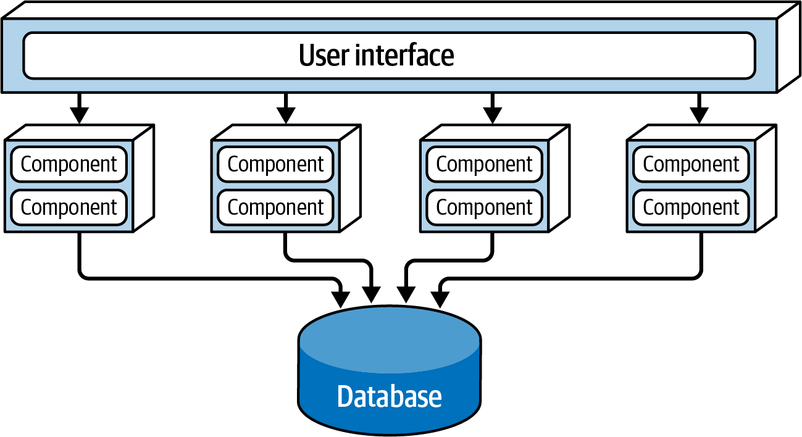
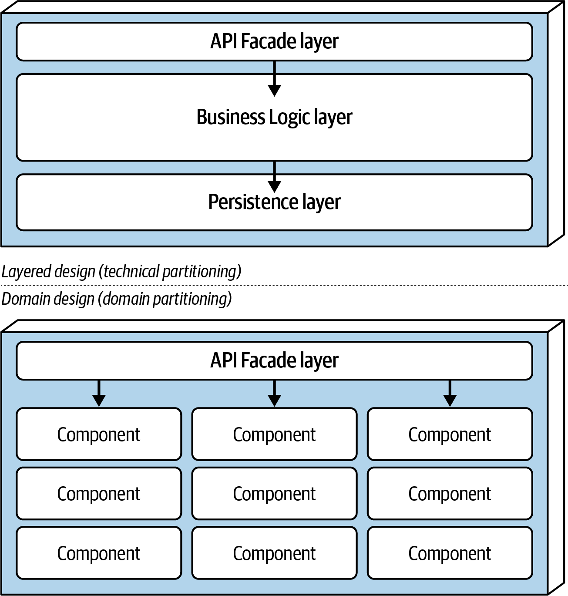
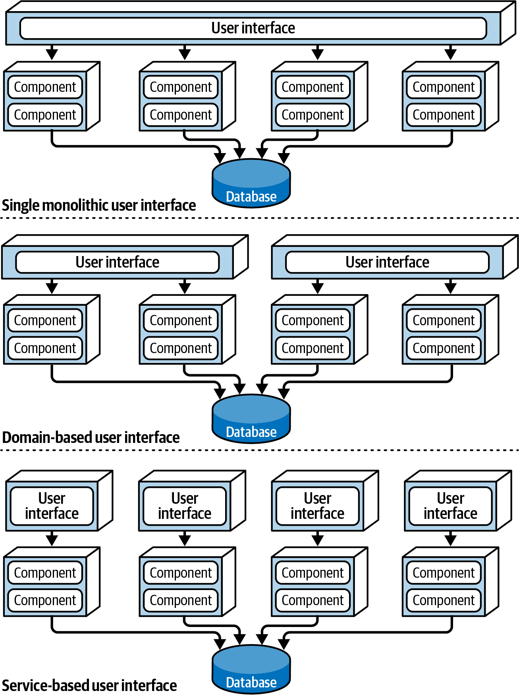
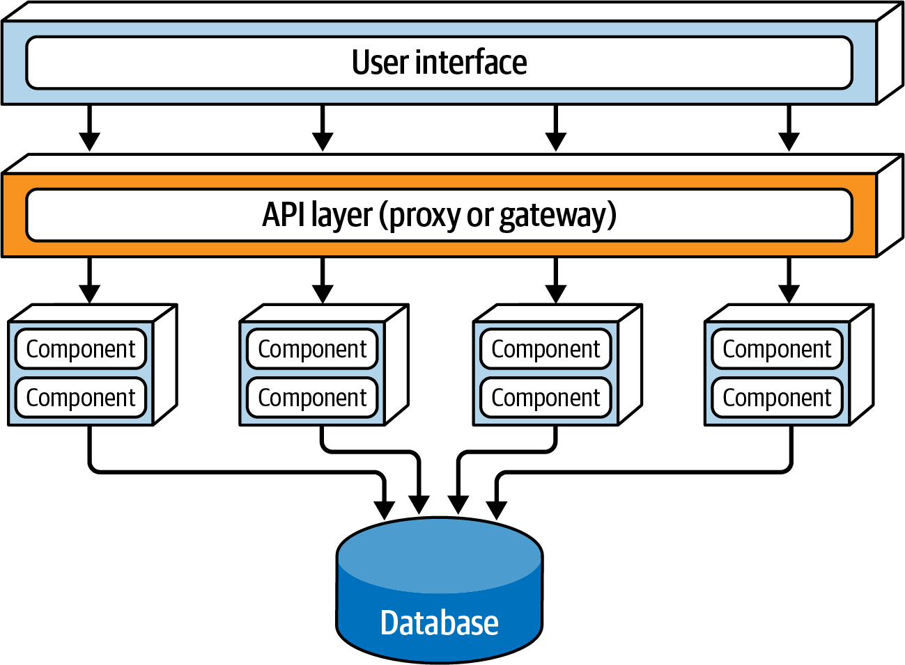
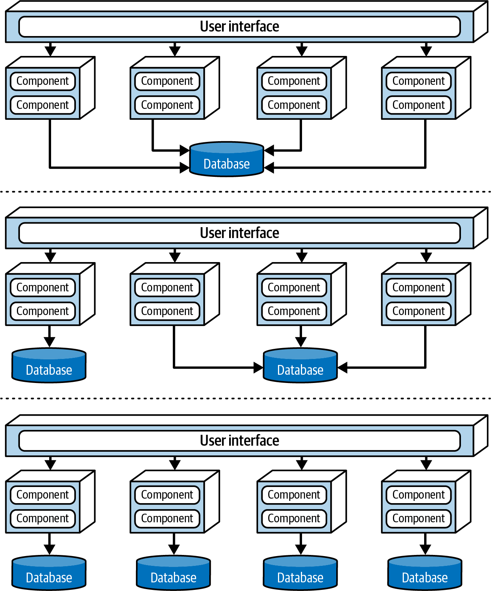
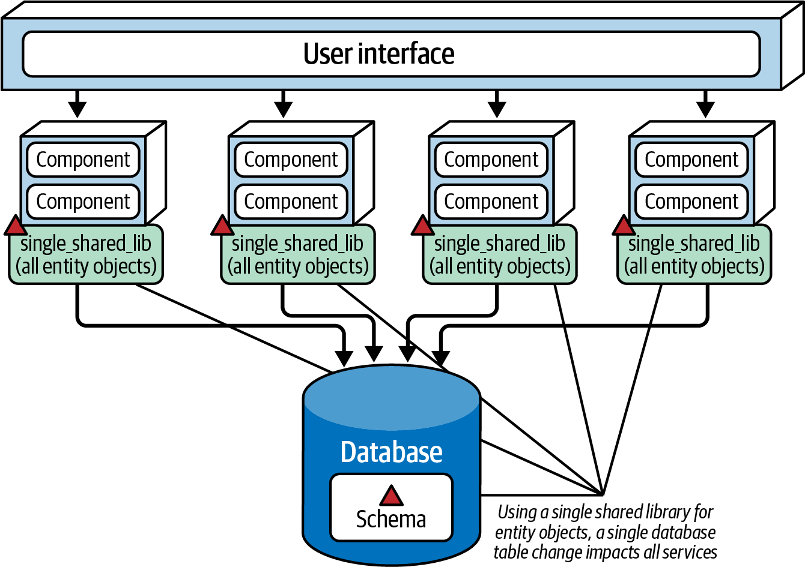
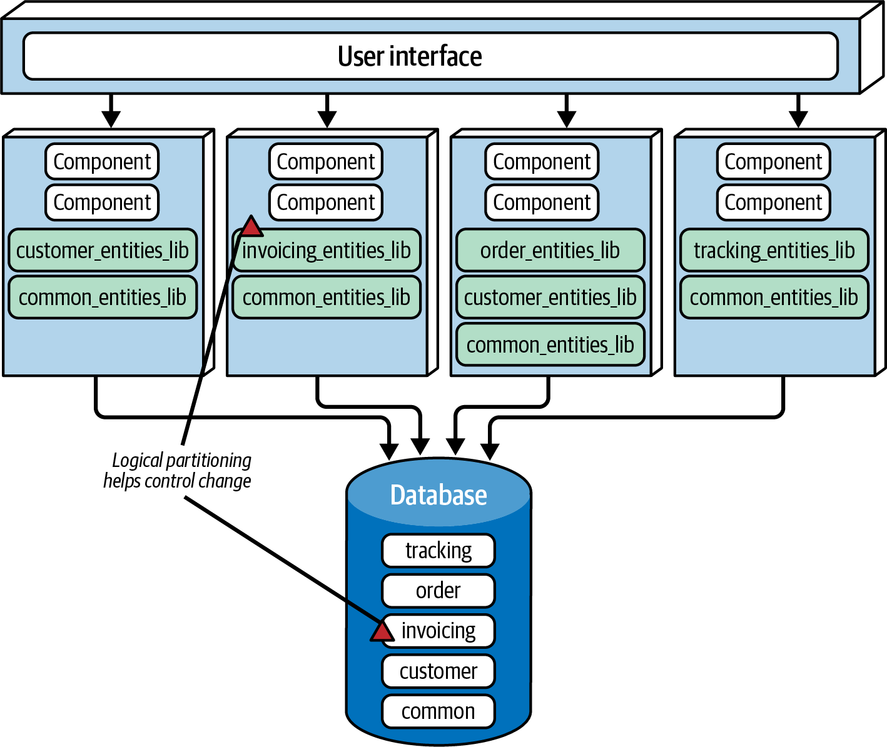
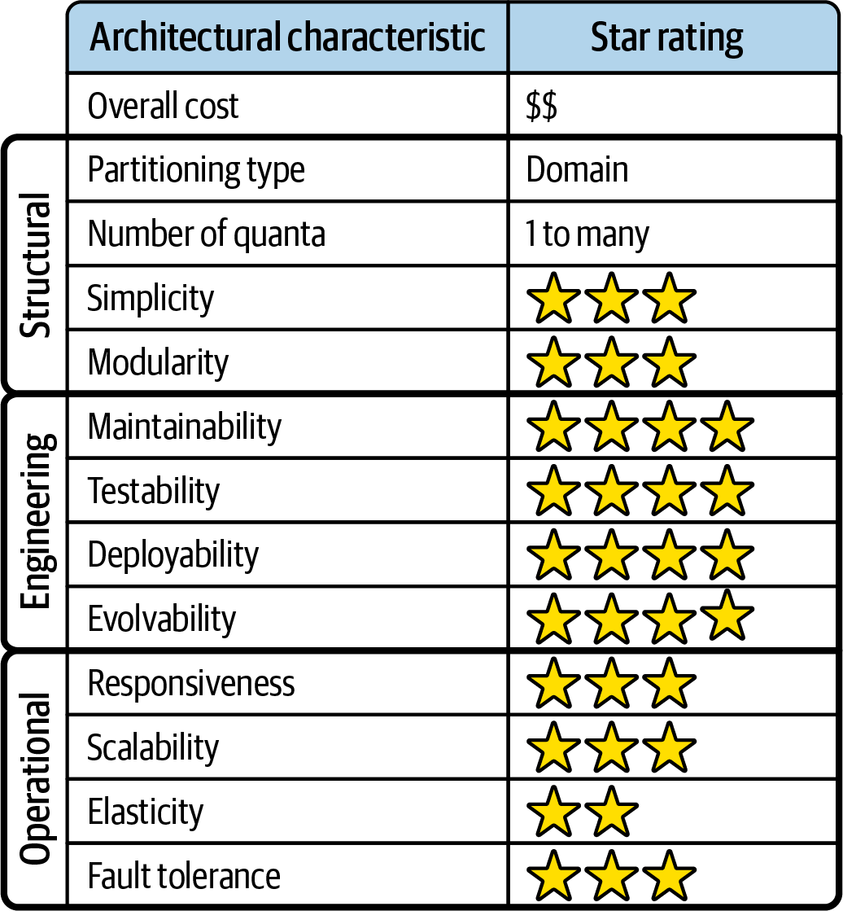
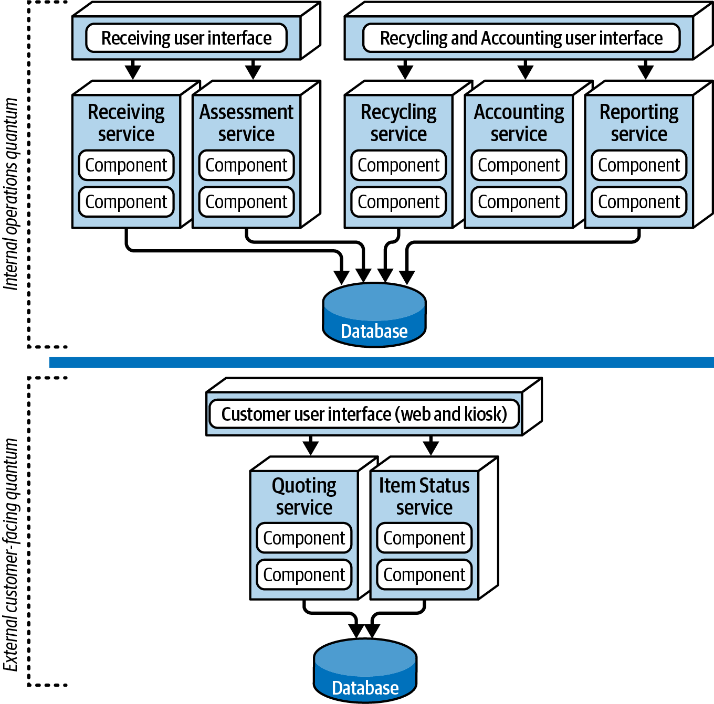
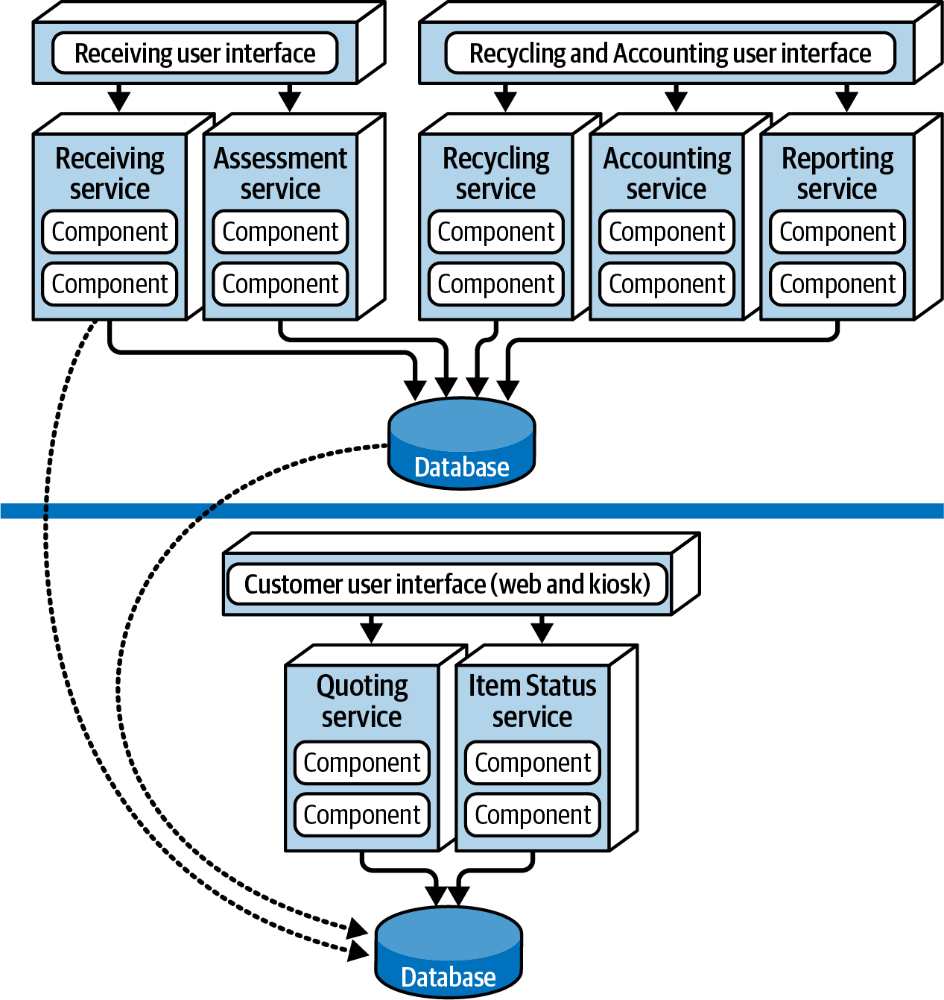

# Chương 14. Architecture style dựa trên service (Service-Based Architecture Style)

Architecture *service-based* là một biến thể lai của microservices architectural style và được coi là một trong những style thực dụng nhất hiện có, chủ yếu nhờ tính linh hoạt của nó. Dù service-based architecture là phân tán, nó không có cùng mức độ phức tạp và chi phí như các architecture phân tán khác (như microservices hoặc event-driven architecture), khiến nó trở thành một lựa chọn phổ biến cho các ứng dụng business-related.

## Topology

Topology cơ bản của service-based architecture tuân theo một cấu trúc macro-layered phân tán gồm một giao diện người dùng được deploy riêng; các service coarse-grained, từ xa, được deploy riêng; và, tùy chọn, một monolithic database.

Dù [Hình 14-1](#fig-style-service-based-topology) minh họa topology *cơ bản* của style này, nó có thể thay đổi rất nhiều, bao gồm việc dùng các UI riêng và các database riêng. Chương này sẽ mô tả chi tiết các biến thể topology đó.

Các service trong architectural style này thường đại diện cho một domain hoặc subdomain cụ thể trong một hệ thống, nên chúng được gọi là *domain service*. Domain service nhìn chung là coarse-grained và đại diện cho một phần chức năng của hệ thống (như thực hiện đơn hàng hoặc giao đơn hàng). Chúng thường độc lập với nhau và được deploy riêng. Các service thường được deploy khá giống như bất kỳ ứng dụng monolith nào, nên chúng không đòi hỏi container hóa (dù deploy một domain service trong một container như Docker hoặc Kubernetes chắc chắn là một lựa chọn). Khi dùng một monolithic database duy nhất, kiến trúc sư nên cố tối thiểu hóa số lượng domain service (chúng tôi khuyến nghị không quá 12) để tránh các vấn đề về kiểm soát thay đổi, scalability và fault tolerance.

*Hình 14-1. Topology cơ bản của architectural style service-based*

Thông thường, mỗi domain service được deploy dưới dạng một instance duy nhất. Tuy nhiên, dựa trên nhu cầu về scalability, fault tolerance và throughput của hệ thống, kiến trúc sư đôi khi tạo nhiều instance của một domain service. Làm vậy thường đòi hỏi một loại năng lực load-balancing nào đó giữa UI và domain service để UI có thể được hướng tới một instance service khỏe mạnh và sẵn sàng.

Các service được truy cập từ xa từ một UI bằng một giao thức truy cập từ xa, thường là REST. Các khả năng khác bao gồm messaging, remote procedure call (RPC), một API layer với proxy hoặc gateway, hoặc thậm chí SOAP. Tuy nhiên, trong hầu hết các trường hợp, UI có một [service locator pattern](https://oreil.ly/UAA5I) nhúng để có thể truy cập trực tiếp các service; service locator pattern cũng có thể được nhúng trong một API Gateway hoặc proxy.

Kiến trúc service-based thường dùng một monolithic database dùng chung tập trung. Điều này cho phép các service tận dụng các truy vấn SQL và join giống như một layered architecture monolith truyền thống. Vì số lượng domain service nhỏ thường thấy trong architectural style này, việc cạn kiệt các kết nối database có sẵn hiếm khi là vấn đề. Tuy nhiên, quản lý các thay đổi database có thể là một thách thức. [“Data Topologies”](#sec-service-based-data-topologies) mô tả các kỹ thuật để giải quyết và quản lý các thay đổi database trong một service-based architecture.

## Đặc thù của style (Style Specifics)

Vì các domain service trong một service-based architecture nhìn chung là coarse-grained, mỗi domain service thường được thiết kế bằng một layered architectural style gồm một API Facade layer, một Business layer và một Persistence layer. Một cách tiếp cận thiết kế phổ biến khác là phân vùng mỗi domain service thành các subdomain, tương tự modular monolith architectural style (xem [Chương 11](ch11_the_modular_monolith_architecture_style.vi.md#ch-style-modular-mono)). Cả hai cách tiếp cận được minh họa trong [Hình 14-2](#fig-style-service-based-service-design).

*Hình 14-2. Các biến thể thiết kế domain service*

Bất kể thiết kế ra sao, một domain service phải chứa một loại API access facade nào đó mà UI tương tác để thực thi một chức năng nghiệp vụ nào đó. API access facade thường đảm nhận trách nhiệm orchestrate request nghiệp vụ từ UI.

Hãy xét một ví dụ từ một trang thương mại điện tử có service-based architecture. Một request nghiệp vụ đến từ UI: một khách hàng đang đặt mua một số sản phẩm. Request duy nhất này được nhận bởi API access facade bên trong domain service `OrderService`. API access facade orchestrate nội bộ mọi thứ phải xảy ra để đáp ứng request này: đặt đơn hàng, tạo order ID, áp dụng thanh toán, và cập nhật tồn kho cho mỗi sản phẩm được đặt. Trong một microservices architecture, hoàn thành request này có lẽ sẽ đòi hỏi orchestrate nhiều service single-purpose, từ xa, được deploy riêng. Sự khác biệt về granularity này—giữa orchestration class-level nội bộ trong service-based architecture và orchestration service bên ngoài trong microservices—chỉ ra một trong nhiều khác biệt đáng kể giữa hai style.

Vì domain service là coarse-grained, các database transaction ACID (atomicity, consistency, isolation, durability) thông thường với commit và rollback database chuẩn có thể bảo đảm tính toàn vẹn database trong một domain service duy nhất. Hãy so sánh điều này với các service single-purpose fine-grained của các architecture phân tán cao như microservices, vốn dùng một kỹ thuật transaction phân tán được biết đến là BASE transaction (basic availability, soft state, eventual consistency). Những service fine-grained như vậy không hỗ trợ cùng mức toàn vẹn database mà ACID transaction trong một service-based architecture có thể hỗ trợ.

Để minh họa điểm này, hãy xét quy trình thanh toán đơn hàng trong trang thương mại điện tử service-based ví dụ của chúng ta. Giả sử khách hàng đặt một đơn hàng, nhưng thẻ tín dụng họ dùng để thanh toán đã hết hạn. Vì việc thanh toán này là một transaction nguyên tử trong cùng một service, service có thể loại bỏ mọi thứ đã được thêm vào database cho đến lúc đó bằng một transaction rollback chuẩn. Service thông báo cho khách hàng rằng không thể áp dụng thanh toán.

Bây giờ hãy xét cùng quy trình này trong một microservices architecture, với các service fine-grained nhỏ hơn. Trước tiên, service `OrderPlacement` chấp nhận request, tạo đơn hàng, tạo order ID, và chèn đơn hàng vào các bảng đơn hàng. Khi việc này xong, service `OrderPlacement` thực hiện một lời gọi từ xa tới `PaymentService`, service này cố áp dụng thanh toán. Nếu không thể áp dụng thanh toán vì thẻ tín dụng đã hết hạn, đơn hàng không thể được đặt. Giờ dữ liệu ở trạng thái không nhất quán: thông tin đơn hàng đã được chèn, nhưng chưa được phê duyệt. Một hành động riêng được biết đến là *compensating update* (được thảo luận trong [Chương 9](ch09_foundations.vi.md#ch-architecture-styles)) sẽ cần được áp dụng cho service `OrderPlacement` để đưa dữ liệu về trạng thái nhất quán.

### Thiết kế service và granularity (Service Design and Granularity)

Vì domain service là coarse-grained, chúng cho phép tính toàn vẹn và nhất quán dữ liệu tốt hơn, nhưng có một trade-off lớn. Trong service-based architecture, thay đổi chức năng order-placement trong một `OrderService` sẽ đòi hỏi team test và deploy lại toàn bộ chức năng của service, bao gồm xử lý thanh toán. Tuy nhiên, trong một microservices architecture, cùng thay đổi đó sẽ chỉ ảnh hưởng đến một service `OrderPlacement` nhỏ hơn, fine-grained, không cần test hay deploy `PaymentService`. Hơn nữa, vì một domain service deploy nhiều chức năng hơn, có nhiều rủi ro hơn rằng thứ gì đó khác có thể bị hỏng (bao gồm xử lý thanh toán). Với microservices, mỗi service có một trách nhiệm duy nhất, nên có ít khả năng làm hỏng các chức năng khác khi thực hiện thay đổi.

### Các lựa chọn giao diện người dùng (User Interface Options)

Architecture style service-based bao gồm nhiều biến thể UI, khiến nó rất linh hoạt. Ví dụ, một kiến trúc sư có thể tách UI monolith duy nhất minh họa trong [Hình 14-1](#fig-style-service-based-topology) thành các UI riêng, thậm chí đến mức khớp với mỗi domain service. Điều này sẽ tăng scalability, fault tolerance và agility tổng thể của hệ thống. Các biến thể UI này được minh họa trong [Hình 14-3](#fig-style-service-based-variants-ui).

*Hình 14-3. Ba biến thể user-interface trong một service-based architecture*

Ví dụ, một hệ thống đặt hàng điển hình có thể có một UI để khách hàng đặt hàng, và các UI nội bộ riêng để người đóng gói đơn hàng xem các sản phẩm cần đóng gói và cho bộ phận hỗ trợ khách hàng.

### Các lựa chọn API Gateway (API Gateway Options)

Nhờ tính linh hoạt của architectural style này, có thể thêm một API layer gồm một reverse proxy hoặc API Gateway giữa UI và các service, như trong [Hình 14-4](#fig-style-service-based-variants-api). Điều này hữu ích để phơi bày chức năng domain service cho các hệ thống bên ngoài, để hợp nhất các mối quan tâm cross-cutting dùng chung (như metric, security, các yêu cầu auditing và service discovery) và chuyển chúng vào API Gateway, và để load-balancing các domain service có nhiều instance.

*Hình 14-4. Thêm một API layer giữa UI và các domain service*

## Topology dữ liệu (Data Topologies)

Service-based architecture mang lại cho kiến trúc sư nhiều lựa chọn topology database, minh họa thêm tính linh hoạt của chúng. Style này độc đáo ở chỗ là một architecture phân tán có thể hỗ trợ hiệu quả một monolithic database. Tuy nhiên, monolithic database duy nhất đó có thể được tách thành các database riêng, thậm chí đi xa đến mức tạo một database domain-scoped để khớp với mỗi domain service (tương tự microservices). Nếu dùng nhiều database riêng, kiến trúc sư phải bảo đảm không domain service nào khác cần dữ liệu trong mỗi database, điều có thể phát sinh giao tiếp liên service giữa các domain service. Trong architectural style này, thường ưu tiên chia sẻ dữ liệu hơn là gọi một domain service khác. Các biến thể database này được minh họa trong [Hình 14-5](#fig-style-service-based-variants-db).

*Hình 14-5. Các topology database của service-based architecture*

Dù architectural style này hỗ trợ một monolithic database, các thay đổi schema đối với bảng database có thể, nếu không được thực hiện đúng cách, ảnh hưởng đến mọi domain service. Điều này khiến việc thay đổi database trở thành một tác vụ rất tốn kém, rủi ro, đòi hỏi nhiều công sức, phối hợp và reliability tổng thể.

Trong một service-based architecture, các file class dùng chung đại diện cho schema bảng database (gọi là *entity object*) thường nằm trong một thư viện dùng chung tùy biến được tất cả các domain service sử dụng, như một file JAR hoặc DLL. Những thư viện dùng chung này cũng có thể chứa code SQL. Tạo một thư viện dùng chung duy nhất chứa tất cả các entity object là cách *kém* hiệu quả nhất để hiện thực một service-based architecture. Bất kỳ thay đổi nào đối với cấu trúc bảng database cũng đòi hỏi thay đổi thư viện các entity object tương ứng đó, nghĩa là phải thay đổi và deploy lại *mọi* service, bất kể nó có thực sự truy cập bảng bị thay đổi hay không. Versioning thư viện dùng chung có thể giúp giải quyết vấn đề này, nhưng vẫn khó biết thay đổi bảng sẽ ảnh hưởng đến những service nào nếu không phân tích thủ công chi tiết. Kịch bản này, vốn được coi là một antipattern trong service-based architecture, được minh họa trong [Hình 14-6](#fig-style-service-based-single-db-lib).

*Hình 14-6. Dùng một thư viện dùng chung duy nhất cho các entity object database tác động đến mọi service khi có thay đổi xảy ra và được coi là một antipattern trong service-based architecture*

Một cách để giảm nhẹ tác động và rủi ro của các thay đổi database là phân vùng logic database và thể hiện việc phân vùng logic đó thông qua các thư viện dùng chung riêng biệt. Lưu ý rằng trong [Hình 14-7](#fig-style-service-based-logical-db-lib), database được phân vùng logic thành năm domain riêng biệt: common, customer, invoicing, order và tracking. Các domain service dùng năm thư viện dùng chung tương ứng khớp với các phân vùng logic trong database. Dùng kỹ thuật này, bất kỳ thay đổi nào mà kiến trúc sư thực hiện đối với một bảng trong một domain logic cụ thể (trong trường hợp này là `Invoicing`) sẽ khớp với thư viện dùng chung tương ứng chứa các entity object (và có thể cả SQL). Các service duy nhất bị ảnh hưởng sẽ là những service dùng thư viện dùng chung đó. Không service nào khác bị ảnh hưởng bởi thay đổi này, nên không cần test lại và deploy lại chúng.

*Hình 14-7. Dùng nhiều thư viện dùng chung cho các entity object database*

Trong [Hình 14-7](#fig-style-service-based-logical-db-lib), database chứa một domain `Common` và một thư viện dùng chung `common_entities_lib` tương ứng, được tất cả các service sử dụng. Điều này tương đối phổ biến. Vì các bảng này là chung cho mọi service, thay đổi chúng đòi hỏi phối hợp tất cả các service truy cập database dùng chung. Một cách để giảm nhẹ các tác dụng phụ lan tỏa tiềm tàng của các thay đổi đối với các bảng này (và đối với các entity object và domain service tương ứng của chúng) là khóa các common entity object trong hệ thống version control (nếu có) và chỉ cho phép team database thực hiện thay đổi. Điều này giúp kiểm soát thay đổi và nhấn mạnh tầm quan trọng của việc thực hiện thay đổi đối với các bảng chung được mọi service sử dụng.

> **Mẹo**
>
> Để kiểm soát tốt hơn các thay đổi database trong một service-based architecture, hãy làm cho việc phân vùng logic trong database fine-grained nhất có thể—trong khi vẫn duy trì các data domain well-defined.

## Các cân nhắc về cloud (Cloud Considerations)

Là một architecture phân tán, service-based style hoạt động tốt trong môi trường cloud, dù các domain service của nó thường là coarse-grained. Do phạm vi lớn, các domain service thường được hiện thực dưới dạng các service được container hóa thay vì các hàm serverless, và chúng có thể dễ dàng tận dụng các dịch vụ lưu trữ file, database và messaging trên cloud.

## Các rủi ro phổ biến (Common Risks)

Trong khi giao tiếp liên service là điển hình với microservices, đó là điều kiến trúc sư cố tránh trong service-based architectural style. Lý tưởng là các domain nên độc lập nhất có thể, với coupling chỉ tập trung ở mức database. Quá nhiều giao tiếp giữa các domain service là một dấu hiệu tốt cho thấy hoặc kiến trúc sư đã không phân vùng các domain đúng, hoặc đây không phải là architectural style đúng cho vấn đề họ đang giải quyết.

Một rủi ro phổ biến khác là tạo ra *quá nhiều* domain service. Giới hạn trên thực tế là khoảng 12. Nhiều hơn thế có khả năng sẽ bắt đầu gây ra vấn đề với testing, deployment, giám sát, và các kết nối cũng như thay đổi database.

## Quản trị (Governance)

Ngoài các kỹ thuật governance kiến trúc cấu trúc và vận hành phổ biến được thảo luận xuyên suốt cuốn sách này, như cyclomatic complexity, scalability, responsiveness, v.v., kiến trúc sư có thể áp dụng các bài test governance cụ thể để bảo đảm tính toàn vẹn cấu trúc của một service-based architecture.

Vì các domain service nên độc lập nhất có thể, khía cạnh đầu tiên của việc quản trị style này là bảo đảm các thay đổi không trải rộng qua nhiều domain service. Nếu có, đó là một dấu hiệu tốt cho thấy ranh giới domain không được định nghĩa phù hợp, hoặc service-based không phải là architectural style phù hợp nhất cho vấn đề.

Khi giao tiếp liên service là không thể tránh được, kiến trúc sư cũng có thể quản trị lượng giao tiếp giữa các domain service. Chắc chắn có những tình huống và workflow mà một domain service phải giao tiếp với một domain service khác: ví dụ, một domain `OrderProcessing` có thể cần giao tiếp với một domain `CustomerNotification` để gửi email thông tin trạng thái đơn hàng cho khách hàng. Tuy nhiên, nói chung, các domain service nên phần lớn độc lập với nhau, với orchestration diễn ra ở mức UI hoặc API Gateway.

## Các cân nhắc về team topology (Team Topology Considerations)

Vì service-based architecture được phân vùng theo domain, chúng hoạt động tốt nhất khi các team cũng được sắp xếp theo vùng domain (như các team cross-functional có chuyên môn hóa). Khi một yêu cầu domain-based xuất hiện, một team cross-functional domain-focused có thể cùng làm việc trên tính năng đó bên trong một domain service cụ thể, mà không can thiệp vào các team hoặc service khác. Ngược lại, các team được phân vùng theo kỹ thuật (như team UI, team backend, team database, v.v.) không hoạt động tốt với architectural style này vì domain partitioning của nó. Gán các yêu cầu domain-based cho một team được tổ chức theo kỹ thuật đòi hỏi một mức giao tiếp và cộng tác liên team mà hầu hết các tổ chức đều thấy khó khăn.

Dưới đây là một số cân nhắc cho kiến trúc sư liên quan đến việc gắn một service-based architecture với các team topology cụ thể được nêu trong [“Team Topologies and Architecture”](ch09_foundations.vi.md#sec-foundations-team-topologies):

**Stream-aligned team**

Nếu ranh giới domain được sắp xếp đúng, stream-aligned team hoạt động tốt với architectural style này, đặc biệt khi các stream của họ tập trung vào một domain cụ thể. Tuy nhiên, service-based architecture trở nên thách thức hơn khi các stream vượt qua ranh giới được định nghĩa bởi các domain service. Trong trường hợp này, kiến trúc sư nên phân tích ranh giới và granularity của các domain service và hoặc sắp xếp lại chúng theo các stream hoặc chọn một architectural style khác.

**Enabling team**

Service-based architecture không hiệu quả bằng các architecture phân tán khác khi kết hợp với enabling team topology, do bản chất coarse-grained của các domain service. Tuy nhiên, kiến trúc sư có thể tăng modularity của style này bằng cách cẩn thận xác định và tạo các component phù hợp bên trong mỗi domain service. Các chuyên gia và thành viên team cross-cutting khi đó có thể đưa ra đề xuất và thực hiện thử nghiệm dựa trên các component đó.

**Complicated-subsystem team**

Complicated-subsystem team có thể tận dụng modularity domain-level và subdomain-level của architecture style này để tập trung vào xử lý domain hoặc subdomain phức tạp, độc lập với các thành viên team (và service) khác.

**Platform team**

Mức modularity cao của service-based architecture giúp các team tận dụng lợi ích của platform team topology bằng cách sử dụng các công cụ, service, API và tác vụ chung.

## Các characteristic của style (Style Characteristics)

Đánh giá one-star (một sao) trong bảng đánh giá characteristic ở [Hình 14-8](#fig-style-service-based-ratings) có nghĩa là architecture characteristic cụ thể không được hỗ trợ tốt trong architecture, trong khi đánh giá five-star (năm sao) có nghĩa là architecture characteristic đó là một trong những đặc điểm mạnh nhất của architectural style. Định nghĩa của mỗi characteristic được xác định trong bảng điểm có thể được tìm thấy trong [Chương 4](ch04_architectural_characteristics_defined.vi.md#ch04-architecture-characteristics-defined).

*Hình 14-8. Đánh giá các characteristic của service-based architecture*

Service-based architecture là một architecture *domain-partitioned*, nghĩa là cấu trúc của nó được dẫn dắt bởi các domain thay vì các cân nhắc kỹ thuật (như logic trình bày hoặc logic persistence).

Hãy xét ví dụ ứng dụng tái chế đồ điện tử Going Green, mà chúng tôi đã giới thiệu trong [Chương 7](ch07_the_scope_of_architectural_characteristics.vi.md#ch-scope) và xem lại trong [Chương 13](ch13_microkernel_architecture_style.vi.md#ch-style-microkernel). Với mục đích của chương này, hãy hình dung Going Green dùng service-based architecture style. Mỗi service, là một đơn vị phần mềm được deploy riêng, có phạm vi gắn với một domain cụ thể (như đánh giá sản phẩm). Các thay đổi được thực hiện trong domain này chỉ tác động đến service cụ thể đó cùng UI và database tương ứng của nó. Không cần sửa đổi gì khác để hỗ trợ một thay đổi đánh giá cụ thể.

Trong một architecture phân tán, số lượng quanta có thể lớn hơn hoặc bằng một. Ví dụ, nếu các service của Going Green đều dùng chung cùng một database hoặc UI, toàn bộ hệ thống sẽ chỉ là một quantum duy nhất. Tuy nhiên, như đã thảo luận trong [“Style Specifics”](#sec-service-based-specifics), cả UI lẫn database đều có thể được liên hợp (tách ra), dẫn đến nhiều quanta trong hệ thống tổng thể. Trong [Hình 14-9](#fig-style-service-based-quanta), hệ thống của Going Green chứa hai quanta. Một quantum dành cho phần customer-facing của ứng dụng và chứa một UI khách hàng riêng, database, và tập service (`Quoting` và `Item Status`). Quantum còn lại xử lý các hoạt động nội bộ là tiếp nhận, đánh giá và tái chế thiết bị điện tử. Dù quantum hoạt động nội bộ chứa các service được deploy riêng và hai UI riêng, tất cả chúng đều dùng chung cùng một database, khiến phần hoạt động nội bộ của ứng dụng là một quantum duy nhất.

*Hình 14-9. Các quanta riêng biệt trong một service-based architecture*

Dù chúng tôi không cho service-based architecture đánh giá five-star nào, nó vẫn được đánh giá cao (bốn sao) ở nhiều lĩnh vực quan trọng. Tách một ứng dụng thành các domain service được deploy riêng bằng architectural style này cho phép thay đổi nhanh hơn (agility), độ bao phủ test tốt hơn nhờ modularity dựa trên phạm vi domain (testability), và khả năng deploy thường xuyên hơn với ít rủi ro hơn so với một monolithic architecture (deployability). Ba characteristic này dẫn đến time to market tốt hơn, cho phép các tổ chức giao tính năng mới và sửa bug tương đối nhanh.

Fault tolerance và availability tổng thể của ứng dụng cũng được đánh giá cao đối với service-based architecture. Dù các domain service có xu hướng coarse-grained, đánh giá four-star đến từ thực tế rằng các service trong architectural style này thường self-contained và, nhờ chia sẻ code và database, thường không dùng giao tiếp liên service. Kết quả là, nếu một domain service bị sập (chẳng hạn, service `Receiving` của Going Green), nó không ảnh hưởng đến bất kỳ service nào trong sáu service còn lại.

Scalability chỉ được đánh giá ba sao do bản chất coarse-grained của các service; tương ứng, elasticity chỉ được đánh giá hai sao. Dù scalability và elasticity theo chương trình chắc chắn khả thi với architectural style này, nó nhân bản nhiều chức năng hơn so với các architecture style có service finer-grained (như microservices), khiến nó kém cost-effective và kém hiệu quả hơn về tài nguyên máy. Thông thường, service-based architecture chỉ dùng một instance duy nhất của mỗi service, trừ khi cần throughput hoặc failover tốt hơn. Một ví dụ tốt về điều này, minh họa trong [Hình 14-9](#fig-style-service-based-quanta), là Going Green—chỉ các service `Quoting` và `Item Status` cần scale để hỗ trợ khối lượng khách hàng lớn. Các service vận hành khác chỉ cần instance đơn lẻ, giúp dễ dàng hỗ trợ những thứ như caching in-memory đơn lẻ và database-connection pooling.

Sự đơn giản và chi phí tổng thể là hai động lực khác giúp phân biệt architectural style này với các architecture phân tán khác, tốn kém và phức tạp hơn, như microservices, event-driven architecture, hoặc thậm chí space-based architecture. Điều này khiến service-based trở thành một trong những architecture phân tán dễ hiện thực nhất và cost-effective nhất. Dù đó là một đề xuất hấp dẫn, như mọi khi, vẫn có một trade-off. Chi phí và độ phức tạp càng cao, các characteristic four-star này (như scalability, elasticity và fault tolerance) càng trở nên tốt hơn.

Tính linh hoạt của nó, kết hợp với nhiều architecture characteristic three-star và four-star, khiến service-based architecture trở thành một trong những style thực dụng nhất hiện có. Dù có những distributed architectural style mạnh mẽ hơn nhiều, nhiều công ty nhận thấy sức mạnh đó phải trả một cái giá quá đắt. Những công ty khác thấy rằng họ đơn giản là không *cần* nhiều sức mạnh đến vậy. Nó giống như mua một chiếc Ferrari nhưng chỉ dùng nó để đi làm trong giờ cao điểm rush-hour—chắc chắn, trông nó rất ngầu, nhưng thật lãng phí sức mạnh, tốc độ và sự linh hoạt!

Service-based architecture cũng phù hợp một cách tự nhiên với domain-driven design. Vì các service là coarse-grained và có phạm vi theo domain, mỗi domain vừa khít vào một service được deploy riêng bao trùm domain cụ thể đó. Phân ngăn chức năng đó vào một đơn vị phần mềm duy nhất giúp việc áp dụng thay đổi cho domain đó dễ dàng hơn.

Duy trì và phối hợp các database transaction luôn là một vấn đề với các architecture phân tán, vốn thường dựa vào *eventual consistency* (nghĩa là các cập nhật database độc lập cuối cùng sẽ đồng bộ với nhau) thay vì *ACID transaction* truyền thống (nghĩa là các cập nhật database được phối hợp và thực hiện cùng nhau trong một đơn vị công việc duy nhất). Service-based architecture tận dụng ACID transaction tốt hơn bất kỳ distributed architecture style nào khác vì các domain service của nó là coarse-grained. Điều này có nghĩa là phạm vi transaction được đặt cho một domain service cụ thể, cho phép chức năng transaction commit-and-rollback truyền thống có ở hầu hết các ứng dụng monolith.

Cuối cùng, service-based architecture là một lựa chọn tốt cho các kiến trúc sư muốn đạt được một mức modularity tốt mà không bị vướng vào sự phức tạp của granularity và phối hợp service (xem [“Choreography and Orchestration”](ch18_microservices_architecture.vi.md#sec-ms-coordination) trong [Chương 18](ch18_microservices_architecture.vi.md#ch-style-microservices)).

## Ví dụ và use case (Examples and Use Cases)

Để minh họa tính linh hoạt và sức mạnh của service-based architectural style, chúng ta sẽ xem lại ví dụ Going Green, một hệ thống dùng để tái chế các thiết bị điện tử cũ (như điện thoại iPhone hoặc Galaxy).

Luồng xử lý của Going Green hoạt động như sau:

1. Khách hàng hỏi Going Green (qua website hoặc kiosk) sẽ trả bao nhiêu tiền cho một thiết bị điện tử cũ (*quoting*).
2. Nếu hài lòng với giá báo, khách hàng gửi thiết bị tới công ty tái chế (*receiving*).
3. Going Green đánh giá tình trạng của thiết bị (*assessment*).
4. Nếu thiết bị ở tình trạng hoạt động tốt, Going Green trả tiền cho khách hàng cho thiết bị đó (*accounting*). Trong quá trình này, khách hàng có thể vào website bất cứ lúc nào để kiểm tra trạng thái của sản phẩm (*item status*).
5. Dựa trên việc đánh giá, Going Green hoặc tiêu hủy an toàn thiết bị và tái chế các bộ phận của nó, hoặc bán lại nó trên một nền tảng bán hàng third-party, như Facebook Marketplace hoặc eBay (*recycling*).
6. Going Green định kỳ chạy các báo cáo tài chính và vận hành về hoạt động tái chế của mình (*reporting*).

[Hình 14-10](#fig-style-service-based-example) minh họa hệ thống này khi được hiện thực bằng service-based architecture. Mỗi vùng domain chúng ta vừa xác định được hiện thực như một domain service độc lập, được deploy riêng. Các service cần scale (và do đó sẽ cần nhiều instance service) là những service cần throughput cao hơn (trong trường hợp này là các service customer-facing `Quoting` và `ItemStatus`). Vì các service khác không cần scale, chúng chỉ cần một instance service duy nhất.

*Hình 14-10. Ứng dụng tái chế đồ điện tử của Going Green dùng service-based architecture*

Trong ví dụ này, các ứng dụng UI được tách thành các domain: *Customer Facing*, *Receiving*, và *Recycling and Accounting*. Sự tách biệt này mang lại fault tolerance tốt ở mức UI, scalability tốt, và security phù hợp (vì khách hàng bên ngoài không có đường mạng để truy cập chức năng nội bộ). Cũng lưu ý rằng có hai database vật lý riêng biệt: một cho các hoạt động customer-facing bên ngoài, và một cho các hoạt động nội bộ. Sự sắp xếp này cho phép dữ liệu và hoạt động nội bộ nằm trong một vùng mạng riêng với các hoạt động bên ngoài (được biểu thị bằng đường ngang). Nó cũng mang lại các hạn chế security-access và bảo vệ dữ liệu tốt hơn nhiều—và tạo thành một architectural quantum riêng). Truy cập one-way qua firewall cho phép các service nội bộ truy cập và cập nhật thông tin customer-facing, nhưng không theo chiều ngược lại. Ngoài ra, tùy thuộc vào database, các team cũng có thể dùng mirroring bảng nội bộ và đồng bộ bảng bên ngoài để đồng bộ dữ liệu giữa hai database.

Ngoài ra, service `Assessment` thay đổi liên tục, khi các sản phẩm mới được tiếp nhận hoặc ra mắt thị trường. Với service-based architecture, những thay đổi thường xuyên này được cô lập vào một domain service duy nhất, mang lại agility, testability và deployability.

Service-based architecture là một architectural style rất linh hoạt, mang lại domain partitioning và các mức scalability, agility, fault tolerance, availability và responsiveness tốt với cái giá khá thấp, so với các architecture phân tán khác. Những yếu tố này khiến nó trở thành một lựa chọn phổ biến.

Service-based architecture cũng là những mục tiêu di chuyển “bàn đạp” (stepping stone) tốt cho các architecture phân tán khác, dù tổ chức đang di chuyển sang một distributed architecture style khác hay đang tạo một hệ thống phân tán mới từ đầu. Điều này đưa chúng ta đến điểm chính:

> Không phải mọi phần của một ứng dụng đều cần là microservices.
>
> —Mark Richards

Ban đầu chuyển sang hoặc tạo một service-based architecture như một “bàn đạp” *trước khi* di chuyển sang architectural style đích cho phép các team phân tích các domain và quyết định những phần nào của architecture *nên* là microservices. Ví dụ, trong ví dụ Going Green, các service `Recycling` và `Accounting` không cần được tách nhỏ thêm nữa và có lẽ nên giữ nguyên là domain service. Tuy nhiên, service `Assessment` thay đổi thường xuyên và đòi hỏi mức agility cao, nên service *đó* nên được tách thành các service riêng, mỗi service cho một loại thiết bị điện tử. Nếu team Going Green bỏ qua bước này và chuyển *thẳng* sang một microservices architecture, *mọi* phần chức năng có lẽ sẽ trở thành một microservice, ngay cả khi nó không cần phải như vậy.

Đây là một vài trong số nhiều lý do khiến service-based architecture được các kiến trúc sư ưa chuộng. Tuy nhiên, nó chỉ là một trong nhiều distributed architectural style, và hiểu tất cả chúng sẽ hữu ích để xác định sự phù hợp đúng cho một vấn đề kinh doanh cụ thể. Để làm điều đó, hãy xem xét một số architecture phân tán khác.
