<a id="ch-style-eda"></a>

# Chương 15. Architecture style hướng sự kiện (Event-Driven Architecture Style)

<a id="ix_ch15-style-eda-asciidoc0"></a>Style *event-driven* architecture (EDA) là một architecture style phân tán, bất đồng bộ phổ biến, được dùng để tạo ra các ứng dụng có scalability cao và high-performance. Nó cũng đặc biệt dễ thích ứng và có thể được dùng cho các ứng dụng nhỏ cũng như các ứng dụng lớn, phức tạp. Event-driven architecture được tạo thành từ các component xử lý sự kiện được decoupled, kích hoạt và phản hồi các sự kiện một cách bất đồng bộ. Nó có thể được dùng như một architecture style độc lập hoặc được nhúng trong các architecture style khác (như một microservices architecture event-driven).

Nhiều developer và kiến trúc sư phần mềm coi EDA là một architectural pattern hơn là một architectural style. Chúng tôi không đồng ý. Các tác giả đã phát triển toàn bộ những hệ thống chỉ dựa vào EDA, đó là lý do chúng tôi khẳng định rằng nó chủ yếu là một architectural style. Dù EDA có thể được dùng trong các architectural style khác—như microservices và space-based architecture—để tạo thành các architecture lai, về cốt lõi nó vẫn là một cách thiết kế các hệ thống phức tạp.

<a id="id1252"></a>Hầu hết các ứng dụng tuân theo cái được gọi là mô hình *request-based* (dựa trên request), như minh họa trong [Hình 15-1](#fig-style-eda-request-based). Khi một khách hàng yêu cầu, chẳng hạn, lịch sử đơn hàng của họ trong sáu tháng qua, request này ban đầu được nhận bởi một *request orchestrator*. Request orchestrator thường là một giao diện người dùng, nhưng nó cũng có thể được triển khai thông qua một API layer, các orchestration service, event hub, event bus, hoặc integration hub. Vai trò của nó là hướng request tới các *request processor* khác nhau, một cách tất định và đồng bộ. Chúng xử lý request bằng cách truy xuất và cập nhật thông tin của khách hàng trong một database. Truy xuất thông tin lịch sử đơn hàng là một request data-driven, tất định được gửi tới hệ thống trong một bối cảnh cụ thể, không phải một sự kiện đang xảy ra mà hệ thống phải phản ứng, đó là lý do đây là một mô hình request-based.

<a id="id1253"></a>Ngược lại, một mô hình *event-based* (dựa trên sự kiện) phản ứng với một sự kiện cụ thể bằng cách hành động. Ví dụ, hãy xét việc gửi một lượt đặt giá đấu giá trực tuyến cho một vật phẩm cụ thể. Người đặt giá gửi lượt đặt giá không phải đang gửi một request tới hệ thống, mà đang khởi tạo một sự kiện xảy ra sau khi giá chào hiện tại được công bố. Hệ thống phải phản hồi sự kiện đó bằng cách so sánh lượt đặt giá với các lượt khác nhận được cùng lúc và xác định người đặt giá cao nhất hiện tại.

<a id="fig-style-eda-request-based"></a>

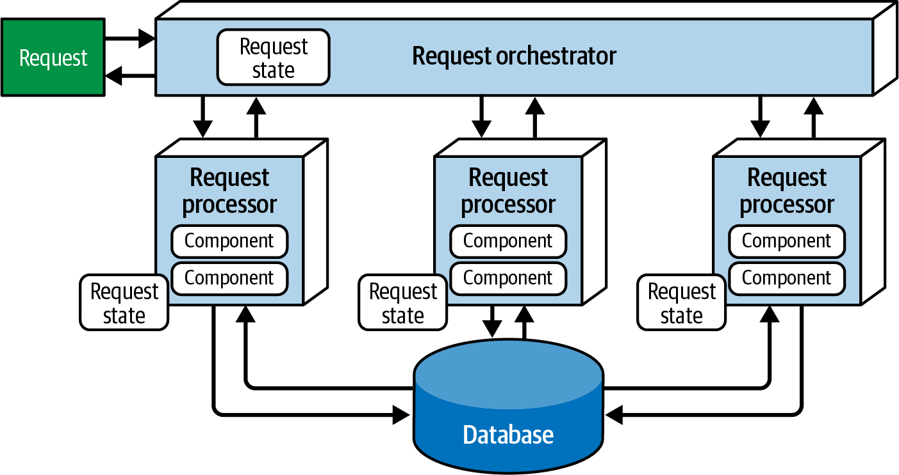

*Hình 15-1. Mô hình request-based*

<a id="id124"></a>

## Topology

<a id="ix_ch15-style-eda-asciidoc1"></a><a id="id1254"></a>Event-driven architecture tận dụng giao tiếp *fire-and-forget* (bắn và quên) bất đồng bộ, trong đó các service kích hoạt sự kiện và các service khác phản hồi những sự kiện đó. Bốn component kiến trúc chính trong topology của nó là *initiating event* (sự kiện khởi đầu), *event broker*, *event processor* (thường chỉ được gọi là *service*), và *derived event* (sự kiện dẫn xuất).

<a id="id1255"></a>*Initiating event* là sự kiện bắt đầu toàn bộ luồng sự kiện. Đây có thể là một sự kiện đơn giản, như đặt giá trong một phiên đấu giá trực tuyến, hoặc những sự kiện phức tạp hơn, như cập nhật hệ thống health-benefits khi một nhân viên kết hôn. Initiating event được gửi tới một event channel trong *event broker* để xử lý. Một *event processor* duy nhất chấp nhận initiating event từ event broker và bắt đầu xử lý sự kiện đó.

<a id="id1256"></a>Event processor đã chấp nhận initiating event thực hiện một tác vụ cụ thể gắn với việc xử lý sự kiện đó (như đặt giá cho một vật phẩm đấu giá), rồi thông báo bất đồng bộ những gì nó đã làm cho phần còn lại của hệ thống bằng cách kích hoạt cái được gọi là *derived event* tới một *event broker*. Các event processor khác phản hồi derived event, thực hiện xử lý cụ thể dựa trên nó, rồi thông báo những gì chúng đã làm thông qua các derived event mới. Quá trình này tiếp tục cho đến khi tất cả các event processor đều rảnh và mọi derived event đã được xử lý. [Hình 15-2](#fig-style-eda-topology) minh họa luồng event-processing này.

<a id="fig-style-eda-topology"></a>

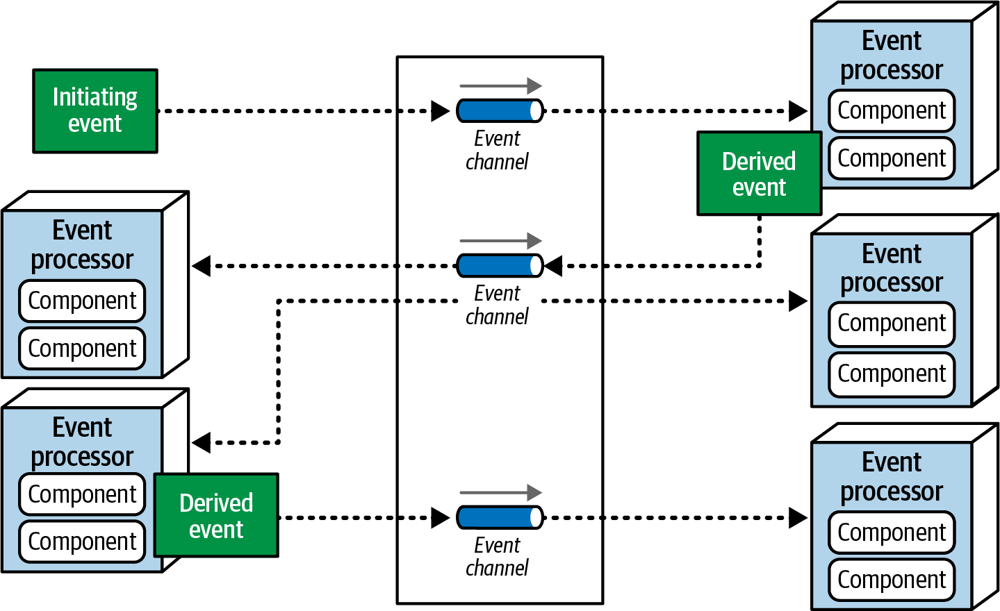

*Hình 15-2. Topology cơ bản của một event-driven architecture*

<a id="id1257"></a>Component event-broker thường được *liên hợp* (federated) (nghĩa là nó có nhiều instance cụm domain-based). Mỗi broker liên hợp chứa tất cả các *event channel* (như queue và topic) được dùng trong *event flow* (toàn bộ workflow để xử lý sự kiện) cho domain cụ thể đó. Do bản chất decoupled, bất đồng bộ, phát quảng bá fire-and-forget của architectural style này, broker topology dùng topic, topic exchange (trong trường hợp [Advanced Message Queuing Protocol (AMQP)](https://oreil.ly/TQDvA)), hoặc stream với mô hình messaging publish-and-subscribe.

Để minh họa cách xử lý EDA hoạt động tổng thể, hãy xét workflow của một hệ thống nhập retail-order điển hình, như minh họa trong [Hình 15-3](#fig-style-eda-topology-example), nơi khách hàng có thể đặt mua sản phẩm (giả sử, một cuốn sách như cuốn này). Trong ví dụ này, event processor `Order Placement` nhận initiating event (`place order`), chèn đơn hàng vào một bảng database, và trả về một order ID cho khách hàng. Sau đó nó thông báo cho phần còn lại của hệ thống rằng nó đã tạo một đơn hàng thông qua derived event `order placed`. Lưu ý rằng có ba event processor quan tâm đến derived event đó: event processor `Notification`, event processor `Payment` và event processor `Inventory`, tất cả đều thực hiện tác vụ của mình song song.

<a id="fig-style-eda-topology-example"></a>

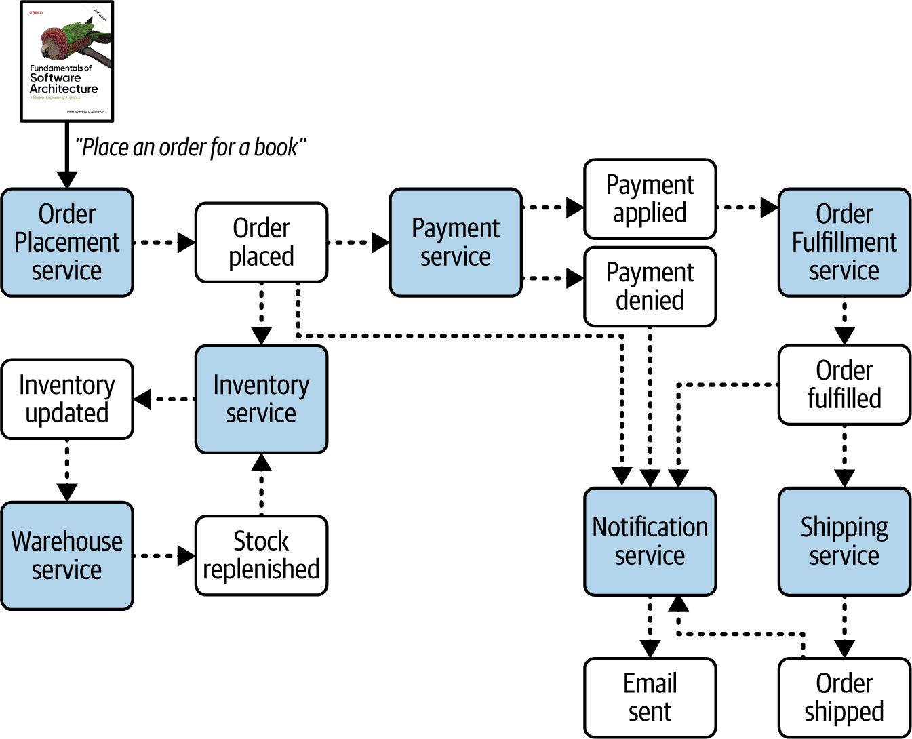

*Hình 15-3. Ví dụ về topology event-driven architecture*

Event processor `Notification` nhận derived event `order placed` và gửi email cho khách hàng với chi tiết đơn hàng. Vì event processor `Notification` đã thực hiện một hành động, sau đó nó tạo ra derived event `email sent`. Tuy nhiên, hãy chú ý trong [Hình 15-3](#fig-style-eda-topology-example) rằng không có event processor nào khác lắng nghe derived event đó. <a id="id1258"></a>Điều này là điển hình trong EDA và minh họa *khả năng mở rộng kiến trúc* (architectural extensibility) của style này—khả năng để các event processor trong tương lai phản hồi derived event mà không cần thay đổi gì đối với hệ thống hiện có (xem [“Triggering Extensible Events”](#sec-eda-extensible-events)).

Event processor `Inventory` cũng lắng nghe derived event `order placed` và điều chỉnh tồn kho tương ứng cho cuốn sách đó. Sau đó nó thông báo hành động này bằng cách kích hoạt derived event `inventory updated`, sự kiện này đến lượt nó kích hoạt một phản hồi từ event processor `Warehouse`. Processor này phản hồi và quản lý tồn kho tương ứng giữa các kho hàng, đặt lại hàng nếu nguồn cung xuống quá thấp. Khi hàng được bổ sung, event processor `Warehouse` kích hoạt derived event `stock replenished`, mà event processor `Inventory` phản hồi bằng cách điều chỉnh tồn kho hiện tại.

Trong trường hợp này, event processor `Inventory` sẽ không kích hoạt một sự kiện `inventory adjusted` tương ứng. Nếu có, điều đó sẽ dẫn đến cái được gọi là *poison event* (sự kiện độc)—một sự kiện cứ lặp đi lặp lại mãi mãi.

> **Cảnh báo**
>
> <a id="id1259"></a>Một *poison event* xảy ra khi một derived event liên tục bị kích hoạt và được phản hồi trong một vòng lặp liên tục giữa các service. Chúng có thể xảy ra thường xuyên khi dùng event-driven architecture, vì vậy hãy cẩn thận tránh chúng.

Event processor `Payment` cũng phản hồi derived event `order placed`. Nó phản hồi bằng cách tính tiền vào thẻ tín dụng của khách hàng. [Hình 15-3](#fig-style-eda-topology-example) cho thấy một trong hai derived event khả dĩ sẽ được tạo ra do hành động của event processor `Payment`: một để thông báo cho phần còn lại của hệ thống rằng thanh toán đã được áp dụng (`payment applied`), và một để thông báo cho hệ thống rằng thanh toán bị từ chối (`payment denied`). Event processor `Notification` quan tâm đến derived event `payment denied`, vì nếu điều này xảy ra, nó cần gửi email cho khách hàng thông báo rằng họ phải cập nhật thông tin thẻ tín dụng hoặc chọn một phương thức thanh toán khác.

Event processor `Order Fulfillment` lắng nghe derived event `payment applied` và thực hiện nhiều chức năng tự động trong việc lấy hàng và đóng gói đơn hàng, như chỉ dẫn cho nhân viên nơi tìm sản phẩm và cần hộp cỡ nào cho đơn hàng. Khi việc đó hoàn tất, nó kích hoạt derived event `order fulfilled` cho phần còn lại của hệ thống biết rằng nó đã thực hiện xong đơn hàng. Cả event processor `Notification` và `Shipping` đều lắng nghe derived event này. Đồng thời, event processor `Notification` thông báo cho khách hàng rằng đơn hàng đã được thực hiện và sẵn sàng để giao, còn event processor `Shipping` chọn một phương thức vận chuyển, giao đơn hàng, và gửi ra derived event `order shipped`. Event processor `Notification` cũng lắng nghe derived event `order shipped` và thông báo cho khách hàng rằng đơn hàng đang trên đường đến.

Tất cả các event processor đều decoupled cao và độc lập với nhau. Một cách để hiểu workflow xử lý bất đồng bộ này là nghĩ về nó như một cuộc chạy tiếp sức. Trong một cuộc chạy tiếp sức, các vận động viên cầm một chiếc gậy (một thanh gỗ) và chạy một quãng đường nhất định (giả sử, 1.5 km), rồi trao gậy cho vận động viên tiếp theo, người này làm tương tự, cứ thế dọc theo chuỗi cho đến khi vận động viên cuối cùng cán đích. Một khi một vận động viên đã trao gậy, vận động viên đó đã xong cuộc đua và có thể chuyển sang việc khác. Điều này cũng đúng với các event processor: một khi một event processor đã chuyển giao một sự kiện, nó không còn tham gia xử lý sự kiện cụ thể đó nữa và sẵn sàng phản ứng với các initiating event hoặc derived event khác. Ngoài ra, mỗi event processor có thể scale độc lập để xử lý các điều kiện tải khác nhau hoặc tình trạng ùn ứ.<a id="id1260"></a>

<a id="id339"></a>

## Đặc thù của style (Style Specifics)

<a id="ix_ch15-style-eda-asciidoc2"></a>Các mục sau mô tả EDA chi tiết hơn, bao gồm một số cân nhắc, pattern và các dạng lai của architectural style phức tạp này.

<a id="sec-eda-events-messages"></a>

### Sự kiện so với message (Events Versus Messages)

<a id="ix_ch15-style-eda-asciidoc3"></a>Event-driven architecture tận dụng sự kiện để truyền và xử lý thông tin. Nhưng một *sự kiện* (event) có thực sự khác một *message* đến vậy không? Hóa ra, có, thực sự là vậy.

Một *sự kiện* phát quảng bá tới các event processor khác rằng một điều gì đó đã xảy ra: “Tôi vừa đặt một đơn hàng.” Tuy nhiên, một *message* giống một lệnh hoặc truy vấn hơn, như “áp dụng thanh toán cho đơn hàng này” hoặc “đưa ra các lựa chọn vận chuyển cho đơn hàng này.” Đây không phải là một khác biệt tinh tế. Khi chúng tôi nói về *xử lý sự kiện* (event processing), ý chúng tôi là *phản ứng* với một điều đã xảy ra, trong khi một message mô tả một điều *cần được làm*. Trong ví dụ của chúng ta, rõ ràng “Tôi vừa đặt một đơn hàng” là một sự kiện vì nó không mô tả xử lý nào cần xảy ra, như một message sẽ làm. Điều này minh họa bản chất decoupled của EDA.

Khác biệt chính thứ hai giữa một sự kiện và một message là một sự kiện thường không đòi hỏi phản hồi từ bên nhận, trong khi một message thường có. Điều này làm giảm giao tiếp back-and-forth giữa các event processor, decouple chúng với nhau hơn nữa.

Một khác biệt lớn khác giữa sự kiện và message là một sự kiện thường được phát quảng bá tới nhiều event processor, trong khi một message hầu như luôn được hướng tới một event processor. Trong ví dụ order-processing đơn giản của chúng ta, một số event processor quan tâm và phản hồi sự kiện `order created`, trong khi chỉ một event processor phản hồi message `apply payment`. Sự kiện thường dùng dạng giao tiếp *publish and subscribe* (one-to-many), trong khi message thường dùng dạng giao tiếp *point-to-point* (one-to-one).

Một khác biệt cuối cùng giữa sự kiện và message là artifact vật lý đại diện cho kênh giao tiếp. Sự kiện dùng một *topic*, *stream*, hoặc dịch vụ thông báo để nhiều event processor có thể subscribe vào kênh và lắng nghe sự kiện. Messaging thường dùng một *queue* hoặc *messaging service* để bảo đảm chỉ một loại event processor sẽ nhận message đó.

Event-driven architecture chủ yếu dùng *sự kiện* (do đó có tên như vậy), nhưng đôi khi nó có thể dùng message, như khi yêu cầu dữ liệu từ một event processor khác (xem [“Data Topologies”](#sec-eda-data-topologies) và [“Request-Reply Processing”](#sec-eda-request-reply)). Ở phần sau của chương này, chúng tôi sẽ cho bạn thấy *mediated event-driven architecture* (xem [“Mediated Event-Driven Architecture”](#sec-eda-mediated)), loại dùng message để kiểm soát thứ tự xử lý của các sự kiện.

Bạn có thể chỉ ra lựa chọn nào sau đây là sự kiện và lựa chọn nào là message không?

- “Chuyến bay Adventurous Air 6557, rẽ trái, hướng 230 độ.”
- “Ở một tin khác, một đợt không khí lạnh đã tràn vào khu vực.”
- “Được rồi, cả lớp, mở sách bài tập trang 145.”
- “Chào mọi người! Xin lỗi tôi đến họp muộn.”

Hãy xem xét từng cái một:

**“Chuyến bay Adventurous Air 6557, rẽ trái, hướng 230 độ.”**

Đây là một *message* vì nó là một lệnh (điều cần được làm) và vì nó được hướng tới một đích, phi công, dù một số phi công khác có thể nghe thấy message đó.

**“Ở một tin khác, một đợt không khí lạnh đã tràn vào khu vực.”**

Đây là một *sự kiện*: nó được phát quảng bá tới nhiều người, nó mô tả một điều đã xảy ra, và phát thanh viên tin tức không chờ đợi phản hồi. (Tuy nhiên, cũng có một số message không đòi hỏi phản hồi.)

**“Được rồi, cả lớp, mở sách bài tập trang 145.”**

Cái này hơi khó. Hóa ra đây là một *message*, dù nó được phát quảng bá tới nhiều học sinh. Nó là một *lệnh* để làm gì đó, không phải một điều đã xảy ra (điều sẽ khiến nó là một sự kiện). Điều này minh họa một điểm quan trọng về sự khác biệt giữa một sự kiện và một message: phát quảng bá một lệnh (như mở sách bài tập trang 145) qua một kênh publish-and-subscribe không biến nó thành một *sự kiện*.

**“Chào mọi người! Xin lỗi tôi đến họp muộn.”**

Đây là một *sự kiện*, vì việc người này đến họp muộn đã xảy ra. Nó cũng được phát quảng bá tới nhiều người, và không có phản hồi nào được chờ đợi.<a id="id1261"></a>

<a id="id126"></a>

### Derived event (Derived Events)

<a id="ix_ch15-style-eda-asciidoc4"></a>Derived event là một phần then chốt và cần thiết của EDA. Chúng được tạo ra và kích hoạt bởi các event processor *sau khi* initiating event được nhận. Một event processor có thể kích hoạt nhiều hơn một derived event, dựa trên xử lý của nó.

Hãy xét các derived event được kích hoạt khi event processor `Payment` tính tiền vào thẻ tín dụng của khách hàng cho một giao dịch mua trong [Hình 15-3](#fig-style-eda-topology-example). Như minh họa trong [Hình 15-4](#fig-style-eda-derived-events), tính tiền một thẻ tín dụng bao gồm kiểm tra gian lận có thể xảy ra (được xử lý bởi event processor `Fraud Detection`) và kiểm tra số dư thẻ tín dụng (được xử lý bởi event processor `Credit Limit`). EDA có thể tận dụng một sự kiện duy nhất (`creditcard charged`) để thực hiện cả hai hoạt động cùng lúc.

<a id="fig-style-eda-derived-events"></a>

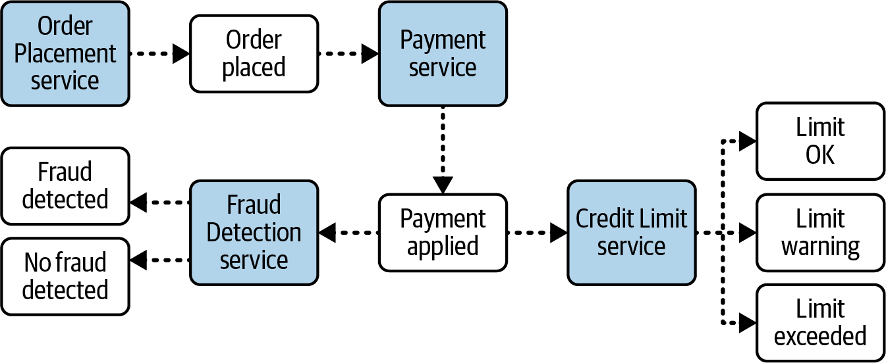

*Hình 15-4. Các derived event được tạo ra để phản hồi initiating event*

Hãy chú ý hành động duy nhất này tạo ra bao nhiêu derived event. Trong event processor `Fraud Detection`, nó kích hoạt hai derived event khả dĩ: một nếu processor phát hiện gian lận, một nếu không phát hiện gian lận. Cả hai derived event này đều cần thiết, vì các event processor khác nhau có thể thực hiện thêm hành động tùy thuộc vào kết quả của việc phát hiện gian lận.

Bây giờ hãy xem các derived event từ event processor `Credit Limit`. Thứ nhất, derived event `limit okay` cho phần còn lại của hệ thống biết không có rủi ro nào cho giao dịch mua này và khách hàng còn nhiều hạn mức tín dụng. Thực tế, sự kiện cụ thể này cũng có thể lưu trong event payload của nó số tín dụng còn lại của khách hàng, thông tin có thể được các event processor downstream quan tâm. Thứ hai, derived event `limit warning`, cảnh báo rằng số dư của thẻ đã gần đến hạn mức tín dụng, có thể được các event processor downstream khác quan tâm—chẳng hạn, event processor `Notification`, processor có thể thông báo cho khách hàng rằng họ sắp chạm hạn mức tín dụng. Cuối cùng, derived event nghiêm trọng `limit exceeded` được một số event processor quan tâm, bao gồm `Notification`, `Decline Purchase`, và có lẽ một event processor marketing-based `Extend Credit Limit` tự động nâng hạn mức tín dụng của khách hàng để cho phép giao dịch mua.

Điều này minh họa rằng nhiều hơn một derived event có thể được kích hoạt từ một event processor. Tuy nhiên, hãy cẩn thận để không mắc bẫy antipattern *Swarm of Gnats* (bầy muỗi mắt), nơi một đơn vị xử lý gửi ra quá nhiều sự kiện fine-grained (xem [“The Swarm of Gnats Antipattern”](#sec-eda-swarm-antipattern)).<a id="id1262"></a>

<a id="sec-eda-extensible-events"></a>

### Kích hoạt các sự kiện mở rộng được (Triggering Extensible Events)

<a id="id1263"></a>Trong EDA, thường là một thực hành tốt khi mỗi event processor thông báo những gì nó đã làm cho phần còn lại của hệ thống, bất kể có event processor nào khác quan tâm đến hành động đó hay không.

<a id="id1264"></a>Khi không có event processor nào quan tâm hoặc phản hồi sự kiện, chúng tôi gọi nó là một *extensible derived event* (derived event mở rộng được) vì nó vẫn hỗ trợ *khả năng mở rộng kiến trúc* bằng cách cung cấp một “điểm móc” built-in trong trường hợp việc xử lý sự kiện đó đòi hỏi chức năng bổ sung. Ví dụ, giả sử rằng, như một phần của một quy trình sự kiện phức tạp (như minh họa trong [Hình 15-5](#fig-style-eda-notification)), event processor `Notification` tạo ra một email gửi cho khách hàng, thông báo cho họ về một hành động cụ thể. Sau đó nó thông báo cho phần còn lại của hệ thống rằng nó đã gửi email thông qua một derived event mới (`email sent`). Vì hiện không có event processor nào khác đang lắng nghe hoặc phản hồi sự kiện đó, message đơn giản là biến mất (hoặc bị bỏ qua, trong trường hợp event streaming). Điều đó có vẻ là lãng phí tài nguyên, nhưng không phải vậy. Giả sử phía kinh doanh quyết định phân tích tất cả email được gửi cho khách hàng. Team có thể thêm một event processor `Email Analyzer` mới vào hệ thống tổng thể với công sức tối thiểu và không thay đổi gì đối với các event processor khác, vì thông tin email đã có sẵn thông qua derived event `email sent`.

<a id="fig-style-eda-notification"></a>

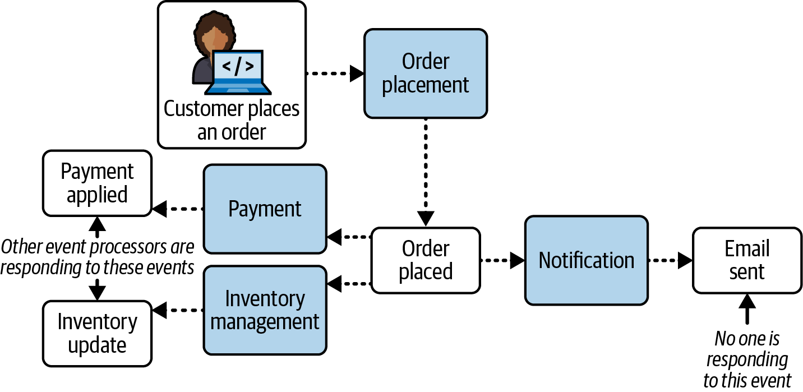

*Hình 15-5. Sự kiện `Notification` được gửi đi, nhưng bị bỏ qua và không được dùng*

<a id="id128"></a>

### Các năng lực bất đồng bộ (Asynchronous Capabilities)

<a id="ix_ch15-style-eda-asciidoc5"></a><a id="id1265"></a>Architectural style event-driven có một characteristic độc đáo ở chỗ nó chủ yếu dựa vào giao tiếp bất đồng bộ cho cả xử lý *fire-and-forget* (không cần phản hồi) và xử lý *request/reply* (khi cần phản hồi từ event consumer, xem [“Request-Reply Processing”](#sec-eda-request-reply)). Giao tiếp bất đồng bộ có thể là một kỹ thuật mạnh mẽ để tăng responsiveness tổng thể của một hệ thống.

Trong [Hình 15-6](#fig-style-eda-async), một người dùng đang đăng một bài đánh giá sản phẩm trên một website. Comment service, trong ví dụ này. mất 3,000 mili giây để kiểm tra và đăng bình luận đó. Bình luận phải đi qua một số engine phân tích cú pháp: một bước kiểm tra các từ không chấp nhận được, một bước kiểm tra để bảo đảm bình luận không chứa văn bản lăng mạ (như “kẻ chậm hiểu” hoặc “không thể suy nghĩ rõ ràng”), và cuối cùng một bước kiểm tra ngữ cảnh để bảo đảm bình luận nói về sản phẩm (chứ không phải, chẳng hạn, chỉ là một tràng chửi bới chính trị).

Đường phía trên trong [Hình 15-6](#fig-style-eda-async) đăng bình luận bằng một lời gọi RESTful đồng bộ. Điều đó có nghĩa là 50 ms latency mạng để service nhận bài đăng, 3,000 ms để kiểm tra và đăng bình luận, và 50 ms latency để báo cho người dùng rằng bình luận đã được đăng. Do đó, tổng thời gian để đăng một bình luận, từ góc nhìn của người dùng, là 3,100 mili giây. Bây giờ hãy xem đường phía dưới, đường dùng messaging bất đồng bộ. Ở đây, tổng thời gian đăng của người dùng chỉ là 25 ms, so với 3,100 ms. Hệ thống vẫn mất 25 ms để nhận bình luận và 3,000 ms để đăng nó, tổng cộng là 3,025 ms, nhưng từ góc nhìn của người dùng cuối, chỉ 25 ms trôi qua trước khi hệ thống phản hồi rằng nó đã chấp nhận bình luận (dù bình luận thực ra chưa được đăng).

<a id="fig-style-eda-async"></a>

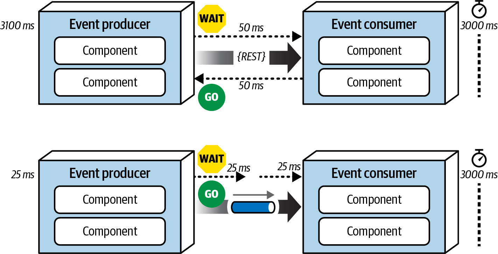

*Hình 15-6. Giao tiếp đồng bộ so với bất đồng bộ*

Sự khác biệt về thời gian phản hồi giữa 3,100 ms và 25 ms là đáng kinh ngạc. Tuy nhiên, có một lưu ý: trên đường đồng bộ phía trên, người dùng cuối nhận được một *bảo đảm* rằng bình luận của họ đã được đăng. Tuy nhiên, trên đường bất đồng bộ phía dưới, bài đăng chỉ được xác nhận, với một lời hứa trong tương lai rằng *cuối cùng* nó sẽ được đăng. Điều gì sẽ xảy ra nếu bình luận của người dùng chứa lời tục tĩu và hệ thống từ chối nó? Không có cách nào để hệ thống thông báo cho người dùng cuối—hay là có? Nếu người dùng phải đăng ký với website để đăng bình luận, hệ thống có thể gửi cho họ một message cho biết có vấn đề với bình luận và gợi ý cách sửa nó.

Ví dụ này minh họa sự khác biệt giữa *responsiveness* (thời gian để đưa thông tin trở lại cho người dùng) và *performance* (thời gian để chèn bình luận vào database). Khi người dùng không cần bất kỳ thông tin nào trả về (ngoài một xác nhận hoặc một message thank-you), tại sao bắt họ phải chờ? Responsiveness là về việc thông báo cho người dùng rằng hành động đã được chấp nhận và sẽ được xử lý trong chốc lát, trong khi performance là về việc làm cho quy trình end-to-end nhanh hơn. Trên đường bất đồng bộ phía dưới, kiến trúc sư không làm gì để tối ưu cách comment service xử lý bình luận (đó là giải quyết *responsiveness*). Nếu kiến trúc sư dành thời gian để tối ưu comment service, có lẽ bằng cách thực thi song song tất cả các engine phân tích văn bản và ngữ pháp, tận dụng caching và các kỹ thuật tương tự khác nhưng vẫn dùng giao tiếp đồng bộ, thì thay vào đó họ sẽ đang giải quyết *performance* tổng thể.

Đó là một ví dụ đơn giản. Còn một ví dụ phức tạp hơn thì sao? Lần này, hãy xem một *giao dịch chứng khoán* (stock trade) trực tuyến, nơi một người dùng đang mua một số cổ phiếu một cách bất đồng bộ. Điều gì xảy ra nếu không có cách nào để thông báo lỗi cho người dùng?

Dù giao tiếp bất đồng bộ cải thiện đáng kể responsiveness, xử lý lỗi là một vấn đề lớn. Sự khó khăn trong việc giải quyết các tình trạng lỗi làm tăng độ phức tạp của architecture style này. [“Error Handling”](#sec-eda-error-handling) minh họa một pattern của reactive architecture để giải quyết các thách thức error-handling: pattern *Workflow Event*.

<a id="id1266"></a>Ngoài responsiveness, giao tiếp bất đồng bộ cũng mang lại một mức dynamic decoupling tốt và tránh được một antipattern, *Dynamic Quantum Entanglement* (vướng víu quantum động), xảy ra khi hai architectural quanta giao tiếp thông qua giao tiếp đồng bộ. (Có lẽ bạn nhớ từ [Chương 7](ch07_the_scope_of_architectural_characteristics.vi.md#ch-scope) rằng một *architectural quantum* là một phần của hệ thống có thể được deploy độc lập với phần còn lại của hệ thống và được ràng buộc thông qua dynamic coupling đồng bộ, và rằng các architectural characteristic tồn tại ở mức quantum.) Vì hai architectural quanta này giờ phụ thuộc vào nhau, về cơ bản chúng trở nên *vướng víu* (entangled). Sự phụ thuộc biến chúng thành một architectural quantum duy nhất. Giao tiếp bất đồng bộ có thể giúp gỡ rối các architectural quanta vì nó loại bỏ phụ thuộc động đó.

Để minh họa điểm quan trọng này, hãy xét hai hệ thống trong [Hình 15-7](#fig-style-eda-single-quantum). Trong ví dụ này, hệ thống `Portfolio Management` tạo một lệnh giao dịch để mua một số cổ phiếu. Nó gửi đồng bộ lệnh giao dịch này tới hệ thống `Trade Order`, hệ thống sẽ thực hiện các kiểm tra tuân thủ và tạo lệnh giao dịch. Vì giao tiếp giữa hai hệ thống này là đồng bộ, hệ thống `Portfolio Management` nhất thiết phải block và chờ một số xác nhận giao dịch từ hệ thống `Trade Order`. Hai hệ thống này đã trở nên vướng víu và giờ tạo thành một architectural quantum duy nhất.

<a id="fig-style-eda-single-quantum"></a>

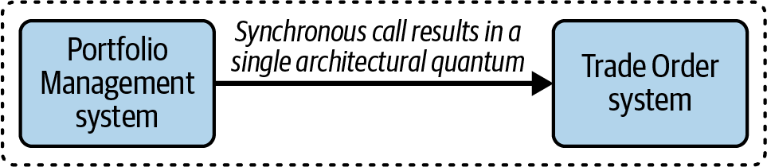

*Hình 15-7. Các hệ thống này tạo thành một architectural quantum duy nhất do dynamic coupling đồng bộ*

Tầm quan trọng của sự vướng víu này là các architectural characteristic giờ tồn tại *giữa* hai hệ thống này. Nếu hệ thống `Trade Order` trở nên không khả dụng hoặc không phản hồi, hệ thống `Portfolio Management` không thể gửi lệnh giao dịch. Điều này cũng làm giảm responsiveness: nếu hệ thống `Trade Order` chậm, hệ thống `Portfolio Management` cũng sẽ chậm. Scalability cũng bị ảnh hưởng vì nếu hệ thống `Portfolio Management` cần scale, hệ thống `Trade Order` cũng vậy. Nếu nó không scale hoặc không thể scale, thì hệ thống `Portfolio Management` không thể scale như cần thiết.

Kiến trúc sư có thể gỡ rối các architectural quanta này bằng cách thay lời gọi đồng bộ bằng một lời gọi bất đồng bộ giữa hai hệ thống, như minh họa trong [Hình 15-8](#fig-style-eda-multi-quanta).

<a id="fig-style-eda-multi-quanta"></a>

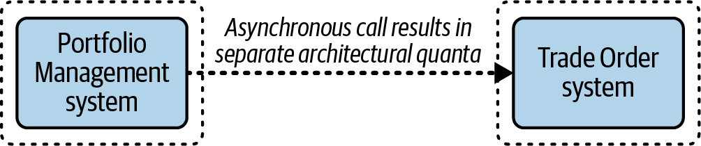

*Hình 15-8. Các hệ thống này tạo thành các architectural quanta riêng biệt do dynamic coupling bất đồng bộ của chúng*

Bằng cách dùng giao tiếp bất đồng bộ, hệ thống `Portfolio Management` có thể gửi lệnh giao dịch qua một queue hoặc một phương tiện bất đồng bộ nào khác, nên nó không phải chờ hệ thống `Trade Order` tạo lệnh giao dịch. Khi hệ thống `Trade Order` thực hiện xong các kiểm tra tuân thủ và tạo lệnh giao dịch, nó có thể gửi số xác nhận tới hệ thống `Portfolio Management` qua một kênh bất đồng bộ riêng. Loại bỏ phụ thuộc này khỏi dynamic coupling của hai hệ thống cho phép chúng tạo thành hai architectural quanta riêng biệt. Nếu hệ thống `Trade Order` không khả dụng hoặc không phản hồi, hệ thống `Portfolio Management` vẫn có thể phát lệnh giao dịch, biết rằng tại một thời điểm nào đó chúng sẽ được tạo và các số xác nhận sẽ được gửi về.<a id="id1267"></a>

<a id="id129"></a>

### Các năng lực phát quảng bá (Broadcast Capabilities)

<a id="id1268"></a>Một characteristic độc đáo khác của EDA là khả năng phát quảng bá sự kiện mà không cần biết những đơn vị xử lý nào khác (nếu có) đang nhận các sự kiện đó hoặc chúng sẽ thực hiện xử lý gì để phản hồi. Như [Hình 15-9](#fig-style-eda-broadcast) cho thấy, điều này decouple động các event processor với nhau.

<a id="fig-style-eda-broadcast"></a>

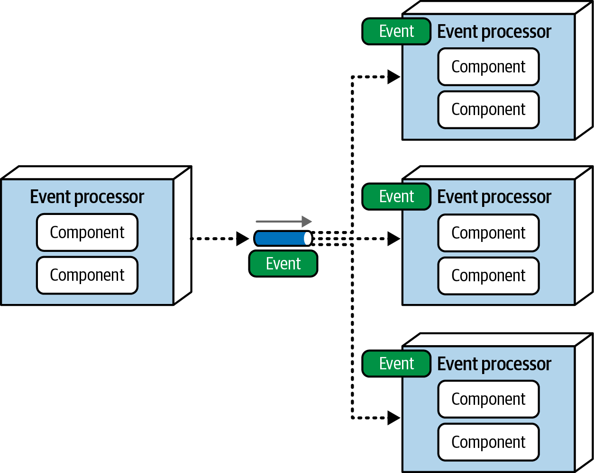

*Hình 15-9. Phát quảng bá sự kiện tới các event processor khác*

Năng lực phát quảng bá là một phần thiết yếu của nhiều pattern, bao gồm eventual consistency và complex event processing (CEP). Ví dụ, giá của các công cụ được giao dịch trên thị trường chứng khoán thay đổi thường xuyên. Mỗi khi một giá ticker mới (giá hiện tại của một cổ phiếu cụ thể) được công bố, nhiều event processor có thể phản hồi giá mới (như phân tích giao dịch, hoặc mua hay bán cổ phiếu). Tuy nhiên, event processor công bố giá mới nhất chỉ đơn giản phát quảng bá nó, không biết thông tin đó sẽ được dùng như thế nào. <a id="id1269"></a>Điều này được biết đến là *semantic decoupling* (decoupling ngữ nghĩa) ở chỗ một event processor không có hiểu biết về (hay phụ thuộc vào) hành động của các event processor khác.

<a id="sec-eda-payload"></a>

### Event payload (Event Payload)

<a id="ix_ch15-style-eda-asciidoc6"></a><a id="ix_ch15-style-eda-asciidoc7"></a>Thông tin chứa trong một sự kiện được gọi là *payload* của nó. Payload có thể thay đổi đáng kể: một event payload có thể là một cặp key-value đơn giản, hoặc toàn bộ thông tin cần thiết cho xử lý downstream. Hai loại cơ bản là event payload *data-based* và *key-based*. Kiến trúc sư phải phân tích trade-off cẩn thận để xác định lựa chọn nào phù hợp với mỗi loại sự kiện được kích hoạt trong hệ thống. Trong mục này, chúng tôi mô tả hai loại payload này và các trade-offs tương ứng của chúng.

#### Event payload dựa trên dữ liệu (Data-based event payloads)

<a id="ix_ch15-style-eda-asciidoc8"></a><a id="ix_ch15-style-eda-asciidoc9"></a>Một *data-based event payload* là một event payload gửi toàn bộ thông tin cần thiết cho việc xử lý. Trong ví dụ minh họa ở [Hình 15-10](#fig-style-eda-data-payload), một khách hàng đặt một đơn hàng. Trước tiên, event processor `Order Placement` chèn toàn bộ đơn hàng vào database (system of record). Sau đó nó phát quảng bá một sự kiện gọi là `order_placed`, chứa tất cả chi tiết đơn hàng (trong trường hợp này là 45 thuộc tính, tổng cộng 500 KB bộ nhớ). Event processor `Payment` phản hồi sự kiện này bằng cách lấy thông tin từ event payload—cụ thể là order ID, thông tin của khách hàng, và tổng chi phí của đơn hàng—và dùng nó để áp dụng thanh toán. Đồng thời, event processor `Inventory Management` dùng item ID và số lượng sản phẩm từ event payload để điều chỉnh tồn kho hiện tại cho sản phẩm được mua.

<a id="fig-style-eda-data-payload"></a>

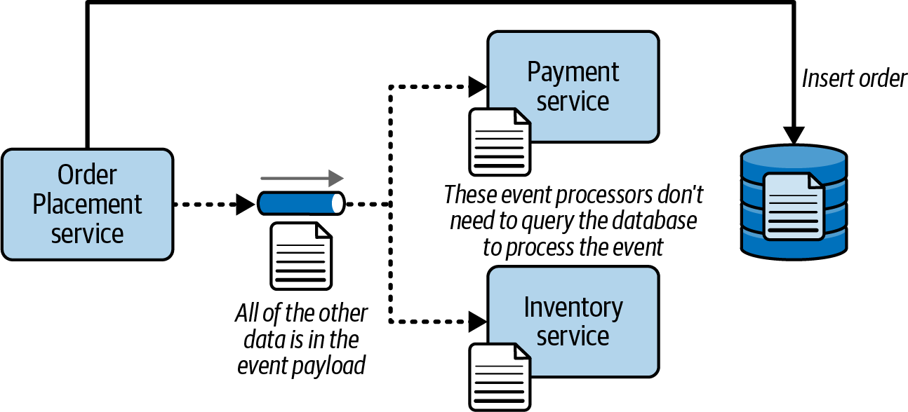

*Hình 15-10. Data-based event payload chứa toàn bộ dữ liệu cần thiết cho việc xử lý*

Các event processor `Payment` và `Inventory Management` không phải truy vấn database để lấy thông tin đơn hàng, vì dữ liệu đã được chứa trong event payload. Đây là một trong những ưu điểm lớn nhất của việc dùng data-based event payload. Một event processor càng ít truy vấn database, performance, responsiveness và scalability của nó càng tốt. Hơn nữa, với bản chất decoupled động cao của EDA, event processor `Order Placement` có thể không biết những event processor nào khác đang phản hồi sự kiện hoặc chúng có thể cần dữ liệu gì để xử lý. Gửi toàn bộ thông tin trong event payload bảo đảm rằng mỗi event processor phản hồi sẽ có thông tin cần thiết để thực hiện xử lý của nó. Các event processor thậm chí có thể không có quyền truy cập database chứa thông tin đơn hàng, đặc biệt trong các topology dữ liệu với bounded context nghiêm ngặt, dựa trên domain hoặc database-per-service (xem [“Data Topologies”](#sec-eda-data-topologies)).

Dù những ưu điểm này cho thấy các cách tạo ra những hệ thống có responsiveness, scalability và linh hoạt hơn, data-based payload có một số nhược điểm. Nhược điểm thứ nhất là khó duy trì tính nhất quán và toàn vẹn dữ liệu hơn khi bạn có *nhiều system of record*. Vì toàn bộ thông tin đơn hàng được chứa trong database *và* trong các sự kiện được kích hoạt trong hệ thống, thông tin đơn hàng có thể dễ dàng mất đồng bộ—đặc biệt nếu đơn hàng được cập nhật trong quá trình xử lý.

Ví dụ, giả sử một khách hàng đặt một đơn hàng cho một trăm sản phẩm, nhưng chỉ định đặt một, và nhận ra sai lầm ngay sau khi gửi đơn hàng. Hoặc có lẽ khách hàng nhận ra ngay sau khi đặt rằng họ đã dùng sai địa chỉ giao hàng (điều này đã xảy ra với các tác giả nhiều lần). Trong cả hai tình huống này, khách hàng lập tức cập nhật đơn hàng với thông tin đúng. Database, vốn là system of record duy nhất, chứa các giá trị đã được sửa, nhưng một số sự kiện chứa các giá trị cũ hơn có thể không được xử lý ngay lập tức. Điều này có nghĩa là bất kỳ giá trị cũ hơn, sai nào vẫn đang được xử lý sẽ được dùng thay cho các giá trị mới hơn, đúng. Làm phức tạp thêm kịch bản này, trong EDA rất khó kiểm soát thời điểm của các sự kiện, nên có khả năng các giá trị mới hơn được xử lý *trước* các giá trị cũ hơn. Điều này có nghĩa là nếu các event processor khác dùng các giá trị cũ hơn, sai, chúng có thể ghi đè lên các giá trị đúng, mới hơn.

Một nhược điểm lớn thứ hai của data-based event payload liên quan đến quản lý contract và versioning. Chúng ta biết rằng một đơn hàng trong hệ thống này có 45 thuộc tính. Vì toàn bộ thông tin đó được chứa trong event payload, sự kiện cần một loại *contract* nào đó—một cách cấu trúc dữ liệu được gửi đi. Kiến trúc sư giờ phải đối mặt với vô số quyết định: loại payload nên là một đối tượng JSON? Một đối tượng XML? Contract nên chặt hay lỏng? (Một contract *chặt* (strict) là contract dùng một loại schema hoặc định nghĩa đối tượng nào đó, như JSON schema, GraphQL spec, hoặc định nghĩa class; trong khi một contract *lỏng* (loose) có thể dùng các cặp name-value JSON đơn giản.) Mỗi quyết định này mang theo nhiều trade-offs, và mỗi quyết định tạo thành một static coupling chặt giữa các event processor.

Và rồi còn versioning. Với các contract chặt, một kiến trúc sư hoặc developer có thể dùng một [vendor MIME type](https://oreil.ly/gj4TZ) trong event header để chỉ định số phiên bản. Điều này giúp hệ thống agile hơn và mang lại khả năng tương thích ngược (để tránh làm hỏng các event processor khác). Tuy nhiên, tất cả các event processor phải tận dụng cùng một logic versioning, điều đòi hỏi governance mạnh. Nếu một event processor bỏ qua một phiên bản contract khi phản hồi payload của một contract chặt, thay đổi schema đó có khả năng sẽ khiến event processor đó thất bại. Ngoài ra, rất khó triển khai các chiến lược truyền thông và ngừng hỗ trợ phiên bản trong một architecture bất đồng bộ, decoupled cao như EDA. Tất cả những điều này khiến data-based event payload có phần mong manh.

<a id="ix_ch15-style-eda-asciidoc10"></a>Data-based event payload cũng có thể gặp *stamp coupling*: một dạng static coupling trong đó một số module (trong trường hợp này là các event processor) đều dùng chung một cấu trúc dữ liệu chung, nhưng chỉ dùng một phần của nó (và trong nhiều trường hợp là các phần khác nhau). Khi tình huống này xảy ra, thay đổi cấu trúc dữ liệu chung có thể đòi hỏi thay đổi các event processor khác, kể cả những processor không quan tâm đến dữ liệu đó.

[Hình 15-11](#fig-style-eda-data-stamp-coupling) minh họa cách stamp coupling hoạt động và tác động tiêu cực của nó lên architecture. Trong ví dụ này, event processor `Order Placement` gửi một sự kiện `order_placed` gồm 45 thuộc tính, chứa toàn bộ thông tin về đơn hàng, với kích thước 500 KB. Event processor `Inventory` phản hồi sự kiện `order_created`, nhưng chỉ cần hai thuộc tính, `item_id` và `quantity`, tổng cộng chỉ 30 byte. Trong ví dụ này, thay đổi payload, chẳng hạn bằng cách xóa một thuộc tính address-line, sẽ ảnh hưởng đến event processor `Inventory` dù nó không quan tâm đến trường đó.

<a id="fig-style-eda-data-stamp-coupling"></a>

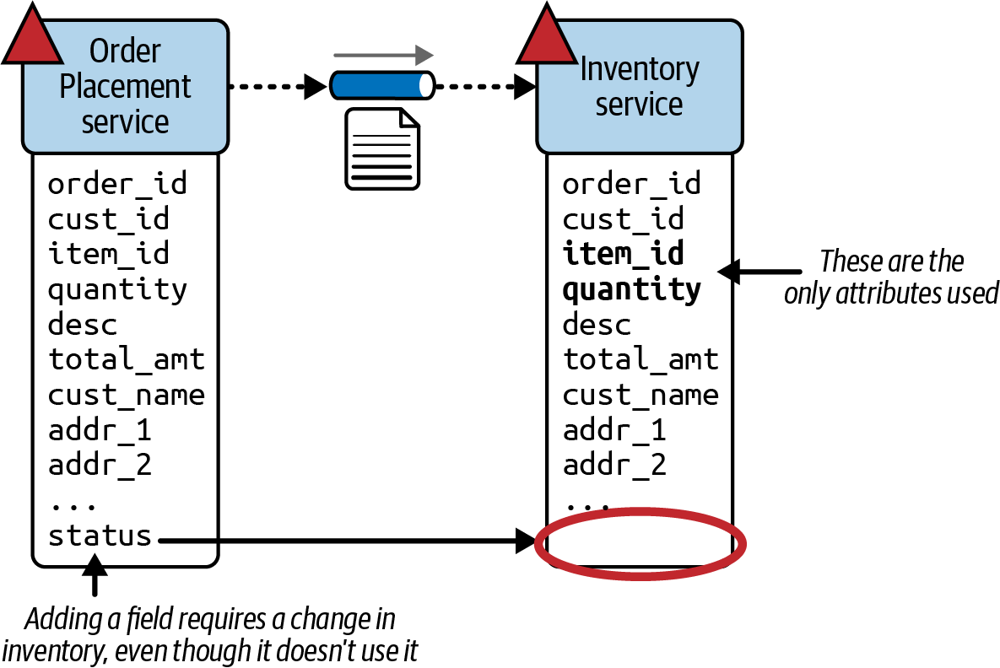

*Hình 15-11. Một ví dụ về stamp coupling, nơi một service khác chỉ cần một phần của dữ liệu được gửi*

Trong ví dụ này, dùng contract versioning với các contract chặt giúp giảm nhẹ rủi ro event processor `Inventory` bị hỏng, nhưng tại một thời điểm nào đó—khi phiên bản contract bị ngừng hỗ trợ hoặc một thay đổi contract phá vỡ tương thích xảy ra—một developer sẽ phải test lại và deploy lại nó.

Một vấn đề thường bị bỏ qua với stamp coupling là *mức sử dụng bandwidth*. Ngộ nhận thứ ba của [tính toán phân tán](https://oreil.ly/xxVRx) là “bandwidth là vô hạn.” Tất nhiên là không phải vậy. Thực tế, trong hầu hết các môi trường cloud-based, bandwidth là thứ tốn kém nhất. Quay lại ví dụ của chúng ta trong [Hình 15-11](#fig-style-eda-data-stamp-coupling), với một data-based payload, nếu khách hàng đang đặt 500 đơn hàng mỗi giây, gửi một sự kiện 500-KB duy nhất tới event processor `Inventory` sẽ sử dụng 250,000 KB bandwidth mỗi giây. Tuy nhiên, nếu hệ thống chỉ gửi 30 byte dữ liệu thực sự *cần thiết*, sự kiện sẽ chỉ sử dụng 15 KB bandwidth mỗi giây. Đây là một sự khác biệt đáng kinh ngạc, đáng để tìm hiểu khi dùng data-based event payload.

Một lý do kiến trúc sư đôi khi hạn chế stamp coupling là để tận dụng [consumer-driven contracts](https://oreil.ly/tG-eT), trong đó mỗi consumer của một message có contract riêng chỉ chứa dữ liệu nó cần để xử lý. Tuy nhiên, vì năng lực phát quảng bá của EDA và vì hệ thống không phải lúc nào cũng biết những event processor nào sẽ phản hồi một sự kiện, rất khó tận dụng consumer-driven contracts với sự kiện trong event-driven architecture. Vì lý do này (và để giải quyết các nhược điểm khác của data-based event payload), nhiều kiến trúc sư chuyển sang key-based event payload<a id="id1270"></a>.<a id="id1271"></a><a id="id1272"></a>

#### Event payload dựa trên key (Key-based event payload)

<a id="ix_ch15-style-eda-asciidoc11"></a><a id="ix_ch15-style-eda-asciidoc12"></a>Một *key-based event payload* là một event payload chỉ chứa một key xác định bối cảnh của sự kiện (như một order ID hoặc customer ID). Với key-based event payload, các event processor phản hồi sự kiện phải truy vấn một database để truy xuất thông tin chúng cần để xử lý sự kiện.

Khi một khách hàng đặt một đơn hàng, event processor `Order Placement` chèn đơn hàng vào database và kích hoạt một sự kiện key-based gọi là `order_placed`. Sự kiện này chứa một giá trị key duy nhất chứa order ID dưới dạng JSON đơn giản:

```json
{
 "order_id": "123"
}
```

Một trong những nhược điểm chính của key-based event payload là mỗi event processor phản hồi sự kiện phải truy vấn database để lấy thông tin nó cần để xử lý đơn hàng. Chẳng hạn, khi event processor `Payment` phản hồi sự kiện, nó phải truy vấn database để lấy thông tin đơn hàng cần thiết để xử lý thanh toán. Event processor `Inventory` cũng đồng thời phản hồi sự kiện, nên nó cũng phải truy vấn database để truy xuất item ID và số lượng. Điều này có thể làm giảm responsiveness, performance và scalability, và có thể làm quá tải một database, đặc biệt trong một architecture song song cao và bất đồng bộ như event-driven architecture. (Xem [“Data Topologies”](#sec-eda-data-topologies) để biết các cách giảm nhẹ rủi ro này.) Key-based event payload cũng đặt ra một thách thức nếu dữ liệu cần thiết không dễ truy cập (chẳng hạn nếu nó nằm trong bounded context của một event processor khác). [Hình 15-12](#fig-style-eda-key-payload) minh họa kỹ thuật này.

<a id="fig-style-eda-key-payload"></a>

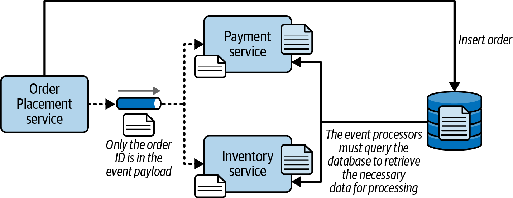

*Hình 15-12. Với key-based event payload, chỉ context key được chứa trong sự kiện*

Tuy nhiên, dùng key-based event payload mang lại nhiều ưu điểm, một số có thể vượt trội hơn các vấn đề về performance và scalability. Ưu điểm chính thứ nhất là tính nhất quán và toàn vẹn dữ liệu tổng thể tốt hơn, nhờ có một *system of record duy nhất*. Vì dữ liệu về sự kiện chỉ nằm ở một nơi (database), key-based event payload có thể xử lý các thay đổi dữ liệu trong quá trình xử lý sự kiện dễ dàng hơn nhiều so với data-based event payload.

Ưu điểm chính thứ hai là vì contract trong key-based event payload rất đơn giản và hiếm khi thay đổi, kiến trúc sư thường triển khai nó bằng JSON hoặc XML lỏng, schema-less. Do đó, key-based event payload không có cùng những vấn đề về quản lý thay đổi contract, versioning, và các chiến lược truyền thông và ngừng hỗ trợ mà data-based event payload có xu hướng gặp phải.

Một ưu điểm khác của key-based event payload: chúng không có cùng các vấn đề stamp coupling và bandwidth như data-based event payload. Vì không có dữ liệu mờ đục nào gắn với sự kiện, contract đơn giản, nhỏ, và sử dụng bandwidth tối thiểu. Do đó, chúng có xu hướng hoạt động nhanh hơn, từ góc nhìn mạng và message broker, so với data-based event payload.<a id="id1273"></a><a id="id1274"></a>

#### Tóm tắt đánh đổi (Trade-off summary)

<a id="id1275"></a>Chọn giữa data-based event payload và key-based data payload đòi hỏi phân tích trade-off cẩn thận. Hãy nhớ, đây không phải là một đề xuất all-or-nothing: mỗi loại sự kiện có thể dùng một loại payload khác nhau. [Bảng 15-1](#table-eda-payload-type) tóm tắt các trade-offs gắn với data-based event payload và key-based event payload.

<a id="table-eda-payload-type"></a>

<a id="table-eda-payload-type"></a>*Bảng 15-1. Data-based event payload so với key-based event payload*

| Tiêu chí | Data-based payload | Key-based payload |
|---|---|---|
| Performance và scalability | Tốt | Xấu |
| Quản lý contract | Xấu | Tốt |
| Stamp coupling | Xấu | Tốt |
| Mức sử dụng bandwidth | Xấu | Tốt |
| Truy cập database bị hạn chế | Tốt | Xấu |
| Độ mong manh tổng thể của hệ thống | Xấu | Tốt |

Lưu ý rằng trade-off tổng thể giữa hai lựa chọn này quy về scalability và performance so với quản lý contract và mức sử dụng bandwidth. Hãy hỏi cái nào quan trọng hơn đối với mỗi sự kiện cụ thể. Một số xử lý sự kiện đòi hỏi mức quy mô và performance cực cao, trong trường hợp đó data-based event payload sẽ là lựa chọn tốt hơn; một số dữ liệu xử lý sự kiện sẽ thay đổi thường xuyên, trong trường hợp đó key-based event payload có thể phù hợp hơn.

Như hầu hết mọi thứ trong software architecture, lựa chọn của kiến trúc sư nằm trên một dải phổ, không phải một lựa chọn nhị phân đơn giản. Đó là lý do quan trọng phải cẩn thận tránh kích hoạt những gì được biết đến là anemic event (sự kiện thiếu máu).

#### Anemic event (Anemic events)

<a id="id1276"></a><a id="id1277"></a>Một *anemic event* là một derived event có payload không chứa đủ thông tin để giúp event processor đưa ra quyết định, và thiếu bối cảnh cần thiết cho xử lý downstream tiếp theo.

[Hình 15-13](#fig-style-eda-anemic) minh họa một anemic derived event. Trong ví dụ này, một khách hàng đã cập nhật một số thông tin trong hồ sơ người dùng của họ. Khi thông tin đó được cập nhật trong database, event processor `Customer Profile` kích hoạt một sự kiện `profile_updated`, dùng một key-based event payload chỉ truyền customer ID làm dữ liệu key-based.

Ba service phản hồi sự kiện này chỉ nhận được customer ID và bối cảnh rằng hồ sơ của khách hàng đã bị thay đổi. Service thứ nhất (`Service 1`) không biết dữ liệu nào đã bị thay đổi trong hồ sơ: tên, địa chỉ, hay một thông tin quan trọng nào khác? Đáng tiếc là truy vấn database không thể trả lời câu hỏi này, nên `Service 1` không biết phải phản hồi thế nào hay hành động gì. `Service 2` phản hồi sự kiện `profile_updated`, nhưng chỉ dựa vào key, không biết liệu nó có cần thực hiện xử lý bổ sung nào không. Cuối cùng, `Service 3` phản hồi cùng sự kiện đó, nhưng không biết các giá trị trước đó là gì và do đó không thể thực hiện xử lý của nó. Cả ba event processor này đều cần phản hồi theo một cách nào đó với việc khách hàng cập nhật hồ sơ nhưng không thể, do thiếu thông tin. Đây là các anemic event: các sự kiện không bao gồm thông tin bổ sung để xử lý tiếp sự kiện.

<a id="fig-style-eda-anemic"></a>

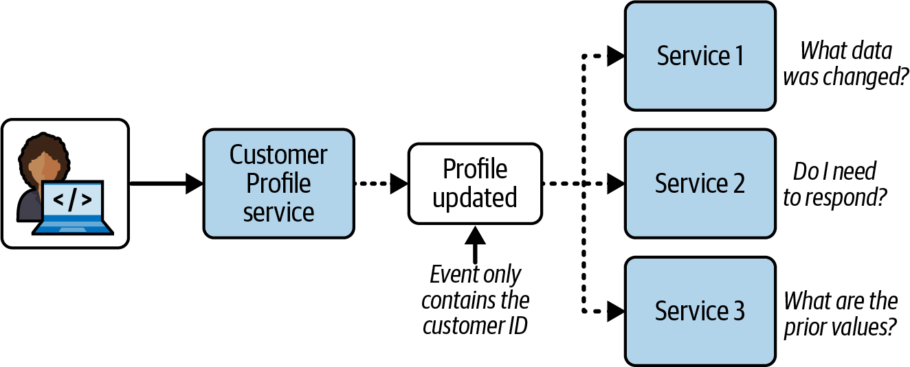

*Hình 15-13. Một anemic event thiếu đủ bối cảnh để xử lý sự kiện*

Để tránh các anemic event như thế này, hãy bao gồm thông tin khách hàng đã được cập nhật *cũng như các giá trị trước đó*, vì hầu hết các database thường không phản ánh thông tin đó.

Đây là một ví dụ về *dải phổ* granularity của event payload. Ở phía cực trái của dải phổ là key-based event payload, nơi chỉ key được chứa trong sự kiện. Dù điều này có giá trị khi tạo hoặc xóa một đơn hàng, nó không hoạt động tốt khi một khách hàng cập nhật một đơn hàng. Ở phía xa bên phải của dải phổ là data-based event payload, nơi *toàn bộ* dữ liệu được bao gồm, dù có cần hay không. Đây là nơi stamp coupling lộ ra bộ mặt xấu xí của nó. Kịch bản customer-profile-update nằm đâu đó giữa hai thái cực này vì nó cung cấp đúng mức thông tin, qua đó tránh được vấn đề anemic derived event.<a id="id1278"></a><a id="id1279"></a>

<a id="sec-eda-swarm-antipattern"></a>

### Antipattern Swarm of Gnats (The Swarm of Gnats Antipattern)

<a id="ix_ch15-style-eda-asciidoc13"></a><a id="ix_ch15-style-eda-asciidoc14"></a><a id="ix_ch15-style-eda-asciidoc15"></a>Liên quan đến anemic event là một antipattern được biết đến là *Swarm of Gnats*. Có lẽ bạn biết muỗi mắt (gnat) là những loài côn trùng bay rất nhỏ, phiền phức, vo ve quanh đầu bạn, quấy rầy đến mức khiến bạn phải quay vào nhà trong một ngày nắng đẹp. Trong khi anemic event quan tâm đến granularity của *payload* sự kiện, antipattern Swarm of Gnats quan tâm đến granularity của *bản thân* các sự kiện được kích hoạt và đến việc có bao nhiêu derived event được kích hoạt từ một event processor. Nếu một kiến trúc sư kích hoạt quá nhiều derived event từ một event processor duy nhất, họ có nguy cơ mắc vào antipattern Swarm of Gnats.

Hãy xét ví dụ thanh toán bằng thẻ tín dụng trong [Hình 15-14](#fig-style-eda-fraud-coarse-grained), nơi một khách hàng đặt một đơn hàng và thẻ tín dụng của họ bị tính tiền để thanh toán. Khi thẻ tín dụng bị tính tiền, event processor `Payment` kích hoạt một sự kiện `payment applied`, và (may mắn thay) event processor `Fraud Detection` lắng nghe nó. Event processor này phân tích mỗi khoản tính tiền để xác định nó hợp pháp hay gian lận. Bất kể kết quả là gì, event processor `Fraud Detection` kích hoạt một derived event `fraud_checked` với kết quả kiểm tra gian lận được chứa trong event payload của nó.

<a id="fig-style-eda-fraud-coarse-grained"></a>

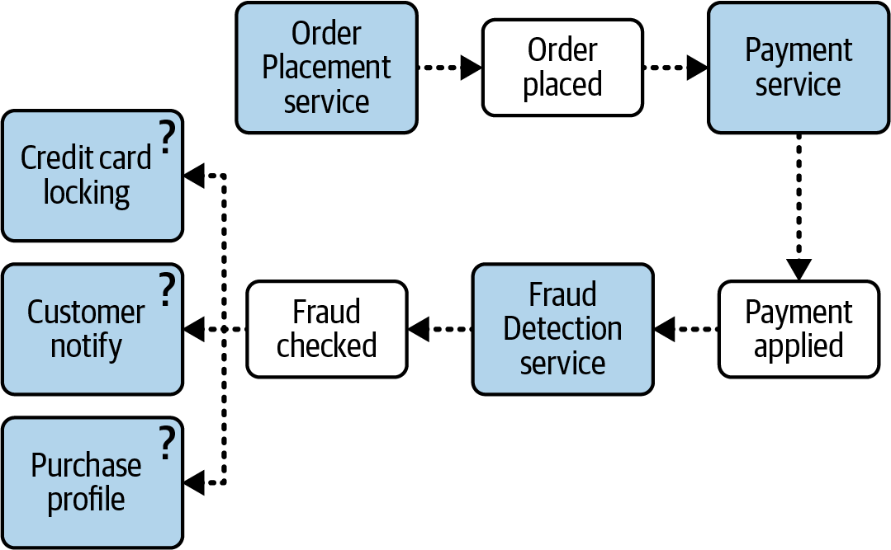

*Hình 15-14. Một ví dụ về một sự kiện quá coarse-grained*

Ba event processor quan tâm đến kết quả kiểm tra gian lận thẻ tín dụng:

- Nếu phát hiện gian lận, event processor `Credit Card Locking` khóa thẻ tín dụng của khách hàng để ngăn các khoản tính tiền tiếp theo.
- Event processor `Customer Notify` thông báo cho khách hàng về khả năng gian lận.
- Nếu *không* phát hiện gian lận, event processor `Purchase Profile` cập nhật các thuật toán của nó.

Đáng tiếc là khi một derived event `fraud_checked` duy nhất được kích hoạt, *tất cả* các event processor này phải phản hồi sự kiện, kiểm tra payload để biết kết quả, và quyết định có hành động hay không. Vì derived event này quá coarse-grained, tất cả các event processor phải thực hiện xử lý bổ sung: phân tích payload của derived event duy nhất để quyết định có hành động hay không. Nếu không phát hiện gian lận, đây là sự lãng phí bandwidth và sức xử lý, vì chỉ event processor `Purchase Profile` cần hành động.

Một cách tiếp cận hiệu quả hơn nhiều là kích hoạt *hai* derived event riêng biệt (`fraud_detected` và `no_fraud_detected`), như trong [Hình 15-15](#fig-style-eda-fraud-good). Ở đây, các derived event được kích hoạt bởi event processor `Fraud Detection` cung cấp bối cảnh *bên ngoài* event payload, cho phép mỗi event processor quyết định có phản hồi hay không mà không phải phân tích payload bên trong của sự kiện.

<a id="fig-style-eda-fraud-good"></a>

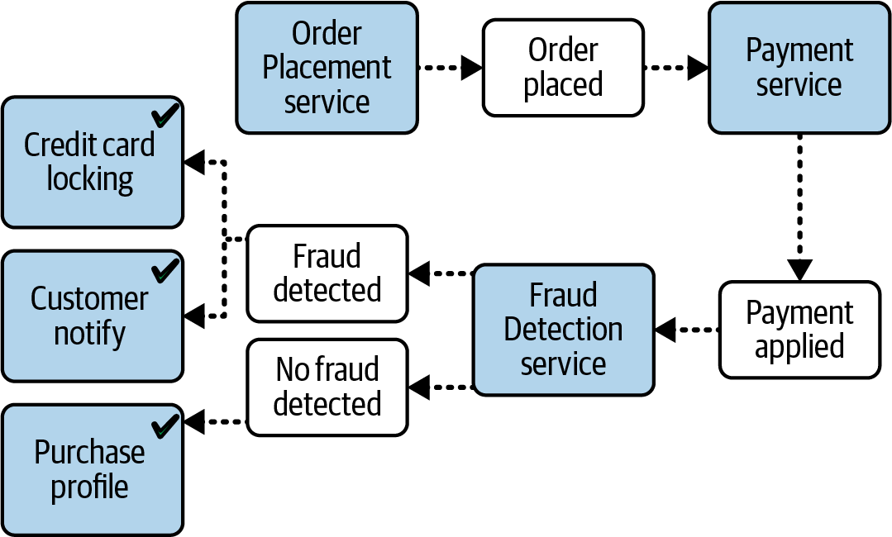

*Hình 15-15. Kích hoạt nhiều sự kiện cho phép xử lý và ra quyết định hiệu quả hơn*

Trong ví dụ này, kích hoạt nhiều derived event cho mỗi kết quả cho phép luồng sự kiện tốt hơn, ít xáo trộn hơn, và xử lý hiệu quả hơn. Tuy nhiên, kích hoạt *quá nhiều* derived event dẫn đến antipattern *Swarm of Gnats*.

Kịch bản trong [Hình 15-16](#fig-style-eda-swarm) minh họa antipattern này có thể xảy ra như thế nào. Một khách hàng vừa chuyển nhà và cần thay đổi hồ sơ người dùng trên website để cập nhật địa chỉ bill-to của thẻ tín dụng, địa chỉ ship-to (nơi các đơn hàng sẽ được giao), và số điện thoại từ điện thoại bàn cũ sang điện thoại di động. Khi khách hàng nhấn nút Submit cho những thay đổi hồ sơ này, event processor `Customer Profile` nhận request cập nhật, cập nhật database, và kích hoạt một sự kiện riêng cho mỗi cập nhật chứa thông tin cần thiết để thực hiện bất kỳ xử lý tiếp theo nào.

<a id="fig-style-eda-swarm"></a>

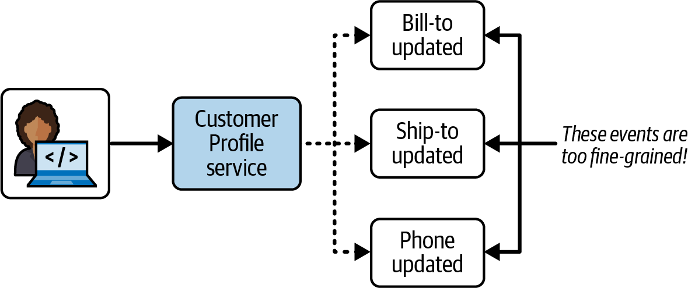

*Hình 15-16. Kích hoạt quá nhiều derived event fine-grained được biết đến là antipattern Swarm of Gnats*

Vấn đề với việc kích hoạt quá nhiều sự kiện fine-grained, chi tiết là nó có thể làm bão hòa và quá tải hệ thống với các derived event đều liên quan đến cùng một điều: khách hàng đã cập nhật hồ sơ người dùng. Antipattern này cũng có xu hướng làm sinh sôi vô số derived event nhỏ từ các event processor khác, cuối cùng khiến không ai hiểu được các luồng sự kiện tổng thể của hệ thống.

Để tránh antipattern này, kiến trúc sư có thể gộp từng cập nhật hồ sơ riêng lẻ vào một derived event `profile_updated` duy nhất cho toàn bộ hành động, chứa dữ liệu trước và sau của tất cả các trường được cập nhật. Cách tiếp cận hiệu quả hơn này được minh họa trong [Hình 15-17](#fig-style-eda-domain-event).

<a id="fig-style-eda-domain-event"></a>

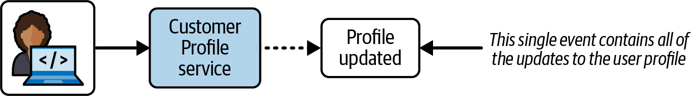

*Hình 15-17. Gộp các thay đổi trạng thái riêng lẻ vào một derived event duy nhất tránh được antipattern Swarm of Gnats*

Xác định đúng mức granularity cho derived event có thể khá thách thức. Chúng tôi khuyến nghị tập trung vào *kết quả* của việc xử lý hoặc thay đổi trạng thái để tránh antipattern Swarm of Gnats và giúp đơn giản hóa các luồng sự kiện.<a id="id1280"></a><a id="id1281"></a><a id="id1282"></a>

<a id="sec-eda-error-handling"></a>

### Xử lý lỗi (Error Handling)

<a id="ix_ch15-style-eda-asciidoc16"></a><a id="ix_ch15-style-eda-asciidoc17"></a>Pattern Workflow Event của reactive architecture là một cách giải quyết việc xử lý lỗi trong một workflow bất đồng bộ. Pattern này giải quyết cả resiliency lẫn responsiveness, vì nó cho phép hệ thống xử lý các lỗi bất đồng bộ mà không ảnh hưởng đến responsiveness của nó.

Pattern Workflow Event tận dụng việc ủy thác, ngăn chặn và sửa chữa bằng cách dùng một *workflow delegate*, như minh họa trong [Hình 15-18](#fig-style-eda-wep). Trong pattern này, một event processor truyền dữ liệu một cách bất đồng bộ qua một message channel tới event consumer. Nếu event consumer gặp lỗi khi xử lý dữ liệu, nó lập tức ủy thác lỗi đó cho service `Workflow Processor` và chuyển sang message tiếp theo trong event queue. Bằng cách này, message tiếp theo được xử lý ngay lập tức, nên responsiveness tổng thể vẫn giữ nguyên. Nếu event consumer dành thời gian để cố tìm hiểu lỗi, nó sẽ không xử lý message tiếp theo trong queue—làm chậm không chỉ message tiếp theo, mà cả mọi message khác đang chờ trong processing queue.

Khi service `Workflow Processor` nhận một lỗi, nó cố tìm hiểu message bị sai ở đâu. Có lẽ là một lỗi tĩnh, tất định? Nó có thể phân tích message bằng một số thuật toán machine-learning hoặc AI để tìm điểm bất thường trong dữ liệu. Dù bằng cách nào, workflow processor thực hiện *theo chương trình* (tức là không có sự can thiệp của con người) các thay đổi đối với dữ liệu gốc để cố sửa nó, rồi gửi nó trở lại queue ban đầu. Event consumer xem message đã cập nhật này như một message mới và cố xử lý lại, hy vọng lần này thành công hơn.

Tất nhiên, workflow processor không phải lúc nào cũng xác định được message bị sai ở đâu. Trong những trường hợp này, nó gửi message tới một queue khác, queue này sau đó được nhận bởi một dashboard trên máy tính của một người am hiểu. Người này xem xét message, áp dụng các bản sửa thủ công, rồi gửi lại nó vào queue ban đầu (thường thông qua một biến message header reply-to).

<a id="fig-style-eda-wep"></a>

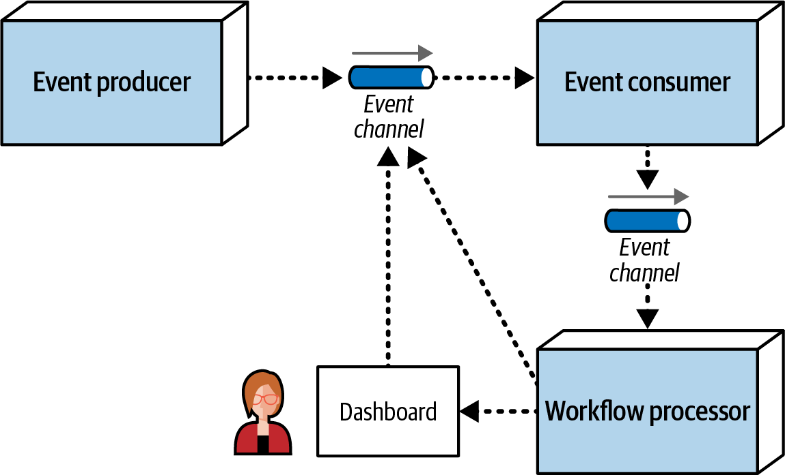

*Hình 15-18. Pattern Workflow Event của reactive architecture*

Giả sử một cố vấn giao dịch ở một vùng của đất nước chấp nhận các *lệnh giao dịch* (trade order: chỉ dẫn về việc mua cổ phiếu nào và bao nhiêu cổ phần) thay mặt cho một công ty giao dịch lớn ở một vùng khác của đất nước. Cố vấn gom các lệnh giao dịch thành cái thường được gọi là một *basket* (giỏ) và gửi chúng một cách bất đồng bộ tới một nhà môi giới ở bên kia đất nước, người này sau đó mua cổ phiếu. Để đơn giản hóa ví dụ, giả sử contract cho các chỉ dẫn giao dịch phải tuân theo định dạng sau:

```text
ACCOUNT(String),SIDE(String),SYMBOL(String),SHARES(Long)
```

Giả sử công ty giao dịch lớn nhận được basket lệnh giao dịch Apple (AAPL) sau từ cố vấn giao dịch:

```text
12654A87FR4,BUY,AAPL,1254
87R54E3068U,BUY,AAPL,3122
6R4NB7609JJ,BUY,AAPL,5433
2WE35HF6DHF,BUY,AAPL,8756 SHARES
764980974R2,BUY,AAPL,1211
1533G658HD8,BUY,AAPL,2654
```

Chỉ dẫn giao dịch thứ tư (`2WE35HF6DHF,BUY,AAPL,8756 SHARES`) có từ `SHARES` sau số cổ phần của giao dịch. Khi công ty chính xử lý các lệnh giao dịch bất đồng bộ này mà không có bất kỳ năng lực xử lý lỗi nào, lỗi sau xảy ra trong service `TradePlacement`:

```text
Exception in thread "main" java.lang.NumberFormatException:
	For input string: "8756 SHARES"
	at java.lang.NumberFormatException.forInputString
	(NumberFormatException.java:65)
	at java.lang.Long.parseLong(Long.java:589)
	at java.lang.Long.<init>(Long.java:965)
	at trading.TradePlacement.execute(TradePlacement.java:23)
	at trading.TradePlacement.main(TradePlacement.java:29)
```

Khi exception này xảy ra, vì đây là một request bất đồng bộ, không có người dùng nào để phản hồi đồng bộ và sửa lỗi. Service `TradePlacement` không thể làm gì, ngoại trừ có thể ghi log tình trạng lỗi.

Áp dụng pattern Workflow Event có thể sửa lỗi này theo chương trình. Vì công ty chính không kiểm soát được cố vấn giao dịch hay dữ liệu trade-order mà cố vấn gửi, nó phải tự phản ứng để sửa lỗi (xem [Hình 15-19](#fig-style-eda-wep-example)). Khi cùng lỗi đó xảy ra (`2WE35HF6DHF,BUY,AAPL,8756 SHARES`), service `TradePlacement` lập tức ủy thác lỗi qua messaging bất đồng bộ cho service `Trade Placement Error` để xử lý lỗi, truyền kèm thông tin lỗi về exception:

```text
Trade Placed: 12654A87FR4,BUY,AAPL,1254
Trade Placed: 87R54E3068U,BUY,AAPL,3122
Trade Placed: 6R4NB7609JJ,BUY,AAPL,5433
Error Placing Trade: "2WE35HF6DHF,BUY,AAPL,8756 SHARES"
Sending to trade error processor <-- delegate the error fixing and move on
Trade Placed: 764980974R2,BUY,AAPL,1211
...
```

Service `Trade Placement Error`, đóng vai trò workflow delegate, nhận lỗi và kiểm tra exception. Thấy rằng vấn đề nằm ở từ `SHARES` trong trường Number of Shares, service `Trade Placement Error` loại bỏ từ `SHARES` và gửi lại giao dịch để xử lý lại:

```text
Received Trade Order Error: 2WE35HF6DHF,BUY,AAPL,8756 SHARES
Trade fixed: 2WE35HF6DHF,BUY,AAPL,8756
Resubmitting Trade For Re-Processing
```

Giờ service `TradePlacement` có thể xử lý thành công giao dịch đã được sửa:

```text
...
trade placed: 1533G658HD8,BUY,AAPL,2654
trade placed: 2WE35HF6DHF,BUY,AAPL,8756 <-- this was the original trade in error
```

<a id="fig-style-eda-wep-example"></a>

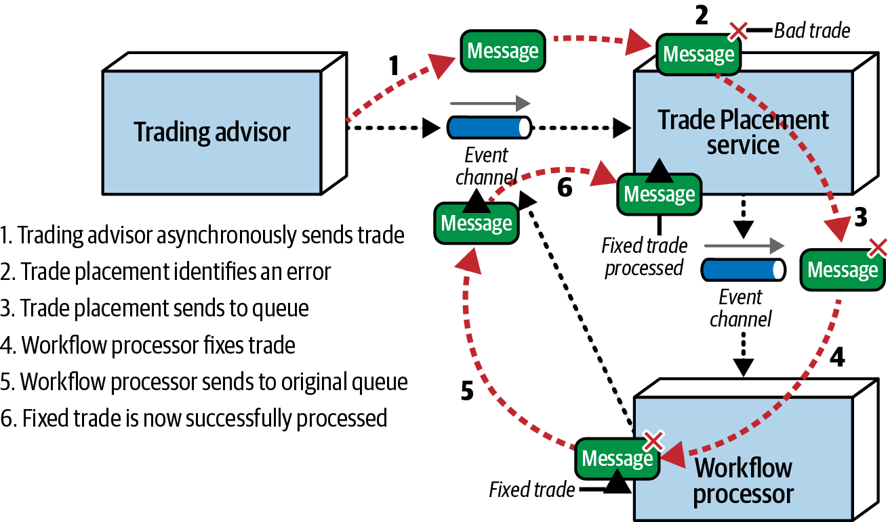

*Hình 15-19. Xử lý lỗi với pattern Workflow Event*

Một hệ quả của việc dùng pattern Workflow Event là các message được gửi tới workflow processor rồi được gửi lại sẽ được xử lý không theo thứ tự. Trong ví dụ giao dịch của chúng ta, thứ tự của các message là quan trọng, vì mọi giao dịch trong một tài khoản nhất định phải được xử lý theo thứ tự (ví dụ, một lệnh `SELL` cho IBM phải xảy ra trước một lệnh `BUY` cho AAPL trong cùng một tài khoản môi giới). Sẽ phức tạp, dù không phải là không thể, để duy trì thứ tự message trong một bối cảnh nhất định (trong trường hợp này là số tài khoản môi giới). Một cách để giải quyết điều này là để service `TradePlacement` đưa vào queue và lưu số tài khoản môi giới của giao dịch bị lỗi. Bất kỳ giao dịch nào có cùng số tài khoản môi giới đó sẽ được lưu trong một queue tạm để xử lý sau (theo thứ tự first-in, first-out, hay FIFO). Khi giao dịch bị lỗi đã được sửa và xử lý, service `TradePlacement` de-queues các giao dịch còn lại của cùng tài khoản đó và xử lý chúng theo thứ tự.<a id="id1283"></a><a id="id1284"></a>

<a id="sec-data-loss"></a>

### Ngăn ngừa mất dữ liệu (Preventing Data Loss)

<a id="ix_ch15-style-eda-asciidoc18"></a>Các kiến trúc sư làm việc với giao tiếp bất đồng bộ luôn lo ngại về *mất dữ liệu* (data loss): khi một sự kiện hoặc message bị rớt hoặc không bao giờ đến được đích cuối cùng. May mắn là có những kỹ thuật out-of-the-box cơ bản để ngăn ngừa mất dữ liệu.

Kiến trúc sư có thể triển khai event channel theo nhiều cách khác nhau. <a id="id1285"></a><a id="id1286"></a>Hầu hết các event-driven architecture dùng [Advanced Message Queuing Protocol (AMQP)](https://oreil.ly/X3Dl7) để kích hoạt và phản hồi sự kiện. Ví dụ về các AMQP broker bao gồm [Amazon SNS (Simple Notification Service)](https://aws.amazon.com/pm/sns), [RabbitMQ](https://oreil.ly/XLNKs), [Solace](https://solace.com) và [Azure Event Hubs](https://oreil.ly/b2Lzw). Với AMQP, các sự kiện được publish tới một exchange. Exchange dùng các quy tắc binding do các event processor tiêu thụ thiết lập để chuyển tiếp sự kiện tới một queue cho mỗi event processor subscribe sự kiện đó. Các AMQP broker cũng có thể tận dụng cái được biết đến là pattern *Event Forwarding* để ngăn ngừa mất dữ liệu, một kỹ thuật chúng tôi mô tả trong mục này.

<a id="id1287"></a>Một cách triển khai event channel khác là [Jakarta Messaging API (formerly Java Message Service or JMS)](https://oreil.ly/YdBvG), dùng *topic* thay vì quy trình chuyển tiếp two-step mà queue dùng. <a id="id1288"></a>Tuy nhiên, Jakarta Messaging vẫn có thể tận dụng pattern *Event Forwarding* để ngăn ngừa mất dữ liệu, miễn là các event processor phản hồi một sự kiện được cấu hình như các durable subscriber. Một *durable subscriber* là subscriber được bảo đảm nhận được sự kiện. Nếu event processor bị sập hoặc không khả dụng vì lý do khác, JMS topic lưu sự kiện cho đến khi event processor subscribe trở nên khả dụng.

Một cách triển khai event-channel khả dĩ khác là event streaming dùng [Kafka](https://kafka.apache.org) làm *event broker* (sản phẩm phần mềm chứa các queue và topic). Các kỹ thuật ngăn ngừa mất dữ liệu trong event streaming rất khác so với các kỹ thuật dùng cho pattern Event Forwarding được mô tả trong mục này. Tham khảo [trang web Kafka](https://kafka.apache.org) để biết thêm thông tin về việc ngăn ngừa mất dữ liệu khi dùng loại streaming event broker này.

Hãy xét một kịch bản điển hình trong đó event processor `A` publish bất đồng bộ một sự kiện tới một message broker, sự kiện này cuối cùng đi tới một AMQP queue hoặc JMS topic. Event processor `B` phản hồi sự kiện và chèn dữ liệu từ payload vào một database. Như minh họa trong [Hình 15-20](#fig-style-eda-data-loss-issue), có ba cách mất dữ liệu có thể xảy ra trong kịch bản này:

1. Trong khi event processor `A` đang publish sự kiện, nó bị crash trước khi event broker kịp gửi xác nhận; hoặc, event broker gửi xác nhận cho event processor `A`, nhưng rồi bị crash trước khi sự kiện được một event processor khác chấp nhận.
2. Event processor `B` chấp nhận sự kiện từ queue nhưng bị crash trước khi có thể xử lý sự kiện.
3. Event processor `B` không thể lưu message vào database do lỗi dữ liệu.

Mỗi vùng mất dữ liệu này đều có thể được giảm nhẹ thông qua pattern *Event Forwarding*.

<a id="fig-style-eda-data-loss-issue"></a>

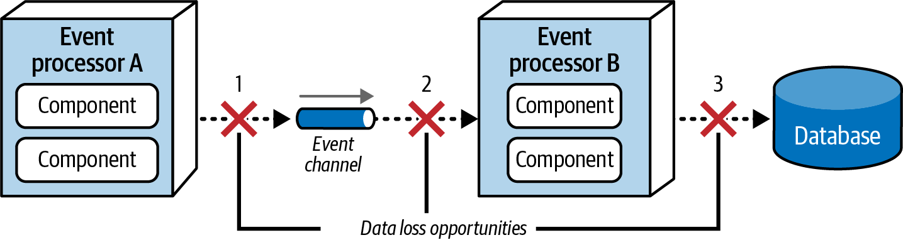

*Hình 15-20. Những nơi có thể xảy ra mất dữ liệu trong một event-driven architecture*

Với vấn đề thứ nhất, sự kiện không bao giờ đến được queue hoặc broker gặp sự cố trước khi sự kiện được đọc. Để giải quyết điều này, hãy dùng persistent message queue cùng với synchronous send. <a id="id1289"></a>Persisted message queue hỗ trợ *guaranteed delivery* (giao bảo đảm): khi event broker nhận sự kiện, nó không chỉ lưu sự kiện trong bộ nhớ để truy xuất nhanh, mà còn lưu bền sự kiện vào một loại kho dữ liệu vật lý nào đó (như filesystem hoặc database). Nếu event broker bị sập, sự kiện được lưu vật lý trên đĩa, nên nó vẫn có sẵn để xử lý khi event broker hoạt động trở lại. <a id="id1290"></a>*Synchronous send* thực hiện một blocking wait trong event processor, ngăn nó kích hoạt sự kiện cho đến khi broker xác nhận rằng nó đã lưu bền sự kiện vào database. Hai kỹ thuật cơ bản này ngăn ngừa mất dữ liệu giữa event producer và queue, vì sự kiện hoặc vẫn ở event producer hoặc đã được lưu bền trong queue.

<a id="id1291"></a>Một kỹ thuật messaging cơ bản gọi là *client acknowledge mode* có thể giải quyết vấn đề thứ hai, khi event processor `B` de-queues sự kiện khả dụng tiếp theo và bị crash trước khi có thể xử lý sự kiện. <a id="id1292"></a>Theo mặc định, khi một sự kiện được đọc từ một queue, nó lập tức bị loại khỏi queue đó (điều này được gọi là chế độ *auto acknowledge*). Client acknowledge mode giữ sự kiện trong queue và gắn client ID vào nó để không consumer nào khác có thể đọc hoặc xử lý sự kiện. Với chế độ này, nếu event processor `B` bị crash, sự kiện vẫn được giữ trong queue, ngăn ngừa mất message.

Vấn đề thứ ba, trong đó event processor `B` không thể lưu sự kiện vào database do một lỗi dữ liệu nào đó, có thể được giải quyết bằng ACID transaction thông qua một database commit. Khi event processor phát ra một database commit, dữ liệu được bảo đảm là đã được lưu bền trong database. <a id="id1293"></a><a id="id1294"></a>*Last participant support* (LPS) loại sự kiện khỏi persisted queue bằng cách xác nhận rằng mọi xử lý đã hoàn tất và sự kiện đã được lưu bền. Điều này bảo đảm sự kiện không bị mất trên đường từ event processor `A` tới database. Các kỹ thuật này được minh họa trong [Hình 15-21](#fig-style-eda-data-loss-prevent).<a id="id1295"></a>

<a id="fig-style-eda-data-loss-prevent"></a>

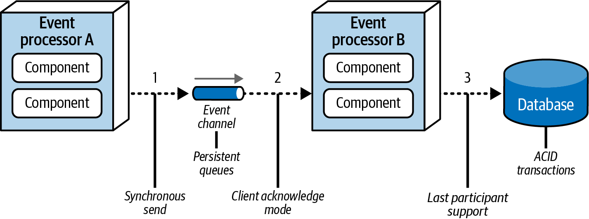

*Hình 15-21. Ngăn ngừa mất dữ liệu trong một event-driven architecture*

<a id="sec-eda-request-reply"></a>

### Xử lý yêu cầu–phản hồi (Request-Reply Processing)

<a id="ix_ch15-style-eda-asciidoc19"></a><a id="ix_ch15-style-eda-asciidoc20"></a><a id="ix_ch15-style-eda-asciidoc21"></a>Cho đến giờ trong chương này, chúng ta đã xử lý các request bất đồng bộ không cần phản hồi ngay lập tức từ event consumer. Nhưng còn các event processor cần thông tin trả về ngay lập tức từ một event processor khác thì sao—ví dụ, chờ một loại confirmation ID hoặc xác nhận nào đó trước khi kích hoạt một sự kiện? Kịch bản này đòi hỏi giao tiếp đồng bộ để hoàn thành request.

Trong EDA, giao tiếp đồng bộ thường được thực hiện thông qua messaging *request-reply* (đôi khi được gọi là *pseudosynchronous communications*: giao tiếp giả đồng bộ). Mỗi event channel trong messaging request-reply gồm hai queue: một *request* queue và một *reply* queue. Message producer gửi request thông tin ban đầu sẽ gửi dữ liệu một cách bất đồng bộ tới request queue, rồi trả quyền điều khiển cho message producer. Message producer sau đó thực hiện xử lý bổ sung, và cuối cùng chờ trên reply queue để nhận phản hồi. Message consumer nhận và xử lý message, rồi gửi phản hồi tới reply queue. Event producer nhận message chứa dữ liệu phản hồi. Luồng cơ bản này được minh họa trong [Hình 15-22](#fig-style-eda-rr).

<a id="fig-style-eda-rr"></a>

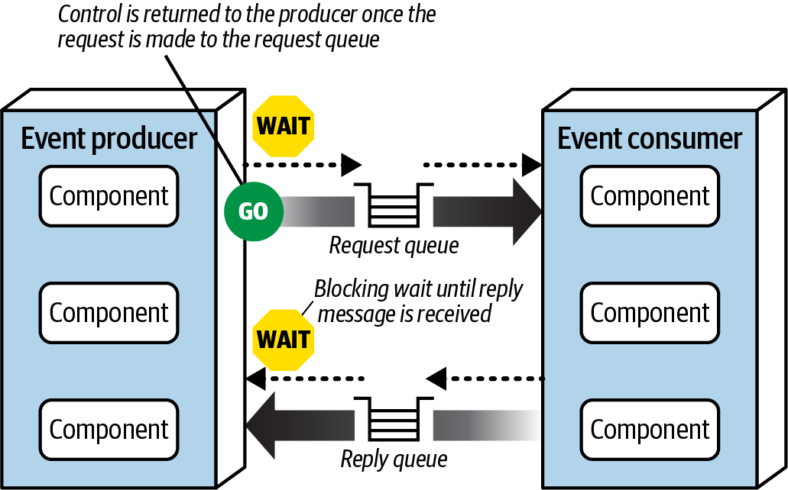

*Hình 15-22. Xử lý message request-reply*

Có hai cách chính để triển khai messaging request-reply. <a id="id1296"></a><a id="id1297"></a>Kỹ thuật thứ nhất (và phổ biến nhất) là đặt một trường *correlation ID* (CID) trong message header của reply message, thường được đặt bằng message ID của request message gốc (được gọi đơn giản là ID trong [Hình 15-23](#fig-style-eda-correlation)). Nó hoạt động như sau:

1. Event producer gửi một message tới request queue và ghi lại message ID duy nhất (ID 124). Lưu ý rằng CID trong trường hợp này là `null`.
2. Event producer thực hiện một blocking wait trên reply queue với một message filter (còn gọi là *message selector*), trong đó CID trong message header bằng message ID gốc (124). Có hai message trong reply queue: ID 855 với CID 120, và ID 856 với CID 122. Không message nào trong số này được lấy, vì không correlation ID nào khớp với cái mà event consumer đang tìm (CID 124).
3. Event consumer nhận message (ID 124) và xử lý request.
4. Event consumer tạo reply message chứa phản hồi và đặt CID trong message header bằng message ID gốc (124).
5. Event consumer gửi message ID mới (857) tới reply queue.
6. Event producer nhận message, vì CID (124) khớp với message selector từ bước 2.

<a id="fig-style-eda-correlation"></a>

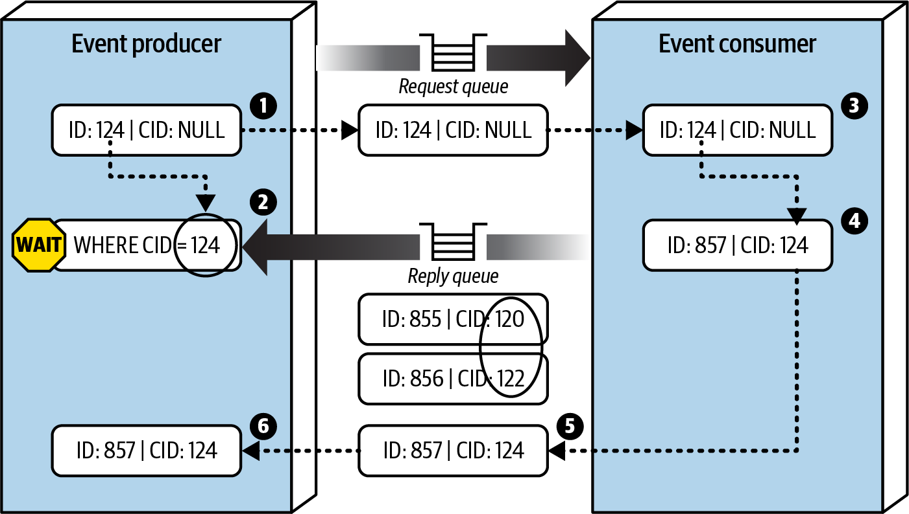

*Hình 15-23. Xử lý message request-reply dùng correlation ID*

<a id="ix_ch15-style-eda-asciidoc22"></a>Cách khác để triển khai messaging request-reply là dùng một *temporary queue* (queue tạm) làm reply queue. Một temporary queue dành riêng cho một request cụ thể, được tạo khi request được thực hiện, và bị xóa khi request kết thúc. Kỹ thuật này, như minh họa trong [Hình 15-24](#fig-style-eda-temp-queue), không đòi hỏi correlation ID, vì temporary queue là một queue chuyên dụng chỉ event producer biết cho request cụ thể đó. Kỹ thuật temporary queue hoạt động như sau:

1. Event producer tạo một temporary queue (hoặc queue được tạo tự động, tùy thuộc vào message broker) và gửi một message tới request queue, truyền tên của temporary queue trong header reply-to (hoặc một custom attribute agreed-upon nào khác trong message header).
2. Event producer thực hiện một blocking wait trên temporary reply queue. Không cần message selector vì bất kỳ message nào được gửi tới queue này đều chỉ thuộc về event producer đã gửi message gốc.
3. Event consumer nhận message, xử lý request, và gửi một message phản hồi tới reply queue được nêu tên trong header reply-to.
4. Event processor nhận message và xóa temporary queue.

<a id="fig-style-eda-temp-queue"></a>

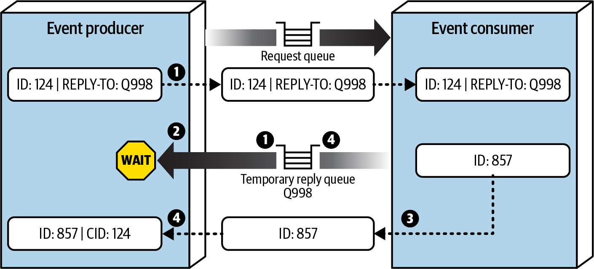

*Hình 15-24. Xử lý message request-reply dùng temporary queue*

Dù kỹ thuật temporary queue đơn giản hơn nhiều, message broker phải tạo một temporary queue cho mỗi request rồi xóa nó ngay lập tức. Điều này có thể làm chậm broker đáng kể và có thể ảnh hưởng đến performance và responsiveness tổng thể, đặc biệt với khối lượng message lớn và mức đồng thời cao. Vì lý do này, chúng tôi thường khuyến nghị dùng kỹ thuật correlation ID<a id="id1298"></a>.<a id="id1299"></a><a id="id1300"></a><a id="id1301"></a>

<a id="sec-eda-mediated"></a>

### Kiến trúc hướng sự kiện có mediator (Mediated Event-Driven Architecture)

<a id="ix_ch15-style-eda-asciidoc23"></a><a id="ix_ch15-style-eda-asciidoc24"></a>Cho đến giờ trong chương này, chúng tôi đã tập trung vào EDA *choreographed*, nơi các event processor kích hoạt sự kiện thông qua năng lực phát quảng bá, và nhiều event processor phản hồi sự kiện. Tuy nhiên, có thể có những lúc kiến trúc sư muốn kiểm soát nhiều hơn việc xử lý một sự kiện. Trong trường hợp này, kiến trúc sư có thể dùng một dạng EDA *orchestrated* được biết đến là mediator topology.

*Mediator topology* giải quyết một số thiếu sót của topology EDA choreographed chuẩn mà chúng tôi đã mô tả cho đến giờ trong chương này. <a id="id1302"></a>Nó xoay quanh một *event mediator*, thành phần quản lý và kiểm soát workflow cho các initiating event đòi hỏi phối hợp giữa nhiều event processor. Các component kiến trúc tạo nên mediator topology là: một initiating event, một event queue, một event mediator, các event channel và các event processor.

Quan trọng là, mediated topology thường dùng *message* thay vì *sự kiện* (xem [“Events Versus Messages”](#sec-eda-events-messages)). Chúng nhìn chung là các lệnh (như `ship_order`) thay vì các sự kiện đã xảy ra (như `order_shipped`).

Giống như trong choreographed topology, initiating event là thứ bắt đầu toàn bộ quy trình. Tuy nhiên, trong mediator topology ([Hình 15-25](#fig-style-eda-mediator)), một event mediator chấp nhận initiating event. Nó chỉ biết các bước liên quan đến việc xử lý sự kiện, nên nó tạo ra các derived message tương ứng và gửi chúng tới các message channel chuyên dụng (thường là queue) theo kiểu point-to-point. Các event processor sau đó lắng nghe các event channel chuyên dụng, xử lý message, và (thường) phản hồi mediator khi hoàn thành công việc. Các event processor trong mediator topology không thông báo những gì chúng đã làm cho phần còn lại của hệ thống thông qua các derived message bổ sung.

Trong hầu hết các bản triển khai của mediator topology, có nhiều mediator, mỗi mediator thường gắn với một domain hoặc nhóm sự kiện cụ thể. Điều này tránh có một single point of failure, vốn có thể là vấn đề với topology này, và tăng throughput và performance tổng thể. Ví dụ, một customer mediator có thể xử lý mọi sự kiện customer-related (như đăng ký khách hàng mới và cập nhật hồ sơ), trong khi một order mediator xử lý các hoạt động order-related (như thêm sản phẩm vào giỏ hàng và thanh toán).

Cách kiến trúc sư chọn để triển khai event mediator thường phụ thuộc vào bản chất và độ phức tạp của các message mà event mediator đang xử lý. Ví dụ, với các sự kiện đòi hỏi xử lý lỗi và orchestration đơn giản, các mediator như [Apache Camel](https://camel.apache.org), [Mule ESB](https://mulesoft.com) hoặc [Spring Integration](https://oreil.ly/r2e4r) thường là đủ. Các luồng message và tuyến message trong những loại mediator này thường được viết tùy biến bằng code lập trình (như Java hoặc C#) để kiểm soát workflow event-processing.

Tuy nhiên, nếu workflow sự kiện đòi hỏi nhiều xử lý có điều kiện và nhiều đường đi động với các chỉ thị xử lý lỗi phức tạp, thì một mediator như [Apache ODE](https://ode.apache.org) hoặc [Oracle BPEL Process Manager](https://oreil.ly/jMtta) sẽ là lựa chọn phù hợp hơn. <a id="id1303"></a><a id="id1304"></a>Các mediator này dựa trên [Business Process Execution Language (BPEL)](https://oreil.ly/Uu-Fo), một cấu trúc XML-like mô tả các bước liên quan đến việc xử lý một sự kiện. Các artifact BPEL cũng chứa các phần tử có cấu trúc dùng cho xử lý lỗi, chuyển hướng, multicasting, v.v. BPEL là một ngôn ngữ mạnh nhưng tương đối phức tạp để học, nên kiến trúc sư thường tạo mediator bằng các công cụ GUI trong bộ engine của BPEL.

<a id="fig-style-eda-mediator"></a>

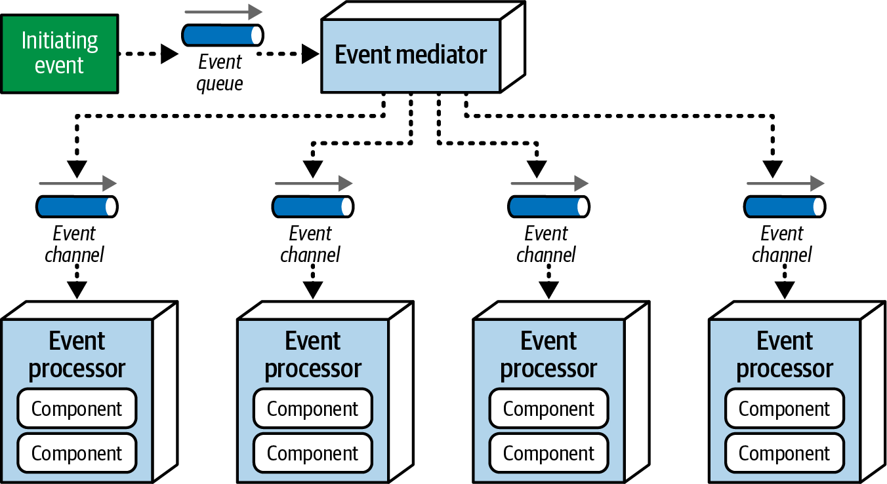

*Hình 15-25. Mediator topology*

BPEL tốt cho các workflow phức tạp, động, nhưng nó không hoạt động tốt với các workflow sự kiện có transaction long-running đòi hỏi sự can thiệp của con người trong suốt quy trình sự kiện. Ví dụ, giả sử một giao dịch đang được đặt thông qua một initiating event `place_trade`. Event mediator chấp nhận sự kiện này, nhưng trong quá trình xử lý, phát hiện ra cần phê duyệt thủ công vì giao dịch vượt quá một số lượng cổ phần nhất định. Event mediator giờ phải dừng xử lý sự kiện, thông báo cho một nhà giao dịch cấp cao để được phê duyệt thủ công, và chờ sự phê duyệt đó. Trong những trường hợp này, một <a id="id1305"></a><a id="id1306"></a>engine Business Process Management (BPM), như [jBPM](https://jbpm.org), sẽ phù hợp hơn so với dùng một event mediator.

Trước khi chọn loại event mediator nào để triển khai, điều quan trọng là phải biết các loại sự kiện nó sẽ xử lý. Với các sự kiện phức tạp, long-running có sự tương tác của con người, Apache Camel sẽ cực kỳ khó dùng và bảo trì. Tương tự, dùng một BPM engine cho các luồng sự kiện đơn giản sẽ lãng phí nhiều tháng công sức cho một thứ mà Apache Camel có thể hoàn thành trong vài ngày.

Tất nhiên, hiếm khi tất cả các sự kiện đều vừa khít vào một mức độ phức tạp. Chúng tôi khuyến nghị phân loại sự kiện thành đơn giản, khó, hoặc phức tạp, và gửi mọi sự kiện qua một mediator đơn giản, như Apache Camel hoặc Mule. Mediator đơn giản có thể tự xử lý sự kiện hoặc chuyển tiếp nó tới một event mediator khác, phức tạp hơn dựa trên phân loại độ phức tạp đó. Mô hình ủy thác mediator này, minh họa trong [Hình 15-26](#fig-style-eda-mediator-delegate), bảo đảm rằng mọi loại sự kiện đều được xử lý bởi loại mediator sẽ xử lý chúng hiệu quả nhất.

<a id="fig-style-eda-mediator-delegate"></a>

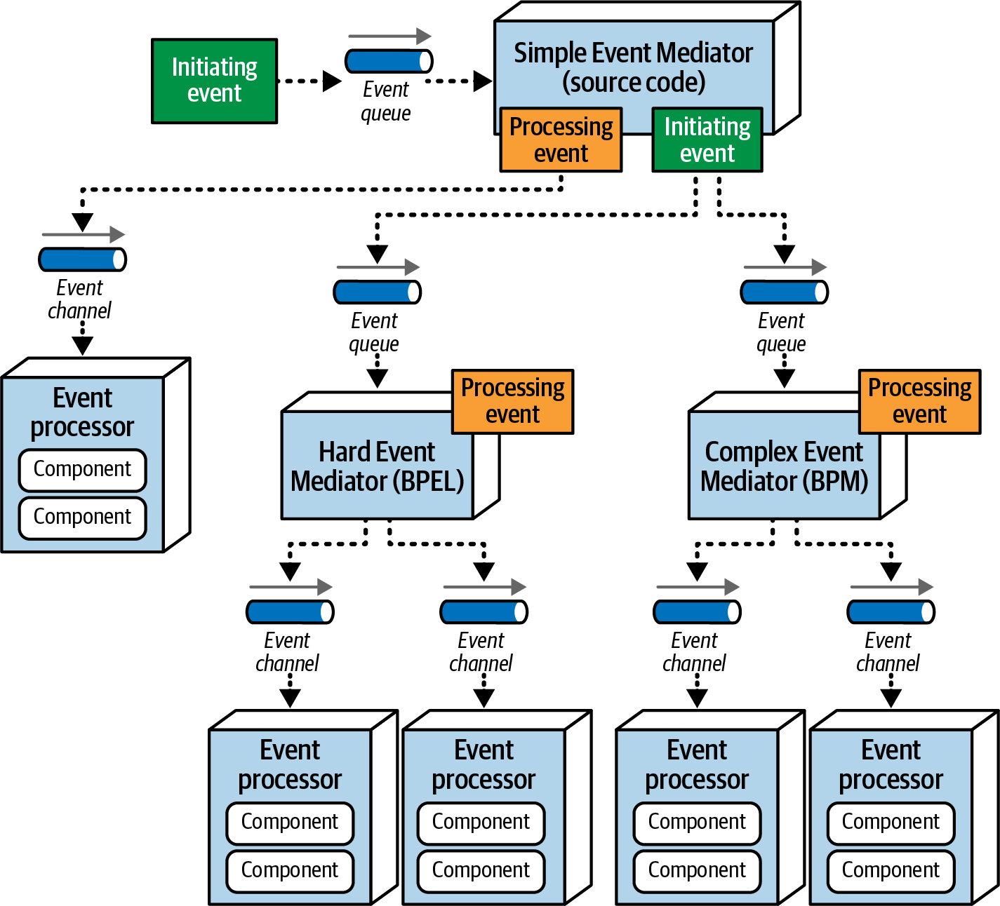

*Hình 15-26. Ủy thác sự kiện cho loại event mediator phù hợp*

Hãy chú ý trong [Hình 15-26](#fig-style-eda-mediator-delegate) rằng `Simple Event Mediator` tạo và gửi một derived message khi workflow sự kiện đủ đơn giản để được xử lý hoàn toàn bởi mediator đơn giản. Tuy nhiên, khi initiating event được phân loại là khó hoặc phức tạp, `Simple Event Mediator` chuyển tiếp initiating event gốc tới các mediator tương ứng (BPEL hoặc BPM). `Simple Event Mediator`, đã chặn sự kiện gốc, vẫn có thể chịu trách nhiệm biết khi nào sự kiện đó hoàn tất, hoặc nó có thể đơn giản ủy thác toàn bộ workflow (bao gồm thông báo cho client) cho các mediator khác.

Để xem xét mediator topology hoạt động như thế nào, hãy xét cùng hệ thống nhập đơn hàng bán lẻ mà chúng tôi đã mô tả trong mục về choreographed topology, nhưng lần này dùng mediator topology. Mediator biết các bước cần thiết để xử lý sự kiện cụ thể này. Luồng sự kiện nội bộ của mediator component được minh họa trong [Hình 15-27](#fig-style-eda-mediator-flow).

<a id="fig-style-eda-mediator-flow"></a>

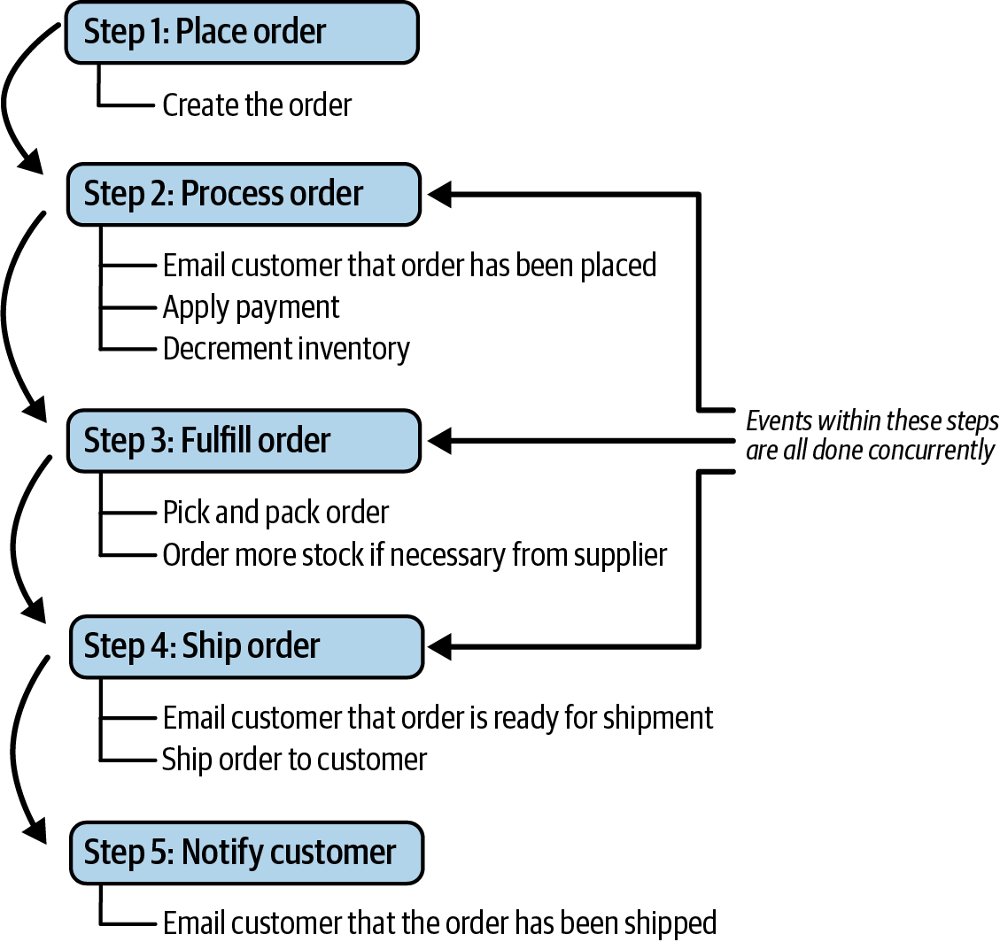

*Hình 15-27. Các bước của mediator để đặt một đơn hàng*

Nhất quán với ví dụ trước, cùng initiating event (`place order`) được gửi tới event mediator qua một queue chuyên dụng để xử lý. Mediator `Customer` nhận initiating event này và bắt đầu tạo các derived message, dựa trên luồng trong [Hình 15-27](#fig-style-eda-mediator-flow). Các sự kiện trong các bước 2, 3 và 4 đều được thực hiện đồng thời (trong mỗi bước) và tuần tự, giữa các bước. Nói cách khác, bước 3 (fulfill order) phải được hoàn tất và xác nhận trước khi khách hàng có thể được thông báo rằng đơn hàng đã sẵn sàng để giao ở bước 4 (ship order).

Khi nhận được initiating event, mediator `Customer` tạo một derived message `create order`, được gửi tới queue `order placement` (xem [Hình 15-28](#fig-style-eda-mediator-example-1)). Event processor `Order Placement` chấp nhận message, kiểm tra và tạo đơn hàng, rồi gửi lại cho mediator một xác nhận và order ID. Tại thời điểm này, mediator có thể gửi order ID đó cho khách hàng, cho biết đơn hàng đã được đặt, hoặc nó có thể phải tiếp tục cho đến khi tất cả các bước hoàn tất (điều này sẽ phụ thuộc vào các quy tắc nghiệp vụ cụ thể về việc đặt đơn hàng).

<a id="fig-style-eda-mediator-example-1"></a>

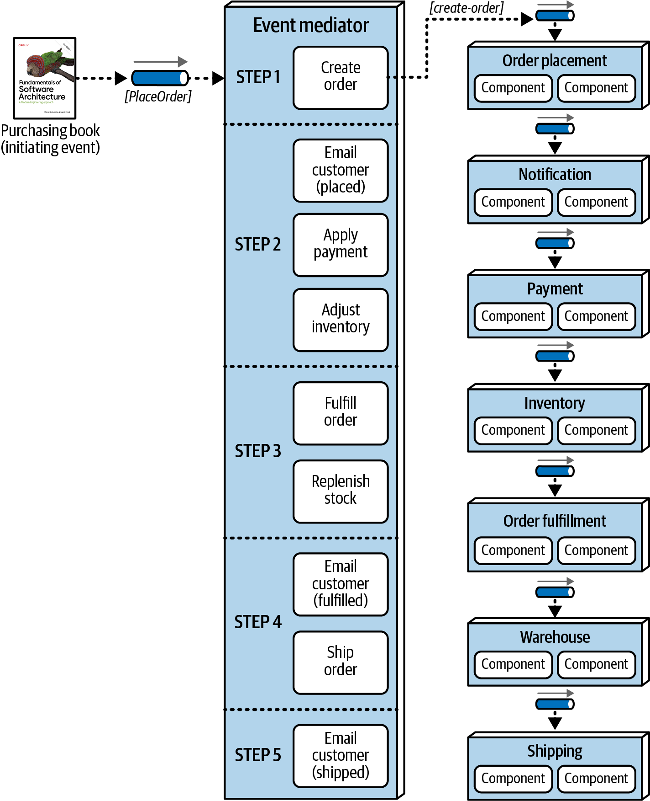

*Hình 15-28. Bước 1 của ví dụ mediator*

Giờ bước 1 đã hoàn tất, mediator chuyển sang bước 2 (xem [Hình 15-29](#fig-style-eda-mediator-example-2)) và tạo ba derived message cùng lúc: `email customer`, `apply payment` và `adjust inventory`. Nó gửi cả ba tới các queue tương ứng. Cả ba event processor nhận các message này, thực hiện tác vụ tương ứng của mình, và thông báo cho mediator rằng việc xử lý đã hoàn tất. Mediator phải chờ cho đến khi nhận được xác nhận từ cả ba tiến trình song song trước khi chuyển sang bước 3. Nếu xảy ra lỗi ở một trong các event processor song song, mediator có thể thực hiện hành động khắc phục (sẽ nói thêm về điều đó ở phần sau của mục này).

<a id="fig-style-eda-mediator-example-2"></a>

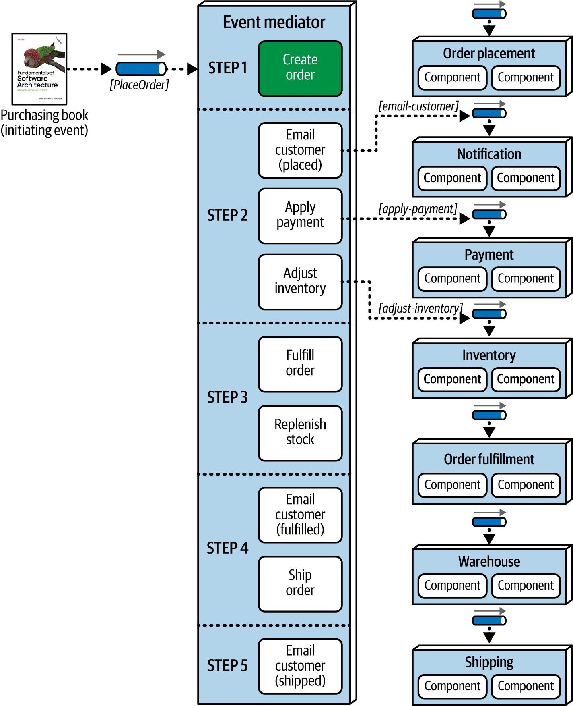

*Hình 15-29. Bước 2 của ví dụ mediator*

Khi mediator nhận được xác nhận thành công từ tất cả các event processor ở bước 2, nó có thể chuyển sang bước 3 để thực hiện đơn hàng (xem [Hình 15-30](#fig-style-eda-mediator-example-3)). Một lần nữa, cả hai message này (`fulfill order` và `order stock`) có thể xảy ra đồng thời. Các event processor `Order Fulfillment` và `Warehouse` chấp nhận các message, thực hiện công việc của mình, và trả về một xác nhận cho mediator.

<a id="fig-style-eda-mediator-example-3"></a>

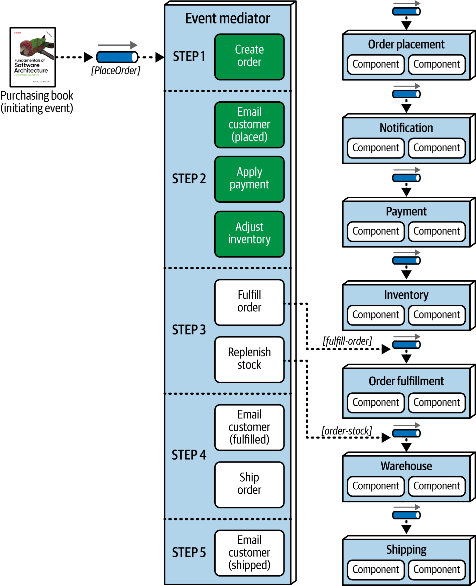

*Hình 15-30. Bước 3 của ví dụ mediator*

Mediator chuyển sang bước 4 (xem [Hình 15-31](#fig-style-eda-mediator-example-4)) để giao đơn hàng. Bước này tạo hai derived message: một message `ship order`, và một message `email customer` khác với thông tin cụ thể về việc cần làm (thông báo cho khách hàng rằng đơn hàng đã sẵn sàng để giao).

<a id="fig-style-eda-mediator-example-4"></a>

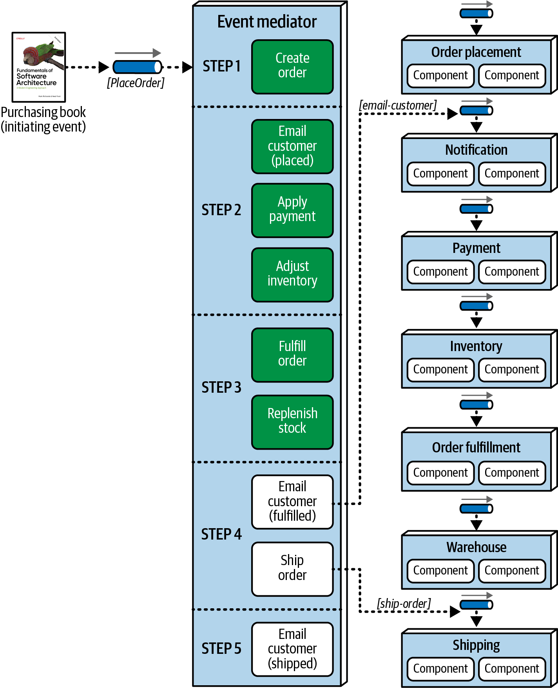

*Hình 15-31. Bước 4 của ví dụ mediator*

Cuối cùng, mediator chuyển sang bước 5 (xem [Hình 15-32](#fig-style-eda-mediator-example-5)) và tạo một message `email customer` theo ngữ cảnh khác để thông báo cho khách hàng rằng đơn hàng đã được giao đi. Điều này kết thúc workflow. Mediator đánh dấu luồng initiating event là hoàn tất và loại bỏ mọi trạng thái gắn với initiating event.

<a id="fig-style-eda-mediator-example-5"></a>

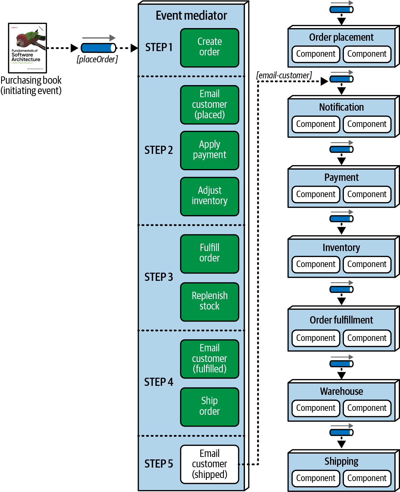

*Hình 15-32. Bước 5 của ví dụ mediator*

Trong topology này, không giống choreographed topology, mediator component có hiểu biết về và kiểm soát workflow. Nó có thể duy trì trạng thái sự kiện và quản lý xử lý lỗi, khả năng phục hồi, và năng lực khởi động lại. Ví dụ, giả sử trong ví dụ của chúng ta rằng thanh toán không được áp dụng vì thẻ tín dụng đã hết hạn. Khi mediator nhận được tình trạng lỗi này, nó biết rằng đơn hàng không thể được thực hiện (bước 3) cho đến khi thanh toán được áp dụng, nên nó dừng workflow và ghi lại trạng thái của request vào datastore lưu bền của riêng nó. Khi thanh toán cuối cùng được áp dụng, workflow có thể được khởi động lại từ chỗ đã dừng (trong trường hợp này là đầu bước 3).

Dù mediator topology giải quyết các vấn đề gắn với choreographed topology, nó có những nhược điểm riêng. Trước hết, rất khó mô hình hóa theo kiểu khai báo việc xử lý động xảy ra trong một luồng sự kiện phức tạp. Do đó, nhiều workflow trong mediator topology chỉ xử lý phần xử lý chung, nhưng dùng một mô hình lai kết hợp mediator topology và choreographed topology để giải quyết bản chất động của xử lý sự kiện phức tạp, như các tình trạng out-of-stock hoặc các lỗi bất thường khác. Hơn nữa, dù các event processor có thể dễ dàng scale theo cùng cách như choreographed topology, mediator cũng phải scale—điều đôi khi tạo ra nút cổ chai trong luồng event-processing tổng thể. Các event processor không decoupled cao trong mediator topology bằng trong choreographed topology. Cuối cùng, performance trong topology này không tốt bằng, vì mediator kiểm soát việc xử lý sự kiện.

Sự trade-off giữa choreographed topology và mediator topology về cơ bản quy về việc cân nhắc giữa kiểm soát workflow và năng lực xử lý lỗi với performance và scalability cao. Dù performance và scalability vẫn tốt trong mediator topology, chúng không cao bằng với choreographed topology<a id="id1307"></a><a id="id1308"></a>.<a id="id1309"></a>

<a id="sec-eda-data-topologies"></a>

## Topology dữ liệu (Data Topologies)

<a id="ix_ch15-style-eda-asciidoc25"></a>Với tất cả những gì đã bàn về sự kiện và xử lý sự kiện, rất dễ quên mặt dữ liệu của EDA. Các topology database là một khía cạnh độc đáo và thú vị của architectural style này. Nó mang lại nhiều lựa chọn, mỗi lựa chọn có những trade-offs đáng kể có thể tác động lớn đến architecture tổng thể. Để mô tả các topology database khác nhau trong EDA, chúng tôi sẽ dùng một phiên bản đơn giản hóa của ví dụ chúng tôi đã trình bày trong [Hình 15-3](#fig-style-eda-topology-example) (xem [Hình 15-33](#fig-eda-data-topology-example)).

Khi một khách hàng đặt một đơn hàng, event processor `Order Placement` tạo đơn hàng, rồi kích hoạt sự kiện `order placed`, mà cả event processor `Payment` và `Inventory` đều phản hồi. Khi thanh toán đã được áp dụng, event processor `Order Fulfillment` giúp người đóng gói chuẩn bị đơn hàng, rồi kích hoạt sự kiện `order fulfilled`. Event processor `Shipping` phản hồi sự kiện `order fulfilled` bằng cách giao đơn hàng cho khách hàng, hoàn tất việc xử lý và đáp ứng yêu cầu của khách hàng.

<a id="fig-eda-data-topology-example"></a>

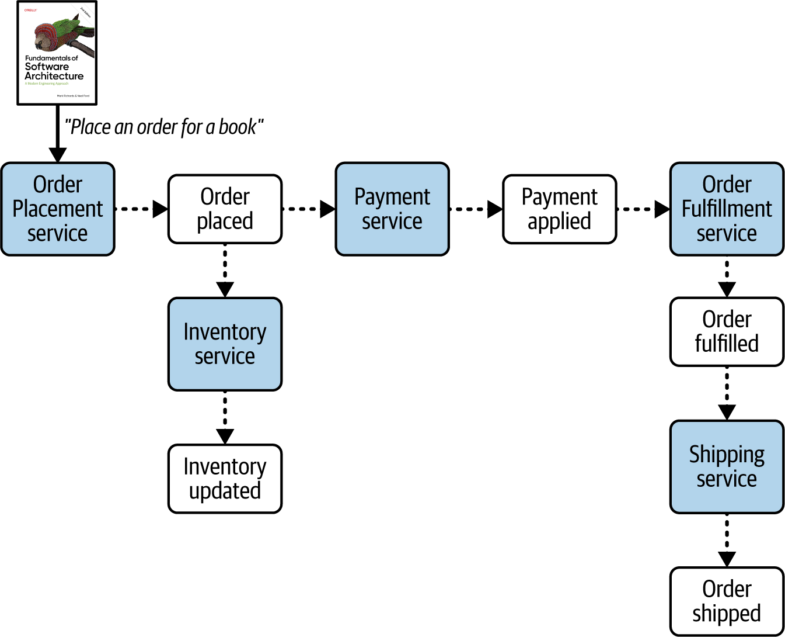

*Hình 15-33. Một ví dụ đơn giản hóa của hệ thống order-entry ví dụ dùng EDA*

Một sự phức tạp của EDA là event processor `Order Placement` cần biết hai mẩu thông tin: hiện có bao nhiêu sản phẩm trong kho, và có những lựa chọn vận chuyển nào dựa trên vị trí của khách hàng. Nó lấy thông tin này như thế nào sẽ phụ thuộc vào loại topology database mà architecture dùng. Hãy xem từng lựa chọn topology database để thấy các trade-offs đáng kể của nó.

<a id="id139"></a>

### Topology database monolith (Monolithic Database Topology)

<a id="ix_ch15-style-eda-asciidoc26"></a><a id="ix_ch15-style-eda-asciidoc27"></a><a id="ix_ch15-style-eda-asciidoc28"></a>Topology database đầu tiên, và có lẽ phổ biến nhất, được dùng trong EDA là topology *single monolithic database* (một monolithic database duy nhất). Với topology này, mọi dữ liệu đều có sẵn cho mọi event processor thông qua một database trung tâm.

Lợi ích chính của monolithic database topology là bất kỳ event processor nào cũng có thể truy vấn dữ liệu nó cần trực tiếp từ database, mà không phải giao tiếp đồng bộ với bất kỳ event processor nào khác. Đây là một ưu điểm đáng kể, vì các event-driven architecture dựa vào các event processor decoupled cao giao tiếp qua giao tiếp bất đồng bộ. Trong [Hình 15-34](#fig-eda-data-monolith-query), event processor `Order Placement` có thể đơn giản truy vấn monolithic database trung tâm để truy xuất số lượng sản phẩm hiện có trong kho và các lựa chọn vận chuyển của khách hàng.

<a id="fig-eda-data-monolith-query"></a>

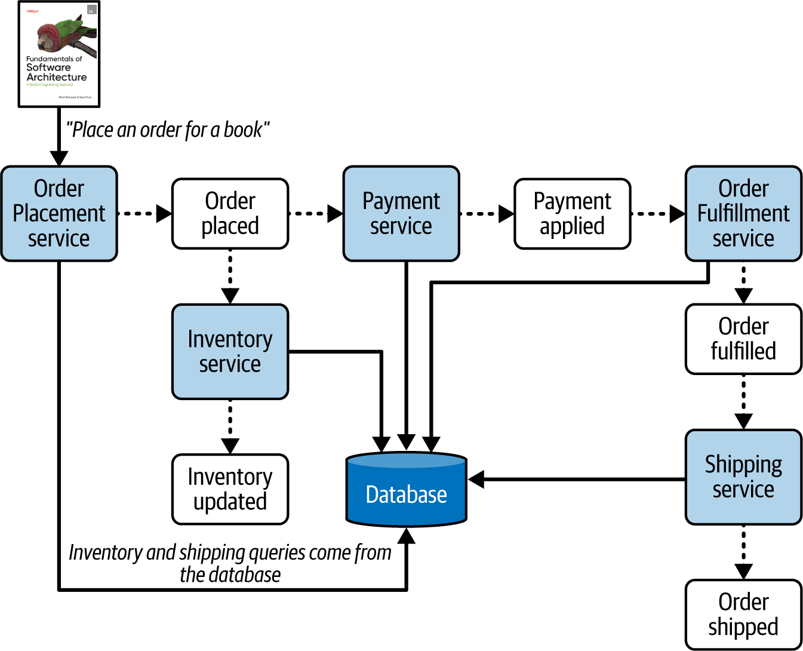

*Hình 15-34. Với monolithic database topology, dữ liệu có sẵn trực tiếp từ database*

Dù monolithic database topology hỗ trợ decoupling và hạn chế giao tiếp giữa các event processor, nó mang theo một số nhược điểm rắc rối, đầu tiên là fault tolerance. Nếu monolithic database trung tâm bị crash hoặc ngừng hoạt động để bảo trì, mọi event processor đều trở nên không khả dụng.

Vấn đề thứ hai là scalability. Vì các event-driven architecture dùng giao tiếp bất đồng bộ, mỗi event processor có thể scale độc lập với các processor khác. Event channel về cơ bản đóng vai trò như một điểm backpressure để các event processor riêng lẻ có thể scale khi cần, bất kể các event processor khác có scale hay không. Tuy nhiên, nếu tất cả các event processor đồng thời truy vấn và ghi vào cùng một database, *database* phải scale để đáp ứng những nhu cầu này. Nhiều database không thể đạt được điều này ở tải đồng thời cao.

Vấn đề thứ ba là kiểm soát thay đổi. Khi cấu trúc của database thay đổi (như xóa một cột hoặc thuộc tính), nhiều event processor bị ảnh hưởng và phải phối hợp, ngay cả với một thay đổi database duy nhất.

Cuối cùng, monolithic database topology tất yếu tạo ra một architectural quantum duy nhất, do monolithic database dùng chung.<a id="id1310"></a><a id="id1311"></a><a id="id1312"></a>

<a id="id140"></a>

### Topology database theo domain (Domain Database Topology)

<a id="ix_ch15-style-eda-asciidoc29"></a><a id="ix_ch15-style-eda-asciidoc30"></a>Một topology database khả dĩ khác trong EDA là *domain database topology*, nhóm các event processor vào các domain khác nhau, mỗi domain sở hữu database riêng ([Hình 15-35](#fig-eda-data-domain)).

<a id="fig-eda-data-domain"></a>

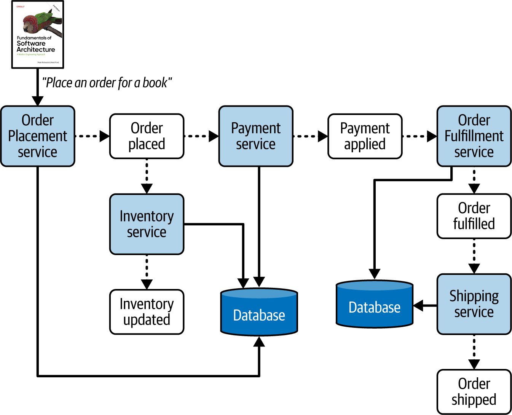

*Hình 15-35. Domain database topology dùng một database riêng cho mỗi domain*

Các ưu điểm chính của domain database topology so với monolithic database topology, xuất phát từ việc được phân vùng theo domain, là fault tolerance, scalability và kiểm soát thay đổi tốt hơn. Trong ví dụ ở [Hình 15-35](#fig-eda-data-domain), nếu database của domain order-processing (database gắn với các event processor `Order Fulfillment` và `Order Shipping`) bị crash hoặc trở nên không khả dụng do bảo trì, domain đặt đơn hàng vẫn hoạt động đầy đủ và có thể tiếp tục chấp nhận đơn hàng. Event channel chứa derived event `payment applied` đóng vai trò như một điểm backpressure, xếp hàng các sự kiện cho đến khi database order-processing trở nên khả dụng. Điều tương tự cũng đúng với scalability và kiểm soát thay đổi; mỗi domain database chỉ phải lo về việc scale dựa trên các event processor cụ thể của domain đó, và chỉ những event processor domain-scoped đó cần thay đổi nếu cấu trúc database thay đổi.

Tuy nhiên, hãy xét hai mẩu thông tin mà event processor `Order Placement` cần: số lượng sách hiện có và các lựa chọn vận chuyển. Với domain database topology, event processor `Order Placement` có thể đơn giản truy vấn domain database của mình để lấy tồn kho sách, tương tự cách nó truy xuất thông tin này với monolithic database topology. Tuy nhiên, nó phải thực hiện một lời gọi *đồng bộ* tới event processor `Order Shipping` để truy xuất các lựa chọn vận chuyển, qua đó coupling đồng bộ các service này (xem [Hình 15-36](#fig-eda-data-domain-query)).

<a id="fig-eda-data-domain-query"></a>

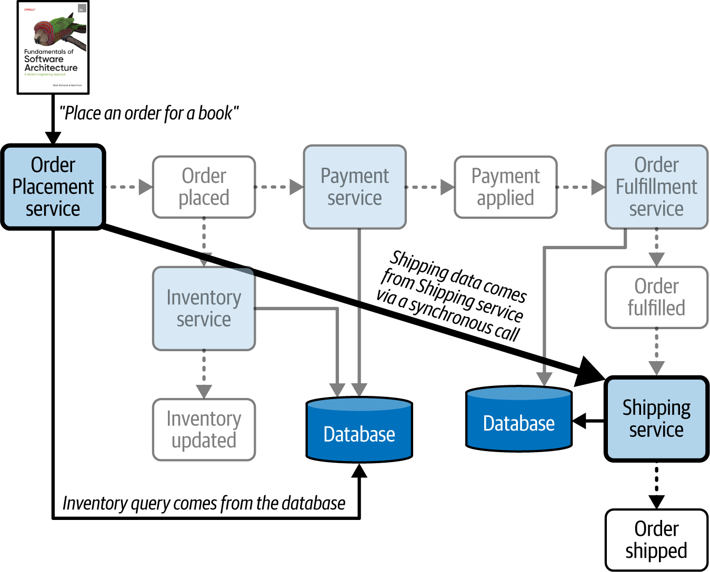

*Hình 15-36. Dữ liệu cần cho event processor Order Placement có thể đòi hỏi giao tiếp đồng bộ tới một event processor ở domain khác*

Kiến trúc sư nên cố tránh coupling đồng bộ trong một architecture động cao, decoupled như EDA. Các lời gọi đồng bộ có thể gây tổn hại cho fault tolerance và scalability, triệt tiêu nhiều lợi ích của việc dùng topology này. Hãy luôn kiểm tra rằng các domain vẫn khá độc lập với nhau, và tối thiểu hóa các lời gọi liên service đồng bộ nhiều nhất có thể. Nếu cần quá nhiều giao tiếp đồng bộ giữa các event processor, hãy đánh giá lại ranh giới domain, gộp các domain thành một, hoặc chuyển sang monolithic database topology.<a id="id1313"></a><a id="id1314"></a>

<a id="id141"></a>

### Topology dữ liệu chuyên dụng (Dedicated Data Topology)

<a id="ix_ch15-style-eda-asciidoc31"></a><a id="ix_ch15-style-eda-asciidoc32"></a><a id="ix_ch15-style-eda-asciidoc33"></a>Một lựa chọn khả thi khác trong EDA là *dedicated database topology* (topology database chuyên dụng), trong thế giới microservices thường được gọi là pattern *database-per-service*. Với topology database này, mỗi event processor sở hữu database chuyên dụng riêng trong một bounded context được hình thành chặt chẽ, tương tự microservices (xem [“Data Topologies”](ch18_microservices_architecture.vi.md#sec-ms-data-topologies) trong [Chương 18](ch18_microservices_architecture.vi.md#ch-style-microservices)). Topology này được minh họa trong [Hình 15-37](#fig-eda-data-dedicated).

<a id="fig-eda-data-dedicated"></a>

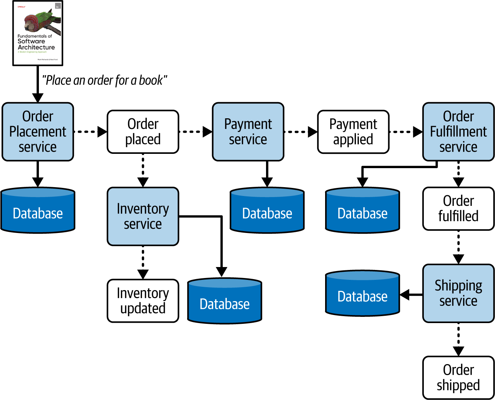

*Hình 15-37. Dedicated database topology của EDA dùng một database riêng cho mỗi event processor*

Không ngạc nhiên khi dedicated database topology có mức fault tolerance, scalability và kiểm soát thay đổi cao nhất trong tất cả các topology hiện có. Nếu một event processor hoặc database bị sập, sự cố được cô lập chỉ trong event processor đó; mọi event processor khác vẫn hoạt động bình thường. Database chỉ cần scale dựa trên event processor duy nhất trong bounded context của nó, khiến topology này có scalability cao nhất trong ba topology được thảo luận trong mục này. Cuối cùng, các thay đổi đối với cấu trúc database chỉ tác động đến event processor gắn với database đó.

Về mặt tiêu cực, tùy thuộc vào technology stack database, đây có thể là một lựa chọn rất tốn kém. Tuy nhiên, có lẽ nhược điểm lớn nhất là dynamic coupling đồng bộ giữa các event processor. Để minh họa nhược điểm này, hãy xem lại hai mẩu thông tin mà event processor `Order Placement` cần cho việc xử lý: tồn kho sách và các lựa chọn vận chuyển. Trong topology này, event processor `Order Placement` sẽ cần thực hiện các lời gọi đồng bộ tới *cả* event processor `Inventory` và event processor `Order Shipment` để lấy thông tin nó cần, tạo ra các điểm coupling đồng bộ chặt khắp architecture (như trong [Hình 15-38](#fig-eda-data-dedicated-query)). Như với domain database topology, hãy xác định mọi yêu cầu data-related trong mỗi event processor trước khi chọn lựa chọn topology database này.

<a id="fig-eda-data-dedicated-query"></a>

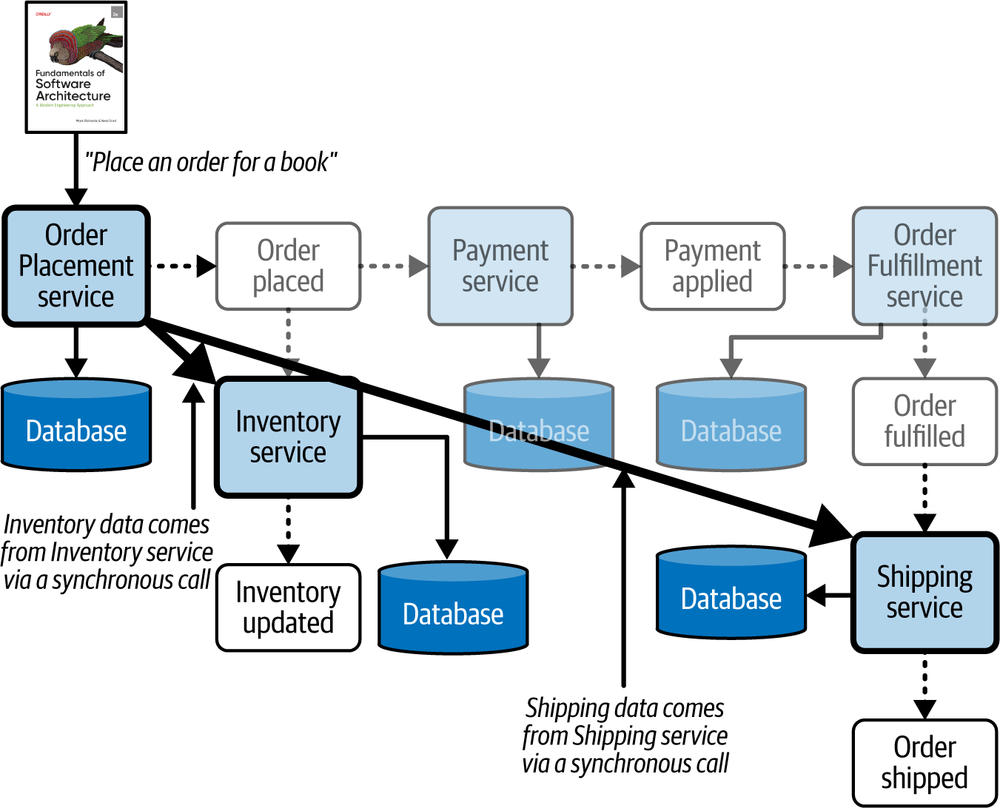

*Hình 15-38. Dữ liệu cần cho event processor `Order Placement` có thể đòi hỏi giao tiếp đồng bộ tới các event processor khác*

Dedicated database topology là một lựa chọn tốt khi các event processor phần lớn self-contained, chỉ cần dữ liệu trong bounded context và database tương ứng của riêng nó. Nếu các event processor giao tiếp quá nhiều (xem [“Governance”](#sec-eda-governance)), kiến trúc sư nên cân nhắc chuyển sang domain database topology hoặc thậm chí monolithic database topology để cải thiện performance và scalability tổng thể. Tuy nhiên, nếu tình huống cụ thể có các thay đổi cấu trúc thường xuyên đối với database, điều đó có thể biện minh cho một trade-off giữa các characteristic vận hành này để tối thiểu hóa số lượng event processor bị ảnh hưởng<a id="id1315"></a><a id="id1316"></a><a id="id1317"></a>.<a id="id1318"></a>

<a id="id342"></a>

## Các cân nhắc về cloud (Cloud Considerations)

<a id="id1319"></a><a id="id1320"></a>Event-driven architecture hoạt động tốt với các môi trường và bản triển khai cloud-based, chủ yếu nhờ bản chất decoupled cao của chúng. EDA có thể dễ dàng tận dụng các service bất đồng bộ do các nhà cung cấp cloud cung cấp, và bản chất elastic của hạ tầng cloud và các service cloud-based khớp với hình dạng của nó. Về cơ bản, các môi trường cloud-based là một sự kết hợp tốt cho EDA.

<a id="id343"></a>

## Các rủi ro phổ biến (Common Risks)

<a id="id1321"></a>Một trong những rủi ro chính gắn với EDA là việc xử lý sự kiện không tất định của nó có thể gây ra tác dụng phụ: chẳng hạn, các event processor kích hoạt derived event một cách bất ngờ hoặc không phản hồi một sự kiện khi lẽ ra phải phản hồi. Các workflow sự kiện có thể trở nên rất phức tạp trong một event-driven architecture, và nhiều khi khó biết chính xác điều gì sẽ xảy ra khi một sự kiện được kích hoạt.

Một rủi ro lớn khác là có quá nhiều static coupling (và do đó sự giòn) trong event-driven architecture. Dù EDA có coupling *động* cao, các contract event payload (xem [“Event Payload”](#sec-eda-payload)) cũng có thể đưa vào coupling *tĩnh* chặt. Thay đổi một contract có thể là một tác vụ đáng ngại, vì kiến trúc sư không phải lúc nào cũng biết những event processor nào đang phản hồi một sự kiện cụ thể. Khi một contract event payload thay đổi, nó có thể tác động tiêu cực đến một số event processor khác, làm tăng sự giòn tổng thể của architectural style này. Key-based event payload giúp giảm nhẹ rủi ro này, nhưng rủi ro của thực hành này bao gồm các vấn đề về scalability và performance và khả năng xảy ra anemic event (xem [“Event Payload”](#sec-eda-payload)).

Cũng hãy cẩn thận với quá nhiều giao tiếp đồng bộ giữa các event processor. Event-driven architecture có được siêu năng lực từ các event processor được decoupled động cao. Tuy nhiên, nếu các event processor liên tục cần giao tiếp đồng bộ, đó là một dấu hiệu tốt cho thấy EDA không phải là architectural style phù hợp nhất.

Cuối cùng, quản lý trạng thái tổng thể vừa là một rủi ro vừa là một thách thức trong EDA. Biết khi nào initiating event đã được xử lý hoàn toàn là điều tốt, nhưng điều đó có thể rất khó xác định do việc xử lý sự kiện song song, bất đồng bộ, không tất định của EDA. Đôi khi kiến trúc sư có thể xác định endpoint xử lý cuối cùng và để event processor đã chấp nhận initiating event subscribe vào sự kiện “kết thúc” đó, nhưng trong hầu hết các trường hợp điều này khó xác định. Kết quả là, rất khó biết khi nào một initiating event đã được xử lý đầy đủ, hoặc thậm chí trạng thái hiện tại của nó.

<a id="sec-eda-governance"></a>

## Quản trị (Governance)

<a id="id1322"></a><a id="id1323"></a>Phần lớn governance gắn với EDA là phi cấu trúc và đòi hỏi observability dưới dạng log như một phần của một governance mesh tổng thể. Tùy thuộc vào hạ tầng và môi trường, một số governance metric gắn với EDA có thể cần được thu thập thủ công.

Hai lĩnh vực governance chính trong style này là static coupling thông qua quản lý contract, và dynamic coupling thông qua các lời gọi đồng bộ. Cả hai khía cạnh này đều được coi là sự xuống cấp cấu trúc trong EDA, nên điều quan trọng là phải để mắt đến chúng.

Từ góc nhìn static coupling, kiến trúc sư có thể thiết lập governance xoay quanh những thứ như tốc độ thay đổi của các contract event payload và stamp coupling tổng thể. Thay đổi contract có thể rất rủi ro trong EDA vì bản chất decoupled của nó. Thay đổi một contract sự kiện, đặc biệt là contract không có schema gắn kèm, có thể làm hỏng một event processor downstream. Đây là một rủi ro đặc biệt trong EDA vì rất khó test các luồng sự kiện end-to-end không tất định.

<a id="id1324"></a>Stamp coupling (xem [“Event Payload”](#sec-eda-payload)) có thể được quản trị bằng cách liên tục ghi lại và quan sát những trường nào trong một contract sự kiện không được dùng bởi các event processor phản hồi sự kiện. Quan sát các trường không dùng này có thể giúp cắt gọn kích thước contract, giảm bandwidth, và giúp quản lý stamp coupling cùng các thay đổi không cần thiết tương ứng đối với event processor.

Từ góc nhìn dynamic coupling, kiến trúc sư có thể viết các fitness function tự động để quan sát và theo dõi giao tiếp đồng bộ giữa các event processor thông qua log và các phương tiện quan sát được khác (như annotation trong source code hoặc việc dùng các thư viện custom-identifier đồng bộ chuẩn). *Bất kỳ* giao tiếp đồng bộ nào trong một event-driven architecture cũng nên được theo dõi và thảo luận để bảo đảm nó là cần thiết, đặc biệt nếu dùng domain database topology hoặc dedicated database topology.

<a id="id143"></a>

## Các cân nhắc về team topology (Team Topology Considerations)

<a id="ix_ch15-style-eda-asciidoc34"></a><a id="ix_ch15-style-eda-asciidoc35"></a>EDA phần lớn được coi là một architecture được phân vùng theo kỹ thuật do có nhiều artifact tạo nên mỗi domain: nhiều event processor, event channel, message broker, và có thể cả database, tùy thuộc vào topology database. Tuy nhiên, nó có thể hoạt động tốt khi các team được sắp xếp theo vùng domain (như các team cross-functional có chuyên môn hóa). Dù vậy, một số loại team topology cụ thể (xem [“Team Topologies and Architecture”](ch09_foundations.vi.md#sec-foundations-team-topologies)) có thể thấy EDA là thách thức.

Dưới đây là một số cân nhắc về sự gắn kết giữa các team topology cụ thể này và EDA:

**Stream-aligned team**

Tùy thuộc vào kích thước của hệ thống, các stream-aligned team có thể thấy mình vật lộn để triển khai các thay đổi domain-based, do bản chất decoupled của các event processor. Vì các domain và subdomain trong EDA thường được triển khai bằng nhiều event processor và derived event, các stream-aligned team có thể thấy khó hiểu được tất cả các phần chuyển động này. Ví dụ, thêm một bước vào workflow order-placement có thể đòi hỏi thay đổi nhiều event processor, cũng như tái cấu trúc cách (và thời điểm) các derived event hiện có được kích hoạt. Kiến trúc event-driven càng lớn và phức tạp, các stream-aligned team càng kém hiệu quả.

**Enabling team**

Do việc tích hợp cần thiết giữa các event processor dựa trên derived event và contract của chúng, các enabling team không hoạt động tốt trong event-driven architecture. Thử nghiệm và cải tiến hiệu quả của các enabling team *bên trong* một stream có thể làm xáo trộn sự hiểu biết và quản lý luồng sự kiện tổng thể của một stream-aligned team, và thường đòi hỏi quá nhiều phối hợp giữa các stream-aligned team và enabling team.

**Complicated-subsystem team**

Complicated-subsystem team hoạt động tốt với EDA nhờ bản chất decoupled, bất đồng bộ của nó. Xử lý phức tạp có thể dễ dàng được cô lập thông qua các event processor riêng, và complicated-subsystem team có thể tập trung vào chúng, để lại phần xử lý ít phức tạp hơn cho các stream-aligned team. Vì các event processor được decoupled động cao, các stream-aligned team chỉ cần phối hợp với các complicated-subsystem team về các contract event-payload tĩnh và các derived event.

**Platform team**

Trong EDA, developer có thể tận dụng lợi ích của topology platform-teams bằng cách sử dụng các công cụ, service, API và tác vụ chung, chủ yếu nhờ technical partitioning của EDA. Điều này đặc biệt đúng nếu các team coi các phần infrastructure-related của EDA (như message broker, event hub, event bus, và các artifact event-channel khác) là thuộc về nền tảng.<a id="id1325"></a><a id="id1326"></a>

<a id="id144"></a>

## Các characteristic của style (Style Characteristics)

<a id="ix_ch15-style-eda-asciidoc36"></a>Đánh giá one-star (một sao) trong bảng đánh giá characteristic ở [Hình 15-39](#fig-style-eda-ratings) có nghĩa là architecture characteristic cụ thể không được hỗ trợ tốt trong architecture, trong khi đánh giá five-star (năm sao) có nghĩa là nó là một trong những đặc điểm mạnh nhất của style đó. Định nghĩa của mỗi characteristic được xác định trong bảng điểm có thể được tìm thấy trong [Chương 4](ch04_architectural_characteristics_defined.vi.md#ch04-architecture-characteristics-defined).

Event-driven architecture chủ yếu là một architecture được phân vùng theo kỹ thuật, ở chỗ bất kỳ domain cụ thể nào cũng bị trải ra trên nhiều event processor và được gắn kết với nhau qua broker, contract (event payload) và topic. Các thay đổi đối với một domain cụ thể thường tác động đến nhiều event processor và các artifact messaging khác, nên EDA nhìn chung không được coi là được phân vùng theo domain.

<a id="fig-style-eda-ratings"></a>

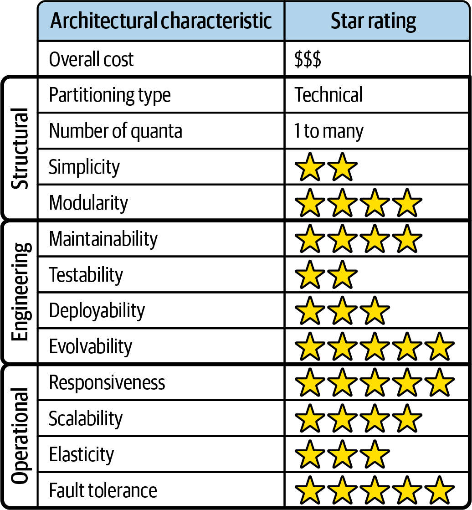

*Hình 15-39. Đánh giá các characteristic của EDA*

Số lượng quanta trong EDA có thể thay đổi từ một đến nhiều, tùy thuộc vào các tương tác database trong mỗi event processor và việc hệ thống có dùng xử lý request-reply hay không. Dù giao tiếp trong EDA dựa vào các lời gọi bất đồng bộ, nếu nhiều event processor dùng chung một instance database duy nhất, tất cả chúng sẽ nằm trong cùng một architectural quantum. Điều tương tự cũng đúng với xử lý request-reply: dù giao tiếp giữa các event processor vẫn là bất đồng bộ, nếu cần phản hồi ngay từ event consumer, nó sẽ gắn các event processor đó lại với nhau một cách đồng bộ, tạo thành một quantum duy nhất.

Ví dụ, hãy tưởng tượng rằng một event processor gửi một request tới một event processor khác để đặt một đơn hàng. Event processor thứ nhất phải chờ order ID từ event processor kia để tiếp tục. Nếu event processor thứ hai (processor đặt đơn hàng và tạo order ID) bị sập, event processor thứ nhất không thể tiếp tục. Điều này có nghĩa là chúng là một phần của cùng một architecture quantum và có chung các architectural characteristic, dù cả hai đều đang gửi và nhận các message bất đồng bộ.

Event-driven architecture được đánh giá rất cao (4 đến 5 sao) về performance, scalability và fault tolerance, những điểm mạnh chính của nó. Performance cao của nó đạt được bằng cách kết hợp giao tiếp bất đồng bộ với xử lý song song cao. Scalability cao được hiện thực thông qua load balancing theo chương trình của các event processor (còn gọi là *competing consumers* và *consumer groups*). Khi tải request tăng lên, các event processor bổ sung có thể được thêm vào theo chương trình để xử lý các request bổ sung. Lý do chúng tôi chỉ cho nó bốn sao (thay vì năm) là vì database (xem [Chương 16](ch16_space_based_architecture_style.vi.md#ch-style-space-based), về space-based architecture, để có ví dụ về đánh giá five-star cho các characteristic này). EDA đạt được fault tolerance thông qua các event processor decoupled, bất đồng bộ, vốn mang lại eventual consistency và việc xử lý các workflow sự kiện. Nếu các processor downstream khác không khả dụng, miễn là giao diện người dùng hoặc một event processor gửi request không cần phản hồi ngay lập tức, hệ thống có thể xử lý sự kiện vào một thời điểm sau.

EDA được đánh giá tương đối thấp về *simplicity* và *testability* tổng thể, chủ yếu do các luồng sự kiện không tất định và động của nó. Trong các mô hình request-based, các luồng tất định tương đối dễ test vì đường đi và kết quả của chúng nhìn chung đã biết. Mô hình event-driven thì không như vậy. Đôi khi kiến trúc sư đơn giản là không biết các event processor sẽ phản ứng thế nào với các sự kiện động hoặc chúng có thể tạo ra những message gì. <a id="id1327"></a>Những điều này được biết đến là *nondeterministic workflows* (workflow không tất định). “Sơ đồ cây sự kiện” của những hệ thống này có thể cực kỳ phức tạp, tạo ra hàng trăm hoặc thậm chí hàng nghìn kịch bản, khiến việc quản trị và test rất khó khăn.

Cuối cùng, EDA có tính tiến hóa rất cao, do đó có đánh giá five-star. Thêm các tính năng mới thông qua các event processor hiện có hoặc mới tương đối đơn giản. Bằng cách cung cấp các điểm móc thông qua các derived event được kích hoạt, sự kiện và dữ liệu tương ứng của nó đã có sẵn cho xử lý khác, nên không cần thay đổi gì trong hạ tầng hay các event processor hiện có để thêm chức năng mới đó

Nhược điểm của EDA bao gồm khó kiểm soát workflow tổng thể gắn với một initiating event. Việc xử lý sự kiện rất động do các điều kiện thay đổi, và khó biết khi nào transaction nghiệp vụ dựa trên initiating event đã hoàn tất.

Xử lý lỗi cũng là một thách thức lớn với EDA. Vì thường không có mediator nào giám sát hoặc kiểm soát transaction nghiệp vụ (ngoại trừ với mediator topology), nếu xảy ra sự cố, các service khác sẽ không biết về sự cố đó. Quy trình nghiệp vụ dựa trên initiating event đó bị kẹt và không thể tiến lên nếu không có một loại can thiệp tự động hoặc thủ công nào đó, ngay cả khi mọi quy trình khác vẫn tiến lên mà không quan tâm đến lỗi. Ví dụ, nếu event processor `Payment` trong hệ thống đặt hàng của chúng ta bị crash và không hoàn thành tác vụ được giao, event processor `Inventory` vẫn điều chỉnh tồn kho, và mọi event processor tiếp theo khác đều phản ứng như thể mọi thứ đều ổn.

Khởi động lại một transaction nghiệp vụ (recoverability) rất khó thực hiện trong EDA. Vì các hành động khác đã được thực hiện một cách bất đồng bộ thông qua việc xử lý initiating event, nhiều khi việc gửi lại initiating event đơn giản là không khả thi.

<a id="id145"></a>

### Chọn giữa mô hình dựa trên request và dựa trên sự kiện (Choosing Between Request-Based and Event-Based Models)

<a id="id1328"></a>Mô hình request-based và mô hình event-based đều là những cách tiếp cận khả thi để thiết kế hệ thống phần mềm. Tuy nhiên, chọn đúng mô hình là điều thiết yếu cho thành công. Chúng tôi khuyến nghị chọn mô hình request-based cho các request well-structured, data-driven (như truy xuất dữ liệu hồ sơ khách hàng), khi ưu tiên là sự chắc chắn và kiểm soát workflow. Chúng tôi khuyến nghị chọn mô hình event-based cho các sự kiện linh hoạt, action-based đòi hỏi mức responsiveness và quy mô cao, với xử lý người dùng phức tạp và động.

Hiểu các trade-offs của mô hình event-based cũng giúp xác định sự phù hợp tốt nhất. [Bảng 15-2](#table-style-eda-tradeoffs) liệt kê các ưu điểm và nhược điểm của mô hình event-based của EDA.<a id="id1329"></a>

<a id="table-style-eda-tradeoffs"></a>

<a id="table-style-eda-tradeoffs"></a>*Bảng 15-2. Trade-offs của mô hình event-driven*

| Ưu điểm so với request-based | Trade-offs |
|---|---|
| Phản hồi tốt hơn với nội dung người dùng động | Chỉ hỗ trợ eventual consistency |
| Scalability và elasticity tốt hơn | Ít kiểm soát luồng xử lý hơn |
| Agility và quản lý thay đổi tốt hơn | Ít chắc chắn hơn về kết quả của luồng sự kiện |
| Khả năng thích ứng và mở rộng tốt hơn | Khó test và debug |
| Responsiveness và performance tốt hơn |  |
| Ra quyết định real-time tốt hơn |  |
| Phản ứng tốt hơn với nhận thức tình huống |  |

<a id="id146"></a>

## Ví dụ và use case (Examples and Use Cases)

<a id="ix_ch15-style-eda-asciidoc37"></a>Bất kỳ vấn đề kinh doanh nào tập trung vào việc phản hồi những điều đang xảy ra trong hệ thống (bên trong hoặc bên ngoài) đều là ứng viên tốt cho EDA. Ví dụ hệ thống order-entry mà chúng tôi đã dùng xuyên suốt chương này là một use case tốt cho EDA ở chỗ nó cho phép xử lý song song, decoupled một đơn hàng. Các hệ thống đòi hỏi mức responsiveness, performance, scalability, fault tolerance và elasticity cao cũng là những ứng viên tuyệt vời cho EDA.

<a id="ix_ch15-style-eda-asciidoc38"></a>Một use case tốt khác để chứng minh sức mạnh và hiệu quả của EDA là ví dụ auction-system Going, Going, Gone đang xuyên suốt của chúng tôi, nơi người dùng đặt giá cho các vật phẩm được đưa ra đấu giá cho đến khi một lượt đặt giá cuối cùng không bị ai trả cao hơn và người đặt giá thắng vật phẩm đó. Trong những hệ thống này, số lượng người đặt giá thường không biết trước, đòi hỏi cả scalability lẫn elasticity—đặc biệt nếu phiên đấu giá có giới hạn thời gian và việc đặt giá sắp kết thúc. Những hệ thống này cũng cần mức responsiveness cao. Tuy nhiên, có lẽ lý do tốt nhất khiến các hệ thống đặt giá trực tuyến và EDA phù hợp với nhau là EDA coi việc đặt giá không phải là một *request gửi tới hệ thống*, mà là một *sự kiện đã xảy ra*.

Như [Hình 15-40](#fig-eda-example) cho thấy, rất nhiều hành động diễn ra trong hệ thống khi một người đặt giá đặt một lượt giá. Tất cả các hành động này đều có thể bất đồng bộ, được thực hiện hoặc cùng lúc hoặc sau đó, như xử lý backend (như event processor `Bidder Tracker`). Khi một người đặt giá đặt một lượt giá, event processor `Bid Capture` nhận initiating event đó, xác định xem nó có cao hơn lượt đặt giá trước không, và kích hoạt sự kiện `bid placed`. Event processor `Auctioneer` phản hồi sự kiện đó và cập nhật website với giá đặt mới của vật phẩm. Đồng thời, event processor `Bid Streamer` phản hồi cùng sự kiện đó, stream lượt đặt giá ra lịch sử đặt giá của website hoặc thậm chí tới từng người đặt giá (tùy thuộc vào UI). Cuối cùng, event processor `Bidder Tracker` phản hồi sự kiện để lưu người đặt giá và lượt đặt giá của họ cho mục đích theo dõi và kiểm toán.

<a id="fig-eda-example"></a>

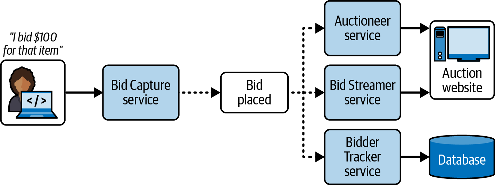

*Hình 15-40. Một ví dụ hệ thống đặt giá trực tuyến dùng EDA*

Nhiều event processor khác tham gia vào workflow của initiating event này, và nhiều derived event khác được kích hoạt, nhưng phần nhỏ này của hệ thống thể hiện một cách dùng tốt của event-driven architectural style, minh họa responsiveness, fault tolerance, scalability và elasticity. <a id="id1330"></a>

Event-driven architecture là một architectural style rất phức tạp, nhưng cũng rất mạnh mẽ. Hãy phân tích kỹ các workflow và việc xử lý cần thiết cho vấn đề kinh doanh để xác định liệu việc xử lý độ phức tạp của EDA có đáng giá với siêu năng lực của nó hay không. Nếu phần lớn việc xử lý cần thiết là request based, hãy cân nhắc microservices architectural style (được thảo luận trong [Chương 18](ch18_microservices_architecture.vi.md#ch-style-microservices)) thay thế<a id="id1331"></a>.<a id="id1332"></a>
