<a id="ch-style-space-based"></a>

# Chương 16. Architecture style dựa trên không gian (Space-Based Architecture Style)

<a id="ix_ch16-style-space-based-asciidoc0"></a>Hầu hết các ứng dụng nghiệp vụ web-based tuân theo cùng một luồng request chung: một request từ trình duyệt đến web server, rồi đến application server, rồi cuối cùng đến database server. Dù luồng request điển hình này hoạt động được với một tập nhỏ người dùng đồng thời, các nút cổ chai bắt đầu xuất hiện khi tải người dùng đồng thời tăng lên: đầu tiên ở layer web-server, rồi ở layer application-server, và cuối cùng ở layer database-server.

Phản ứng thông thường khi tải người dùng tăng gây ra nút cổ chai là scale out các web server. Việc này tương đối dễ và rẻ, và đôi khi nó hiệu quả. Tuy nhiên, trong hầu hết các trường hợp tải người dùng cao, scale out layer web-server chỉ đẩy nút cổ chai xuống application server. Scale các application server có thể phức tạp và tốn kém hơn scale web server, và làm vậy thường chỉ đẩy nút cổ chai xuống database server, vốn còn khó và tốn kém hơn để scale. Ngay cả khi bạn có thể scale database, cuối cùng thứ bạn có là một topology triangle-shaped (hình tam giác), với phần rộng nhất của tam giác là các web server (dễ scale nhất) và phần nhỏ nhất là database (khó scale nhất), như minh họa trong [Hình 16-1](#fig-style-space-based-scale-issue).

Trong bất kỳ ứng dụng high-volume nào có tải người dùng đồng thời lớn, database thường sẽ là yếu tố giới hạn cuối cùng về số lượng transaction mà ứng dụng có thể xử lý đồng thời. Dù các công nghệ caching và sản phẩm database-scaling khác nhau có thể giúp ích, scale out một ứng dụng thông thường cho tải cực lớn vẫn là một bài toán rất khó.

<a id="fig-style-space-based-scale-issue"></a>

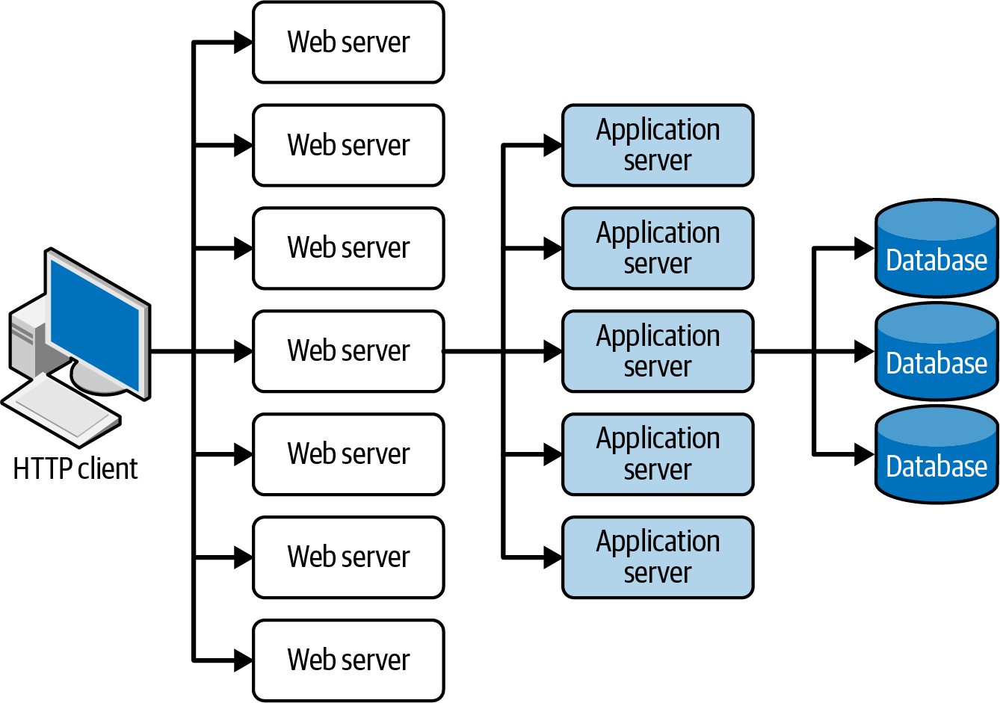

*Hình 16-1. Giới hạn scalability trong một topology web-based truyền thống*

Architecture style *space-based* được thiết kế đặc biệt để giải quyết các vấn đề liên quan đến scalability, elasticity và concurrency cao. Nó cũng là một architecture style hữu ích cho các ứng dụng có khối lượng người dùng đồng thời thay đổi và không dự đoán được. Thường tốt hơn là giải quyết scalability cực lớn và biến động bằng kiến trúc, thay vì cố scale out một database hoặc gắn thêm các công nghệ caching vào một architecture không thể scale tốt như vậy.

<a id="id148"></a>

## Topology

<a id="ix_ch16-style-space-based-asciidoc1"></a><a id="id1333"></a>Kiến trúc space-based có tên từ khái niệm [*tuple space*](https://oreil.ly/XVJ_D), kỹ thuật dùng nhiều bộ xử lý song song giao tiếp qua bộ nhớ dùng chung. Các hệ thống space-based đạt được scalability, elasticity và performance cao bằng cách thay thế database trung tâm, vốn là một ràng buộc đồng bộ trong hệ thống, bằng các in-memory data grid được nhân bản.

Dữ liệu ứng dụng được giữ in-memory và được nhân bản giữa tất cả các processing unit đang hoạt động. Khi một processing unit cập nhật dữ liệu, nó gửi bất đồng bộ dữ liệu đó tới database thông qua một data pump, thường qua messaging với các queue lưu bền. Các processing unit khởi động và tắt một cách động khi tải người dùng tăng và giảm, điều này giải quyết scalability biến động. Vì không có database trung tâm nào tham gia vào việc xử lý transaction chuẩn của ứng dụng, nút cổ chai database bị loại bỏ. Điều này cho phép scalability near-infinite (gần như vô hạn) trong ứng dụng.

Space-based architecture là một architectural style phức tạp gồm nhiều artifact khác nhau phối hợp với nhau để xử lý một request duy nhất. Các artifact chính của nó là:

**Processing unit**

Chứa chức năng của ứng dụng

**Virtualized middleware**

Tập hợp các artifact infrastructure-related được dùng để quản lý và phối hợp các processing unit

**Messaging grid**

Được dùng để quản lý các request đầu vào và session state

**Data grid**

Quản lý việc đồng bộ và nhân bản dữ liệu giữa các processing unit

**Processing grid**

Được dùng để quản lý orchestration request giữa nhiều processing unit

**Deployment manager**

Quản lý việc khởi động và hủy các instance processing unit khi tải tăng và giảm

**Data pump**

Gửi bất đồng bộ dữ liệu đã cập nhật tới database

**Data writer**

Thực hiện các cập nhật từ data pump

**Data reader**

Đọc dữ liệu database và chuyển nó tới các processing unit khi khởi động

[Hình 16-2](#fig-style-space-based-topology) minh họa các artifact chính này.<a id="id1334"></a>

<a id="fig-style-space-based-topology"></a>

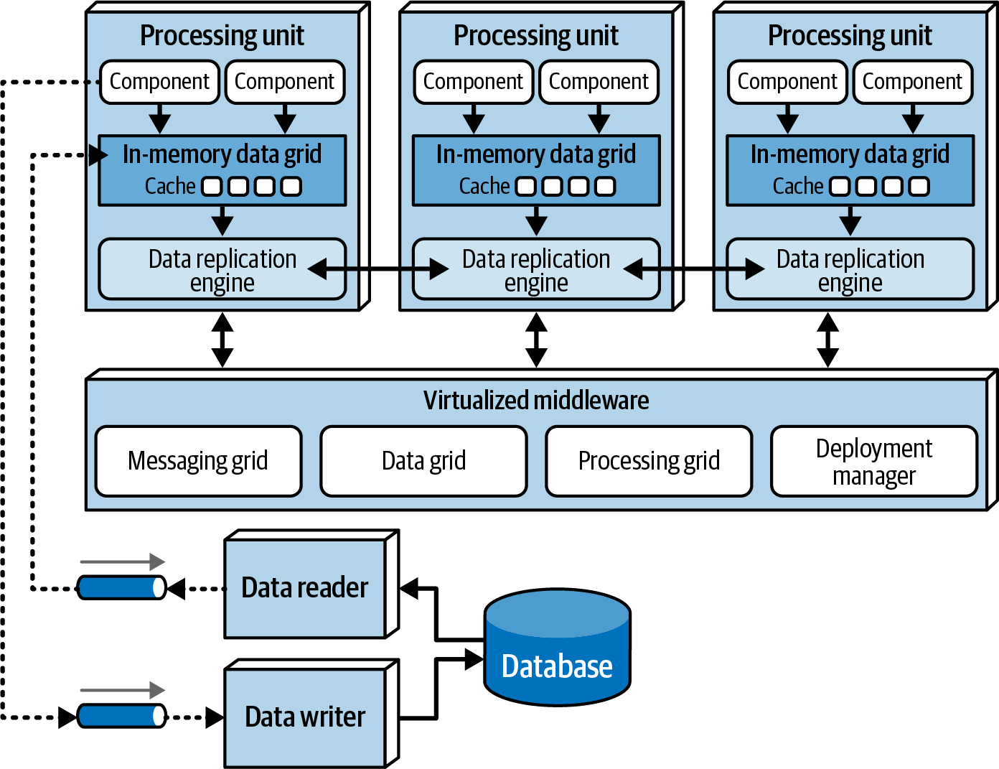

*Hình 16-2. Topology cơ bản của space-based architecture*

<a id="id689"></a>

## Đặc thù của style (Style Specifics)

Các mục sau mô tả chi tiết các artifact chính này và cách chúng hoạt động.

<a id="id344"></a>

### Processing Unit

<a id="id1335"></a>Processing unit (minh họa trong [Hình 16-3](#fig-style-space-based-pu)) chứa logic ứng dụng (hoặc một phần của nó), thường bao gồm các component web-based cũng như logic nghiệp vụ backend. Nội dung của processing unit thay đổi tùy theo loại ứng dụng. Các ứng dụng web-based nhỏ hơn thường được deploy vào một processing unit duy nhất, trong khi các ứng dụng lớn hơn thường chia chức năng của mình thành nhiều processing unit, dựa trên các vùng chức năng của ứng dụng. Processing unit cũng có thể chứa các service nhỏ, single-purpose (khá giống microservices). Ngoài ra, processing unit cũng chứa một in-memory data grid và replication engine, thường được hiện thực thông qua các sản phẩm như [Hazelcast](https://hazelcast.com), [Apache Ignite](https://ignite.apache.org) và [Oracle Coherence](https://oreil.ly/XOUJL) (xem [“Data Grid”](#sec-data-grid)).

<a id="fig-style-space-based-pu"></a>

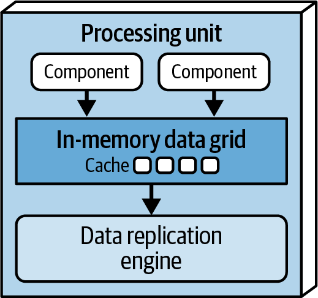

*Hình 16-3. Processing unit chứa chức năng của ứng dụng*

<a id="id345"></a>

### Virtualized Middleware

<a id="id1336"></a>*Virtualized middleware*, như trong [Hình 16-4](#fig-style-space-based-messaging-grid), chứa nhiều artifact infrastructure-related và được dùng để quản lý và kiểm soát các processing unit. Ở mức tối thiểu, artifact middleware này chứa một *messaging grid* để quản lý các request đầu vào và user session state, một *data grid* để quản lý việc nhân bản và đồng bộ dữ liệu, và một *deployment manager* để khởi động và hủy các instance processing unit khi chúng cần và không cần. Tùy chọn, virtualized middleware cũng chứa một *processing grid* trong trường hợp hai hoặc nhiều processing unit cần được orchestrate cho một request nghiệp vụ duy nhất. Kiến trúc sư có thể thêm bất kỳ chức năng infrastructure-related nào khác vào virtualized middleware khi cần, như chức năng security, thu thập metric cho observability, v.v.

Vì không có sản phẩm đơn lẻ nào có thể thực hiện tất cả các chức năng của virtualized middleware, nó thường được hiện thực thông qua các sản phẩm third-party như web server, công cụ caching, load balancer, service orchestrator, và deployment manager để quản lý việc giám sát, khởi động và hủy các processing unit. Mỗi artifact middleware này được mô tả chi tiết trong các mục sau.

<a id="id346"></a>

### Messaging Grid

<a id="id1337"></a>*Messaging grid*, như trong [Hình 16-4](#fig-style-space-based-messaging-grid), là một phần của virtualized middleware và quản lý các request đầu vào và session state. Khi một request đi vào virtualized middleware, component messaging grid xác định những processing unit đang hoạt động nào sẵn sàng nhận nó, rồi chuyển tiếp request tới một trong các processing unit đó.

Độ phức tạp của messaging grid có thể thay đổi, từ một thuật toán round-robin đơn giản đến một thuật toán next-available phức tạp hơn theo dõi processing unit nào sẵn sàng nhất. Component này thường được hiện thực bằng một web server điển hình có năng lực load-balancing (như HA Proxy hoặc Nginx).

<a id="fig-style-space-based-messaging-grid"></a>

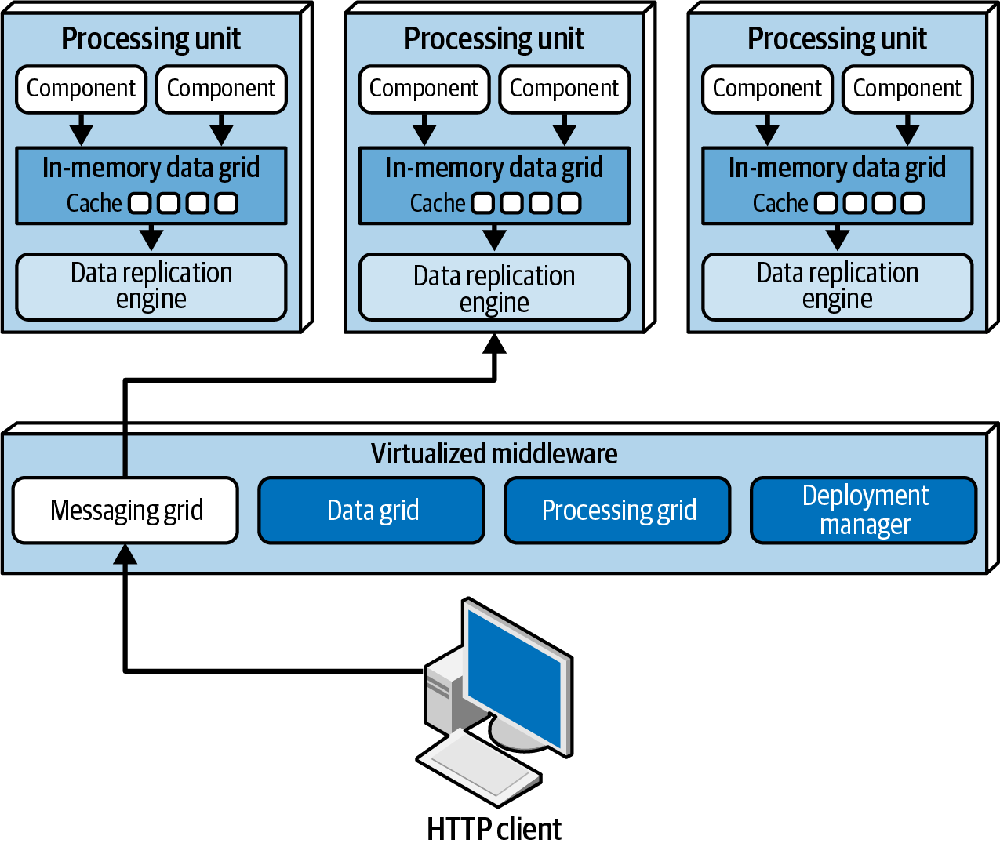

*Hình 16-4. Messaging grid xử lý request và session state*

<a id="sec-data-grid"></a>

### Data Grid

<a id="ix_ch16-style-space-based-asciidoc2"></a>*Data grid* là một component—có lẽ là component then chốt nhất—của virtualized middleware. Trong hầu hết các hiện thực hiện đại, data grid được hiện thực hoàn toàn bên trong các processing unit dưới dạng một cache được nhân bản in-memory (xem [“Replicated and distributed caching”](#sec-spa-caching)). Tuy nhiên, đối với các hiện thực replicated caching đòi hỏi một controller bên ngoài, hoặc dùng distributed cache, chức năng này nằm ở *cả* các processing unit lẫn các component data grid của virtualized middleware.

Vì messaging grid có thể chuyển tiếp một request tới bất kỳ processing unit nào sẵn có, điều thiết yếu là in-memory data grid của mỗi processing unit phải chứa *chính xác cùng một dữ liệu*. Như minh họa bằng các đường chấm trong [Hình 16-5](#fig-style-space-based-data-grid), việc nhân bản dữ liệu thường được thực hiện bất đồng bộ giữa các processing unit, thường hoàn tất nhân bản dữ liệu trong chưa đến 100 ms.

<a id="fig-style-space-based-data-grid"></a>

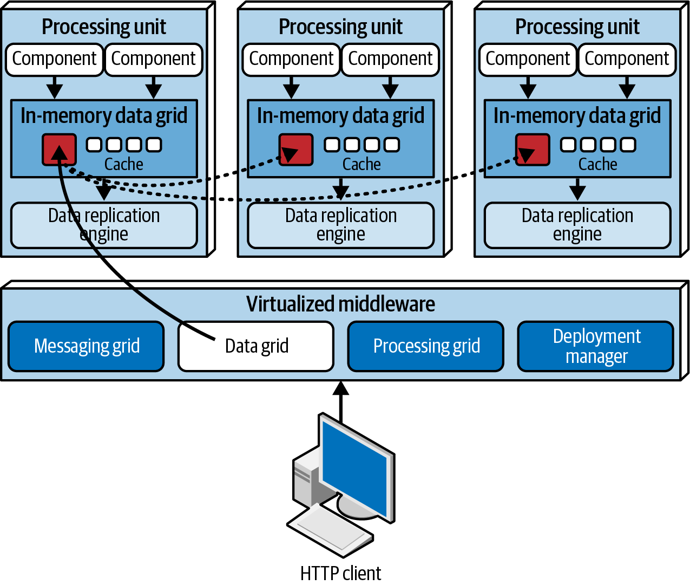

*Hình 16-5. Data grid đồng bộ các in-memory cache*

Dữ liệu được đồng bộ giữa các processing unit chứa cùng một data grid có tên. Ví dụ, đoạn code Java sau dùng Hazelcast để tạo một data grid được nhân bản nội bộ cho các processing unit chứa thông tin hồ sơ khách hàng:

```java
HazelcastInstance hz = Hazelcast.newHazelcastInstance();
Map<String, CustomerProfile> profileCache =
	hz.getReplicatedMap("CustomerProfile");
```

Tất cả các processing unit cần truy cập thông tin customer-profile nên chứa đoạn code này. Khi bất kỳ processing unit nào cập nhật dữ liệu trong cache `CustomerProfile`, data grid nhân bản cập nhật đó tới tất cả các processing unit khác chứa cùng cache có tên `CustomerProfile`. Một processing unit có thể chứa bao nhiêu in-memory replicated cache tùy nhu cầu để hoàn thành công việc của nó. Hoặc, một processing unit có thể thực hiện một lời gọi từ xa tới processing unit khác để yêu cầu dữ liệu (choreography) hoặc tận dụng processing grid (được mô tả trong mục tiếp theo) để orchestrate yêu cầu dữ liệu (xem [“Orchestration Versus Choreography”](ch20_architectural_patterns.vi.md#sec-pattern-orch-chor) trong [Chương 20](ch20_architectural_patterns.vi.md#ch-architectural-patterns) để biết thêm thông tin về orchestration và choreography).

Dùng nhân bản dữ liệu bên trong các processing unit cho phép các instance bổ sung khởi động mà không phải đọc dữ liệu từ database, miễn là ít nhất một instance chứa cache được nhân bản có tên đó. Khi một instance processing unit mới khởi động, nó phát quảng bá một request thông qua nhà cung cấp caching (như Hazelcast) để tham gia cùng các processing unit khác có cùng cache có tên. Khi các processing unit khác xác nhận request quảng bá và kết nối tới processing unit mới, một trong số chúng (thường là cái đầu tiên kết nối tới processing unit mới) gửi dữ liệu cache tới instance mới để nó đồng bộ với tất cả các instance khác có cùng cache có tên.

Mỗi instance của một processing unit chứa một *member list* (danh sách thành viên) chứa địa chỉ IP và port của tất cả các instance processing-unit khác chứa cùng cache có tên. Ví dụ, giả sử có một instance processing-unit duy nhất chứa chức năng hồ sơ khách hàng và dữ liệu được cache nhân bản in-memory của nó. Trong trường hợp này chỉ có một instance, nên member list của nó chỉ chứa chính nó. Điều này được minh họa trong các câu lệnh logging sau, được tạo ra bằng Hazelcast:

```text
Instance 1:
Members {size:1, ver:1} [
	Member [172.19.248.89]:5701 - 04a6f863-dfce-41e5-9d51-9f4e356ef268 this
]
```

Khi một processing unit khác khởi động với cùng cache có tên, member list của cả hai service được cập nhật để phản ánh địa chỉ IP và port của mỗi processing unit:

```text
Instance 1:
Members {size:2, ver:2} [
	Member [172.19.248.89]:5701 - 04a6f863-dfce-41e5-9d51-9f4e356ef268 this
	Member [172.19.248.90]:5702 - ea9e4dd5-5cb3-4b27-8fe8-db5cc62c7316
]

Instance 2:
Members {size:2, ver:2} [
	Member [172.19.248.89]:5701 - 04a6f863-dfce-41e5-9d51-9f4e356ef268
	Member [172.19.248.90]:5702 - ea9e4dd5-5cb3-4b27-8fe8-db5cc62c7316 this
]
```

Khi processing unit thứ ba khởi động, member list của instance 1 và instance 2 đều được cập nhật để phản ánh instance thứ ba mới:

```text
Instance 1:
Members {size:3, ver:3} [
	Member [172.19.248.89]:5701 - 04a6f863-dfce-41e5-9d51-9f4e356ef268 this
	Member [172.19.248.90]:5702 - ea9e4dd5-5cb3-4b27-8fe8-db5cc62c7316
	Member [172.19.248.91]:5703 - 1623eadf-9cfb-4b83-9983-d80520cef753
]

Instance 2:
Members {size:3, ver:3} [
	Member [172.19.248.89]:5701 - 04a6f863-dfce-41e5-9d51-9f4e356ef268
	Member [172.19.248.90]:5702 - ea9e4dd5-5cb3-4b27-8fe8-db5cc62c7316 this
	Member [172.19.248.91]:5703 - 1623eadf-9cfb-4b83-9983-d80520cef753
]

Instance 3:
Members {size:3, ver:3} [
	Member [172.19.248.89]:5701 - 04a6f863-dfce-41e5-9d51-9f4e356ef268
	Member [172.19.248.90]:5702 - ea9e4dd5-5cb3-4b27-8fe8-db5cc62c7316
	Member [172.19.248.91]:5703 - 1623eadf-9cfb-4b83-9983-d80520cef753 this
]
```

Giờ cả ba instance đều biết về nhau (kể cả chính chúng, như được biểu thị bởi từ `this` ở cuối dòng member). Giả sử instance 1 nhận một request từ một khách hàng để cập nhật địa chỉ bill-to của họ. Khi instance 1 cập nhật cache bằng `cache.put()` hoặc một method cập nhật cache tương tự, data grid (như Hazelcast) sẽ cập nhật bất đồng bộ các cache được nhân bản khác với cùng cập nhật đó, bảo đảm cả ba cache hồ sơ khách hàng đều chứa địa chỉ bill-to mới, qua đó luôn đồng bộ với nhau với cùng một dữ liệu.

Khi các instance processing-unit bị sập, member list của tất cả các processing-units khác được cập nhật tự động để phản ánh thay đổi. Ví dụ, nếu instance 2 bị sập, sản phẩm caching lập tức cập nhật member list của instance 1 và 3 để loại bỏ instance bị mất:

```text
Instance 1:
Members {size:2, ver:4} [
	Member [172.19.248.89]:5701 - 04a6f863-dfce-41e5-9d51-9f4e356ef268 this
	Member [172.19.248.91]:5703 - 1623eadf-9cfb-4b83-9983-d80520cef753
]

Instance 3:
Members {size:2, ver:4} [
	Member [172.19.248.89]:5701 - 04a6f863-dfce-41e5-9d51-9f4e356ef268
	Member [172.19.248.91]:5703 - 1623eadf-9cfb-4b83-9983-d80520cef753 this
]
```

<a id="sec-spa-caching"></a>

#### Replicated caching và distributed caching (Replicated and distributed caching)

<a id="ix_ch16-style-space-based-asciidoc3"></a><a id="ix_ch16-style-space-based-asciidoc4"></a>Space-based architecture dựa vào caching để xử lý transaction trong ứng dụng. Space-based architecture loại bỏ nhu cầu đọc và ghi trực tiếp vào database, đó là cách nó có thể hỗ trợ scalability, elasticity và performance cao. Architecture style này chủ yếu dựa vào replicated caching in-memory, dù nó cũng có thể dùng distributed caching.

<a id="id1338"></a>Với *replicated caching* (cache nhân bản), như minh họa trong [Hình 16-6](#fig-style-space-based-replicated), mỗi processing unit chứa in-memory data grid riêng được đồng bộ giữa tất cả các processing unit dùng cùng cache có tên. Khi một cache trong bất kỳ processing unit nào được cập nhật, các processing unit khác tự động được cập nhật với thông tin mới.

<a id="fig-style-space-based-replicated"></a>

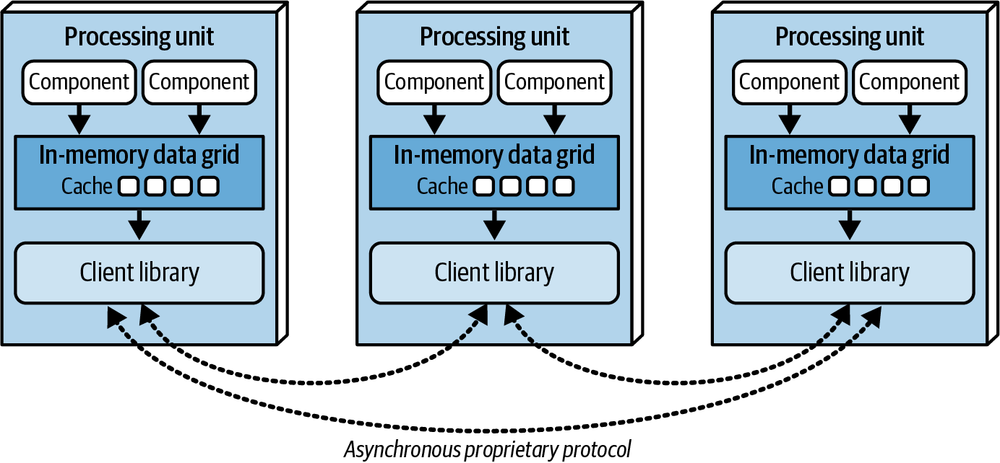

*Hình 16-6. Replicated caching đồng bộ các in-memory cache giữa các processing unit*

Replicated caching không chỉ cực kỳ nhanh, nó còn hỗ trợ mức fault tolerance cao. Vì không có server trung tâm nào giữ cache, replicated caching không có single point of failure.<sup><a id="id1339-marker"></a>[1](#id1339)</sup>

Dù replicated caching là mô hình caching chuẩn cho space-based architecture, có một số trường hợp nó không thể được dùng. Một tình huống như vậy là khi hệ thống phải xử lý khối lượng dữ liệu lớn. Khi các cache bộ nhớ nội bộ lớn hơn 100 MB, mỗi processing unit phải dùng quá nhiều bộ nhớ đến mức có thể gây ra vấn đề với elasticity và scalability. Các processing unit thường được deploy trong một máy ảo hoặc một container (như Docker), mỗi thứ chỉ có một lượng bộ nhớ nhất định cho việc dùng cache nội bộ. Điều này giới hạn số lượng instance processing-unit có thể được khởi động để xử lý các tình huống high-throughput.

Một tình huống khác mà data cache được nhân bản không hoạt động tốt là khi dữ liệu cache được cập nhật rất thường xuyên. Như trình bày trong [“Data Collisions”](#sec-data-collisions), nếu tốc độ cập nhật dữ liệu cache quá cao, data grid có thể không theo kịp, điều có thể gây hại cho tính nhất quán dữ liệu trên tất cả các instance processing-unit. Khi những tình huống này xảy ra, hầu hết kiến trúc sư chọn dùng distributed cache thay thế.

<a id="ix_ch16-style-space-based-asciidoc5"></a>*Distributed caching* (cache phân tán), như minh họa trong [Hình 16-7](#fig-style-space-based-distributed), đòi hỏi một server hoặc service bên ngoài chuyên giữ một cache tập trung. Trong mô hình này, các processing unit không lưu dữ liệu trong bộ nhớ nội bộ. Thay vào đó, chúng dùng một giao thức độc quyền để truy cập dữ liệu từ cache server trung tâm. Distributed caching hỗ trợ mức nhất quán dữ liệu cao, vì toàn bộ dữ liệu được giữ ở một nơi và không cần nhân bản. Tuy nhiên, mô hình này không có performance tốt bằng replicated caching vì dữ liệu cache phải được truy cập từ xa, làm tăng latency tổng thể của hệ thống.

<a id="fig-style-space-based-distributed"></a>

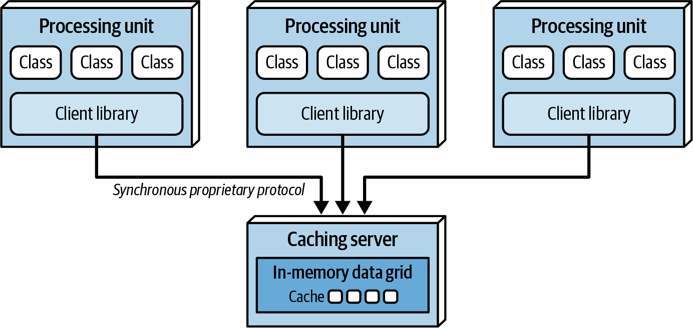

*Hình 16-7. Distributed caching tạo ra tính nhất quán dữ liệu tốt giữa các processing unit*

Fault tolerance cũng là một vấn đề với distributed caching. Nếu cache server chứa dữ liệu bị sập, không processing unit nào có thể truy cập hoặc cập nhật dữ liệu. Single point of failure này có thể được giảm nhẹ bằng cách mirror distributed cache, nhưng điều này có thể gây ra vấn đề nhất quán nếu cache server chính bị sập bất ngờ và dữ liệu chưa kịp đến cache server mirror.

Khi kích thước của cache tương đối nhỏ (dưới 100 MB) và tốc độ cập nhật của cache đủ thấp để replication engine của sản phẩm caching có thể theo kịp, quyết định giữa dùng replicated cache và distributed cache trở thành một câu hỏi về việc ưu tiên tính nhất quán dữ liệu so với performance và fault tolerance. Distributed cache sẽ luôn mang lại tính nhất quán dữ liệu tốt hơn replicated cache, vì dữ liệu nằm ở một nơi, không bị trải ra trên nhiều processing unit. Tuy nhiên, performance và fault tolerance sẽ luôn tốt hơn với replicated cache. Nhiều khi, yếu tố quyết định rốt cuộc là *loại* dữ liệu được cache trong các processing unit. Nếu nhu cầu chính của hệ thống là dữ liệu có tính nhất quán cao (như số lượng tồn kho của các sản phẩm có sẵn), điều đó thường biện minh cho một distributed cache. Nếu dữ liệu không thay đổi thường xuyên (như dữ liệu tham chiếu kiểu các cặp name/value, mã sản phẩm và mô tả sản phẩm), hãy cân nhắc dùng replicated cache để tra cứu nhanh. [Bảng 16-1](#table-style-space-based-caching) tóm tắt một số tiêu chí để chọn khi nào dùng distributed cache so với replicated cache.

<a id="table-style-space-based-caching"></a>

<a id="table-style-space-based-caching"></a>*Bảng 16-1. Distributed caching so với replicated caching*

| Tiêu chí quyết định | Replicated cache | Distributed cache |
|---|---|---|
| Tối ưu hóa | Performance | Tính nhất quán |
| Kích thước cache | Nhỏ (\<100 MB) | Lớn (>500 MB) |
| Loại dữ liệu | Tương đối tĩnh | Rất động |
| Tần suất cập nhật | Tương đối thấp | Tốc độ cập nhật cao |
| Fault tolerance | Cao | Thấp |

Khi chọn mô hình caching nào để dùng với space-based architecture, hãy nhớ rằng trong hầu hết các trường hợp, *cả hai* mô hình đều có thể áp dụng. Nói cách khác, cả replicated caching lẫn distributed caching đều không giải quyết được mọi vấn đề. Các processing unit khác nhau cũng có thể dùng các mô hình khác nhau. Thay vì thỏa hiệp bằng cách chọn một mô hình caching nhất quán duy nhất trên toàn ứng dụng, hãy tận dụng mỗi mô hình theo điểm mạnh của nó. Ví dụ, với một processing unit duy trì tồn kho hiện tại, hãy chọn mô hình distributed caching để có tính nhất quán dữ liệu; với một processing unit duy trì hồ sơ khách hàng, hãy chọn replicated cache để có performance và fault tolerance<a id="id1340"></a>.<a id="id1341"></a><a id="id1342"></a>

#### Các cân nhắc về cache gần (Near-cache considerations)

<a id="ix_ch16-style-space-based-asciidoc6"></a><a id="ix_ch16-style-space-based-asciidoc7"></a><a id="ix_ch16-style-space-based-asciidoc8"></a>Một *near-cache* là một mô hình caching lai kết nối các in-memory data grid với một distributed cache. Trong mô hình này (minh họa trong [Hình 16-8](#fig-style-space-based-near-cache)), distributed cache được gọi là *full backing cache*, và mỗi in-memory data grid nằm trong một processing unit được gọi là *front cache*. Front cache luôn chứa một tập con nhỏ hơn của full backing cache, và dùng một *eviction policy* (chính sách loại bỏ) để loại bỏ các mục cũ hơn để có thể thêm các mục mới hơn. Front cache có ba lựa chọn eviction policy: cache *most recently used* (dùng gần đây nhất), chứa các mục được dùng gần đây nhất; cache *most frequently used* (dùng thường xuyên nhất), chứa các mục được dùng thường xuyên nhất; hoặc eviction policy *random replacement* (thay thế ngẫu nhiên), loại bỏ các mục một cách ngẫu nhiên khi cần chỗ. Random replacement là một eviction policy tốt khi không có phân tích rõ ràng nào về dữ liệu đưa ra lý do để giữ các mục được dùng gần nhất hay thường xuyên nhất.

<a id="fig-style-space-based-near-cache"></a>

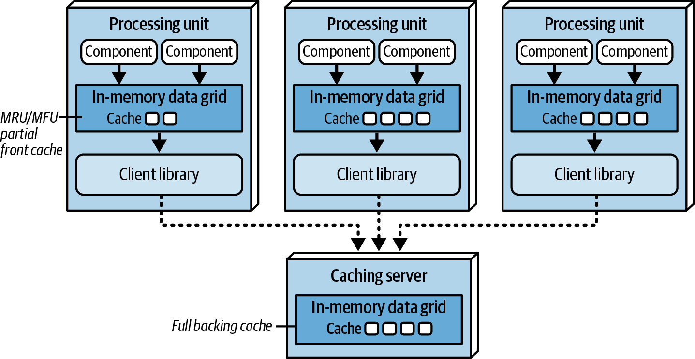

*Hình 16-8. Mô hình near-cache dùng cả front cache lẫn backing cache*

Dù các front cache luôn được giữ đồng bộ với full backing cache, các front cache nằm trong mỗi processing unit không được đồng bộ với các processing unit khác dùng chung cùng dữ liệu. Điều này có nghĩa là nhiều processing unit dùng chung cùng bối cảnh dữ liệu (như một hồ sơ khách hàng) có khả năng đều có dữ liệu khác nhau trong front cache của chúng. Điều này tạo ra sự không nhất quán về performance và responsiveness giữa các processing unit, nên chúng tôi không khuyến nghị dùng mô hình near-cache trong space-based architecture.<a id="id1343"></a>

<a id="id348"></a>

### Processing Grid

<a id="ix_ch16-style-space-based-asciidoc9"></a>*Processing grid*, minh họa trong [Hình 16-9](#fig-style-space-based-processing-grid), là một component tùy chọn trong virtualized middleware, quản lý việc xử lý request được orchestrate khi nhiều processing unit tham gia vào một request nghiệp vụ duy nhất. Nếu một request đòi hỏi phối hợp giữa nhiều hơn một loại processing unit (như một order-processing unit và một payment-processing unit), processing grid điều phối và orchestrate request giữa hai processing unit đó.

<a id="fig-style-space-based-processing-grid"></a>

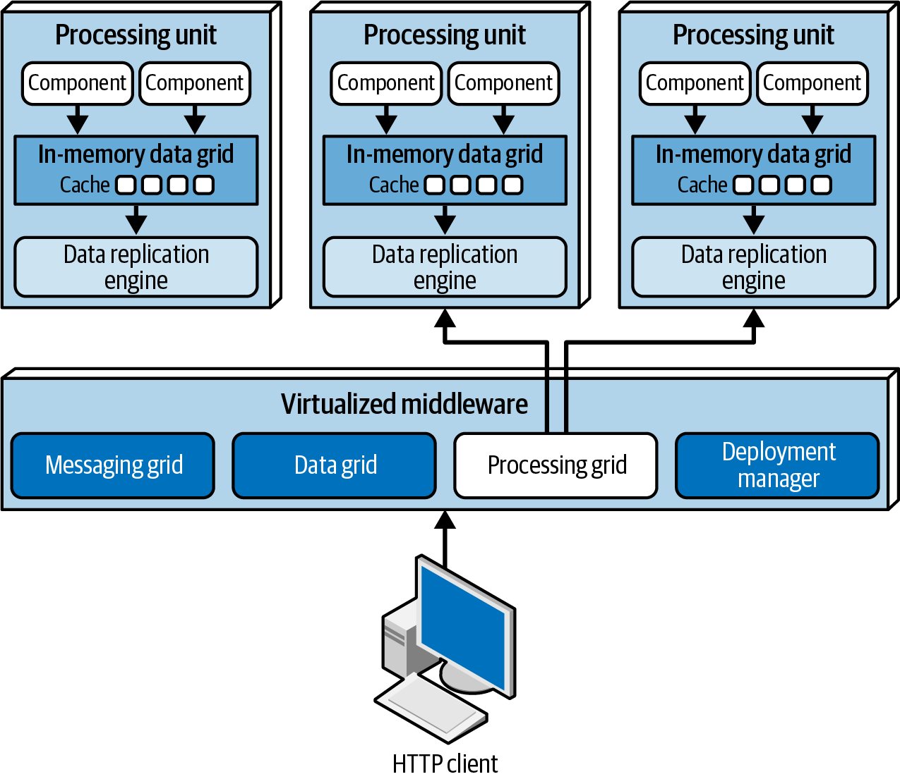

*Hình 16-9. Processing grid quản lý orchestration giữa các processing unit*

Hầu hết các hiện thực space-based hiện đại (đặc biệt là những hiện thực có các service fine-grained) hiện thực chức năng processing-grid của chúng thông qua các *orchestration processing unit* fine-grained riêng biệt thay vì một orchestration engine coarse-grained duy nhất, với mỗi orchestration processing unit xử lý một workflow chính duy nhất. Lấy một ví dụ thương mại điện tử, giả sử khi một khách hàng đặt một đơn hàng, ba processing unit phải phối hợp: *Order Placement*, *Payment* và *Inventory Adjustment*. Kiến trúc sư có thể tạo một processing unit *Order Placement Orchestrator* để orchestrate ba processing unit này. Họ cũng có thể tạo các orchestration processing unit riêng cho các workflow chính khác, như xử lý trả hàng và bổ sung hàng tồn.

<a id="id349"></a>

### Deployment Manager

<a id="id1344"></a>Component `Deployment Manager` quản lý việc khởi động và tắt động các instance processing-unit dựa trên điều kiện tải. Component này liên tục giám sát thời gian phản hồi và tải người dùng, khởi động các processing unit mới khi tải tăng, và tắt các processing unit khi tải giảm. Nó then chốt để đạt được scalability biến động (elasticity) trong một ứng dụng. Hầu hết các hạ tầng cloud-based xử lý trách nhiệm này, cũng như các sản phẩm service-orchestration như [Kubernetes](https://kubernetes.io).

<a id="id151"></a>

### Data Pumps

<a id="ix_ch16-style-space-based-asciidoc10"></a><a id="ix_ch16-style-space-based-asciidoc11"></a>Một *data pump* là một cách gửi dữ liệu tới một processor khác, processor này sau đó cập nhật một database. Space-based architecture cần data pump vì các processing unit không đọc từ và ghi vào database trực tiếp. Data pump trong space-based architecture luôn bất đồng bộ, mang lại eventual consistency giữa in-memory cache và database. Khi một instance processing-unit nhận một request và cập nhật cache của nó, processing unit đó trở thành chủ sở hữu của cập nhật, và do đó chịu trách nhiệm gửi nó qua data pump để database cuối cùng có thể được cập nhật.

Data pump thường được hiện thực trong space-based architecture bằng messaging, như trong [Hình 16-10](#fig-style-space-based-data-pump).

<a id="fig-style-space-based-data-pump"></a>

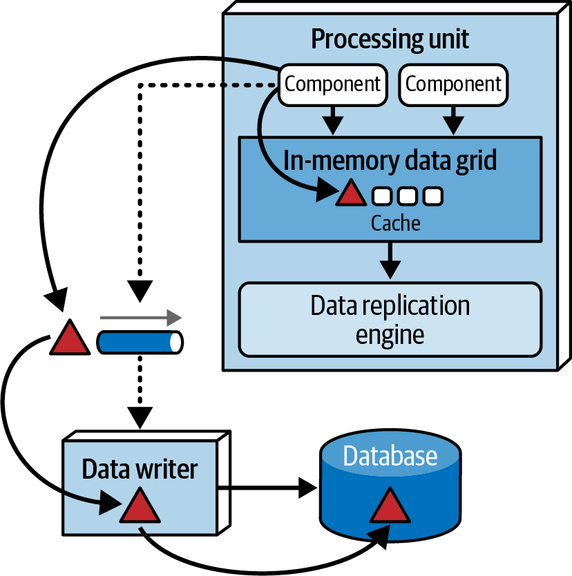

*Hình 16-10. Data pump được dùng để gửi dữ liệu tới một database*

Messaging không chỉ hỗ trợ giao tiếp bất đồng bộ, mà còn hỗ trợ guaranteed delivery, lưu bền message, và thứ tự message, thông qua queuing first-in, first-out (FIFO). Hơn nữa, messaging decouple processing unit và data writer để nếu data writer không khả dụng, việc xử lý trong các processing unit không bị gián đoạn.

Hầu hết các space-based architecture có nhiều data pump. Thường thì mỗi data pump dành riêng cho một domain hoặc subdomain cụ thể (như customer hoặc inventory), nhưng chúng có thể dành riêng cho từng loại cache (như `CustomerProfile`, `CustomerWishlist`, v.v.) hoặc cho một domain processing-unit (như `Customer`) cũng chứa một cache chung lớn hơn nhiều.

Data pump thường có contract, bao gồm một hành động gắn với dữ liệu contract (add, delete hoặc update). Contract có thể là một JSON schema, XML schema, một đối tượng, hoặc thậm chí một *value-driven message* (một map message chứa các cặp name-value). Đối với cập nhật, message payload của data pump thường chỉ chứa các giá trị dữ liệu mới. Ví dụ, nếu một khách hàng thay đổi số điện thoại trong hồ sơ, chỉ số điện thoại mới sẽ được gửi, cùng với customer ID và một hành động để cập nhật dữ liệu.<a id="id1345"></a><a id="id1346"></a>

<a id="id152"></a>

### Data Writers

<a id="ix_ch16-style-space-based-asciidoc12"></a>Component `Data Writer` chấp nhận message từ một data pump và cập nhật database với thông tin trong payload của chúng (xem [Hình 16-10](#fig-style-space-based-data-pump)). Data writer có thể được hiện thực dưới dạng service, ứng dụng, hoặc data hub (như [Ab Initio](https://abinitio.com)). Granularity của chúng có thể thay đổi, dựa trên phạm vi của các data pump và processing unit.

Một *domain-based data writer* chứa logic database cần thiết để xử lý mọi cập nhật trong một domain cụ thể (như xử lý đơn hàng), bất kể số lượng data pump nó đang đọc. Hệ thống trong [Hình 16-11](#fig-style-space-based-dw-domain) có bốn processing unit khác nhau và bốn data pump khác nhau để đại diện cho các domain khách hàng (`Profile`, `WishList`, `Wallet` và `Preferences`)—nhưng chỉ có một data writer. Data writer khách hàng duy nhất đó lắng nghe cả bốn data pump và chứa logic database (như SQL) để cập nhật dữ liệu customer-related trong database.

<a id="fig-style-space-based-dw-domain"></a>

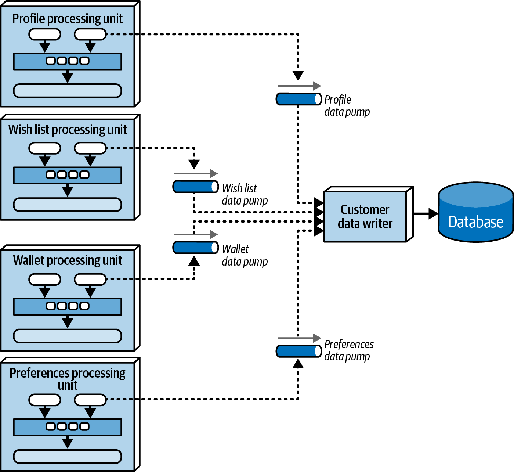

*Hình 16-11. Domain-based data writer*

Hoặc, mỗi loại processing unit có thể có component `Data Writer` chuyên dụng riêng, như minh họa trong [Hình 16-12](#fig-style-space-based-dw-dedicated). Trong mô hình này, mỗi data writer dành riêng cho một data pump tương ứng và chỉ chứa logic xử lý database cho processing unit cụ thể đó (như `Wallet`). Dù mô hình này có xu hướng tạo ra nhiều component data-writer, nó mang lại scalability và agility tốt hơn vì nó gắn kết processing unit, data pump và data writer.<a id="id1347"></a>

<a id="fig-style-space-based-dw-dedicated"></a>

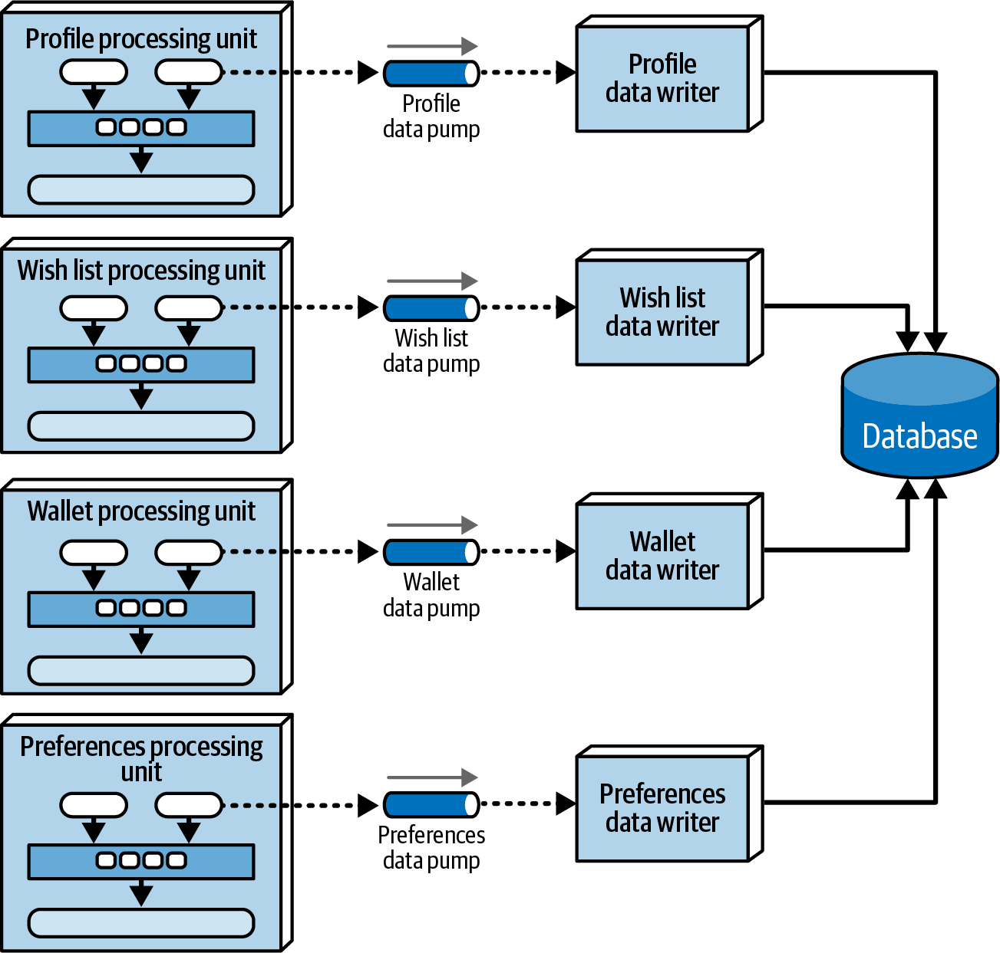

*Hình 16-12. Data writer chuyên dụng cho mỗi data pump*

<a id="id153"></a>

### Data Readers

<a id="ix_ch16-style-space-based-asciidoc13"></a>Trong khi data writer chịu trách nhiệm cập nhật database, *data reader* đọc dữ liệu từ database và gửi nó tới các processing unit thông qua một *reverse data pump* (data pump ngược) (mà chúng tôi sẽ thảo luận thêm ngay sau đây). Trong space-based architecture, data reader chỉ được gọi trong một trong ba tình huống: tất cả các instance processing unit của cùng cache có tên bị crash, tất cả các processing unit trong cùng cache có tên được deploy lại, hoặc cần truy xuất dữ liệu lưu trữ không có trong cache được nhân bản.

Nếu tất cả các instance bị sập do một sự cố system-wide hoặc do deploy lại, dữ liệu phải được nạp vào cache từ database—điều mà chúng ta nhìn chung cố tránh trong space-based architecture. Khi các instance của một loại processing unit bắt đầu hoạt động trở lại, mỗi instance sẽ cố giành một lock trên cache. Instance đầu tiên giành được lock trở thành chủ sở hữu cache tạm thời; các instance khác chuyển sang trạng thái chờ cho đến khi lock được giải phóng. (Điều này có thể thay đổi tùy theo loại hiện thực cache, nhưng dù sao, có một chủ sở hữu chính của cache trong kịch bản này.) Để nạp cache, chủ sở hữu cache tạm thời gửi một message tới một queue, yêu cầu dữ liệu. Component `Data Reader` chấp nhận request đọc rồi thực hiện logic database-query cần thiết để truy xuất dữ liệu cần thiết. Nó gửi dữ liệu đó tới một queue khác gọi là reverse data pump, queue này gửi nó tới processing unit chủ sở hữu cache tạm thời. Khi đã nạp xong cache, chủ sở hữu tạm thời giải phóng lock. Tất cả các instance khác sau đó được đồng bộ, và việc xử lý có thể bắt đầu. Luồng xử lý này được minh họa trong [Hình 16-13](#fig-style-space-based-dr).

<a id="fig-style-space-based-dr"></a>

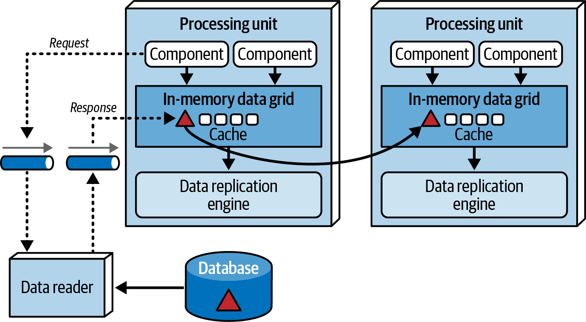

*Hình 16-13. Data reader gửi dữ liệu tới các processing unit*

Giống như data writer, data reader có thể dựa trên domain hoặc dành riêng cho một loại processing unit cụ thể (cách sau phổ biến hơn). Cách hiện thực của nó cũng giống như data writer—service, ứng dụng, hoặc data hub.

<a id="id1348"></a>Data writer và data reader về cơ bản tạo thành một *data abstraction layer* (hoặc *data access layer*, trong một số trường hợp). Sự khác biệt giữa hai loại nằm ở lượng hiểu biết chi tiết mà các processing unit có về database schema (cấu trúc của các bảng). Với data access layer, các processing unit bị coupled với các cấu trúc dữ liệu nền trong database, và chỉ truy cập database một cách gián tiếp, thông qua data reader và writer. Ngược lại, với data abstraction layer, processing unit được decoupled khỏi các schema nền thông qua việc dùng các contract riêng.

Space-based architecture nhìn chung dựa vào mô hình data abstraction layer để schema của cache được nhân bản trong mỗi processing unit có thể khác với các database schema nền. Điều này có nghĩa là các thay đổi dần dần đối với database không nhất thiết ảnh hưởng đến các processing unit. Để tạo điều kiện cho thay đổi dần dần này, data writer và reader chứa logic biến đổi. Nếu kiểu của một cột thay đổi hoặc một cột hay bảng bị xóa, data reader và writer có thể làm bộ đệm cho thay đổi database cho đến khi các thay đổi cần thiết có thể được thực hiện đối với các cache processing-unit.<a id="id1349"></a>

<a id="id350"></a>

## Topology dữ liệu (Data Topologies)

<a id="id1350"></a>Vì các processing unit không tương tác trực tiếp với database, space-based architecture cực kỳ linh hoạt về các topology database mà nó có thể dùng. Việc dùng data pump bất đồng bộ kết hợp với data reader và writer có nghĩa là việc xử lý request (transaction) phần lớn độc lập với database, mang lại cho kiến trúc sư nhiều lựa chọn về topology database và loại database.

Lựa chọn topology database chịu ảnh hưởng của hàng loạt yếu tố. Trong space-based architecture, yếu tố quyết định chính là hệ thống sẽ dùng backing database như thế nào. Ví dụ, nếu báo cáo và phân tích dữ liệu đặc biệt quan trọng, một monolithic database topology có thể hiệu quả hơn—trừ khi báo cáo và phân tích dữ liệu được thực hiện thông qua một data mesh, trong trường hợp đó một topology database domain-based có thể tốt hơn.

Throughput và tính nhất quán dữ liệu domain-based tổng thể cũng là những cân nhắc khi chọn một topology database. Một monolithic database duy nhất có thể tỏ ra là một nút cổ chai trong quá trình đồng bộ, làm chậm thời gian đồng bộ tổng thể và làm giảm tính nhất quán dữ liệu; một topology database domain-based có thể mang lại thời gian đồng bộ tổng thể tốt hơn và do đó tính nhất quán dữ liệu tốt hơn, nếu dữ liệu có thể được phân vùng theo domain một cách sạch sẽ. Cuối cùng, nếu các hệ thống downstream cần dùng database để xử lý tiếp, một monolithic database topology có thể phù hợp hơn.

<a id="id351"></a>

## Các cân nhắc về cloud (Cloud Considerations)

<a id="id1351"></a><a id="id1352"></a>Space-based architecture mang lại một số lựa chọn độc đáo khi nói đến môi trường deployment. Toàn bộ hệ thống—bao gồm các processing unit, virtualized middleware, data pump, data reader và writer, và database—có thể được deploy trong các môi trường cloud-based hoặc on-premises (on-prem). Tuy nhiên, architecture style này cũng có thể được deploy *đồng thời ở cả hai môi trường này* (như minh họa trong [Hình 16-14](#fig-style-space-based-hybrid-cloud)), một tính năng độc đáo, mạnh mẽ không có ở các architecture style khác. Trong topology lai này, các ứng dụng được deploy thông qua các processing unit và virtualized middleware trong các môi trường cloud-based được quản lý, trong khi các database vật lý và dữ liệu tương ứng được giữ on-prem. Điều này hỗ trợ việc đồng bộ dữ liệu cloud-based rất hiệu quả, nhờ các data pump bất đồng bộ và mô hình eventual consistency của architecture style này. Việc xử lý transaction có thể diễn ra trong các môi trường cloud-based động, elastic, trong khi quản lý dữ liệu vật lý, báo cáo và phân tích dữ liệu vẫn ở trong các môi trường on-prem an toàn.

<a id="fig-style-space-based-hybrid-cloud"></a>

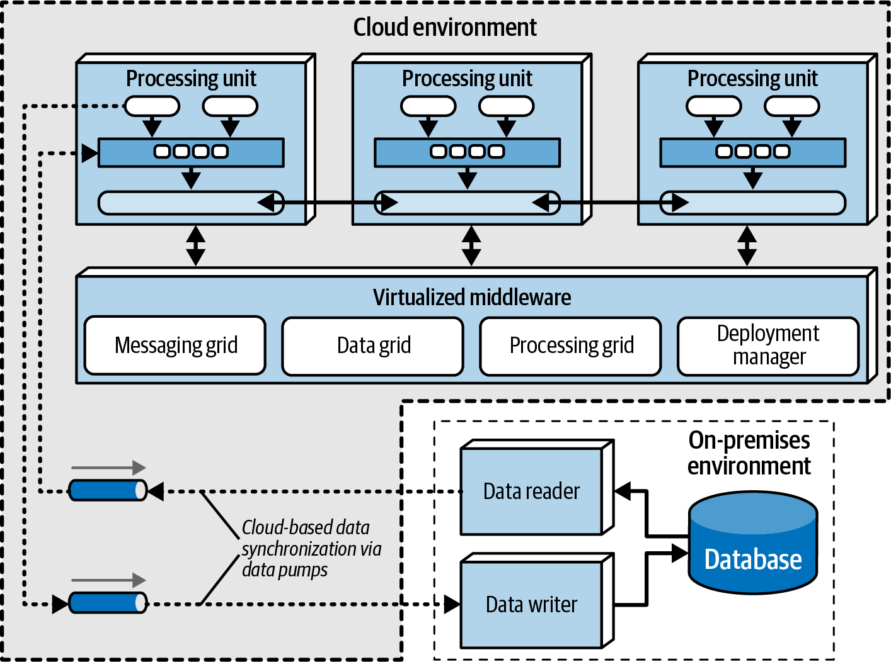

*Hình 16-14. Topology lai cloud-based và on-prem*

Bản chất elastic của hạ tầng cloud và các service cloud-based—lai hay không—khớp tốt với hình dạng của architectural style này, khiến các môi trường cloud-based trở thành một lựa chọn tốt cho space-based architecture.

<a id="common-risks"></a>

## Các rủi ro phổ biến (Common Risks)

<a id="ix_ch16-style-space-based-asciidoc14"></a>Không ngạc nhiên khi hầu hết các rủi ro gắn với space-based architectural style đều liên quan đến dữ liệu, do việc dùng caching và đồng bộ dữ liệu nền. Các mục sau mô tả một số rủi ro phổ biến.

<a id="id403"></a>

### Đọc database thường xuyên (Frequent Reads from the Database)

<a id="id1353"></a>Space-based architecture đạt được scalability và concurrency cao bằng cách dùng caching cho mọi dữ liệu transaction. Điều này ngăn hệ thống thực hiện việc đọc và ghi database quá mức, vốn có thể làm giảm scalability, elasticity và responsiveness tổng thể của hệ thống, khiến khó hiện thực được lợi ích của architectural style này.

Việc đọc database thường chỉ xảy ra trong hai kịch bản: đọc dữ liệu lưu trữ (như lịch sử đơn hàng hoặc sao kê ngân hàng cũ), hoặc *cold-starting* một processing unit (lần khởi động ban đầu của một processing unit khi không có instance nào khác đang chạy). Nếu khối lượng dữ liệu được cache cao đến mức phần lớn dữ liệu cần được lưu trữ và truy xuất từ backing database, hoặc nếu các processing unit bị crash hoặc được deploy lại thường xuyên, đây có thể không phải là architecture đúng cho problem domain.

<a id="id154"></a>

### Đồng bộ và nhất quán dữ liệu (Data Synchronization and Consistency)

<a id="id1354"></a>Vì data pump và data writer đồng bộ dữ liệu giữa in-memory cache và database, dữ liệu sẽ luôn có tính nhất quán cuối cùng (eventually consistent) trong space-based architecture. Tuy nhiên, vì style này thường được dùng trong các tình huống có tải người dùng đồng thời rất cao, các nút cổ chai trong data pump là phổ biến. Những nút cổ chai này có thể làm chậm đáng kể việc dữ liệu đến được backing database. Đây có thể là một rủi ro đáng kể nếu các hệ thống downstream cần có dữ liệu cập nhật nhanh chóng.

<a id="id1355"></a>Một rủi ro vốn có khác liên quan đến đồng bộ dữ liệu là mất dữ liệu trong data pump. Rủi ro này thường được giảm nhẹ bằng cách dùng *persisted queue* (trong đó dữ liệu trong queue được lưu trên đĩa cũng như trong bộ nhớ) và dùng chế độ client-acknowledgment trong các data writer khi đọc từ data pump. Chế độ client-acknowledgment giữ message trong queue cho đến khi data writer xác nhận với message broker rằng nó đã hoàn tất xử lý. Trong khi xử lý message, message broker bảo đảm không data writer nào khác có thể đọc message in-process. Dù các kỹ thuật này giúp ngăn ngừa mất dữ liệu trong data pump, chúng cũng có thể làm chậm responsiveness tổng thể và làm giảm tính nhất quán dữ liệu.

<a id="id404"></a>

### Khối lượng dữ liệu lớn (High Data Volumes)

<a id="id1356"></a>Vì toàn bộ bộ nhớ transaction được cache trong các processing unit, khối lượng dữ liệu cần duy trì tương đối thấp, đặc biệt khi có thêm nhiều instance của một processing unit. Điều này khiến việc chú ý kỹ đến kích thước của in-memory cache trở nên then chốt để tránh một processing unit hết bộ nhớ và do đó bị crash.

<a id="sec-data-collisions"></a>

### Xung đột dữ liệu (Data Collisions)

<a id="ix_ch16-style-space-based-asciidoc15"></a><a id="ix_ch16-style-space-based-asciidoc16"></a>Một *data collision* (xung đột dữ liệu) xảy ra khi dữ liệu được cập nhật ở một instance cache (cache A), và trong quá trình nhân bản tới một instance cache khác (cache B), cùng dữ liệu đó được cache đó (cache B) cập nhật. <a id="id1357"></a>Điều này có thể xảy ra khi dùng replicated caching ở *trạng thái active/active*, nghĩa là nhiều processing unit có thể cập nhật cùng dữ liệu cùng lúc. <a id="id1358"></a><a id="id1359"></a>Xung đột thường xảy ra khi tốc độ cập nhật dữ liệu trong cache vượt quá *replication latency (RL)*—thời gian cần để đồng bộ mỗi cache same-named. Trong kịch bản này, cập nhật cục bộ ở cache B sẽ bị ghi đè bởi dữ liệu cũ từ cache A, và cùng dữ liệu đó trong cache A sẽ bị ghi đè bởi cập nhật từ cache B. Điều này khiến dữ liệu trong mỗi cache không nhất quán.

Để minh họa vấn đề data collision, giả sử có hai instance service (A và B) của một service đặt đơn hàng, mỗi instance chứa một cache được nhân bản về tồn kho sản phẩm (blue widget). Luồng như sau:

1. Số lượng tồn kho hiện tại là 500 đơn vị ở mỗi instance A và B.
2. Instance A nhận một request từ một khách hàng mua 10 đơn vị, và cập nhật cache tồn kho cho blue widget thành 490 đơn vị.
3. Trước khi dữ liệu của instance A có thể được nhân bản tới instance B, instance B nhận một request mua 5 đơn vị, và cập nhật cache tồn kho cho blue widget thành 495 đơn vị.
4. Cache ở instance B được cập nhật thành 490 đơn vị do nhân bản từ cập nhật của instance A.
5. Cache ở instance A được cập nhật thành 495 đơn vị do nhân bản từ cập nhật của instance B.
6. Cả hai cache đều sai và mất đồng bộ: tồn kho phải là 485 đơn vị ở mỗi instance.

Có một số yếu tố ảnh hưởng đến việc có bao nhiêu data collision có thể xảy ra: số lượng instance processing-unit chứa cùng cache, tốc độ cập nhật của cache, kích thước của cache, và RL của sản phẩm caching. Chúng ta có thể xác định theo xác suất có bao nhiêu data collision tiềm tàng có thể xảy ra dựa trên các yếu tố này, dùng công thức sau:

$$\mathrm{Collision} \mathrm{Rate} = N * \frac{U {R}^{2}}{S} * R L$$

Ở đây, *N* biểu diễn số lượng instance service dùng cùng cache có tên. *UR* biểu diễn tốc độ cập nhật tính bằng mili giây (bình phương), *S* là kích thước cache (tính bằng số dòng), và *RL* là replication latency của sản phẩm caching (tính bằng mili giây).

Công thức này hữu ích để xác định phần trăm data collision có khả năng xảy ra dựa trên các cập nhật trong một khung thời gian nhất định (ví dụ, mỗi giờ), và do đó mức độ khả thi của việc hệ thống này dùng replicated caching. Ví dụ, hãy xét các giá trị trong [Bảng 16-2](#table-style-space-based-collisionsA) cho các yếu tố tham gia vào phép tính này.

<a id="table-style-space-based-collisionsA"></a>

<a id="table-style-space-based-collisionsA"></a>*Bảng 16-2. Các giá trị cơ sở*

|  |  |
|---|---|
| Tốc độ cập nhật (UR): | 20 cập nhật/giây |
| Số lượng instance (N): | 5 |
| Kích thước cache (S): | 50,000 dòng |
| Replication latency (RL): | 100 mili giây |
|  |  |
| Số cập nhật: | 72,000 mỗi giờ |
| Tỉ lệ xung đột: | 14.4 mỗi giờ |
| Phần trăm: | 0.02% |

Áp dụng các yếu tố này vào công thức cho ra 72,000 cập nhật một giờ, với xác suất cao là 14 cập nhật vào cùng dữ liệu *có thể* xung đột. Với phần trăm thấp (0.02%), nhân bản sẽ là một lựa chọn khả thi.

Các biến thiên về RL có thể có tác động đáng kể đến tính nhất quán dữ liệu. Replication latency phụ thuộc vào nhiều yếu tố, bao gồm loại mạng và khoảng cách vật lý giữa các processing unit. Các giá trị RL phải được tính toán và rút ra từ các phép đo thực tế trong môi trường production, đó là lý do chúng hiếm khi được công bố. Giá trị 100 ms dùng trong ví dụ trước là một con số lập kế hoạch tốt nếu không có RL thực tế. Ví dụ, thay đổi RL từ 100 ms xuống 1 ms cho ra cùng số cập nhật (72,000 mỗi giờ) nhưng tạo ra xác suất xung đột thấp hơn nhiều (0.1 xung đột mỗi giờ). Kịch bản này được trình bày trong [Bảng 16-3](#table-style-space-based-collisionsB).

<a id="table-style-space-based-collisionsB"></a>

<a id="table-style-space-based-collisionsB"></a>*Bảng 16-3. Tác động của replication latency*

|  |  |
|---|---|
| Tốc độ cập nhật (UR): | 20 cập nhật/giây |
| Số lượng instance (N): | 5 |
| Kích thước cache (S): | 50,000 dòng |
| Replication latency (RL): | 1 mili giây (thay đổi từ 100) |
|  |  |
| Số cập nhật: | 72,000 mỗi giờ |
| Tỉ lệ xung đột: | 0.1 mỗi giờ |
| Phần trăm: | 0.0002% |

Số lượng processing unit chứa cùng cache có tên (được biểu diễn bởi *N*) cũng có quan hệ tỉ lệ thuận trực tiếp với số lượng data collision có thể xảy ra. Ví dụ, giảm số lượng processing unit từ 5 instance xuống 2 instance cho ra tỉ lệ data-collision chỉ 6 mỗi giờ, trên 72,000 cập nhật mỗi giờ, như trong [Bảng 16-4](#table-style-space-based-collisionsC).

<a id="table-style-space-based-collisionsC"></a>

<a id="table-style-space-based-collisionsC"></a>*Bảng 16-4. Tác động của số lượng instance processing-unit*

|  |  |
|---|---|
| Tốc độ cập nhật (UR): | 20 cập nhật/giây |
| Số lượng instance (N): | 2 (thay đổi từ 5) |
| Kích thước cache (S): | 50,000 dòng |
| Replication latency (RL): | 100 mili giây |
|  |  |
| Số cập nhật: | 72,000 mỗi giờ |
| Tỉ lệ xung đột: | 5.8 mỗi giờ |
| Phần trăm: | 0.008% |

Kích thước cache là yếu tố duy nhất tỉ lệ nghịch với tỉ lệ xung đột: khi kích thước cache giảm, tỉ lệ xung đột tăng. Trong ví dụ này, giảm kích thước cache từ 50,000 dòng xuống 10,000 dòng (và giữ mọi thứ khác giống như ví dụ đầu tiên) cho ra tỉ lệ xung đột 72 mỗi giờ, cao hơn đáng kể so với 50,000 dòng, như trong [Bảng 16-5](#table-style-space-based-collisionsD).

<a id="table-style-space-based-collisionsD"></a>

<a id="table-style-space-based-collisionsD"></a>*Bảng 16-5. Tác động của kích thước cache*

|  |  |
|---|---|
| Tốc độ cập nhật (UR): | 20 cập nhật/giây |
| Số lượng instance (N): | 5 |
| Kích thước cache (S): | 10,000 dòng (thay đổi từ 50,000) |
| Replication latency (RL): | 100 mili giây |
|  |  |
| Số cập nhật: | 72,000 mỗi giờ |
| Tỉ lệ xung đột: | 72.0 mỗi giờ |
| Phần trăm: | 0.1% |

Trong điều kiện bình thường, hầu hết các hệ thống không có tốc độ cập nhật ổn định trong một khoảng thời gian dài (như một ngày eight-hour (tám giờ)). Khi dùng phép tính này, chúng tôi khuyến nghị hiểu tốc độ cập nhật tối đa của hệ thống trong lúc sử dụng cao điểm và tính tỉ lệ xung đột tối thiểu, bình thường và cao điểm<a id="id1360"></a><a id="id1361"></a>.<a id="id1362"></a>

<a id="sec-spa-governance"></a>

## Quản trị (Governance)

<a id="ix_ch16-style-space-based-asciidoc17"></a><a id="ix_ch16-style-space-based-asciidoc18"></a>Space-based architecture, với nhiều phần chuyển động, là một architectural style phức tạp để thiết kế và hiện thực. Governance đúng đắn là then chốt để bảo đảm thành công—đặc biệt là để kiểm soát mức tiêu thụ bộ nhớ, do các vấn đề của style này với việc sử dụng bộ nhớ nội bộ (như chúng tôi đã lưu ý trước đó, trong [“Common Risks”](#common-risks)).

Để giải quyết các vấn đề bộ nhớ này, chúng tôi khuyến nghị viết một fitness function governance liên tục, tự động để mỗi instance của một processing unit định kỳ làm cho mức sử dụng bộ nhớ hiện tại của nó quan sát được. Vì tất cả các instance của một processing unit có cùng cache được nhân bản, fitness function chỉ cần báo cáo tên của processing unit. Hãy dùng một fitness function riêng để ghi lại số lượng instance cho mỗi processing unit, cho phép bạn tính tổng mức tiêu thụ bộ nhớ cho mỗi processing unit. [Hình 16-15](#fig-spa-ff-memory) cho thấy một ví dụ về đầu ra của fitness function liên tục này.

<a id="fig-spa-ff-memory"></a>

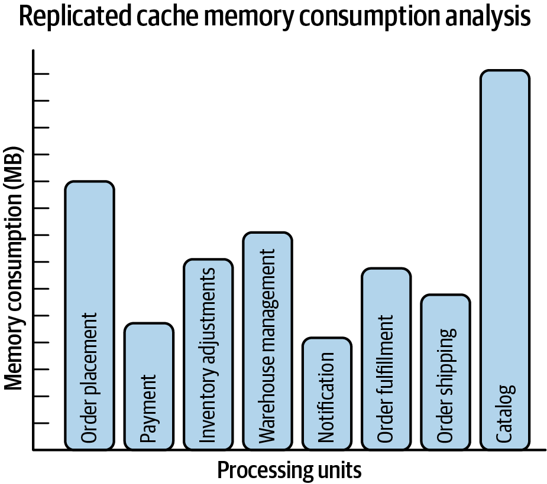

*Hình 16-15. Một ví dụ fitness function để theo dõi mức tiêu thụ bộ nhớ*

Một chiến lược governance hữu ích khác để duy trì tính nhất quán dữ liệu tổng thể là theo dõi và đo thời gian đồng bộ—cụ thể là một cập nhật cache mất bao lâu để đồng bộ tới database tương ứng. Một phương pháp tốt là để mỗi processing unit stream request ID của một cập nhật cùng với timestamp tương ứng, và để mỗi data writer stream cùng request ID đó cùng với timestamp sau khi database commit. Sau đó, viết một fitness function để liên kết các request ID này và trừ các timestamp để tính thời gian đồng bộ. Fitness function có thể theo dõi điều này ở mức nguyên tử, dùng các thời gian gắn với một processing unit cụ thể, hoặc một cách tổng thể, bằng cách tính trung bình các thời gian đồng bộ tổng thể. Phân tích các xu hướng này giúp kiến trúc sư theo dõi tác động của các thay đổi đối với architecture, như các thay đổi đang làm thời gian đồng bộ tốt hơn hay tệ hơn, và architecture có đang đáp ứng các mục tiêu thời gian đồng bộ của doanh nghiệp hay không. [Hình 16-16](#fig-spa-ff-consistency) minh họa loại governance này thông qua một fitness function liên tục.

<a id="fig-spa-ff-consistency"></a>

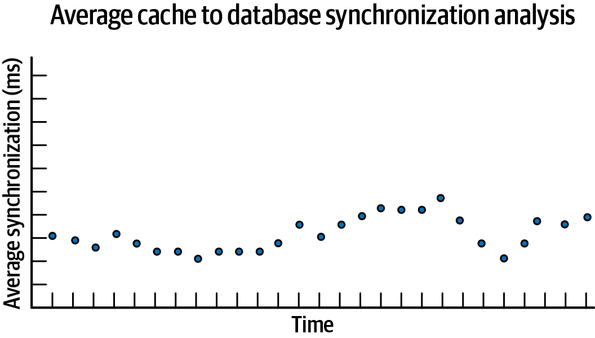

*Hình 16-16. Một ví dụ fitness function để theo dõi thời gian đồng bộ trung bình tổng hợp*

Như chúng tôi đã lưu ý, vì data pump đóng vai trò như một điểm backpressure trong space-based architecture và vì việc ghi database lâu hơn việc ghi cache, data pump có thể tạo thành một nút cổ chai trong hệ thống tổng thể. Để quản trị điều này, chúng tôi khuyến nghị theo dõi và đo loại nút cổ chai này khi nó phát sinh. Trước tiên, để xác định mức độ của nút cổ chai, hãy viết một fitness function để theo dõi độ sâu của queue được dùng trong data pump. Nút cổ chai quá lớn làm tăng thời gian đồng bộ (và do đó ảnh hưởng tính nhất quán dữ liệu) và cũng tăng khả năng mất dữ liệu và data collision, đặc biệt trong các giai đoạn có mức user-concurrency cao. Giống như fitness function trước, function này có thể báo cáo ở mức nguyên tử về mỗi queue data-pump hoặc tổng hợp trung bình toàn hệ thống. [Hình 16-17](#fig-spa-ff-queue) cho thấy một phân tích nút cổ chai cho một processing unit *Order Placement* và data pump tương ứng của nó trong một hệ thống order-processing điển hình.

<a id="fig-spa-ff-queue"></a>

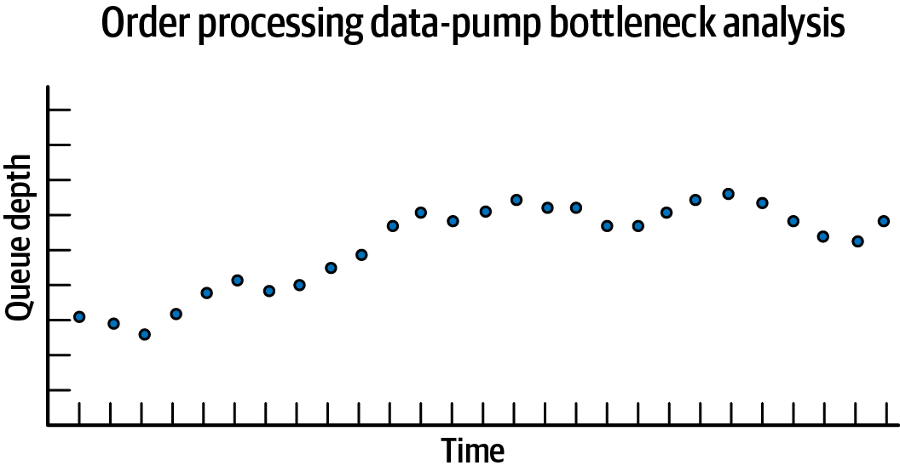

*Hình 16-17. Một ví dụ fitness function để theo dõi các nút cổ chai data-pump*

Các fitness function governance khác cho space-based architecture có thể theo dõi tần suất đọc database (request tới data reader), vốn có thể ảnh hưởng đến scalability, elasticity và responsiveness. Cũng là ý hay khi dùng fitness function để đo scalability, elasticity và responsiveness: vì các architectural characteristic này là những lý do chính để dùng space-based architecture, việc theo dõi và đo chúng là hợp lý. <a id="id1363"></a><a id="id1364"></a>

<a id="id157"></a>

## Các cân nhắc về team topology (Team Topology Considerations)

<a id="ix_ch16-style-space-based-asciidoc19"></a><a id="ix_ch16-style-space-based-asciidoc20"></a>Dù space-based architecture phần lớn được coi là một architecture được phân vùng theo kỹ thuật do có nhiều artifact tạo nên bất kỳ domain hay subdomain cụ thể nào, nó hiệu quả nhất với các team được phân vùng theo kỹ thuật, gắn với các vùng kỹ thuật của nó (như chức năng, data pump, data reader và writer, và quản lý database backend). Tuy nhiên, nó vẫn có thể hoạt động tốt khi các team được sắp xếp theo vùng domain (như các team cross-functional có chuyên môn hóa). Dưới đây là một số điều cần cân nhắc về việc gắn các team topology cụ thể được nêu trong [“Team Topologies and Architecture”](ch09_foundations.vi.md#sec-foundations-team-topologies) với space-based architecture:

**Stream-aligned team**

Tùy thuộc vào kích thước của hệ thống, các stream-aligned team có thể thấy mình vật lộn để hiện thực các thay đổi domain-based do technical partitioning trong architectural style này. Ví dụ, một thay đổi stream-based có thể tác động đến một hoặc nhiều processing unit, data pump, data reader, data writer, cache contract, hoặc orchestrator, cũng như backing database. Đây có thể là nhiều thứ để một team stream-based duy nhất quản lý, đặc biệt nếu các artifact đó được các team khác dùng chung. Hệ thống càng lớn và phức tạp, các stream-aligned team càng kém hiệu quả với space-based architecture.

**Enabling team**

Vì một số artifact của style này (data pump, data reader, data writer và virtualized middleware) có thể được dùng chung hoặc cross-cutting, nó rất phù hợp với các enabling team. Dành riêng một team cho một artifact cụ thể (như một data writer và data pump tương ứng của nó) có thể cho phép các thành viên thử nghiệm và tìm cách làm cho các artifact này hiệu quả hơn, độc lập với team làm việc trên chức năng chính trong một processing unit cụ thể.

**Complicated-subsystem team**

Các team complicated-system có thể tận dụng bản chất được phân vùng theo kỹ thuật của space-based architecture style để tập trung vào một phần của hệ thống (như data grid hoặc data pump). Một số artifact này có thể trở nên cực kỳ phức tạp, nên chúng rất phù hợp với complicated-subsystem team topology. Xử lý data collision (xem [“Data Collisions”](#sec-data-collisions)) và các loại lỗi đồng bộ dữ liệu bất đồng bộ khác trong data writer khá phức tạp; đây là một ví dụ tuyệt vời về một subsystem phức tạp mà các team domain-based chức năng làm việc trên processing unit không cần phải bận tâm.

**Platform team**

Như với hầu hết các architectural style, developer làm việc trên một space-based architecture có thể tận dụng lợi ích của topology platform-team bằng cách sử dụng các công cụ, service, API và tác vụ chung, đặc biệt nếu các phần infrastructure-related của architecture (như data pump và virtualized middleware) được coi là thuộc về nền tảng. <a id="id1365"></a><a id="id1366"></a>

<a id="id158"></a>

## Các characteristic của style (Style Characteristics)

<a id="ix_ch16-style-space-based-asciidoc21"></a>Đánh giá one-star (một sao) trong bảng đánh giá characteristic ở [Hình 16-18](#fig-style-space-based-ratings) có nghĩa là architecture characteristic cụ thể không được hỗ trợ tốt trong architecture, trong khi đánh giá five-star (năm sao) có nghĩa là architecture characteristic đó là một trong những đặc điểm mạnh nhất của architecture style. Định nghĩa của mỗi characteristic được xác định trong bảng điểm có thể được tìm thấy trong [Chương 4](ch04_architectural_characteristics_defined.vi.md#ch04-architecture-characteristics-defined).

<a id="fig-style-space-based-ratings"></a>

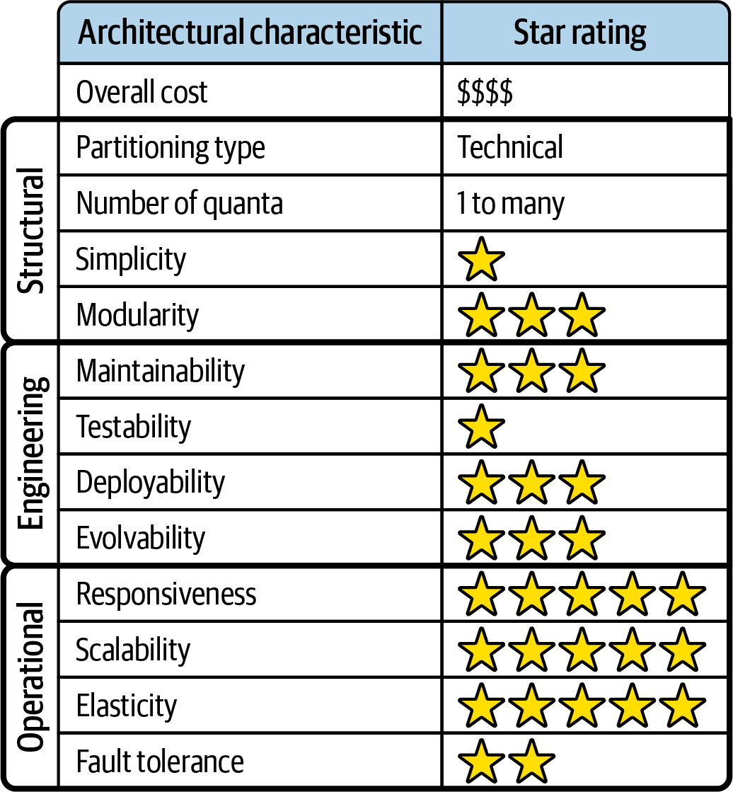

*Hình 16-18. Đánh giá các characteristic của space-based architecture*

Space-based architecture tối đa hóa elasticity, scalability và performance—do đó chúng tôi đã cho tất cả các characteristic này đánh giá five-star. Đây là những characteristic dẫn dắt và ưu điểm chính của architecture style này. Tận dụng caching dữ liệu in-memory và loại bỏ database như một ràng buộc có thể mang lại cho các hệ thống được xây dựng bằng architecture style này mức elasticity, scalability và performance cao mà chúng cần để xử lý hàng triệu người dùng đồng thời.

Các trade-offs cho những ưu điểm này liên quan đến sự đơn giản và testability tổng thể của hệ thống. Space-based architecture rất phức tạp, do việc dùng caching và eventual consistency của kho dữ liệu chính, vốn là system of record tối hậu. Với vô số phần chuyển động của style này, kiến trúc sư nên đặc biệt cẩn thận để tránh mất dữ liệu khi có sự cố crash (xem [“Preventing Data Loss”](ch15_event_driven_architecture_style.vi.md#sec-data-loss) trong [Chương 15](ch15_event_driven_architecture_style.vi.md#ch-style-eda)).

Testability nhận đánh giá one-star do sự phức tạp của việc mô phỏng mức scalability và elasticity cao mà style này hỗ trợ. Test hàng trăm nghìn người dùng đồng thời ở tải cao điểm là một tác vụ rất phức tạp và tốn kém, nên hầu hết việc testing high-volume diễn ra trong môi trường production, với tải cực lớn thực tế, gây ra rủi ro đáng kể cho các hoạt động bình thường.

Chi phí là một trade-off khác. Space-based architecture tương đối tốn kém, chủ yếu do độ phức tạp tổng thể, phí bản quyền cho các sản phẩm caching, và việc sử dụng tài nguyên cần thiết trong các hệ thống cloud và on-prem để hỗ trợ scalability và elasticity cao của nó.

Dù các processing unit, được deploy riêng, có thể phù hợp với một mức domain partitioning nào đó, chúng tôi đã xác định space-based là một architecture được phân vùng theo kỹ thuật, vì bất kỳ domain nào cũng được đại diện bởi các component kỹ thuật khác nhau, như processing unit, data pump, data reader và writer, và database.

Số lượng quanta trong một space-based architecture có thể thay đổi, dựa trên cách UI được thiết kế và cách các processing unit giao tiếp. Vì các processing unit không giao tiếp đồng bộ với database, bản thân database không phải là một phần của phương trình quantum. Kết quả là, quanta trong một space-based architecture thường được phân định thông qua các liên kết giữa các UI khác nhau và các processing unit. Các processing unit giao tiếp đồng bộ (với nhau hoặc thông qua processing grid để orchestration) sẽ đều là một phần của cùng một architectural quantum.<a id="id1367"></a>

<a id="id353"></a>

## Ví dụ và use case (Examples and Use Cases)

<a id="ix_ch16-style-space-based-asciidoc22"></a>Space-based architecture rất phù hợp cho các ứng dụng trải qua những đợt tăng vọt lớn về khối lượng người dùng hoặc request và các ứng dụng có throughput vượt quá 10,000 người dùng đồng thời. Ở đây chúng ta sẽ xem xét hai use case space-based architecture: một ứng dụng concert-ticketing trực tuyến và một hệ thống đấu giá trực tuyến. Cả hai đều đòi hỏi mức performance, scalability và elasticity cao.

<a id="id159"></a>

### Hệ thống bán vé hòa nhạc (Concert Ticketing System)

<a id="id1368"></a><a id="id1369"></a>Hệ thống bán vé hòa nhạc là một problem domain độc đáo, ở chỗ khối lượng người dùng đồng thời tương đối thấp cho đến khi một buổi hòa nhạc nổi tiếng được công bố. Khi vé của một nghệ sĩ đặc biệt nổi tiếng được mở bán, khối lượng người dùng thường tăng vọt từ vài trăm người dùng đồng thời lên vài nghìn hoặc thậm chí hàng chục nghìn, tùy thuộc vào buổi hòa nhạc, tất cả đều cố giành được chỗ ngồi tốt! Vé thường bán hết trong vài phút, nên những hệ thống này thực sự cần các characteristic mà space-based architecture hỗ trợ.

Có nhiều thách thức gắn với loại hệ thống này. Thứ nhất, chỉ có một số lượng vé nhất định có sẵn tổng cộng, bất kể sở thích chỗ ngồi. Tình trạng chỗ ngồi còn trống phải được cập nhật liên tục và nhanh nhất có thể, do số lượng request đồng thời cao. Liên tục truy cập đồng bộ một database trung tâm khó có thể hoạt động—sẽ rất khó để một database điển hình xử lý hàng chục nghìn request đồng thời thông qua các transaction chuẩn ở quy mô này và với tần suất cập nhật này.

Space-based architecture sẽ rất phù hợp cho một hệ thống bán vé hòa nhạc, do các yêu cầu elasticity cao của nó. *Deployment manager* sẽ lập tức nhận ra sự gia tăng đột ngột về số lượng người dùng đồng thời và khởi động nhiều processing unit để xử lý khối lượng lớn các request mua vé. Tối ưu nhất, deployment manager có thể được cấu hình để khởi động số lượng processing unit cần thiết ngay *trước khi* vé được mở bán, để chúng sẵn sàng chờ ngay trước khi tải người dùng tăng đáng kể.

<a id="id160"></a>

### Hệ thống đấu giá trực tuyến (Online Auction System)

<a id="id1370"></a><a id="id1371"></a>Các hệ thống đấu giá trực tuyến (các trang để đặt giá cho vật phẩm trong một phiên đấu giá, như eBay) có nhiều characteristic chung với các hệ thống concert-ticketing trực tuyến mà chúng tôi vừa mô tả. Cả hai đều đòi hỏi mức performance và elasticity cao, và cả hai đều có những đợt tăng vọt không dự đoán được về tải người dùng và request. Khi một phiên đấu giá bắt đầu, không có cách nào để xác định có bao nhiêu người tham gia hoặc có bao nhiêu lượt đặt giá đồng thời sẽ xảy ra cho mỗi mức giá chào.

Space-based architecture rất phù hợp cho problem domain này vì nó cho phép nhiều processing unit được khởi động khi tải tăng, rồi bị hủy khi phiên đấu giá kết thúc dần và chúng không còn cần thiết. Các processing unit riêng lẻ có thể được dành riêng cho mỗi phiên đấu giá, bảo đảm tính nhất quán trong dữ liệu đặt giá. Ngoài ra, bản chất bất đồng bộ của data pump có nghĩa là dữ liệu đặt giá có thể được gửi tới các xử lý khác (như lịch sử đặt giá, phân tích đặt giá, và kiểm toán) mà không có nhiều latency, tăng performance tổng thể của quy trình đặt giá.

Space-based architecture là một architectural style phức tạp nhưng rất mạnh mẽ. Nó là architectural style duy nhất tối đa hóa sự kết hợp của responsiveness, scalability và elasticity, chủ yếu nhờ cách nó dùng caching và việc không truy cập database trực tiếp. Do đó, nó có thể được coi là một architectural style chuyên biệt, được dùng trong các tình huống phải tối đa hóa những architectural characteristic cụ thể này<a id="id1372"></a>.<a id="id1373"></a>

<a id="id1339"></a>

<sup>[1](#id1339-marker)</sup> Có thể có ngoại lệ cho quy tắc này tùy theo cách hiện thực của sản phẩm caching được dùng. Một số sản phẩm caching đòi hỏi một controller bên ngoài để giám sát và kiểm soát việc nhân bản dữ liệu giữa các processing unit, nhưng hầu hết đang dần rời bỏ mô hình này.
