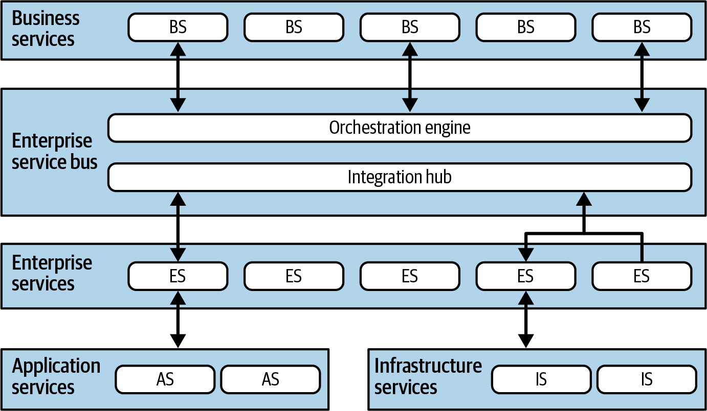
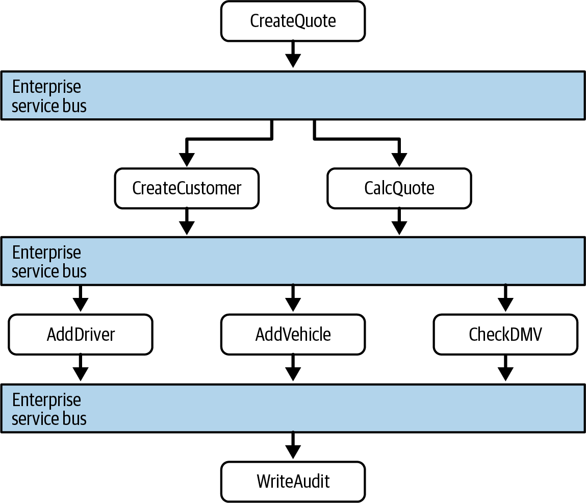
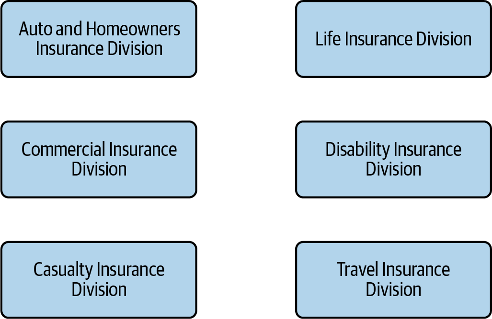
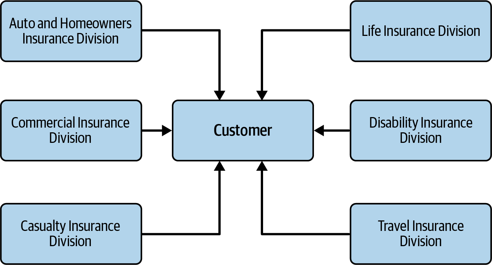
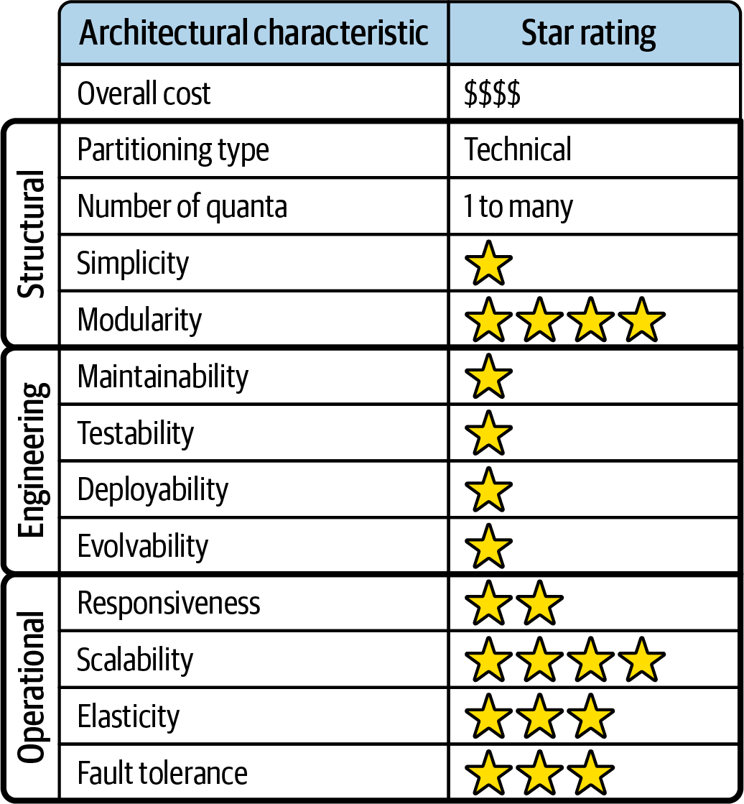
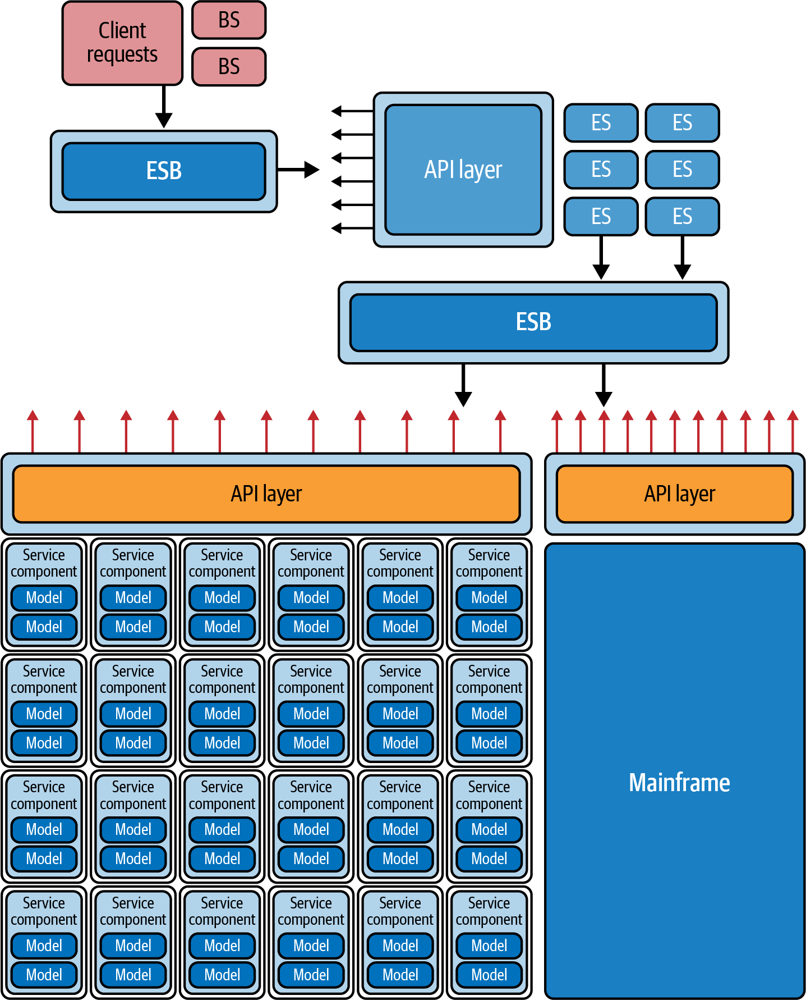

<a id="ch-style-esb-soa"></a>

# Chương 17. Kiến trúc hướng service điều phối tập trung (Orchestration-Driven Service-Oriented Architecture)

<a id="ix_ch17-style-esb-soa-asciidoc0"></a>Các architecture style có ý nghĩa với kiến trúc sư trong bối cảnh của thời kỳ mà chúng tiến hóa, nhưng mất đi sự phù hợp ở các thời kỳ sau, khá giống các trào lưu nghệ thuật. *Orchestration-driven service-oriented architecture* (SOA) là ví dụ điển hình cho xu hướng này. Những lực tác động bên ngoài thường ảnh hưởng đến các architecture decision, kết hợp với một triết lý tổ chức hợp lý nhưng rốt cuộc là thảm họa, đã khiến architecture này rơi vào quên lãng. Tuy nhiên, nó cung cấp một ví dụ tuyệt vời về việc một ý tưởng tổ chức cụ thể có thể hợp lý về mặt logic nhưng lại cản trở những phần quan trọng nhất của quy trình phát triển. Nó minh họa một trong những mối nguy của việc phớt lờ Định luật thứ nhất của chúng tôi: *mọi thứ trong software architecture đều là một trade-off*.

<a id="id354"></a>

## Topology

<a id="id1374"></a>Topology của orchestration-driven SOA được thể hiện trong [Hình 17-1](#fig-ch-style-esb-soa-topo).

Không phải mọi ví dụ của style architecture này đều có chính xác các layer này, nhưng tất cả đều theo cùng ý tưởng thiết lập một hệ phân loại (taxonomy) các service trong architecture, mỗi layer có một trách nhiệm cụ thể, well-defined.

Service-oriented architecture là một architecture phân tán. Sự phân định chính xác các ranh giới không được thể hiện trong [Hình 17-1](#fig-ch-style-esb-soa-topo) vì nó thay đổi tùy theo tổ chức và công cụ: một số phần của hệ phân loại có thể nằm bên trong một application server. Orchestration-driven SOA xoay quanh một hệ phân loại service cụ thể, với các trách nhiệm kỹ thuật khác nhau trong architecture và các vai trò dành riêng cho các layer cụ thể.

<a id="fig-ch-style-esb-soa-topo"></a>



*Hình 17-1. Topology của orchestration-driven service-oriented architecture*

<a id="id162"></a>

## Đặc thù của style (Style Specifics)

<a id="ix_ch17-style-esb-soa-asciidoc1"></a>Orchestration-driven SOA chủ yếu mang ý nghĩa lịch sử đối với các kiến trúc sư current-day; những bài học rút ra từ việc xây dựng các architecture này là một phần quan trọng trong sự tiến hóa của lĩnh vực. Tuy nhiên, kiến trúc sư vẫn thấy một số phần của nó phù hợp trong một số kịch bản integration architecture.

<a id="id1375"></a><a id="id1376"></a>Service-oriented architecture xuất hiện vào cuối thập niên 1990s, đúng lúc các công ty nhỏ đủ loại đang phát triển thành doanh nghiệp lớn với tốc độ chóng mặt, sáp nhập với các công ty nhỏ hơn, và đòi hỏi IT tinh vi hơn để đáp ứng sự tăng trưởng này. Tuy nhiên, tài nguyên tính toán khan hiếm, quý giá và mang tính thương mại. Tính toán phân tán vừa mới trở nên khả thi và cần thiết, và nhiều công ty cần scalability cùng các characteristic có lợi khác của nó.

Nhiều động lực bên ngoài đã buộc kiến trúc sư thời đó hướng tới các architecture phân tán với những ràng buộc hệ thống đáng kể. Trước khi các hệ điều hành open source được coi là đủ đáng tin cậy cho công việc nghiêm túc, hệ điều hành rất đắt và được cấp phép theo từng máy. Tương tự, các database server thương mại đi kèm những phương án cấp phép rắc rối kiểu Byzantine, đôi khi khiến các nhà cung cấp application-server (vốn cung cấp database connection pooling) phản ứng bằng cách đối đầu với các nhà cung cấp database. Do có quá nhiều tài nguyên đắt đỏ ở quy mô lớn, kiến trúc sư đã chấp nhận một triết lý chung là tái sử dụng càng nhiều càng tốt.

Những mối quan tâm kỹ thuật này kết hợp với các mối quan tâm tổ chức về việc trùng lặp cả thông tin lẫn workflow—do các vụ sáp nhập và tăng trưởng thường xuyên, các tổ chức vật lộn với sự đa dạng và không nhất quán giữa các thực thể nghiệp vụ cốt lõi. Điều này khiến các mục tiêu của SOA trở nên hấp dẫn. Do đó, kiến trúc sư đã đón nhận *tái sử dụng* dưới mọi hình thức như triết lý thống trị trong architecture này, mà các tác dụng phụ của nó chúng tôi đề cập trong [“Reuse…and Coupling”](#sec-soa-reuse). Style architecture này cũng minh họa kiến trúc sư có thể đẩy ý tưởng technical partitioning đi xa đến mức nào, điều có thể có động cơ tốt nhưng dẫn đến hậu quả xấu khi bị đẩy đến cực đoan.

> **Vì sao có nhiều tên service đến vậy? (Why So Many Service Names?)**
>
> <a id="id1378"></a>Kiến trúc sư thường bối rối trước vô số thứ trong software architecture được gọi là *service*. Ngay trong cuốn sách này chúng tôi đã đề cập ba style “service” khác nhau: SOA trong chương này, microservices trong [Chương 18](ch18_microservices_architecture.vi.md#ch-style-microservices), và service-based architecture trong [Chương 14](ch14_service_based_architecture_style.vi.md#ch-style-service-based). Một phần vấn đề là sự thiếu linh hoạt của ngôn ngữ để mô tả các architecture. Phần còn lại nằm ở sự tiến hóa liên tục của hệ sinh thái software-development. *Service* là một cái tên chung chung hay cho thứ gì đó cung cấp một, ừm, dịch vụ, nên kiến trúc sư có xu hướng tái sử dụng cái tên này. Khi các style tiến hóa, chúng ta thay đổi ý nghĩa của *service*. Ví dụ, một *entity service* trong một orchestration-driven SOA khác về hầu như mọi mặt so với một service trong microservices architecture (vốn khác với một service-based architecture). Dù phiền phức, kiến trúc sư thường phải phân tích bối cảnh khi từ *service* xuất hiện trong một cái tên; bản thân thuật ngữ này đã bị [semantic diffusion](https://oreil.ly/9oQNq) (khuếch tán ngữ nghĩa).

<a id="id405"></a>

### Hệ phân loại (Taxonomy)

<a id="ix_ch17-style-esb-soa-asciidoc2"></a>Triết lý dẫn dắt đằng sau architecture này là một loại trừu tượng hóa cụ thể và tái sử dụng enterprise-level. Nhiều công ty lớn bực bội vì phải liên tục viết lại phần mềm quá nhiều. Họ đi đến một chiến lược có vẻ giải quyết dần vấn đề đó bằng cách tạo một *service taxonomy* (hệ phân loại service) nghiêm ngặt, với các layer well-defined và các trách nhiệm tương ứng. Mỗi layer của hệ phân loại hỗ trợ hai mục tiêu kép là trừu tượng hóa tối thượng và tái sử dụng.

#### Business service (Business services)

<a id="id1379"></a><a id="id1380"></a>*Business service* nằm ở trên cùng của SOA này và cung cấp điểm vào cho các quy trình nghiệp vụ. Ví dụ, các service như `ExecuteTrade` hoặc `PlaceOrder` đại diện cho phạm vi hành vi đúng của các service này. Một phép thử phổ biến thời đó là: kiến trúc sư có thể trả lời “có” cho câu hỏi “Chúng ta có đang kinh doanh việc…” đối với mỗi service này không? Nếu có, thì service ở mức granularity phù hợp. Tuy nhiên, dù developer có thể cần một method như `CreateCustomer` để thực hiện một quy trình nghiệp vụ như `ExecuteTrade`, `CreateCustomer` ở mức trừu tượng sai đối với một business service. Công ty không *kinh doanh* việc tạo khách hàng, nhưng nó cần tạo khách hàng để thực hiện giao dịch.

Các định nghĩa service này không chứa code—chỉ có đầu vào, đầu ra, và đôi khi thông tin schema. Người dùng nghiệp vụ và/hoặc nhà phân tích định nghĩa các chữ ký service này, do đó có tên là *business service*.

#### Enterprise service (Enterprise services)

<a id="id1381"></a><a id="id1382"></a>Các *enterprise service* chứa các hiện thực dùng chung fine-grained. Thông thường, một team developer xây dựng hành vi nguyên tử xoay quanh các business domain cụ thể, như `CreateCustomer` hoặc `CalculateQuote`, và các thực thể transaction, như `Customer`, `Order` và `Lineitem`. Các enterprise service này là các khối xây dựng tạo nên các business service, được gắn kết với nhau thông qua orchestration engine.

Đáng lưu ý sự khác biệt về trừu tượng giữa business service và enterprise service. Trong khi business service khá coarse-grained, enterprise service là fine-grained và nhằm nắm bắt các loại trừu tượng, workflow và thực thể khác nhau. Mục tiêu của kiến trúc sư khi tạo enterprise service là tạo ra các khối xây dựng được đóng gói hoàn hảo của chức năng nghiệp vụ biệt lập, có thể được kết hợp tự do thành các workflow nghiệp vụ phức tạp hơn.

Dù đó là một mục tiêu đáng khen, kiến trúc sư nhận thấy rằng điểm ngọt lý tưởng của trừu tượng giữa tất cả các lực này, nói tốt nhất là khó nắm bắt và có lẽ là không thể do vô số trade-offs cạnh tranh nhau. Rốt cuộc, như các architecture được phân vùng theo kỹ thuật khác, architecture này cố gắng tách biệt trách nhiệm một cách nghiêm ngặt, điều xuất phát từ mệnh lệnh tái sử dụng. Ý tưởng là nếu developer có thể xây dựng các enterprise service fine-grained ở đúng mức granularity, doanh nghiệp sẽ không phải viết lại phần đó của workflow nghiệp vụ nữa. Dần dần, doanh nghiệp sẽ xây dựng được một bộ sưu tập các tài sản tái sử dụng được dưới dạng các enterprise service tái sử dụng được—ít nhất là về lý thuyết.

Đáng tiếc là bản chất động của thực tế và tác động tiến hóa của hệ sinh thái phát triển phần mềm thách thức những nỗ lực này. Các component nghiệp vụ không giống vật liệu xây dựng, nơi các giải pháp tồn tại hàng thập kỷ. Thị trường, thay đổi công nghệ, thực hành kỹ thuật, và hàng loạt yếu tố khác làm thất bại những nỗ lực áp đặt sự ổn định lên thế giới phần mềm.

#### Application service (Application services)

<a id="id1383"></a><a id="id1384"></a>Không phải mọi service trong architecture đều đòi hỏi cùng mức granularity hay tái sử dụng như các enterprise service. *Application service* là các service one-off, single-implementation. Ví dụ, có lẽ một ứng dụng cần định vị địa lý, nhưng tổ chức không muốn bỏ thời gian hay công sức để biến nó thành một service tái sử dụng được. Một application service, thường do một team ứng dụng duy nhất sở hữu, giải quyết vấn đề đó.

#### Infrastructure service (Infrastructure services)

<a id="id1385"></a><a id="id1386"></a>*Infrastructure service* cung cấp các mối quan tâm vận hành, như giám sát, logging, xác thực, ủy quyền, v.v. Các service này có xu hướng là các hiện thực cụ thể, do một team hạ tầng dùng chung sở hữu, làm việc chặt chẽ với bộ phận vận hành. Triết lý của kiến trúc sư khi xây dựng architecture này xoay quanh technical partitioning, nên việc họ xây dựng các infrastructure service riêng là hợp lý.

#### Orchestration engine và message bus (Orchestration engine and message bus)

<a id="id1387"></a><a id="id1388"></a><a id="id1389"></a>*Orchestration engine* tạo thành trái tim của architecture phân tán này, khâu các hiện thực business service lại với nhau bằng orchestration, bao gồm các tính năng như phối hợp transaction và biến đổi message. Orchestration engine định nghĩa mối quan hệ giữa business service và enterprise service, cách chúng ánh xạ với nhau, và nơi các ranh giới transaction nằm. Nó cũng đóng vai trò như một integration hub, cho phép kiến trúc sư tích hợp code tùy biến với các hệ thống phần mềm đóng gói và legacy. Sự kết hợp các tính năng này làm nổi bật cách dùng modern-day của các công cụ như enterprise service bus (ESB). <a id="id1390"></a>Dù hầu hết kiến trúc sư cho rằng xây dựng toàn bộ một architecture xoay quanh ESB là ý tồi, chúng vô cùng hữu ích trong các môi trường integration-heavy. Khi kiến trúc sư phải kết hợp một integration hub và orchestration engine, tại sao không dùng một công cụ đã có sẵn cả hai? (Điều này chỉ ra một kỹ năng quan trọng khác cần phát triển với tư cách kiến trúc sư—cách nhận ra những công dụng thực sự của công cụ, tách biệt khỏi sự thổi phồng, cả tốt lẫn xấu.)

Vì message bus tạo thành trái tim của architecture, Định luật Conway (xem [“Conway’s Law”](ch09_foundations.vi.md#sidebar-conway)) dự đoán đúng rằng team kiến trúc sư tích hợp chịu trách nhiệm về engine này có xu hướng trở thành một thế lực chính trị trong tổ chức—và cuối cùng là một nút cổ chai quan liêu.

Dù cách tiếp cận tập trung, được phân loại này nghe có vẻ hấp dẫn, trên thực tế nó phần lớn là một thảm họa. Chuyển hành vi transaction sang một công cụ orchestration nghe có vẻ hay, nhưng kiến trúc sư vật lộn để tìm đúng mức granularity. Dù họ có thể xây dựng vài service được bọc trong một transaction phân tán, architecture trở nên ngày càng phức tạp. Developer phải tìm ra nơi các ranh giới transaction phù hợp giữa các service nằm khi các thực thể tham gia vào vô số workflow. Dù các nhà quản lý dự đoán và hy vọng rằng các tổ chức có thể xây dựng thành công các khối xây dựng transaction dưới dạng enterprise service, điều đó đã tỏ ra khó khăn trên thực tế.

#### Luồng message (Message flow)

<a id="id1391"></a>Mọi request đều đi qua orchestration engine, nơi logic của architecture này nằm. Do đó, luồng message đi qua engine ngay cả với các lời gọi nội bộ, như trong [Hình 17-2](#fig-style-esb-soa-msgflow).

<a id="fig-style-esb-soa-msgflow"></a>



*Hình 17-2. Luồng message với service-oriented architecture*

Trong [Hình 17-2](#fig-style-esb-soa-msgflow), service business-level `CreateQuote` gọi service bus, nơi định nghĩa workflow. Workflow gồm các lời gọi tới cả `CreateCustomer` và `CalculateQuote`, mỗi cái cũng thực hiện các lời gọi tới application service. Service bus đóng vai trò trung gian cho mọi lời gọi trong architecture này, phục vụ như cả integration hub lẫn orchestration engine.<a id="id1392"></a>

<a id="sec-soa-reuse"></a>

### Tái sử dụng…và coupling (Reuse…and Coupling)

<a id="ix_ch17-style-esb-soa-asciidoc3"></a>Một trong những mục tiêu chính của các kiến trúc sư lần đầu dùng architecture này là tái sử dụng ở mức service—khả năng dần dần xây dựng hành vi nghiệp vụ mà họ có thể tái sử dụng dần theo thời gian. Họ được chỉ dẫn tìm các cơ hội tái sử dụng một cách quyết liệt nhất có thể.

Ví dụ, hãy xét tình huống minh họa trong [Hình 17-3](#fig-style-esb-soa-reuse-begin). Một kiến trúc sư nhận ra rằng mỗi bộ phận trong sáu bộ phận của một công ty bảo hiểm đều chứa khái niệm `Customer`.

<a id="fig-style-esb-soa-reuse-begin"></a>



*Hình 17-3. Tìm kiếm cơ hội tái sử dụng trong service-oriented architecture*

Do đó, chiến lược SOA đúng đắn bao gồm việc tách các phần `Customer` thành một service tái sử dụng được rồi cho phép các service ban đầu tham chiếu tới service `Customer` chuẩn tắc. Điều này được thể hiện trong [Hình 17-4](#fig-style-esb-soa-reuse-end): ở đây kiến trúc sư đã cô lập toàn bộ hành vi khách hàng vào một service `Customer` duy nhất, đạt được các mục tiêu tái sử dụng hiển nhiên.

<a id="fig-style-esb-soa-reuse-end"></a>



*Hình 17-4. Xây dựng các biểu diễn chuẩn tắc trong service-oriented architecture*

Kiến trúc sư chỉ dần dần nhận ra các trade-offs tiêu cực của thiết kế này. Thứ nhất, khi một team xây dựng hệ thống chủ yếu xoay quanh tái sử dụng, nó cũng phát sinh một lượng coupling khổng lồ giữa các component. Suy cho cùng, tái sử dụng được hiện thực *thông qua* coupling. Ví dụ, trong [Hình 17-4](#fig-style-esb-soa-reuse-end), một thay đổi đối với service `Customer` lan tỏa tới tất cả các service khác. Điều này khiến ngay cả thay đổi dần dần cũng rủi ro: mỗi thay đổi có một hiệu ứng lan tỏa tiềm tàng khổng lồ. Điều đó đến lượt nó đòi hỏi các deployment phối hợp, testing tổng thể, và những gánh nặng khác đối với hiệu quả kỹ thuật.

Một tác dụng phụ tiêu cực khác của việc hợp nhất hành vi vào một nơi duy nhất: hãy xét trường hợp bảo hiểm ô tô và bảo hiểm tàn tật trong [Hình 17-4](#fig-style-esb-soa-reuse-end). Để hỗ trợ một service `Customer` duy nhất, mỗi bộ phận phải bao gồm mọi chi tiết mà tổ chức biết về khách hàng của mình. Bảo hiểm ô tô đòi hỏi giấy phép lái xe, vốn là thuộc tính của con người, không phải của xe. Do đó, service `Customer` sẽ phải bao gồm các chi tiết về giấy phép lái xe mà bộ phận bảo hiểm tàn tật hoàn toàn không quan tâm. Thế nhưng team bảo hiểm tàn tật phải xử lý độ phức tạp bổ sung của một định nghĩa khách hàng duy nhất. Theo nhiều cách, sự khăng khăng của DDD về việc *tránh* tái sử dụng tổng thể bắt nguồn từ kinh nghiệm với những loại architecture này.

Có lẽ phát hiện tai hại nhất về orchestration-driven SOA là sự phi thực tế của việc xây dựng một architecture tập trung quá nhiều vào technical partitioning. Dù điều này hợp lý từ góc nhìn triết lý tách biệt và tái sử dụng, nó là một cơn ác mộng thực tế.

Ví dụ, developer thường làm các tác vụ như “thêm một dòng địa chỉ mới vào `CatalogCheckout`.” Các khái niệm domain như `CatalogCheckout` bị trải mỏng khắp architecture này đến mức chúng hầu như bị nghiền thành bụi. Trong một SOA, tác vụ này có thể liên quan đến hàng chục service ở nhiều tầng khác nhau, cộng thêm các thay đổi đối với một database schema duy nhất. Hơn nữa, nếu các enterprise service hiện tại không được định nghĩa ở đúng granularity transaction, developer sẽ hoặc phải thay đổi thiết kế của mình hoặc phải xây dựng một service mới gần như giống hệt để thay đổi hành vi transaction. Tái sử dụng chỉ đến thế mà thôi<a id="id1393"></a>.<a id="id1394"></a>

<a id="id170"></a>

## Topology dữ liệu (Data Topologies)

<a id="id1395"></a>Không giống nhiều architecture style chúng tôi thảo luận trong cuốn sách này, các topology dữ liệu của orchestration-driven SOA không mấy thú vị, do nguồn gốc lịch sử của style này. Dù là một architecture phân tán gồm nhiều phần, nó nhìn chung dùng một (hoặc vài) relational database, vốn là thực hành phổ biến trong mọi architecture phân tán vào cuối thập niên 1990s. Ngay cả tính transaction nhìn chung cũng được giao cho architecture này và tách khỏi database: message bus thường bao gồm các tương tác transaction khai báo cho mỗi thực thể trong topology, cho phép developer, kiến trúc sư hoặc những người khác xác định hành vi transaction độc lập với database hay thậm chí với việc tái sử dụng thực thể theo tình huống.

Kiến trúc sư thời đó coi dữ liệu là một vùng đất xa lạ. Dù nó là một phần không thể tránh khỏi của hệ thống “đường ống” trong cả SOA lẫn event-driven architecture, hồi đó, họ coi nó như một điểm tích hợp hơn là một phần của problem domain.

> **Thật sao? Transaction khai báo?!? (Really? Declarative Transactions?!?)**
>
> <a id="id1397"></a><a id="id1398"></a>Đúng vậy, thật đấy. Một trong những “tính năng” của nhiều application server vào thời hoàng kim của orchestration-driven SOA là cho phép các configuration manager thay đổi phạm vi transaction của từng thực thể, tùy thuộc vào bối cảnh transaction mà họ muốn vận hành. (Tất nhiên, điều này được khai báo bằng XML, do thời đại đó và tình yêu của nó với các định dạng cấu hình dài dòng nhưng easy-to-parse.) Một phần khai báo của một thực thể (gọi là `EntityBeans`, một loại JavaBean chuyên biệt) xác định phạm vi transaction khi nó tham gia vào các workflow, mà chính kiến trúc sư khai báo là có transaction hay không. Đến lượt mình, application server tương tác với database để tạo và quản lý các database transaction khớp với hành vi mong muốn của các thực thể và/hoặc workflow.
>
> Điều này phần lớn đã thất bại, vì hai lý do. Thứ nhất, nếu một developer không biết hành vi transaction sẽ là gì tại runtime, nó làm tăng đáng kể độ phức tạp cho các thực thể và phụ thuộc. Điều này buộc developer tạo ra các phiên bản gần như giống hệt nhau của các thực thể, chỉ khác nhau ở phạm vi transaction. Thứ hai, bất kể các nhà cung cấp xây dựng message bus tinh vi đến đâu, các edge case vẫn liên tục xuất hiện, nơi vô số kiểu lỗi ngăn hệ thống quản lý transaction một cách gọn gàng, tạo ra những mớ hỗn độn không nhất quán để con người gỡ rối. Một số tính năng phức tạp, nhiều mặt của hệ thống (như transaction) không thể được trừu tượng hóa một cách gọn gàng. Quá nhiều chỗ rò rỉ trong lớp trừu tượng ngăn nó đạt được độ tin cậy.

<a id="id355"></a>

## Các cân nhắc về cloud (Cloud Considerations)

<a id="id1399"></a><a id="id1400"></a>Orchestration-driven SOA ra đời trước cloud nhiều thập kỷ, nên không có cân nhắc nào về việc xây dựng architecture này (ở hình thái ban đầu) trên cloud.

Tuy nhiên, cách dùng current-day của style này khiến nó trở thành một integration architecture tốt cho các service cloud và on-premises phải tích hợp và tham gia vào các workflow. Chủ yếu là một integration architecture, nó hoạt động tốt với các service và tiện ích cloud-based.

<a id="id171"></a>

## Các rủi ro phổ biến (Common Risks)

<a id="id1401"></a>Vào cuối thế kỷ trước và đầu thế kỷ này, những rủi ro lớn của architecture này chủ yếu là về chi phí của nó, thời gian hiện thực, và (một bất ngờ gây sốc) việc các hệ thống này khó bảo trì và cập nhật đến mức nào. Nhiều dự án này là những nỗ lực kéo dài nhiều năm rất tốn kém, với các quyết định then chốt được đưa ra ở cấp cao trong hệ thống phân cấp công ty. Thay vì gọi các dự án này là “thất bại”, các công ty phần lớn chỉ biến chúng thành các integration architecture với ranh giới tốt hơn, gắn kết chặt chẽ hơn với các ý tưởng của DDD.

<a id="id1402"></a><a id="id1403"></a>Khi kiến trúc sư dùng một ESB trong một hệ thống hiện đại như một tiện ích tích hợp, rủi ro lớn nhất là con dốc trơn trượt của việc để ESB dần dần bao trùm toàn bộ architecture. Điều này được gọi là antipattern *Accidental SOA*: khi một kiến trúc sư dần dần và vô tình xây dựng một orchestration-driven SOA đầy đủ mà không nhận ra. Để tránh Accidental SOA, kiến trúc sư phải bảo đảm các ranh giới đóng gói hợp lý cho orchestration và chú ý kỹ đến các vấn đề như ranh giới transaction.

<a id="ch17_governance"></a>

## Quản trị (Governance)

<a id="ix_ch17-style-esb-soa-asciidoc4"></a><a id="ix_ch17-style-esb-soa-asciidoc5"></a>Khi architecture này còn phổ biến, testing tổng thể modern-day không phổ biến. Các team hiếm khi test SOA bên ngoài testing quality-assurance-level chính thức, nên những người tạo công cụ và framework ít quan tâm đến việc hỗ trợ test các phần riêng lẻ. Một số framework testing đã xuất hiện để tạo mock và stub cho bộ máy đồ sộ của message bus và các phần chuyển động liên quan của nó, nhưng chúng luôn cồng kềnh và không nhất quán.

Governance cũng chịu cùng những hạn chế. Ý tưởng tự động hóa governance kiến trúc còn xa lạ hơn cả tự động hóa testing. Thời đó, “governance” nghĩa là các framework nặng nề, các cuộc họp, và code review—tất cả đều thủ công.

<a id="ix_ch17-style-esb-soa-asciidoc6"></a>Tuy nhiên, kiến trúc sư vẫn dùng ESB một cách chiến lược trong các tổ chức cần sự kết hợp năng lực cụ thể mà chúng mang lại. Đặc biệt, nhiều công ty có các hệ thống legacy phải tương tác với các hệ thống hiện đại hơn, thường là kết hợp kết quả và tổng hợp hành vi—tất cả những điều đó mô tả chức năng trung tâm của một ESB. Trong những kịch bản này, fitness function có thể đóng vai trò then chốt trong việc ngăn dữ liệu hoặc bounded context “rò rỉ” qua các phần của hệ sinh thái nơi chúng không nên xuất hiện.

Ví dụ, hãy xét một hệ thống dùng một ESB để phối hợp giữa một gói enterprise resource planning (ERP), một công cụ bán hàng trực tuyến, và các service `Accounting` microservices-based hiện đại hơn. Trong kịch bản này, hệ thống chỉ nên đọc từ hệ thống ERP và hệ thống bán hàng, và nên ghi vào các microservice `Accounting`. Kiến trúc sư trước tiên có thể xây dựng một fitness function bảo đảm mọi giao tiếp đều được ghi nhất quán vào log, rồi viết một thứ giống như fitness function sau (được trình bày ở đây bằng pseudocode):

```java
READ logs for ERP into ERP-logs for past 24 hours
READ logs for Sales into Sales-logs for past 24 hours
FOREACH entry IN ERP-logs
    IF 'operation' is 'update' and 'target' != 'accounting' THEN
       raise fitness function violation
       	     "Invalid communication between integration points"
    END IF
FOREACH entry IN Sales-logs
    IF 'operation' is 'update' and 'target' != 'accounting' THEN
       raise fitness function violation
       	     "Invalid communication between integration points"
    END IF
```

Fitness function này đọc các mục log từ cả hai điểm tích hợp để bảo đảm không có thao tác cập nhật nào diễn ra mà đích không phải là hệ thống `Accounting`.

Dùng những fitness function như vậy, kiến trúc sư có thể dùng các công cụ như ESB một cách chiến lược trong khi xây dựng các rào chắn xung quanh những nơi mà các team thường dùng sai chúng<a id="id1404"></a>.<a id="id1405"></a><a id="id1406"></a>

<a id="id356"></a>

## Các cân nhắc về team topology (Team Topology Considerations)

<a id="id1407"></a><a id="id1408"></a>Cũng như kiến trúc sư không xem xét topology dữ liệu cho orchestration-driven SOA, điều tương tự cũng đúng với team topologies, vốn là một chủ đề chưa được biết đến khi architecture style này còn phổ biến.

Thực tế, hệ phân loại nghiêm ngặt của style này đóng vai trò như một antipattern giao tiếp đã *dẫn* kiến trúc sư đến việc phát triển các nguyên lý của team topologies. *Mục tiêu* trong architecture này là sự tách biệt trách nhiệm cực đoan, với sự tách biệt tương ứng giữa các thành viên team. Trong số các công ty áp dụng nó, quả thực hiếm khi một người xây dựng *business service* trò chuyện với một người xây dựng *enterprise service*. Họ được kỳ vọng giao tiếp thông qua các artifact kỹ thuật, như contract và interface. Mức trừu tượng trong style này tạo ra nhiều layer tích hợp, mỗi layer được hiện thực bởi các team khác nhau, dùng các công cụ ticketing enterprise-level để giao tiếp. Hẳn là dễ thấy vì sao developer thấy việc xây dựng tính năng trong style này rất time-consuming.

<a id="id173"></a>

## Các characteristic của style (Style Characteristics)

<a id="ix_ch17-style-esb-soa-asciidoc7"></a>Nhiều tiêu chí mà ngày nay chúng ta dùng để đánh giá architecture style không phải là ưu tiên khi orchestration-driven SOA còn phổ biến. Phong trào phần mềm Agile vừa mới bắt đầu và chưa thâm nhập vào các tổ chức lớn có khả năng dùng architecture này.

Đánh giá one-star (một sao) trong bảng đánh giá characteristic ở [Hình 17-5](#ch-style-esb-soa-rating) có nghĩa là architecture characteristic cụ thể không được hỗ trợ tốt trong architecture, trong khi đánh giá five-star (năm sao) có nghĩa là architecture characteristic đó là một trong những đặc điểm mạnh nhất của style. Định nghĩa của các characteristic được xác định trong bảng điểm có thể được tìm thấy trong [Chương 4](ch04_architectural_characteristics_defined.vi.md#ch04-architecture-characteristics-defined).

SOA có lẽ là architecture general-purpose được phân vùng theo kỹ thuật nhiều nhất từng được thử nghiệm! Thực tế, phản ứng dữ dội chống lại các nhược điểm của cấu trúc này đã dẫn đến những architecture hiện đại hơn, như microservices. SOA có một quantum duy nhất, dù nó là một architecture phân tán, vì hai lý do. Thứ nhất, nó nhìn chung dùng một database duy nhất hoặc chỉ vài database, tạo ra các điểm coupling qua nhiều mối quan tâm khác nhau. Thứ hai, và quan trọng hơn, orchestration engine đóng vai trò như một điểm coupling khổng lồ—không phần nào của architecture có thể có characteristic khác với mediator điều phối mọi hành vi. Do đó, architecture này xoay xở để tìm ra những nhược điểm của cả monolithic architecture *lẫn* architecture phân tán.

<a id="ch-style-esb-soa-rating"></a>



*Hình 17-5. Đánh giá các characteristic của service-oriented architecture*

Các mục tiêu kỹ thuật hiện đại như deployability và testability có điểm số thảm hại trong architecture này, vừa vì chúng được hỗ trợ kém vừa vì chúng không phải là mục tiêu quan trọng (hay thậm chí là mục tiêu mong muốn) khi nó được phát triển.

Architecture này có hỗ trợ một số mục tiêu, như elasticity và scalability, bất chấp những khó khăn trong việc hiện thực chúng. Các nhà cung cấp công cụ đã đổ công sức khổng lồ vào việc làm cho các hệ thống này có scalability bằng cách xây dựng session replication qua các application server và các kỹ thuật khác. Tuy nhiên, vì là một architecture phân tán, performance chưa bao giờ là điểm nổi bật, vì mỗi request nghiệp vụ bị chia ra qua rất nhiều phần của architecture.

Vì tất cả các yếu tố này, sự đơn giản và chi phí có mối quan hệ ngược với điều mà hầu hết kiến trúc sư mong muốn. Orchestration-driven SOA là một cột mốc quan trọng vì nó đã dạy kiến trúc sư những giới hạn thực tế của technical partitioning và transaction phân tán có thể khó khăn đến mức nào trong thế giới thực.<a id="id1409"></a>

<a id="id174"></a>

## Ví dụ và use case (Examples and Use Cases)

<a id="ix_ch17-style-esb-soa-asciidoc8"></a>Các ví dụ chính của architecture này tồn tại vào cuối thập niên 1990s và đầu thập niên 2000s ở nhiều doanh nghiệp lớn. Chúng dần dần bị thay thế bởi các architecture phân tán agile hơn và domain-based, như microservices. Ngay cả các doanh nghiệp lớn cũng đã nhận ra rằng thay đổi là không thể tránh khỏi và phần mềm không tĩnh mà cần thay đổi theo các lực thị trường và năng lực mới.

Kiến trúc sư đã xây dựng các orchestration-driven SOA architecture để cố đạt được tái sử dụng hiệu quả trong các tổ chức lớn, nhưng cuối cùng nhận ra hệ phân loại nghiêm ngặt và công phu của chúng khiến việc hiện thực các thay đổi và cập nhật phổ biến khó khăn đến mức nào. Ví dụ, một thay đổi domain phổ biến có thể là cập nhật chi tiết về một thực thể duy nhất. Vào một ngày may mắn, developer có thể chỉ cần thay đổi các component trong layer enterprise service để hoàn thành công việc. Tuy nhiên, vào một ngày tồi tệ (ngày mà các enterprise architect và/hoặc business stakeholder không lường trước loại thay đổi này), developer có thể phải cập nhật bốn hoặc năm layer trong architecture, thực hiện các thay đổi coupling cao ở mỗi layer. Các kiến trúc sư làm việc với style này sợ nghe thấy từ *thay đổi* (change) vì nó đòi hỏi phân tích sâu, và phạm vi công việc rất khó lường.

Như chúng tôi đã đề cập trong [“Governance”](#ch17_governance), kiến trúc sư vẫn dùng các khối xây dựng của orchestration-driven SOA (như ESB), đặc biệt cho các integration architecture. Ví dụ, một ESB bao gồm cả một integration hub (để hỗ trợ giao tiếp, biến đổi giao thức và contract) lẫn một orchestration engine (để cho phép kiến trúc sư xây dựng workflow giữa các integration endpoint khác nhau). Vì orchestration-driven SOA bao gồm nhiều tầng gián tiếp, nó cho phép kiến trúc sư hiện thực các enterprise service như các điểm tích hợp, như phần mềm đóng gói, hoặc như code làm riêng, cùng nhiều khả năng khác, như minh họa trong [Hình 17-6](#ch17-soa-integration).

Các request của client dùng message bus để xác định gọi những enterprise service nào, gọi chúng theo thứ tự nào, và tổng hợp thông tin gì. Các enterprise service, đến lượt mình, giao tiếp qua API tới code tùy biến, hệ thống cũ, hoặc phần mềm đóng gói, v.v.

Orchestration-driven SOA đại diện cho một sự đổi mới thú vị về cách kiến trúc sư xử lý các vấn đề tích hợp ở quy mô lớn trong các ràng buộc của hệ sinh thái của họ. Ví dụ, vì hầu hết các tổ chức không dùng hệ điều hành open source khi architecture này còn phổ biến, các architecture thay thế như microservices tốn kém đến mức không thể. Kiến trúc sư nên học hỏi từ các cách tiếp cận trong quá khứ. Chúng ta có thể tiếp tục dùng những phần vẫn còn hợp lý, trong khi thấm nhuần các bài học về điều gì đã thất bại và tại sao<a id="id1410"></a>.<a id="id1411"></a>

<a id="ch17-soa-integration"></a>



*Hình 17-6. Các tầng trừu tượng trong architecture style này cho phép linh hoạt trong hiện thực*
