

# Chương 18. Microservices architecture (Microservices Architecture)

*Microservices* là một architecture style cực kỳ phổ biến đã có được đà phát triển đáng kể trong những năm gần đây. Trong chương này, chúng tôi đưa ra tổng quan về những characteristic quan trọng khiến architecture này khác biệt, cả về topology lẫn triết lý.

Hầu hết các architecture style được đặt tên sau khi chúng được tạo ra bởi những kiến trúc sư nhận thấy một pattern cụ thể cứ xuất hiện lặp lại. Không có nhóm kiến trúc sư bí mật nào quyết định phong trào lớn tiếp theo sẽ là gì—kiến trúc sư đưa ra quyết định khi hệ sinh thái phát triển phần mềm dịch chuyển và thay đổi, và trong số những cách phổ biến nhất để đối phó và hưởng lợi từ những dịch chuyển đó, những cách nổi lên như tốt nhất trở thành các architecture style mà người khác noi theo.

Microservices khác ở điểm này—nó được đặt tên khá sớm trong quá trình sử dụng. Martin Fowler và James Lewis đã phổ biến nó trong một [bài blog](https://oreil.ly/Px3Wk) nổi tiếng năm 2014, trong đó họ nhận diện và phân định các characteristic của architectural style tương đối mới này. Bài blog của họ đã định hình định nghĩa của architecture và giúp các kiến trúc sư tò mò hiểu được triết lý nền tảng.

Microservices được lấy cảm hứng mạnh mẽ từ các ý tưởng trong domain-driven design (DDD), một quy trình thiết kế logic cho các dự án phần mềm. Đặc biệt một khái niệm từ DDD, *bounded context*, đã truyền cảm hứng rõ rệt cho microservices. Khái niệm bounded context đại diện cho một style decoupling (như đã thảo luận trước đó trong [“Domain-Driven Design’s Bounded Context”](ch07_the_scope_of_architectural_characteristics.vi.md#sidebar-ddd) ở [Chương 7](ch07_the_scope_of_architectural_characteristics.vi.md#ch-scope)), đó là lý do microservices đôi khi được gọi là một architecture “không chia sẻ gì” (share nothing).

Khi một developer định nghĩa một domain, domain đó bao gồm nhiều thực thể và hành vi, được xác định trong các artifact như code và database schema. Ví dụ, một ứng dụng có thể có một domain tên là `CatalogCheckout` bao gồm các khái niệm như catalog item, khách hàng và thanh toán. Trong một monolithic architecture truyền thống, developer sẽ chia sẻ nhiều khái niệm này, xây dựng các class tái sử dụng được và các database liên kết. Bên trong một bounded context, các phần nội bộ như code và data schema có thể được coupled với nhau để tạo ra công việc, nhưng chúng *không bao giờ* được coupled với bất cứ thứ gì bên ngoài bounded context, như một database hoặc định nghĩa class từ một bounded context khác. Điều này cho phép mỗi context chỉ định nghĩa những gì nó cần thay vì phải đáp ứng các thành phần khác, hạn chế tái sử dụng giữa các bounded context.

Dù tái sử dụng nhìn chung là có lợi, bạn có nhớ Định luật thứ nhất của software architecture không? Mọi thứ đều là một trade-off. Mặt trái của tái sử dụng là việc đạt được nó thường đòi hỏi tăng coupling của hệ thống, hoặc bằng kế thừa hoặc bằng composition.

Nếu mục tiêu của kiến trúc sư là một hệ thống decoupled cao—mục tiêu chính của microservices—thì họ sẽ ưu tiên nhân bản hơn tái sử dụng, mô hình hóa vật lý khái niệm logic bounded context để bao gồm một service và dữ liệu tương ứng của nó.

## Topology

Topology cơ bản của microservices được thể hiện trong [Hình 18-1](#fig-ch-style-microservices-topology). Do bản chất single-purpose, các service trong architecture style này nhỏ hơn nhiều so với trong các architecture phân tán khác, như orchestration-driven SOA ([Chương 17](ch17_orchestration_driven_service_oriented_architecture.vi.md#ch-style-esb-soa)), event-driven architecture ([Chương 15](ch15_event_driven_architecture_style.vi.md#ch-style-eda)) và service-based architecture ([Chương 14](ch14_service_based_architecture_style.vi.md#ch-style-service-based)). Kiến trúc sư kỳ vọng mỗi service bao gồm mọi phần cần thiết để nó hoạt động độc lập, bao gồm database và các component phụ thuộc khác.

Microservices là một architecture style *phân tán*: mỗi service chạy trong process riêng, trong một máy ảo hoặc container. Decouple các service đến mức này cho phép một giải pháp đơn giản cho một vấn đề phổ biến trong các architecture dùng nhiều hạ tầng multitenant để host ứng dụng. Ví dụ, khi hệ thống dùng một application server để quản lý nhiều ứng dụng đang chạy, application server cho phép tái sử dụng vận hành bandwidth mạng, bộ nhớ, dung lượng đĩa, v.v. Tuy nhiên, nếu tất cả các ứng dụng được hỗ trợ tiếp tục phát triển, cuối cùng một tài nguyên nào đó trên hạ tầng dùng chung sẽ trở nên bị hạn chế.

Một vấn đề khác liên quan đến sự cô lập không đúng mức giữa các ứng dụng dùng chung. Tách mỗi service vào process riêng giải quyết mọi vấn đề do việc chia sẻ gây ra. Trước khi có sự tiến hóa của các hệ điều hành open source miễn phí và provisioning máy tự động, việc mỗi domain có hạ tầng riêng là không thực tế. Tuy nhiên, giờ đây, với tài nguyên cloud và công nghệ container (xem [“Cloud Considerations”](#sec-ms-cloud)), các team có thể gặt hái lợi ích của decoupling cực đoan, cả ở mức domain lẫn mức vận hành.

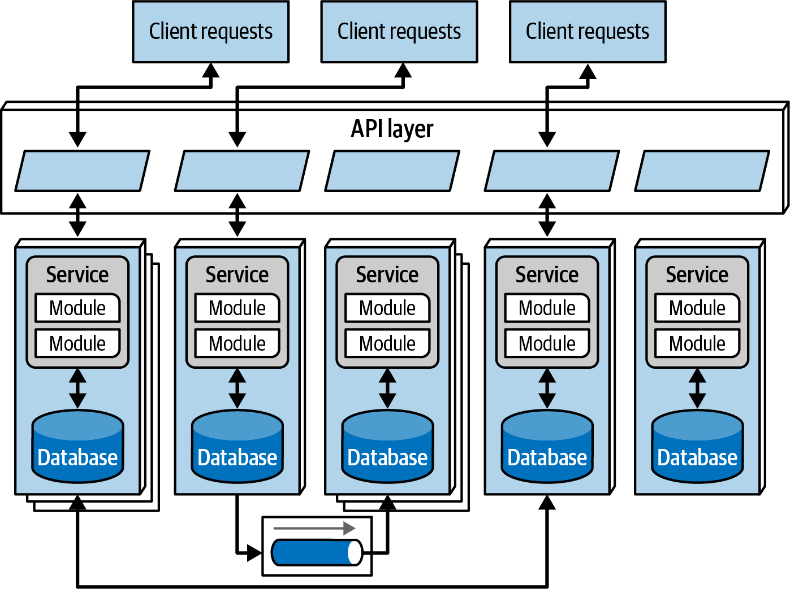

*Hình 18-1. Topology của microservices architecture style*

Performance thường là mặt trái của bản chất phân tán của microservices. Các lời gọi mạng mất nhiều thời gian hơn nhiều so với lời gọi method, và việc kiểm tra security ở mọi endpoint làm tăng thêm thời gian xử lý, đòi hỏi kiến trúc sư phải suy nghĩ cẩn thận về các hàm ý của granularity.

Vì microservices là một architecture phân tán, các kiến trúc sư giàu kinh nghiệm khuyên không nên dùng transaction xuyên qua ranh giới service. Xác định granularity của service thực sự là chìa khóa để thành công trong architecture này.

## Đặc thù của style (Style Specifics)

Các mục sau, dù không đầy đủ, mô tả một số khía cạnh quan trọng của topology microservices, bao gồm một số phần tử độc đáo chỉ có ở microservices.

### Bounded Context

Hãy đi sâu hơn vào khái niệm *bounded context*, mà chúng tôi đã nhắc đến như triết lý dẫn dắt của microservices. Mỗi service mô hình hóa một chức năng, subdomain hoặc workflow cụ thể. Khi đó, mỗi bounded context bao gồm mọi thứ cần thiết để vận hành trong chức năng hoặc subdomain đó—bao gồm các service gồm các logical component và class, database schema, và database tương ứng mà service cần để thực hiện các chức năng của mình. Mỗi service nhằm đại diện cho một subdomain hoặc chức năng cụ thể.

Triết lý này dẫn dắt nhiều quyết định mà kiến trúc sư đưa ra trong microservices. Ví dụ, trong một monolith, việc developer chia sẻ các class chung, như `Address`, giữa các phần khác biệt của ứng dụng là phổ biến. Tuy nhiên, vì microservices architecture cố tránh coupling, một kiến trúc sư xây dựng theo architecture style này sẽ dùng nhân bản thay vì coupling để giữ *toàn bộ* code bên trong bounded context của chức năng hoặc subdomain đó.

Microservices đẩy khái niệm architecture domain-partitioned đến cực đoan; theo nhiều cách, architecture này hiện thân hóa về mặt vật lý các khái niệm logic trong domain-driven design.

### Granularity

Các kiến trúc sư thiết kế microservices thường vật lộn để tìm đúng mức granularity, và rốt cuộc làm cho service của họ quá nhỏ do hiểu thuật ngữ *micro* theo nghĩa đen. Sau đó họ phải xây dựng các liên kết giao tiếp ngược lại giữa các service để làm việc hữu ích, điều này phủ nhận ý nghĩa ban đầu và dẫn đến một Big Ball of Distributed Mud.

> Thuật ngữ *microservice* là một cái nhãn, không phải một mô tả.
>
> —Martin Fowler

Nói cách khác, những người khởi xướng thuật ngữ cần gọi style mới này là *một cái gì đó*, và họ đã chọn *microservices* để đối lập nó với architecture style thống trị thời đó (khoảng năm 2007), service-oriented architecture, thứ có thể đã được gọi là “gigantic services” (service khổng lồ). Tuy nhiên, nhiều developer coi thuật ngữ *microservices* là một mệnh lệnh, không phải một mô tả, và tạo ra các service quá fine-grained.

Mục đích của ranh giới service trong microservices là nắm bắt một domain hoặc workflow. Trong một số ứng dụng, những ranh giới tự nhiên đó có thể lớn đối với một số phần của hệ thống, đơn giản vì một số quy trình nghiệp vụ có coupling cao hơn những quy trình khác. Dưới đây là một số hướng dẫn mà kiến trúc sư có thể dùng để giúp tìm ranh giới phù hợp:

**Mục đích (Purpose)**

Ranh giới hiển nhiên nhất dựa vào nguồn cảm hứng của architecture style: problem domain. Lý tưởng là mỗi microservice nên cohesive về mặt chức năng, đóng góp một hành vi quan trọng thay mặt cho toàn bộ ứng dụng.

**Transaction (Transactions)**

Bounded context là các workflow nghiệp vụ, và thường các thực thể cần hợp tác trong một transaction gợi ý một ranh giới service tốt. Vì transaction gây ra vấn đề trong các architecture phân tán, thiết kế hệ thống với mục tiêu tránh chúng có xu hướng dẫn đến những thiết kế tốt hơn.

**Choreography**

Một tập service mang lại sự cô lập domain tuyệt vời nhưng đòi hỏi giao tiếp rộng khắp để hoạt động. Kiến trúc sư có thể cân nhắc gộp các service này trở lại thành một service lớn hơn để tránh overhead giao tiếp.

Lặp lại là cách duy nhất để bảo đảm thiết kế service tốt. Kiến trúc sư hiếm khi khám phá ra mức granularity, các phụ thuộc dữ liệu và style giao tiếp hoàn hảo ngay ở lượt đầu tiên: họ lặp lại qua các lựa chọn để tinh chỉnh thiết kế, đặc biệt khi họ học thêm về hệ thống và chức năng nghiệp vụ của nó.

### Cô lập dữ liệu (Data Isolation)

Một yêu cầu khác của microservices, cũng được dẫn dắt bởi khái niệm bounded-context, là *data isolation* (cô lập dữ liệu). Nhiều architecture style dùng một database duy nhất để lưu trữ. Tuy nhiên, microservices cố tránh *mọi* loại coupling, *kể cả* việc dùng schema và database dùng chung làm điểm tích hợp.

Data isolation là một yếu tố khác cần xem xét khi nhìn vào granularity của service. Hãy cảnh giác với Entity Trap (được thảo luận trong [“The Entity Trap”](ch08_component_based_thinking.vi.md#sec-entity-trap))—đừng đơn giản mô hình hóa các service giống với các thực thể đơn lẻ trong database. Kiến trúc sư quen dùng relational database để hợp nhất các giá trị trong một hệ thống, tạo ra một nguồn sự thật duy nhất (single source of truth), nhưng đó không còn là lựa chọn khi bạn phân tán dữ liệu khắp architecture. Vì vậy mọi kiến trúc sư phải quyết định cách họ muốn xử lý vấn đề này: hoặc xác định một domain làm nguồn sự thật cho một dữ kiện nào đó và phối hợp với nó để truy xuất giá trị, hoặc phân phối thông tin thông qua database replication hoặc caching.

Dù mức data isolation này gây đau đầu, nó cũng mang lại cơ hội. Giờ đây khi không bị buộc phải hợp nhất xoay quanh một database duy nhất, mỗi team có thể chọn công nghệ database phù hợp nhất cho ngân sách, loại cấu trúc lưu trữ, characteristic vận hành, characteristic quy trình, v.v. của service mình. Một ưu điểm khác của hệ thống decoupled cao là bất kỳ team nào cũng có thể đổi hướng và chọn một database phù hợp hơn (hoặc phụ thuộc khác) mà không ảnh hưởng đến các team khác, vốn không được phép coupling với chi tiết hiện thực. (Chúng tôi đề cập data isolation và các cân nhắc về database chi tiết hơn trong [“Data Topologies”](#sec-ms-data-topologies).)

### API Layer

Hầu hết các microservices architecture bao gồm một API layer (thường gọi là *API Gateway*) giữa các bên tiêu thụ hệ thống (giao diện người dùng hoặc lời gọi từ các hệ thống khác) và các microservice. API layer có thể được hiện thực như một reverse-proxy đơn giản hoặc một gateway tinh vi hơn chứa các mối quan tâm cross-cutting như security, naming service, v.v. (những điều này được đề cập chi tiết hơn trong [“Operational Reuse”](#sec-operational-reuse)).

Dù API layer có nhiều công dụng, để trung thành với triết lý nền tảng của architecture này, chúng không nên được dùng làm mediator hay orchestrator. Mọi logic nghiệp vụ đáng kể trong architecture này nên nằm bên trong một bounded context, và đặt orchestration hay logic nghiệp vụ khác vào một mediator vi phạm quy tắc đó. Kiến trúc sư thường dùng mediator trong các architecture được phân vùng theo kỹ thuật, trong khi microservices được phân vùng theo domain một cách vững chắc.

> **Mẹo**
>
> Khi dùng một API layer trong microservices architecture, chỉ bao gồm việc định tuyến request và các mối quan tâm cross-cutting, như security, giám sát, logging, v.v. Hãy cẩn thận tránh đặt bất kỳ logic business-related nào vào API layer.

### Tái sử dụng vận hành (Operational Reuse)

Vì microservices ưu tiên nhân bản hơn coupling, kiến trúc sư xử lý thế nào với các phần của architecture này thực sự có lợi từ coupling, như các mối quan tâm vận hành kiểu giám sát, logging và circuit breaker? Triết lý service-oriented architecture truyền thống là tái sử dụng càng nhiều chức năng càng tốt, cả domain lẫn vận hành. Tuy nhiên, trong microservices, kiến trúc sư cố tách hai mối quan tâm này.

Khi một team đã xây dựng một số microservice, các thành viên bắt đầu nhận ra rằng mỗi microservice có những phần tử chung có lợi từ sự tương đồng. Ví dụ, nếu một tổ chức cho phép mỗi team service tự hiện thực việc giám sát, làm sao nó bảo đảm mỗi team đều làm vậy? Và tổ chức xử lý các mối quan tâm như nâng cấp thế nào—mỗi team có chịu trách nhiệm nâng cấp lên phiên bản mới của công cụ giám sát không, và việc đó sẽ mất bao lâu? Pattern *Sidecar* đưa ra một giải pháp cho vấn đề này ([Hình 18-2](#fig-style-microservices-sidecar)).

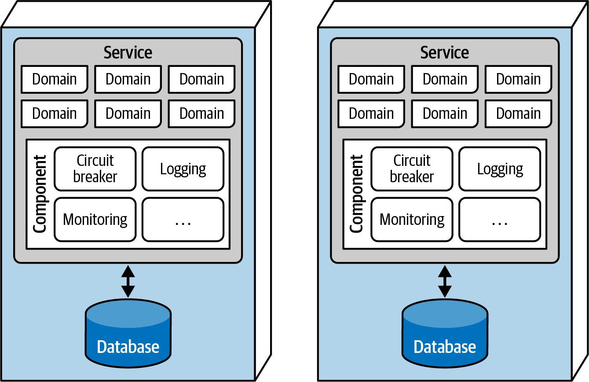

*Hình 18-2. Pattern Sidecar trong microservices*

Trong [Hình 18-2](#fig-style-microservices-sidecar), các mối quan tâm vận hành chung (circuit breaker, logging, giám sát) xuất hiện trong mỗi service như các component riêng, mỗi component có thể do từng team riêng lẻ hoặc một team hạ tầng dùng chung sở hữu. Component `Sidecar` xử lý mọi mối quan tâm vận hành có lợi từ coupling, nên khi đến lúc nâng cấp công cụ giám sát, team hạ tầng dùng chung có thể cập nhật sidecar, và mỗi microservice sẽ nhận được chức năng mới (xem [“Team Topology Considerations”](#sec-ms-team-topologies)).

Khi mỗi service bao gồm một component `Sidecar` chung, kiến trúc sư có thể xây dựng một *service mesh* để cho phép các team kiểm soát thống nhất các mối quan tâm chung này khắp architecture. Các component sidecar kết nối với nhau để tạo thành một giao diện vận hành nhất quán trên mọi microservice, như trong [Hình 18-3](#fig-style-microservices-sidecar-plane).

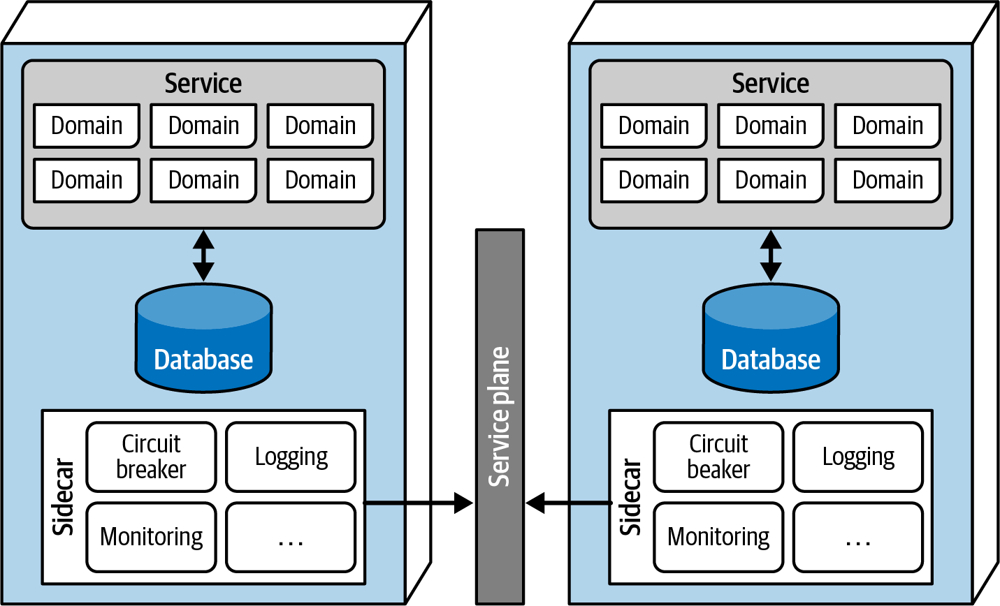

*Hình 18-3. Service plane kết nối các sidecar trong một service mesh*

Trong [Hình 18-3](#fig-style-microservices-sidecar-plane), mỗi sidecar nối vào *service plane*. Service plane là phần mềm tích hợp (thường dưới dạng một sản phẩm như [Istio](https://oreil.ly/cohCg)) kết nối mỗi sidecar bằng một giao diện nhất quán, qua đó tạo thành service mesh.

Mỗi service tạo thành một nút trong mesh tổng thể, như trong [Hình 18-4](#fig-style-microservices-mesh). Service mesh tạo thành một bảng điều khiển cho phép các team kiểm soát toàn cục coupling vận hành, như mức giám sát, logging, và các mối quan tâm vận hành cross-cutting khác.

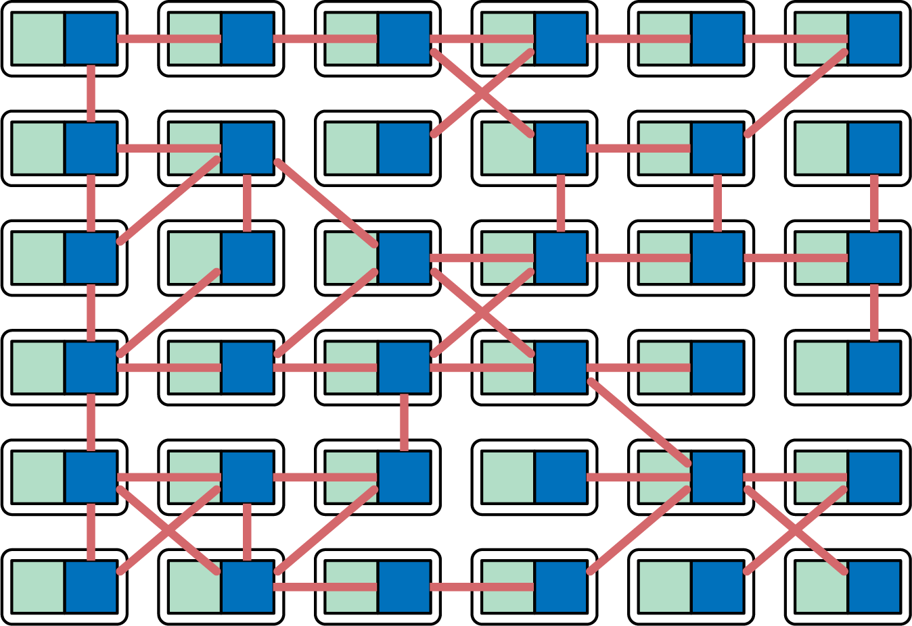

*Hình 18-4. Service mesh tạo thành một khung nhìn tổng thể về khía cạnh vận hành của microservices*

Kiến trúc sư dùng [service discovery](https://oreil.ly/IvPCO) như một cách để xây dựng elasticity vào microservices architecture. *Service discovery* là một cách tự động phát hiện và định vị các service trong một mạng. Khi một request đến, thay vì gọi một service duy nhất, nó đi qua một công cụ service discovery, công cụ này có thể giám sát số lượng và tần suất request và khởi tạo các instance service mới để xử lý các mối quan tâm về quy mô hoặc elasticity. Kiến trúc sư thường đưa service discovery vào service mesh, biến nó thành một phần của mọi microservice. API layer thường được dùng để host service discovery, cho phép một nơi duy nhất để giao diện người dùng hoặc các hệ thống gọi khác tìm và tạo service theo cách elastic, nhất quán.

### Frontend (Frontends)

Microservices ưu tiên decoupling, điều lý tưởng là bao gồm cả giao diện người dùng lẫn các mối quan tâm backend. Thực tế, tầm nhìn ban đầu cho microservices bao gồm UI như một phần của bounded context, trung thành với nguyên lý bounded-context trong DDD. Tuy nhiên, tính thực tế của việc phân vùng mà các ứng dụng web đòi hỏi (và các ràng buộc bên ngoài khác) khiến đó là một mục tiêu khó. Đó là lý do chúng ta thường thấy hai style UI cho microservices architecture.

Style thứ nhất, như trong [Hình 18-5](#fig-style-microservices-ui-mono), là *monolithic frontend*, có một UI duy nhất gọi qua API layer để đáp ứng request của người dùng. Frontend này có thể là một ứng dụng desktop, di động hoặc web phong phú. Ví dụ, nhiều ứng dụng web hiện nay dùng một web framework JavaScript để xây dựng một UI duy nhất.

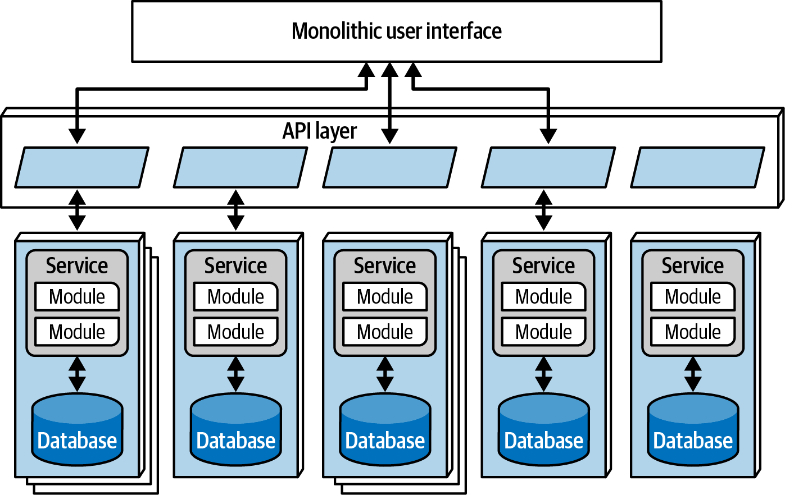

*Hình 18-5. Microservices architecture với một giao diện người dùng monolith*

Lựa chọn UI thứ hai là *micro-frontends*, như trong [Hình 18-6](#fig-style-microservices-micro).

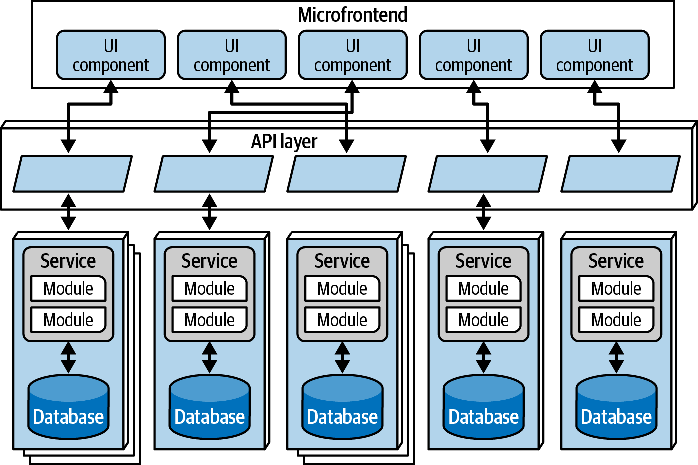

*Hình 18-6. Pattern micro-frontend trong microservices*

Cách tiếp cận micro-frontend dùng các component ở mức UI để tạo ra một mức granularity và cô lập đồng bộ trong UI và các service backend, qua đó hình thành quan hệ giữa các UI component và các service backend tương ứng.

Để tìm hiểu thêm về micro-frontends, chúng tôi rất khuyến nghị cuốn sách [*Building Micro-Frontends*](https://learning.oreilly.com/library/view/building-micro-frontends-2nd/9781098170776/), ấn bản 2nd Edition, của Luca Mezzalira (O’Reilly, 2025).

### Giao tiếp (Communication)

Trong microservices, kiến trúc sư và developer vật lộn để tìm granularity service phù hợp, điều ảnh hưởng đến cả data isolation lẫn giao tiếp. Tìm đúng style giao tiếp giúp các team giữ các service decoupled, nhưng vẫn phối hợp chúng theo những cách hữu ích.

Về cơ bản, kiến trúc sư phải quyết định giữa giao tiếp *đồng bộ* hay *bất đồng bộ*. Giao tiếp đồng bộ đòi hỏi bên gửi phải chờ phản hồi từ bên nhận. Microservices architecture thường sử dụng *protocol-aware heterogeneous interoperability* (khả năng tương tác không đồng nhất có nhận biết giao thức) khi giao tiếp tới và giữa các service. Hãy chia thuật ngữ phức tạp đó thành các phần để hiểu rõ hơn nó nghĩa là gì và vì sao nó quan trọng:

**Protocol-aware (nhận biết giao thức)**

Vì microservices không bao gồm một integration hub tập trung, mỗi service cần biết cách gọi các service khác. Do đó, kiến trúc sư thường chuẩn hóa *cách* các service cụ thể gọi nhau: một mức REST nhất định, message queue, v.v. Điều đó có nghĩa là các service phải biết (hoặc khám phá) giao thức nào cần dùng để gọi các service khác.

**Heterogeneous (không đồng nhất)**

Vì microservices là một architecture phân tán, mỗi service có thể được viết bằng một technology stack khác nhau. *Heterogeneous* cho biết microservices hỗ trợ đầy đủ các môi trường đa ngôn ngữ (polyglot), trong đó các service khác nhau dùng các nền tảng khác nhau.

**Interoperability (khả năng tương tác)**

Mô tả việc các service gọi nhau. Dù kiến trúc sư trong microservices cố hạn chế các lời gọi method có transaction, các service thường gọi các service khác qua mạng để cộng tác và trao đổi thông tin.

> **Bắt buộc không đồng nhất (Enforced Heterogeneity)**
>
> Một kiến trúc sư well-known, người tiên phong trong microservices style, từng là kiến trúc sư trưởng tại một startup xây dựng phần mềm quản lý personal-information cho thiết bị di động. Vì di động là một problem domain fast-moving, kiến trúc sư muốn bảo đảm không development team nào vô tình tạo ra các điểm coupling có thể cản trở khả năng di chuyển độc lập của họ. Hóa ra các team có bộ kỹ năng kỹ thuật rất đa dạng, nên kiến trúc sư đã ra một quy tắc mới: mỗi development team phải dùng một technology stack *khác nhau*. Nếu một team dùng Java và team kia dùng .NET, họ sẽ không thể vô tình chia sẻ class!
>
> Cách tiếp cận này hoàn toàn trái ngược với hầu hết các chính sách governance doanh nghiệp, vốn khăng khăng chuẩn hóa trên một technology stack duy nhất. Trong thế giới microservices, mục tiêu không phải là tạo ra hệ sinh thái phức tạp nhất có thể, mà là chọn đúng quy mô công nghệ cho phạm vi hẹp của vấn đề. Không phải service nào cũng cần một relational database industrial-strength, và ép một database như vậy lên một team nhỏ có nhiều khả năng làm họ chậm lại hơn là mang lại lợi ích. Khái niệm này tận dụng bản chất decoupled cao của microservices.

Với giao tiếp bất đồng bộ, kiến trúc sư thường dùng sự kiện và message, tương tự những gì chúng tôi đã mô tả về event-driven architecture trong [Chương 15](ch15_event_driven_architecture_style.vi.md#ch-style-eda).

### Choreography và orchestration (Choreography and Orchestration)

*Choreography* sử dụng cùng style giao tiếp như EDA. Các choreographed architecture không có bộ điều phối trung tâm, tôn trọng triết lý bounded context và khiến việc hiện thực các sự kiện decoupled giữa các service trở nên tự nhiên.

Trong choreography, mỗi service gọi các service khác khi cần, không có mediator trung tâm. Ví dụ, hãy xét kịch bản trong [Hình 18-7](#fig-style-microservices-choreography). Người dùng yêu cầu chi tiết về wish list của một người dùng khác. Vì service `CustomerWishList` không chứa mọi thông tin nó cần, nó thực hiện một lời gọi tới `CustomerDemographics` để truy xuất thông tin còn thiếu, rồi trả kết quả cho người dùng.

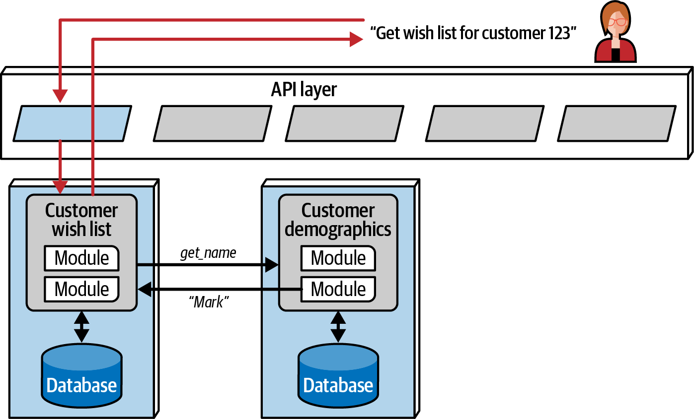

*Hình 18-7. Dùng choreography trong microservices để quản lý phối hợp*

Vì microservices architecture không bao gồm một mediator toàn cục như các service-oriented architecture khác, nếu kiến trúc sư cần phối hợp qua nhiều service, họ có thể tạo mediator cục bộ của riêng mình (thường gọi là *orchestration service*).

Trong [Hình 18-8](#fig-style-microservices-orchestration), các developer tạo một service có trách nhiệm duy nhất là phối hợp các lời gọi. Chẳng hạn, người dùng gọi mediator `ReportCustomerInformation`, mediator này gọi mọi service cần thiết khác để lấy thông tin được yêu cầu.

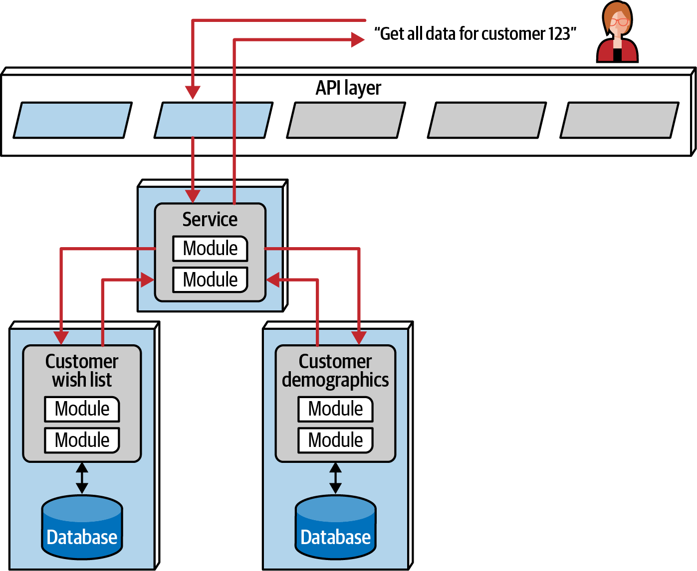

*Hình 18-8. Dùng orchestration trong microservices*

Định luật thứ nhất của software architecture gợi ý rằng không giải pháp nào trong số này hoàn hảo—mỗi giải pháp đều có trade-offs. Choreography giữ gìn triết lý decoupled cao của microservices để gặt hái tối đa lợi ích của nó. Tuy nhiên, nó cũng làm cho các vấn đề phổ biến như xử lý lỗi và phối hợp phức tạp hơn.

Hãy xét một ví dụ với workflow phức tạp hơn. Trong [Hình 18-9](#fig-style-microservices-ch-book), service được gọi đầu tiên phải phối hợp qua nhiều service khác nhau, về cơ bản đóng vai trò như một mediator bên cạnh các trách nhiệm domain khác của nó. Điều này được gọi là pattern *Front Controller*, trong đó một service trên danh nghĩa là choreographed trở thành một mediator phức tạp hơn cho một vấn đề nào đó. Nhược điểm của pattern này là service đảm nhận nhiều vai trò làm tăng độ phức tạp.

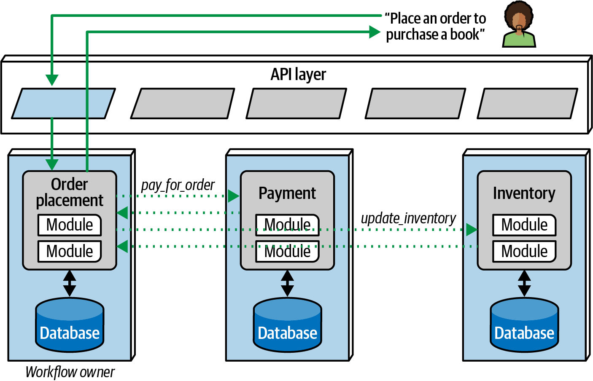

*Hình 18-9. Dùng choreography cho một quy trình nghiệp vụ phức tạp*

Ngoài ra, kiến trúc sư có thể chọn dùng orchestration cho các quy trình nghiệp vụ phức tạp, như minh họa trong [Hình 18-10](#fig-microservices-ch-orch). Kiến trúc sư xây dựng một mediator service để phối hợp workflow nghiệp vụ, tạo ra coupling giữa các service này, nhưng cũng cho phép kiến trúc sư tập trung việc phối hợp vào một service duy nhất, khiến các service khác ít bị ảnh hưởng hơn. Các workflow domain thường vốn đã coupled, nên công việc của kiến trúc sư bao gồm tìm cách biểu diễn coupling đó sao cho hỗ trợ tốt nhất các mục tiêu của cả domain lẫn architecture.

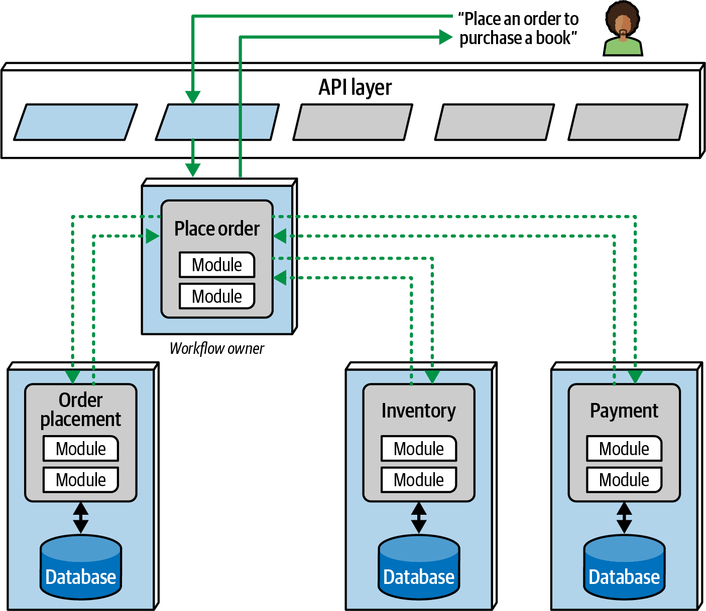

*Hình 18-10. Dùng orchestration cho một quy trình nghiệp vụ phức tạp*

### Transaction và saga (Transactions and Sagas)

Kiến trúc sư hướng tới decoupling cực đoan trong microservices, nhưng thường gặp vấn đề làm sao phối hợp transaction giữa các service. Vì microservices khuyến khích cùng mức decoupling trong database như trong architecture, tính nguyên tử vốn tầm thường trong các ứng dụng monolith trở thành vấn đề trong các ứng dụng phân tán.

Xây dựng transaction xuyên qua ranh giới service vi phạm nguyên lý decoupling cốt lõi của microservices, và cũng tạo ra loại dynamic connascence tệ nhất, *Connascence of Values* (xem [“Connascence”](ch03_modularity.vi.md#sec-modularity-connascence)). Lời khuyên tốt nhất chúng tôi có thể đưa ra cho các kiến trúc sư muốn thực hiện transaction giữa các service là: *đừng làm!* Thay vào đó hãy sửa granularity của service. Nếu bạn thấy mình cần nối microservices architecture lại với nhau bằng transaction, đó là dấu hiệu thiết kế của bạn quá chi tiết (too granular).

> **Mẹo**
>
> Hãy cố tránh các transaction trải qua nhiều microservice—thay vào đó hãy sửa granularity của service!

Theo đúng quy tắc “còn tùy”, luôn có ngoại lệ. Ví dụ, có thể nảy sinh một tình huống mà hai service khác nhau cần những architecture characteristic rất khác nhau đòi hỏi ranh giới service riêng biệt, nhưng vẫn cần phối hợp transaction. Trong trường hợp đó, sau khi cân nhắc kỹ các trade-offs, kiến trúc sư có thể tận dụng một số transactional pattern nhất định để orchestrate transaction.

Transaction phân tán trong microservices thường được xử lý bằng cái được biết đến là pattern *Saga*. Trong văn học, một *saga* là một câu chuyện sử thi mô tả một chuỗi dài các sự kiện dẫn đến một kết thúc anh hùng nào đó, do đó có tên của transactional pattern này.

Trong [Hình 18-11](#fig-microservices-saga-happy), một service đóng vai trò như một mediator qua nhiều lời gọi service để phối hợp một transaction. Mediator gọi từng phần của transaction, ghi lại thành công hay thất bại, và phối hợp các kết quả. Nếu mọi thứ diễn ra như kế hoạch, tất cả các giá trị trong các service và database chứa trong chúng được cập nhật đồng bộ. Nếu có tình trạng lỗi và một phần của transaction thất bại, mediator phải bảo đảm không phần nào của transaction thành công. Hãy xét tình huống trong [Hình 18-12](#fig-microservices-saga-error).

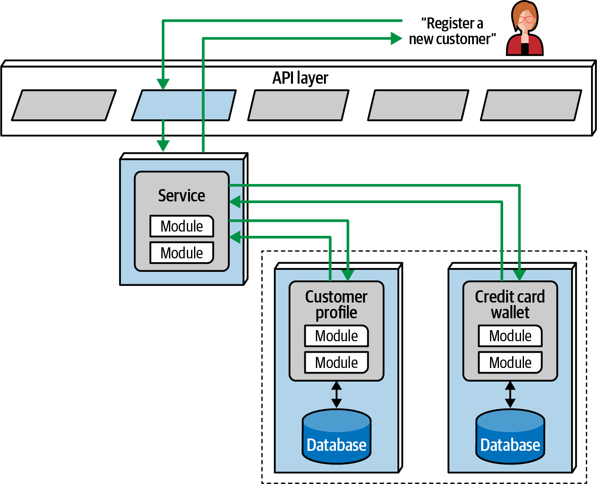

*Hình 18-11. Pattern Saga trong microservices architecture*

Nếu phần đầu tiên của transaction thành công nhưng phần thứ hai thất bại, mediator phải gửi một request tới tất cả các service tham gia khác của transaction đã thành công và bảo chúng hoàn tác request trước đó. Style phối hợp transaction này được gọi là *compensating transaction framework* (framework transaction bù trừ). Developer thường hiện thực pattern này bằng cách để mỗi request từ mediator vào trạng thái `pending` cho đến khi mediator báo thành công tổng thể. Tuy nhiên, việc tung hứng các request bất đồng bộ có thể trở nên phức tạp, đặc biệt nếu xuất hiện các request mới phụ thuộc vào trạng thái transaction đang chờ. Bất kể dùng giao thức nào, các compensating transaction tạo ra rất nhiều lưu lượng phối hợp ở mức mạng.

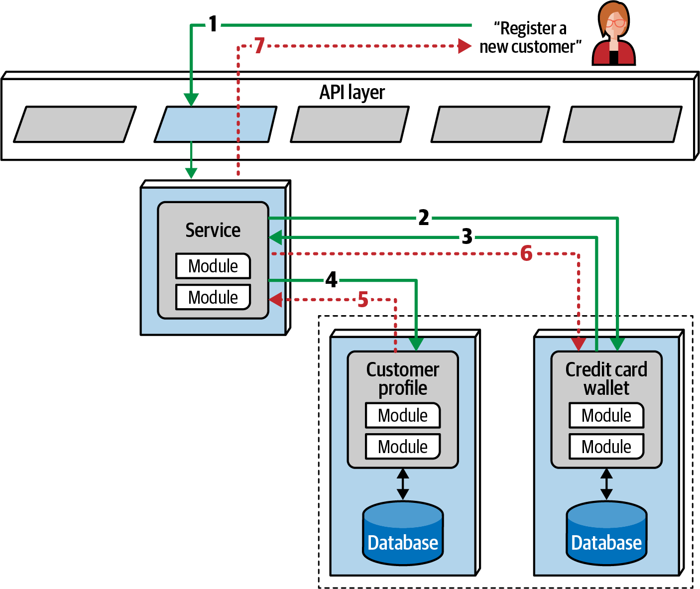

*Hình 18-12. Các compensating transaction của pattern Saga cho tình trạng lỗi*

> **Mẹo**
>
> Đôi khi cần thiết để một vài transaction đi qua nhiều service; tuy nhiên, nếu đó là đặc điểm chủ đạo của architecture, thì microservices có lẽ không phải là lựa chọn đúng!

Quản lý transaction trong microservices rất phức tạp, và bạn có thể đào sâu hơn nhiều. Chúng tôi đã xác định tám transactional Saga pattern khác nhau để giải quyết nhiều kịch bản, bạn có thể tìm thấy trong Chương 12 của cuốn sách [*Software Architecture: The Hard Parts*](https://www.amazon.com/Software-Architecture-Trade-Off-Distributed-Architectures/dp/1492086894) (O’Reilly, 2021), đồng tác giả với Pramod Sadalage và Zhamak Dehghani.

## Topology dữ liệu (Data Topologies)

Như chúng tôi đã thảo luận xuyên suốt chương này, dữ liệu đóng vai trò then chốt trong microservices architecture. Thực tế, microservices là architectural style duy nhất *đòi hỏi* kiến trúc sư phải tách dữ liệu. Trong khi *có thể* (dù không phải lúc nào cũng hiệu quả) dùng một monolithic database trong các architecture phân tán khác, điều đó đơn giản là không phải một lựa chọn trong microservices. Domain database cũng vậy, như chúng tôi thảo luận trong [“Data Topologies”](ch14_service_based_architecture_style.vi.md#sec-service-based-data-topologies) và cả trong [“Data Topologies”](ch15_event_driven_architecture_style.vi.md#sec-eda-data-topologies). Điều này là do bản chất fine-grained của microservices, bounded context, và số lượng lớn service có trong hầu hết các hệ sinh thái microservices.

Để minh họa vì sao một monolithic database không khả thi trong microservices, hãy xét một kịch bản trong đó 60 service dùng chung cùng một database. Vấn đề đầu tiên nảy sinh sẽ là về việc kiểm soát thay đổi trong architecture. Như [Hình 18-13](#fig-ms-data-change-control) minh họa, thay đổi cấu trúc của database đó (như đổi tên một cột hoặc xóa một bảng) sẽ đòi hỏi các thay đổi tương ứng ở tất cả 60 service dùng dữ liệu đó. Hãy tưởng tượng việc cố phối hợp bảo trì, test và phát hành năm tá service được deploy riêng trong khi cùng lúc phát hành các thay đổi database! Nhiệm vụ này sẽ đáng sợ, nói một cách nhẹ nhàng nhất, và có lẽ sẽ kết thúc bằng thảm họa.

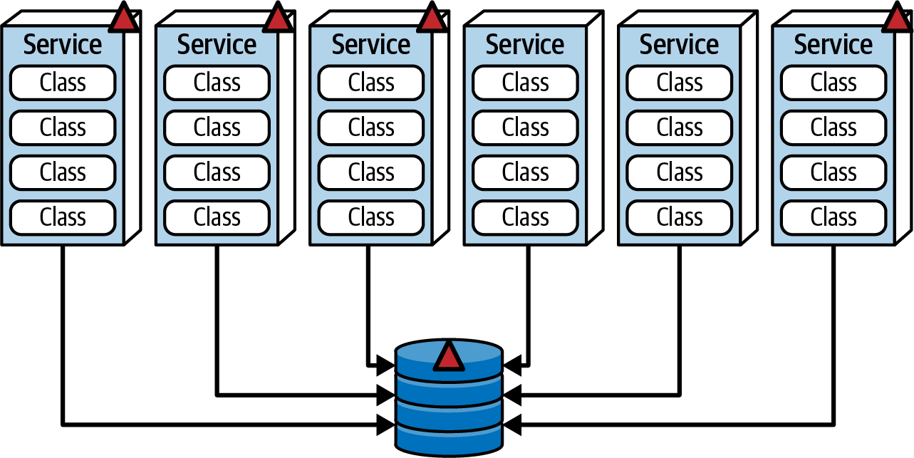

*Hình 18-13. Kiểm soát thay đổi với một monolithic database là một nhiệm vụ rất thách thức*

Có lẽ vấn đề lớn nhất khi kết hợp một topology dữ liệu monolith với microservices là nó phá vỡ toàn bộ khái niệm về một bounded context vật lý. Hãy nhớ lại rằng bounded context bao gồm *toàn bộ* chức năng cần thiết để thực thi một chức năng nghiệp vụ hoặc subdomain cụ thể, *bao gồm database và các cấu trúc dữ liệu tương ứng*. Nếu mọi service dùng chung cùng database và cấu trúc dữ liệu, bounded context biến mất.

Một vấn đề khác với dữ liệu monolith là về scalability và elasticity. Dù nhiều công cụ và sản phẩm vận hành tự động giám sát tải đồng thời và điều chỉnh số lượng instance service để đáp ứng sự gia tăng, không có nhiều database scale tương ứng. Sự mất cân bằng này có thể gây ra các vấn đề về responsiveness tổng thể và request timeout. Quản lý các kết nối database, vốn thường nằm trong mỗi *instance* service, là một mối lo khác. Khi số lượng service và instance service tăng lên, các service có thể nhanh chóng cạn kiệt các kết nối database có sẵn, dẫn đến thêm việc chờ kết nối và request timeout.

Cuối cùng, nếu database trở nên không khả dụng do crash, bảo trì theo kế hoạch hoặc backup, toàn bộ hệ sinh thái microservices bị sập—như bất kỳ architectural style nào dùng monolithic database. Dù không cực đoan bằng, một topology database domain-based cũng có thể gặp các vấn đề tương tự về scalability, quản lý database connection pool, availability và fault tolerance.

Vì những lý do này, topology database chuẩn cho microservices là pattern *Database-per-Service*. Với topology database này, mỗi microservice sở hữu dữ liệu riêng của mình, được chứa dưới dạng các bảng trong một database hoặc schema riêng, như minh họa trong [Hình 18-14](#fig-ms-database-per-service).

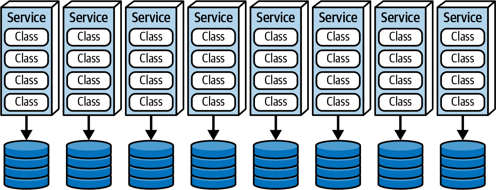

*Hình 18-14. Pattern Database-per-Service là topology database điển hình cho microservices*

Topology này giữ gìn bounded context, giúp kiến trúc sư dễ kiểm soát thay đổi hơn. Vì các service khác cần dữ liệu phải yêu cầu nó từ service sở hữu thông qua một loại contract nào đó, chúng được decoupled khỏi cấu trúc bên trong của dữ liệu. Thay đổi cấu trúc database chỉ ảnh hưởng đến service sở hữu trong bounded context. Điều này cho phép kiến trúc sư tự do thay đổi loại database (như từ relational database sang document database) mà không ảnh hưởng đến các service khác.

Topology Database-per-Service cũng mang lại scalability, elasticity, availability và fault tolerance tuyệt vời, những architectural characteristic đều bị ảnh hưởng dưới các topology database monolith hoặc domain-based. Hơn nữa, quản lý kết nối tới database trong một bounded context dễ dàng hơn nhiều so với một database monolith hoặc domain-based.

Dù topology Database-per-Service được dùng rộng rãi trong microservices, nó có những nhược điểm. Ví dụ, điều gì xảy ra nếu hai hoặc nhiều service ghi vào cùng một bảng database? Điều gì xảy ra nếu một service bên ngoài bounded context *phải* truy vấn database trực tiếp, vì lý do performance? Trong những trường hợp này (vốn khá phổ biến), có thể để một vài service dùng chung một database, như trong [Hình 18-15](#fig-ms-data-sharing). Chúng tôi khuyến nghị không quá năm hoặc sáu service dùng chung một database (hoặc schema). Nhiều hơn thế và bạn sẽ bắt đầu gặp các vấn đề tương tự về kiểm soát thay đổi, scalability, elasticity, availability, fault tolerance, v.v.

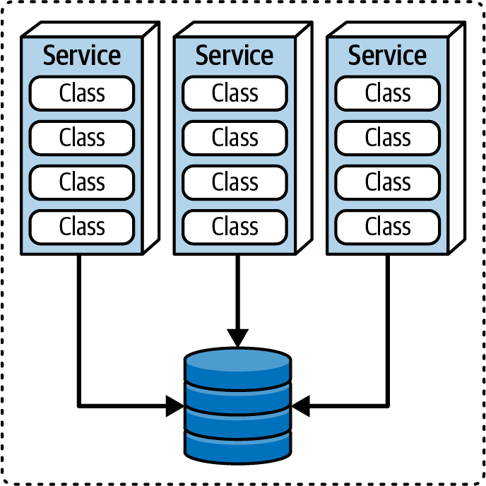

*Hình 18-15. Có thể chia sẻ dữ liệu giữa một vài microservice*

Chiếc hộp bao quanh các service và database trong [Hình 18-15](#fig-ms-data-sharing) biểu thị bounded context. Việc các service dùng chung một database không có nghĩa là không có bounded context; nó chỉ có nghĩa là kiến trúc sư đã tạo ra một bounded context *rộng hơn*. Ví dụ, họ có thể có lý do chính đáng để tách xử lý thanh toán thành các loại thanh toán khác nhau (như thẻ tín dụng, thẻ quà tặng, PayPal, điểm thưởng, v.v.), nhưng các service riêng lẻ này vẫn cần cập nhật và truy cập cùng dữ liệu. Tương tự, kiến trúc sư có thể tách một service vận chuyển duy nhất thành các service được deploy riêng, mỗi service cho một phương thức vận chuyển, nhưng các service đó vẫn sẽ đều cần cập nhật và truy cập cùng dữ liệu.

Điểm trade-off chính của việc chia sẻ dữ liệu giữa các microservice trong một bounded context rộng hơn là kiểm soát các thay đổi database. Khi database schema thay đổi, kiến trúc sư giờ phải phối hợp thay đổi và deployment của nhiều service, khiến các thay đổi database rủi ro hơn và kém agile hơn. Cũng có thể có những hệ quả tiêu cực đối với scalability, elasticity và fault tolerance, tùy thuộc vào vấn đề kinh doanh và tình huống.

## Các cân nhắc về cloud (Cloud Considerations)

Dù microservices chắc chắn có thể được deploy trong các hệ thống on-prem, đặc biệt với sự phổ biến của các nền tảng service orchestration như [Kubernetes](https://kubernetes.io) và [Cloud Foundry](https://cloudfoundry.org), architectural style này rất phù hợp cho các deployment cloud-based—đến mức microservices đôi khi được gọi là một architecture “cloud-native”. Provisioning on-demand các máy ảo, container và database, kết hợp với cách tiếp cận services-based có trong các môi trường cloud (như AWS), rất phù hợp với microservices architectural style.

Người đọc chú ý có thể thắc mắc vì sao chúng tôi không đưa [serverless](https://oreil.ly/Oltzv) vào làm một architecture style. *Serverless* chỉ một mô hình cloud-computing trong đó các hàm được kích hoạt theo request, phân bổ tài nguyên máy cần thiết trên cơ sở on-demand. Các hàm serverless bao gồm những artifact như [AWS Lambdas](https://aws.amazon.com/lambda), [Google cloud functions](https://cloud.google.com/functions) và [Azure cloud functions](https://oreil.ly/wzcp3). Chúng tôi tin rằng serverless không phải là một architectural style, mà là một *mô hình deployment* của microservices architectural style.

Hãy nhớ lại từ phần trước của chương rằng một *microservice* được định nghĩa là một đơn vị phần mềm single-purpose, được deploy riêng, làm *một việc* thật tốt (do đó có tiền tố *micro*). Như vậy, microservices có xu hướng tương đối finer-grained hơn so với các service trong các architectural style khác. Điều này về cơ bản cũng mô tả một *serverless function*, đó là lý do chúng tôi coi serverless là một phần của microservices.

Dù vậy, microservices trong môi trường cloud không *bắt buộc* phải được deploy dưới dạng serverless function; nó cũng có thể được deploy dưới dạng các service được container hóa dễ dàng như vậy. Hầu hết các nhà cung cấp cloud đã áp dụng Kubernetes (hoặc một dạng nào đó của nền tảng Kubernetes), cho phép developer deploy các microservice được container hóa dễ dàng như các microservice serverless.

## Các rủi ro phổ biến (Common Risks)

Một trong những rủi ro lớn nhất trong microservices là làm cho service *quá* nhỏ. Năm 2016 một trong các tác giả (Mark) đã đặt ra cái tên *Grains of Sand* (những hạt cát) cho antipattern làm service quá fine-grained, giống như những hạt cát trên bãi biển. Như chúng tôi đã đề cập trước đó, chữ *micro* trong microservices chỉ *những gì* service làm, không phải nó *lớn* đến mức nào. Granularity service là một khía cạnh quan trọng của microservices đến mức chúng tôi dành cả một chương cho nó (Chương 7) trong cuốn sách [*Software Architecture: The Hard Parts*](https://www.amazon.com/Software-Architecture-Trade-Off-Distributed-Architectures/dp/1492086894).

Một rủi ro phổ biến khác trong microservices là tạo ra quá nhiều giao tiếp giữa các service. Bản chất fine-grained của microservices, kết hợp với các bounded context chặt chẽ, khiến các service trong một hệ sinh thái microservices tất yếu sẽ cần giao tiếp với nhau. Giao tiếp này có thể là do xử lý workflow (như choreography hoặc AWS step function cho microservices serverless) hoặc do cần dữ liệu của service khác (do bounded context bên trong mỗi service và dữ liệu của nó). Bất kể lý do gì, hãy cẩn thận tránh quá nhiều dynamic coupling và giao tiếp liên service. Một lần nữa, điều này thường là kết quả của việc làm service quá fine-grained, và có thể được sửa bằng cách gộp các service lại thành các microservice coarser-grained.

Một rủi ro khác trong microservices là quá đà trong việc chia sẻ dữ liệu. Dù chúng tôi đã đề cập rằng có thể (và đôi khi cần thiết) chia sẻ dữ liệu trong microservices, chia sẻ dữ liệu quá nhiều tạo ra rủi ro cho hệ thống về kiểm soát thay đổi, scalability, fault tolerance và agility tổng thể—những thứ microservices làm thực sự tốt (xem [“Style Characteristics”](#sec-ms-ratings)). Hãy biết khi nào cần chia sẻ dữ liệu và khi nào nên sửa việc chia sẻ dữ liệu thông qua hợp nhất service.

Một rủi ro cuối cùng thường bị bỏ qua trong microservices architectural style là việc tái sử dụng code và chia sẻ chức năng. Tái sử dụng code là một phần cần thiết của phát triển phần mềm. Tuy nhiên, tái sử dụng code và chức năng đi ngược trực tiếp với các nguyên lý của microservices, do đó có thuật ngữ architecture “không chia sẻ gì” (share nothing) được mô tả ở phần trước của chương này. Khi một kiến trúc sư chia sẻ chức năng chung giữa các service thông qua các thư viện tùy biến (như file JAR hoặc DLL), một phần của bounded context sụp đổ. Nói cách khác, code được tái sử dụng bị trải ra qua nhiều bounded context, nghĩa là không phải *toàn bộ* chức năng cho chức năng hoặc subdomain cụ thể đó được chứa trong bounded context của nó, và do đó một thay đổi đối với code dùng chung có thể làm hỏng các service trong các bounded context khác. Dù versioning có giúp giải quyết vấn đề này, chia sẻ code vẫn làm tăng đáng kể sự phức tạp cho một hệ sinh thái microservices.

## Quản trị (Governance)

Nhiều quy tắc và kỹ thuật governance được dùng trong microservices giải quyết các rủi ro phổ biến mà chúng tôi đã mô tả trong mục trước. Governance trong một microservices architecture phần lớn là về việc tránh sự xuống cấp cấu trúc.

Trước hết và quan trọng nhất, kiến trúc sư nên áp dụng governance để giám sát và kiểm soát lượng static coupling và dynamic coupling giữa các service. Hãy nhớ lại từ [Chương 7](ch07_the_scope_of_architectural_characteristics.vi.md#ch-scope) rằng static coupling xảy ra khi các microservice dùng chung các thư viện tùy biến hoặc third-party, cũng như dưới dạng contract khi các service cần giao tiếp. Contract đặc biệt quan trọng: dù kiến trúc sư có thể dùng các giao thức giao tiếp bất đồng bộ để decouple các service về mặt *động*, chúng vẫn có thể bị coupled về mặt *tĩnh* bởi contract được dùng giữa chúng (bất kể loại giao tiếp).

Một software bill of materials (danh mục thành phần phần mềm), các script deployment, và các công cụ dependency-management có thể giúp kiến trúc sư hiểu rõ hơn và quản trị số lượng artifact được chia sẻ giữa các service. Dù chúng tôi không thể chỉ định chính xác bao nhiêu static coupling là *quá nhiều*, chúng tôi khuyến nghị cố gắng tối thiểu hóa coupling giữa các service.

Quản trị dynamic coupling khó hơn nhiều so với quản trị static coupling. Thu thập các metric phù hợp đòi hỏi một chút sáng tạo và nhất quán. Một kỹ thuật governance phổ biến là dùng log để xác định các lời gọi tới các service khác. Khi các service thực hiện lời gọi tới các service nội bộ hoặc third-party, các service đó ghi log các tương tác cùng với thông tin về service nào đang được gọi, giao thức được dùng, v.v. Kiến trúc sư có thể phân tích thông tin này thông qua fitness function để hiểu rõ hơn các mức dynamic coupling trên toàn hệ sinh thái microservices. Tuy nhiên, cách tiếp cận này đòi hỏi governance chặt chẽ để bảo đảm mỗi service đều phơi bày thông tin này thông qua logging một cách nhất quán. Một thư viện tùy biến (như file JAR hoặc DLL) là một cách để cung cấp một API nhất quán mà mọi service có thể bind vào tại thời điểm biên dịch và dùng để bảo đảm logging nhất quán.

Một cách khác để thu thập các metric dynamic coupling trong microservices là thông qua các mục registry. Bất cứ khi nào instance đầu tiên của một service khởi động, service đó đăng ký các lời gọi liên service của nó thông qua một loại contract nào đó (như JSON) tới một configuration service hoặc configuration server tùy biến, như [Apache ZooKeeper](https://zookeeper.apache.org). Kiến trúc sư sau đó có thể truy vấn configuration server để lấy một bản đồ của mọi lời gọi liên service trên toàn hệ sinh thái microservices, thứ họ có thể dùng để quản trị và kiểm soát lượng giao tiếp giữa các service.

## Các cân nhắc về team topology (Team Topology Considerations)

Vì microservices architecture được phân vùng theo domain, chúng hoạt động tốt nhất khi các team cũng được sắp xếp theo vùng domain (như các team cross-functional có chuyên môn hóa). Khi một yêu cầu domain-based xuất hiện, một team cross-functional domain-focused có thể cùng làm việc trên tính năng đó bên trong một domain service cụ thể, mà không can thiệp vào các team hoặc service khác. Ngược lại, các team được phân vùng theo kỹ thuật (như team UI, team backend, team database, v.v.) không hoạt động tốt với architectural style này vì domain partitioning của nó. Gán các yêu cầu domain-based cho một team được tổ chức theo kỹ thuật đòi hỏi một mức giao tiếp và cộng tác liên team mà hầu hết các tổ chức đều thấy khó khăn.

Dưới đây là một số cân nhắc cho các kiến trúc sư muốn gắn một microservices architecture với các team topology cụ thể được nêu trong [“Team Topologies and Architecture”](ch09_foundations.vi.md#sec-foundations-team-topologies):

**Stream-aligned team**

Nếu ranh giới domain được sắp xếp đúng, stream-aligned team hoạt động tốt với architectural style này, đặc biệt nếu các stream của họ tập trung vào một domain cụ thể. Tuy nhiên, microservices architecture trở nên thách thức hơn đối với các team có stream vượt qua nhiều bounded context và service, ra ngoài một subdomain hoặc domain cụ thể. Trong trường hợp này, chúng tôi khuyến nghị phân tích các bounded context và granularity của microservices và hoặc sắp xếp lại chúng theo các stream hoặc chọn một architectural style khác.

**Enabling team**

Enabling team hiệu quả nhất trong một microservices architecture khi họ có thể dùng các service dùng chung cho các mối quan tâm chuyên biệt hoặc cross-cutting. Nhờ mức modularity cao có trong microservices, enabling team có thể làm việc độc lập với các stream-aligned team để cung cấp thêm chức năng chuyên biệt và dùng chung mà không cản đường. Làm việc cùng các platform team, họ cũng có thể hỗ trợ tạo các component sidecar tạo nên một service mesh (xem [“Operational Reuse”](#sec-operational-reuse)).

**Complicated-subsystem team**

Complicated-subsystem team có thể tận dụng modularity service-level của architecture style này để tập trung vào xử lý domain hoặc subdomain phức tạp, độc lập với các thành viên team (và service) khác.

**Platform team**

Mức modularity cao có trong microservices giúp các stream-aligned team tận dụng lợi ích của topology platform-teams bằng cách sử dụng các công cụ, service, API và tác vụ chung. Trong nhiều trường hợp, các platform team (đôi khi làm việc cùng enabling team) tập trung vào việc tạo và duy trì chức năng vận hành cross-cutting có trong các sidecar (xem [“Operational Reuse”](#sec-operational-reuse)) và service mesh, giải phóng các stream-aligned team khỏi những mối quan tâm vận hành này.

## Các characteristic của style (Style Characteristics)

Microservices architecture style có một số giá trị cực đoan trên thang đánh giá chuẩn của chúng tôi, như trong [Hình 18-16](#fig-style-microservices-ratings). Đánh giá one-star (một sao) có nghĩa là architecture characteristic cụ thể không được hỗ trợ tốt trong architecture, trong khi đánh giá five-star (năm sao) có nghĩa là architecture characteristic đó là một trong những đặc điểm mạnh nhất của architecture style. Định nghĩa của mỗi characteristic được xác định trong bảng điểm có thể được tìm thấy trong [Chương 4](ch04_architectural_characteristics_defined.vi.md#ch04-architecture-characteristics-defined).

Microservices hỗ trợ đặc biệt cao cho các thực hành kỹ thuật hiện đại như deployment tự động và testability. Microservices không thể tồn tại nếu không có cuộc cách mạng DevOps, với bước tiến không ngừng hướng tới tự động hóa các mối quan tâm vận hành.

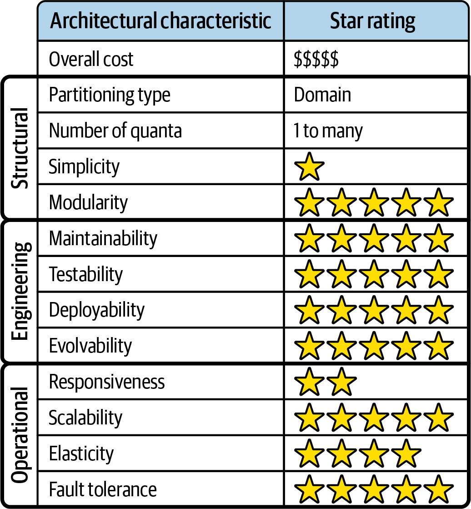

*Hình 18-16. Đánh giá các characteristic của microservices*

Bản chất độc lập, single-purpose, và do đó fine-grained của các service trong architectural style này nhìn chung dẫn đến fault tolerance cao, do đó characteristic này được đánh giá cao.

Các điểm cao khác của architecture này là scalability, elasticity và evolvability. Một số hệ thống có scalability cao nhất từng được viết đã dùng microservices rất thành công. Tương tự, vì style này dựa nhiều vào tự động hóa và tích hợp thông minh với vận hành, kiến trúc sư có thể xây dựng hỗ trợ cho elasticity. Vì architecture này ưu tiên decoupling cao ở mức từng bước, nó cũng hỗ trợ thực hành kinh doanh hiện đại là thay đổi tiến hóa, ngay cả ở mức architecture. Các doanh nghiệp hiện đại di chuyển nhanh, và phát triển phần mềm đã vật lộn để theo kịp. Một architecture được cấu trúc với các deployment unit cực nhỏ, decoupled cao có thể hỗ trợ tốc độ thay đổi nhanh hơn.

Performance thường là một vấn đề trong microservices. Các architecture phân tán phải thực hiện nhiều lời gọi mạng để hoàn thành công việc, và điều đó có overhead performance cao. Chúng cũng phải gọi các phép kiểm tra security để xác minh danh tính và quyền truy cập cho mỗi endpoint, phát sinh thêm latency. Microservices cũng chịu *data latency* (độ trễ dữ liệu): khi một request đòi hỏi nhiều service phối hợp, điều đó có nghĩa là nhiều lời gọi database.

Vì lý do này, thế giới microservices có nhiều architecture pattern để tăng performance, bao gồm caching và nhân bản dữ liệu thông minh để tránh quá nhiều lời gọi mạng. Performance là một lý do khác khiến microservices thường dùng choreography thay vì orchestration: ít coupling hơn cho phép giao tiếp nhanh hơn và ít nút cổ chai hơn.

Microservices chắc chắn là một architecture domain-partitioned, trong đó mỗi ranh giới service nên tương ứng với các domain. Nhờ bounded context, nó cũng có các quanta rõ ràng nhất trong mọi architecture hiện đại—theo nhiều cách, nó là ví dụ điển hình cho điều mà thước đo quantum đánh giá. Triết lý dẫn dắt về decoupling cực đoan gây đau đầu, nhưng mang lại lợi ích to lớn khi được làm tốt. Như với bất kỳ architecture nào, kiến trúc sư phải hiểu các quy tắc để phá vỡ chúng một cách thông minh.

## Ví dụ và use case (Examples and Use Cases)

Các hệ thống có mức modularity chức năng và dữ liệu cao là ứng viên tốt cho microservices architecture. Một use case tốt minh họa sức mạnh của style này là một hệ thống theo dõi y tế giám sát các dấu hiệu sinh tồn của bệnh nhân: nhịp tim, huyết áp, nồng độ oxy, v.v. Mỗi dấu hiệu sinh tồn mà hệ thống giám sát là một chức năng riêng biệt, độc lập, quản lý dữ liệu riêng của nó, điều rất phù hợp với architectural style này và khái niệm bounded-context.

Hệ thống patient-monitoring này đọc đầu vào từ các thiết bị patient-monitoring, ghi lại các dấu hiệu sinh tồn, phân tích các dấu hiệu sinh tồn đó để tìm bất kỳ vấn đề hay bất thường nào, và cảnh báo một nhân viên y tế nếu phát hiện vấn đề. Mỗi dấu hiệu sinh tồn có thể được đại diện bởi một microservice riêng, phần lớn độc lập với các service và dữ liệu khác. Tuy nhiên, một ngoại lệ cho sự độc lập này sẽ là nếu một dấu hiệu sinh tồn cụ thể (như nhịp tim) cần thêm thông tin từ một dấu hiệu sinh tồn khác (như một service sleep-monitor) để phân tích dấu hiệu sinh tồn của nó nhằm tìm cảnh báo hoặc vấn đề.

[Hình 18-17](#fig-style-microservices-use-case) minh họa hệ thống này có thể được thiết kế như thế nào bằng microservices architecture. Hãy chú ý cách mỗi dấu hiệu sinh tồn được hiện thực như một microservice riêng, mỗi microservice duy trì kho dữ liệu riêng cho các số đo vital-sign và dữ liệu lịch sử.

Chức năng cảnh báo, vốn chung cho mọi service vital-signs, được đại diện bởi một *shared service* gọi là `Alert Staff`. Nó cảnh báo y tá hoặc bác sĩ nếu một service cụ thể nhận thấy có gì đó sai với một số đo. Mỗi service gửi bất đồng bộ số đo vital-signs mới nhất của mình tới một màn hình đặt trong phòng bệnh nhân, được đại diện bởi shared service `Display Vital Signs`.

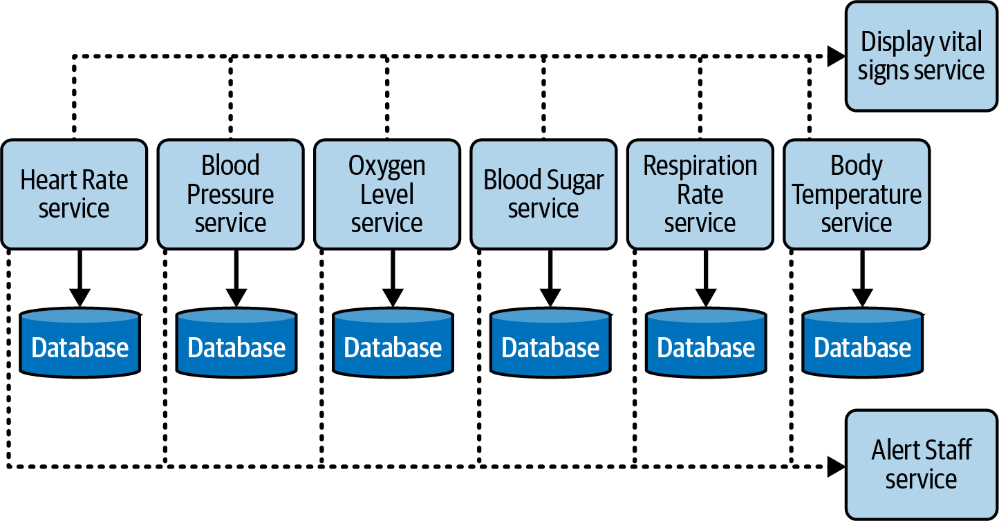

*Hình 18-17. Một hệ thống medical-monitoring cho bệnh nhân được hiện thực bằng microservices architecture*

Ví dụ này minh họa rõ một số điểm mạnh và ưu điểm của microservices architecture. Lấy *fault tolerance*: nếu một trong các service vital-sign bị crash hoặc không phản hồi, mọi service giám sát vital-sign khác vẫn hoạt động đầy đủ. Điều này đặc biệt quan trọng trong theo dõi y tế. Một siêu năng lực khác là *testability*. Nếu một developer thực hiện bảo trì service giám sát blood-pressure, phạm vi testing đủ nhỏ để họ có thể yên tâm rằng dấu hiệu sinh tồn cụ thể này được test đầy đủ, và việc bảo trì không ảnh hưởng đến các service vital-sign khác. Cuối cùng, một dấu hiệu của *evolvability* (một siêu năng lực khác của microservices) là kiến trúc sư có thể dễ dàng thêm một bộ giám sát vital-sign khác mà không ảnh hưởng đến các service khác. 

Chúng tôi đã đề cập đến nhiều khía cạnh quan trọng của microservices architecture trong chương này, và có nhiều tài liệu tuyệt vời bạn có thể dùng để tìm hiểu thêm. Để tìm hiểu sâu về microservices, chúng tôi khuyến nghị những tài liệu sau:

- [*Building Microservices*](https://learning.oreilly.com/library/view/building-microservices-2nd/9781492034018/), ấn bản 2nd Edition, của Sam Newman (O’Reilly, 2021)
- [*Building Micro-Frontends*](https://learning.oreilly.com/library/view/building-micro-frontends-2nd/9781098170776/), ấn bản 2nd Edition, của Luca Mezzalira (O’Reilly, 2025)
- [*Microservices vs. Service-Oriented Architecture*](https://learning.oreilly.com/library/view/microservices-vs-service-oriented/9781491975657) của Mark Richards (O’Reilly, 2016)
- [*Microservices AntiPatterns and Pitfalls*](https://learning.oreilly.com/library/view/microservices-antipatterns-and/9781492042716) của Mark Richards (O’Reilly, 2016)
