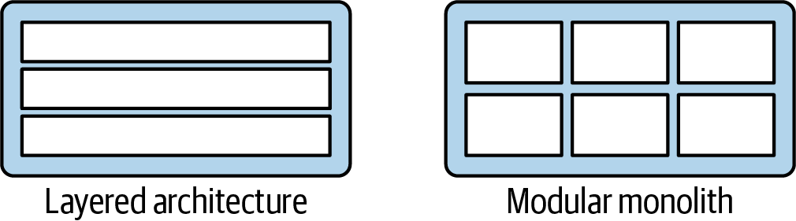
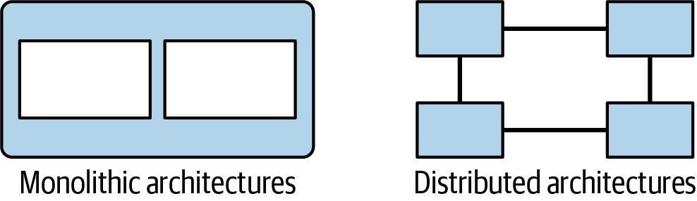
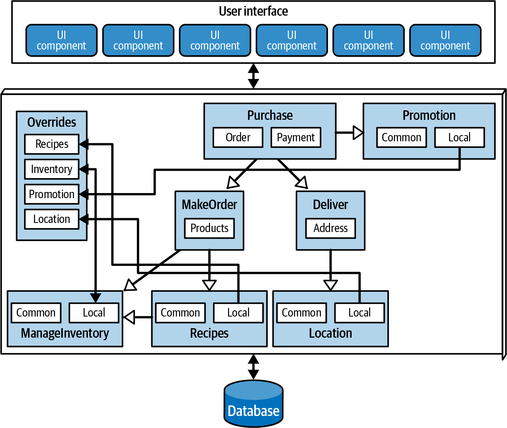
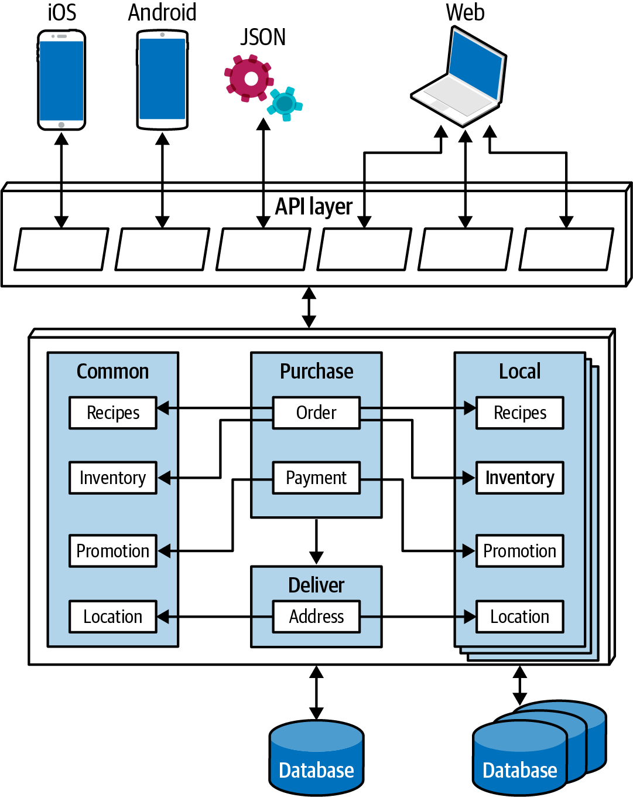
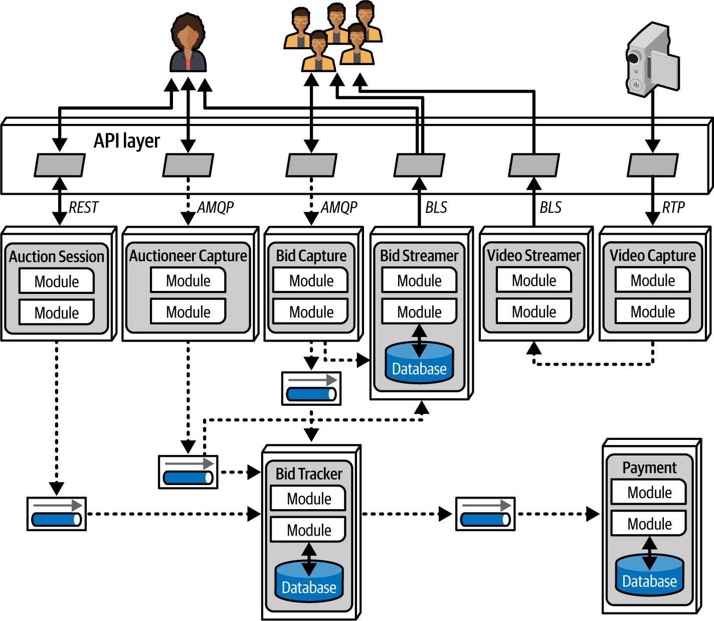
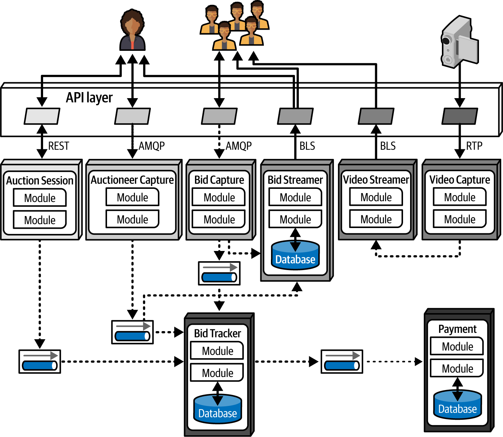

# Chương 19. Chọn architecture style phù hợp (Choosing the Appropriate Architecture Style)

Còn tùy! Với tất cả các lựa chọn hiện có (và những lựa chọn mới xuất hiện gần như hằng ngày), chúng tôi rất muốn nói cho bạn biết bạn nên dùng architecture style nào—nhưng chúng tôi không thể. Không có gì phụ thuộc vào bối cảnh hơn thế, vào nhiều yếu tố trong một tổ chức và phần mềm mà tổ chức đó xây dựng. Chọn một architecture style là đỉnh điểm của cả một quá trình phân tích và suy nghĩ về trade-offs cho các architecture characteristic, các cân nhắc domain, mục tiêu chiến lược, và hàng loạt thứ khác. Đó là lý do, như chúng tôi đã nói trong [Chương 2](ch02_architectural_thinking.vi.md#ch-architectural-thinking), còn tùy.

Dù quyết định này phụ thuộc vào bối cảnh đến đâu, chương này đưa ra một số lời khuyên chung xoay quanh việc chọn một architecture style phù hợp.

## “Thời trang” thay đổi trong architecture (Shifting “Fashion” in Architecture)

Sở thích của ngành phần mềm về architecture style thay đổi theo thời gian, do nhiều yếu tố thúc đẩy. Những yếu tố này bao gồm:

**Quan sát từ quá khứ**

Các architecture style mới nhìn chung nảy sinh từ những quan sát về các trải nghiệm trong quá khứ, đặc biệt là quan sát về các điểm đau. Trải nghiệm của kiến trúc sư khi làm việc với các hệ thống—vốn thường là điều dẫn chúng ta trở thành kiến trúc sư ngay từ đầu—ảnh hưởng đến suy nghĩ của chúng ta về các hệ thống tương lai. Các thiết kế architecture mới thường phản ánh cách sửa những khiếm khuyết cụ thể gặp phải ở các architecture style trước đó. Ví dụ, sau khi xây dựng các architecture xoay quanh tái sử dụng code, kiến trúc sư đã nhận ra các trade-offs tiêu cực và nghiêm túc suy nghĩ lại về các hệ quả của việc tái sử dụng code.

**Thay đổi trong hệ sinh thái**

Trong hệ sinh thái phát triển phần mềm, mọi thứ thay đổi liên tục. Sự thay đổi không ngừng này hỗn loạn đến mức thậm chí không thể dự đoán loại thay đổi nào sẽ đến tiếp theo. Cách đây không nhiều năm, không ai biết Kubernetes là gì, và giờ nó là một phần hằng ngày trong cuộc sống của nhiều developer. Trong vài năm nữa, Kubernetes có thể bị thay thế bởi một công cụ khác chưa được viết ra.

**Năng lực mới**

Kiến trúc sư phải để mắt không chỉ tới các công cụ mới mà cả các paradigm mới. Khi năng lực mới xuất hiện, architecture có thể chuyển sang một paradigm hoàn toàn mới, thay vì chỉ thay một công cụ bằng công cụ khác. Ví dụ, ít ai lường trước sự dịch chuyển kiến tạo trong thế giới phát triển phần mềm do sự ra đời của các container như Docker. Dù đó là một bước tiến hóa, nó đã có tác động đáng kinh ngạc lên kiến trúc sư, công cụ, thực hành kỹ thuật, và nhiều thứ khác. Sự thay đổi không ngừng trong hệ sinh thái cũng thường xuyên mang lại các công cụ và năng lực mới. Ngay cả một thứ trông giống như một one-of-something-we-already-have (thêm một thứ ta đã có) cũng có thể bao gồm những sắc thái khiến nó thay đổi cuộc chơi. Các tính năng mới thậm chí không cần làm rung chuyển cả thế giới phát triển: một thay đổi nhỏ khớp chính xác với mục tiêu của kiến trúc sư có thể thay đổi mọi thứ.

**Tăng tốc**

Hệ sinh thái không chỉ liên tục thay đổi, mà sự thay đổi còn ngày càng nhanh hơn và lan rộng hơn. Các công cụ mới tạo ra các thực hành kỹ thuật mới, dẫn đến các thiết kế và năng lực mới, giữ cho kiến trúc sư phần mềm luôn ở trạng thái biến động liên tục. Sự trỗi dậy và ảnh hưởng của generative AI là một ví dụ nổi bật về sự tiến hóa liên tục và tính khó dự đoán tương ứng này.

**Thay đổi domain**

Các domain mà chúng ta viết phần mềm cho chúng liên tục dịch chuyển và thay đổi, khi các doanh nghiệp tiến hóa hoặc sáp nhập với các công ty khác.

**Thay đổi công nghệ**

Các tổ chức cố theo kịp ít nhất một số thay đổi công nghệ, đặc biệt là những thay đổi có lợi ích bottom-line (lợi nhuận) rõ ràng.

**Các yếu tố bên ngoài**

Nhiều yếu tố bên ngoài chỉ liên quan bên lề đến phát triển phần mềm có thể thúc đẩy thay đổi trong một tổ chức. Ví dụ, kiến trúc sư và developer có thể hoàn toàn hài lòng với một công cụ cụ thể, nhưng nếu chi phí bản quyền của nó trở nên quá cao, doanh nghiệp có thể bị buộc phải chuyển sang một lựa chọn khác.

Kiến trúc sư nên hiểu các xu hướng hiện tại của ngành để có thể đưa ra quyết định thông minh về việc theo những xu hướng nào và khi nào tạo ngoại lệ, bất kể tổ chức của họ theo sát “thời trang” architecture hiện tại đến mức nào. 

## Tiêu chí quyết định (Decision Criteria)

Khi chọn một architectural style, kiến trúc sư phải tính đến mọi yếu tố khác nhau góp phần vào cấu trúc thiết kế domain. Về cơ bản, một kiến trúc sư thiết kế hai thứ: bất kỳ domain nào đã được chỉ định, và các phần tử cấu trúc cần thiết để làm cho hệ thống thành công (được cung cấp bởi các architectural characteristic).

Chỉ nên bắt tay vào chọn một architectural style khi bạn có đủ kiến thức về các yếu tố sau:

**Domain**

Hãy hiểu càng nhiều khía cạnh quan trọng của business domain càng tốt, đặc biệt là những khía cạnh ảnh hưởng đến các architecture characteristic vận hành. Kiến trúc sư không cần phải là chuyên gia về lĩnh vực, nhưng ít nhất nên có hiểu biết chung tốt về các khía cạnh chính của domain đang được thiết kế. Các chuyên gia khác, như nhà phân tích nghiệp vụ, có thể giúp bạn lấp đầy mọi khoảng trống trong kiến thức domain của bạn.

**Các architecture characteristic tác động đến quyết định cấu trúc**

Xác định và làm rõ những architecture characteristic nào cần thiết để hỗ trợ domain và các yếu tố bên ngoài khác bằng cách thực hiện phân tích architectural characteristic, một trong những hoạt động cốt lõi trong việc chọn một style.

Có thể triển khai bất kỳ architecture style chung nào trong hầu như bất kỳ problem domain nào—suy cho cùng, *chung* (generic) hàm ý rằng chúng là general-purpose. Ngoại lệ là các domain đòi hỏi những architectural characteristic vận hành đặc biệt, như một trang đấu giá có scalability rất cao. Tuy nhiên, trong hầu hết các trường hợp, sự khác biệt thực sự giữa các architectural style không liên quan đến domain, mà ở chỗ mỗi style hỗ trợ các architectural characteristic khác nhau tốt đến mức nào.

Có lẽ bạn đã nhận thấy rằng các biểu đồ sao chúng tôi dùng trong Phần II của cuốn sách này để so sánh từng architecture style tập trung vào các *characteristic* kiến trúc, không phải domain. Điều này phản ánh tầm quan trọng của việc hiểu các architectural characteristic khi chọn một style.

**Data architecture**

Kiến trúc sư và data developer phải cộng tác về database, schema, và các mối quan tâm data-related khác. Data architecture tự nó là một chuyên ngành, và chúng tôi không đề cập nhiều trong cuốn sách này, ngoài các cân nhắc style-specific. Tuy nhiên, bạn cần hiểu tác động mà một thiết kế dữ liệu cụ thể có thể có lên thiết kế kiến trúc của bạn, đặc biệt nếu hệ thống mới phải tương tác với một data architecture cũ hơn hoặc một data architecture đang được dùng.

**Deployment trên cloud**

Dùng cloud làm đích đến kiến trúc là thay đổi mới nhất trong một chuỗi dài các dịch chuyển cơ bản về nơi tính toán và dữ liệu cư trú. Các trade-offs liên quan đến việc thiết kế một ứng dụng chạy on-premises khá khác so với những gì liên quan đến việc thiết kế một ứng dụng cho cloud. Điều quan trọng là phải biết ứng dụng sẽ cần lưu trữ bao nhiêu dữ liệu và bao nhiêu dữ liệu có thể di chuyển (điều có thể phát sinh chi phí đáng kể), cùng hàng loạt mối quan tâm khác.

Cloud là một ví dụ tuyệt vời về cách các năng lực tinh vi trở thành hàng hóa thông dụng theo thời gian. Một thập kỷ trước, xây dựng một hệ thống on-prem có elasticity và scalability cao đòi hỏi những kỹ năng bí truyền và được coi là gần như phép màu. Giờ đây, kiến trúc sư có thể đạt được cùng kết quả chỉ bằng cách thay đổi các tham số cấu hình của nhà cung cấp cloud.

**Các yếu tố tổ chức**

Nhiều yếu tố bên ngoài ảnh hưởng đến thiết kế. Ví dụ, chi phí của một nhà cung cấp cloud cụ thể có thể ngăn một doanh nghiệp áp dụng thiết kế mà lẽ ra là lý tưởng. Tương tự, biết rằng công ty có kế hoạch tham gia sáp nhập và mua lại có thể khuyến khích kiến trúc sư nghiêng về các giải pháp mở và integration architecture.

**Hiểu biết về quy trình, team và các mối quan tâm vận hành**

Nhiều yếu tố dự án cụ thể ảnh hưởng đến thiết kế của kiến trúc sư: quy trình phát triển phần mềm, sự tương tác (hoặc thiếu tương tác) của kiến trúc sư với bộ phận vận hành, và quy trình QA. Ví dụ, nếu một tổ chức thiếu sự trưởng thành trong các thực hành kỹ thuật Agile, các architecture style dựa vào những thực hành đó để thành công (như microservices) sẽ gặp khó khăn.

**Sự đẳng cấu domain/architecture**

*Architecture isomorphism* (sự đẳng cấu kiến trúc) là một thuật ngữ hoa mỹ cho “hình dạng” chung của một architecture—nói cách khác, cách các component của nó phụ thuộc vào nhau trong topology tổng thể. Từ *isomorphism* có nghĩa là “một ánh xạ bảo toàn các tập hợp và quan hệ giữa các phần tử”; nó bắt nguồn từ tiếng Hy Lạp *isos*, nghĩa là “bằng nhau,” và *morph*, nghĩa là “hình thức” hoặc “hình dạng.”

Kiến trúc sư nghĩ về hình dạng chung của architecture khi cân nhắc mức độ phù hợp của nó. Ví dụ, hãy xét sự khác biệt giữa hai sơ đồ đẳng cấu kiến trúc cho các architectural style layered và modular monolith trong [Hình 19-1](#fosa_2e_new_1901). Hình dạng bên trong của mỗi architecture là rõ ràng: phân tách theo layer so với theo domain.

*Hình 19-1. So sánh giữa các biểu diễn đẳng cấu của layered monolith và modular monolith*

Sự khác biệt giữa monolith và phân tán cũng rõ ràng tương tự từ các hình vẽ đẳng cấu, như minh họa trong [Hình 19-2](#fosa_2e_new_1902). Ở đây, sự phân tán của các component cốt lõi làm rõ cấu trúc macro-level của architecture.

*Hình 19-2. So sánh các biểu diễn đẳng cấu của các architecture style monolith và phân tán*

Một số problem domain khớp với topology của architecture. Chẳng hạn, microkernel architecture style hoàn toàn phù hợp với các hệ thống đòi hỏi khả năng tùy biến—kiến trúc sư có thể thiết kế các phần tùy biến dưới dạng plug-ins. Một ví dụ khác, một hệ thống được thiết kế để phân tích bộ gen, vốn đòi hỏi một số lượng lớn các thao tác rời rạc, có thể rất phù hợp với space-based architecture, vốn cung cấp một số lượng lớn các bộ xử lý rời rạc.

Tương tự, một số problem domain có thể đặc biệt ill-suited (không phù hợp) với một số architecture style nhất định. Các hệ thống có scalability cao gặp khó khăn với các thiết kế monolith lớn, vì một code base coupling cao khó hỗ trợ một số lượng lớn người dùng đồng thời. Một problem domain bao gồm một lượng semantic coupling khổng lồ sẽ khớp kém với một architecture phân tán, decoupled cao: chẳng hạn, một ứng dụng bảo hiểm gồm các biểu mẫu nhiều trang, mỗi trang dựa trên bối cảnh của các trang trước, là một vấn đề coupling cao. Sẽ khó mô hình hóa nó trong một architecture decoupled như microservices. Một architecture có coupling có chủ ý như service-based architecture sẽ phù hợp hơn với vấn đề này.

Tính đến tất cả những điều này, bạn phải đưa ra một số quyết định khi chọn một architecture style:

**Monolith hay phân tán?**

Một tập architecture characteristic duy nhất có đủ cho thiết kế không, hay các phần khác nhau của hệ thống cần các architecture characteristic khác nhau? Một tập duy nhất hàm ý rằng một monolith sẽ phù hợp (dù các yếu tố khác có thể gợi ý một architecture phân tán); các tập architecture characteristic khác nhau hàm ý một architecture phân tán. Khái niệm architecture quantum ([Chương 7](ch07_the_scope_of_architectural_characteristics.vi.md#ch-scope)) hữu ích trong việc đưa ra quyết định này.

**Dữ liệu nên nằm ở đâu?**

Nếu architecture là monolith, kiến trúc sư thường giả định nó sẽ dùng một relational database duy nhất, hoặc có lẽ vài database. Trong một architecture phân tán, bạn phải quyết định những service nào nên lưu trữ dữ liệu, điều cũng hàm ý suy nghĩ về cách dữ liệu sẽ chảy qua architecture để xây dựng các workflow. Hãy xem xét cả cấu trúc lẫn hành vi khi thiết kế architecture, và đừng ngại lặp lại trên thiết kế của bạn để tìm ra những kết hợp tốt hơn.

**Các service nên giao tiếp đồng bộ hay bất đồng bộ?**

Khi đã xác định dữ liệu nên nằm ở đâu, điều cần cân nhắc thiết kế tiếp theo là giao tiếp giữa các service—nó nên đồng bộ hay bất đồng bộ? Giao tiếp đồng bộ thường tiện lợi hơn, nhưng nó có thể có nghĩa là đánh đổi scalability, reliability, và các characteristic đáng mong muốn khác. Giao tiếp bất đồng bộ có thể mang lại những lợi ích độc đáo về performance và quy mô, nhưng cũng có nhiều đau đầu xoay quanh đồng bộ dữ liệu, deadlock, race condition, debug, v.v. (Chúng tôi đề cập nhiều vấn đề trong số này trong [Chương 15](ch15_event_driven_architecture_style.vi.md#ch-style-eda).)

Vì giao tiếp đồng bộ đặt ra ít thách thức hơn về thiết kế, triển khai và debug, chúng tôi khuyến nghị mặc định dùng đồng bộ khi có thể, và chỉ dùng giao tiếp bất đồng bộ khi cần thiết.

> **Mẹo**
>
> Mặc định dùng giao tiếp đồng bộ, dùng bất đồng bộ khi cần thiết.

Đầu ra của quy trình thiết kế này là một *architecture topology* bao gồm architecture style đã chọn (và mọi dạng lai), các Architectural Decision Record (ADR) về những phần của thiết kế đòi hỏi nhiều công sức nhất, và các architecture fitness function để bảo vệ các nguyên lý quan trọng và các architecture characteristic vận hành.

## Nghiên cứu tình huống monolith: Silicon Sandwiches (Monolith Case Study: Silicon Sandwiches)

Trong architecture kata Silicon Sandwiches ở [Chương 5](ch05_identifying_architectural_characteristics.vi.md#ch-identifying), sau khi phân tích architecture characteristic, chúng tôi đã xác định rằng một quantum duy nhất là đủ để triển khai hệ thống. Vì chúng tôi đang xem xét một ứng dụng đơn giản không có ngân sách lớn, sự đơn giản của một monolith là hấp dẫn.

Tuy nhiên, chúng tôi đã tạo hai thiết kế component khác nhau cho Silicon Sandwiches: một được phân vùng theo domain, và một được phân vùng theo kỹ thuật—bạn có thể muốn lật lại [Chương 5](ch05_identifying_architectural_characteristics.vi.md#ch-identifying) nếu muốn ôn lại. Trong chương này, chúng tôi quay lại những giải pháp đơn giản đó để tạo thiết kế cho mỗi lựa chọn và thảo luận các trade-offs của chúng. Chúng ta sẽ bắt đầu với một monolithic architecture.

### Modular Monolith

Một modular monolith xây dựng các component domain-centric với một database duy nhất, được deploy như một quantum duy nhất; thiết kế modular monolith cho Silicon Sandwiches xuất hiện trong [Hình 19-3](#fig-choosing-pattern-SS-modular).

Đây là một monolith với một relational database duy nhất, được triển khai với một UI web-based duy nhất (với các cân nhắc thiết kế cẩn thận cho thiết bị di động) để giữ chi phí tổng thể thấp. Mỗi domain chúng tôi đã xác định xuất hiện như một component. Nếu đủ thời gian và nguồn lực, hãy cân nhắc tách các bảng và các tài sản database khác theo cùng cách như các domain component, điều sẽ giúp dễ dàng hơn nhiều để di chuyển architecture này sang một architecture phân tán nếu các yêu cầu tương lai đòi hỏi.

*Hình 19-3. Một bản triển khai modular monolith của Silicon Sandwiches*

Vì bản thân architecture style vốn không xử lý việc tùy biến, tính năng đó nên trở thành một phần của thiết kế domain. Trong trường hợp này, kiến trúc sư thiết kế một endpoint `Override`, nơi developer có thể tải lên các tùy biến riêng lẻ. Tương ứng, họ phải bảo đảm rằng mọi domain component đều tham chiếu tới component `Override` cho mỗi characteristic tùy biến được. (Kiểm tra điều này sẽ là một công việc hoàn hảo cho một architectural fitness function.)

### Microkernel

Một trong các architecture characteristic chúng tôi đã xác định trong Silicon Sandwiches là customizability. [Hình 19-4](#fig-choosing-pattern-SS-micro) dùng sự đẳng cấu domain/architecture để cho thấy điều này có thể được triển khai như thế nào bằng một microkernel architecture.

*Hình 19-4. Một bản triển khai microkernel của Silicon Sandwiches*

Trong [Hình 19-4](#fig-choosing-pattern-SS-micro), core system gồm các domain component và một relational database duy nhất. Như trong thiết kế modular monolith, việc đồng bộ cẩn thận giữa các domain và thiết kế dữ liệu sẽ tạo điều kiện cho việc di chuyển core sang một architecture phân tán trong tương lai. Mỗi tùy biến xuất hiện trong một plug-in; những tùy biến chung xuất hiện trong một tập plug-ins duy nhất (với một database tương ứng) và một loạt tùy biến địa phương, mỗi cái có dữ liệu riêng. Vì không plug-ins nào cần được coupled với các plug-ins khác, chúng có thể đều duy trì dữ liệu của mình và vẫn decoupled.

Phần tử độc đáo khác của thiết kế này là nó sử dụng [pattern Backends for Frontends (BFF)](https://oreil.ly/i3Hsc), biến API layer thành một adapter microkernel mỏng bên cạnh architecture cốt lõi. API layer cung cấp thông tin chung từ backend, mà các adapter BFF dịch sang một định dạng phù hợp cho thiết bị frontend. Ví dụ, BFF cho iOS lấy đầu ra chung của backend và tùy biến định dạng dữ liệu, phân trang, latency, và các yếu tố khác để khớp với những gì ứng dụng native iOS mong đợi. Xây dựng mỗi adapter BFF cho phép giao diện người dùng phong phú nhất có thể và giúp có thể mở rộng architecture để hỗ trợ các thiết bị khác trong tương lai—một trong những lợi ích của microkernel style.

Giao tiếp trong cả hai architecture Silicon Sandwich này đều có thể đồng bộ, vì architecture không đòi hỏi performance hay elasticity cực cao, và không thao tác nào sẽ kéo dài.

## Nghiên cứu tình huống phân tán: Going, Going, Gone (Distributed Case Study: Going, Going, Gone)

Kata Going, Going, Gone (GGG) từ [Chương 8](ch08_component_based_thinking.vi.md#ch08-component-based-thinking) đặt ra một số thách thức kiến trúc thú vị hơn. Dựa trên phân tích component trong [“Case Study: Going, Going, Gone—Discovering Components”](ch08_component_based_thinking.vi.md#sec-ggg-comp-discovery), chúng ta biết rằng các phần khác nhau của architecture này cần các characteristic khác nhau. Ví dụ, nhu cầu về availability và scalability sẽ khác nhau giữa các vai trò như người điều khiển đấu giá và người đặt giá.

Các yêu cầu hệ thống của GGG cũng nêu rõ một số kỳ vọng tham vọng về quy mô, elasticity, performance, và các architecture characteristic vận hành khó khác. Architecture pattern nên cho phép mức tùy biến cao ở mức fine-grained. Trong số các architecture phân tán ứng viên, event-driven architecture low-level và microservices là hai cái khớp tốt nhất với hầu hết các architecture characteristic cần thiết. Trong hai cái đó, microservices tốt hơn trong việc hỗ trợ sự khác biệt giữa các architecture characteristic vận hành. (Các event-driven architecture thuần thường tách các phần không theo architecture characteristic của chúng, mà theo việc chúng dùng giao tiếp orchestrated hay choreographed.)

Đạt được mục tiêu performance đã nêu sẽ là một thách thức trong microservices, nhưng cách tốt nhất để giải quyết bất kỳ điểm yếu nào của một architecture là thiết kế để đáp ứng nó. Ví dụ, dù microservices về bản chất mang lại mức scalability cao, nó thường phát sinh các vấn đề performance cụ thể do quá nhiều orchestration hoặc tách dữ liệu quá quyết liệt, cùng các vấn đề khác.

*Hình 19-5. Một bản triển khai microservices của Going, Going, Gone*

Trong [Hình 19-5](#fig-choosing-pattern-GGG-topo), mỗi component đã xác định trở thành một service trong architecture, khớp component với granularity service. GGG có ba giao diện người dùng riêng biệt:

**Bidder (người đặt giá)**

Đông đảo người đặt giá cho phiên đấu giá trực tuyến.

**Auctioneer (người điều khiển đấu giá)**

Một người cho mỗi phiên đấu giá.

**Streamer**

Một service chịu trách nhiệm stream video và các lượt đặt giá tới người đặt giá. Đây là một stream read-only, cho phép những tối ưu hóa không thể có nếu cần cập nhật.

Các service sau xuất hiện trong thiết kế này cho architecture GGG:

**`Bid Capture`**

Thu nhận các lượt đặt giá của người đặt giá trực tuyến và gửi chúng bất đồng bộ tới `Bid Tracker`. Service này không cần lưu trữ vì nó đóng vai trò như một đường dẫn cho các lượt đặt giá trực tuyến.

**`Bid Streamer`**

Stream các lượt đặt giá trở lại cho người tham gia trực tuyến trong một stream high-performance, read-only.

**`Bid Tracker`**

Theo dõi các lượt đặt giá từ cả `Auctioneer Capture` và `Bid Capture`, hợp nhất hai luồng thông tin này và sắp xếp thứ tự các lượt đặt giá gần với thời gian thực nhất có thể. Cả hai kết nối đi vào service này đều bất đồng bộ, cho phép developer dùng message queue làm bộ đệm để xử lý các tốc độ luồng message rất khác nhau.

**`Auctioneer Capture`**

Thu nhận các lượt đặt giá cho người điều khiển đấu giá. Phân tích trong [“Case Study: Going, Going, Gone—Discovering Components”](ch08_component_based_thinking.vi.md#sec-ggg-comp-discovery) cho thấy các architecture characteristic của `Bid Capture` và `Auctioneer Capture` khá khác nhau, dẫn chúng tôi đến việc tách chúng ra.

**`Auction Session`**

Quản lý workflow của từng phiên đấu giá riêng lẻ.

**`Payment`**

Nhà cung cấp thanh toán third-party xử lý thông tin thanh toán sau khi `Auction Session` hoàn tất phiên đấu giá.

**`Video Capture`**

Thu nhận video stream của phiên đấu giá trực tiếp.

**`Video Streamer`**

Stream video phiên đấu giá tới người đặt giá trực tuyến.

Chúng tôi đã cẩn thận xác định cả style giao tiếp đồng bộ lẫn bất đồng bộ trong architecture này. Việc chọn giao tiếp bất đồng bộ chủ yếu là để đáp ứng các architecture characteristic vận hành khác nhau giữa các service. Ví dụ, nếu service `Payment` chỉ có thể xử lý một khoản thanh toán mới mỗi 500 ms, và một số lượng lớn phiên đấu giá kết thúc cùng lúc, dùng giao tiếp đồng bộ giữa các service sẽ gây ra timeout và những rắc rối reliability khác. Message queue tăng thêm reliability cho một phần then chốt nhưng mong manh của architecture.

*Hình 19-6. Ranh giới quantum của GGG*

Trong phân tích cuối cùng, thiết kế này quy về năm quanta, được xác định trong [Hình 19-6](#fig-choosing-pattern-GGG-quanta), gần tương ứng với các service: `Payment`, `Auctioneer`, `Bidder`, `Bidder Streams` và `Bid Tracker`. Nhiều instance được biểu thị trong sơ đồ bằng các chồng container. Dùng phân tích quantum ở giai đoạn component-design giúp dễ dàng hơn trong việc xác định ranh giới service, dữ liệu và giao tiếp.

Lưu ý rằng đây không phải là thiết kế “đúng” cho GGG, và chắc chắn không phải là thiết kế duy nhất. Chúng tôi thậm chí không gợi ý rằng đó là thiết kế tốt nhất có thể—nhưng nó có vẻ có tập trade-offs *ít tệ nhất*. Chọn microservices, rồi dùng sự kiện và message một cách thông minh, cho phép architecture này khai thác tối đa một architecture pattern chung trong khi vẫn xây dựng nền tảng cho phát triển và mở rộng trong tương lai.
