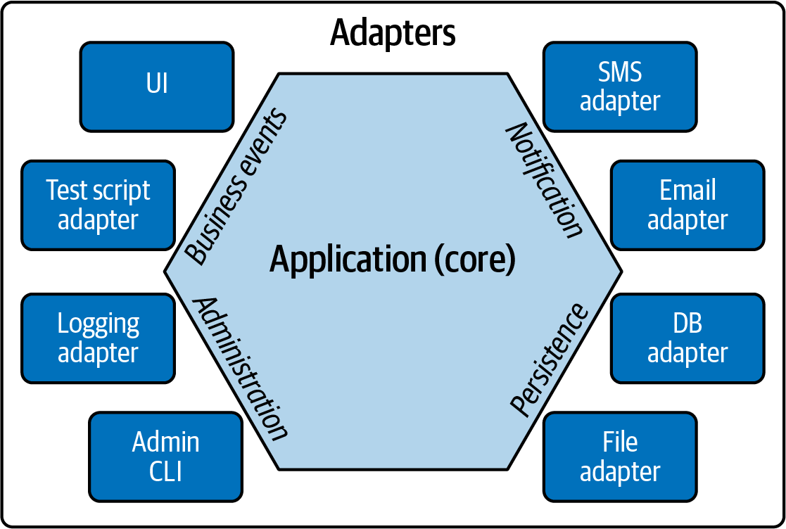
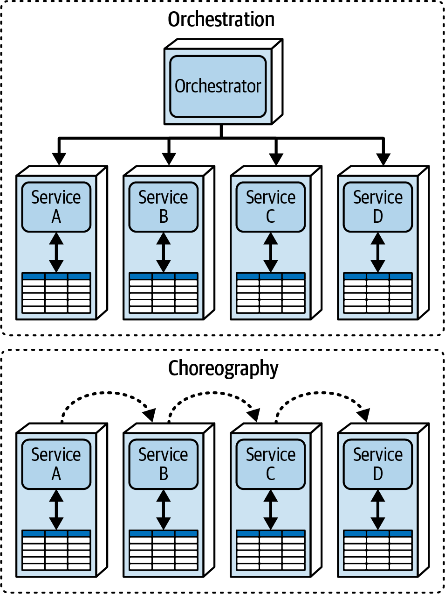
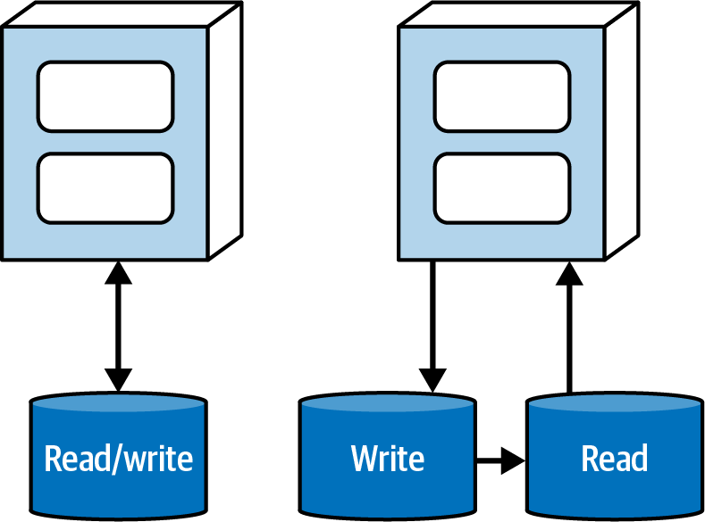
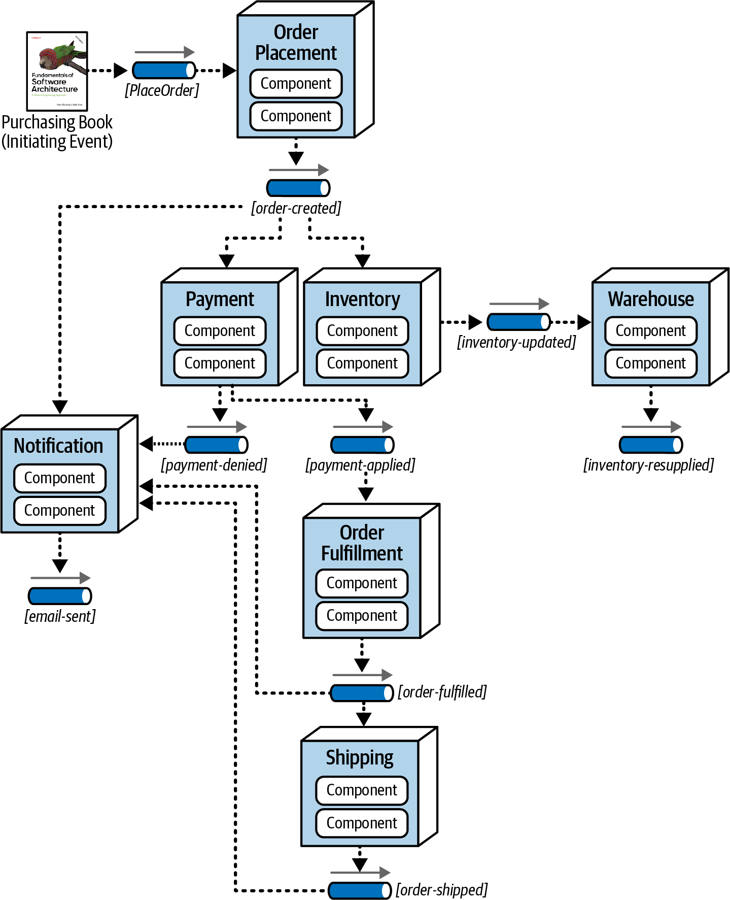
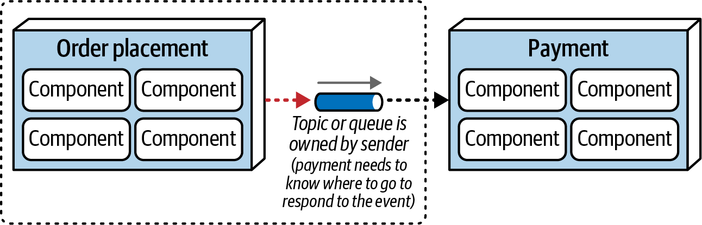
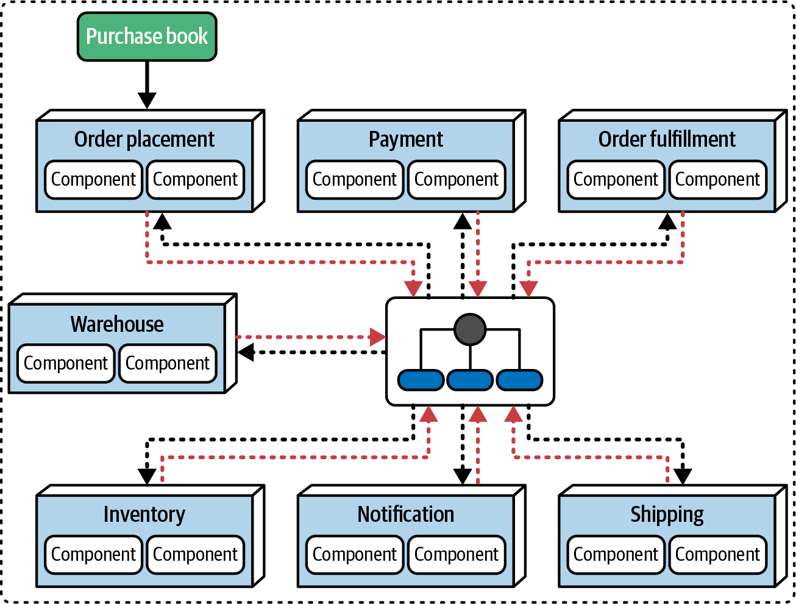
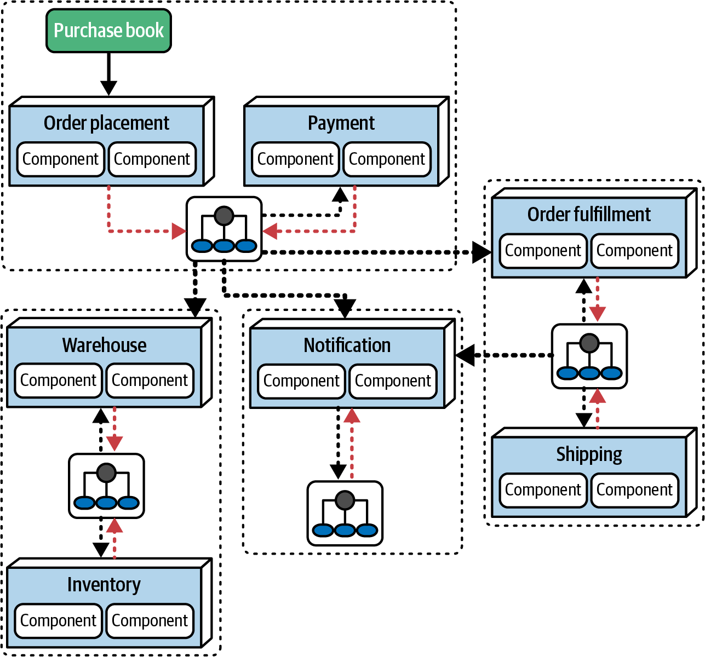

# Chương 20. Các architectural pattern (Architectural Patterns)

Chúng tôi đã phân biệt giữa architectural style và architectural pattern trong [Chương 9](ch09_foundations.vi.md#ch-architecture-styles): tóm tắt lại, *style* là các topology có tên mà kiến trúc sư phân biệt bằng sự khác biệt về topology, physical architecture, deployment, style giao tiếp và topology dữ liệu. Architecture *pattern*, lấy cảm hứng từ cuốn sách often-mentioned (thường được nhắc đến) [*Design Patterns*](https://www.oreilly.com/library/view/design-patterns-elements/0201633612), là các giải pháp gắn với bối cảnh cho các vấn đề.

Điều quan trọng là phân biệt giữa architecture pattern và “best practice” (được thảo luận sâu hơn trong [Chương 21](ch21_architectural_decisions.vi.md#ch-architectural-decisions)). Gọi một thứ là “best practice” hàm ý rằng kiến trúc sư có nghĩa vụ rõ ràng, bất cứ khi nào một tình huống cụ thể phát sinh, phải dùng thực hành đó. Gọi nó là một thực hành *tốt hơn* ít nhất sẽ cho phép tranh luận, nhưng không—chúng ta gọi nó là thực hành *tốt nhất*, cho phép kiến trúc sư tắt não và luôn theo cùng một giải pháp.

Cũng quan trọng là phân biệt giữa pattern và *giải pháp* (solution). Nhiều công cụ, framework, thư viện và các artifact software-development khác đóng gói một hoặc nhiều pattern—tùy thuộc vào cách chúng được triển khai, với các mức độ trung thành và đan xen khác nhau với các pattern khác. Hãy tập trung xác định pattern phù hợp nhất trước, rồi chọn triển khai phù hợp nhất cho nó.

Chúng tôi đưa ra một ít pattern tiêu biểu trong chương này để đối chiếu và cung cấp bối cảnh cho các style chúng tôi đã giới thiệu trong Phần II của cuốn sách này. Ví dụ đầu tiên của chúng tôi, một pattern tái sử dụng kiến trúc, làm rõ sự khác biệt giữa pattern và bản triển khai.

## Tái sử dụng (Reuse)

Sự phân tách giữa domain coupling và operational coupling là một mối quan tâm kiến trúc phổ biến trong các architecture phân tán như microservices.

### Tách domain coupling và operational coupling (Separating Domain and Operational Coupling)

Một trong các mục tiêu thiết kế của microservices architecture là mức decoupling cao, thường thể hiện qua lời khuyên: “nhân bản tốt hơn coupling.”

Giả sử hai service cần truyền qua lại thông tin về hồ sơ khách hàng, nhưng bounded context domain-driven của architecture khăng khăng rằng các chi tiết triển khai phải giữ riêng tư với mỗi service. Một giải pháp phổ biến là cho mỗi service biểu diễn nội bộ riêng của các thực thể như `Profile`, rồi truyền thông tin đó theo những cách loosely coupled, như các cặp name-value trong JSON. Điều này cho phép mỗi service thay đổi biểu diễn nội bộ của mình—kể cả technology stack—tùy ý, mà không làm hỏng việc tích hợp. Developer nhìn chung không thích nhân bản code, điều có thể gây ra vấn đề về đồng bộ, trôi dạt ngữ nghĩa, v.v., nhưng có những thứ còn tệ hơn nhân bản…và trong microservices, điều đó bao gồm coupling.

Các kiến trúc sư thiết kế microservices nhìn chung chấp nhận thực tế rằng đôi khi họ phải nhân bản phần triển khai để giữ decoupling. Nhưng còn những năng lực *có lợi* từ coupling cao thì sao? Mỗi service nên có một số năng lực vận hành chung nhất định, như giám sát, logging, xác thực và ủy quyền, và circuit breaker. Tuy nhiên, để mỗi team tự quản lý các phụ thuộc này thường dẫn đến hỗn loạn.

Ví dụ, hãy xét một công ty đang cố chọn một giải pháp giám sát chuẩn cho tất cả các service để dễ vận hành chúng hơn. Kiến trúc sư quyết định để mỗi team chịu trách nhiệm triển khai việc giám sát cho service của mình: team service `Payment`, team service `Inventory`, v.v. Nhưng làm sao team vận hành có thể chắc chắn rằng mỗi team thực sự đã làm điều này? Ngoài ra, còn các vấn đề như nâng cấp thống nhất thì sao? Nếu công cụ giám sát đã chuẩn hóa cần được nâng cấp trên toàn tổ chức, các team nên phối hợp việc đó như thế nào?

#### Hexagonal architecture (kiến trúc lục giác)

Trong architecture pattern *Hexagonal*, như trong [Hình 20-1](#fosa_2e_new_2001), logic domain nằm ở trung tâm hình lục giác, được bao quanh bởi các port và adapter kết nối tới các phần khác của hệ sinh thái (thực tế, pattern này còn được biết đến với tên pattern *Ports and Adapters*). Một biểu diễn trực quan của pattern này xuất hiện trong [Hình 20-1](#fosa_2e_new_2001).

*Hình 20-1. Pattern Hexagonal architecture*

Những độc giả sharp-eyed (tinh mắt) có thể nhận thấy chỉ bốn trong sáu cạnh của hình lục giác được dùng. Người tạo ra pattern này, Alistair Cockburn, ban đầu vẽ nó thành hình lục giác và gọi nó là pattern Hexagonal architecture. Ông gần như lập tức hối hận, vì tên Ports and Adapters mang tính mô tả hơn, nhưng đã quá muộn. Quá nhiều kiến trúc sư thấy “Hexagonal” nghe ngầu, nên cái tên đã bám rễ.

Nhầm lẫn pattern với bản triển khai là một mối nguy phổ biến, và đây là một ví dụ tốt. Hexagonal architecture có một khiếm khuyết tiềm ẩn nghiêm trọng khi được dùng để mô tả microservices, nhưng chỉ đối với những người hiểu ý định ban đầu của pattern. Hexagonal architecture ra đời trước microservices hiện đại, nhưng có nhiều điểm tương đồng giữa chúng. Cũng có một khác biệt đáng kể: tính trung thành dữ liệu (data fidelity). Hexagonal architecture coi database chỉ là một adapter khác có thể cắm vào. Nó không bao gồm data schema như logic nghiệp vụ, vì nhận thức sai lầm (vốn phổ biến vào thời điểm tên pattern Hexagonal được đặt ra) rằng database là một bộ máy hoàn toàn tách biệt. Eric Evans đã có cái nhìn sâu sắc để sửa sai lầm này trong cuốn sách *Domain-Driven Design* của ông bằng cách nhận ra rằng, bất kể chúng nằm ở đâu, database schema phải thay đổi để phản ánh logic nghiệp vụ của hệ thống.

Điều này khiến pattern Hexagonal trở thành một nguồn gây nhầm lẫn thường trực giữa các kiến trúc sư. Bất cứ khi nào ai đó dùng nó, họ đang mô tả sự tách biệt giữa các mối quan tâm vận hành và domain, hay họ đang đề cập đến pattern theo nghĩa đen, thứ sẽ cô lập dữ liệu và do đó vi phạm một nguyên lý thiết kế cốt lõi của microservices? Dùng tên pattern như cách viết tắt cho “tách biệt các mối quan tâm domain và vận hành” là ổn, miễn là nó không gây hiểu lầm trong bối cảnh. Tuy nhiên, kiến trúc sư ngày nay không cần đến bản triển khai này. Giờ đây chúng ta có một cơ chế phù hợp hơn để triển khai pattern Hexagonal: pattern *Service Mesh*.

#### Service Mesh

Trở lại [“Operational Reuse”](ch18_microservices_architecture.vi.md#sec-operational-reuse), chúng tôi đã mô tả cách tiếp cận kiến trúc phổ biến để tách các mối quan tâm kỹ thuật khỏi các mối quan tâm domain: dùng các pattern Sidecar và Service Mesh.

Pattern Sidecar không chỉ là một cách để decouple các năng lực vận hành khỏi domain—nó là một pattern tái sử dụng trực giao để giải quyết một loại coupling cụ thể (xem [“Orthogonal Coupling”](#sb-orthogonal-coupling)). Thường thì các giải pháp kiến trúc đòi hỏi nhiều loại coupling, như ví dụ hiện tại của chúng ta về domain coupling so với operational coupling. Một pattern *Orthogonal Reuse* (tái sử dụng trực giao) đưa ra một cách để tái sử dụng một khía cạnh nào đó được đại diện bởi một hoặc nhiều mối quan tâm trong architecture không khớp với tổ chức phân cấp được ưu tiên. Ví dụ, microservices architecture được tổ chức xoay quanh các domain, nhưng operational coupling đòi hỏi cắt ngang qua các domain đó. Một sidecar cho phép kiến trúc sư cô lập những mối quan tâm đó trong một layer cross-cutting, nhưng nhất quán, xuyên suốt architecture.

> 
>
> **Coupling trực giao (Orthogonal Coupling)**
>
> Trong toán học, hai đường thẳng là *trực giao* (orthogonal) nếu chúng cắt nhau theo góc vuông, điều này cũng hàm ý sự độc lập. Trong software architecture, hai phần của một architecture có thể *coupled trực giao* (orthogonally coupled): chúng có thể có hai mục đích riêng biệt nhưng vẫn phải giao nhau để tạo thành một giải pháp hoàn chỉnh. Ví dụ hiển nhiên từ chương này là một mối quan tâm vận hành như giám sát, vốn cần thiết nhưng độc lập với hành vi domain, như catalog checkout. Nhận ra coupling trực giao cho phép kiến trúc sư tìm ra các điểm giao nhau gây ít vướng víu nhất giữa các mối quan tâm.

Dù pattern Sidecar mang lại một sự trừu tượng hay, nó có trade-offs như mọi cách tiếp cận kiến trúc khác, như trong [Bảng 20-1](#table-replication-mesh).

*Bảng 20-1. Trade-offs đối với các pattern Sidecar và Service Mesh*

| Ưu điểm | Nhược điểm |
|---|---|
| Mang lại một cách nhất quán để tạo coupling được cô lập | Phải triển khai một sidecar cho mỗi nền tảng |
| Cho phép phối hợp hạ tầng nhất quán | Component sidecar có thể phát triển lớn/phức tạp |
| Quyền sở hữu theo từng team, tập trung, hoặc kết hợp | “Trôi dạt” triển khai giữa các team độc lập |

Cả pattern Hexagonal lẫn pattern Service Mesh đều minh họa các cách triển khai pattern tái sử dụng để tách domain khỏi các mối quan tâm vận hành. Bản triển khai Hexagonal là general purpose, trong khi Service Mesh rất phù hợp với microservices và các architecture phân tán khác. Chìa khóa đối với kiến trúc sư là xác định pattern trước—sự tách biệt—rồi quyết định cách tốt nhất để triển khai nó trong architecture của mình.

## Giao tiếp (Communication)

Nhiều architecture pattern, bao gồm các communication pattern, đến từ event-driven architecture và áp dụng cho bất kỳ architecture phân tán nào giao tiếp qua message và/hoặc sự kiện, như được thảo luận trong các Chương [15](ch15_event_driven_architecture_style.vi.md#ch-style-eda) và [18](ch18_microservices_architecture.vi.md#ch-style-microservices). Thực tế, bạn đã thấy các ví dụ về giao tiếp trong mỗi chương đó—chỉ là chúng tôi chưa xác định chúng là các pattern cụ thể vì kiến trúc sư thường triển khai pattern mà không nhận ra. Suy cho cùng, pattern là các giải pháp cho những vấn đề phổ biến.

### Orchestration so với choreography (Orchestration Versus Choreography)

Hãy xét hai communication pattern bạn đã thấy, trong cả [“Mediated Event-Driven Architecture”](ch15_event_driven_architecture_style.vi.md#sec-eda-mediated) lẫn [“Choreography and Orchestration”](ch18_microservices_architecture.vi.md#sec-ms-coordination): choreography và orchestration, như được tóm tắt trong [Hình 20-2](#fosa_2e_new_2006).

*Hình 20-2. Orchestration và choreography trong một microservices architecture*

Trong mỗi workflow đẳng cấu trong [Hình 20-2](#fosa_2e_new_2006), bốn domain service (Service A đến D) cần cộng tác để tạo thành một workflow. Trong trường hợp orchestration, còn có một service riêng đóng vai trò bộ điều phối cho workflow: *orchestrator*.

Dù chúng tôi đã mô tả giao tiếp này là cả *orchestration* lẫn *mediation*, pattern vẫn như nhau. Kiến trúc sư có lợi khi có thể nhận ra các pattern ẩn nấp bên trong các bản triển khai vì trade-offs của chúng trở nên rõ ràng hơn.

Lưu ý rằng khi chúng tôi mô tả trade-offs cho mediation và orchestration, chúng tôi đã chạm đến nhiều vấn đề giống nhau. Chúng tôi sẽ tóm tắt các ưu điểm ở đây:

**Workflow tập trung**

Khi độ phức tạp tăng lên, kiến trúc sư có lợi khi dùng một component thống nhất cho trạng thái, hành vi và các điều kiện biên.

**Xử lý lỗi**

Xử lý lỗi, một phần quan trọng của nhiều workflow domain, được hỗ trợ bằng việc có một chủ sở hữu trạng thái cho workflow.

**Khả năng phục hồi (Recoverability)**

Vì một orchestrator giám sát trạng thái của workflow, nếu một hoặc nhiều domain service gặp sự cố ngừng hoạt động short-term, kiến trúc sư có thể thêm logic để thử lại.

**Quản lý trạng thái**

Có một orchestrator khiến trạng thái của workflow có thể truy vấn được, cung cấp một nơi cho các workflow khác và các trạng thái tạm thời khác.

Các nhược điểm chung của orchestration bao gồm:

**Responsiveness**

Mọi giao tiếp đều phải đi qua orchestrator, điều có khả năng tạo ra một nút cổ chai throughput có thể gây hại cho responsiveness.

**Fault tolerance**

Dù orchestration tăng khả năng phục hồi cho các domain service, nó tạo ra một single point of failure tiềm tàng cho workflow. Điều này có thể được giải quyết bằng dự phòng, nhưng điều đó cũng làm tăng thêm độ phức tạp.

**Scalability**

Style giao tiếp này không scale tốt bằng choreography vì orchestrator thêm nhiều điểm phối hợp hơn, làm giảm khả năng song song tiềm tàng.

**Coupling giữa các service**

Có một orchestrator trung tâm tạo ra coupling chặt hơn giữa nó và các domain component, điều đôi khi cần thiết nhưng không được ưa chuộng trong microservices architecture.

Tương tự, chúng tôi đã thảo luận choreography trong cả microservices lẫn event-driven architecture. Các trade-offs đối với các workflow choreographed bao gồm:

**Responsiveness**

Style giao tiếp này có ít điểm nghẽn đơn lẻ hơn, do đó mang lại nhiều cơ hội song song hơn.

**Scalability**

Việc không có các điểm phối hợp như orchestrator cho phép scale độc lập hơn.

**Fault tolerance**

Việc không có một orchestrator duy nhất cho phép kiến trúc sư dùng nhiều instance để tăng fault tolerance. Tất nhiên, họ có thể tạo nhiều orchestrator, nhưng vì mọi giao tiếp đều phải đi qua chúng, nhiều orchestrator nhạy cảm hơn với mức fault tolerance tổng thể của workflow.

**Decoupling giữa các service**

Không có orchestrator nghĩa là ít coupling hơn.

Các nhược điểm của style giao tiếp choreography bao gồm:

**Workflow phân tán**

Không có chủ sở hữu workflow khiến việc quản lý lỗi và các điều kiện biên khác khó khăn hơn.

**Quản lý trạng thái**

Không có nơi giữ trạng thái tập trung cản trở việc quản lý trạng thái liên tục.

**Xử lý lỗi**

Xử lý lỗi khó khăn hơn khi không có orchestrator vì các domain service phải có nhiều hiểu biết về workflow hơn.

**Khả năng phục hồi (Recoverability)**

Khả năng phục hồi trở nên khó khăn hơn khi không có orchestrator để thử lại và thực hiện các nỗ lực khắc phục khác.

Hai pattern này minh họa rất rõ sự phân biệt giữa style và pattern của chúng tôi. Bất kỳ architecture phân tán nào cũng có thể dùng bất kỳ communication pattern nào trong số này, và kiến trúc sư nên hiểu cách đánh giá trade-offs của chúng. Hãy nhớ Định luật thứ hai của software architecture: *bạn không thể chỉ phân tích trade-off một lần là xong*. Chúng cũng minh họa rằng các pattern phổ biến tồn tại ở khắp nơi, đó là lý do chúng phổ biến.

## CQRS

Một communication pattern phổ biến khác xuất hiện trong nhiều architecture phân tán (và một vài architecture monolith) là *Command-Query-Responsibility-Segregation* (CQRS). Pattern giao tiếp và dữ liệu đơn giản này tách một giao tiếp vốn thường là monolith với database thành hai, như minh họa trong [Hình 20-3](#fosa_2e_new_2010).

*Hình 20-3. Client/server so với CQRS*

Trong [Hình 20-3](#fosa_2e_new_2010), cấu trúc bên trái minh họa một tương tác dữ liệu *client/server* phổ biến, trong đó ứng dụng truy vấn database và thực hiện các thao tác ghi transaction bằng cách dùng database như một phần của hạ tầng ứng dụng. Dù đây là một pattern phổ biến, một số hệ thống có sự khác biệt rõ rệt giữa khối lượng đọc và ghi, hoặc muốn cô lập việc đọc khỏi việc ghi vì lý do security và các mối quan tâm khác. Với những hệ thống đó, CQRS, như minh họa ở bên phải trong [Hình 20-3](#fosa_2e_new_2010), giải quyết vấn đề này.

CQRS cô lập việc ghi vào một datastore (thường là một database; đôi khi là một hạ tầng khác, như một durable message queue), datastore này đồng bộ dữ liệu sang một database khác (thường là bất đồng bộ), database này phục vụ các request đọc.

Bằng cách tách đọc và ghi, kiến trúc sư có thể cô lập các architectural characteristic khác nhau, tùy thuộc vào dữ liệu. Điều này cũng cho phép họ dùng các mô hình dữ liệu khác nhau cho mỗi database nếu cần.

CQRS là một ví dụ tốt về một pattern giao tiếp dữ liệu hỗ trợ các architectural characteristic khác nhau cho các loại năng lực dữ liệu, mối quan tâm security, hoặc các yếu tố khác có lợi từ sự tách biệt vật lý.

## Hạ tầng (Infrastructure)

Software architecture có pattern ở mọi nơi mà các team đã tìm ra những giải pháp gắn với bối cảnh hữu ích cho các vấn đề phổ biến, và những pattern này thường giao thoa với các phần khác của hệ sinh thái (xem [Chương 26](ch26_architectural_intersections.vi.md#ch-architecture-intersections) để có thảo luận đầy đủ).

Kiến trúc sư quan tâm đến coupling: giữa các component, các phần tử dữ liệu, các API…và hạ tầng, như được minh họa bởi *Broker-Domain pattern*.

### Pattern broker theo domain (Broker-Domain Pattern)

Trong mục này, chúng ta sẽ xem xét cùng workflow order-placement, lần này được triển khai bằng một event-driven architecture, như minh họa trong [Hình 20-4](#fosa_2e_new_2016).

*Hình 20-4. Một workflow đặt đơn hàng được triển khai bằng EDA*

Như bạn đã thấy, EDA dùng sự kiện để giao tiếp giữa các service, nên các event handler cần subscribe tới các service phù hợp để xây dựng workflow. Event handler được triển khai bởi các *broker*, vốn là một phần của hạ tầng của architecture. Trong EDA, topic hoặc queue thường thuộc sở hữu của bên gửi: ví dụ, `Payment` cần biết địa chỉ của một topic để subscribe vào nó.

Trong [Hình 20-5](#fosa_2e_new_2017), `OrderPlacement` “sở hữu” broker mà các processor khác sẽ subscribe; nói cách khác, hạ tầng cần thiết để hỗ trợ service này bao gồm broker. Nếu một hệ thống chỉ dùng một broker cho mọi giao tiếp, tất cả các service của nó đều phụ thuộc vào một phần duy nhất của hạ tầng.

*Hình 20-5. Trong event-driven choreography, topic hoặc queue thường thuộc sở hữu của bên gửi*

Hạ tầng cho workflow được mô tả trong [Hình 20-6](#fosa_2e_new_2018) bao gồm một broker duy nhất, nghĩa là mỗi event processor “biết” phải đi đâu để subscribe tới các bên cộng tác trong workflow. Một broker duy nhất cũng cho phép một nơi duy nhất cho logging, giám sát và governance khác.

*Hình 20-6. Dùng một broker cho toàn bộ workflow*

Tuy nhiên, một trong những mục tiêu của một architecture phân tán là cải thiện fault tolerance. Điều gì xảy ra nếu broker duy nhất trong [Hình 20-6](#fosa_2e_new_2018) bị sập? Toàn bộ workflow ngừng hoạt động. Một vấn đề tiềm tàng khác là quy mô. Nếu mọi message đều phải đi qua một broker duy nhất, có rủi ro rằng broker sẽ bị quá tải khi khối lượng message tăng lên.

Một cách tiếp cận thay thế là pattern *Domain-Broker*, coi hạ tầng theo cách tương tự như granularity của domain. Hãy xét [Hình 20-7](#fosa_2e_new_2019).

*Hình 20-7. Dùng pattern Domain-Broker để gán quyền sở hữu cho hạ tầng*

Trong architecture thay thế ở [Hình 20-7](#fosa_2e_new_2019), mỗi nhóm service liên quan dùng chung một broker, phản ánh domain partitioning tổng thể của architecture. Giải pháp này vẫn cho phép khám phá tốt trong khi tăng fault tolerance, scalability, elasticity, và hàng loạt architectural characteristic vận hành khác. Tuy nhiên, lưu ý rằng không cách tiếp cận nào trong số này là một “best practice.” Các trade-offs của pattern Single-Broker xuất hiện trong [Bảng 20-2](#tbl-single-broker).

*Bảng 20-2. Các trade-offs của pattern Single-Broker*

| Ưu điểm | Nhược điểm |
|---|---|
| Khám phá tập trung | Fault tolerance |
| Ít hạ tầng nhất có thể | Giới hạn throughput |

Pattern Domain-Broker cũng có trade-offs, như trong [Bảng 20-3](#tbl-domain-broker).

*Bảng 20-3. Các trade-offs của pattern Domain-Broker*

| Ưu điểm | Nhược điểm |
|---|---|
| Cô lập tốt hơn | Khó khám phá queue/topic hơn |
| Khớp với ranh giới domain | Nhiều hạ tầng hơn = tốn kém hơn |
| Scalability tốt hơn | Nhiều phần chuyển động hơn cần bảo trì |

Kiến trúc sư phải cân bằng giữa việc khám phá với nhu cầu cô lập domain khi họ quyết định pattern hạ tầng nào trong số này hợp lý nhất cho các  hệ thống cụ thể của họ.
