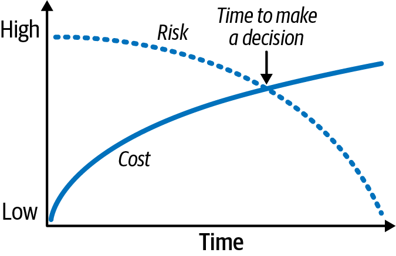
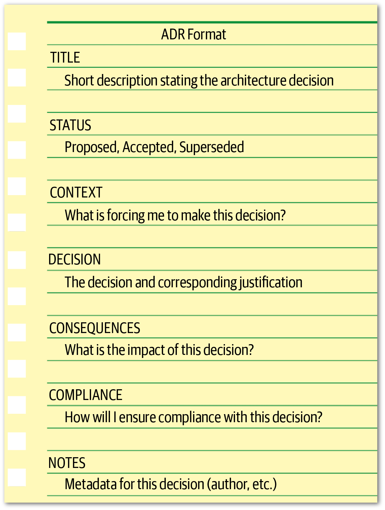
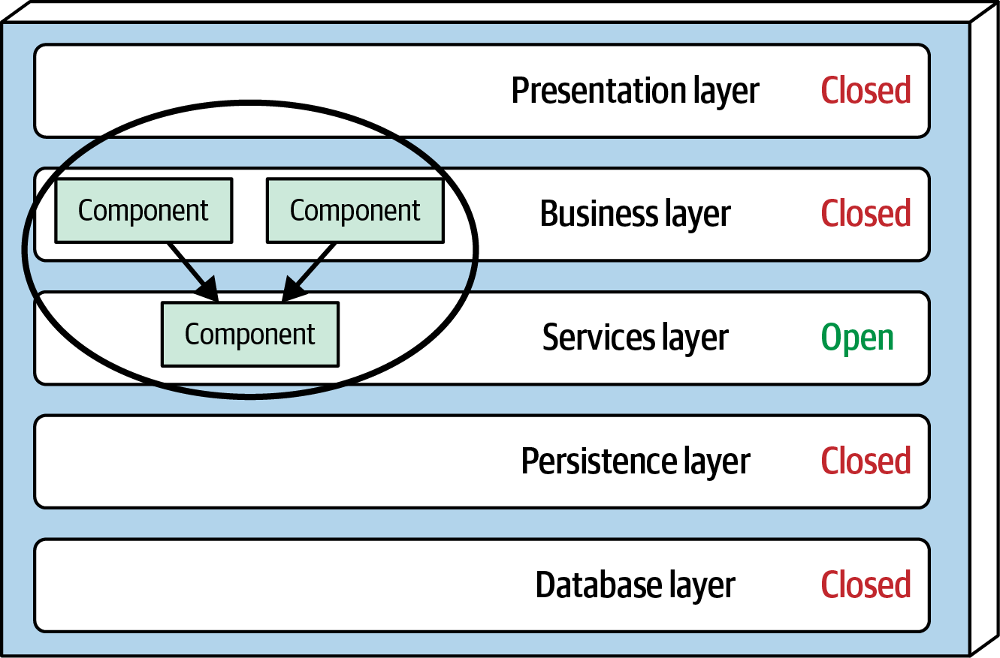
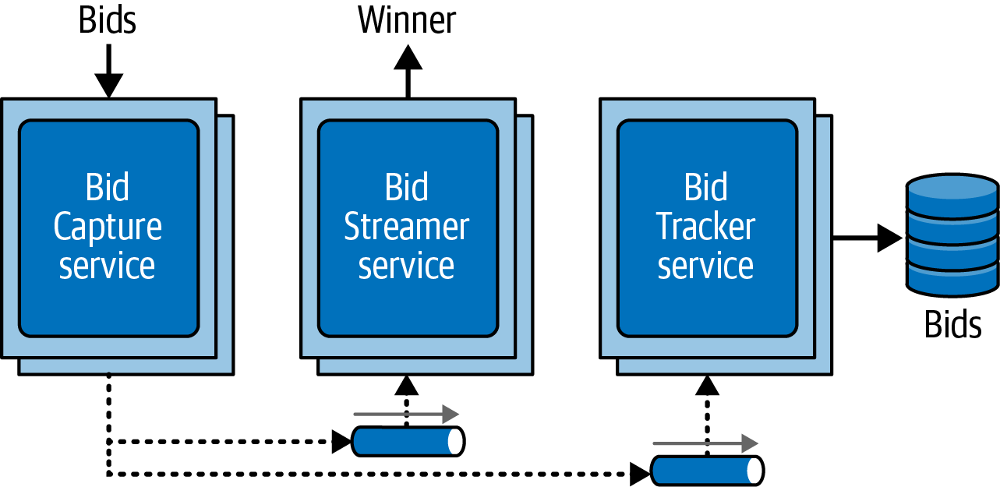
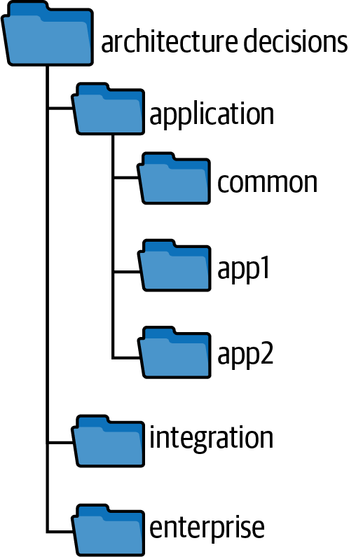

<a id="ch-architectural-decisions"></a>

# Chương 21. Các quyết định kiến trúc (Architectural Decisions)

<a id="ix_ch21-architecture-decisions-asciidoc0"></a>Một trong những kỳ vọng cốt lõi đối với một kiến trúc sư là đưa ra các quyết định kiến trúc. Các quyết định kiến trúc thường liên quan đến cấu trúc của ứng dụng hoặc hệ thống, nhưng chúng cũng có thể liên quan đến các quyết định công nghệ, đặc biệt khi những quyết định công nghệ đó tác động đến các architectural characteristic. Dù trong bối cảnh nào, một quyết định kiến trúc tốt là quyết định giúp hướng dẫn các development team đưa ra những lựa chọn kỹ thuật đúng. Đưa ra quyết định kiến trúc bao gồm thu thập đủ thông tin liên quan, biện minh cho quyết định, ghi tài liệu quyết định, và truyền đạt hiệu quả quyết định đó tới đúng các stakeholder.

<a id="id363"></a>

## Các antipattern về quyết định kiến trúc (Architectural Decision Antipatterns)

<a id="ix_ch21-architecture-decisions-asciidoc1"></a><a id="ix_ch21-architecture-decisions-asciidoc2"></a><a id="id1515"></a>Lập trình viên [Andrew Koenig](https://oreil.ly/p9i_Y) định nghĩa một *antipattern* là một thứ có vẻ là ý hay khi bạn bắt đầu, nhưng lại dẫn bạn vào rắc rối. Một định nghĩa khác của antipattern là một quy trình lặp lại tạo ra kết quả tiêu cực. Ba antipattern về quyết định kiến trúc phổ biến nhất có thể (và thường thực sự) xuất hiện khi một kiến trúc sư đưa ra quyết định là antipattern Covering Your Assets, antipattern Groundhog Day và antipattern Email-Driven Architecture. Ba antipattern này thường tuân theo một luồng tăng dần: vượt qua antipattern Covering Your Assets dẫn đến antipattern Groundhog Day, và vượt qua antipattern đó dẫn đến antipattern Email-Driven Architecture. Đưa ra các quyết định kiến trúc hiệu quả và chính xác đòi hỏi vượt qua cả ba.

<a id="id204"></a>

### Antipattern Covering Your Assets (The Covering Your Assets Antipattern)

<a id="ix_ch21-architecture-decisions-asciidoc3"></a><a id="ix_ch21-architecture-decisions-asciidoc4"></a><a id="ix_ch21-architecture-decisions-asciidoc5"></a>Antipattern Covering Your Assets (che chắn cho bản thân) xảy ra khi một kiến trúc sư né tránh hoặc trì hoãn việc đưa ra một quyết định kiến trúc vì sợ chọn sai. Có hai cách để vượt qua điều này. <a id="id1516"></a>Cách thứ nhất là chờ đến *last responsible moment* (thời điểm có trách nhiệm cuối cùng) để đưa ra một quyết định kiến trúc quan trọng: tức là khi đã có đủ thông tin để biện minh và kiểm chứng quyết định, <a id="id1517"></a><a id="id1518"></a>nhưng không quá lâu đến mức cản trở các development team hoặc đẩy kiến trúc sư vào antipattern *Analysis Paralysis* (tê liệt vì phân tích), nơi họ mãi mắc kẹt trong việc phân tích quyết định. Một cách tốt để xác định last responsible moment là hỏi khi nào chi phí của việc trì hoãn quyết định vượt quá rủi ro gắn với việc quyết định. Như minh họa trong [Hình 21-1](#fig-architecture-decisions-last-responsible-moment), hãy lưu ý rằng ở các giai đoạn đầu của thang thời gian decision-making, chi phí (được biểu thị bằng đường liền) thấp vì ít thời gian được dùng cho việc ra quyết định, nhưng rủi ro (được biểu thị bằng đường chấm) cao vì biết ít hơn về vấn đề hoặc giải pháp. Dành thêm thời gian trì hoãn quyết định làm tăng chi phí, nhưng cũng giảm rủi ro vì kiến trúc sư có thể phân tích đầy đủ hơn về vấn đề và các phương án khả dĩ. Thời điểm để đưa ra quyết định là nơi hai yếu tố này giao nhau và mức tăng chi phí vượt quá mức rủi ro giảm đi.

<a id="fig-architecture-decisions-last-responsible-moment"></a>



*Hình 21-1. Last responsible moment*

Một cách khác để tránh antipattern này là cộng tác với các development team để bảo đảm quyết định có thể được hiện thực như kỳ vọng. Điều này cực kỳ quan trọng vì không kiến trúc sư nào có thể biết mọi chi tiết về bất kỳ vấn đề nào gắn với một công nghệ cụ thể. Bằng cách cộng tác chặt chẽ với các development team, kiến trúc sư có thể phản ứng nhanh, có thêm hiểu biết, và giảm rủi ro quyết định là sai.

Để minh họa điểm này: giả sử bạn, với tư cách kiến trúc sư, quyết định rằng mọi dữ liệu tham chiếu product-related (như mô tả sản phẩm, trọng lượng và kích thước) nên được cache trong mọi instance service cần thông tin đó. Bạn quyết định rằng việc này sẽ được thực hiện bằng một cache được nhân bản read-only, với cache chính thuộc sở hữu của service `Catalog`. (Một cache *được nhân bản* (replicated), hay *in-memory*, có nghĩa là nếu có bất kỳ thay đổi nào về thông tin sản phẩm hoặc sản phẩm mới được thêm vào, service `Catalog` cập nhật cache của nó, cache này sau đó được nhân bản tới tất cả các service khác cần dữ liệu đó thông qua một sản phẩm replicated cache.) Lý do biện minh của bạn cho quyết định này là giảm coupling giữa các service và chia sẻ dữ liệu hiệu quả mà không phải thực hiện lời gọi liên service. Tuy nhiên, các development team hiện thực quyết định kiến trúc này phát hiện ra rằng, do yêu cầu scalability của một số service, quyết định này sẽ đòi hỏi nhiều bộ nhớ in-process hơn mức có sẵn. Vì bạn đang cộng tác chặt chẽ với các team này, bạn nhanh chóng nhận ra vấn đề và điều chỉnh quyết định kiến trúc của mình cho phù hợp.<a id="id1519"></a><a id="id1520"></a><a id="id1521"></a>

<a id="id205"></a>

### Antipattern Groundhog Day (Groundhog Day Antipattern)

<a id="id1522"></a><a id="id1523"></a><a id="id1524"></a>Antipattern Groundhog Day xảy ra khi mọi người không biết vì sao một kiến trúc sư đưa ra một quyết định cụ thể, nên họ cứ thảo luận về nó lặp đi lặp lại mãi, không bao giờ đi đến kết luận hay đồng thuận cuối cùng. Nó có tên từ bộ phim năm 1993 *Groundhog Day* (Ngày chuột chũi), trong đó nhân vật của Bill Murray phải sống lại ngày 2 tháng Hai lặp đi lặp lại, mỗi ngày.

Antipattern này xảy ra vì kiến trúc sư không biện minh cho quyết định của mình (hoặc không biện minh đầy đủ). Điều quan trọng là phải cung cấp cả lý do biện minh kỹ thuật lẫn kinh doanh cho một quyết định kiến trúc.

Ví dụ, giả sử bạn quyết định tách một ứng dụng monolith thành các service riêng. Lý do biện minh của bạn là decouple các khía cạnh chức năng của ứng dụng để mỗi phần của ứng dụng dùng ít tài nguyên máy ảo hơn và có thể được bảo trì và deploy riêng. Dù đây là một lý do biện minh kỹ thuật tốt, điều còn thiếu là lý do biện minh *kinh doanh*—nói cách khác, tại sao doanh nghiệp nên trả tiền cho việc refactoring kiến trúc này? Một lý do biện minh kinh doanh tốt cho quyết định này có thể là giao chức năng nghiệp vụ mới nhanh hơn, qua đó cải thiện time to market. Một lý do khác có thể là giảm chi phí gắn với việc phát triển và phát hành tính năng mới.

Cung cấp giá trị kinh doanh cực kỳ quan trọng khi biện minh cho một quyết định kiến trúc. Nó cũng là một phép thử tốt để xác định liệu quyết định kiến trúc có nên được đưa ra ngay từ đầu không. Nếu nó không mang lại giá trị kinh doanh nào, có lẽ kiến trúc sư nên cân nhắc lại quyết định.

Bốn lý do biện minh kinh doanh phổ biến nhất là chi phí, time to market, sự hài lòng của người dùng, và định vị chiến lược. Hãy xem xét điều gì quan trọng với các stakeholder kinh doanh. Biện minh cho một quyết định cụ thể chỉ dựa trên tiết kiệm chi phí có thể không phải là lựa chọn đúng nếu các stakeholder kinh doanh quan tâm nhiều hơn đến time to market.

<a id="id206"></a>

### Antipattern kiến trúc dẫn dắt bằng email (Email-Driven Architecture Antipattern)

<a id="id1525"></a><a id="id1526"></a><a id="id1527"></a>Khi một kiến trúc sư đã đưa ra và biện minh đầy đủ cho các quyết định của mình, một architecture antipattern khác thường xuất hiện: Email-Driven Architecture. Antipattern này xảy ra khi mọi người làm mất hoặc quên một quyết định kiến trúc, hoặc thậm chí không biết rằng nó đã được đưa ra và do đó không thể nào hiện thực nó. Vượt qua antipattern này hoàn toàn là về việc truyền đạt hiệu quả các quyết định kiến trúc. Email là một công cụ giao tiếp tuyệt vời, nhưng nó là một hệ thống kho tài liệu tồi.

May mắn là kiến trúc sư có thể dễ dàng tránh antipattern Email-Driven Architecture bằng cách học cách truyền đạt hiệu quả các quyết định kiến trúc. Trước hết, hãy chắc chắn không đưa quyết định vào phần thân email. Làm vậy tạo ra nhiều system of record cho quyết định đó, vì mỗi email chứa một bản sao của quyết định thay vì chỉ có nó ở một nơi. Nhiều email như vậy bỏ sót những chi tiết quan trọng về quyết định (kể cả lý do biện minh), lại tạo ra antipattern Groundhog Day một lần nữa. Ngoài ra, nếu quyết định kiến trúc đó từng bị thay đổi hoặc thay thế, rất khó biết liệu tất cả những người liên quan có nhận được quyết định đã sửa đổi hay không.

Một cách tiếp cận tốt hơn là chỉ đề cập bản chất và bối cảnh của quyết định trong phần thân email và cung cấp một liên kết tới system of record duy nhất, nơi quyết định kiến trúc và các chi tiết tương ứng được lưu trữ (dù đó là một liên kết tới trang wiki hay một tham chiếu tới tài liệu trong filesystem).

Hãy xét email sau về một quyết định kiến trúc:

> “Chào Sandra, tôi đã đưa ra một quyết định quan trọng về giao tiếp giữa các service, tác động trực tiếp đến bạn. Vui lòng xem quyết định qua liên kết sau….”

Lưu ý rằng, trong cách diễn đạt phần đầu của câu thứ nhất, bối cảnh được đề cập (giao tiếp giữa các service), nhưng không phải bản thân quyết định thực tế. Phần thứ hai của câu thứ nhất cũng quan trọng: nếu một quyết định kiến trúc không tác động trực tiếp đến người đó, thì tại sao phải làm phiền họ với nó? Đây là một phép thử tuyệt vời để xác định những stakeholder nào (kể cả developer) nên được thông báo trực tiếp về một quyết định kiến trúc. Câu thứ hai trong ví dụ này cung cấp một liên kết tới vị trí duy nhất của quyết định kiến trúc, cung cấp một system of record duy nhất cho các quyết định.<a id="id1528"></a><a id="id1529"></a>

<a id="id207"></a>

## Ý nghĩa kiến trúc (Architectural Significance)

<a id="ix_ch21-architecture-decisions-asciidoc6"></a><a id="ix_ch21-architecture-decisions-asciidoc7"></a>Nhiều kiến trúc sư tin rằng nếu một quyết định liên quan đến một công nghệ cụ thể, thì nó không phải là quyết định kiến trúc, mà là quyết định kỹ thuật. Điều này không phải lúc nào cũng đúng. Nếu một kiến trúc sư quyết định dùng một công nghệ cụ thể vì nó trực tiếp hỗ trợ một architecture characteristic cụ thể (như performance hoặc scalability), thì nó vẫn là một quyết định kiến trúc.

[Michael Nygard](https://michaelnygard.com), một kiến trúc sư phần mềm well-known và là tác giả ấn bản thứ hai của *Release It!* (Pragmatic Bookshelf, 2018), giải quyết vấn đề kiến trúc sư nên chịu trách nhiệm về những quyết định nào (và do đó điều gì tạo nên một quyết định kiến trúc) bằng cách đặt ra thuật ngữ *architecturally significant* (có ý nghĩa kiến trúc). Theo Nygard, các quyết định architecturally significant là những quyết định ảnh hưởng đến cấu trúc, các characteristic non-functional, các phụ thuộc, các interface hoặc các kỹ thuật xây dựng của một hệ thống.

*Cấu trúc* (structure), trong bối cảnh này, chỉ các quyết định ảnh hưởng đến các architecture pattern hoặc style đang được dùng. Ví dụ, quyết định của một kiến trúc sư chia sẻ code giữa một tập microservice tác động đến bounded context của microservice, và do đó ảnh hưởng đến cấu trúc của hệ thống.

<a id="id1530"></a>Các *characteristic non-functional* của hệ thống là các architectural characteristic quan trọng đối với hệ thống đang được phát triển hoặc bảo trì. Ví dụ, nếu một lựa chọn công nghệ ảnh hưởng đến performance, và performance là một khía cạnh quan trọng của ứng dụng, lựa chọn đó trở thành một quyết định kiến trúc, dù nó có thể chỉ định một sản phẩm, framework hay công nghệ cụ thể.

<a id="id1531"></a>*Phụ thuộc* (dependencies) chỉ các điểm coupling giữa các component và/hoặc service trong hệ thống. Phụ thuộc có thể ảnh hưởng đến các architecture characteristic như scalability, modularity, agility, testability, reliability, v.v., nên các quyết định về phụ thuộc trở thành quyết định kiến trúc.

<a id="id1532"></a>*Interface* chỉ cách các service và component được truy cập và orchestrate: thường thông qua một gateway, integration hub, service bus, adapter hoặc API proxy. Đưa ra quyết định về interface thường bao gồm việc định nghĩa contract, kể cả các chiến lược versioning và ngừng hỗ trợ. Interface tác động đến những người khác dùng hệ thống và do đó có ý nghĩa kiến trúc.

<a id="id1533"></a>Cuối cùng, *kỹ thuật xây dựng* (construction techniques) chỉ các quyết định về nền tảng, framework, công cụ, và thậm chí cả quy trình, những thứ dù mang tính kỹ thuật nhưng có thể tác động đến một khía cạnh nào đó của architecture.<a id="id1534"></a><a id="id1535"></a>

<a id="architecture_decision_records"></a>

## Architectural Decision Record (Architectural Decision Records)

<a id="ix_ch21-architecture-decisions-asciidoc8"></a><a id="ix_ch21-architecture-decisions-asciidoc9"></a>Một trong những cách hiệu quả nhất để ghi tài liệu các quyết định kiến trúc là thông qua *Architectural Decision Record* ([ADR](https://adr.github.io)). Michael Nygard lần đầu truyền bá ADR trong một [bài blog](https://oreil.ly/yDcU2) năm 2011, và năm 2017, [Thoughtworks Technology Radar](https://oreil.ly/0nwHw) đã khuyến nghị kỹ thuật này để áp dụng rộng rãi.

Một ADR gồm một file văn bản ngắn (thường dài một đến hai trang) mô tả một quyết định kiến trúc cụ thể. Dù ADR có thể được viết bằng văn bản thuần hoặc bằng một template trang wiki, chúng thường được viết bằng một loại định dạng tài liệu văn bản nào đó, như [AsciiDoc](http://asciidoc.org) hoặc [Markdown](https://markdownguide.org).

Cũng có công cụ để quản lý ADR. Nat Pryce, đồng tác giả của *Growing Object-Oriented Software, Guided by Tests* (Addison-Wesley, 2009), đã viết một công cụ open source tên là [ADR Tools](https://oreil.ly/6d8LN) cung cấp giao diện command-line để quản lý ADR, bao gồm các phương án đánh số, vị trí, và logic thay thế (superseded). Micha Kops, một kỹ sư phần mềm từ Đức, cung cấp một số [ví dụ tuyệt vời](https://oreil.ly/OgBZK) về việc dùng ADR tools để quản lý architectural decision record.

<a id="id364"></a>

### Cấu trúc cơ bản (Basic Structure)

<a id="ix_ch21-architecture-decisions-asciidoc10"></a><a id="ix_ch21-architecture-decisions-asciidoc11"></a>Cấu trúc cơ bản của một ADR gồm năm phần chính: *Title*, *Status*, *Context*, *Decision* và *Consequences*. Chúng tôi thường thêm hai phần bổ sung như một phần của cấu trúc cơ bản: *Compliance* và *Notes*. Phần Compliance là nơi để suy nghĩ và ghi tài liệu cách quyết định kiến trúc sẽ được quản trị và thực thi (thủ công hoặc thông qua fitness function tự động). Phần Notes là nơi để đưa metadata về quyết định, như tác giả, ai đã phê duyệt, khi nào được tạo, v.v.

Mở rộng cấu trúc cơ bản này (như minh họa trong [Hình 21-2](#fig-architecture-decisions-basic-structure)) để bao gồm bất kỳ phần cần thiết nào khác là ổn. Chỉ cần giữ template nhất quán và súc tích. Một ví dụ tốt có thể là thêm một phần *Alternatives* phân tích tất cả các giải pháp khả dĩ khác.

<a id="fig-architecture-decisions-basic-structure"></a>



*Hình 21-2. Cấu trúc ADR cơ bản*

#### Title (tiêu đề)

<a id="id1536"></a>Tiêu đề ADR thường được đánh số tuần tự và chứa một cụm từ ngắn mô tả quyết định kiến trúc. Ví dụ, một tiêu đề ADR mô tả quyết định dùng messaging bất đồng bộ giữa service `Order` và service `Payment` có thể là: “42. Use of Asynchronous Messaging Between Order and Payment Services.” Tiêu đề nên ngắn gọn và súc tích, nhưng đủ tính mô tả để loại bỏ mọi sự mơ hồ về bản chất và bối cảnh của quyết định.

#### Status (trạng thái)

<a id="ix_ch21-architecture-decisions-asciidoc12"></a>Mỗi ADR có một trong ba trạng thái: *Proposed*, *Accepted*, hoặc *Superseded*. Trạng thái Proposed nghĩa là quyết định phải được phê duyệt bởi một người ra quyết định higher-level hoặc một loại cơ quan governance kiến trúc nào đó (như một architecture review board). Accepted nghĩa là quyết định đã được phê duyệt và sẵn sàng để hiện thực. Superseded nghĩa là quyết định đã bị thay đổi và thay thế bởi một ADR khác. Trạng thái Superseded luôn giả định rằng trạng thái của ADR trước đó là Accepted; nói cách khác, một ADR Proposed sẽ không bao giờ bị thay thế bởi một ADR khác; nó sẽ được sửa đổi cho đến khi Accepted.

Trạng thái Superseded là một cách mạnh mẽ để lưu giữ hồ sơ lịch sử về những quyết định nào đã được đưa ra, vì sao chúng được đưa ra vào thời điểm đó, quyết định mới là gì, và vì sao nó bị thay đổi. Thông thường, khi một ADR đã bị thay thế, nó được đánh dấu bằng số của quyết định đã thay thế nó. Tương tự, quyết định thay thế một ADR khác được đánh dấu bằng số của ADR mà nó đã thay thế.

Ví dụ, giả sử ADR 42 (“Use of Asynchronous Messaging Between Order and Payment Services”) đang ở trạng thái Approved. Do những thay đổi sau đó về hiện thực và vị trí của service `Payment`, bạn quyết định rằng giờ nên dùng REST giữa hai service. Do đó bạn tạo một ADR mới (số 68) để ghi tài liệu quyết định đã thay đổi này. Các trạng thái tương ứng trông như sau:

> *ADR 42. Use of Asynchronous Messaging Between Order and Payment Services*
>
> Status: Superseded by 68
>
> *ADR 68. Use of REST Between Order and Payment Services*
>
> Status: Accepted, supersedes 42

Liên kết và dấu vết lịch sử giữa ADR 42 và 68 giúp bạn tránh câu hỏi không thể tránh khỏi “còn dùng messaging thì sao?” đối với ADR 68.

> **ADR và Request for Comments (RFC) (ADRs and Request for Comments (RFC))**
>
> <a id="id1538"></a>Gửi bản nháp ADR ra để lấy ý kiến có thể giúp kiến trúc sư kiểm chứng các giả định và khẳng định của mình với một nhóm stakeholder rộng hơn. Một cách hiệu quả để thu hút developer và khởi đầu sự cộng tác là tạo một loại trạng thái mới gọi là *Request for Comments* (RFC) và chỉ định một hạn chót để người review hoàn thành phản hồi. Khi đến ngày đó, kiến trúc sư có thể phân tích các ý kiến, thực hiện mọi điều chỉnh cần thiết cho quyết định, đưa ra quyết định cuối cùng, và đặt trạng thái thành Proposed (hoặc Accepted, nếu kiến trúc sư có thẩm quyền phê duyệt quyết định).
>
> Một ADR với trạng thái RFC sẽ trông như sau:
>
> *STATUS*<br>
> *Request For Comments, Deadline 09 JAN 2026*

Một khía cạnh quan trọng khác của phần Status của một ADR là nó buộc kiến trúc sư và sếp hoặc lead architect của họ thảo luận về các tiêu chí phê duyệt một quyết định kiến trúc và xác định liệu kiến trúc sư có thể tự mình phê duyệt, hay nó phải được phê duyệt thông qua một kiến trúc sư higher-level, architecture review board, hoặc một cơ quan quản trị nào khác.

Ba điểm khởi đầu tốt cho những cuộc trò chuyện này là chi phí, tác động cross-team, và security. Chi phí nên bao gồm phí mua hoặc bản quyền phần mềm, chi phí phần cứng bổ sung, và mức công sức tổng thể để hiện thực quyết định kiến trúc. <a id="id1539"></a>Để ước tính điều này, hãy nhân số giờ ước tính để hiện thực quyết định kiến trúc với đơn giá *full-time equivalency* (FTE: tương đương toàn thời gian) chuẩn của công ty. Project owner hoặc project manager thường có con số FTE. Cuộc trò chuyện này có thể dẫn mọi người đến đồng ý rằng, chẳng hạn, nếu chi phí của quyết định kiến trúc vượt quá một mức nhất định, thì nó phải được đặt ở trạng thái Proposed và được người khác phê duyệt. Nếu quyết định kiến trúc tác động đến các team hoặc hệ thống khác hoặc có bất kỳ hàm ý security nào, thì nó phải được phê duyệt bởi một cơ quan quản trị higher-level hoặc lead architect.

Khi team đã thiết lập và đồng ý về các tiêu chí và giới hạn tương ứng (như “chi phí vượt quá \$5,000 phải được architecture review board phê duyệt”), hãy ghi tài liệu nó cẩn thận để mọi kiến trúc sư tạo ADR đều biết khi nào họ có thể và không thể tự phê duyệt các quyết định kiến trúc của mình.<a id="id1540"></a>

#### Context (bối cảnh)

<a id="id1541"></a>Phần Context của một ADR chỉ định các lực đang tác động. Nói cách khác, “Tình huống nào đang buộc tôi phải đưa ra quyết định này?” Phần này của ADR cho phép kiến trúc sư mô tả các hoàn cảnh cụ thể và trình bày súc tích các phương án khả dĩ. Nếu kiến trúc sư được yêu cầu ghi tài liệu phân tích từng phương án một cách chi tiết, hãy thêm một phần Alternatives thay vì đưa phân tích đó vào phần Context.

Phần Context cũng cung cấp một nơi để ghi tài liệu một vùng cụ thể của chính architecture. Bằng cách mô tả bối cảnh, kiến trúc sư cũng đang mô tả architecture. Dùng ví dụ từ mục trước, phần Context có thể như sau: “Service Order phải truyền thông tin tới service Payment để thanh toán cho một đơn hàng đang được đặt. Việc này có thể được thực hiện bằng REST hoặc messaging bất đồng bộ.” Lưu ý rằng phát biểu súc tích này chỉ định không chỉ kịch bản, mà cả các phương án đã được xem xét.

#### Decision (quyết định)

<a id="id1542"></a>Phần Decision của ADR chứa mô tả về quyết định kiến trúc, cùng với lý do biện minh đầy đủ. Nygard khuyến nghị phát biểu các quyết định kiến trúc bằng giọng khẳng định, mệnh lệnh thay vì giọng bị động. Ví dụ, quyết định dùng messaging bất đồng bộ giữa các service sẽ là, “*Chúng tôi sẽ dùng* messaging bất đồng bộ giữa các service.” Điều này tốt hơn nhiều so với “*Tôi nghĩ* messaging bất đồng bộ giữa các service sẽ là lựa chọn tốt nhất,” câu không làm rõ quyết định là gì hay thậm chí đã có quyết định nào được đưa ra hay chưa—chỉ là ý kiến của kiến trúc sư.

Một trong những khía cạnh mạnh mẽ nhất của phần Decision trong ADR là nó cho phép kiến trúc sư nhấn mạnh lý do biện minh cho quyết định. Hiểu *tại sao* một quyết định được đưa ra quan trọng hơn nhiều so với hiểu *cách* một thứ hoạt động. Điều này giúp developer và các stakeholder khác hiểu rõ hơn lý lẽ đằng sau một quyết định, và do đó khiến họ có nhiều khả năng đồng ý với nó hơn.

Để minh họa điểm này, giả sử bạn quyết định dùng Remote Procedure Call của Google ([gRPC](https://grpc.io)) để giao tiếp giữa hai service cụ thể nhằm giảm latency mạng do nhu cầu responsiveness rất cao. Vài năm sau, một kiến trúc sư mới trong team quyết định dùng REST thay vì gRPC để làm cho giao tiếp giữa các service nhất quán hơn. Vì kiến trúc sư mới không hiểu *tại sao* gRPC được chọn ngay từ đầu, quyết định của họ rốt cuộc có tác động đáng kể đến latency, gây ra timeout ở các hệ thống upstream. Nếu kiến trúc sư mới có quyền truy cập một ADR, họ đã có thể hiểu rằng quyết định ban đầu dùng gRPC là nhằm giảm latency (với cái giá là các service coupled chặt) và đã có thể ngăn chặn vấn đề này.

#### Consequences (hệ quả)

<a id="id1543"></a>Mọi quyết định mà kiến trúc sư đưa ra đều có một loại tác động nào đó, tốt hay xấu. Phần Consequences của một ADR buộc kiến trúc sư mô tả tác động tổng thể của một quyết định kiến trúc, cho phép họ suy nghĩ xem các tác động tiêu cực có vượt trội hơn lợi ích hay không.

Phần này cũng là một nơi tốt để ghi tài liệu phân tích trade-off đã thực hiện trong quá trình decision-making. Ví dụ, giả sử bạn quyết định dùng messaging bất đồng bộ (fire-and-forget) để đăng bài đánh giá trên một website. Lý do biện minh của bạn cho quyết định này là cải thiện responsiveness (từ 3,100 mili giây xuống 25 mili giây) vì người dùng sẽ không phải chờ bài đánh giá thực sự được đăng—chỉ chờ message được gửi tới một queue. Một thành viên trong development team của bạn cho rằng đây là ý tồi do sự phức tạp của việc xử lý lỗi gắn với một request bất đồng bộ: “Điều gì xảy ra nếu ai đó đăng một bài đánh giá có lời lẽ xấu?” Điều thành viên team này không biết là bạn đã thảo luận chính vấn đề đó với các stakeholder kinh doanh và các kiến trúc sư khác khi phân tích trade-offs của quyết định này, và cùng nhau quyết định rằng tốt hơn là cải thiện responsiveness và xử lý lỗi phức tạp thay vì tăng thời gian chờ và cung cấp phản hồi về việc đăng bài đánh giá có thành công hay không. Nếu quyết định này được ghi tài liệu bằng một ADR, bạn đã có thể cung cấp phân tích trade-off này trong phần Consequences, ngăn chặn loại bất đồng này.

#### Compliance (tuân thủ)

<a id="ix_ch21-architecture-decisions-asciidoc13"></a>Phần Compliance không phải là một trong các phần chuẩn của ADR, nhưng là phần chúng tôi rất khuyến nghị thêm vào. Phần Compliance nêu cách quyết định kiến trúc sẽ được đo lường và quản trị. Phép kiểm tra tuân thủ cho quyết định này sẽ là thủ công, hay có thể được tự động hóa bằng một fitness function? Nếu có thể tự động hóa, kiến trúc sư có thể chỉ định fitness function sẽ được viết như thế nào, cùng với mọi thay đổi khác đối với code base cần thiết để đo sự tuân thủ của quyết định kiến trúc này.

Ví dụ, giả sử bạn đưa ra quyết định trong một layered architecture n-tiered truyền thống (như minh họa trong [Hình 21-3](#fig-architecture-decisions-decision-example)) rằng mọi shared object được dùng bởi các business object trong Business layer phải nằm trong Shared Services layer để cô lập và gói gọn chức năng dùng chung.

<a id="fig-architecture-decisions-decision-example"></a>



*Hình 21-3. Một ví dụ về quyết định kiến trúc*

Quyết định kiến trúc này có thể được đo lường và quản trị bằng hàng loạt công cụ tự động, bao gồm [ArchUnit](https://archunit.org) trong Java và [NetArchTest](https://oreil.ly/0J5fN) trong C#. Với ArchUnit trong Java, bài test fitness-function tự động cho quyết định kiến trúc này có thể trông như sau:

```java
@Test
public void shared_services_should_reside_in_services_layer() {
    classes().that().areAnnotatedWith(SharedService.class)
        .should().resideInAPackage("..services..")
        .check(myClasses);
}
```

Fitness function tự động này sẽ đòi hỏi viết các story mới để tạo một Java annotation (`@SharedService`) và thêm nó vào tất cả các class dùng chung để hỗ trợ phương pháp governance này. <a id="id1544"></a>

#### Notes (ghi chú)

<a id="id1545"></a>Một phần khác không thuộc ADR chuẩn nhưng chúng tôi rất khuyến nghị thêm vào là phần Notes. Phần này bao gồm nhiều metadata khác nhau về ADR:

- Tác giả ban đầu
- Ngày phê duyệt
- Người phê duyệt
- Ngày bị thay thế
- Ngày sửa đổi gần nhất
- Người sửa đổi
- Lần sửa đổi gần nhất

Ngay cả khi lưu ADR trong một hệ thống version-control (như Git), vẫn hữu ích khi có thêm metadata ngoài những gì repository có thể hỗ trợ. Chúng tôi khuyến nghị thêm phần này bất kể kiến trúc sư lưu ADR bằng cách nào và ở đâu.<a id="id1546"></a><a id="id1547"></a>

<a id="id212"></a>

### Ví dụ (Example)

<a id="ix_ch21-architecture-decisions-asciidoc14"></a><a id="ix_ch21-architecture-decisions-asciidoc15"></a><a id="ix_ch21-architecture-decisions-asciidoc16"></a>Ví dụ hệ thống đấu giá Going, Going, Gone (GGG) của chúng tôi bao gồm hàng chục quyết định kiến trúc. Tách giao diện người dùng của người đặt giá và người điều khiển đấu giá, dùng một architecture lai gồm event-driven và microservices, tận dụng Real-time Transport Protocol (RTP) cho việc thu video, dùng một API Gateway duy nhất, và dùng các queue riêng cho messaging chỉ là một vài trong số các quyết định kiến trúc mà một kiến trúc sư sẽ đưa ra. Mọi quyết định kiến trúc mà kiến trúc sư đưa ra, dù hiển nhiên đến đâu, đều nên được ghi tài liệu và biện minh.

[Hình 21-4](#fig-architecture-decisions-adr-example) minh họa một trong các quyết định kiến trúc trong hệ thống đấu giá GGG: dùng các queue point-to-point riêng giữa các service bid capture, bid streamer và bid tracker thay vì một topic publish-and-subscribe duy nhất (hoặc thậm chí REST).

<a id="fig-architecture-decisions-adr-example"></a>



*Hình 21-4. Dùng pub/sub giữa các service*

Không có một ADR để biện minh cho quyết định này, những người khác tham gia thiết kế và phát triển hệ thống này có thể không đồng ý và quyết định hiện thực nó theo cách khác.

Sau đây là một ví dụ về ADR cho quyết định kiến trúc này:

> **ADR 76. Các queue riêng cho service Bid Streamer và Bidder Tracker**
>
> **STATUS**<br>
> Accepted
>
> **CONTEXT**<br>
> Service `Bid Capture`, khi nhận một lượt đặt giá, phải chuyển tiếp lượt đặt giá đó tới service `Bid Streamer` và service `Bidder Tracker`. Việc này có thể được thực hiện bằng một topic duy nhất (pub/sub), các queue riêng (point-to-point) cho mỗi service, hoặc REST thông qua API layer Online Auction.<br>
>
>
> **DECISION**<br>
> Chúng tôi sẽ dùng các queue riêng cho các service `Bid Streamer` và `Bidder Tracker`.
>
> Service `Bid Capture` không cần bất kỳ thông tin nào từ service `Bid Streamer` hay service `Bidder Tracker` (giao tiếp chỉ là one-way).
>
> Service `Bid Streamer` phải nhận các lượt đặt giá theo đúng thứ tự mà chúng được service `Bid Capture` chấp nhận. Dùng messaging và queue tự động bảo đảm thứ tự đặt giá cho stream bằng cách tận dụng các queue first-in, first out (FIFO).
>
> Nhiều lượt đặt giá đến với cùng một số tiền (ví dụ, “Có ai trả một trăm không?”). Service `Bid Streamer` chỉ cần lượt đặt giá đầu tiên nhận được cho số tiền đó, trong khi `Bidder Tracker` cần mọi lượt đặt giá nhận được. Dùng một topic (pub/sub) sẽ đòi hỏi `Bid Streamer` bỏ qua các lượt đặt giá giống với số tiền trước đó, buộc `Bid Streamer` phải lưu trạng thái dùng chung giữa các instance.
>
> Service `Bid Streamer` lưu các lượt đặt giá cho một vật phẩm trong một cache in-memory, trong khi `Bidder Tracker` lưu các lượt đặt giá vào một database. Do đó `Bidder Tracker` sẽ chậm hơn và có thể cần backpressure. Dùng một queue `Bidder Tracker` chuyên dụng cung cấp điểm backpressure chuyên dụng này.
>
> **CONSEQUENCES**<br>
> Chúng tôi sẽ cần clustering và high availability cho các message queue.
>
> Quyết định này sẽ đòi hỏi service `Bid Capture` gửi cùng một thông tin tới nhiều queue.
>
> Các sự kiện đặt giá nội bộ sẽ bỏ qua các phép kiểm tra security được thực hiện ở API layer.<br>
> *CẬP NHẬT: Khi xem xét tại cuộc họp ARB ngày 14 tháng Một năm 2025, ARB đã quyết định rằng đây là một trade-off chấp nhận được và không cần thêm phép kiểm tra security nào cho các sự kiện đặt giá giữa các service này.*
>
> **COMPLIANCE**<br>
> Chúng tôi sẽ dùng các buổi code review thủ công định kỳ để bảo đảm messaging pub/sub bất đồng bộ đang được dùng giữa service `Bid Capture`, service `Bid Streamer` và service `Bidder Tracker`.<br>
>
>
> **NOTES**<br>
> Tác giả: Subashini Nadella
>
> Phê duyệt: Các thành viên cuộc họp ARB, 14 JAN 2025
>
> Cập nhật lần cuối: 14 JAN 2025<a id="id1548"></a><a id="id1549"></a><a id="id1550"></a>

<a id="id213"></a>

### Lưu trữ ADR (Storing ADRs)

<a id="ix_ch21-architecture-decisions-asciidoc17"></a><a id="ix_ch21-architecture-decisions-asciidoc18"></a><a id="ix_ch21-architecture-decisions-asciidoc19"></a>Khi một kiến trúc sư tạo một ADR, họ cần lưu nó ở đâu đó. Bất kể đó là đâu, mỗi quyết định kiến trúc nên có file hoặc trang wiki riêng. Một số kiến trúc sư thích giữ ADR trong cùng Git repository với source code, cho phép team version và theo dõi ADR như với source code.

Tuy nhiên, đối với các tổ chức lớn hơn, chúng tôi cảnh báo không nên làm vậy vì một số lý do. Thứ nhất, không phải ai cần xem quyết định kiến trúc cũng có quyền truy cập Git repository chứa ADR. Thứ hai, Git repository của ứng dụng không phải là nơi tốt để lưu các ADR có bối cảnh nằm ngoài nó (như các quyết định kiến trúc tích hợp, quyết định kiến trúc doanh nghiệp, hoặc các quyết định chung cho mọi ứng dụng). Vì những lý do này, chúng tôi khuyến nghị lưu ADR trong một Git repository ADR chuyên dụng mà mọi người đều có quyền truy cập, một wiki (dùng template wiki), hoặc một thư mục dùng chung trên một file server dùng chung có thể được truy cập dễ dàng bởi một wiki hoặc phần mềm document-rendering khác.

[Hình 21-5](#fig-architecture-decisions-directory-structure) cho thấy cấu trúc thư mục này (hoặc cấu trúc điều hướng trang wiki) có thể trông như thế nào.

<a id="fig-architecture-decisions-directory-structure"></a>



*Hình 21-5. Ví dụ cấu trúc thư mục để lưu ADR*

Thư mục *application* chứa các quyết định kiến trúc đặc thù cho một loại bối cảnh ứng dụng (hoặc sản phẩm) nào đó. Thư mục này được chia nhỏ thành các thư mục con khác:

**common**

Thư mục con *common* dành cho các quyết định kiến trúc áp dụng cho mọi ứng dụng, như, “Mọi class framework-related sẽ chứa một annotation (@Framework trong Java) hoặc attribute ([Framework] trong C#) xác định class đó thuộc về code framework nền tảng.”

**application**

Các thư mục con dưới thư mục *application* tương ứng với bối cảnh ứng dụng hoặc hệ thống cụ thể và chứa các quyết định kiến trúc đặc thù cho ứng dụng hoặc hệ thống đó (trong ví dụ này là các ứng dụng *app1* và *app2*).

**integration**

Thư mục *integration* chứa các ADR liên quan đến giao tiếp giữa các ứng dụng, hệ thống hoặc service.

**enterprise**

Các ADR enterprise architecture được chứa trong thư mục *enterprise*, cho biết đây là những quyết định kiến trúc toàn cục tác động đến mọi hệ thống và ứng dụng. Một ví dụ về ADR enterprise architecture sẽ là “Mọi truy cập vào database của một hệ thống chỉ được thực hiện từ hệ thống sở hữu,” ngăn database bị chia sẻ giữa nhiều hệ thống.

Khi lưu ADR trong một wiki, cùng cấu trúc đó được áp dụng, với mỗi cấu trúc thư mục đại diện cho một trang đích điều hướng. Mỗi ADR được đại diện như một trang wiki duy nhất trong mỗi trang đích điều hướng (application, integration hoặc enterprise).

Tên thư mục và tên landing-page nêu trong mục này chỉ là khuyến nghị và ví dụ. Hãy chọn bất kỳ tên nào phù hợp với tình huống của công ty, miễn là những tên đó nhất quán giữa các team.<a id="id1551"></a><a id="id1552"></a><a id="id1553"></a>

<a id="id365"></a>

### ADR như tài liệu (ADRs as Documentation)

<a id="id1554"></a>Ghi tài liệu software architecture luôn khó khăn. Dù một số tiêu chuẩn đang nổi lên để vẽ sơ đồ architecture (như [C4 Model](https://c4model.com) của kiến trúc sư phần mềm Simon Brown hoặc tiêu chuẩn [ArchiMate](https://oreil.ly/gbNQG) của The Open Group), chưa có tiêu chuẩn agreed-upon nào để ghi tài liệu software architecture. Đó là lúc ADR phát huy tác dụng.

ADR có thể là một phương tiện hiệu quả để ghi tài liệu một software architecture. Phần Context mang lại một cơ hội tuyệt vời để mô tả vùng cụ thể của hệ thống đòi hỏi đưa ra một quyết định kiến trúc, cũng như mô tả các phương án. Quan trọng hơn, phần Decision mô tả lý do vì sao một quyết định cụ thể được đưa ra, đây là dạng tài liệu kiến trúc tốt nhất. Phần Consequences bổ sung mảnh ghép cuối cùng bằng cách mô tả phân tích trade-off cho quyết định—ví dụ, các lý do (và trade-offs) khi chọn performance hơn scalability.

<a id="id366"></a>

### Dùng ADR cho các tiêu chuẩn (Using ADRs for Standards)

<a id="id1555"></a><a id="id1556"></a>Rất ít developer thích tiêu chuẩn. Đáng tiếc là tiêu chuẩn đôi khi thiên về kiểm soát hơn là phục vụ một mục đích hữu ích. Dùng ADR cho tiêu chuẩn có thể thay đổi thực hành xấu này. Ví dụ, phần Context của một ADR mô tả tình huống đang buộc tổ chức áp dụng tiêu chuẩn cụ thể. Do đó phần Decision của một ADR có thể cho biết không chỉ tiêu chuẩn là gì, mà quan trọng hơn, vì sao nó cần tồn tại.

Đây là một cách tuyệt vời để đánh giá liệu một tiêu chuẩn cụ thể có nên tồn tại ngay từ đầu không. Nếu kiến trúc sư không thể biện minh cho nó, thì có lẽ đó không phải là một tiêu chuẩn tốt để đặt ra và thực thi. Hơn nữa, developer càng hiểu *tại sao* một tiêu chuẩn cụ thể tồn tại, họ càng có khả năng tuân theo nó (và, tương ứng, không thách thức nó). Phần Consequences của một ADR là một nơi tuyệt vời khác để đánh giá liệu một tiêu chuẩn có hợp lệ không: nó đòi hỏi kiến trúc sư suy nghĩ và ghi tài liệu các hàm ý và hệ quả của tiêu chuẩn, và liệu tiêu chuẩn cụ thể đó có nên được hiện thực hay không.

<a id="id214"></a>

### Dùng ADR với các hệ thống hiện có (Using ADRs with Existing Systems)

<a id="id1557"></a><a id="id1558"></a>Nhiều kiến trúc sư đặt câu hỏi về tính hữu ích của ADR đối với các hệ thống hiện có. Suy cho cùng, các quyết định kiến trúc đã được đưa ra và hệ thống đang chạy production. ADR có phục vụ mục đích thực sự nào ở thời điểm này không? Thực tế là có. Hãy nhớ, ADR không chỉ là tài liệu—chúng giúp kiến trúc sư và developer hiểu *tại sao* một quyết định được đưa ra và liệu nó có phải là quyết định phù hợp nhất không.

Hãy bắt đầu bằng cách viết một số ADR cho các quyết định kiến trúc quan trọng hơn đã được đưa ra và đặt câu hỏi liệu những quyết định đó có đúng hay không. Ví dụ, có lẽ một nhóm service đang dùng chung một database duy nhất. Tại sao? Có lý do chính đáng không? Dữ liệu có nên được tách ra không?

Một phần của hành trình đưa ADR vào một hệ thống hiện có là làm một chút công việc điều tra để khám phá những câu hỏi *tại sao* này. Đáng tiếc là người đưa ra quyết định ban đầu có thể đã rời công ty từ lâu, nên không ai biết câu trả lời. Trong những trường hợp này, việc xác định và phân tích các phương án và trade-offs của mỗi lựa chọn và cố kiểm chứng (hoặc bác bỏ) quyết định hiện có là trách nhiệm của kiến trúc sư. Trong cả hai trường hợp, viết ADR cho những loại quyết định quan trọng này bắt đầu xây dựng các lý do biện minh và lý lẽ (và kho trí tuệ) cho hệ thống và có thể giúp xác định các điểm kém hiệu quả về kiến trúc và thiết kế hệ thống sai.<a id="id1559"></a><a id="id1560"></a>

<a id="id215"></a>

### Tận dụng generative AI và LLM trong các quyết định kiến trúc (Leveraging Generative AI and LLMs in Architectural Decisions)

<a id="ix_ch21-architecture-decisions-asciidoc20"></a><a id="ix_ch21-architecture-decisions-asciidoc21"></a><a id="ix_ch21-architecture-decisions-asciidoc22"></a>Một trong nhiều khía cạnh hấp dẫn của generative AI là liệu kiến trúc sư có thể dùng nó để giúp đưa ra và kiểm chứng quyết định không. Các service có nên dùng messaging, streaming hay event sourcing khi gửi dữ liệu downstream? Database có nên giữ nguyên là một monolith duy nhất, hay nên được chia nhỏ thành các domain database? `Payment Processing` có nên được deploy như một service duy nhất hay tách thành nhiều service, mỗi service cho một loại thanh toán?

Hầu hết kiến trúc sư đã biết câu trả lời cho những câu hỏi này—còn tùy! Quay lại Định luật thứ nhất của software architecture, *mọi thứ trong software architecture đều là một trade-off*. Những quyết định như thế này phụ thuộc vào nhiều yếu tố, bao gồm bối cảnh cụ thể mà quyết định được áp dụng. Mỗi tình huống và mỗi môi trường đều khác nhau, đó là lý do không có “best practice” nào cho những loại câu hỏi cấu trúc này.

Hầu hết các LLM dựa kết quả của chúng phần lớn vào xác suất. Nói cách khác, câu trả lời có xác suất cao nhất với bối cảnh của prompt là gì, và “best practice” cho vấn đề này là gì? Tuy nhiên, xác suất và “best practice” không có chỗ trong việc đưa ra quyết định kiến trúc. Trả lời các câu hỏi kiến trúc đòi hỏi phân tích cẩn thận các trade-offs liên quan, và áp dụng một bối cảnh kinh doanh và kỹ thuật cụ thể để xác định lựa chọn phù hợp nhất. Ví dụ, nếu doanh nghiệp quan tâm nhất đến time to market (đưa các thay đổi và tính năng mới đến khách hàng nhanh nhất có thể), thì *maintainability* sẽ quan trọng hơn nhiều so với *performance*, và sẽ dẫn dắt phần lớn quá trình decision-making hướng tới tối ưu maintainability.

Các quyết định kiến trúc đòi hỏi chuyển các mối quan tâm kinh doanh (như time to market hoặc tăng trưởng bền vững) thành các architectural characteristic (như maintainability, testability, deployability, v.v.). Việc chuyển đổi này không phải lúc nào cũng hiển nhiên, và làm đúng đòi hỏi nhiều năm kinh nghiệm. Khi hoàn tất, nó đóng vai trò nền tảng cho phân tích trade-off. Ví dụ, quyết định có một service duy nhất cho xử lý thanh toán hay một service cho mỗi loại thanh toán quy về một trade-off giữa maintainability và performance: một service duy nhất mang lại performance tốt hơn, nhưng nhiều service mang lại maintainability tốt hơn. Nếu doanh nghiệp chủ yếu quan tâm đến time to market, maintainability quan trọng hơn nhiều so với performance, nên các service riêng biệt sẽ là lựa chọn phù hợp cho bối cảnh cụ thể này.

Do bản chất rất cụ thể và cá biệt của việc phân tích trade-offs và bối cảnh kinh doanh, generative AI như hiện nay khó có thể đi đến quyết định kiến trúc phù hợp nhất. Kịch bản best-case, dựa trên các thử nghiệm gần đây mà các tác giả đã thực hiện, là để một công cụ generative AI phác thảo các trade-offs khả dĩ của một quyết định, nhằm hỗ trợ xác định những trade-offs bị bỏ sót. Dù các công cụ generative AI có rất nhiều *kiến thức*, chúng thiếu *trí tuệ* cần thiết để đưa ra quyết định kiến trúc phù hợp nhất.<a id="id1561"></a>
