

# Chương 22. Phân tích rủi ro kiến trúc (Analyzing Architecture Risk)

Mọi architecture đều đi kèm rủi ro: một số mang tính vận hành (như availability, scalability và tính toàn vẹn dữ liệu), một số mang tính cấu trúc (như static coupling giữa các logical component). Phân tích rủi ro kiến trúc là một trong những hoạt động quan trọng nhất của kiến trúc sư, cho phép họ giải quyết các khiếm khuyết và sự xuống cấp cấu trúc trong architecture và thực hiện hành động khắc phục. Trong chương này, chúng tôi cho bạn thấy một số kỹ thuật và thực hành then chốt để định lượng, đánh giá và xác định rủi ro, và giới thiệu một hoạt động gọi là *risk storming*.

## Ma trận rủi ro (Risk Matrix)

Điều đầu tiên cần xác định khi đánh giá rủi ro kiến trúc là mức độ của nó: rủi ro đối với một phần cụ thể của architecture là thấp, trung bình hay cao. Thách thức ở đây là việc đánh giá rủi ro có thể *chủ quan*. Một kiến trúc sư có thể có *ý kiến* rằng một khía cạnh nào đó của architecture có rủi ro cao, trong khi *ý kiến* của một kiến trúc sư khác có thể là cùng khía cạnh đó có rủi ro trung bình. Chúng tôi in nghiêng *ý kiến* ở đây để nhấn mạnh tính chủ quan của việc đánh giá rủi ro. May mắn là kiến trúc sư có một ma trận risk-assessment hữu ích giúp chúng ta làm cho rủi ro đo lường được hơn.

Ma trận risk-assessment kiến trúc ([Hình 22-1](#fig-analyzing-architecture-risk-matrix)) dùng hai chiều để định lượng rủi ro: tác động tổng thể của rủi ro liên quan và khả năng rủi ro đó xảy ra. Kiến trúc sư đánh giá mỗi chiều là thấp (1), trung bình (2) hoặc cao (3), rồi nhân các con số tại mỗi giao điểm của ma trận. Điều này cung cấp một biểu diễn số của rủi ro, khiến quá trình định lượng rủi ro trở nên *khách quan* hơn. Mức đánh giá 1 và 2 được coi là rủi ro thấp (thường được biểu thị bằng màu xanh lá), các số 3 và 4 được coi là rủi ro trung bình (thường là màu vàng), và các số 6 đến 9 được coi là rủi ro cao (thường là màu đỏ). Dùng tô bóng có thể hữu ích cho việc hiển thị thang xám và cho những người không phân biệt được màu.

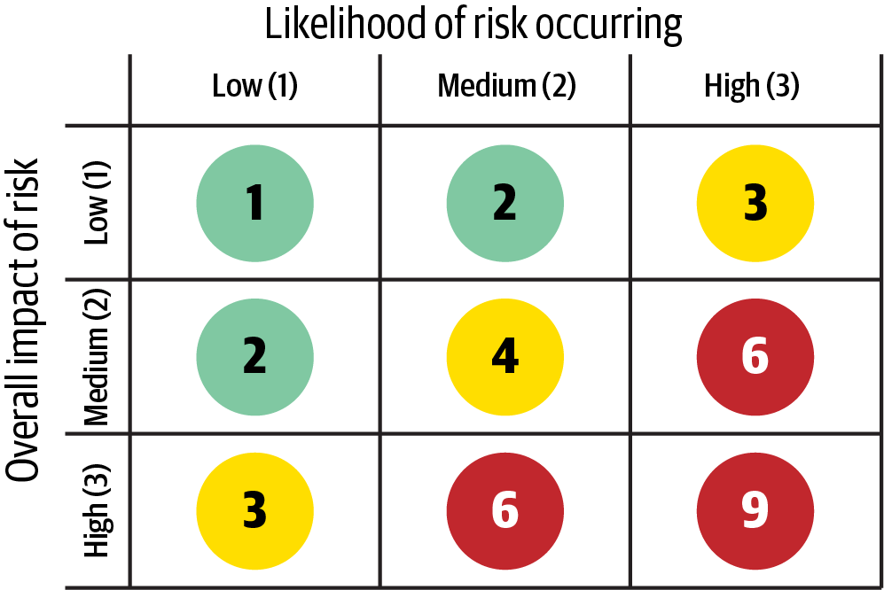

*Hình 22-1. Ma trận để xác định rủi ro kiến trúc*

Để cho bạn thấy tính hữu dụng của nó, chúng tôi sẽ dùng ma trận rủi ro trong một ví dụ. Giả sử bạn lo ngại về availability của database trung tâm chính của ứng dụng.

> **Mẹo**
>
> Khi dùng ma trận này để định lượng rủi ro, hãy xét tác động trước và khả năng xảy ra sau. Nếu bạn không chắc về khả năng xảy ra, hãy dùng mức cao (3) cho đến khi bạn có thể xác nhận.

Trước tiên, bạn sẽ xét tác động tổng thể: điều gì xảy ra nếu database bị sập hoặc trở nên không khả dụng? Giả sử bạn có thể đánh giá tác động là rủi ro cao và ánh xạ rủi ro đó vào hàng cuối cùng của ma trận trong [Hình 22-1](#fig-analyzing-architecture-risk-matrix) là 3 (trung bình), 6 (cao), hoặc 9, (cao). Tuy nhiên, khi xét chiều thứ hai—khả năng rủi ro đó xảy ra—bạn nhận ra rằng database nằm trên các server có tính sẵn sàng cao trong một cấu hình cluster, và *khả năng* database trở nên không khả dụng là thấp (cột đầu tiên trong ma trận). Giao điểm giữa tác động cao và khả năng thấp cho bạn mức đánh giá rủi ro tổng thể là 3 (rủi ro trung bình) cho availability của database trung tâm chính.

## Đánh giá rủi ro (Risk Assessments)

Bạn có thể dùng ma trận rủi ro để xây dựng cái được gọi là một *risk assessment* (bản đánh giá rủi ro): một báo cáo tóm tắt về rủi ro tổng thể của một architecture, với các tiêu chí đánh giá có ý nghĩa dựa trên một bối cảnh (các service, vùng subdomain, hoặc vùng domain của một hệ thống). Chúng tôi đã thực hiện nhiều risk assessment, và nhận thấy các architectural characteristic là những tiêu chí risk-assessment tuyệt vời. Tại sao lại dành thời gian phân tích rủi ro performance khi các architectural characteristic then chốt của hệ thống là scalability, elasticity và tính toàn vẹn dữ liệu? Biết các characteristic như những characteristic được mô tả trong [Chương 4](ch04_architectural_characteristics_defined.vi.md#ch04-architecture-characteristics-defined) là bước đầu tiên trong việc phân tích rủi ro kiến trúc.

> **Mẹo**
>
> Các architectural characteristic then chốt nhất mà architecture phải hỗ trợ là những tiêu chí risk-assessment tuyệt vời.

Định dạng cơ bản của một báo cáo risk-assessment được thể hiện trong [Hình 22-2](#fig-analyzing-architecture-risk-assessment). Ở đây, 1 và 2 biểu thị rủi ro thấp, 3 và 4 biểu thị rủi ro trung bình, và 6 và 9 biểu thị rủi ro cao. Các tiêu chí rủi ro chạy dọc phía bên trái của bảng tính, và bối cảnh chạy ngang phía trên.

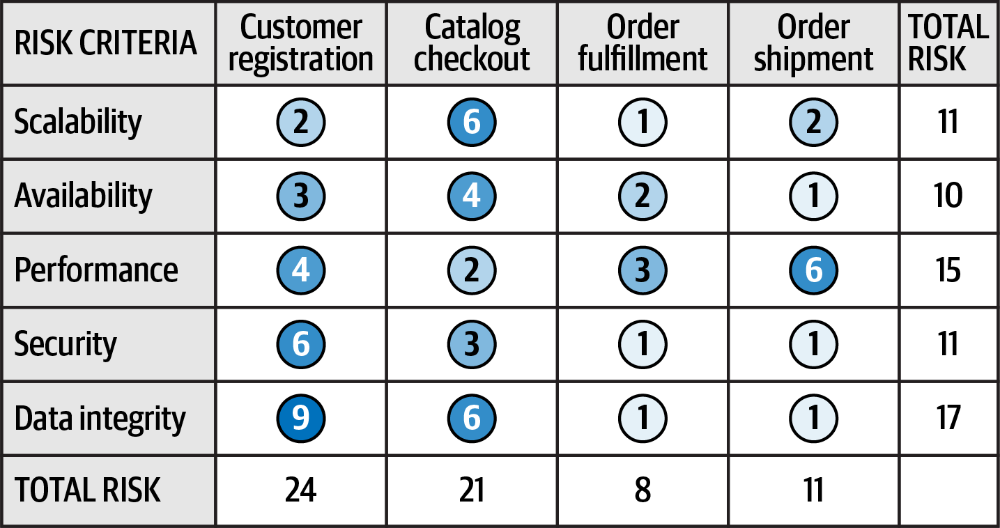

*Hình 22-2. Ví dụ về một risk assessment chuẩn*

Chúng tôi dùng một hệ thống đặt hàng thương mại điện tử làm ví dụ cho risk assessment này. Nó đánh giá năm tiêu chí, đại diện cho các architectural characteristic then chốt của hệ thống. Ở phía trên là bốn bối cảnh khác nhau, mỗi bối cảnh đại diện cho một domain riêng (đăng ký khách hàng, thanh toán catalog, thực hiện đơn hàng, và giao đơn hàng). Một bối cảnh domain hoặc subdomain hoạt động tốt; phân tích rủi ro ở mức service thường quá fine-grained và không tính đến rủi ro liên quan đến giao tiếp hoặc phối hợp giữa nhiều service.

Điều hay khi dùng rủi ro đã định lượng là nó xét đến cả tiêu chí rủi ro lẫn bối cảnh. Ví dụ, trong [Hình 22-2](#fig-analyzing-architecture-risk-assessment), tổng rủi ro tích lũy cho tính toàn vẹn dữ liệu là 17, khiến nó là vùng rủi ro cao nhất xét theo tiêu chí. Rủi ro tích lũy cho availability chỉ là 10 (rủi ro thấp nhất criteria-wise). Tuy nhiên, xét về rủi ro tương đối của mỗi vùng bối cảnh, đăng ký khách hàng là domain mang rủi ro cao nhất context-wise, trong khi thực hiện đơn hàng là bối cảnh lowest-risk. Đây là thông tin hữu ích khi xác định các ưu tiên và nơi cần dồn thêm công sức để giảm rủi ro.

Ví dụ risk assessment này chứa tất cả các kết quả risk-analysis, nhưng đôi khi hữu ích khi lọc bớt chi tiết để làm nổi bật một số vấn đề nhất định. Ví dụ, giả sử bạn, với tư cách kiến trúc sư của hệ thống này, đang trong một cuộc họp, trình bày với các stakeholder về các vùng high-risk của hệ thống. Thay vì trình bày toàn bộ risk assessment, như [Hình 22-2](#fig-analyzing-architecture-risk-assessment), bạn có thể lọc bỏ các vùng rủi ro thấp và medium-risk (nhiễu) để làm nổi bật các vùng high-risk (tín hiệu). Cải thiện tỉ lệ signal-to-noise tổng thể cho phép bạn truyền đạt một thông điệp hiệu quả hơn, ít gây xao nhãng hơn. [Hình 22-3](#fig-analyzing-architecture-risk-filtering) cho thấy một phiên bản đã lọc của cùng risk assessment đó. Hãy so sánh hai hình để thấy thông điệp rõ ràng hơn bao nhiêu với bản đánh giá đã lọc thứ hai.

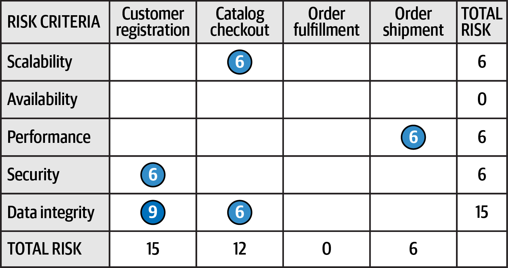

*Hình 22-3. Lọc risk assessment để chỉ hiển thị các rủi ro cao*

Một vấn đề với phiên bản đầy đủ của risk assessment là nó chỉ cho thấy một ảnh chụp tại một thời điểm, không cho thấy mọi thứ đang cải thiện hay tệ đi. Nói cách khác, [Hình 22-2](#fig-analyzing-architecture-risk-assessment) không cho thấy *hướng của rủi ro*. Bạn có thể xác định hướng của rủi ro bằng cách dùng các phép đo liên tục thông qua fitness function, như được mô tả trong [Chương 6](ch06_measuring_and_governing_architecture_characteristics.vi.md#ch06-measuring). Phân tích khách quan từng tiêu chí rủi ro cho phép bạn quan sát xu hướng để nhận ra hướng của mỗi tiêu chí rủi ro.

Trong [Hình 22-4](#fig-analyzing-architecture-risk-direction), chúng tôi thêm một chiều thứ ba vào risk assessment: *hướng*. Chúng tôi dùng một tam giác right-side-up (đỉnh hướng lên) để biểu thị rằng rủi ro cho tiêu chí và bối cảnh cụ thể đó đang tệ đi—đỉnh tam giác hướng lên, về phía một con số *cao hơn*. Ngược lại, chúng tôi dùng một tam giác upside-down (lộn ngược) để biểu thị rằng rủi ro đang giảm (nói cách khác, đỉnh hướng xuống một con số *thấp hơn*). Cuối cùng, chúng tôi dùng một hình tròn để biểu thị rằng rủi ro không thay đổi—không tốt lên cũng không tệ đi. Điều này có thể gây nhầm lẫn, nên chúng tôi luôn khuyến nghị kèm theo chú giải khi dùng bất kỳ loại ký hiệu nào để biểu thị hướng.

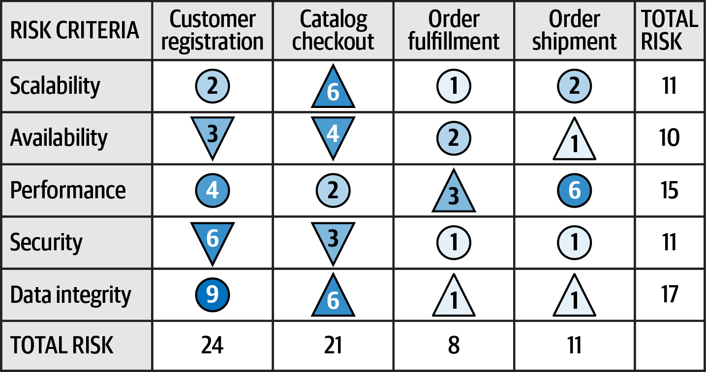

*Hình 22-4. Thể hiện hướng của rủi ro bằng tam giác*

Risk assessment kiến trúc đã sửa đổi này, giờ thể hiện cả hướng, kể một câu chuyện khác so với bản gốc. Thứ nhất, chúng ta có thể thấy tính toàn vẹn dữ liệu đang tệ đi dựa trên các phép đo liên tục (tam giác hướng lên) đối với thanh toán catalog, thực hiện đơn hàng và giao đơn hàng, điều có thể cho thấy một vấn đề về database. Tuy nhiên, security và availability đang tốt lên nhìn chung (tam giác hướng xuống) đối với đăng ký khách hàng và thanh toán catalog, cho thấy sự cải thiện ở những vùng đó.

Tiếp theo, chúng tôi mô tả một quy trình gọi là *risk storming* mà các team có thể dùng để xác định *cách* xác định mức rủi ro cho các bối cảnh và tiêu chí cụ thể. 

## Risk storming (Risk Storming)

Không kiến trúc sư nào có thể một mình xác định rủi ro tổng thể của một hệ thống, vì hai lý do. Thứ nhất, một kiến trúc sư làm việc một mình có thể bỏ sót hoặc không để ý một vùng rủi ro; thứ hai, rất ít kiến trúc sư có hiểu biết đầy đủ về *mọi* phần của hệ thống. Đây là lúc risk storming có thể giúp ích.

*Risk storming* là một bài tập cộng tác để xác định rủi ro kiến trúc trong một chiều cụ thể (hoặc bối cảnh hoặc tiêu chí). Dù hầu hết các nỗ lực risk-storming có sự tham gia của nhiều kiến trúc sư, chúng tôi đặc biệt khuyến nghị đưa cả các senior developer và tech lead vào. Không chỉ họ sẽ cung cấp góc nhìn hiện thực về rủi ro kiến trúc, mà việc đưa họ vào còn giúp họ hiểu architecture tốt hơn.

Risk storming gồm ba giai đoạn: xác định, đồng thuận và giảm thiểu. Trong giai đoạn cá nhân (giai đoạn 1), tất cả người tham gia, làm việc một mình, dùng ma trận rủi ro để gán rủi ro cho các vùng khác nhau của architecture. Giai đoạn cá nhân này của risk storming là thiết yếu để người tham gia không ảnh hưởng đến những người tham gia khác hoặc hướng sự chú ý của mọi người ra khỏi những vùng cụ thể của architecture. Trong hai giai đoạn cộng tác, tất cả người tham gia cùng làm việc để đạt được đồng thuận về các vùng rủi ro là gì và thảo luận về chúng (giai đoạn 2), và đưa ra giải pháp để giảm thiểu rủi ro (giai đoạn 3).

Cả ba giai đoạn đều dùng một sơ đồ architecture toàn diện hoặc theo bối cảnh (xem [Chương 23](ch23_diagramming_architecture.vi.md#ch-diagramming-architecture)). Kiến trúc sư điều phối nỗ lực risk-storming—chúng tôi sẽ gọi người này là *facilitator* (người điều phối)—chịu trách nhiệm gửi cho tất cả người tham gia các sơ đồ cập nhật cho phiên risk-storming.

[Hình 22-5](#fig-analyzing-architecture-risk-diagram) cho thấy một architecture ví dụ chúng tôi sẽ dùng để minh họa quy trình risk-storming. Trong architecture này, một Elastic Load Balancer chuyển tiếp một request tới mỗi instance EC2 chứa các web server (Nginx) và các application service. Các application service thực hiện lời gọi tới một database MySQL, một cache Redis, và một database MongoDB (để ghi log). Chúng cũng thực hiện lời gọi tới các Push Expansion Server, các server này đến lượt mình đều tương tác với database MySQL, cache Redis và tiện ích logging MongoDB. (Đừng lo nếu bạn không hiểu hết các sản phẩm và thuật ngữ thời thượng này—architecture quá mơ hồ, tổng quát hóa này chỉ nhằm minh họa risk storming hoạt động như thế nào.)

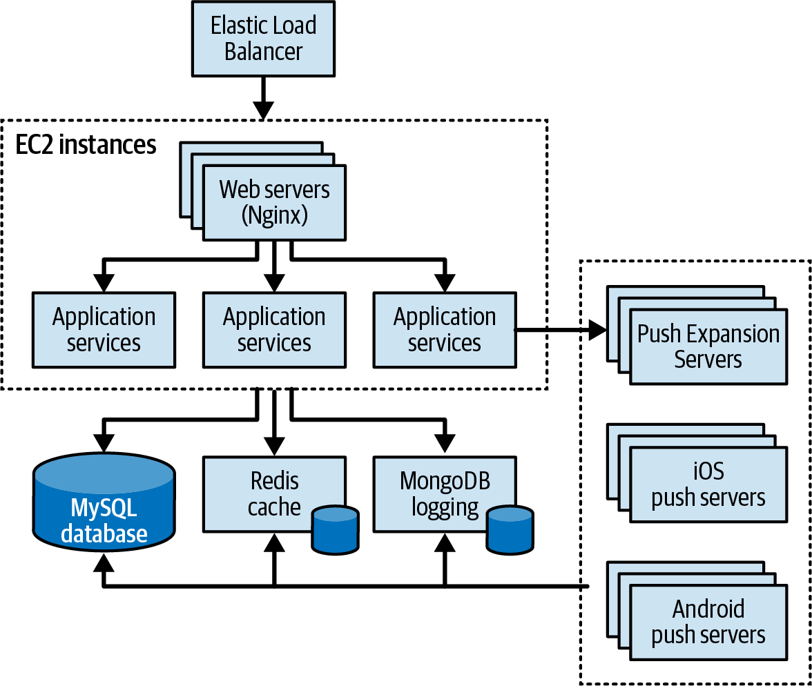

*Hình 22-5. Sơ đồ architecture ví dụ cho phiên risk storming*

Chúng ta sẽ bắt đầu với giai đoạn 1.

### Giai đoạn 1: Xác định (Phase 1: Identification)

Giai đoạn *xác định* (identification) của risk storming bao gồm việc mỗi người tham gia tự xác định các vùng rủi ro trong architecture. Điều then chốt là, trong giai đoạn này, mỗi người tham gia phải ghi lại góc nhìn không thiên lệch của mình về rủi ro liên quan, mà không bị những người tham gia khác hướng lái hay ảnh hưởng. Giai đoạn xác định có ba bước:

1. Facilitator gửi cho tất cả người tham gia lời mời tham dự các giai đoạn cộng tác. Lời mời chứa sơ đồ architecture (hoặc nơi tìm nó), các tiêu chí rủi ro và bối cảnh cần phân tích, và ngày, giờ, địa điểm (vật lý hoặc ảo) của phiên cộng tác, cùng với mọi chi tiết hậu cần khác.
2. Người tham gia dùng ma trận rủi ro để tự phân tích các rủi ro kiến trúc.
3. Người tham gia phân loại mỗi rủi ro là thấp (1–2), trung bình (3–4), hoặc cao (6–9), và viết các con số lên giấy ghi chú nhỏ màu xanh lá, vàng hoặc đỏ.

Hầu hết các nỗ lực risk-storming chỉ phân tích một tiêu chí hoặc bối cảnh cụ thể (như “Các rủi ro security của chúng ta nằm ở đâu?” hoặc “Những vùng nào có rủi ro trong đăng ký khách hàng?”). Tuy nhiên, nếu có vấn đề về sự sẵn có của nhân sự hoặc thời gian, team risk-assessment có thể phải phân tích nhiều chiều trong một bối cảnh cụ thể (như performance và scalability). Trong những trường hợp này, người tham gia thường viết tiêu chí cụ thể bên cạnh con số rủi ro trên giấy ghi chú. Ví dụ, giả sử ba người tham gia xác định rủi ro với một database trung tâm. Cả ba người tham gia đều xác định rủi ro là cao (6), nhưng một người tham gia xem đây là rủi ro đối với availability, trong khi hai người kia xem nó là rủi ro đối với performance. Người tham gia nên thảo luận riêng hai tiêu chí này.

> **Mẹo**
>
> Bất cứ khi nào có thể, hãy giới hạn các nỗ lực risk-storming vào một tiêu chí hoặc bối cảnh duy nhất. Điều này cho phép người tham gia tập trung sự chú ý vào chiều cụ thể đó và tránh nhầm lẫn về rủi ro thực sự là gì.

### Giai đoạn 2: Đồng thuận (Phase 2: Consensus)

Giai đoạn *đồng thuận* (consensus) của risk storming mang tính cộng tác cao, với mục tiêu đạt được sự đồng thuận giữa tất cả người tham gia về rủi ro hoặc các rủi ro trong architecture. Hoạt động này hiệu quả nhất khi facilitator dán một sơ đồ architecture in khổ lớn lên tường (hoặc một phiên bản điện tử trên màn hình lớn). Khi người tham gia đến phiên risk-storming, facilitator hướng dẫn họ bắt đầu đặt các giấy ghi chú risk-level của mình lên vùng liên quan của sơ đồ architecture (xem [Hình 22-6](#fig-analyzing-architecture-risk-identification)).

Khi tất cả giấy ghi chú đã được đặt vào chỗ, giai đoạn cộng tác có thể bắt đầu. Mục tiêu ở đây là cùng team phân tích các vùng rủi ro và đạt được đồng thuận về mức rủi ro của chúng. Trong ví dụ minh họa ở [Hình 22-6](#fig-analyzing-architecture-risk-identification), team đã xác định một số vùng rủi ro. (Các tiêu chí thực tế không quan trọng đối với ví dụ này.) Chúng ta có thể thấy rằng:

- Hai người tham gia xác định Elastic Load Balancer là rủi ro trung bình (3), trong khi một người tham gia xác định nó là rủi ro cao (6).
- Một người tham gia xác định các Push Expansion Server là rủi ro cao (9).
- Ba người tham gia xác định database MySQL là rủi ro trung bình (3).
- Một người tham gia xác định cache Redis là rủi ro cao (9).
- Ba người tham gia xác định logging MongoDB là rủi ro thấp (2).
- Không ai xác định bất kỳ vùng nào khác của architecture là có rủi ro, nên không có giấy ghi chú nào trên các vùng khác.

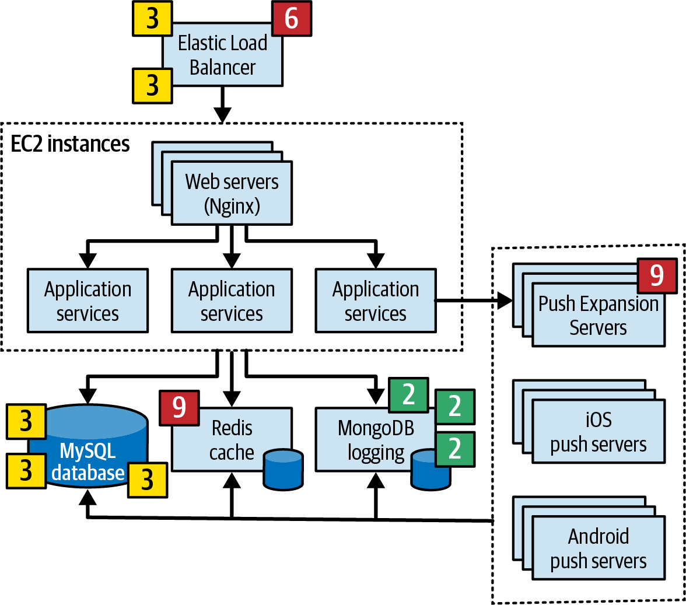

*Hình 22-6. Xác định ban đầu các vùng rủi ro*

Database MySQL và logging MongoDB không cần thảo luận thêm trong phiên này, vì tất cả người tham gia đều đồng ý về mức rủi ro của chúng. Tuy nhiên, có sự khác biệt ý kiến về Elastic Load Balancer, còn các Push Expansion Server và cache Redis mỗi thứ chỉ được một người tham gia xác định là rủi ro. Giải quyết những chênh lệch này chính là ý nghĩa của giai đoạn cộng tác.

Hai người tham gia (Austen và Logan) xác định Elastic Load Balancer là rủi ro trung bình (3); một người (Addison) xác định nó là rủi ro cao (6). Austen và Logan hỏi Addison vì sao họ xác định rủi ro là cao. Addison trả lời rằng nếu Elastic Load Balancer bị sập, toàn bộ hệ thống sẽ trở nên không thể truy cập. Dù điều này đúng—và nâng mức đánh giá *tác động* lên cao—hai người tham gia kia thuyết phục Addison rằng khả năng điều này xảy ra là thấp nhờ clustering. Addison đồng ý, và nhóm hạ mức rủi ro *khả năng xảy ra* xuống trung bình (3).

Tuy nhiên, việc này có thể diễn ra theo hướng khác. Nếu Austen và Logan bỏ sót một khía cạnh rủi ro cụ thể trong Elastic Load Balancer mà Addison đã thấy, Addison có thể đã thuyết phục hai người tham gia kia phân loại mức rủi ro này là cao thay vì trung bình. Đó là lý do giai đoạn cộng tác của risk storming quan trọng đến vậy.

Một người tham gia xác định các Push Expansion Server là rủi ro cao (9), nhưng không người tham gia nào khác xác định bất kỳ rủi ro nào ở vùng này của architecture. Người xác định rủi ro giải thích rằng họ đánh giá rủi ro là cao vì họ từng có những trải nghiệm tồi tệ với các Push Expansion Server liên tục bị crash dưới tải cao tương tự tải của architecture này. Ví dụ này cho thấy giá trị của risk storming—không có sự tham gia của người đó, không ai sẽ thấy rủi ro cao cho đến khi đã vào production khá lâu.

Cache Redis là một trường hợp thú vị. Một người tham gia, một developer tên Devon, xác định nó là rủi ro cao (9), nhưng không ai khác thấy cache đó có rủi ro gì. Khi những người tham gia khác hỏi Devon về lý do đánh giá rủi ro này là cao, Devon trả lời, “Cache Redis là gì vậy?” Bất cứ khi nào một người tham gia risk-storming xác định một công nghệ là chưa biết đối với họ, vùng đó tự động được gán mức rủi ro cao (9).

> **Mẹo**
>
> Luôn gán cho các công nghệ chưa được kiểm chứng hoặc chưa biết mức đánh giá rủi ro cao nhất (9), vì ma trận rủi ro không thể được dùng cho tiêu chí hoặc bối cảnh này.

Ví dụ về cache Redis minh họa vì sao quan trọng phải đưa developer vào các phiên risk-storming. Việc người tham gia này không biết một công nghệ nhất định là thông tin có giá trị cho kiến trúc sư về rủi ro tổng thể. Kiến trúc sư có thể quyết định thay đổi công nghệ hoặc chấp nhận chi phí đào tạo để development team bắt kịp.

Giai đoạn này tiếp tục cho đến khi tất cả người tham gia đồng ý về các vùng rủi ro đã xác định. Khi tất cả giấy ghi chú đã được hợp nhất, giai đoạn này kết thúc. Kết quả cuối cùng của nó được thể hiện trong [Hình 22-7](#fig-analyzing-architecture-risk-consensus).

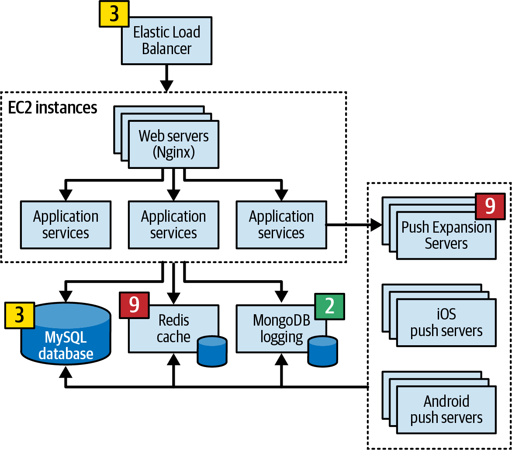

*Hình 22-7. Đồng thuận về các vùng rủi ro*

### Giai đoạn 3: Giảm thiểu rủi ro (Phase 3: Risk Mitigation)

Khi tất cả người tham gia đồng ý về các mức rủi ro của architecture, giai đoạn *giảm thiểu rủi ro* (risk mitigation) bắt đầu. Giảm thiểu rủi ro thường bao gồm việc thay đổi một số vùng nhất định của architecture mà nếu không có giai đoạn này có thể đã được coi là hoàn hảo như vốn có.

Giai đoạn này, cũng mang tính cộng tác, tìm cách giảm hoặc loại bỏ các rủi ro đã xác định ở giai đoạn thứ hai. Tùy thuộc vào các rủi ro đã xác định, architecture ban đầu có thể cần được thay đổi hoàn toàn, hoặc các thay đổi có thể giới hạn ở việc refactoring kiến trúc đơn giản ở những vùng cụ thể, như thêm một queue để tạo backpressure nhằm giảm một nút cổ chai throughput.

Bất kể các thay đổi cần thiết là gì, giai đoạn giảm thiểu rủi ro thường phát sinh chi phí bổ sung. Vì lý do đó, điều quan trọng là giai đoạn này phải có sự tham gia của các stakeholder kinh doanh chủ chốt có thẩm quyền quyết định liệu chi phí của một giải pháp giảm thiểu nhất định có đáng hơn rủi ro hay không.

Ví dụ, giả sử rằng, trong phiên risk-storming ví dụ của chúng ta, team xác định database trung tâm có rủi ro trung bình (4) đối với availability tổng thể của hệ thống. Người tham gia đồng ý rằng cluster database và tách nó thành các database vật lý riêng sẽ giảm thiểu rủi ro đó. Tuy nhiên, giải pháp đó sẽ tốn \$50,000. Kiến trúc sư điều phối gặp các stakeholder kinh doanh chủ chốt, bao gồm chủ sở hữu, để thảo luận trade-offs giữa rủi ro availability và chi phí. Chủ doanh nghiệp quyết định rằng cái giá quá cao và chi phí không đáng so với rủi ro availability. Kiến trúc sư khi đó đề xuất một cách tiếp cận khác: thay vì clustering đắt đỏ, sao không tách database thành hai database domain-based riêng? Giải pháp này sẽ chỉ tốn \$16,000, trong khi vẫn giảm được rủi ro availability. Các stakeholder đồng ý với sự thỏa hiệp này.

Kịch bản này cho thấy risk storming định hình không chỉ architecture tổng thể, mà cả các cuộc đàm phán giữa kiến trúc sư và stakeholder kinh doanh. Kết hợp với các risk assessment mà chúng tôi đã mô tả ở đầu chương này, risk storming là một phương tiện tuyệt vời để xác định và theo dõi rủi ro, cải thiện architecture, và cấu trúc các cuộc đàm phán giữa các stakeholder chủ chốt.

## Phân tích rủi ro user story (User-Story Risk Analysis)

Risk storming hữu ích trong nhiều khía cạnh của phát triển phần mềm ngoài việc xác định rủi ro kiến trúc. Ví dụ, một development team có thể dùng risk storming để xác định rủi ro tổng thể gắn với việc hoàn thành user-story trong một iteration nhất định (và do đó risk assessment tổng thể của iteration đó) trong quá trình story grooming. Dùng cùng ma trận rủi ro, team có thể xác định rủi ro user-story bằng cách xác định tác động tổng thể nếu story không được hoàn thành trong iteration, và khả năng story sẽ không được hoàn thành trong iteration hiện tại. Sau đó họ có thể xác định các story high-risk, theo dõi chúng cẩn thận, và ưu tiên chúng tốt hơn.

## Use case risk storming (Risk-Storming Use Case)

Để minh họa sức mạnh của risk storming và cách nó có thể cải thiện architecture tổng thể, hãy xét ví dụ về một hệ thống hỗ trợ cho một call center nơi các y tá tư vấn cho bệnh nhân về các tình trạng sức khỏe khác nhau. Các yêu cầu hệ thống là:

- Một diagnostics engine third-party sẽ cung cấp các câu hỏi và hướng dẫn y tá và bệnh nhân qua các vấn đề y tế của họ. Engine này có thể xử lý khoảng 500 request một giây.
- Bệnh nhân có thể hoặc gọi điện qua call center để nói chuyện với y tá hoặc dùng một website self-service truy cập trực tiếp cùng diagnostic engine đó.
- Hệ thống phải hỗ trợ 250 y tá đồng thời trên toàn quốc và tới hàng trăm nghìn bệnh nhân self-service đồng thời trên toàn quốc.
- Y tá có thể truy cập hồ sơ y tế của bệnh nhân thông qua một medical records exchange, nhưng bệnh nhân không thể truy cập hồ sơ y tế của chính mình.
- Hệ thống phải tuân thủ [HIPAA](https://oreil.ly/qoJmT) (Health Insurance Portability and Accountability Act), nghĩa là điều thiết yếu là không ai ngoài y tá có thể truy cập hồ sơ y tế của bệnh nhân. Lựa chọn self-service không thể bảo đảm tuân thủ HIPAA.
- Hệ thống cần có khả năng xử lý khối lượng lớn trong các đợt bùng phát cảm lạnh, cúm và COVID.
- Các cuộc gọi được định tuyến tới y tá dựa trên hồ sơ kỹ năng của mỗi y tá (như ngôn ngữ nói hoặc chuyên môn y khoa).

Sau khi phân tích các yêu cầu này, Logan, kiến trúc sư chịu trách nhiệm cho hệ thống này, tạo ra architecture high-level được vẽ trong [Hình 22-8](#fig-analyzing-architecture-risk-example). Architecture này có ba UI web-based riêng biệt: một cho self-service, một cho y tá nhận cuộc gọi, và một cho nhân viên hành chính để thêm và duy trì hồ sơ y tá và các thiết lập cấu hình. Phần call-center của hệ thống gồm một service `Call Accepter`, nhận cuộc gọi, và service `Call Router`, định tuyến người gọi tới y tá sẵn sàng tiếp theo dựa trên hồ sơ kỹ năng của y tá. Service `Call Router` truy cập database trung tâm để lấy thông tin hồ sơ y tá. Trung tâm của architecture này là một API Gateway của diagnostics-system, thực hiện các phép kiểm tra security và hướng các request tới service backend phù hợp.

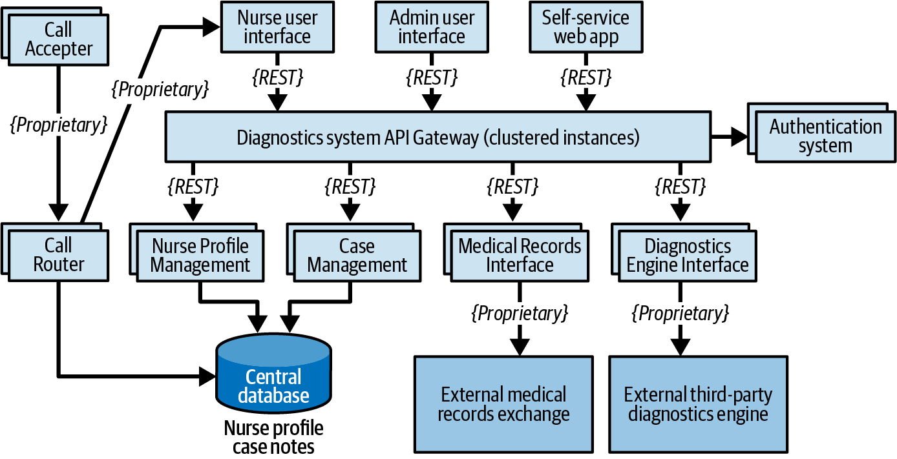

*Hình 22-8. Architecture high-level cho một hệ thống chẩn đoán nursing-hotline*

Bốn service chính trong hệ thống này là service `Case Management`, service `Nurse Profile Management`, service `Medical Records Interface` tới medical records exchange, và service `Diagnostics Engine Interface` third-party bên ngoài. Mọi giao tiếp đều dùng REST, ngoại trừ các giao thức độc quyền tới các hệ thống bên ngoài và các service call-center. Tóm lại, các vùng mà architecture phải hỗ trợ là availability, elasticity và security.

Sau nhiều lần review, Logan tin rằng architecture đã sẵn sàng để hiện thực. Tuy nhiên, là một kiến trúc sư có trách nhiệm và hiệu quả, Logan quyết định tổ chức một bài tập risk-storming.

### Availability

Với vai trò facilitator, Logan quyết định tập trung bài tập risk-storming đầu tiên vào availability, vốn then chốt đối với sự thành công của hệ thống. Sau các giai đoạn xác định và cộng tác, những người tham gia đưa ra các vùng rủi ro sau (minh họa trong [Hình 22-9](#fig-analyzing-architecture-risk-availability-risk)):

- Availability của database trung tâm: rủi ro cao (6) do tác động cao (3) và khả năng trung bình (2) database không khả dụng khi cần.
- Availability của `Diagnostics Engine`: rủi ro cao (9) do tác động cao (3) và khả năng chưa biết (3) về việc không khả dụng.
- Availability của `Medical Records Interface`: rủi ro thấp (2); component này không bắt buộc để xác định một kết quả y tế cụ thể.
- Team không coi phần nào khác của hệ thống là rủi ro availability, vì architecture bao gồm nhiều instance của mỗi service và cluster API Gateway.

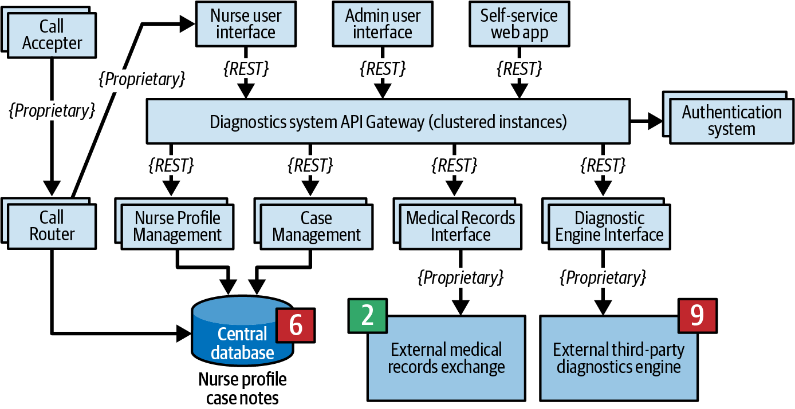

*Hình 22-9. Các vùng rủi ro availability, như được team risk-storming xác định*

Tất cả người tham gia đồng ý rằng nếu database bị sập, y tá có thể ghi chú ca bệnh thủ công, nhưng call router không thể hoạt động. Để giảm thiểu rủi ro này, họ cùng quyết định tách database vật lý duy nhất thành hai database riêng: một database được cluster chứa thông tin nurse-profile, và một database single-instance cho ghi chú ca bệnh. Thay đổi architecture này không chỉ giải quyết các lo ngại về availability của database, nó còn giúp bảo vệ các ghi chú ca bệnh.

Giảm thiểu rủi ro availability ở các hệ thống bên ngoài (trong trường hợp này là `Diagnostics Engine` và `Medical Records Interface`) khó hơn nhiều vì chúng do một bên thứ ba kiểm soát. Team quyết định tìm hiểu xem các hệ thống này có công bố service-level agreement (SLA) hay service-level objective (SLO) không. SLA thường là một thỏa thuận hợp đồng ràng buộc pháp lý; SLO thường không ràng buộc pháp lý. Họ tìm thấy SLA cho cả hai hệ thống. SLA của `Diagnostics Engine` bảo đảm availability 99.99% (tức là 52.60 phút downtime mỗi năm), và `Medical Records Interface` bảo đảm availability 99.90% (tức là 8.77 giờ downtime mỗi năm). Dựa trên phân tích này, thông tin này đủ để team đánh giá rủi ro loại bỏ rủi ro đã xác định.

Sau phiên risk-storming này, team thay đổi architecture, như minh họa trong [Hình 22-10](#fig-analyzing-architecture-risk-availability-mitigation), tạo hai database và thêm các SLA vào sơ đồ architecture.

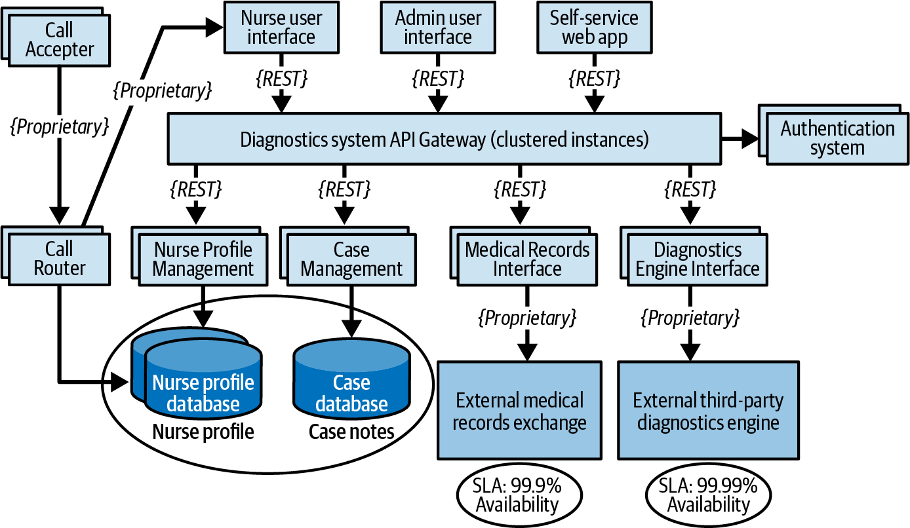

*Hình 22-10. Các vùng rủi ro availability có thể được giảm thiểu bằng cách dùng các database riêng*

### Elasticity

Bài tập risk-storming thứ hai tập trung vào elasticity—các đợt tăng vọt tải người dùng (còn được gọi là scalability biến động). Dù chỉ có 250 y tá (nghĩa là không quá 250 y tá sẽ truy cập `Diagnostics Engine`), phần self-service của hệ thống cũng có thể truy cập `Diagnostics Engine`, điều này làm tăng đáng kể số lượng request tới interface `Diagnostics Engine`. Những người tham gia risk-storming lo ngại về mùa cúm và các đợt bùng phát COVID, vốn sẽ làm tăng đáng kể tải dự kiến lên hệ thống.

Những người tham gia nhất trí xác định interface `Diagnostics Engine` là rủi ro cao (9). Vì nó chỉ có thể xử lý 500 request mỗi giây, họ tính toán đúng rằng có rủi ro cao là nó sẽ không theo kịp throughput dự kiến, đặc biệt với REST là giao thức interface của nó.

Team quyết định rằng một cách để giảm thiểu rủi ro này là dùng các queue bất đồng bộ (messaging) cho giao tiếp giữa API Gateway và interface `Diagnostics Engine`. Điều này sẽ cung cấp một điểm backpressure nếu các lời gọi tới `Diagnostics Engine` bị ùn lại. Dù đây là một thực hành tốt, nó vẫn chưa thực sự giảm thiểu hết rủi ro: y tá và bệnh nhân self-service vẫn sẽ phải chờ quá lâu để nhận phản hồi từ `Diagnostics Engine`, và request của họ có khả năng sẽ bị timeout.

Những người tham gia quyết định dùng một pattern được biết đến là [pattern *Ambulance*](https://oreil.ly/ZfLU0) để tách các request này bằng cách dùng hai message channel thay vì chỉ một. Điều này cho phép hệ thống ưu tiên request của y tá hơn request self-service. Điều này giúp giảm thiểu rủi ro, nhưng vẫn chưa giải quyết thời gian chờ. Sau khi thảo luận thêm, nhóm quyết định giảm các cuộc gọi outbreak-related tới `Diagnostics Engine` bằng cách cache những câu hỏi chẩn đoán cụ thể đó để chúng không bao giờ đến interface `Diagnostics Engine`.

Ngoài việc tạo hai messaging channel (một cho y tá và một cho bệnh nhân self-service), team tạo một service mới gọi là `Diagnostics Outbreak Cache Server` xử lý mọi request liên quan đến một đợt bùng phát cụ thể hoặc câu hỏi flu-related ([Hình 22-11](#fig-analyzing-architecture-risk-elasticity)). Architecture mới này làm giảm số lượng lời gọi tới diagnostics engine, cho phép nhiều request đồng thời hơn liên quan đến các triệu chứng khác. Nếu không có nỗ lực risk-storming, rủi ro này có thể đã không được xác định cho đến mùa cúm.

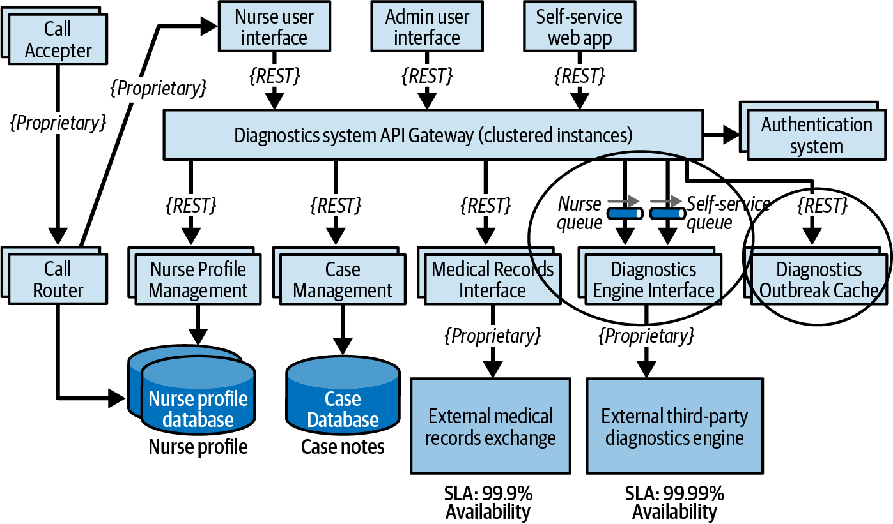

*Hình 22-11. Các sửa đổi architecture để giải quyết rủi ro elasticity*

### Security

Được khích lệ bởi những thành công này, kiến trúc sư quyết định điều phối một phiên risk-storming cuối cùng tập trung vào một characteristic then chốt khác của hệ thống này—security. Do các yêu cầu pháp quy HIPAA, `Medical Records Interface` phải chỉ cho phép y tá truy cập hồ sơ y tế của bệnh nhân. Kiến trúc sư tin rằng các phép kiểm tra xác thực và ủy quyền trong API Gateway vô hiệu hóa rủi ro này, nhưng tò mò liệu những người tham gia có tìm ra bất kỳ rủi ro security nào khác không.

Tất cả người tham gia đều xác định API Gateway của hệ thống chẩn đoán là rủi ro security cao (6). Họ nêu tác động cao nếu nhân viên hành chính hoặc bệnh nhân self-service truy cập hồ sơ y tế (3), nhưng đánh giá khả năng là trung bình (2). Dù các phép kiểm tra security cho mỗi lời gọi API có giúp ích, mọi lời gọi (self-service, admin và y tá) vẫn đi qua cùng một API Gateway. Cuối cùng họ thuyết phục được facilitator, người ban đầu đánh giá rủi ro này là thấp (2), rằng rủi ro thực tế là cao và cần được giảm thiểu.

Mọi người đồng ý rằng có các API Gateway riêng cho mỗi loại người dùng (nhân viên admin, người dùng self-service và y tá) sẽ ngăn các lời gọi non-nurse đến được `Medical Records Interface`. Phiên bản architecture cuối cùng của kiến trúc sư được thể hiện trong [Hình 22-12](#fig-analyzing-architecture-risk-security).

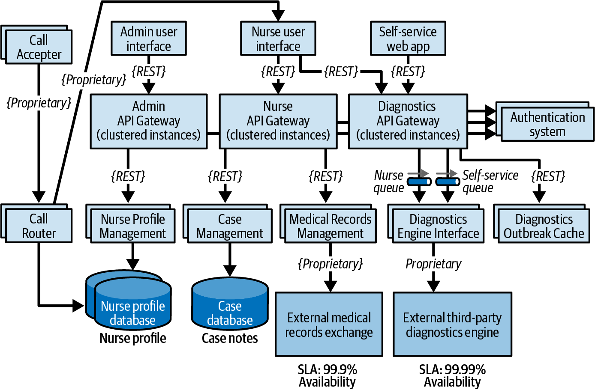

*Hình 22-12. Các sửa đổi architecture để giải quyết rủi ro security*

Ví dụ này minh họa sức mạnh của risk storming. Kiến trúc sư, developer và các stakeholder chủ chốt cộng tác, xem xét các architectural characteristic quan trọng nhất đối với sự thành công của hệ thống, và xác định các vùng rủi ro mà nếu không sẽ không được để ý.

Architecture ban đầu ([Hình 22-8](#fig-analyzing-architecture-risk-example)) đã thay đổi đáng kể sau risk storming ([Hình 22-12](#fig-analyzing-architecture-risk-security)) theo những cách giải quyết các lo ngại về availability, elasticity và security và làm cho architecture này hiệu quả hơn và có nhiều khả năng thành công hơn.

## Tóm tắt (Summary)

Risk storming không phải là một quy trình one-time. Nó tiếp tục trong suốt vòng đời của một hệ thống, khi các team làm việc để xác định và giảm thiểu các vùng rủi ro trước khi chúng xuất hiện trên production. Một tổ chức nên tổ chức các phiên risk-storming thường xuyên đến mức nào phụ thuộc vào nhiều yếu tố, bao gồm tần suất thay đổi, mọi nỗ lực architecture-refactoring, và việc phát triển dần dần của architecture. Thông thường, người ta thực hiện một ít risk storming trên các chiều cụ thể sau khi thêm một tính năng lớn hoặc vào cuối mỗi iteration, để bảo đảm architecture là đúng và sẽ đáp ứng nhu cầu của doanh nghiệp.
