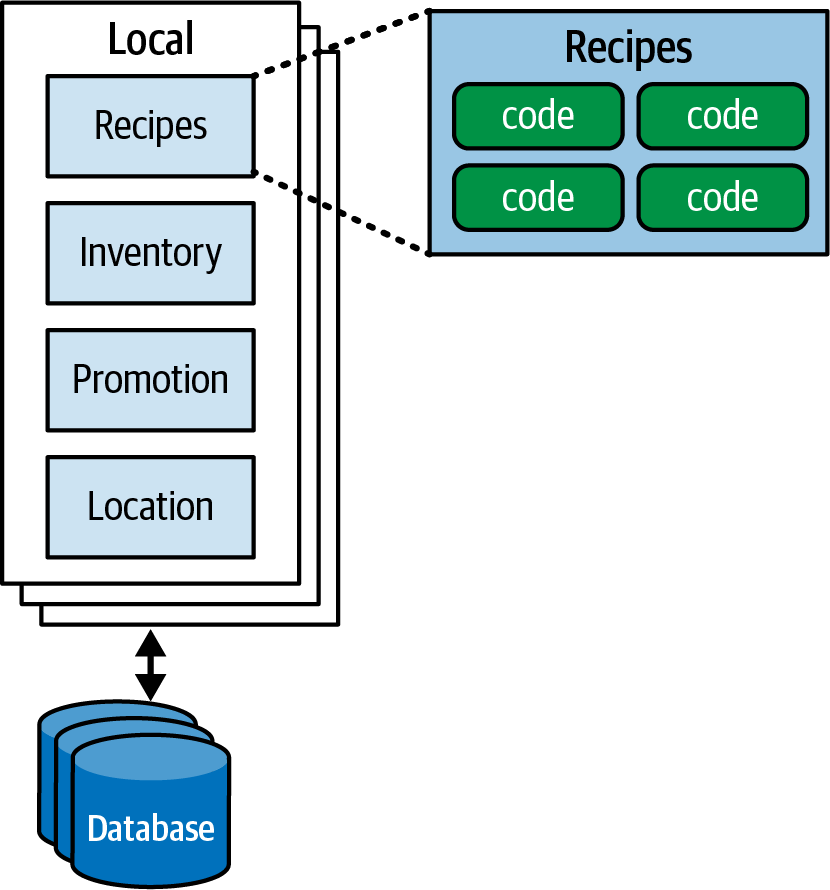
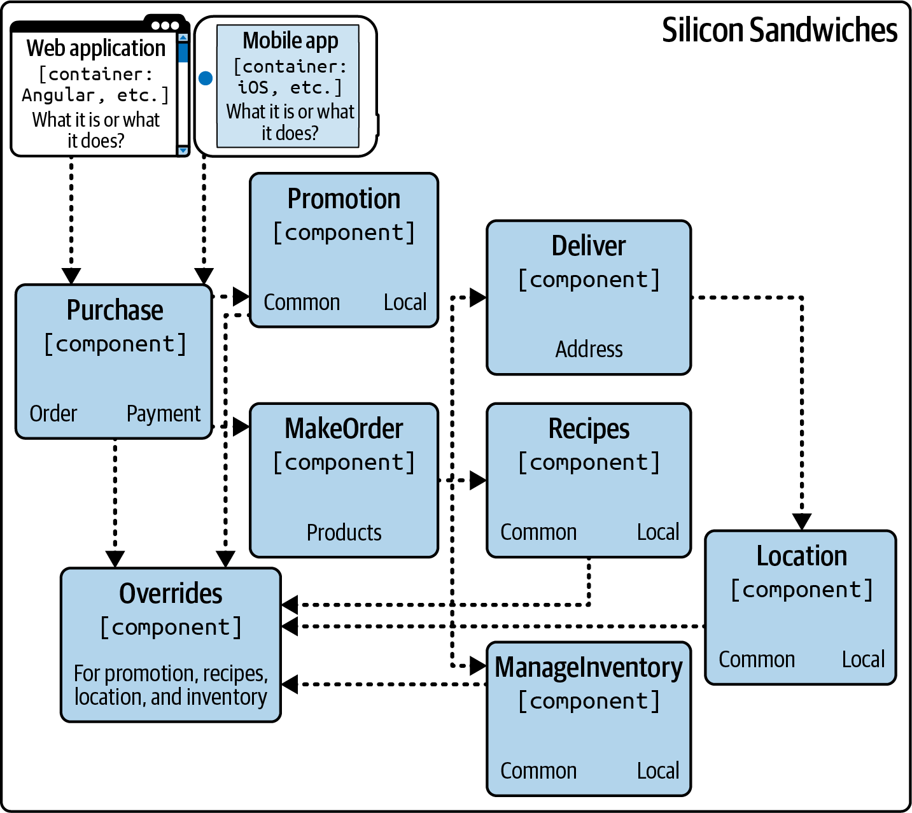
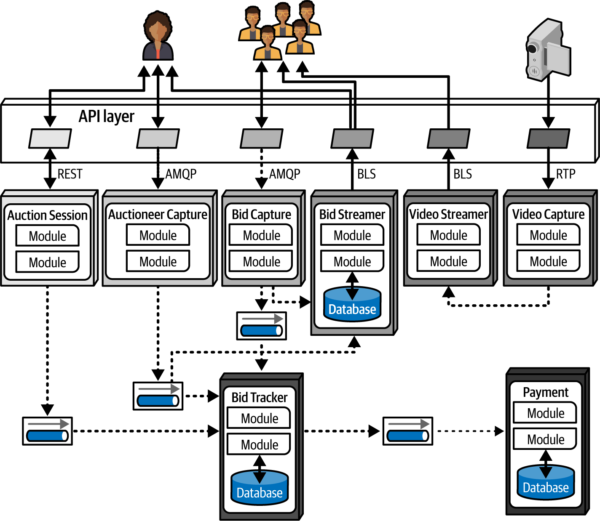

# Chương 23. Vẽ sơ đồ architecture (Diagramming Architecture)

Các kiến trúc sư phần mềm mới vào nghề thường ngạc nhiên về mức độ đa dạng của công việc, ngoài kiến thức và kinh nghiệm kỹ thuật vốn đã đưa họ vào vai trò này ngay từ đầu. Đặc biệt, giao tiếp hiệu quả là then chốt đối với sự thành công của một kiến trúc sư. Dù ý tưởng kỹ thuật của bạn xuất sắc đến đâu, nếu bạn không thể thuyết phục các nhà quản lý cấp vốn cho những ý tưởng đó và developer xây dựng chúng, sự xuất sắc của bạn sẽ không bao giờ thành hiện thực.

Vẽ sơ đồ là một kỹ năng giao tiếp then chốt đối với kiến trúc sư. Dù có cả những cuốn sách về mỗi chủ đề, chúng tôi sẽ điểm qua một số điểm nổi bật cụ thể cho mỗi chủ đề.

Để mô tả trực quan một architecture, kiến trúc sư thường phải thể hiện các khung nhìn khác nhau: ví dụ, họ có thể bắt đầu với một cái nhìn tổng quan về toàn bộ topology, rồi đi sâu vào chi tiết thiết kế của các phần cụ thể của architecture. Tuy nhiên, thể hiện một phần mà không cho biết vị trí của nó trong architecture tổng thể sẽ khiến người xem bối rối.

*Representational consistency* (nhất quán trong biểu diễn) là thực hành luôn thể hiện mối quan hệ giữa các phần của một architecture trước khi chuyển khung nhìn, và nó quan trọng như nhau trong sơ đồ và trong bài thuyết trình. Ví dụ, nếu bạn muốn mô tả chi tiết cách các plug-ins liên quan với nhau trong giải pháp Silicon Sandwiches, bạn sẽ bắt đầu với một sơ đồ architecture thể hiện toàn bộ topology của hệ thống, rồi mối quan hệ giữa nó và cấu trúc plug-in, trước khi đi vào chính cấu trúc plug-in. [Hình 23-1](#fig-diagramming-SS-micro-plugins) đưa ra một ví dụ.

*Hình 23-1. Dùng representational consistency để chỉ ra bối cảnh trong một sơ đồ lớn hơn*

Hãy dùng representational consistency cẩn thận để bảo đảm người xem hiểu phạm vi của các mục đang được trình bày và loại bỏ một nguồn gây nhầm lẫn phổ biến.

## Vẽ sơ đồ (Diagramming)

Topology của một architecture luôn được kiến trúc sư và developer quan tâm vì nó nắm bắt cách cấu trúc khớp với nhau, và cho phép các team hình thành một sự hiểu biết chung có giá trị. Chúng tôi khuyến khích mọi kiến trúc sư mài giũa kỹ năng vẽ sơ đồ của mình đến mức sắc như dao cạo.

### Công cụ (Tools)

Thế hệ công cụ vẽ sơ đồ hiện nay dành cho kiến trúc sư cực kỳ mạnh mẽ, và mọi kiến trúc sư nên học sâu công cụ mình chọn. Nhưng đừng bỏ qua các artifact low-fidelity, đặc biệt là ở giai đoạn đầu của quy trình thiết kế. Xây dựng các artifact thiết kế rất tạm thời ở giai đoạn đầu ngăn kiến trúc sư trở nên quá gắn bó với những gì họ đã tạo ra, một antipattern mà chúng tôi gọi là *Irrational Artifact Attachment* (gắn bó phi lý với artifact).

> **Gắn bó phi lý với artifact (Irrational Artifact Attachment)**
>
> Antipattern Irrational Artifact Attachment mô tả mối quan hệ tỉ lệ thuận giữa sự gắn bó phi lý của một người với một artifact nào đó và thời gian người đó mất để tạo ra artifact đó. Nếu một kiến trúc sư dành bốn giờ để tạo một sơ đồ đẹp trong một công cụ như Visio, họ sẽ gắn bó phi lý với artifact đó nhiều hơn so với khi chỉ đầu tư hai giờ.
>
> Một lợi ích của cách tiếp cận Agile đối với phát triển phần mềm là nó bao gồm việc tạo ra các artifact “just-in-time” với ít thủ tục và nghi thức nhất có thể. Đây là một lý do khiến nhiều người theo Agile yêu thích thẻ chỉ mục và giấy ghi chú: dùng các công cụ low-tech cho phép mọi người vứt bỏ những gì không đúng, giải phóng họ để thử nghiệm và cho phép bản chất thực sự của artifact nổi lên thông qua sửa đổi, cộng tác và thảo luận.

Artifact tạm thời kinh điển là một bức ảnh chụp bằng cell-phone một sơ đồ trên bảng trắng (cùng với lời dặn không thể thiếu “Đừng xóa!”). Ngày nay, nhiều kiến trúc sư đã từ bỏ bảng trắng để chuyển sang một máy tính bảng gắn với máy chiếu. Điều này mang lại một số ưu điểm. Thứ nhất, máy tính bảng có một khung vẽ không giới hạn và có thể chứa bao nhiêu hình vẽ tùy team cần. Thứ hai, nó cho phép team copy/paste các kịch bản “nếu như”, điều sẽ che khuất bản gốc nếu làm trên bảng trắng. Thứ ba, hình ảnh được tạo trên máy tính bảng đã được số hóa và không có độ lóa không thể tránh khỏi của ảnh chụp bảng trắng. Thứ tư, dùng hình ảnh điện tử khiến làm việc từ xa dễ dàng hơn nhiều và mang tính cộng tác hơn.

Cuối cùng, bạn sẽ cần tạo các sơ đồ đẹp trong một công cụ xịn, nhưng trước khi đầu tư thời gian đó, hãy chắc chắn team đã lặp lại đủ trên thiết kế. Dù bạn dùng nền tảng nào, bạn đều sẽ tìm thấy các công cụ vẽ sơ đồ mạnh mẽ. Chúng tôi đã vui vẻ dùng [OmniGraffle](https://oreil.ly/fEoKR) cho các phiên bản gốc của tất cả sơ đồ trong cuốn sách này, sau đó được các họa sĩ minh họa của O’Reilly tinh chỉnh. Dù chúng tôi không nhất thiết ủng hộ công cụ này hơn công cụ khác, chúng tôi khuyến nghị tìm kiếm các tính năng sau, như một mức nền:

**Layer**

Các công cụ vẽ thường hỗ trợ layer, thứ mà kiến trúc sư nên học cách dùng thành thạo. Layer cho phép người dùng liên kết các nhóm mục với nhau một cách logic và hiển thị hoặc ẩn chúng khi cần. Ví dụ, bạn có thể xây dựng một sơ đồ toàn diện cho một bài thuyết trình, nhưng ẩn các chi tiết quá tải khi không trực tiếp thảo luận về chúng. Layer cũng cung cấp một cách tốt để trình bày các hình ảnh được xây dựng dần dần.

**Stencil/template**

Các công cụ stencil cho phép người dùng tích lũy một thư viện các thành phần trực quan phổ biến, bao gồm các tổ hợp của các hình cơ bản khác. Ví dụ, xuyên suốt cuốn sách này, bạn đã thấy các biểu tượng chuẩn cho những thứ như từng microservice riêng lẻ; chúng tồn tại như các mục đơn lẻ trong công cụ stencil của các tác giả. Xây dựng một bộ stencil cho các pattern và artifact phổ biến trong một tổ chức tạo ra sự nhất quán giữa các sơ đồ architecture và giúp xây dựng sơ đồ mới nhanh hơn.

**Magnet (nam châm)**

Nhiều công cụ vẽ hỗ trợ việc vẽ đường nối giữa các hình. *Magnet* đại diện cho những vị trí trên các hình đó nơi đường nối tự động bám vào để kết nối, mang lại sự căn chỉnh và các tiện ích trực quan khác. Một số công cụ cho phép người dùng thêm magnet hoặc tạo magnet riêng.

> **Dùng layer theo ngữ nghĩa, không phải để trang trí (Use Layers Semantically, Not Decoratively)**
>
> Chúng tôi thích các công cụ vẽ hỗ trợ layer, nhưng chúng tôi đề nghị dùng chúng *theo ngữ nghĩa*—tức là theo những cách đóng góp ý nghĩa cho hình ảnh tổng thể. Ví dụ, layer nền của mỗi sơ đồ nên đại diện cho topology của architecture: các container, database, phụ thuộc, broker và các phần tử cốt lõi khác của nó. Layer này nên tập trung vào architecture thay vì bản triển khai; chẳng hạn, ghi rõ “giao tiếp đồng bộ” thay vì nêu tên một giao thức cụ thể. Layer tiếp theo nên chứa các chi tiết triển khai: loại database nào, giao thức giao tiếp nào, v.v.
>
> Dùng layer theo cách này khiến sơ đồ có thể mở rộng: có thể thêm các layer theo bối cảnh khác để trình bày ranh giới domain-driven design, phạm vi transaction, hoặc bất kỳ meta-information nào khác mà kiến trúc sư muốn đối chiếu với topology của architecture.

Ngoài các tính năng hữu ích cụ thể này, tất nhiên công cụ nên hỗ trợ các chức năng cơ bản như đường, màu, hình, và các artifact trực quan khác, và nên có khả năng xuất ra nhiều định dạng khác nhau.

### Các tiêu chuẩn vẽ sơ đồ: UML, C4 và ArchiMate (Diagramming Standards: UML, C4, and ArchiMate)

Ngành phần mềm dùng một số tiêu chuẩn chính thức cho sơ đồ kỹ thuật. Ở đây chúng ta sẽ xem xét ba tiêu chuẩn phổ biến nhất.

#### UML

Grady Booch, Ivar Jacobson và Jim Rumbaugh đã tạo ra tiêu chuẩn Unified Modeling Language (UML) vào thập niên 1980s để hợp nhất các triết lý thiết kế cạnh tranh nhau của họ. Nó được cho là sẽ hội tụ những gì tốt nhất của mọi phía, nhưng, như nhiều thứ được thiết kế bởi ủy ban, nó đã không tạo được nhiều tác động bên ngoài các tổ chức bắt buộc dùng nó. Kiến trúc sư và developer vẫn dùng sơ đồ class và sơ đồ sequence của UML để truyền đạt cấu trúc và workflow, nhưng hầu hết các loại sơ đồ UML khác đã không còn được dùng.

#### C4

C4 là một kỹ thuật vẽ sơ đồ được Simon Brown phát triển trong khoảng 2006 đến 2011 để giải quyết các khiếm khuyết của UML và hiện đại hóa cách tiếp cận của nó. “Bốn chữ C” trong C4 là:

**Context (bối cảnh)**

Toàn bộ bối cảnh của hệ thống, bao gồm vai trò của người dùng và các phụ thuộc bên ngoài.

**Container**

Các ranh giới deployment và container vật lý (và thường là logic) trong architecture. Khung nhìn này tạo thành một điểm gặp gỡ tốt cho các operations team và kiến trúc sư.

**Component**

Khung nhìn component của hệ thống; khung nhìn này khớp gọn gàng nhất với khung nhìn của kiến trúc sư về hệ thống.

**Class**

C4 dùng cùng style sơ đồ class như UML, vốn hiệu quả, nên không cần thay thế chúng.

C4 mang lại một lựa chọn thay thế tốt cho bất kỳ công ty nào đang tìm cách chuẩn hóa một kỹ thuật vẽ sơ đồ. Những người tạo ra nó đã hoạt động tích cực trong nhiều năm và đã thu hút được một lượng người theo dõi khổng lồ. Điều then chốt là nó đã theo kịp những thay đổi trong hệ sinh thái phát triển phần mềm, mở rộng để tận dụng các năng lực mới. Nhiều công cụ vẽ sơ đồ có template cho sơ đồ C4, và [hệ sinh thái C4](https://c4model.com) chứa các công cụ và framework để hỗ trợ kiến trúc sư. C4 định nghĩa các tiêu chuẩn cho component, đường nối, container, database và các artifact phổ biến khác.

Một sơ đồ C4 về thiết kế dữ liệu modular monolith của Silicon Sandwich xuất hiện trong [Hình 23-2](#fosa_2e_new_2301).

*Hình 23-2. Sơ đồ component Silicon Sandwiches theo C4*

#### ArchiMate

ArchiMate (ghép từ *architecture* và *animate*) là một ngôn ngữ mô hình hóa enterprise-architecture open source của The Open Group để mô tả, phân tích và trực quan hóa các architecture bên trong và xuyên suốt các business domain. ArchiMate cung cấp một ngôn ngữ mô hình hóa lighter-weight cho các hệ sinh thái doanh nghiệp. Mục tiêu của tiêu chuẩn kỹ thuật này là “nhỏ nhất có thể,” không phải bao quát mọi edge case. Nó là một lựa chọn phổ biến trong giới kiến trúc sư.

### Hướng dẫn về sơ đồ (Diagram Guidelines)

Mọi kiến trúc sư nên xây dựng style vẽ sơ đồ của riêng mình, dù họ dùng ngôn ngữ mô hình hóa của riêng mình hay một trong các ngôn ngữ chính thức. Mượn những cách biểu diễn mà bạn thấy đặc biệt hiệu quả cũng không sao. Mục này đưa ra một số hướng dẫn chung để tạo sơ đồ kỹ thuật.

#### Tiêu đề (Titles)

Hãy chắc chắn mọi phần tử của sơ đồ đều có tiêu đề, trừ khi chúng rất well-known với người xem. Dùng xoay chữ và các hiệu ứng khác để làm cho tiêu đề “dính” đúng vào thứ cần dính và tận dụng không gian hiệu quả.

#### Đường nối (Lines)

Đường nối nên đủ dày để nhìn thấy rõ. Nếu các đường nối biểu thị luồng thông tin, hãy dùng mũi tên để chỉ lưu lượng một chiều hoặc two-way. Các loại đầu mũi tên khác nhau có thể gợi ý các ngữ nghĩa khác nhau—chỉ cần nhất quán.

Một trong số ít các tiêu chuẩn chung trong sơ đồ architecture là đường liền hầu như luôn biểu thị giao tiếp đồng bộ, và đường chấm biểu thị giao tiếp bất đồng bộ.

#### Hình (Shapes)

Dù các ngôn ngữ mô hình hóa chính thức mà chúng tôi đã mô tả đều có các hình chuẩn, không có một bộ hình chuẩn phổ biến nào được dùng khắp thế giới phát triển phần mềm. Hầu hết kiến trúc sư tự tạo bộ hình chuẩn riêng; đôi khi chúng được áp dụng khắp một tổ chức để tạo ra một ngôn ngữ chuẩn.

Chúng tôi có xu hướng dùng các hộp three-dimensional (ba chiều) để biểu thị các artifact có thể deploy, hình chữ nhật để biểu thị container, và hình trụ để biểu diễn database, nhưng ngoài ra chúng tôi không có chú giải cụ thể nào khác.

#### Nhãn (Labels)

Điều quan trọng là phải dán nhãn mọi mục trong sơ đồ, đặc biệt nếu có bất kỳ khả năng mơ hồ nào.

#### Màu sắc (Color)

Kiến trúc sư thường không dùng màu đủ nhiều. Trong nhiều năm, sách buộc phải in đen trắng, nên kiến trúc sư và developer đã quen với các hình vẽ đơn sắc. Dù chúng tôi vẫn ưa chuộng đơn sắc, chúng tôi dùng màu khi nó giúp phân biệt artifact này với artifact khác. Ví dụ, khi thảo luận về architecture quantum của microservices trong [Chương 19](ch19_choosing_the_appropriate_architecture_style.vi.md#ch-choosing-style), chúng tôi dùng các sắc xám trong [Hình 19-6](ch19_choosing_the_appropriate_architecture_style.vi.md#fig-choosing-pattern-GGG-quanta) (được tái hiện ở đây là [Hình 23-3](#fig-ch-style-microservices-topology2)) để biểu thị việc gom nhóm.

*Hình 23-3. Tái hiện một ví dụ giao tiếp microservices từ [Chương 19](ch19_choosing_the_appropriate_architecture_style.vi.md#ch-choosing-style), thể hiện các service khác nhau bằng các sắc xám*

Tuy nhiên, hãy cẩn thận khi dùng màu để biểu thị những khác biệt then chốt; những người mù màu hoặc có khuyết tật thị giác khác sẽ không thể thấy sự phân biệt. Chúng tôi đề nghị dùng biểu tượng riêng bên cạnh màu sắc, để nếu ai đó không phân biệt được màu, họ vẫn có thể hiểu ý nghĩa—giống như mọi đèn street-crossing (qua đường) dùng màu xanh cho đi và màu đỏ cho dừng, nhưng cũng hiển thị hình riêng cho mỗi màu.

#### Chú giải (Keys)

Nếu các hình của một sơ đồ mơ hồ vì bất kỳ lý do gì, hãy kèm một chú giải chỉ rõ mỗi hình đại diện cho cái gì. Một sơ đồ dễ bị hiểu sai còn tệ hơn không có sơ đồ nào.

## Tóm tắt (Summary)

Các tiêu chuẩn vẽ sơ đồ là một cách hữu ích để các tổ chức cung cấp giao tiếp nhất quán. Tuy nhiên, kiến trúc sư thường xuyên phá vỡ quy tắc, đặc biệt khi tiêu chuẩn không cung cấp cách tốt để biểu diễn thiết kế. Chúng tôi khuyến khích các tổ chức thiết lập tiêu chuẩn nhưng cho phép những ngoại lệ hợp lý.

Trong quá khứ, khi các công cụ computer-assisted software engineering (CASE) nặng nề là chuẩn mực, kiến trúc sư phải xây dựng những mô hình công phu để biểu diễn những thứ đơn giản. Họ thường bị buộc phải đưa vào nhiều chi tiết vô dụng chỉ là nhiễu trong bối cảnh cụ thể đó. Chúng tôi ưa chuộng các công cụ vẽ sơ đồ nhẹ và các artifact quick-and-dirty (nhanh và thô), đặc biệt ở giai đoạn đầu của quy trình thiết kế. Chỉ là đừng quá say mê những sáng tạo của mình đến mức mất đi sự khách quan. 
