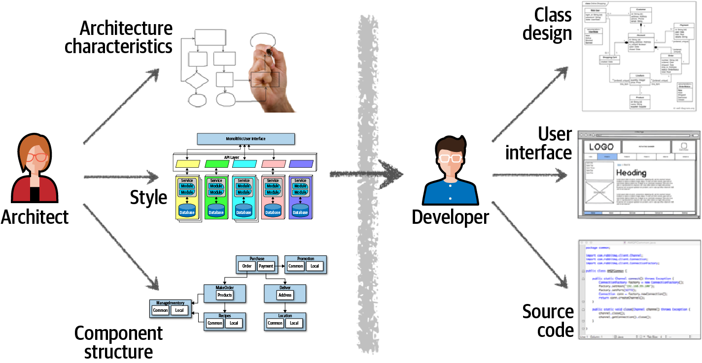
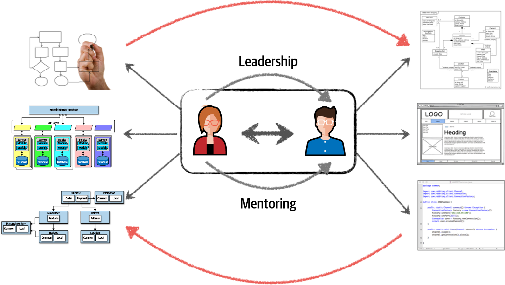
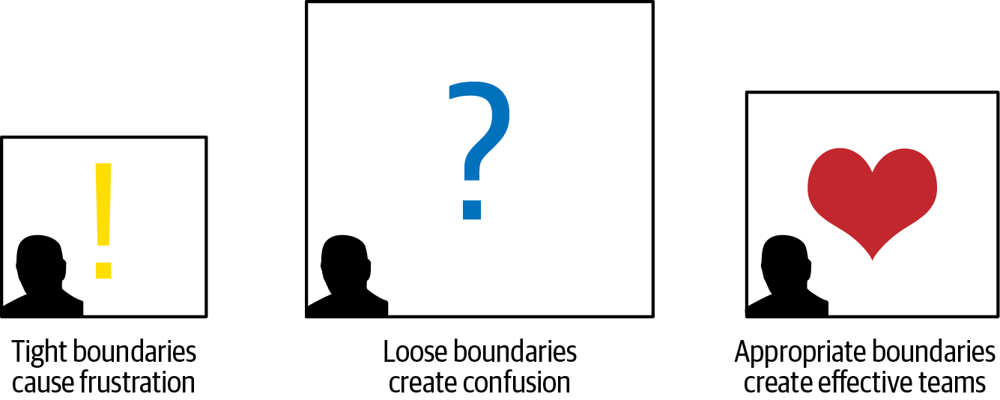
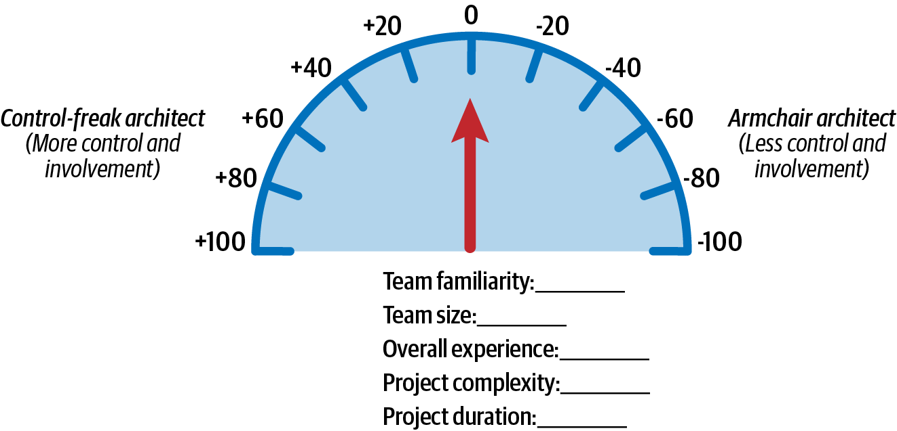
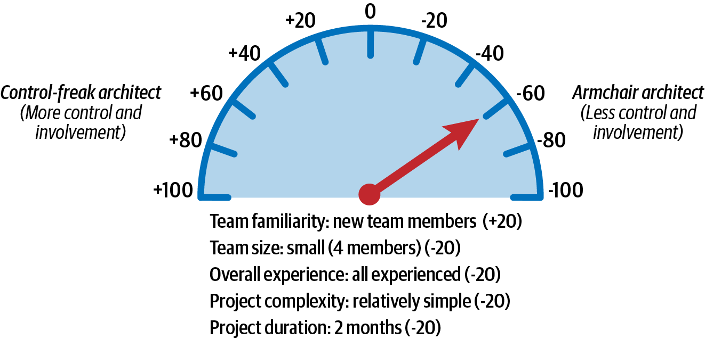
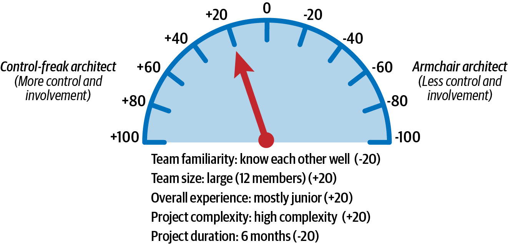
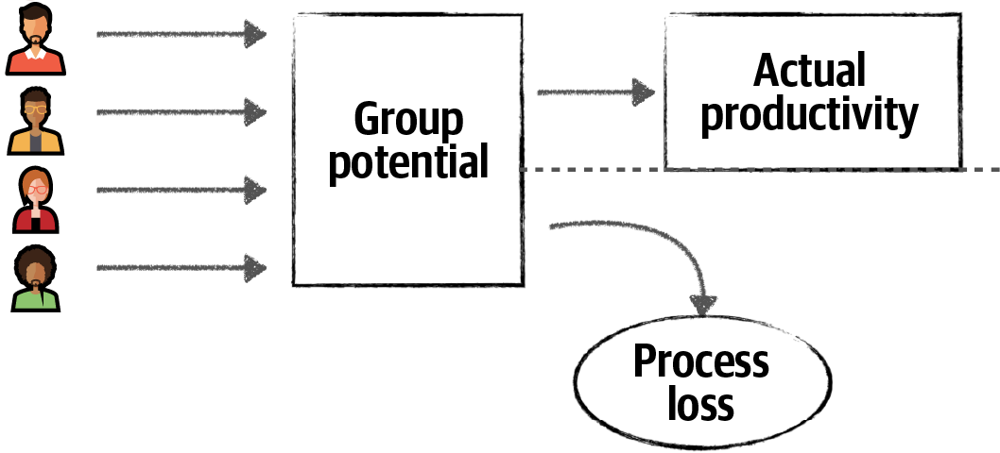
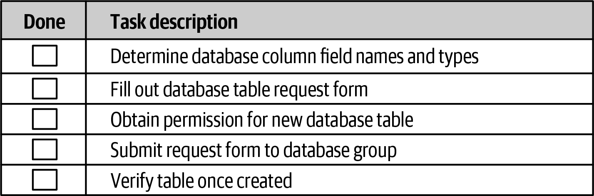
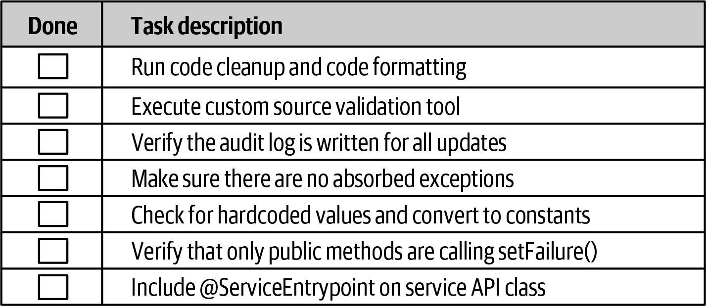
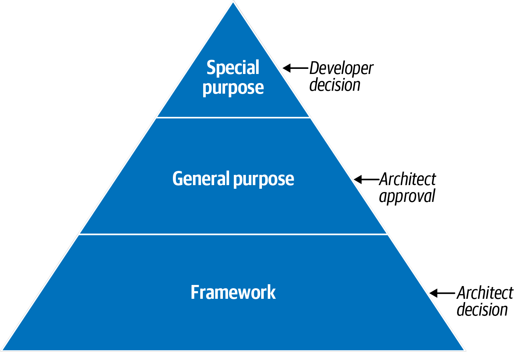

# Chương 24. Làm cho team hiệu quả (Making Teams Effective)

Ngoài việc tạo ra các architecture kỹ thuật và đưa ra các architecture decision, kiến trúc sư phần mềm còn chịu trách nhiệm dẫn dắt development team và hướng dẫn team qua việc triển khai architecture. Những kiến trúc sư làm tốt việc này tạo ra các development team hiệu quả, làm việc chặt chẽ cùng nhau để giải quyết vấn đề và tạo ra những giải pháp thành công. Dù điều này nghe có vẻ hiển nhiên, chúng tôi đã thấy quá nhiều kiến trúc sư phớt lờ development team của mình và tạo ra architecture một mình, trong một môi trường biệt lập. Khi architecture này được giao cho development team, các developer thường vật lộn để triển khai nó cho đúng.

Làm cho các team năng suất là một trong những cách mà các kiến trúc sư phần mềm thành công tạo nên sự khác biệt. Trong chương này, chúng tôi giới thiệu một số kỹ thuật cơ bản để cải thiện hiệu quả của các development team.

## Cộng tác (Collaboration)

Quá thường xuyên, ngành phần mềm coi architecture và phát triển là hai hoạt động hoàn toàn tách biệt. Hãy xét [Hình 24-1](#fig-architectural-thinking-traditional), so sánh các trách nhiệm truyền thống của kiến trúc sư với trách nhiệm của developer. Kiến trúc sư chịu trách nhiệm về các hoạt động như phân tích yêu cầu nghiệp vụ để rút ra và định nghĩa các architectural characteristic, chọn các architecture pattern và style để giải quyết problem domain, và tạo các logical component. Development team dùng các artifact mà kiến trúc sư tạo ra trong các hoạt động này để tạo sơ đồ class cho các component, xây dựng màn hình UI, và viết và test source code.

*Hình 24-1. Vai trò truyền thống của kiến trúc sư so với developer*

Hình ảnh trong [Hình 24-1](#fig-architectural-thinking-traditional) minh họa vì sao cách tiếp cận truyền thống này đối với architecture hiếm khi hiệu quả. Hãy nhìn mũi tên một chiều đi qua các rào cản ảo và vật lý ngăn cách kiến trúc sư với developer: đó là thứ gây ra mọi vấn đề. Các quyết định của kiến trúc sư không phải lúc nào cũng đến được development team, và khi development team thay đổi architecture, điều đó hiếm khi quay trở lại kiến trúc sư. Trong mô hình này, vì kiến trúc sư quá tách rời khỏi development team, architecture hiếm khi đạt được mục tiêu của nó.

Chìa khóa để làm cho architecture hiệu quả là phá vỡ các rào cản, cả vật lý lẫn ảo, giữa kiến trúc sư và developer, thay vào đó hình thành một mối quan hệ cộng tác hai chiều vững chắc giữa họ. Kiến trúc sư và development team phải ở trong cùng một team ảo, như trong mô hình cộng tác được mô tả ở [Hình 24-2](#fig-architectural-thinking-collaboration). Mô hình này không chỉ hỗ trợ giao tiếp và cộng tác hai chiều mạnh mẽ, mà còn cho phép kiến trúc sư mentor và coach các developer.

*Hình 24-2. Làm cho architecture hiệu quả thông qua cộng tác*

Không giống các cách tiếp cận waterfall old-school tĩnh, cứng nhắc, các software architecture ngày nay thay đổi và tiến hóa với gần như mọi iteration hoặc giai đoạn của một nỗ lực sản phẩm. Sự cộng tác chặt chẽ giữa kiến trúc sư và development team là thiết yếu để thành công.

Trong phần còn lại của chương này và trong [Chương 25](ch25_negotiation_and_leadership_skills.vi.md#ch-negotiation-skills), chúng tôi sẽ cho bạn thấy các kỹ thuật để hình thành những mối quan hệ cộng tác hai chiều, lành mạnh, không chỉ làm cho các development team hiệu quả hơn, mà còn tạo ra những architecture vững chắc và thành công hơn.

## Ràng buộc và ranh giới (Constraints and Boundaries)

Theo kinh nghiệm của chúng tôi, một kiến trúc sư phần mềm có thể ảnh hưởng đáng kể đến sự thành công hay thất bại của một development team. Các team cảm thấy bị gạt ra ngoài hoặc xa cách với kiến trúc sư của mình thường thiếu hiểu biết về các ràng buộc khác nhau của hệ thống; không có mức hướng dẫn phù hợp, họ vật lộn để triển khai architecture cho đúng.

Một trong những vai trò của kiến trúc sư phần mềm là tạo ra và truyền đạt các ràng buộc mà developer phải triển khai architecture bên trong đó. Hãy nghĩ về những ràng buộc này như tạo thành một “căn phòng” trong đó development team làm việc để triển khai architecture. Như [Hình 24-3](#fig-making-teams-effective-boundaries) minh họa, có các ranh giới quá chặt hoặc quá lỏng trực tiếp cản trở khả năng triển khai thành công architecture của các team.

*Hình 24-3. Các ranh giới mà kiến trúc sư phần mềm tạo ra ảnh hưởng đến khả năng triển khai architecture của team*

Quá nhiều ràng buộc khiến căn phòng quá nhỏ đối với development team, ngăn họ tiếp cận nhiều công cụ, thư viện và thực hành mà họ cần để triển khai hệ thống. Điều này gây ra sự bực bội, và thường dẫn đến việc developer rời dự án để tìm đến những môi trường vui vẻ và lành mạnh hơn.

Điều ngược lại cũng có thể xảy ra. Các ràng buộc quá lỏng (hoặc không có ràng buộc nào) khiến căn phòng quá lớn. Trong trường hợp này có quá nhiều lựa chọn, buộc development team về cơ bản phải đảm nhận vai trò của kiến trúc sư để đưa ra mọi quyết định kiến trúc quan trọng. Thiếu sự hướng dẫn đúng mức, các developer thấy mình thực hiện quá nhiều proof of concept, vật lộn với các quyết định thiết kế, và trở nên kém năng suất, bối rối và bực bội.

Các kiến trúc sư phần mềm hiệu quả cố gắng cung cấp đúng mức hướng dẫn và các ràng buộc phù hợp để team có mọi thứ mình cần. Phần còn lại của chương này dành để chỉ ra cách tạo ra những ranh giới phù hợp này.

## Tính cách kiến trúc sư (Architect Personalities)

Ở đây chúng tôi sẽ khái quát hóa mạnh tay vì sự rõ ràng về khái niệm, và nói với bạn rằng tính cách của kiến trúc sư có ba loại cơ bản: *control-freak architect* (kiến trúc sư thích kiểm soát), *armchair architect* (kiến trúc sư ngồi ghế bành), và *effective architect* (kiến trúc sư hiệu quả). Control-freak architect có xu hướng tạo ra ranh giới chặt, armchair architect có xu hướng tạo ra ranh giới lỏng, còn effective architect tạo ra ranh giới phù hợp. Các mục sau mô tả chi tiết từng tính cách kiến trúc sư.

### Kiến trúc sư thích kiểm soát (The Control-Freak Architect)

Kiến trúc sư control-freak cố kiểm soát mọi chi tiết của quy trình phát triển phần mềm. Mọi quyết định họ đưa ra thường quá fine-grained và quá low-level, dẫn đến ranh giới chặt và quá nhiều ràng buộc đối với development team.

Ví dụ, một control-freak architect có thể cấm development team tải về các thư viện open source hoặc third-party hữu ích hoặc thậm chí cần thiết, hoặc đặt ra những hạn chế chặt chẽ về quy ước đặt tên, thiết kế class, độ dài method, v.v. Họ có thể đi xa đến mức viết pseudocode để các development team triển khai, về cơ bản là tước đi nghệ thuật lập trình khỏi tay developer. Developer thấy điều này bực bội và thường mất sự tôn trọng đối với kiến trúc sư.

Đáng tiếc là rất dễ trở thành một control-freak architect, đặc biệt khi bạn đang chuyển sang architecture từ vai trò developer phần mềm. Vai trò của kiến trúc sư là tạo ra các khối xây dựng của ứng dụng (các logical component) và xác định cách tất cả chúng tương tác. Vai trò tương ứng của developer là xác định cách tốt nhất để triển khai các logical component đó, dùng sơ đồ class và design pattern. Các kiến trúc sư mới, vốn quen tự tạo sơ đồ class và chọn design pattern khi còn là developer, thường thấy cám dỗ này khó cưỡng lại.

Ví dụ, giả sử một kiến trúc sư tạo một logical component quản lý dữ liệu tham chiếu trong hệ thống: những thứ như dữ liệu cặp name-value tĩnh được dùng trên website, mã sản phẩm và mã kho. Vai trò của kiến trúc sư là xác định logical component (trong trường hợp này là một `Reference Manager`), xác định tập thao tác cốt lõi của nó (ví dụ, `GetData`, `SetData`, `ReloadCache` và `NotifyOnUpdate`), và xác định những component nào khác cần tương tác với `ReferenceManager`. Một control-freak architect có thể nghĩ rằng cách tốt nhất để triển khai component này là thông qua pattern parallel loader, tận dụng một cache nội bộ với một cấu trúc dữ liệu cụ thể. Đây có thể là một thiết kế hiệu quả, nhưng nó không phải thiết kế duy nhất, và quan trọng hơn, không phải việc của kiến trúc sư là nghĩ ra thiết kế nội bộ cho `Reference Manager`—đó là việc của developer.

Như chúng tôi sẽ nói trong chương này, đôi khi kiến trúc sư cần đóng vai control freak, tùy thuộc vào độ phức tạp của dự án và trình độ kỹ năng của team. Tuy nhiên, hầu hết thời gian, một control-freak architect gây xáo trộn cho development team, không cung cấp đúng mức hướng dẫn, cản đường, và nhìn chung kém hiệu quả với vai trò lãnh đạo.

### Kiến trúc sư ngồi ghế bành (The Armchair Architect)

Armchair architect là một kiến trúc sư đã không viết code trong một thời gian rất dài (nếu từng viết) và không tính đến các chi tiết triển khai khi tạo architecture. Họ thường tách rời khỏi development team và hiếm khi có mặt, đơn giản là chuyển sang dự án tiếp theo sau khi hoàn thành các sơ đồ architecture ban đầu.

Một số armchair architect đơn giản là quá sức với họ: họ không biết công nghệ hoặc business domain đủ rõ để lãnh đạo hay hướng dẫn. Hãy nghĩ xem: developer làm gì? Tất nhiên là họ viết source code. Viết source code thực sự khó giả vờ; hoặc bạn viết được source code hoặc bạn không viết được. Kiến trúc sư làm gì? Không ai biết! Vẽ thật nhiều đường và hộp? Làm kiến trúc sư thì quá dễ giả vờ.

Ví dụ, giả sử một armchair architect thiết kế một hệ thống stock-trading đang quá sức với họ. Sơ đồ architecture của họ có thể chỉ chứa hai hộp: một đại diện cho hệ thống giao dịch, và một đại diện cho engine tuân thủ giao dịch mà nó giao tiếp. Architecture này không có gì *sai*—chỉ là nó quá high-level để có ích cho bất kỳ ai.

Armchair architect tạo ra ranh giới lỏng quanh development team của họ, nên các team đó rốt cuộc phải làm công việc mà kiến trúc sư lẽ ra phải làm. Velocity và năng suất của họ vì vậy bị ảnh hưởng, và mọi người đều bối rối về việc hệ thống nên hoạt động thế nào.

Trở thành một armchair architect cũng dễ như trở thành một control freak. Khi một kiến trúc sư thấy rằng họ không có thời gian cho các development team đang triển khai architecture (hoặc đơn giản là chọn không dành thời gian với họ), đó là dấu hiệu cho thấy họ có thể đang rơi vào tính cách armchair-architect. Các development team cần sự hỗ trợ và hướng dẫn của kiến trúc sư, và họ cần kiến trúc sư luôn sẵn sàng trả lời câu hỏi. Các dấu hiệu khác của một armchair architect là:

- Không hiểu đầy đủ business domain, vấn đề kinh doanh, hoặc công nghệ đang được dùng
- Không đủ kinh nghiệm hands-on phát triển phần mềm
- Không xem xét các hệ quả gắn với một cách triển khai nhất định của giải pháp kiến trúc (như độ phức tạp, bảo trì và testing)

Rất ít kiến trúc sư *có ý định* trở thành armchair architect; nó cứ “xảy ra” khi họ bị dàn trải quá mỏng giữa các dự án hoặc team và mất liên hệ với công nghệ hoặc business domain. Để tránh điều này, chúng tôi khuyến nghị tham gia sâu hơn vào các công nghệ của dự án và xây dựng hiểu biết vững chắc hơn về vấn đề kinh doanh và domain.

### Kiến trúc sư hiệu quả (The Effective Architect)

Một kiến trúc sư phần mềm *hiệu quả* tạo ra các ràng buộc và ranh giới phù hợp, bảo đảm các thành viên team làm việc tốt với nhau, và cung cấp cho họ đúng mức hướng dẫn. Effective architect cũng bảo đảm team có đúng công cụ và công nghệ, và loại bỏ mọi chướng ngại khác giữa development team và mục tiêu của team.

Dù điều này nghe có vẻ hiển nhiên và dễ dàng, nó không phải vậy. Có một nghệ thuật để trở thành một *nhà lãnh đạo* hiệu quả cũng như một kiến trúc sư phần mềm hiệu quả. Nó đòi hỏi cộng tác chặt chẽ với development team và giành được sự tôn trọng của họ. Trong các mục sau, chúng tôi sẽ cho bạn thấy một số kỹ thuật để xác định một kiến trúc sư nên tham gia với một development team đến mức nào.

## Tham gia bao nhiêu? (How Much Involvement?)

Trở thành một kiến trúc sư hiệu quả là biết nên tham gia với một development team nhất định đến mức nào—và khi nào nên tránh đường cho họ. Khái niệm này, được biết đến là [Elastic Leadership](https://elasticleadership.com), được tác giả và nhà tư vấn Roy Osherove truyền bá rộng rãi. Chúng tôi sẽ đi lệch một chút khỏi công trình của Osherove trong lĩnh vực này để tập trung vào các yếu tố đặc thù cho lãnh đạo software-architecture.

Biết nên tham gia với một development team đến mức nào có thể là thách thức, và việc xác định bạn có thể quản lý bao nhiêu team hoặc dự án cùng lúc cũng vậy. Dưới đây là năm yếu tố then chốt cần xem xét:

**Mức độ quen thuộc của team**

Các thành viên team biết nhau rõ đến mức nào? Họ đã từng làm việc cùng nhau trước đây chưa? Nhìn chung, các thành viên team càng biết rõ nhau, họ càng có thể self-organize (tự tổ chức) và càng ít cần kiến trúc sư tham gia. Ngược lại, các thành viên team càng mới, họ càng cần kiến trúc sư hỗ trợ cộng tác và giảm các bè nhóm.

**Kích thước team**

Chúng tôi coi một team hơn 12 developer là team lớn, và một team từ 5 người trở xuống là team nhỏ. Team càng lớn, càng cần kiến trúc sư. Chúng tôi thảo luận chủ đề này chi tiết hơn trong [“Team Warning Signs”](#sec-team-warning-signs).

**Kinh nghiệm tổng thể**

Tỉ lệ giữa developer senior và junior (thiếu kinh nghiệm) của team là thế nào? Các thành viên biết công nghệ và business domain rõ đến mức nào? (Nếu business domain đặc biệt phức tạp, hãy cân nhắc đánh giá mức kinh nghiệm công nghệ tổng thể của các thành viên team tách biệt với kinh nghiệm business-domain của họ.) Các team có nhiều developer junior đòi hỏi kiến trúc sư tham gia và mentor nhiều hơn. Trong các team có nhiều developer senior hơn, kiến trúc sư có thể trở thành người điều phối nhiều hơn là người mentor.

**Độ phức tạp của dự án**

Các dự án rất phức tạp đòi hỏi kiến trúc sư sẵn sàng hơn để hỗ trợ giải quyết vấn đề, trong khi các dự án tương đối đơn giản, thẳng thắn đòi hỏi ít sự tham gia hơn.

**Thời gian dự án**

Dự án ngắn (chẳng hạn, hai tháng), dài (hai năm), hay thời gian trung bình (khoảng sáu tháng)? Mức tham gia cần thiết của kiến trúc sư tăng theo độ dài của dự án.

Dù hầu hết các yếu tố này có vẻ hiển nhiên, thời gian dự án đôi khi gây nhầm lẫn. Như chúng tôi đã chỉ ra, thời gian dự án càng ngắn, càng cần ít sự tham gia; dự án càng dài, càng cần nhiều sự tham gia. Điều đó có vẻ ngược trực giác? Hãy xét một dự án two-month nhanh. Hai tháng không phải là nhiều thời gian để xác định yêu cầu, thử nghiệm, phát triển code, test mọi kịch bản, và phát hành lên production. Trong trường hợp này, kiến trúc sư nên hành động giống một armchair architect hơn; development team đã có ý thức cấp bách rõ rệt, và một control-freak architect sẽ chỉ cản đường và làm chậm dự án. Giờ hãy nghĩ về một dự án two-year: các developer thoải mái hơn, không cảm thấy cấp bách. Họ có khả năng đang lên kế hoạch nghỉ phép và ăn trưa dài. Do đó, với các dự án thời gian dài hơn, cần kiến trúc sư để bảo đảm dự án tiến triển đúng tiến độ và team hoàn thành các tác vụ phức tạp nhất trước.

Để minh họa cách dùng các yếu tố này để xác định mức tham gia phù hợp, giả sử một thang cố định 20 điểm cho mỗi yếu tố, như trong [Hình 24-4](#fig-making-teams-effective-scale). Phía có giá trị âm của thang biểu thị ít tham gia hơn, kết thúc ở cực armchair architect. Các giá trị dương biểu thị nhiều tham gia hơn, kết thúc ở cực control-freak architect.

*Hình 24-4. Thang đo mức độ tham gia của kiến trúc sư với các development team*

Tất nhiên thang này không chính xác, nhưng nó giúp xác định mức tham gia mà kiến trúc sư nên kỳ vọng với một development team. Ví dụ, hãy xét kịch bản dự án, Scenario 1, trong [Bảng 24-1](#table-making-teams-effective-scenario1) và [Hình 24-5](#fig-making-teams-effective-scenario1). Các giá trị cho mỗi yếu tố trong bảng đẩy “kim” về một trong hai cực: +20 cho một yếu tố biểu thị nhiều tham gia hơn, -20 cho một yếu tố biểu thị ít tham gia hơn. Điểm các yếu tố được đánh giá ở đây cho Scenario 1 tổng cộng là -60, cho thấy kiến trúc sư nên hạn chế tham gia vào các tương tác hằng ngày, hỗ trợ nhưng tránh đường cho team. Họ sẽ cần có mặt để trả lời câu hỏi và bảo đảm team đi đúng hướng, nhưng phần lớn kiến trúc sư nên khá hands-off và để team giàu kinh nghiệm làm điều họ làm tốt nhất—phát triển phần mềm nhanh chóng.

*Bảng 24-1. Ví dụ Scenario 1 về mức độ tham gia*

| Yếu tố | Giá trị | Đánh giá | Tính cách |
|---|---|---|---|
| Mức độ quen thuộc của team | Thành viên team mới | \+20 | Control freak |
| Kích thước team | Nhỏ (4 thành viên) | \-20 | Armchair architect |
| Kinh nghiệm tổng thể | Tất cả đều giàu kinh nghiệm | \-20 | Armchair architect |
| Độ phức tạp của dự án | Tương đối đơn giản | \-20 | Armchair architect |
| Thời gian dự án | 2 tháng | \-20 | Armchair architect |
|  |  |  |  |
| Điểm tích lũy |  | \-60 | Armchair architect |

*Hình 24-5. Mức độ tham gia cho Scenario 1*

Giờ hãy xét Scenario 2, được mô tả trong [Bảng 24-2](#table-making-teams-effective-scenario2) và minh họa trong [Hình 24-6](#fig-making-teams-effective-scenario2), trong đó các thành viên team biết rõ nhau, nhưng team lớn (12 thành viên) và gồm chủ yếu là developer junior. Dự án tương đối phức tạp, với thời gian sáu tháng. Trong trường hợp này, điểm tích lũy ra +20, cho thấy effective architect nên đảm nhận vai trò mentor và coach và tham gia khá nhiều vào các hoạt động day-to-day, nhưng không đến mức gây xáo trộn cho team.

*Bảng 24-2. Ví dụ Scenario 2 về mức độ tham gia*

| Yếu tố | Giá trị | Đánh giá | Tính cách |
|---|---|---|---|
| Mức độ quen thuộc của team | Biết rõ nhau | \-20 | Armchair architect |
| Kích thước team | Lớn (12 thành viên) | \+20 | Control freak |
| Kinh nghiệm tổng thể | Chủ yếu junior | \+20 | Control freak |
| Độ phức tạp của dự án | Độ phức tạp cao | \+20 | Control freak |
| Thời gian dự án | 6 tháng | \-20 | Armchair architect |
|  |  |  |  |
| Điểm tích lũy |  | \+20 | Control freak |

*Hình 24-6. Mức độ tham gia cho Scenario 2*

Kiến trúc sư dùng các yếu tố này khi bắt đầu một dự án để xác định họ dự định tham gia đến mức nào, nhưng khi dự án tiến triển, mức tham gia của họ thường thay đổi. Do đó chúng tôi khuyến nghị liên tục phân tích các yếu tố này trong suốt vòng đời của dự án.

Khó làm cho các yếu tố này khách quan, vì một số yếu tố (như mức kinh nghiệm tổng thể của team) có thể có ý nghĩa lớn hơn những yếu tố khác. Trong những trường hợp này, các metric có thể dễ dàng được gán trọng số hoặc điều chỉnh để phù hợp với một tình huống cụ thể.

Thông điệp chính ở đây là mức tham gia phù hợp của kiến trúc sư trong một development team thay đổi theo năm yếu tố này. Bằng cách dùng các yếu tố này để đo mức tham gia của mình, kiến trúc sư có thể vạch ra các ranh giới phù hợp và tạo ra “căn phòng” có kích thước đúng cho team.

## Các dấu hiệu cảnh báo của team (Team Warning Signs)

Chúng tôi đã đề cập kích thước team là một trong năm yếu tố giúp kiến trúc sư xác định mức tham gia vào một development team: team càng lớn, càng cần kiến trúc sư tham gia nhiều; team càng nhỏ, càng cần ít tham gia. Tuy nhiên, thế nào là một “team lớn”? Trong mục này, chúng ta sẽ xem xét ba yếu tố có thể giúp kiến trúc sư xác định team có quá lớn không, và do đó không hiệu quả như có thể.

### Process loss (Process Loss)

Thuật ngữ *process loss* (tổn thất quy trình) được Fred Brooks đặt ra trong cuốn sách *The Mythical Man-Month* (Addison-Wesley, 1995) của ông. Ý tưởng cơ bản của process loss, còn được biết đến là [Định luật Brooks](https://oreil.ly/rZt88) (Brooks’s Law), là *bạn càng thêm nhiều người vào một dự án, dự án càng mất nhiều thời gian*. Như [Hình 24-7](#fig-making-teams-effective-process-loss) cho thấy, *group potential* (tiềm năng nhóm) được định nghĩa bởi nỗ lực tập thể của mọi người trong team. Tuy nhiên, Brooks phát biểu rằng năng suất *thực tế* của bất kỳ team nào sẽ luôn thấp hơn năng suất *tiềm năng* của nó; sự chênh lệch được gọi là *process loss* của team.

*Hình 24-7. Định luật Brooks cho rằng kích thước team ảnh hưởng đến năng suất thực tế của nó*

Process loss là một yếu tố tốt để xác định kích thước team đúng cho một dự án cụ thể, và một kiến trúc sư phần mềm hiệu quả quan sát development team để tìm các dấu hiệu của process loss. Chẳng hạn, nếu các thành viên team thường xuyên gặp merge conflict khi push code lên repository, đây là dấu hiệu cho thấy họ đang làm việc trên cùng code và có thể đang cản đường nhau.

Để tránh process loss, chúng tôi khuyến nghị tìm kiếm các vùng có thể song song và để các thành viên team làm việc trên các service hoặc vùng riêng của ứng dụng. Bất cứ khi nào một project manager đề xuất thêm một thành viên mới vào dự án, một kiến trúc sư hiệu quả sẽ tìm cơ hội tạo ra các luồng công việc song song. Nếu không tìm thấy, họ thông báo cho project manager rằng việc bổ sung người mới có thể có tác động tiêu cực đến team.

### Pluralistic ignorance (Pluralistic Ignorance)

*Pluralistic ignorance* (sự thiếu hiểu biết đa nguyên) là khi mọi người riêng tư bác bỏ một chuẩn mực, nhưng vẫn đồng ý với nó vì họ nghĩ mình đang bỏ lỡ điều gì đó hiển nhiên. Ví dụ, giả sử đa số người trong một team lớn đồng ý rằng dùng messaging giữa hai service từ xa là giải pháp tốt nhất. Một người nghĩ đây là ý tưởng ngớ ngẩn, vì có một firewall bảo mật giữa hai service. Tuy nhiên, người đó công khai đồng ý cùng mọi người dùng messaging. Dù riêng tư bác bỏ ý tưởng, họ sợ rằng mình có thể đang bỏ lỡ điều gì đó hiển nhiên nếu lên tiếng. Nhóm càng lớn, mọi người càng ít sẵn lòng đối đầu với người khác. Trong một team nhỏ hơn, họ có thể đã lên tiếng thách thức giải pháp ban đầu, khiến team chuyển sang một giao thức khác (như REST) để có giải pháp tốt hơn.

Khái niệm pluralistic ignorance được biết đến rộng rãi nhờ câu chuyện thiếu nhi Đan Mạch [“Bộ quần áo mới của hoàng đế”](https://oreil.ly/ROvce) (The Emperor’s New Clothes) của Hans Christian Andersen. Trong câu chuyện, hai kẻ lừa đảo, giả làm thợ may, thuyết phục nhà vua rằng bộ quần áo mới chúng “may” cho ông là vô hình đối với bất kỳ ai không xứng đáng nhìn thấy. Nhà vua, không nhìn thấy quần áo nhưng không muốn thừa nhận rằng chính mình không xứng đáng, đi khệnh khạng hoàn toàn trần truồng, hỏi tất cả thần dân xem họ thích bộ quần áo mới của ông thế nào. Các thần dân, sợ bị coi là không xứng đáng, quả quyết với nhà vua rằng bộ quần áo mới của ông là tuyệt vời nhất. Sự ngớ ngẩn này tiếp diễn cho đến khi một đứa trẻ cuối cùng hét lên với nhà vua rằng ông chẳng mặc gì cả.

Trong các cuộc họp, một kiến trúc sư phần mềm hiệu quả quan sát biểu cảm khuôn mặt và ngôn ngữ cơ thể của mọi người, cảnh giác với khả năng một số người có thể che giấu sự hoài nghi của mình vì pluralistic ignorance. Nếu kiến trúc sư cảm nhận được điều này đang xảy ra, họ đóng vai trò người điều phối—có lẽ ngắt lời để hỏi một người hoài nghi nghĩ gì về giải pháp được đề xuất và ủng hộ họ khi họ lên tiếng, ngay cả khi người đó sai. Điểm mấu chốt ở đây là kiến trúc sư, với vai trò người điều phối, bảo đảm mọi người đều cảm thấy đây là một môi trường đủ an toàn để lên tiếng.

Yếu tố thứ ba cho biết kích thước team phù hợp được gọi là *diffusion of responsibility* (sự khuếch tán trách nhiệm). Khi team lớn hơn, sự tăng trưởng của chúng có tác động tiêu cực đến giao tiếp. Nếu các thành viên team bối rối về ai chịu trách nhiệm về việc gì và mọi thứ bị bỏ sót, đó là những dấu hiệu tốt cho thấy team quá lớn.

[Hình 24-8](#fig-making-teams-effective-diffusion) cho thấy một người đứng cạnh một chiếc xe broken-down (chết máy) bên lề một con đường quê. Trong kịch bản này, có bao nhiêu người có thể dừng lại và hỏi người lái xe mọi thứ có ổn không? Vì đó là một con đường nhỏ, có lẽ nó ở trong một cộng đồng nhỏ, nên có thể mọi người đi qua đều sẽ dừng lại. Nhưng nếu cùng người lái xe đó bị mắc kẹt bên lề một xa lộ đông đúc trong một thành phố lớn thì sao? Hàng nghìn chiếc xe có thể chỉ chạy qua mà không ai dừng lại hỏi mọi thứ có ổn không. Đây là một ví dụ tốt về sự khuếch tán trách nhiệm. Khi các thành phố trở nên bận rộn và đông đúc hơn, mọi người cho rằng người lái xe đã gọi trợ giúp, hoặc một người khác trong đám đông chứng kiến sự việc sẽ giúp. Tuy nhiên, trong hầu hết các trường hợp này, sự trợ giúp không đến, và người lái xe bị kẹt lại với một chiếc điện thoại hết pin hoặc bị bỏ quên.

*Hình 24-8. Sự khuếch tán trách nhiệm*

Một kiến trúc sư hiệu quả không chỉ hướng dẫn development team qua việc triển khai architecture, mà còn bảo đảm các thành viên khỏe mạnh, vui vẻ, và cùng làm việc để đạt được mục tiêu chung. Tìm kiếm ba dấu hiệu cảnh báo này và giúp sửa các vấn đề mà chúng chỉ ra là một cách tốt để bảo đảm một development team hiệu quả.

## Tận dụng checklist (Leveraging Checklists)

Phi công hàng không dùng checklist trong mọi chuyến bay. Ngay cả những phi công kỳ cựu, giàu kinh nghiệm nhất cũng có checklist cho cất cánh, hạ cánh, và hàng nghìn tình huống khác—cả những tình huống phổ biến lẫn những edge case bất thường. Họ dùng checklist vì chỉ một thiết lập máy bay hoặc một thủ tục bị bỏ sót (như quên đặt cánh tà ở 10 độ trước khi cất cánh) có thể tạo ra sự khác biệt giữa một chuyến bay an toàn và một thảm họa.

Trong cuốn sách xuất sắc [*The Checklist Manifesto*](https://oreil.ly/XNcV9) (Picador, 2011), Tiến sĩ Atul Gawande mô tả sức mạnh của checklist trong việc làm cho các thủ thuật phẫu thuật an toàn hơn. Lo ngại về tỉ lệ nhiễm tụ cầu cao trong bệnh viện, Tiến sĩ Gawande đã tạo ra các checklist phẫu thuật. Tỉ lệ nhiễm trùng ở các bệnh viện dùng checklist giảm xuống gần bằng không, trong khi tỉ lệ ở các bệnh viện đối chứng không dùng checklist tiếp tục tăng.

Checklist hiệu quả. Chúng là phương tiện tuyệt vời để bảo đảm mọi tác vụ đều được bao quát và xử lý. Vậy tại sao ngành phát triển phần mềm không tận dụng chúng? Sau nhiều năm làm việc trong ngành này, chúng tôi tin chắc rằng checklist tạo ra sự khác biệt lớn trong hiệu quả của các development team. Tất nhiên, hầu hết developer phần mềm không xử lý những vấn đề life-and-death như lái máy bay chở khách hay thực hiện phẫu thuật open-heart. Nói cách khác, developer phần mềm không cần checklist cho mọi thứ. Chìa khóa là biết khi nào nên tận dụng chúng và khi nào không.

[Hình 24-9](#fig-making-teams-effective-db) không phải là một checklist—nó là một tập các bước thủ tục để tạo một bảng database mới, nên nó không nên ở dạng checklist. Một số tác vụ của nó có phụ thuộc; ví dụ, bảng database không thể được kiểm chứng nếu biểu mẫu chưa được gửi. Bất kỳ quy trình nào có luồng thủ tục gồm các tác vụ phụ thuộc đều không nên nằm trong checklist. Các quy trình đơn giản, quen thuộc được thực hiện thường xuyên mà không có lỗi cũng vậy.

*Hình 24-9. Ví dụ về một checklist tồi*

Các ứng viên tốt cho checklist bao gồm những quy trình không có thứ tự thủ tục cố định hay tác vụ phụ thuộc, cũng như những quy trình mà mọi người thường xuyên bỏ qua bước hoặc mắc lỗi. Đừng quá đà và bắt đầu biến mọi thứ thành checklist. Kiến trúc sư thường làm vậy khi thấy rằng checklist thực sự làm cho các development team hiệu quả hơn. Họ có nguy cơ kích hoạt cái được biết đến là [*Law of Diminishing Returns*](https://oreil.ly/px1g3) (quy luật lợi ích giảm dần). Kiến trúc sư tạo càng nhiều checklist, developer càng ít có khả năng dùng chúng. Cũng khôn ngoan khi làm cho checklist nhỏ nhất có thể trong khi vẫn nắm bắt mọi bước cần thiết. Developer nhìn chung sẽ không tuân theo các checklist quá dài. Nếu bất kỳ tác vụ nào trong danh sách có thể được tự động hóa, hãy tự động hóa chúng và loại chúng khỏi checklist.

> **Lưu ý**
>
> Đừng lo về việc nêu những điều hiển nhiên trong checklist. Những thứ hiển nhiên thường là những thứ bị bỏ sót.

Ba checklist mà chúng tôi thấy hữu ích nhất bao gồm hoàn thành code của developer, unit test và functional test, và phát hành phần mềm. Mỗi checklist được thảo luận trong các mục sau.

> **Hiệu ứng Hawthorne (The Hawthorne Effect)**
>
> Phần khó nhất của việc đưa checklist vào một development team là khiến developer thực sự dùng chúng. Quá phổ biến việc một số developer hết thời gian và chỉ đơn giản đánh dấu tất cả các mục trong checklist mà không thực sự thực hiện các tác vụ.
>
> Một cách để giải quyết vấn đề này là nói chuyện với team về sự khác biệt mà việc dùng checklist có thể tạo ra và cho họ đọc *The Checklist Manifesto* của Atul Gawande. Hãy bảo đảm mỗi thành viên team hiểu lý do đằng sau mỗi checklist. Hãy cân nhắc để họ cùng quyết định những thủ tục nào nên và không nên có trong checklist—tạo ra ý thức sở hữu cũng giúp ích.
>
> Khi mọi cách khác thất bại, còn có [*Hawthorne effect*](https://oreil.ly/caGH_): xu hướng những người biết mình đang bị quan sát hoặc giám sát thay đổi hành vi, nhìn chung là làm điều đúng. Hiệu ứng này không đòi hỏi giám sát thực tế mà chủ yếu là cảm giác bị giám sát; ví dụ, nhiều chủ lao động gắn các camera non-functioning ở những khu vực rất dễ thấy, trong khi những người khác cài đặt phần mềm giám sát website mà họ hiếm khi kiểm tra. (Bao nhiêu báo cáo trong số đó thực sự được các nhà quản lý xem?)
>
> Để dùng Hawthorne effect quản trị checklist, hãy cho team biết rằng vì việc dùng checklist là then chốt đối với năng suất của team, mọi checklist sẽ được kiểm tra để bảo đảm tác vụ thực sự đã được thực hiện. Trên thực tế, chỉ cần thỉnh thoảng spot-checks là đủ; developer sẽ ít có khả năng bỏ qua các mục hoặc đánh dấu sai là đã hoàn thành hơn nhiều.

### Checklist hoàn thành code của developer (Developer Code-Completion Checklist)

Checklist code-completion của developer là một công cụ hữu ích, đặc biệt khi một developer tuyên bố rằng họ đã “xong” với code. Nó cũng hữu ích để đi đến một “definition of done” (định nghĩa hoàn thành): nếu mọi thứ trong checklist đều hoàn tất, developer có thể nói rằng họ thực sự đã xong với code họ đang làm.

Dưới đây là một số thứ nên đưa vào checklist code-completion của developer:

- Các tiêu chuẩn viết code và định dạng không có trong các công cụ tự động
- Các mục thường bị bỏ sót (như exception bị nuốt)
- Các tiêu chuẩn project-specific
- Các chỉ dẫn hoặc thủ tục đặc biệt của team

[Hình 24-10](#fig-making-teams-effective-completion) cho thấy một ví dụ checklist code-completion của developer. Có một số tác vụ hiển nhiên ở đây, như “Run code cleanup and code formatting” và “Make sure there are no absorbed exceptions.” Developer vội vàng thường quên chạy dọn dẹp và định dạng code từ IDE đến mức nào? Khá thường xuyên. Trong *The Checklist Manifesto*, Gawande phát hiện cùng hiện tượng đối với các thủ thuật phẫu thuật—những tác vụ hiển nhiên thường là những tác vụ bị bỏ sót.

*Hình 24-10. Ví dụ về một checklist code-completion của developer*

Kiến trúc sư nên luôn xem lại checklist để xem có mục nào có thể được tự động hóa hoặc viết thành plug-ins cho một code-validation checker không. Dù các tác vụ project-specific trong checklist (như chạy custom validator, kiểm chứng audit log được ghi, gọi method `setFailure()`, và đưa annotation `@ServiceEntrypoint` vào) là tốt để có trong checklist, một số trong số này có thể được tự động hóa. Ví dụ, dù một phép kiểm tra tự động có thể không khả thi cho “Include `@ServiceEntrypoint` on service API class,” nó sẽ khả thi cho “Verify that only public methods are calling `setFailure()`”—một phép kiểm tra đơn giản để tự động hóa bằng bất kỳ công cụ code-crawling nào. Kiểm tra các vùng có thể tự động hóa làm rút ngắn kích thước checklist và cải thiện tỉ lệ tín hiệu trên nhiễu của nó.

### Checklist unit test và functional test (Unit and Functional Testing Checklist)

Có lẽ một trong những checklist tốt nhất là cho unit test và functional test. Checklist này chứa một số trường hợp bất thường và edge case mà developer phần mềm có xu hướng quên test. Bất cứ khi nào ai đó từ QA tìm thấy một vấn đề code dựa trên một test case cụ thể, hãy thêm test case đó vào checklist này.

Checklist cụ thể này thường là một trong những checklist dài nhất, vì nó bao gồm mọi loại test có thể chạy trên code. Mục đích của nó là bảo đảm testing đầy đủ nhất có thể để khi developer hoàn thành checklist, code về cơ bản đã sẵn sàng cho production.

Dưới đây là một số mục có trong một checklist unit test và functional test điển hình:

- Ký tự đặc biệt trong các trường văn bản và số
- Các khoảng giá trị tối thiểu và tối đa
- Các test case bất thường và cực đoan
- Các trường bị thiếu

Như với checklist code-completion của developer, nếu bất kỳ mục nào có thể được viết thành test tự động hoặc đã có trong bộ test tự động, chúng nên được loại khỏi checklist và tự động hóa.

Developer đôi khi không biết bắt đầu từ đâu khi viết unit test hoặc nên viết bao nhiêu. Checklist này cung cấp một cách để bảo đảm các kịch bản test chung và cụ thể được đưa vào quy trình phát triển. Trong các tổ chức mà testing và phát triển được thực hiện bởi các team riêng, checklist này giúp thu hẹp khoảng cách. Các development team càng test đầy đủ, họ càng làm cho công việc của các testing team dễ dàng hơn, giải phóng họ để tập trung vào các kịch bản nghiệp vụ không được bao quát trong checklist.

### Checklist phát hành phần mềm (Software-Release Checklist)

Phát hành phần mềm lên production có lẽ là một trong những điểm error-prone (dễ lỗi) nhất trong vòng đời phát triển phần mềm, nên nó là một đối tượng tuyệt vời cho checklist. Checklist này giúp tránh build và deployment thất bại, và giảm đáng kể rủi ro gắn với việc phát hành phần mềm.

Checklist software-release thường là checklist dễ biến động nhất trong các checklist được trình bày ở đây, vì nó thay đổi mỗi khi một deployment thất bại hoặc gặp vấn đề, để giải quyết các lỗi mới và hoàn cảnh thay đổi.

Checklist software-release thường bao gồm:

- Các thay đổi cấu hình trên server hoặc configuration server bên ngoài
- Các thư viện third-party được thêm vào dự án (JAR, DLL, v.v.)
- Các cập nhật database và các script database-migration tương ứng

Bất cứ khi nào một build hoặc deployment thất bại, kiến trúc sư nên phân tích nguyên nhân gốc của thất bại và thêm một mục tương ứng vào checklist software-release. Bằng cách này, mục đó sẽ được kiểm tra trong lần build hoặc deployment tiếp theo, ngăn vấn đề xảy ra lần nữa.

## Cung cấp hướng dẫn (Providing Guidance)

Một cách khác để kiến trúc sư phần mềm làm cho team hiệu quả là dùng các nguyên lý thiết kế để cung cấp hướng dẫn. Điều này cũng giúp hình thành “căn phòng” ràng buộc mà developer làm việc trong đó để triển khai architecture. Truyền đạt các nguyên lý thiết kế là một trong những chìa khóa để tạo ra một team thành công.

Để minh họa điểm này, hãy tưởng tượng bạn đang hướng dẫn một development team dùng cái thường được gọi là *layered stack*—tập hợp các thư viện third-party tạo nên ứng dụng. Các development team thường có rất nhiều câu hỏi về layered stack, bao gồm thư viện nào được, thư viện nào không, và liệu hoặc khi nào họ có thể tự đưa ra quyết định về thư viện.

Bạn có thể bắt đầu bằng cách để developer trả lời các câu hỏi sau về một thư viện họ muốn dùng:

- Có sự chồng lấn nào giữa thư viện được đề xuất và chức năng hiện có của hệ thống không?
- Lý do biện minh cho việc dùng thư viện được đề xuất là gì?

Câu hỏi thứ nhất hướng developer kiểm tra xem chức năng mà thư viện mới cung cấp có thể được đáp ứng thông qua một thư viện hiện có hoặc chức năng hiện có không. Khi developer bỏ qua hoạt động này (điều đôi khi xảy ra), họ có thể rốt cuộc tạo ra rất nhiều chức năng trùng lặp, đặc biệt trong các dự án và team lớn.

Câu hỏi thứ hai thúc đẩy developer hỏi xem thư viện hoặc chức năng mới có thực sự cần thiết không. Chúng tôi khuyến nghị yêu cầu cả lý do biện minh kỹ thuật lẫn lý do biện minh kinh doanh, một phần vì kỹ thuật này giúp developer nhận thức được nhu cầu cung cấp lý do biện minh kinh doanh.

> **Tác động của lý do biện minh kinh doanh (The Impact of Business Justifications)**
>
> Một trong các tác giả từng là lead architect trong một dự án Java-based đặc biệt phức tạp với một development team lớn. Một thành viên team bị ám ảnh với ngôn ngữ lập trình Scala và cực kỳ muốn dùng nó trong dự án. Mong muốn dùng Scala của họ rốt cuộc gây xáo trộn đến mức hai thành viên team chủ chốt tuyên bố ý định rời dự án để tìm đến những môi trường khác, “ít độc hại hơn”. Tác giả đã thuyết phục họ tạm hoãn. Sau đó ông nói với người đam mê Scala rằng ông sẽ ủng hộ việc dùng Scala trong dự án *nếu* người đó đưa ra một lý do biện minh kinh doanh cho chi phí đào tạo và viết lại liên quan. Người đam mê Scala vui mừng khôn xiết và nói sẽ bắt tay vào ngay. Họ rời cuộc họp và hét lên, “Cảm ơn—anh là nhất!”
>
> Ngày hôm sau, người đam mê Scala đến văn phòng với dáng vẻ hoàn toàn thay đổi và xin nói chuyện với tác giả. Họ bắt đầu bằng việc ngay lập tức (và khiêm tốn) nói, “Cảm ơn.” Người đam mê Scala giải thích rằng họ đã nghĩ ra mọi lý do kỹ thuật trên đời để dùng Scala, nhưng không ưu điểm kỹ thuật nào trong số đó có giá trị kinh doanh nào xét về chi phí, ngân sách và tiến độ. Thực tế, người đam mê Scala đã nhận ra hai điều: thứ nhất, sự gia tăng chi phí, ngân sách và tiến độ sẽ không mang lại lợi ích gì cả; và thứ hai, họ đã gây xáo trộn cho team. Không lâu sau, người đam mê Scala đã trở thành một trong những thành viên giỏi và hữu ích nhất của team. Việc được yêu cầu đưa ra lý do biện minh kinh doanh cho thứ họ muốn đã nâng cao nhận thức của họ về nhu cầu của doanh nghiệp, khiến họ trở thành một developer phần mềm tốt hơn và làm cho team mạnh mẽ và lành mạnh hơn. Hai developer chủ chốt từng định rời đi đã ở lại team.

Một cách tốt khác để truyền đạt các nguyên lý thiết kế là thông qua các giải thích bằng đồ họa về những quyết định nào development team có thể đưa ra và những quyết định nào không. Đồ họa trong [Hình 24-11](#fig-making-teams-effective-guidance) cho thấy điều này có thể trông như thế nào để kiểm soát layered stack.

*Hình 24-11. Cung cấp hướng dẫn cho layered stack*

Các hạng mục này chỉ là ví dụ, nhưng có thể định nghĩa nhiều hạng mục hơn. Khi trình bày [Hình 24-11](#fig-making-teams-effective-guidance) cho team, kiến trúc sư nên áp dụng từng hạng mục cho thư viện third-party được đề xuất sử dụng:

**Special purpose (mục đích đặc biệt)**

Đây là các thư viện cụ thể được dùng cho những thứ như render PDF, quét mã vạch, và các trường hợp khác không đáng để viết phần mềm tùy biến.

**General purpose (mục đích chung)**

Các thư viện này là các lớp bọc trên API ngôn ngữ và bao gồm những thứ như Apache Commons và Guava cho Java.

**Framework**

Các thư viện này được dùng cho những thứ như persistence (như Hibernate) và inversion of control (như Spring). Nói cách khác, chúng tạo nên toàn bộ một layer hoặc cấu trúc của ứng dụng và có tính xâm lấn cao.

Tiếp theo, kiến trúc sư tạo ra “căn phòng” xung quanh nguyên lý thiết kế này. Hãy chú ý, trong [Hình 24-11](#fig-making-teams-effective-guidance), kiến trúc sư đã cho phép developer đưa ra quyết định về các thư viện special-purpose mà không cần hỏi ý kiến kiến trúc sư. Tuy nhiên, với các thư viện general-purpose, dù developer có thể phân tích sự chồng lấn, đưa ra lý do biện minh và đưa ra khuyến nghị, loại thư viện này đòi hỏi sự phê duyệt của kiến trúc sư. Cuối cùng, các thư viện framework hoàn toàn là trách nhiệm của kiến trúc sư—các development team thậm chí không nên thực hiện phân tích cho những loại thư viện này.

## Tóm tắt (Summary)

Làm cho các development team hiệu quả là công việc khó khăn. Nó đòi hỏi nhiều kinh nghiệm và thực hành, cũng như kỹ năng con người vững vàng (mà chúng tôi sẽ thảo luận trong các chương tiếp theo). Dù vậy, các kỹ thuật đơn giản trong chương này về elastic leadership, tận dụng checklist, và cung cấp hướng dẫn bằng cách truyền đạt các nguyên lý thiết kế thực sự hiệu quả. Chúng tôi đã thấy chúng hữu ích thế nào trong việc làm cho các development team làm việc thông minh hơn.

Một số người đặt câu hỏi về vai trò của kiến trúc sư trong những hoạt động như vậy, khăng khăng rằng công việc này nên được giao cho development manager hoặc project manager. Chúng tôi hoàn toàn không đồng ý. Kiến trúc sư phần mềm hướng dẫn team về các vấn đề kỹ thuật và dẫn dắt họ qua việc triển khai architecture. Xây dựng một mối quan hệ cộng tác chặt chẽ với development team cho phép kiến trúc sư quan sát động lực của team và hỗ trợ những thay đổi để làm cho team năng suất hơn.
