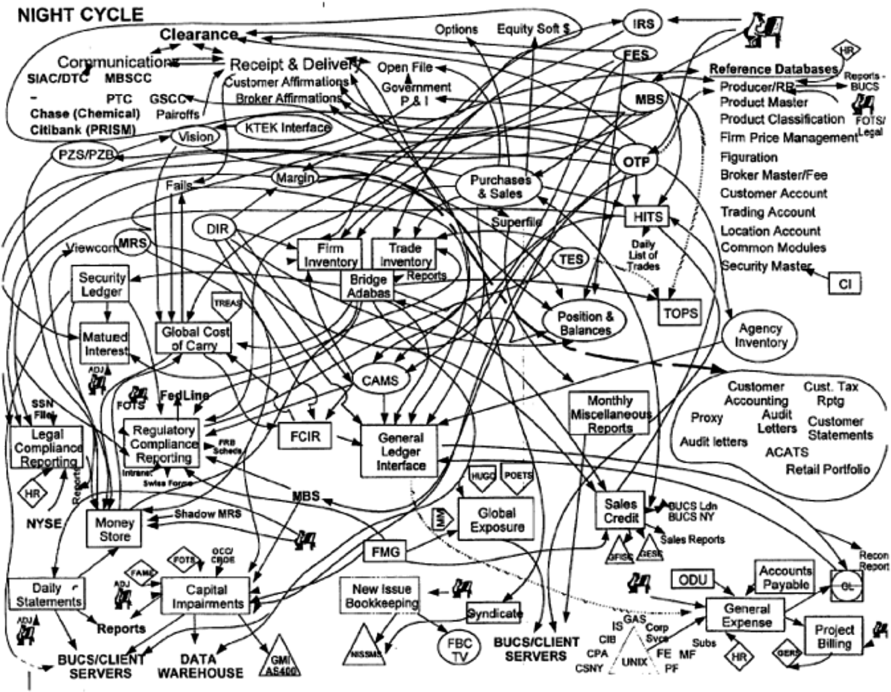
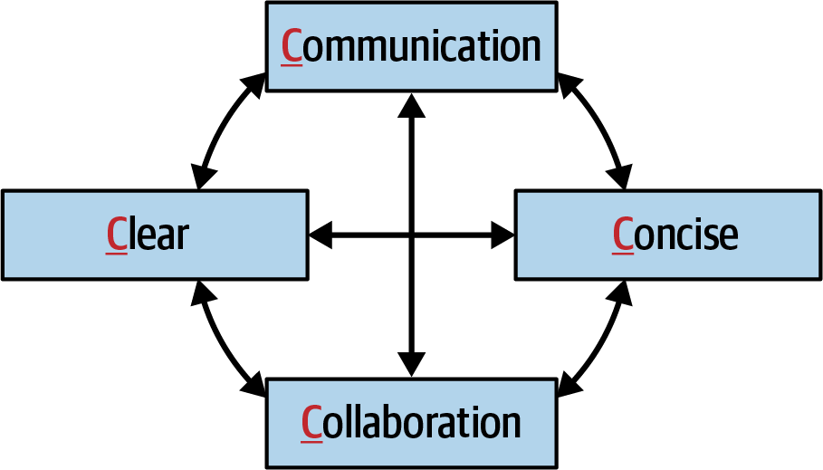
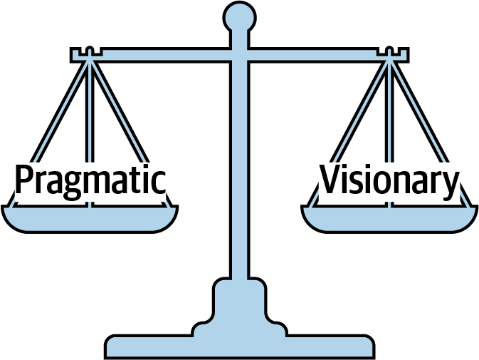
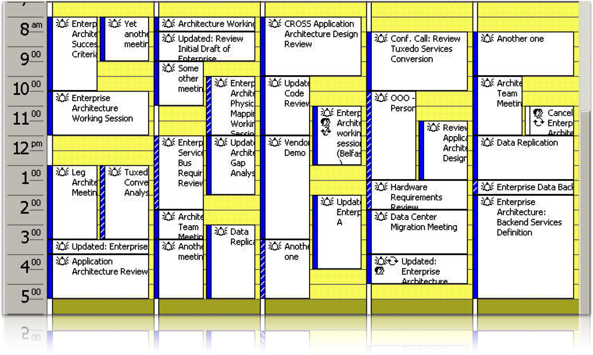
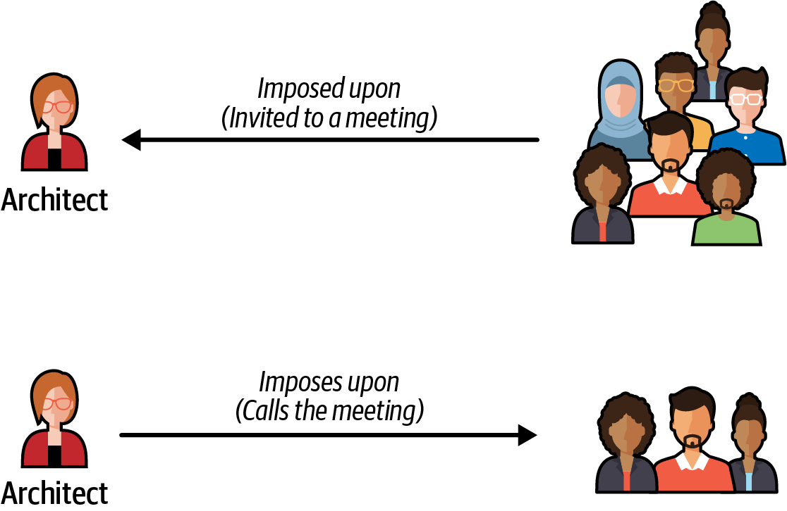

# Chương 25. Kỹ năng đàm phán và lãnh đạo (Negotiation and Leadership Skills)

Kỹ năng đàm phán và lãnh đạo là những kỹ năng khó, chỉ có được qua nhiều năm học hỏi, thực hành và mắc sai lầm—nhưng chúng then chốt để trở thành một kiến trúc sư phần mềm hiệu quả. Cuốn sách này không thể biến ai thành chuyên gia đàm phán và lãnh đạo chỉ sau một đêm, nhưng các kỹ thuật chúng tôi giới thiệu trong chương này là một điểm khởi đầu tốt. Để đi sâu hơn vào chủ đề này, chúng tôi gợi ý cuốn sách [*The Staff Engineer’s Path: A Guide for Individual Contributors*](https://www.oreilly.com/library/view/the-staff-engineers/9781098118723) (O’Reilly, 2022) của Tanya Reilly và cuốn sách kinh điển về đàm phán *Getting to Yes: Negotiating Agreement Without Giving In* (Penguin Books, 2011) của Roger Fisher, William L. Ury và Bruce Patton.

## Đàm phán và điều phối (Negotiation and Facilitation)

Trong [Chương 1](ch01_introduction.vi.md#ch01-introduction), chúng tôi đã liệt kê các kỳ vọng cốt lõi đối với kiến trúc sư phần mềm. Kỳ vọng cuối cùng chúng tôi thảo luận là hiểu và có khả năng xoay xở với chính trị nơi công sở của tổ chức. Lý do đây là một kỳ vọng quan trọng đến vậy là gần như mọi quyết định bạn đưa ra với tư cách kiến trúc sư phần mềm đều sẽ bị thách thức: bởi những developer nghĩ rằng họ biết nhiều hơn, bởi những kiến trúc sư khác nghĩ rằng họ có ý tưởng hay cách tiếp cận vấn đề tốt hơn, và bởi những stakeholder nghĩ rằng giải pháp của bạn quá tốn kém hoặc sẽ mất quá nhiều thời gian.

Đàm phán là một trong những kỹ năng quan trọng nhất của kiến trúc sư. Các kiến trúc sư phần mềm hiệu quả hiểu chính trị của tổ chức, có kỹ năng đàm phán và điều phối vững vàng, và có thể vượt qua bất đồng để tạo ra những giải pháp mà mọi stakeholder đều đồng ý.

### Đàm phán với stakeholder kinh doanh (Negotiating with Business Stakeholders)

Hãy xét kịch bản sau, trong đó bạn, với tư cách lead architect, phải đàm phán với một stakeholder kinh doanh chủ chốt:

**Kịch bản 1**

Parker, phó chủ tịch cấp cao và nhà tài trợ sản phẩm cho dự án này, khăng khăng rằng hệ thống giao dịch toàn cầu mới phải hỗ trợ availability “năm số chín” (99.999%). Tuy nhiên, dựa trên khoảng thời gian giữa các thị trường toàn cầu khi không có giao dịch diễn ra (hai giờ), bạn biết rằng availability ba số chín (99.9%) là đủ để đáp ứng các yêu cầu dự án. Vấn đề là, bạn đã thấy Parker không thích bị sai và không phản ứng tốt khi bị sửa, đặc biệt nếu họ cảm thấy bị coi thường. Parker không am hiểu kỹ thuật, nhưng nghĩ mình am hiểu, nên họ có xu hướng can thiệp vào các khía cạnh non-functional của dự án. Với tư cách kiến trúc sư, mục tiêu của bạn là thuyết phục Parker, thông qua đàm phán, rằng availability ba số chín (99.9%) là đủ.

Bạn sẽ phải cẩn thận để không quá tự cao và áp đặt trong phân tích của mình, nhưng bạn cũng cần bảo đảm mình không bỏ sót điều gì có thể chứng minh bạn sai trong quá trình đàm phán. Có một số kỹ thuật đàm phán then chốt bạn có thể dùng để giúp với kiểu đàm phán với stakeholder này. Kỹ thuật đầu tiên là:

> **Mẹo**
>
> Hãy chú ý đến những từ thời thượng và biệt ngữ mà mọi người dùng, ngay cả khi chúng có vẻ vô nghĩa. Chúng thường chứa manh mối có thể giúp bạn hiểu và đàm phán tình huống tốt hơn.

Các từ thời thượng của doanh nghiệp nhìn chung vô nghĩa, nhưng vẫn có thể cung cấp thông tin giá trị khi bạn sắp bước vào đàm phán. Giả sử bạn hỏi khi nào cần một tính năng cụ thể và Parker trả lời, “Tôi cần nó từ hôm qua.” Bạn không thể đáp ứng điều đó theo nghĩa đen, nhưng nó cho bạn biết rằng time to market quan trọng với stakeholder này. Tương tự, cụm từ “hệ thống này phải nhanh như chớp” có nghĩa performance là một mối quan tâm lớn, và “zero downtime”, thay vì mang nghĩa đen, có nghĩa availability là then chốt trong ứng dụng này. Các kiến trúc sư phần mềm hiệu quả đọc giữa các dòng của những phát biểu cường điệu như vậy để xác định mối quan tâm thực sự của stakeholder. Điều này dẫn đến kỹ thuật đàm phán thứ hai:

> **Mẹo**
>
> Hãy thu thập càng nhiều thông tin càng tốt *trước khi* bước vào một cuộc đàm phán.

Việc Parker dùng cụm từ “năm số chín” cho thấy họ muốn hệ thống có availability cao (cụ thể là uptime 99.999%). Tuy nhiên, có thể Parker không biết availability “năm số chín” thực sự có nghĩa là gì về lượng downtime mỗi năm. [Bảng 25-1](#table-negotiation-skills-nines) cho thấy downtime dựa trên số lượng số chín của availability.

*Bảng 25-1. Các số chín của availability*

| Phần trăm uptime | Downtime mỗi năm (mỗi ngày) |
|---|---|
| 90.0% (một số chín) | 36 ngày 12 giờ (2.4 giờ) |
| 99.0% (hai số chín) | 87 giờ 46 phút (14 phút) |
| 99.9% (ba số chín) | 8 giờ 46 phút (86 giây) |
| 99.99% (bốn số chín) | 52 phút 33 giây (7 giây) |
| 99.999% (năm số chín) | 5 phút 35 giây (1 giây) |
| 99.9999% (sáu số chín) | 31.5 giây (86 ms) |

Availability “năm số chín” tương đương 5 phút 35 giây downtime mỗi năm, hay trung bình 1 giây mỗi ngày downtime ngoài kế hoạch. Điều đó đầy tham vọng, tốn kém, và hóa ra là không cần thiết cho Kịch bản 1 dựa trên khoảng thời gian giữa các phiên giao dịch toàn cầu khi không có giao dịch diễn ra. Phát biểu các mục tiêu này bằng giờ và phút (hoặc, trong trường hợp này, giây) là một cách tốt hơn nhiều để trò chuyện so với bám vào cách nói “số chín” vì nó đưa một số metric thực tế và con số định lượng vào cuộc thảo luận.

Đàm phán Kịch bản 1 sẽ bao gồm việc ghi nhận các mối quan tâm của Parker (“Tôi hiểu rằng availability rất quan trọng đối với hệ thống này”), rồi lái cuộc đàm phán từ cách nói số chín sang cách nói về số giờ và phút downtime ngoài kế hoạch hợp lý. Ba số chín (mà bạn cho là đủ tốt) tương đương trung bình 86 giây downtime ngoài kế hoạch mỗi ngày—chắc chắn là một con số hợp lý, với bối cảnh của hệ thống giao dịch toàn cầu này. Phát biểu theo cách này có thể đủ để thuyết phục Parker rằng lượng downtime ngoài kế hoạch này là thỏa đáng. Tuy nhiên, nếu không, đây là một mẹo khác:

> **Mẹo**
>
> Khi mọi cách khác thất bại, hãy phát biểu mọi thứ theo chi phí và thời gian đã được *định lượng*.

Chúng tôi khuyến nghị để dành chiến thuật đàm phán này đến cuối cùng. Chúng tôi đã thấy quá nhiều cuộc đàm phán khởi đầu tệ vì những câu mở đầu như “Việc đó sẽ tốn rất nhiều tiền” hoặc “Chúng ta không có thời gian cho việc đó.” Tiền và thời gian (bao gồm cả công sức liên quan) chắc chắn là những yếu tố then chốt trong bất kỳ cuộc đàm phán nào, nhưng hãy thử những lý do biện minh và lý lẽ khác quan trọng hơn trước khi bạn nêu chúng ra. Chúng nên là phương án cuối cùng. Khi bạn đã đạt được thỏa thuận với stakeholder, bạn có thể xét đến chi phí và thời gian nếu chúng quan trọng.

Một kỹ thuật đàm phán quan trọng khác cho những tình huống như vậy:

> **Mẹo**
>
> Khi bạn cần định lượng các đòi hỏi hoặc yêu cầu, hãy “chia để trị.”

Trong *Binh pháp Tôn Tử* (The Art of War), chiến binh Trung Hoa cổ đại Tôn Tử viết về đối thủ của mình, “Nếu lực lượng của địch hợp nhất, hãy chia cắt chúng.” Bạn cũng có thể dùng chiến thuật divide-and-conquer này trong đàm phán. Trong Kịch bản 1, Parker khăng khăng đòi availability năm số chín (99.999%) cho hệ thống giao dịch mới. Nhưng *toàn bộ hệ thống* có cần availability năm số chín không? Bạn có thể định lượng yêu cầu, thu hẹp nó xuống bất kỳ (các) vùng cụ thể nào của hệ thống thực sự cần availability năm số chín. Điều này giảm phạm vi của các yêu cầu khó (và tốn kém), chưa kể đến phạm vi của cuộc đàm phán.

### Đàm phán với các kiến trúc sư khác (Negotiating with Other Architects)

Việc kiến trúc sư phải đàm phán với các kiến trúc sư khác trong một dự án không phải là điều bất thường. Hãy xét Kịch bản 2, trong đó hai kiến trúc sư bất đồng về việc dùng giao thức nào:

**Kịch bản 2**

Bạn là người cấp cao hơn trong hai kiến trúc sư của một dự án, và bạn tin rằng messaging bất đồng bộ là cách tiếp cận đúng cho giao tiếp giữa một nhóm service, để tăng cả performance lẫn scalability. Tuy nhiên, Addison, kiến trúc sư còn lại của dự án, cực lực phản đối. Họ khăng khăng rằng REST sẽ là lựa chọn tốt hơn, vì nó luôn nhanh hơn messaging và có thể scale tốt như vậy. Họ dẫn ra nghiên cứu của mình, gồm một lần tìm kiếm Google và đầu ra của một prompt tới một công cụ generative AI phổ biến. Đây không phải cuộc tranh luận gay gắt đầu tiên bạn có với Addison, và cũng sẽ không phải cuộc cuối cùng. Bạn muốn thuyết phục họ rằng messaging là giải pháp đúng.

Giờ đây, là kiến trúc sư cấp cao, bạn chắc chắn có thể nói với Addison rằng ý kiến của họ không quan trọng và phớt lờ nó. Tuy nhiên, điều này sẽ chỉ làm tăng sự thù địch giữa hai người, và một mối quan hệ không lành mạnh, không cộng tác giữa hai kiến trúc sư của dự án gần như chắc chắn sẽ có tác động tiêu cực đến development team.

> **Mẹo**
>
> Luôn nhớ rằng *trình diễn đánh bại tranh luận* (demonstration defeats discussion).

Thay vì tranh cãi về REST so với messaging, bạn nên *trình diễn* cho Addison thấy vì sao messaging là lựa chọn tốt hơn trong môi trường cụ thể này. Vì mỗi môi trường đều khác nhau, đơn giản Google nó hiếm khi cho ra câu trả lời đúng. Nhưng nếu bạn so sánh hai lựa chọn trong một môi trường production-like và cho Addison xem kết quả, bạn có thể tránh được hoàn toàn một cuộc tranh cãi.

> **Mẹo**
>
> Tránh tỏ ra quá hiếu chiến hoặc để mọi thứ trở nên quá cá nhân. Sự lãnh đạo điềm tĩnh, kết hợp với lý lẽ rõ ràng và súc tích, gần như luôn thắng trong một cuộc đàm phán.

Đây là một kỹ thuật rất mạnh mẽ để xử lý các mối quan hệ đối đầu. Một khi mọi thứ trở nên cá nhân hoặc nóng nảy, điều tốt nhất nên làm là dừng cuộc đàm phán. Re-engage (tiếp tục lại) sau, khi cả hai bên đã bình tĩnh. Kiến trúc sư thỉnh thoảng tranh cãi, nhưng nếu bạn giữ bình tĩnh và thể hiện sự lãnh đạo, người kia thường sẽ nhượng bộ.

### Đàm phán với developer (Negotiating with Developers)

Các kiến trúc sư phần mềm hiệu quả giành được sự tôn trọng của team thông qua làm việc cùng nhau. Bằng cách đó, khi họ yêu cầu development team điều gì đó, khả năng gây ra tranh cãi hay oán giận thấp hơn nhiều.

Như bạn đã thấy trong [Chương 24](ch24_making_teams_effective.vi.md#ch-making-teams-effective), làm việc với các development team đôi khi có thể khó khăn. Khi các development team cảm thấy tách rời khỏi architecture (hoặc kiến trúc sư), họ thường cảm thấy bị gạt ra khỏi các quyết định. Đây là một ví dụ kinh điển của architecture antipattern *Ivory Tower* (tháp ngà). Các kiến trúc sư tháp ngà ra lệnh từ trên cao, đưa mệnh lệnh cho các development team mà không quan tâm đến ý kiến hay mối lo của họ. Điều này thường dẫn đến việc team mất sự tôn trọng đối với kiến trúc sư và cuối cùng có thể khiến động lực của team sụp đổ hoàn toàn. Một kỹ thuật đàm phán có thể giúp giải quyết tình huống này là luôn đưa ra lý do biện minh cho các quyết định của bạn.

> **Mẹo**
>
> Khi thuyết phục developer áp dụng một architecture decision hoặc làm một tác vụ cụ thể, hãy đưa ra lý do biện minh thay vì “ra lệnh từ trên cao.”

Nếu bạn đưa ra lý do *tại sao* một việc cần được làm, developer có nhiều khả năng đồng ý hơn. Ví dụ, hãy xét cuộc trò chuyện sau giữa một kiến trúc sư và một developer về việc thực hiện một truy vấn đơn giản trong một layered architecture n-tiered truyền thống:

> **Kiến trúc sư**: “Anh phải đi qua Business layer để thực hiện lời gọi đó.” 
> **Developer**: “Tôi không đồng ý. Gọi thẳng database thì nhanh hơn nhiều.”

Có một số điều sai trong cuộc trò chuyện này. Thứ nhất, hãy chú ý việc kiến trúc sư dùng từ “anh phải.” Không chỉ loại giọng ra lệnh này hạ thấp người khác, mà đó còn là một trong những cách tệ nhất để bắt đầu một cuộc đàm phán (hay một cuộc trò chuyện). Câu trả lời của developer bao gồm một lý do: đi qua Business layer sẽ chậm hơn và tốn nhiều thời gian hơn.

Giờ hãy xét một cách tiếp cận thay thế:

> **Kiến trúc sư**: “Vì kiểm soát thay đổi là quan trọng nhất đối với chúng ta, chúng ta đã hình thành một architecture closed-layered. Điều này có nghĩa là mọi lời gọi tới database cần đến từ Business layer.” 
> **Developer**: “OK, tôi hiểu rồi—nhưng trong trường hợp đó, tôi sẽ xử lý các vấn đề performance này cho những truy vấn đơn giản như thế nào?”

Ở đây, kiến trúc sư đang *biện minh* cho đòi hỏi rằng mọi lời gọi đều đi qua Business layer. Đưa ra lý do biện minh *trước* luôn là một cách tiếp cận tốt. Hầu hết mọi người có xu hướng ngừng lắng nghe ngay khi họ nghe thấy điều gì đó họ không đồng ý. Phát biểu lý do trước đòi hỏi bảo đảm developer sẽ nghe được lý do biện minh của kiến trúc sư.

Kiến trúc sư cũng đã dùng một cách tiếp cận ít cá nhân hơn để diễn đạt đòi hỏi này. Bằng cách nói “điều này có nghĩa là” thay vì “anh phải,” họ đã biến đòi hỏi thành một phát biểu sự thật đơn giản. Giờ hãy nhìn câu trả lời của developer: thay vì phản đối các hạn chế layered-architecture, developer đặt câu hỏi về việc cải thiện performance cho các lời gọi đơn giản. Giờ hai bên có thể tham gia vào một cuộc trò chuyện cộng tác để tìm cách làm cho các truy vấn đơn giản nhanh hơn trong khi vẫn giữ các layer đóng trong architecture.

Một chiến thuật đàm phán hiệu quả khác là để developer tự đi đến giải pháp. Ví dụ, giả sử bạn, với tư cách kiến trúc sư, đang chọn giữa hai framework, Framework X và Framework Y. Framework Y không đáp ứng các yêu cầu security của hệ thống, nên tự nhiên bạn chọn Framework X. Một developer trong team của bạn cực lực phản đối, khăng khăng rằng Framework Y vẫn sẽ là lựa chọn tốt hơn. Thay vì tranh cãi về vấn đề này, bạn nói với developer rằng nếu họ có thể chỉ cho bạn thấy Framework Y giải quyết các mối lo security như thế nào, team sẽ dùng Framework Y.

Một trong hai điều sẽ xảy ra tiếp theo. Khả năng 1 là developer cố chứng minh rằng Framework Y đáp ứng các yêu cầu security, nhưng thất bại. Khi thất bại, họ tự mình hiểu vì sao team không thể dùng framework này. Và vì họ tự đi đến giải pháp, bạn tự động có được sự buy-in (ủng hộ) của họ đối với quyết định dùng Framework X. Về cơ bản bạn đã biến nó thành quyết định của developer. Đây là một chiến thắng. Khả năng 2 là developer tìm ra cách giải quyết các yêu cầu security với Framework Y và trình diễn nó cho bạn. Đây cũng là một chiến thắng. Trong trường hợp này, bạn đã bỏ sót điều gì đó trong đánh giá của mình về Framework Y, và giờ bạn có một giải pháp tốt hơn cho vấn đề (và developer vẫn cảm thấy được tham gia vào quyết định).

> **Mẹo**
>
> Nếu một developer không đồng ý với một quyết định bạn đưa ra, hãy để họ tự đi đến giải pháp.

Developer là những người thông minh với kiến thức hữu ích. Cộng tác với development team là cách kiến trúc sư giành được sự tôn trọng của họ—và sự hỗ trợ của họ trong việc tìm ra những giải pháp tốt hơn. Developer càng tôn trọng một kiến trúc sư, kiến trúc sư càng dễ đàm phán với họ.

## Kiến trúc sư phần mềm với vai trò nhà lãnh đạo (The Software Architect as a Leader)

Một kiến trúc sư phần mềm cũng là một nhà lãnh đạo, hướng dẫn một development team khi họ hiện thực architecture. Chúng tôi khẳng định rằng khoảng 50% của việc là một kiến trúc sư phần mềm hiệu quả là có kỹ năng con người tốt, bao gồm điều phối và lãnh đạo. Trong mục này, chúng tôi thảo luận các kỹ thuật lãnh đạo cho kiến trúc sư phần mềm.

### Bốn chữ C của architecture (The 4 Cs of Architecture)

Chúng tôi đã nói nhiều lần rằng thay đổi là hằng số—và điều đó đúng hơn bao giờ hết khi thay đổi đang bàn liên quan đến việc mọi thứ ngày càng phức tạp, dù là quy trình nghiệp vụ, công nghệ, hay thậm chí chính architecture. Như bạn đã thấy trong [Phần III](part3_techniques_and_soft_skills.vi.md#part3-techniques-softskills) của cuốn sách này, một số architecture *rất* phức tạp. Nếu một architecture cần hỗ trợ availability sáu số chín (99.9999%), điều đó tương đương với downtime ngoài kế hoạch khoảng 86 mili giây mỗi ngày, hay 31.5 giây downtime mỗi *năm*. Loại độ phức tạp này được biết đến là *essential complexity* (độ phức tạp thiết yếu)—nói cách khác, “chúng ta có một bài toán khó.”

Kiến trúc sư (và developer) rất dễ rơi vào bẫy thêm độ phức tạp không cần thiết vào giải pháp, sơ đồ và tài liệu. Trích lời Neal:

> Developer bị độ phức tạp thu hút như thiêu thân lao vào lửa—thường với cùng một kết cục.

[Hình 25-1](#fig-negotiation-skills-complexity) vẽ các luồng thông tin chính của các hệ thống xử lý backend tại một ngân hàng toàn cầu rất lớn. Hệ thống này có *nhất thiết* phức tạp không—nói cách khác, nó có *phải* phức tạp không? Không ai biết, vì kiến trúc sư đã *làm cho* nó phức tạp. Loại độ phức tạp này được gọi là *accidental complexity* (độ phức tạp ngẫu nhiên): nói ngắn gọn, “chúng ta đã làm cho một bài toán trở nên khó.” Kiến trúc sư đôi khi thêm độ phức tạp để chứng tỏ giá trị của mình khi mọi thứ có vẻ quá đơn giản, hoặc để bảo đảm họ luôn được tham gia vào các quyết định, hoặc thậm chí để giữ việc làm. Dù lý do là gì, đưa accidental complexity vào một thứ không cần phải phức tạp là một trong những cách tốt nhất để mất sự tôn trọng và trở thành một nhà lãnh đạo và kiến trúc sư kém hiệu quả.

*Hình 25-1. Đưa accidental complexity vào một vấn đề*

Để tránh accidental complexity, chúng tôi dùng cái mà chúng tôi gọi là *4 Cs* của lãnh đạo kiến trúc: *communication* (giao tiếp), *collaboration* (cộng tác), *clear* (rõ ràng), và *concise* (súc tích). Các yếu tố này, như trong [Hình 25-2](#fig-negotiation-skills-4c) (đừng nhầm với 4 Cs trong C4 Model về vẽ sơ đồ), cùng nhau tạo ra một người giao tiếp và cộng tác hiệu quả trong team.

*Hình 25-2. 4 Cs của architecture*

Với vai trò nhà lãnh đạo, người điều phối và người đàm phán, điều thiết yếu là kiến trúc sư phần mềm có khả năng *giao tiếp* một cách *rõ ràng* và *súc tích*. Cũng quan trọng không kém là khả năng *cộng tác* với developer, stakeholder kinh doanh và các kiến trúc sư khác. Tập trung vào 4 Cs giúp kiến trúc sư giành được sự tôn trọng của team và giúp họ trở thành người go-to (tìm đến đầu tiên) trong dự án về câu hỏi, lời khuyên, mentoring, coaching và lãnh đạo.

### Thực dụng, nhưng có tầm nhìn (Be Pragmatic, Yet Visionary)

Một kiến trúc sư phần mềm hiệu quả phải thực dụng, nhưng có tầm nhìn. Phấn đấu cho sự cân bằng này không dễ như nghe; nó đòi hỏi mức trưởng thành khá cao và thực hành đáng kể để đạt được.

Một *người có tầm nhìn* (visionary) là người suy nghĩ hoặc lập kế hoạch cho tương lai với trí tưởng tượng hoặc sự khôn ngoan. Có tầm nhìn nghĩa là áp dụng tư duy chiến lược vào một vấn đề, đó chính xác là điều kiến trúc sư làm. Kiến trúc sư lập kế hoạch cho tương lai và bảo đảm architecture họ xây dựng vẫn còn sức sống (hợp lệ và hữu ích) trong một thời gian dài. Tuy nhiên, kiến trúc sư thường trở nên quá lý thuyết trong kế hoạch và thiết kế, tạo ra những giải pháp quá khó hiện thực—hoặc thậm chí khó hiểu.

Giờ hãy xét mặt kia của đồng xu, đó là *thực dụng* (pragmatic). Thực dụng nghĩa là xử lý mọi thứ một cách hợp lý và thực tế theo cách dựa trên những cân nhắc *thực tiễn* thay vì *lý thuyết*. Dù kiến trúc sư cần có tầm nhìn, họ cũng cần áp dụng những giải pháp thực tiễn, thực tế. Thực dụng khi tạo một giải pháp kiến trúc nghĩa là tính đến:

- Ràng buộc ngân sách và các yếu tố cost-based khác
- Ràng buộc thời gian và các yếu tố time-based khác
- Bộ kỹ năng và trình độ kỹ năng của development team
- Các trade-offs và hệ quả của mỗi architecture decision
- Các giới hạn kỹ thuật của bất kỳ thiết kế hay giải pháp được đề xuất nào

Các kiến trúc sư phần mềm giỏi cố gắng cân bằng sự thực dụng với trí tưởng tượng và sự khôn ngoan trong việc giải quyết vấn đề (xem [Hình 25-3](#fig-negotiation-skills-pragmatic)).

Ví dụ, hãy xét một kiến trúc sư đối mặt với những đợt tăng đột ngột, đáng kể về tải người dùng đồng thời vì những lý do chưa rõ. Một người có tầm nhìn có thể nghĩ ra một cách công phu để cải thiện elasticity của hệ thống bằng cách tách các database và xây dựng một [*data mesh*](https://oreil.ly/6HmSp) phức tạp: một tập hợp các database phân tán, domain-partitioned được dùng để tách các mối quan tâm dữ liệu phân tích khỏi các mối quan tâm transaction. Về lý thuyết, cách tiếp cận này *có thể* khả thi, nhưng thực dụng nghĩa là áp dụng lý trí và tính thực tiễn vào giải pháp. Ví dụ, công ty đã từng dùng data mesh trước đây chưa? Các trade-offs của việc dùng data mesh là gì? Giải pháp này có thực sự giải quyết được vấn đề không?

*Hình 25-3. Kiến trúc sư giỏi tìm ra sự cân bằng giữa thực dụng và có tầm nhìn*

Duy trì sự cân bằng tốt giữa thực dụng và có tầm nhìn là một cách tuyệt vời để giành được sự tôn trọng với tư cách kiến trúc sư. Các stakeholder kinh doanh đánh giá cao những giải pháp có tầm nhìn nằm trong một tập ràng buộc, và developer đánh giá cao việc có một giải pháp thực tiễn (thay vì lý thuyết) để hiện thực.

Một kiến trúc sư thực dụng trước tiên sẽ xem xét những yếu tố nào đang giới hạn elasticity của hệ thống. Tìm và cô lập mọi nút cổ chai sẽ là một cách tiếp cận đầu tiên thực tiễn cho vấn đề này. Database có đang tạo ra nút cổ chai đối với một số service được gọi hoặc các nguồn bên ngoài cần thiết khác không? Nếu có, liệu một phần dữ liệu có thể được cache để giảm các lời gọi tới database không?

### Dẫn dắt team bằng hành động (Leading Teams by Example)

Những kiến trúc sư phần mềm tồi “lấy chức vụ ra ép,” dùng chức danh của mình để bắt mọi người làm việc. Những kiến trúc sư phần mềm hiệu quả khiến mọi người làm việc bằng cách dẫn dắt qua hành động. Một lần nữa, tất cả là về việc giành được sự tôn trọng của các development team, stakeholder kinh doanh, và những người khác trong tổ chức (như trưởng bộ phận vận hành, development manager và product owner).

Câu chuyện kinh điển “dẫn dắt bằng hành động, không phải bằng chức danh” kể về một đại úy chỉ huy một trung sĩ trong một trận chiến. Viên đại úy, vốn khá xa cách với binh lính, ra lệnh cho toàn bộ binh lính tiến lên chiếm một ngọn đồi đặc biệt khó khăn. Những người lính, đầy hoài nghi, tìm kiếm sự xác nhận từ viên trung sĩ lower-ranking. Viên trung sĩ, hiểu tình hình, khẽ gật đầu, và những người lính lập tức tiến lên với sự tự tin để chiếm ngọn đồi.

Bài học của câu chuyện này là cấp bậc và chức danh có rất ít ý nghĩa khi nói đến việc dẫn dắt con người. Nhà khoa học máy tính [Gerald Weinberg](https://oreil.ly/6fI2m) nổi tiếng với câu nói, “Bất kể vấn đề là gì, đó là vấn đề con người.” Hầu hết mọi người nghĩ rằng giải quyết các vấn đề kỹ thuật không liên quan gì đến kỹ năng con người mà hoàn toàn là về *kiến thức kỹ thuật*. Dù kiến thức kỹ thuật chắc chắn là cần thiết, nó chỉ là một phần của việc giải quyết bất kỳ vấn đề nào.

Ví dụ, giả sử một kiến trúc sư đang họp với một team developer để giải quyết một vấn đề phát sinh trên production. Một trong các developer đưa ra một đề xuất, và kiến trúc sư đáp lại, “Chà, *đó* là một ý tưởng ngớ ngẩn.” Không chỉ developer đó sẽ không đưa ra đề xuất nào nữa, mà giờ không developer nào khác dám nói gì. Kiến trúc sư vừa dập tắt sự cộng tác trên toàn team.

Hãy xem một đoạn đối thoại khác giữa một kiến trúc sư và một developer:

> **Developer**: “Vậy chúng ta sẽ giải quyết vấn đề performance này thế nào?” 
> **Kiến trúc sư**: “Việc anh cần làm là dùng cache. Điều đó sẽ sửa được vấn đề.” 
> **Developer**: “Đừng bảo tôi phải làm gì.” 
> **Kiến trúc sư**: “Điều tôi đang nói với anh là nó sẽ sửa được vấn đề.” 
>

Đây là một ví dụ tốt về giao tiếp mà không *cộng tác*. Bằng cách dùng từ “việc anh cần làm là,” kiến trúc sư đang dập tắt sự cộng tác. Giờ hãy xét một cách tiếp cận đã sửa đổi:

> **Developer**: “Vậy chúng ta sẽ giải quyết vấn đề performance này thế nào?” 
> **Kiến trúc sư**: “Anh đã cân nhắc dùng cache chưa? Điều đó có thể sửa được vấn đề.” 
> **Developer**: “Hmmm, chưa, chúng tôi chưa nghĩ đến điều đó. Anh nghĩ sao?” 
> **Kiến trúc sư**: “Chà, nếu chúng ta đặt một cache ở đây…” 
>

Cụm từ “anh đã cân nhắc” biến mệnh lệnh thành câu hỏi, đặt quyền kiểm soát trở lại tay developer để họ có thể có một cuộc trò chuyện cộng tác với kiến trúc sư. Cách bạn dùng ngôn ngữ cực kỳ quan trọng để xây dựng một môi trường cộng tác.

Dẫn dắt sự cộng tác với tư cách kiến trúc sư không chỉ là về cách bạn cá nhân cộng tác với người khác—mà còn là về việc hỗ trợ sự cộng tác giữa các thành viên team. Hãy cố quan sát động lực của team và nhận ra những tình huống như trong đoạn đối thoại này. Nếu bạn chứng kiến một thành viên team dùng ngôn ngữ đòi hỏi hoặc coi thường, hãy kéo họ ra riêng và coach họ dùng ngôn ngữ cộng tác. Điều này không chỉ tạo ra động lực team tốt hơn, mà còn giúp các thành viên team tôn trọng lẫn nhau.

Nếu bạn cần ai đó làm điều gì đó mà họ có thể không muốn làm, đôi khi tốt nhất là biến một yêu cầu thành một sự nhờ vả. Nhìn chung, con người không thích bị bảo phải làm gì, nhưng muốn giúp đỡ người khác. Hãy xét cuộc trò chuyện sau giữa một kiến trúc sư và developer về một nỗ lực refactoring kiến trúc trong một iteration bận rộn:

> **Kiến trúc sư**: “Tôi cần anh tách payment service thành năm service khác nhau, với mỗi service chứa chức năng cho từng loại thanh toán chúng ta chấp nhận, như tín dụng cửa hàng, thẻ tín dụng, PayPal, thẻ quà tặng và điểm thưởng. Điều đó sẽ mang lại fault tolerance và scalability tốt hơn cho website. Việc này không mất quá nhiều thời gian đâu.” 
> **Developer**: “Xin lỗi, iteration này tôi quá bận để làm việc đó. Tôi thực sự không làm được.” 
> **Kiến trúc sư**: “Nghe này, việc này quan trọng và cần được làm trong iteration này.” 
> **Developer**: “Xin lỗi, tôi không làm được. Có lẽ một developer khác có thể làm. Tôi quá bận.” 
>

Developer lập tức từ chối tác vụ, dù kiến trúc sư đã biện minh rằng nó mang lại fault tolerance và scalability tốt hơn. Kiến trúc sư đang *bảo* developer làm điều mà họ đơn giản là quá bận để làm—và đòi hỏi của họ thậm chí không có tên của người đó! Giờ hãy xét kỹ thuật biến yêu cầu thành một sự nhờ vả:

> **Kiến trúc sư**: “Chào Sridhar. Nghe này, tôi đang thực sự gặp khó. Tôi thực sự cần tách payment service thành các service riêng cho từng loại thanh toán để có fault tolerance và scalability tốt hơn, và tôi đã chờ quá lâu mới làm. Có cách nào anh có thể xếp việc này vào iteration này không? Nó sẽ thực sự giúp tôi rất nhiều.” 
> **Developer *(ngừng một chút)***: “Iteration này tôi thực sự bận, nhưng tôi sẽ xem mình làm được gì.” 
> **Kiến trúc sư**: “Cảm ơn Sridhar, tôi thực sự trân trọng sự giúp đỡ. Tôi nợ anh một lần.” 
> **Developer**: “Không có gì. Tôi sẽ lo cho nó xong trong iteration này.” 
>

Thứ nhất, dùng tên của người đó khiến cuộc trò chuyện mang tính cá nhân và thân quen hơn, thay vì một đòi hỏi chuyên nghiệp vô cảm. Dùng tên của một người và đại từ đúng trong các cuộc trò chuyện hoặc đàm phán có thể giúp xây dựng sự tôn trọng và các mối quan hệ lành mạnh. Không chỉ mọi người thích nghe tên của chính mình, mà nó còn tạo ra cảm giác thân quen. Hãy luyện tập ghi nhớ tên mọi người bằng cách dùng chúng thường xuyên. Nếu bạn thấy một cái tên khó phát âm, hãy tìm hiểu cách phát âm đúng, rồi luyện tập cho đến khi hoàn hảo. Khi ai đó nói cho bạn tên của họ, chúng tôi thích lặp lại nó và hỏi xem mình phát âm đúng không. Nếu chưa đúng, chúng tôi lặp lại quá trình này cho đến khi đúng.

Thứ hai, kiến trúc sư trong cuộc trò chuyện trước thừa nhận họ đang “thực sự gặp khó” và việc tách các service sẽ thực sự “giúp họ rất nhiều.” Điều này không phải lúc nào cũng hiệu quả, nhưng tận dụng thôi thúc cơ bản của con người là giúp đỡ người khác có xác suất thành công cao hơn cuộc trò chuyện đầu tiên. Hãy thử nó lần tới khi bạn gặp loại tình huống này.

Một kỹ thuật lãnh đạo hiệu quả khác khi bạn gặp ai đó lần đầu hoặc chào ai đó mà bạn chỉ thỉnh thoảng gặp là luôn bắt tay người đó và giao tiếp bằng mắt. Cái bắt tay là một kỹ năng con người quan trọng có từ thời trung cổ. Nó cho cả hai người biết họ là bạn, không phải thù, và tạo thành một sự gắn kết giữa họ. Dù vậy, hãy lưu ý khía cạnh văn hóa của việc bắt tay. Ví dụ, ở Mỹ, Anh, châu Âu và Úc, bắt tay là một cách chào hỏi chấp nhận được, trong khi các nền văn hóa khác dùng các cách chào khác (như Nhật Bản, nơi chào hỏi là về cúi chào và thời điểm cúi chào). Tuy nhiên, đôi khi có thể khó để bắt tay cho đúng.

Một cái bắt tay nên chắc, nhưng không quá mạnh. Hãy nhìn vào mắt người đó; nhìn đi chỗ khác trong khi bắt tay ai đó là dấu hiệu thiếu tôn trọng, và hầu hết mọi người sẽ nhận ra điều đó. Ngoài ra, đừng giữ cái bắt tay quá lâu. Hai hoặc ba giây là tất cả những gì bạn cần. Cũng đừng quá đà với việc bắt tay. Nếu bạn đến văn phòng mỗi sáng và bắt đầu bắt tay mọi người, điều đó đủ kỳ quặc để khiến mọi người khó chịu. Tuy nhiên, một cuộc họp hằng tháng với trưởng bộ phận vận hành là cơ hội hoàn hảo để đứng dậy, nói “Chào Ruth, rất vui được gặp lại chị,” và bắt tay Ruth thật nhanh, chắc. Biết khi nào nên bắt tay và khi nào không là một phần của nghệ thuật phức tạp về kỹ năng con người.

Với tư cách nhà lãnh đạo, hãy cẩn thận tôn trọng và giữ gìn ranh giới cá nhân giữa mọi người ở mọi cấp. Cái bắt tay là một cách chuyên nghiệp để tạo thành một sự gắn kết thể chất. Vì đó là điều tốt, một số người cho rằng ôm ai đó còn tốt hơn và gắn kết hơn. Không phải vậy. Ôm trong môi trường chuyên nghiệp, bất kể môi trường nào, có thể khiến mọi người khó chịu và thậm chí có thể trở thành một hình thức quấy rối nơi làm việc. Điều tương tự cũng đúng với hành xử chung ở nơi làm việc hoặc khi đi công tác cùng đồng nghiệp. Hãy bỏ qua những cái ôm, tuân thủ hành xử chuyên nghiệp theo lẽ thường, và gắn bó với cái bắt tay.

Một nhà lãnh đạo giỏi nên trở thành “người go-to” trong team—người mà developer tìm đến khi có câu hỏi và vấn đề. Một kiến trúc sư phần mềm hiệu quả sẽ nắm lấy cơ hội và chủ động dẫn dắt team, bất kể chức danh hay vai trò của họ trong team. Nếu ai đó đang vật lộn với một vấn đề kỹ thuật, hãy chủ động: bước vào và đề nghị giúp đỡ hoặc hướng dẫn. Điều tương tự cũng đúng với các tình huống phi kỹ thuật. Nếu một thành viên team đến chỗ làm trông có vẻ chán nản và phiền muộn, như thể chắc chắn có chuyện gì đó, một kiến trúc sư phần mềm hiệu quả có thể đề nghị nói chuyện. “Này Antonio, tôi đang đi lấy cà phê. Sao chúng ta không đi cùng nhau?” Rồi trong lúc đi bộ, họ có thể hỏi mọi thứ có ổn không. Điều này mở ra cơ hội cho một cuộc thảo luận mang tính cá nhân hơn và có thể thậm chí, trong trường hợp tốt nhất, là cơ hội để mentor và coach. Tuy nhiên, một nhà lãnh đạo hiệu quả cũng sẽ chú ý đến các tín hiệu bằng lời và không bằng lời (như biểu cảm khuôn mặt và ngôn ngữ cơ thể) và nhận ra khi nào nên lùi lại.

Một cách khác để khẳng định mình là người go-to trong team là tổ chức các buổi brown-bag “lunch and learn” (vừa ăn trưa vừa học) định kỳ về một kỹ thuật hay công nghệ cụ thể, như design pattern hoặc một số tính năng mới của bản phát hành programming-language mới nhất. Nếu bạn đang đọc cuốn sách này, bạn có một kỹ năng hoặc kiến thức cụ thể nào đó mà người khác không có. Tổ chức những sự kiện này không chỉ là cung cấp thông tin giá trị cho developer hay thể hiện năng lực kỹ thuật của bạn—mà còn là cơ hội để luyện tập kỹ năng mentoring và public-speaking, và xác lập bạn là một nhà lãnh đạo và người mentor.

## Hòa nhập với development team (Integrating with the Development Team)

Lịch của một kiến trúc sư thường kín các cuộc họp chồng chéo, như lịch trong [Hình 25-4](#fig-negotiation-skills-calendar). Vậy làm sao kiến trúc sư tìm được thời gian để hòa nhập với team, hướng dẫn và mentor họ, và sẵn sàng khi có câu hỏi hay mối lo?

*Hình 25-4. Một lịch điển hình của kiến trúc sư phần mềm*

Đáng tiếc là các cuộc họp thường xuyên là một điều xấu cần thiết. Chìa khóa là kiểm soát chúng để bạn có thể dành thời gian cho team. Như [Hình 25-5](#fig-negotiation-skills-meeting-types) cho thấy, có hai loại cuộc họp: những cuộc họp *áp đặt lên* bạn (ai đó mời bạn họp), và những cuộc họp *bạn áp đặt* (bạn triệu tập cuộc họp).

*Hình 25-5. Các loại cuộc họp*

Các cuộc họp do người khác triệu tập là khó kiểm soát nhất. Vì kiến trúc sư phần mềm phải giao tiếp và cộng tác với rất nhiều stakeholder khác nhau, họ được mời đến gần như mọi cuộc họp—ngay cả khi sự hiện diện của họ không thực sự cần thiết. Khi được mời họp, hãy hỏi người tổ chức vì sao bạn cần có mặt. Nếu mời bạn chỉ là một cách để giữ bạn nắm thông tin, thì biên bản họp là để làm việc đó. Hỏi *vì sao* bạn nên có mặt ở một cuộc họp có thể giúp bạn quyết định nên dự những cuộc họp nào và có thể bỏ qua những cuộc họp nào. Xem chương trình họp cũng hữu ích cho việc này. Ngoài ra, bạn có cần có mặt ở *toàn bộ* cuộc họp, hay chỉ phần sẽ thảo luận một chủ đề cụ thể? Bạn có thể rời đi sau mục chương trình đó không? Đừng lãng phí thời gian trong một cuộc họp mà bạn có thể dùng để giúp development team giải quyết vấn đề.

> **Mẹo**
>
> Hãy xin chương trình họp trước để giúp xác định bạn có thực sự cần có mặt ở cuộc họp hay không.

Khi developer, hoặc tech lead, được mời họp, hãy cân nhắc đi thay họ, đặc biệt nếu cả bạn và tech lead đều được mời, để team có thể tập trung vào các tác vụ trước mắt. Dù việc chuyển các cuộc họp khỏi những thành viên team hữu ích có thể làm tăng thời gian *bạn* dành cho các cuộc họp, nó làm tăng năng suất của development team và sự tôn trọng của họ dành cho bạn.

Với tư cách kiến trúc sư, đôi khi bạn sẽ phải áp đặt cuộc họp lên người khác, nhưng vì đây là nơi bạn có quyền kiểm soát, hãy giữ chúng ở mức tối thiểu tuyệt đối. Đặt ra chương trình và bám theo nó. Đừng để một vấn đề khác không liên quan đến mọi người làm gián đoạn cuộc họp. Hãy tự hỏi liệu cuộc họp bạn đang triệu tập có quan trọng hơn công việc mà nó sẽ kéo team ra khỏi không. Ví dụ, nếu đó là việc truyền đạt một thông tin quan trọng nào đó, bạn có thể chỉ gửi một email thay vì triệu tập một cuộc họp không? Tuy nhiên, nếu bạn thực sự cần lên lịch một cuộc họp với một development team, hãy cố lên lịch họp vào đầu buổi sáng, ngay sau bữa trưa, hoặc gần cuối ngày để giảm thiểu sự gián đoạn cho developer trong giờ làm việc chính.

> **Trạng thái flow của developer (Developer Flow State)**
>
> *Flow* là một trạng thái tinh thần mà developer thường xuyên đạt được, trong đó bộ não dồn 100% vào một vấn đề cụ thể, cho phép sự chú ý trọn vẹn và sáng tạo tối đa. Ví dụ, khi một developer đang làm việc với một thuật toán hay một đoạn code đặc biệt khó, hàng giờ có thể trôi qua như vài phút. Hãy chú ý kỹ đến *productivity flow* của team và bảo đảm không làm gián đoạn nó. Bạn có thể đọc thêm về trạng thái flow trong cuốn sách *Flow: The Psychology of Optimal Experience* của Mihaly Csikszentmihalyi (Harper Perennial, 2008).

Một cách tốt khác để hòa nhập với development team, nếu bạn làm việc on-site, là ngồi cùng họ. Ngồi trong một ô làm việc cách xa team gửi đi thông điệp “Tôi đặc biệt và không nên bị làm phiền.” Ngồi cạnh team gửi đi thông điệp “Tôi là một phần không thể thiếu của team và sẵn sàng khi có câu hỏi hay mối lo.” Khi bạn ở on-site nhưng không thể ngồi cùng development team, điều tốt nhất nên làm là đi quanh và xuất hiện nhiều nhất có thể. Một kiến trúc sư không bao giờ xuất hiện, bị kẹt ở một tầng khác hoặc luôn ở trong văn phòng của mình, không thể nào hướng dẫn team. Hãy dành riêng thời gian vào buổi sáng, sau bữa trưa, hoặc cuối ngày để trò chuyện, giúp giải quyết vấn đề, trả lời câu hỏi, và thực hiện coaching và mentoring cơ bản. Developer đánh giá cao loại giao tiếp này và sẽ tôn trọng bạn vì đã dành thời gian cho họ trong ngày. Điều tương tự cũng đúng với các stakeholder khác: ghé qua chào trưởng bộ phận vận hành trong lúc đi lấy cà phê là một cách tuyệt vời để giữ các kênh giao tiếp luôn mở.

Đôi khi, chẳng hạn nếu bạn làm việc trong môi trường từ xa, không thể ngồi cùng development team hay đi quanh để xuất hiện. Điều này khiến sự cộng tác khó khăn hơn nhiều. Để biết thêm thông tin về quản lý các team từ xa, chúng tôi rất khuyến nghị cuốn sách [*Communication Patterns*](https://www.oreilly.com/library/view/communication-patterns/9781098140533) (O’Reilly, 2023) của Jacqui Read, trong đó Phần 4 hoàn toàn dành cho các team từ xa.

## Tóm tắt (Summary)

Các mẹo đàm phán và lãnh đạo chúng tôi trình bày trong chương này nhằm giúp kiến trúc sư phần mềm hình thành những mối quan hệ cộng tác tốt hơn với development team và các stakeholder khác. Đây là những kỹ năng cần thiết. Nhưng đừng chỉ nghe chúng tôi; hãy nghe [Theodore Roosevelt](https://oreil.ly/g4ELb), tổng thống thứ 26 của Hoa Kỳ:

> Thành phần quan trọng nhất trong công thức thành công là biết cách hòa hợp với mọi người.
>
> —Theodore Roosevelt
