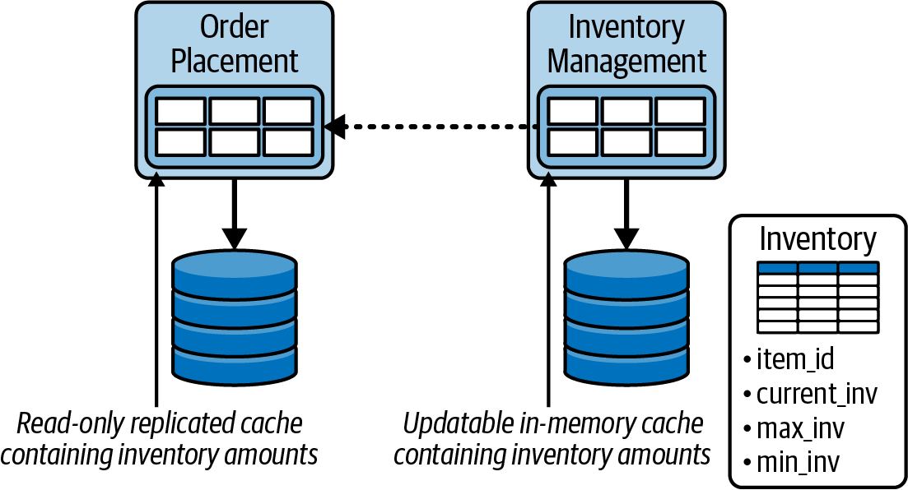
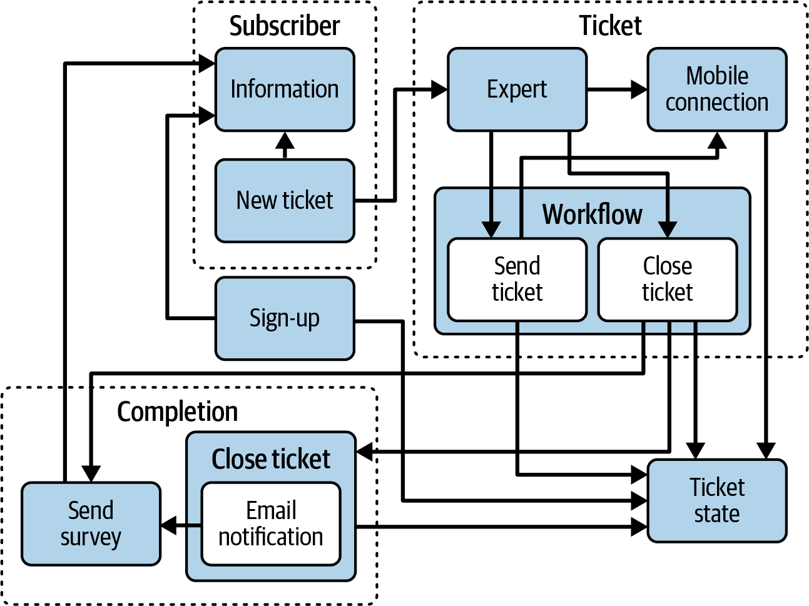
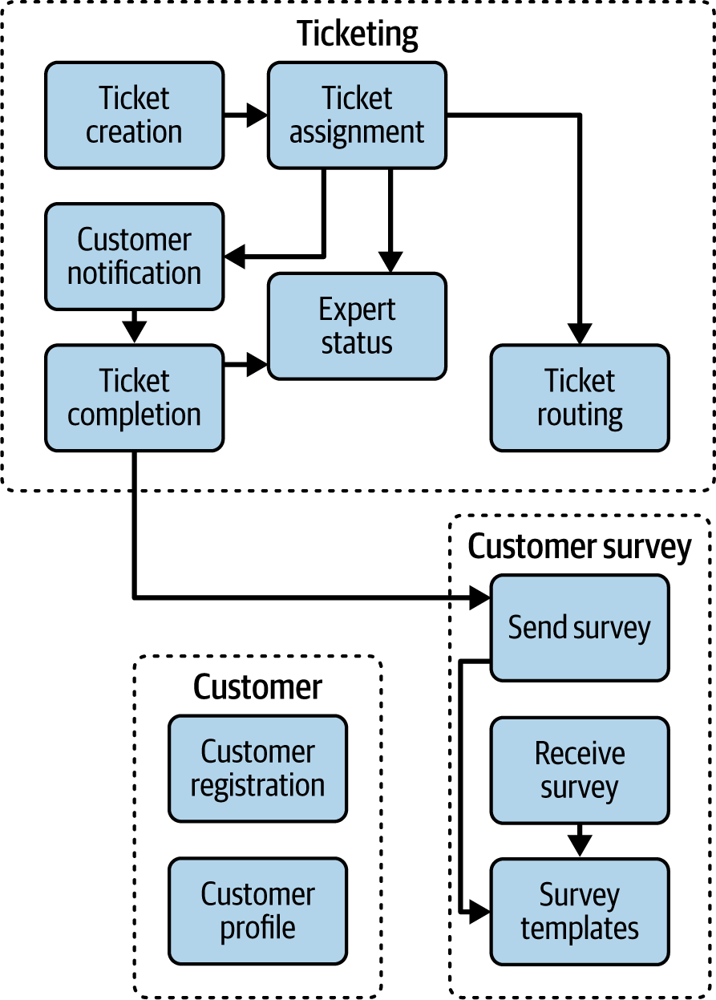
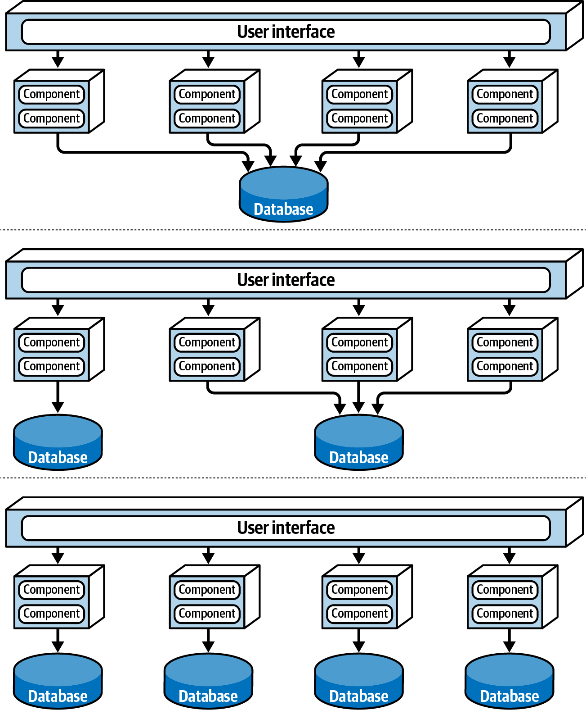

# Chương 26. Các giao điểm của architecture (Architectural Intersections)

Cho đến giờ trong cuốn sách này, chúng tôi đã chỉ ra cách xác định các characteristic then chốt mà một architecture phải hỗ trợ, cách chọn architectural style phù hợp nhất cho những characteristic đó và cho vấn đề kinh doanh, cách đưa ra các architecture decision hiệu quả, và cách dẫn dắt và hướng dẫn các development team qua việc hiện thực architecture. Tuy nhiên, để một architecture hoạt động, nó cũng phải được gắn kết với các khía cạnh khác của môi trường kỹ thuật và kinh doanh. Chúng tôi gọi những sự gắn kết này là *các giao điểm của architecture* (intersections of architecture).

Trong chương này, chúng tôi thảo luận một số giao điểm quan trọng phát sinh khi tạo hoặc kiểm chứng một software architecture:

**Hiện thực (Implementation)**

Hiện thực có được gắn kết với các mối quan tâm kiến trúc xoay quanh các characteristic vận hành, các ràng buộc kiến trúc, và cấu trúc bên trong của architecture không?

**Hạ tầng (Infrastructure)**

Hạ tầng và cách architecture được deploy có gắn kết với các mối quan tâm vận hành của architecture, như scalability, responsiveness, fault tolerance và availability không?

**Topology dữ liệu (Data topologies)**

Một sự gắn kết bị bỏ qua rộng rãi là sự gắn kết tại giao điểm giữa architecture với topology dữ liệu và loại dữ liệu. Topology dữ liệu (monolith, domain database và database per service) phải gắn kết đúng với architectural style để hệ thống hoạt động.

**Thực hành kỹ thuật (Engineering practices)**

Cách development team tạo, bảo trì và test phần mềm có khớp với architecture tương ứng không? Deployment pipeline có khớp với architectural style không?

**Team topologies**

Cách các team được tổ chức có thể tác động đáng kể đến architecture, và ngược lại. Nếu cấu trúc team không được gắn kết đúng với architecture, các development team thường sẽ vật lộn, thấy ngay cả những thay đổi đơn giản nhất cũng đầy thách thức.

**Tích hợp hệ thống (Systems integration)**

Architecture cần giao tiếp với những hệ thống hoặc service nào khác? Không chú ý đến giao điểm cụ thể này có thể dẫn đến kết quả tàn khốc về bảo trì, reliability, và các characteristic vận hành như scalability, responsiveness và availability.

**Doanh nghiệp (The enterprise)**

Architecture có được gắn kết với các framework, thực hành, nguyên tắc chỉ đạo và tiêu chuẩn trên toàn tổ chức và doanh nghiệp không?

**Môi trường kinh doanh (The business environment)**

Architecture có được gắn kết đúng với môi trường kinh doanh và problem domain không? Quá thường xuyên kiến trúc sư bỏ qua giao điểm quan trọng này, và kết quả là architecture không đáp ứng được mục tiêu hay nhu cầu của doanh nghiệp.

**Generative AI**

Việc dùng ngày càng nhiều large language model (LLM) tác động đến architecture như thế nào? Giao điểm này đang nhanh chóng trở nên quan trọng khi ngày càng nhiều công ty tận dụng generative AI trong hệ thống của mình.

Các mục sau mô tả chi tiết hơn những giao điểm này.

## Architecture và hiện thực (Architecture and Implementation)

Định luật thứ nhất của software architecture cũng tình cờ là câu trả lời phổ biến nhất của kiến trúc sư phần mềm cho bất kỳ câu hỏi nào: “Còn tùy.” Có lẽ câu trả lời phổ biến thứ hai là, “Đó là chi tiết hiện thực.” Khi một software architecture không đạt được mục tiêu, câu trả lời thứ hai này thường là thủ phạm.

Để một architecture hoạt động đúng, *hiện thực* của nó—tức là source code của nó—phải được gắn kết với thiết kế để giải quyết ba thứ: các mối quan tâm vận hành của architecture (như fault tolerance, responsiveness, scalability, v.v.), cấu trúc bên trong, và các ràng buộc. Mục này lần lượt đề cập từng thứ trong ba thứ đó.

### Các mối quan tâm vận hành (Operational Concerns)

*Các mối quan tâm vận hành* (operational concerns) là các architectural characteristic mà chúng tôi tập trung vào trong [Phần I](part1_foundations.vi.md#part1-foundations) của cuốn sách, vốn tạo thành nền tảng của bất kỳ software architecture nào, và architecture phải hỗ trợ chúng để giải quyết vấn đề kinh doanh trước mắt. Các architectural characteristic là thứ dẫn dắt các quyết định kiến trúc (như được thảo luận trong [Chương 21](ch21_architectural_decisions.vi.md#ch-architectural-decisions)).

Vậy việc architecture và hiện thực mất gắn kết trong cách chúng giải quyết các mối quan tâm vận hành của hệ thống có nghĩa là gì? Giả sử bạn là kiến trúc sư làm việc trên một hệ thống order-entry mới cần hỗ trợ từ vài nghìn đến nửa triệu khách hàng đồng thời. Bạn chọn microservices architecture style, dựa trên các đánh giá sao trong [“Style Characteristics”](ch18_microservices_architecture.vi.md#sec-ms-ratings) ở [Chương 18](ch18_microservices_architecture.vi.md#ch-style-microservices), lựa chọn phù hợp dựa trên nhu cầu scalability và elasticity cao của hệ thống này. Tuy nhiên, trong quá trình *hiện thực*, development team nhận thấy rằng, vì bounded context của các service được hình thành quá chặt (xem [“Bounded Context”](ch18_microservices_architecture.vi.md#sec-ms-bounded-context) trong [Chương 18](ch18_microservices_architecture.vi.md#ch-style-microservices)), service `Order Placement` không thể truy cập trực tiếp database tồn kho. Thay vào đó, nó phải gọi đồng bộ service `Inventory` để lấy tồn kho hiện tại cho bất kỳ sản phẩm nào khách hàng quan tâm mua. Lời gọi đồng bộ này không chỉ coupling chặt hai service, mà còn làm chậm đáng kể responsiveness của hệ thống.

Development team quyết định dùng một [*in-memory replicated cache*](https://oreil.ly/LQNe4) giữa các service này, như trong [Hình 26-1](#fig-intersect-caching): dữ liệu nằm trong *bộ nhớ nội bộ* của mỗi instance service, và luôn được giữ đồng bộ phía sau thông qua caching. Các sản phẩm caching cho mục đích này bao gồm [Apache Ignite](https://ignite.apache.org) và [Hazelcast](https://hazelcast.com). Ở đây, service `Inventory` sẽ có một cache in-memory có thể ghi chứa item ID và số lượng tồn kho hiện tại; mỗi instance của service `Order Placement` sẽ có một phiên bản read-only được nhân bản của cache đó trong bộ nhớ nội bộ. Dùng một in-memory replicated cache decouple các service và cải thiện *đáng kể* responsiveness.

*Hình 26-1. Development team quyết định dùng caching nhân bản in-memory giữa các service, dẫn đến tình trạng out-of-memory khi scale các service*

Sau khi phát hành production, khi số lượng người dùng đồng thời tăng lên, cần thêm nhiều instance của mỗi service để xử lý tải. Hệ thống crash khi tải đạt khoảng 80,000 khách hàng đồng thời vì yêu cầu bộ nhớ của cache nội bộ quá cao, gây ra tình trạng out-of-memory ở tất cả các máy ảo.

Trong kịch bản này, architecture và hiện thực của nó mất gắn kết. Trong khi architecture tập trung vào hỗ trợ mức *scalability* và *elasticity* cao, hiện thực lại tập trung vào *responsiveness* và *decoupling service*. Cả hai team đều đưa ra quyết định tốt, nhưng phục vụ những mục tiêu khác nhau.

### Tính toàn vẹn cấu trúc (Structural Integrity)

Bạn đã học trong [Chương 8](ch08_component_based_thinking.vi.md#ch08-component-based-thinking) rằng các logical component là các khối xây dựng của bất kỳ hệ thống nào và tạo thành *logical architecture* của nó. Chúng thường được đại diện thông qua cấu trúc thư mục trong repository source-code (hoặc namespace, tùy thuộc vào ngôn ngữ lập trình). Vì logical architecture mô tả cách hệ thống hoạt động và những phần nào của hệ thống tương tác với những phần khác, điều then chốt là cấu trúc của source code phải khớp với cấu trúc của logical architecture.

Nếu không có hướng dẫn, kiến thức và governance phù hợp, developer rất dễ phớt lờ logical architecture của hệ thống và bắt đầu tạo cấu trúc thư mục và namespace tùy ý, không quan tâm đến tác động của chúng lên tính toàn vẹn của hệ thống. Sự mất gắn kết này dẫn đến các architecture khó bảo trì, test và deploy, và kết quả là trở nên kém tin cậy hơn và khó tiến hóa hoặc thích ứng với tính năng mới hơn, như logical architecture minh họa trong [Hình 26-2](#fig-intersect-bad-arch).

*Hình 26-2. Một ví dụ về logical architecture nội bộ thiếu governance và sự gắn kết*

Để bảo đảm cấu trúc của source code khớp với logical architecture, chúng tôi khuyến nghị dùng các công cụ governance tự động, như [ArchUnit](https://archunit.org) cho nền tảng Java, [ArchUnitNet](https://oreil.ly/qgPAf) và [NetArchTest](https://oreil.ly/2ZX8p) cho nền tảng .NET, [PyTestArch](https://oreil.ly/NmRZI) cho Python, hoặc [TSArch](https://oreil.ly/4Z8Ze) cho TypeScript và JavaScript. Các công cụ tự động này, kết hợp với giao tiếp và cộng tác tốt giữa kiến trúc sư và development team, tạo ra các hiện thực được gắn kết đúng với architecture, như trong [Hình 26-3](#fig-intersect-good-arch).

*Hình 26-3. Một ví dụ về logical architecture nội bộ dựa trên governance và sự gắn kết đúng đắn*

Hãy so sánh [Hình 26-2](#fig-intersect-bad-arch) với [Hình 26-3](#fig-intersect-good-arch). Hãy chú ý architecture trong [Hình 26-3](#fig-intersect-good-arch) dễ bảo trì, dễ test, dễ deploy, đáng tin cậy, dễ thích ứng và dễ mở rộng hơn nhiều so với architecture mất gắn kết trong [Hình 26-2](#fig-intersect-bad-arch). Sự so sánh này minh họa tầm quan trọng của loại gắn kết hiện thực này.

### Các ràng buộc kiến trúc (Architectural Constraints)

Một *ràng buộc* (constraint) là một quy tắc hoặc nguyên lý chi phối mô tả một loại hạn chế nào đó trong architecture (như giới hạn giao tiếp chỉ bằng REST hoặc dùng một loại database cụ thể) cần thiết để đạt được mục tiêu của nó. Nếu hiện thực của hệ thống không tuân thủ các ràng buộc của nó, architecture sẽ thất bại. Do đó, một phần công việc của kiến trúc sư phần mềm là xác định và truyền đạt các *ràng buộc* của một architecture.

Để minh họa ý chúng tôi về giao điểm cụ thể này, hãy xét một doanh nghiệp đang cố phát hành một hệ thống mới với ngân sách rất hạn chế và hạn chót gấp. Doanh nghiệp này dự kiến nhiều thay đổi cấu trúc đối với database và cần thực hiện những thay đổi đó nhanh nhất có thể. Trong trường hợp này, một layered architecture truyền thống (xem [Chương 10](ch10_layered_architecture_style.vi.md#ch-style-layered)) sẽ rất phù hợp nhờ sự đơn giản, cost-effectiveness và technical partitioning của nó. Vì style này tách các layer, các thay đổi database có thể được cô lập vào chỉ một layer, khiến chúng dễ dàng và nhanh hơn.

Để layered architecture hoạt động trong vấn đề kinh doanh cụ thể này, kiến trúc sư sẽ cần định nghĩa các ràng buộc sau:

- Mọi logic database phải nằm trong Persistence layer.
- Presentation layer không thể truy cập trực tiếp Persistence layer, mà phải đi qua tất cả các layer, ngay cả với các truy vấn đơn giản.

Những ràng buộc này là cần thiết để ngăn logic database bị trải ra khắp toàn bộ architecture, và để các thay đổi đối với cấu trúc database vật lý (như xóa một bảng hoặc đổi tên một cột) sẽ không ảnh hưởng đến bất kỳ code nào bên ngoài Persistence layer.

Giờ giả sử các UI developer quyết định gọi thẳng database thì nhanh hơn và thay vào đó hiện thực architecture theo cách đó. Ngoài ra, các backend developer nhận ra sẽ dễ bảo trì và test code hơn nhiều nếu logic Business và logic database ở cùng nhau, nên họ cũng phớt lờ các ràng buộc và coupling các mối quan tâm này trong business layer của architecture. Hiện thực này không gắn kết với các ràng buộc của architecture, điều có nghĩa là các thay đổi database sẽ tác động đến toàn bộ code ở mọi layer, mất quá nhiều thời gian, và hệ thống sẽ không đáp ứng được mục tiêu kinh doanh.

Các công cụ kiến trúc cũng hữu ích để quản trị các ràng buộc kiến trúc.

## Architecture và hạ tầng (Architecture and Infrastructure)

Phạm vi của software architecture đã mở rộng trong vài thập kỷ qua để bao gồm ngày càng nhiều trách nhiệm và góc nhìn. Khoảng mid-2000s, mối quan hệ điển hình giữa architecture và vận hành mang tính hợp đồng và chính thức, với rất nhiều thủ tục quan liêu. Hầu hết các công ty thuê ngoài vận hành cho một bên thứ ba để tránh sự phức tạp của việc tự host vận hành, với SLA cho uptime, quy mô, responsiveness, và các characteristic quan trọng khác. Tuy nhiên, ngày nay, các architecture style như microservices tự do tận dụng những characteristic từng chỉ thuộc về vận hành. Ví dụ, elastic scale từng được xây dựng vào space-based architecture (xem [Chương 16](ch16_space_based_architecture_style.vi.md#ch-style-space-based)), nhưng ngày nay, microservices xử lý nó ít đau đớn hơn thông qua sự cộng tác chặt chẽ hơn giữa kiến trúc sư và DevOps.

> **Lịch sử: Pets.com đã cho chúng ta elastic scale như thế nào (History: How Pets.com Gave Us Elastic Scale)**
>
> Mọi người thường cho rằng các năng lực kỹ thuật hiện tại của chúng ta (như elastic scale) chỉ đơn giản được một developer thông minh nào đó phát minh ra vào một ngày đẹp trời. Tuy nhiên, trên thực tế, những ý tưởng tốt nhất thường sinh ra từ những bài học cay đắng. Pets.com là một ví dụ ban đầu. Trang thương mại điện tử này xuất hiện khoảng năm 1998, hy vọng trở thành Amazon.com của đồ dùng thú cưng. Bộ phận marketing xuất sắc của nó đã tạo ra một linh vật hấp dẫn: một con rối vớ cầm micro nói những điều bất kính. Linh vật trở thành siêu sao, xuất hiện trước công chúng tại các cuộc diễu hành và sự kiện thể thao quốc gia.
>
> Đáng tiếc là ban quản lý Pets.com dường như đã chi toàn bộ tiền cho linh vật, chứ không phải cho hạ tầng. Khi đơn hàng bắt đầu đổ về, họ không hề chuẩn bị. Website chậm, giao dịch bị mất, giao hàng chậm trễ…về cơ bản là kịch bản worst-case. Không lâu sau một mùa Giáng sinh mua sắm thảm họa, Pets.com đóng cửa, bán tài sản giá trị duy nhất còn lại của mình—linh vật.
>
> Điều Pets.com cần là *elastic scale*: khả năng khởi tạo thêm instance tài nguyên khi cần. Các nhà cung cấp cloud giờ cung cấp tính năng này như một hàng hóa thông dụng, nhưng các công ty thương mại điện tử thời kỳ đầu phải tự quản lý hạ tầng của mình, và nhiều công ty đã trở thành nạn nhân của một hiện tượng unheard-of (chưa từng nghe) trước đó: quá thành công có thể giết chết một doanh nghiệp. Sự sụp đổ của Pets.com, và những câu chuyện kinh hoàng tương tự khác, đã khiến kiến trúc sư chú ý hơn đến những giao điểm như vậy khi tạo software architecture.

Giao điểm giữa architecture và hạ tầng quan trọng vì nó hỗ trợ các architectural characteristic vận hành. Chỉ vì một *architecture* có thể hỗ trợ scalability cao không có nghĩa là nó sẽ làm được—nếu *hạ tầng* tương ứng không hỗ trợ, nó sẽ không làm được (như Pets.com đã chứng minh). Tại các khách hàng, chúng tôi đã quá thường xuyên chứng kiến kiến trúc sư và developer bị đổ lỗi cho những thất bại kiến trúc thực ra do sự mất gắn kết giữa architecture và hạ tầng gây ra.

Trong hầu hết các trường hợp, sự mất gắn kết này xảy ra do thiếu giao tiếp và cộng tác giữa kiến trúc sư và những người chịu trách nhiệm về hạ tầng và vận hành. Kiến trúc sư thường không nhận ra ảnh hưởng của hạ tầng lên các characteristic như scalability, responsiveness, fault tolerance, performance, availability, elasticity, v.v. Sự mất gắn kết này đã sinh ra lĩnh vực DevOps.

Trong nhiều năm, nhiều công ty coi vận hành là tách biệt với phát triển phần mềm, thường thuê ngoài cho một công ty third-party như một biện pháp cost-saving. Trong những năm 1990s và 2000s, nhiều architecture được thiết kế theo kiểu phòng thủ xoay quanh giả định rằng vận hành sẽ được thuê ngoài và do đó nằm ngoài tầm kiểm soát của kiến trúc sư. (Để có một ví dụ tốt về điều này, xem [Chương 16](ch16_space_based_architecture_style.vi.md#ch-style-space-based).) Tuy nhiên, vào mid-2000s, các công ty bắt đầu thử nghiệm các dạng architecture mới kết hợp nhiều mối quan tâm vận hành. Ví dụ, các architecture style cũ hơn như orchestration-driven SOA đòi hỏi các công cụ và framework công phu để hỗ trợ các năng lực như scalability và elasticity, điều làm phức tạp đáng kể việc hiện thực. Vì vậy kiến trúc sư đã xây dựng các architecture có thể xử lý quy mô, performance, elasticity, và hàng loạt năng lực khác *bên trong*. Tác dụng phụ là các architecture này phức tạp hơn rất nhiều.

Những người tạo ra microservices architecture style nhận ra rằng các mối quan tâm vận hành được xử lý tốt hơn bởi bộ phận vận hành. Bằng cách tạo ra một mối quan hệ cộng tác giữa architecture và vận hành, các kiến trúc sư nhận ra họ có thể đơn giản hóa thiết kế và dựa vào những người vận hành để xử lý những gì họ làm tốt nhất. Họ đã hợp tác với bộ phận vận hành để tạo ra microservices, và đặt nền móng cho thứ sẽ trở thành phong trào DevOps. Dù DevOps đã giúp ích, giao điểm giữa architecture và hạ tầng này vẫn còn là vấn đề đối với hầu hết các công ty.

Dù hạ tầng ít là mối lo hơn, các môi trường cloud vẫn có thể mất gắn kết với một architecture. Ví dụ, deploy các service trên nhiều region hoặc thậm chí availability zone có thể làm giảm hoặc thậm chí triệt tiêu lợi ích performance và toàn vẹn dữ liệu của các in-memory replicated cache và distributed cache. Tương tự, co-locating (đặt chung) các service, container, hoặc thậm chí Kubernetes Pod trên cùng một máy ảo sẽ tăng đáng kể performance, nhưng nó cũng sẽ tác động tiêu cực đến scalability, fault tolerance, availability và elasticity.

Gắn kết architecture với hạ tầng bao gồm giao tiếp và cộng tác chặt chẽ giữa kiến trúc sư và các thành viên team hạ tầng, hoặc thậm chí áp dụng các thực hành DevOps, để mọi stakeholder hiểu các mối quan tâm vận hành then chốt. Chỉ khi đó kiến trúc sư mới thực sự hiện thực được các lợi ích vận hành của architecture họ đã chọn—những lợi ích đã khiến chúng tôi trao những đánh giá five-star tuyệt vời đó.

## Architecture và topology dữ liệu (Architecture and Data Topologies)

Giao điểm giữa architecture và topology dữ liệu thường bị bỏ qua. Chọn sai loại database hoặc topology có thể gây hại cho một architecture và triệt tiêu những architectural characteristic tốt nhất của nó. Ví dụ, các monolithic database, dù mang lại tính nhất quán dữ liệu và hỗ trợ transaction tốt, có thể làm giảm scalability và fault tolerance. Tương tự, các topology database phân tán, dù tốt về scalability và kiểm soát thay đổi, có thể làm giảm tính toàn vẹn dữ liệu, tính nhất quán dữ liệu và performance của hệ thống.

Các mục sau mô tả giao điểm giữa architecture và topology dữ liệu.

### Topology database (Database Topology)

*Topology* của một database, như chúng tôi đã thảo luận trong [Chương 15](ch15_event_driven_architecture_style.vi.md#ch-style-eda), chỉ cách các database vật lý của nó được cấu hình trong architecture. Ba topology cơ bản bao gồm một monolithic database, các database domain-based phân tán, hoặc topology database-per-service phân tán. [Hình 26-4](#fig-intersect-data-top) minh họa các loại topology database cơ bản này.

*Hình 26-4. Các loại topology database phổ biến*

Topology database phải được gắn kết với architecture để hoạt động đúng. Ví dụ, microservices architecture thường dùng pattern database-per-service để duy trì một bounded context nghiêm ngặt. Không có sự gắn kết đúng đắn này, kiến trúc sư sẽ cực kỳ khó kiểm soát thay đổi, và các characteristic vận hành của hệ thống, như fault tolerance, scalability, elasticity, maintainability, testability và deployability, đều sẽ bị ảnh hưởng. Dù vậy, một số style, như service-based architecture (xem [Chương 14](ch14_service_based_architecture_style.vi.md#ch-style-service-based)), linh hoạt hơn về topology database vật lý. 

### Các architectural characteristic (Architectural Characteristics)

Trong [Phần II](part2_architecture_styles.vi.md#part2-styles) của cuốn sách này, chúng tôi đã cho thấy mỗi architectural style đều có siêu năng lực của nó (được đánh giá 4 đến 5 sao) và điểm yếu của nó (1 đến 2 sao). Các loại database cũng vậy—và điều quan trọng là gắn kết siêu năng lực kiến trúc của một hệ thống với siêu năng lực tương ứng của loại database của nó. Trong cuốn sách *Software Architecture: The Hard Parts*, các tác giả đã đánh giá characteristic của sáu loại database khác nhau: relational, key-value, document, columnar, graph và NoSQL. Có lẽ bạn nhớ rằng scalability và elasticity là siêu năng lực của microservices, event-driven và space-based architecture. Chúng cũng là siêu năng lực của database key-value và columnar, điều có nghĩa là những loại database này là lựa chọn tốt để khuếch đại các architectural characteristic đó.

### Cấu trúc dữ liệu (Data Structure)

Cấu trúc của dữ liệu đang được lưu trữ và truy cập cũng là một yếu tố trong giao điểm này. Nếu *cấu trúc dữ liệu* là quan hệ—tức là được xây dựng trên một hệ phân cấp các quan hệ phụ thuộc lẫn nhau—thì relational database sẽ gắn kết tốt. Tuy nhiên, lưu các cặp key-value trong một relational database là một sự mất gắn kết có thể dẫn đến kém hiệu quả ở cả database lẫn architecture. Không phải mọi dữ liệu đều mang cùng một cấu trúc, nên hãy để mắt đến điều này. Một số dữ liệu có thể là quan hệ, dữ liệu khác có thể dựa trên document (đặc biệt khi lưu payload sự kiện hoặc request JSON-based), và dữ liệu khác nữa có thể dựa trên key-value. Với sự đa dạng tiềm tàng của các cấu trúc dữ liệu trong bất kỳ architecture nào, chúng tôi khuyến nghị tận dụng polyglot database bất cứ khi nào khả thi.

### Ưu tiên đọc/ghi (Read/Write Priority)

Nếu vấn đề kinh doanh liên quan đến khối lượng đọc hoặc ghi cao, đó là thông tin quan trọng để gắn kết topology database với architecture. Ví dụ, nếu architecture đòi hỏi khối lượng ghi cao làm ưu tiên hơn việc đọc không thường xuyên, thì một columnar database sẽ phù hợp. Tuy nhiên, nếu điều ngược lại đúng và khối lượng đọc cao là ưu tiên, thì một key-value database, document database hoặc graph database sẽ phù hợp hơn. Nếu hệ thống ưu tiên đọc và ghi gần như ngang nhau, thì relational database và NewSQL database sẽ là lựa chọn tốt. Mất gắn kết ở yếu tố này có thể dẫn đến các hệ thống có performance kém.

## Architecture và thực hành kỹ thuật (Architecture and Engineering Practices)

Vào cuối thế kỷ 20, hàng chục phương pháp luận software-development trở nên phổ biến, bao gồm Waterfall và nhiều biến thể của Agile (như Scrum, Extreme Programming, Lean và Crystal). Vào thời điểm đó, hầu hết kiến trúc sư tin rằng không thứ nào trong số này ảnh hưởng đến software architecture, coi phát triển là một quy trình hoàn toàn tách biệt. Tuy nhiên, trong vài năm qua, những tiến bộ trong kỹ thuật đã đẩy các mối quan tâm quy trình vào software architecture. Hữu ích khi tách *quy trình* (processes) software-development khỏi *thực hành kỹ thuật* (engineering practices). Với *quy trình*, ý chúng tôi là cách các team được hình thành và quản lý, cách các cuộc họp được tiến hành và workflow được tổ chức—tóm lại, cơ chế về cách con người tổ chức và tương tác. Ngược lại, *thực hành kỹ thuật* chỉ các kỹ thuật và công cụ process-agnostic mà các team dùng để phát triển và phát hành phần mềm. Ví dụ, Extreme Programming (XP), continuous integration (CI), continuous delivery (CD), và test-driven development (TDD) đều là những *thực hành* kỹ thuật đã được kiểm chứng không phụ thuộc vào một quy trình cụ thể. Do đó, thuật ngữ *software engineering* bao gồm cả phát triển phần mềm lẫn những thực hành này.

Tập trung vào thực hành kỹ thuật là quan trọng. Phát triển phần mềm thiếu nhiều đặc điểm của các ngành kỹ thuật trưởng thành hơn. Ví dụ, kỹ sư xây dựng có thể dự đoán thay đổi cấu trúc chính xác hơn nhiều so với việc kỹ sư phần mềm dự đoán những khía cạnh tương tự của cấu trúc phần mềm. Điều này có nghĩa là gót chân Achilles của phát triển phần mềm là ước lượng: bao nhiêu thời gian, bao nhiêu nguồn lực, bao nhiêu tiền? Một phần điều góp phần vào khó khăn này là các thực hành ước lượng truyền thống không đáp ứng được bản chất khám phá của phát triển phần mềm và những ẩn số thường phát sinh khi phát triển phần mềm.

Dù quy trình phần lớn tách biệt với architecture, các quy trình lặp phù hợp hơn với bản chất của nó. Cố xây dựng một hệ thống hiện đại như microservices bằng một quy trình lỗi thời như Waterfall sẽ tạo ra rất nhiều ma sát. Một khía cạnh của architecture nơi các phương pháp luận Agile thực sự tỏa sáng là trong việc di chuyển từ một architectural style sang style khác. Các phương pháp luận Agile hỗ trợ những thay đổi như vậy tốt hơn các quy trình planning-heavy vì chúng có vòng phản hồi chặt và khuyến khích các kỹ thuật như [Strangler Pattern](https://oreil.ly/ZRpCc) và [feature toggle](https://oreil.ly/dqpyK).

Kiến trúc sư cũng thường đóng vai trò lãnh đạo kỹ thuật của dự án, nghĩa là xác định các thực hành kỹ thuật mà team dùng. Giống như cân nhắc kỹ problem domain trước khi chọn một architecture, kiến trúc sư cũng phải bảo đảm architectural style và thực hành kỹ thuật của họ ăn khớp với nhau. Ví dụ, triết lý kiến trúc microservices giả định rằng các team sẽ tự động hóa những thứ như provisioning máy, testing và deployment. Cố xây dựng một microservices architecture với một nhóm vận hành lỗi thời, các quy trình thủ công và ít testing có lẽ sẽ dẫn đến thất bại. Cũng như các problem domain khác nhau phù hợp với các architectural style nhất định, các thực hành kỹ thuật khác nhau cũng vậy.

Sự tiến hóa của tư duy tiếp tục, từ Extreme Programming đến continuous delivery và xa hơn, khi những tiến bộ trong thực hành kỹ thuật khiến những năng lực architecture mới trở nên khả thi. Cuốn sách của Neal, [*Building Evolutionary Architectures*](https://learning.oreilly.com/library/view/building-evolutionary-architectures/9781492097532), làm nổi bật những cách mới để suy nghĩ về giao điểm giữa thực hành kỹ thuật và architecture có thể cải thiện cách chúng ta tự động hóa governance kiến trúc. Cuốn sách đưa ra một danh pháp mới quan trọng và cách suy nghĩ về architectural characteristic, và đề cập các kỹ thuật xây dựng những architecture thay đổi một cách uyển chuyển theo thời gian.

Trong thế giới phát triển phần mềm, không có gì đứng yên. Kiến trúc sư có thể thiết kế một hệ thống để đáp ứng một số tiêu chí nhất định, nhưng để bảo đảm thiết kế của họ tồn tại qua cả việc hiện thực lẫn bước tiến không thể tránh khỏi của thay đổi, điều chúng ta cần là một *evolutionary architecture* (kiến trúc tiến hóa).

*Building Evolutionary Architectures* giới thiệu khái niệm dùng *architectural fitness function* để bảo vệ (và quản trị) các architectural characteristic khi thay đổi xảy ra theo thời gian. Hãy nhớ lại từ [Chương 6](ch06_measuring_and_governing_architecture_characteristics.vi.md#ch06-measuring) rằng architectural fitness function là một cách để có được đánh giá khách quan về tính toàn vẹn của (các) architectural characteristic nào đó. Đánh giá này có thể bao gồm nhiều cơ chế khác nhau, như metric, unit test, monitor và chaos engineering.

Để thấy fitness function có thể được dùng thế nào để giúp gắn kết giao điểm này, hãy xét vấn đề kinh doanh cần time to market nhanh. Time to market được dịch thành *agility*—khả năng của hệ thống phản ứng nhanh với thay đổi. Agility là một architectural characteristic tổng hợp gồm maintainability, testability và deployability (xem [Chương 6](ch06_measuring_and_governing_architecture_characteristics.vi.md#ch06-measuring)). Cả ba architectural characteristic này đều chịu ảnh hưởng của thực hành và thủ tục kỹ thuật, và do đó có thể được đo và theo dõi thông qua fitness function. Ví dụ, cả microservices lẫn service-based architecture đều hỗ trợ mức agility cao. Tuy nhiên, nếu các thực hành kỹ thuật xoay quanh các architectural characteristic này không được gắn kết với architecture, hệ thống sẽ không đáp ứng được các mục tiêu và yêu cầu agility đó. Fitness function có thể được dùng để giúp xác định sự mất gắn kết, thúc đẩy kiến trúc sư hành động để gắn kết lại các thực hành kỹ thuật với architecture (hoặc ngược lại). 

## Architecture và team topologies (Architecture and Team Topologies)

Như chúng tôi đã thảo luận xuyên suốt [Phần II](part2_architecture_styles.vi.md#part2-styles) của cuốn sách, team topologies có thể có tác động trực tiếp đến software architecture, và ngược lại. Sự gắn kết này quan trọng đến mức chúng tôi đã đưa vào một mục về team topologies cho mỗi architecture style chúng tôi giới thiệu trong cuốn sách này.

Một trong những cách cơ bản nhất để team topologies gắn kết với architecture là theo loại phân vùng. Giống như architecture, các team có thể được phân vùng theo domain hoặc theo kỹ thuật. Các team domain-partitioned được tổ chức theo vùng domain và thường là cross-functional, với chuyên môn hóa xuyên suốt team. Ví dụ, một team domain-partitioned cụ thể có thể tập trung vào phần customer-facing của một hệ thống, và do đó sẽ chịu trách nhiệm xử lý end-to-end chức năng customer-related, từ UI đến database. Ngược lại, các team được phân vùng theo kỹ thuật mỗi team tập trung vào một chức năng kỹ thuật cụ thể của architecture và thường được tổ chức theo hạng mục kỹ thuật: ví dụ, các team UI, team backend-processing, team shared-services và team database sẽ gắn kết rất tốt với layered architecture style. Hoặc, các team này có thể được phân vùng theo kỹ thuật thành các team business-function và team data-synchronization, điều sẽ gắn kết tốt với space-based architectural style.

Hiểu cách các team được tổ chức là thiết yếu để bảo đảm sự thành công của hệ thống. Nếu team topology của tổ chức mất gắn kết với architecture, các team sẽ vật lộn để hiện thực và bảo trì architecture, và architecture sẽ khó đạt được mục tiêu kinh doanh của nó.

## Architecture và tích hợp hệ thống (Architecture and Systems Integration)

Các hệ thống hiếm khi tồn tại biệt lập. Hầu hết đòi hỏi xử lý bổ sung và dữ liệu từ các hệ thống khác—và điều đó đưa chúng ta đến giao điểm giữa architecture và tích hợp hệ thống. Khi một hệ thống cần giao tiếp với một hệ thống khác để thực hiện xử lý bổ sung hoặc truy xuất dữ liệu, kiến trúc sư của nó đối mặt với hàng loạt thách thức và hệ quả. Ví dụ, hệ thống đang được gọi có sẵn sàng không? Nó có scale và đạt performance ở cùng mức với yêu cầu của hệ thống gọi không?

Khi kiến trúc sư không tập trung đủ vào tích hợp hệ thống, static coupling và dynamic coupling của các hệ thống thường dẫn đến các architecture không thể scale, không responsive, và thiếu agility. Khi tích hợp với các hệ thống khác, hãy xem xét dùng giao thức giao tiếp nào, có loại contract nào giữa các hệ thống, các architectural characteristic của các hệ thống có tương thích không, và việc tích hợp có giữ gìn architectural quantum của mỗi hệ thống không.

## Architecture và doanh nghiệp (Architecture and the Enterprise)

Mỗi doanh nghiệp đều có một tập tiêu chuẩn và nguyên tắc chỉ đạo. Với *doanh nghiệp* (enterprise), ý chúng tôi là tập hợp tất cả các hệ thống và sản phẩm trong một công ty (hoặc một phòng ban hay bộ phận trong công ty). Ví dụ, nhiều công ty áp đặt một số tiêu chuẩn, thực hành hoặc thủ tục security nhất định lên các giải pháp kiến trúc, bất kể loại hệ thống. Các tiêu chuẩn doanh nghiệp cũng có thể liên quan đến nền tảng, công nghệ, tiêu chuẩn tài liệu và tiêu chuẩn vẽ sơ đồ, để kể ra một vài. Hãy nhận thức về các tiêu chuẩn và thực hành enterprise-level, và bảo đảm architecture được gắn kết đúng với chúng.

Chúng tôi đã trải qua nhiều tình huống mà kiến trúc sư phớt lờ các thực hành, tiêu chuẩn và thủ tục enterprise-level. Kết quả thông thường là giải pháp kiến trúc, dù hiệu quả về kỹ thuật đến đâu, bị coi là một giải pháp “one-off” thất bại và bị loại bỏ. Chúng tôi không thể nhấn mạnh đủ tầm quan trọng của việc gắn kết architecture với các thực hành doanh nghiệp để bảo đảm thành công của nó.

## Architecture và môi trường kinh doanh (Architecture and the Business Environment)

Môi trường kinh doanh có ảnh hưởng đáng kể và *trực tiếp* lên architecture của các hệ thống của nó (và ngược lại), và môi trường kinh doanh không bao giờ ngừng thay đổi. Công ty có đang trải qua các biện pháp cost-cutting nghiêm trọng để trụ vững, hay đang mở rộng quyết liệt? Doanh nghiệp có đang chuyển hướng và tái định vị mỗi quý để tìm chỗ đứng trong một thị trường rất biến động và cạnh tranh, hay nó đang ở vị thế ổn định? Một kiến trúc sư phần mềm hiệu quả hiểu vị thế và định hướng của công ty, và gắn kết architecture của các hệ thống then chốt cho khớp với môi trường kinh doanh.

Chúng tôi gọi sự gắn kết này là *domain-to-architecture isomorphism* (sự đẳng cấu domain–architecture). Ví dụ, các công ty đang trải qua các biện pháp cost-cutting cực đoan sẽ không gắn kết tốt với microservices hay space-based architecture, vốn rất tốn kém để tạo và bảo trì. Ngược lại, các doanh nghiệp đang mở rộng quyết liệt thông qua sáp nhập và mua lại sẽ không được phục vụ tốt bởi các monolithic architecture style thiếu khả năng tiến hóa và thích ứng.

Một vấn đề kiến trúc sư thường gặp với giao điểm này là thay đổi kinh doanh, đặc biệt là *thay đổi chưa biết*. Cựu Bộ trưởng Quốc phòng Mỹ Donald Rumsfeld từng [nói một câu nổi tiếng](https://oreil.ly/PQCJk) rằng:

> Có những điều đã biết mà ta biết; có những thứ ta biết là ta biết. Ta cũng biết có những điều chưa biết mà ta biết; nghĩa là ta biết có một số thứ ta không biết. Nhưng cũng có những điều chưa biết mà ta không biết—những thứ ta không biết là ta không biết.

Nhiều sản phẩm và hệ thống bắt đầu với một danh sách *known unknowns* (những điều chưa biết đã biết): những thứ developer phải tìm hiểu về domain và công nghệ mà họ biết sẽ thay đổi. Tuy nhiên, chính những hệ thống này cũng trở thành nạn nhân của *unknown unknowns* (những điều chưa biết chưa biết): những thứ không ai biết sẽ nảy sinh, nhưng lại xuất hiện bất ngờ. “Unknown unknowns” là kẻ thù truyền kiếp của các hệ thống phần mềm. Đây là lý do mọi nỗ lực phần mềm kiểu “Big Design Up Front” đều gặp khó khăn: kiến trúc sư không thể thiết kế cho unknown unknowns. Trích lời Mark:

> Mọi architecture đều trở thành lặp vì *unknown unknowns*. Agile chỉ nhận ra điều này và làm điều đó sớm hơn.

Lập kế hoạch cho thay đổi trong software architecture là *khó*. Các thực hành evolutionary architecture giúp ứng phó với một bối cảnh kinh doanh ever-changing (luôn thay đổi), cũng như architecture lặp. Đón nhận các architectural characteristic như *portability*, *scalability*, *evolvability* và *adaptability* cũng giúp làm cho một software architecture linh hoạt hơn và dễ thích ứng với thay đổi hơn.

Barry O’Reilly, một kiến trúc sư phần mềm giàu kinh nghiệm chuyên về lý thuyết độ phức tạp và thiết kế phần mềm, đã đưa ra một cách suy nghĩ mới về thay đổi kinh doanh liên tục, gọi là *residuality theory* (lý thuyết phần dư). Trong cuốn sách *Residues: Time, Change, and Uncertainty in Software Architecture* (Leanpub, 2024), O’Reilly mô tả các kỹ thuật coi thay đổi kinh doanh là các *stressor* (tác nhân gây áp lực), và các thay đổi kiến trúc tương ứng là các *residue* (phần dư). Lý thuyết của ông là khi kiến trúc sư phản ứng với thay đổi bằng cách áp dụng ngày càng nhiều residue vào architecture, những residue này cuối cùng sẽ bắt đầu giải quyết những thay đổi *chưa biết* mà kiến trúc sư không thể nào dự đoán, tạo ra một architecture đã đạt đến trạng thái tới hạn trong lý thuyết độ phức tạp. Đó là một lý thuyết thú vị, một lý thuyết mà chúng tôi đang theo dõi sát.

## Architecture và generative AI (Architecture and Generative AI)

Khi chúng tôi viết ấn bản thứ hai của cuốn sách này vào đầu năm 2025, *generative artificial intelligence* (Gen AI) và large language model (LLM) đã thâm nhập vào thế giới phát triển phần mềm và thiết kế phần mềm. Nhiều công ty đang đưa chúng vào hệ thống để thực hiện những tác vụ trước đây chỉ được con người thực hiện thủ công. Không ngạc nhiên khi Gen AI cũng giao thoa với software architecture: kiến trúc sư đang đưa LLM vào software architecture, và một số thậm chí đang dùng các công cụ Gen AI để hỗ trợ họ suy nghĩ thấu đáo các vấn đề khó.

### Đưa generative AI vào architecture (Incorporating Generative AI into Architecture)

Một cách tiếp cận chúng tôi khuyến nghị để đưa Gen AI vào một architecture là tận dụng *trừu tượng hóa* và *modularity*. Điều quan trọng là có thể nhanh chóng thay một LLM bằng một LLM khác, và cho phép các rào chắn (rails) và đánh giá kết quả (evals) từ các LLM khác nhau.

Ví dụ, giả sử một công ty tìm việc muốn tận dụng Gen AI để ẩn danh hóa hồ sơ xin việc, với mục tiêu giảm thiên kiến và tập trung vào kỹ năng của người tìm việc thay vì đặc điểm nhân khẩu học hay các yếu tố khác như vậy. Tác vụ này thường do con người thực hiện, nhưng có thể dễ dàng được thực hiện bởi một LLM. Nhưng kết quả của LLM có chính xác không? Nó có loại bỏ quá nhiều thông tin khỏi hồ sơ không? Nó có giữ lại quá nhiều thông tin nhân khẩu học không? Đối với loại hệ thống này, điều thiết yếu là có thể thu thập mẫu và metric và so sánh các LLM engine. Các công cụ như [Langfuse](https://langfuse.com) giúp tạo ra loại observability này trong architecture.

### Generative AI như một trợ lý cho kiến trúc sư (Generative AI as an Architect Assistant)

Với một prompt phù hợp, một LLM (như [Copilot](https://oreil.ly/kaEdv)) có thể tạo ra source code giúp developer tiết kiệm rất nhiều thời gian và công sức. Chúng tuyệt vời để giải quyết các vấn đề rất cụ thể, tất định, như “viết source code bằng ngôn ngữ lập trình C# để tạo một mã PIN four-digit duy nhất không có chữ số lặp lại.” Nhưng công nghệ LLM có thể hỗ trợ kiến trúc sư phần mềm với các tác vụ điển hình không? Dưới đây là một số ví dụ chung về các prompt architecture-related:

- Đánh giá rủi ro: “Có vùng rủi ro nào trong architecture này không?”
- Giảm thiểu rủi ro: “Tôi nên giải quyết rủi ro này như thế nào?”
- Antipattern: “Có antipattern phổ biến nào trong architecture này không?”
- Quyết định: “Tôi nên dùng orchestration hay choreography cho workflow này?”

Tính đến thời điểm viết ấn bản thứ hai này (đầu năm 2025), chúng tôi chưa có nhiều thành công với nỗ lực này. Hỏi một LLM rằng microservices hay space-based architecture sẽ phù hợp nhất cho một tình huống nhất định hiếm khi (nếu có) cho ra câu trả lời đúng. Tại sao? Vì, như chúng tôi đã chứng minh trong cuốn sách này, *mọi thứ trong software architecture đều là một trade-off*. LLM rất giỏi hiểu *kiến thức*, nhưng cho đến ngày nay, chúng vẫn thiếu *trí tuệ* cần thiết để đưa ra các quyết định phù hợp. Trí tuệ đó bao gồm quá nhiều bối cảnh đến mức kiến trúc sư tự giải quyết một vấn đề kinh doanh nhanh hơn nhiều so với dạy một LLM mọi thứ về vấn đề đó cùng môi trường và bối cảnh mở rộng của nó. Việc chúng tôi đã đưa vào tám giao điểm khác cần quan tâm hẳn là đủ bằng chứng rằng đây là một nhiệm vụ đáng ngại.

Dù vậy, chúng tôi đã thấy một số công cụ đầy hứa hẹn. Chẳng hạn, [Thoughtworks Haiven](https://oreil.ly/7gW6M) có thể diễn giải một sơ đồ architecture và mô tả đầy đủ một software architecture, tiết kiệm công sức phải xuất sơ đồ sang một định dạng machine-readable như XML và dùng nó để prompt LLM. Khi đã nhập thông tin đó, người dùng có thể hỏi Haiven những câu hỏi đơn giản về architecture, như nó có thể xác định bất kỳ nút cổ chai hay vấn đề nào không. Những nỗ lực khác bao gồm dùng một LLM để dịch một sơ đồ PlantUML hoặc một mô tả bằng ngôn ngữ giả của một architecture thành code ArchUnit thực thi được để quản trị cấu trúc của một hệ thống. Rất nhiều hoạt động đang diễn ra trong lĩnh vực này, nên hãy chờ đợi thay đổi nhanh chóng trong những năm tới về cách Gen AI có thể hỗ trợ kiến trúc sư.

## Tóm tắt (Summary)

Software architecture là một hoạt động tổng thể liên quan đến nhiều khía cạnh của một tổ chức. Các kiến trúc sư phần mềm hiệu quả nhận ra rằng tạo và duy trì một architecture không chỉ là chọn một architectural style cụ thể rồi tiến hành hiện thực. Nó còn là bảo đảm architecture được gắn kết với các khía cạnh khác của môi trường, và là dùng các kỹ năng giao tiếp và cộng tác được mô tả trong [Phần III](part3_techniques_and_soft_skills.vi.md#part3-techniques-softskills) để hiện thực sự gắn kết đó.
