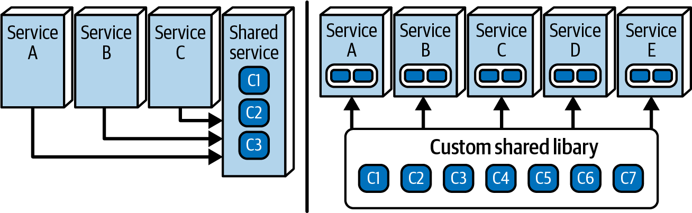
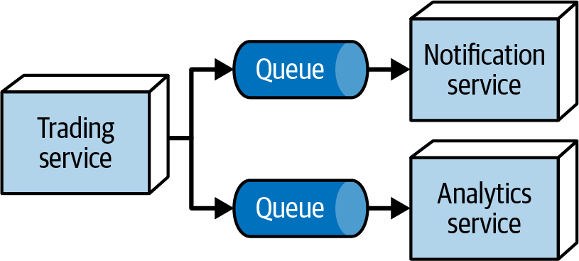
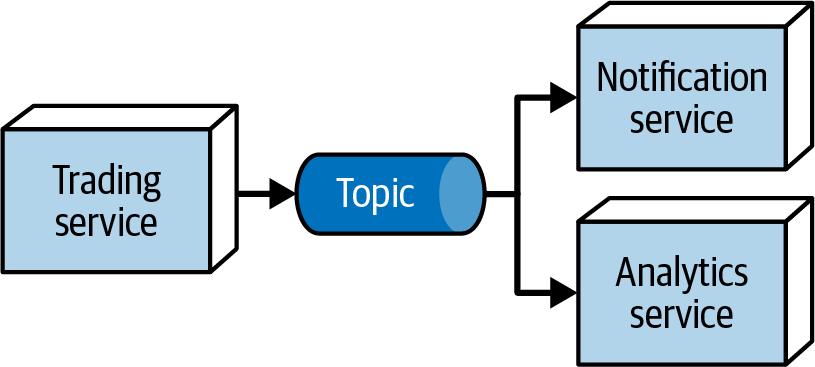

# Chương 27. Nhìn lại các định luật của software architecture (The Laws of Software Architecture, Revisited)

Từ tận [Chương 1](ch01_introduction.vi.md#ch01-introduction), chúng tôi đã mô tả ba định luật của software architecture:

- Mọi thứ trong software architecture đều là một trade-off.
- *Tại sao* quan trọng hơn *như thế nào*.
- Hầu hết các architecture decision không phải là nhị phân mà tồn tại trên một dải phổ giữa các thái cực.

Gần như mọi ví dụ trong cuốn sách này đều đã minh họa những định luật này, điều chỉ ra câu chuyện nguồn gốc của chúng. Khi viết ấn bản đầu tiên, chúng tôi hy vọng tìm được nhiều điều có vẻ đúng một cách phổ quát về software architecture và hệ thống hóa chúng thành *định luật*. Thật ngạc nhiên, rốt cuộc chúng tôi chỉ xác định được hai định luật trong ấn bản đầu tiên, rồi khám phá thêm một định luật nữa khi viết ấn bản thứ hai. Đúng với ý định ban đầu, ba định luật này có vẻ khá phổ quát và định hướng nhiều góc nhìn quan trọng cho các kiến trúc sư phần mềm đang hành nghề.

Trong chương ngắn này, chúng tôi sẽ nhìn lại các định luật này dưới ánh sáng của các ví dụ chúng tôi đã trình bày và chỉ ra một số sắc thái về phân tích trade-off.

## Định luật thứ nhất: mọi thứ trong software architecture đều là một sự đánh đổi (First Law: Everything in Software Architecture Is a Trade-Off)

Định luật thứ nhất của chúng tôi là một trong những đặc điểm định nghĩa của software architecture—mọi thứ đều là một trade-off. Nhiều người nghĩ rằng công việc của một kiến trúc sư phần mềm là tìm ra những giải pháp thần kỳ (silver bullet) cho những vấn đề hóc búa và trở thành người hùng, nhưng điều đó hiếm khi xảy ra. (Kiến trúc sư hiếm khi được ghi công cho những quyết định tốt, nhưng luôn bị đổ lỗi cho những quyết định tồi.) Không, công việc thực sự của software architecture là phân tích trade-offs.

Chúng tôi tin rằng, vì một vài lý do, mọi kiến trúc sư nên trau dồi danh tiếng của mình như một người phân xử khách quan về trade-offs, thay vì truyền bá cho một cách tiếp cận cụ thể.

Thứ nhất, việc truyền bá trong architecture là nguy hiểm về lâu dài, vì best practice của hôm qua có xu hướng trở thành antipattern của ngày mai. Kiến trúc sư đưa ra các quyết định trade-off dựa trên các yếu tố và tình huống hiện tại tốt nhất có thể, với kiến thức chưa đầy đủ. Tuy nhiên, ngay cả khi một quyết định là đúng đắn tại thời điểm đưa ra, hệ sinh thái phát triển phần mềm tồn tại trong trạng thái tiến hóa và xáo trộn liên tục, có nghĩa là hoàn cảnh dần thay đổi và có khả năng cuối cùng sẽ làm suy yếu (hoặc vô hiệu hóa) quyết định đó. Nếu kiến trúc sư đã đầu tư vốn xã hội vào việc truyền bá cho giải pháp đó, danh tiếng của họ có thể bị tổn hại khi quyết định đó phải thay đổi về sau. Hãy luôn giữ cái nhìn clear-eyed (tỉnh táo) và khách quan về các lựa chọn công nghệ để tránh gắn uy tín của mình vào một quyết định không bền theo thời gian.

Thứ hai, những người ra quyết định trong tổ chức không thực sự tìm kiếm sự ủng hộ nhiệt tình mà là sự khách quan tỉnh táo. Một kiến trúc sư xây dựng được danh tiếng là người go-to cho phân tích trade-off khách quan trở thành một tài sản giá trị đối với tổ chức của họ. Khi quyết định là then chốt, những người ra quyết định muốn một người có phán đoán mà họ có thể tin tưởng; người đó nên là bạn.

Hãy xem một số ví dụ về phân tích trade-off cho một vài quyết định software architecture, rồi thảo luận một lỗ hổng phổ biến trong hiểu biết.

### Thư viện dùng chung so với service dùng chung (Shared Library Versus Shared Service)

Một thế khó phổ biến đối với kiến trúc sư liên quan đến hành vi dùng chung trong các architecture phân tán, như microservices hoặc EDA: chúng ta nên dùng một thư viện dùng chung được biên dịch vào mỗi service tại thời điểm build, hay dùng một service dùng chung mà các service khác gọi tại runtime, như minh họa trong [Hình 27-1](#fosa_2e_new_2701)?

*Hình 27-1. Giải pháp nên dùng thư viện dùng chung hay service dùng chung cho chức năng chung?*

Trong [Hình 27-1](#fosa_2e_new_2701), service bên trái đóng gói hành vi dùng chung, và các service khác gọi để truy cập nó. Bên phải, chúng ta có một thư viện dùng chung, được biên dịch vào mỗi service trước khi deployment. Cái nào tốt hơn?

Đến giờ, độc giả đã biết câu trả lời cho mọi câu hỏi như vậy: “Còn tùy!” Nhưng bạn cần trả lời câu hỏi follow-up không thể tránh khỏi: “Tùy vào cái gì?” Như nhiều quyết định không tầm thường trong software architecture, câu trả lời cho câu hỏi này không hiển nhiên ngay lập tức, nên đã đến lúc bạn, với tư cách kiến trúc sư, tiến hành phân tích trade-off.

Trước tiên, bạn phải xác định tất cả các trade-offs theo bối cảnh tạo ra khác biệt cho giải pháp này. Danh sách này sẽ rất đặc thù cho cả tổ chức lẫn giải pháp, nên bạn sẽ cần dựa vào hiểu biết của mình về tổ chức, bức tranh công nghệ, năng lực team, ngân sách, và mọi thứ khác định hướng các lựa chọn trade-off của bạn. Với giải pháp này, chúng tôi đã tạo danh sách các yếu tố thích đáng sau:

**Code không đồng nhất (Heterogeneous code)**

Nếu các giải pháp được viết trên nhiều nền tảng, thì service sẽ dễ làm việc hơn vì, bất kể technology stack, bên gọi truy cập service qua mạng, khiến nền tảng triển khai không còn quan trọng. Với thư viện, team sẽ cần một phiên bản code cho mỗi technology stack và sẽ phải giữ các phiên bản đồng bộ, làm tăng đáng kể độ phức tạp tổng thể của dự án.

**Code dễ biến động cao (High code volatility)**

Hãy nhớ lại rằng code volatility đo tốc độ code thay đổi (thường được biết đến là *churn*). Với một service, bên gọi truy cập chức năng mới ngay khi họ deploy service đã cập nhật, nên nếu bạn cần thay đổi thư viện, bạn sẽ phải biên dịch lại và deploy lại mỗi service để tận dụng các tính năng mới.

**Khả năng versioning thay đổi (Ability to version changes)**

Versioning dễ dàng hơn nhiều ở thư viện so với ở service. Khi thư viện cần cập nhật, team có thể giải quyết các khác biệt phiên bản tại thời điểm biên dịch và chỉ build những gì họ cần. Với service, thông tin phiên bản phải được xác định tại runtime, điều làm phức tạp tương tác với service.

**Rủi ro thay đổi tổng thể (Overall change risk)**

Rủi ro thay đổi tốt hơn đối với thư viện. Một khi bạn thay đổi code thư viện và biên dịch thành công vào service, bạn có thể rất tự tin rằng nó sẽ hoạt động. Ngược lại, service có thể thay đổi mà không có bất kỳ kiểm chứng compile-time nào, điều làm tăng khả năng tiềm tàng xảy ra lỗi runtime tại thời điểm gọi.

**Performance**

Thư viện rõ ràng sẽ có performance tốt hơn, vì các lời gọi tới chức năng dùng chung là các lời gọi in-process, so với các lời gọi mạng cần thiết cho service. Những lời gọi này sẽ chậm hơn nhiều so với lời gọi in-process do latency mạng và các yếu tố khác.

**Fault tolerance**

Như chúng tôi đã thảo luận trong [Chương 9](ch09_foundations.vi.md#ch-architecture-styles), truy cập runtime tới các service luôn chịu các vấn đề mạng tiềm tàng, kể cả service đang bàn ở đây. Thư viện mang lại fault tolerance tốt hơn: một khi bạn biên dịch, test và deploy service, bạn có thể rất tự tin rằng nó ổn định.

**Scalability**

Cũng như performance, các lời gọi giữa các service chịu latency, điều làm giảm scalability. Do đó, thư viện sẽ mang lại scalability tốt hơn, vì truy cập hành vi dùng chung là một lời gọi in-process rất hiệu quả.

Khi đã xác định danh sách các yếu tố quan trọng, bạn có thể tạo một ma trận để so sánh mỗi lựa chọn làm tốt đến mức nào đối với từng tiêu chí, như trong [Bảng 27-1](#totbl-library-vs-service).

*Bảng 27-1. Trade-offs giữa service dùng chung và thư viện dùng chung*

| Yếu tố | Thư viện dùng chung | Service dùng chung |
|---|---|---|
| Code không đồng nhất | \- | \+ |
| Code dễ biến động cao | \- | \+ |
| Khả năng versioning thay đổi | \+ | \- |
| Rủi ro thay đổi tổng thể | \+ | \- |
| Performance | \+ | \- |
| Fault tolerance | \+ | \- |
| Scalability | \+ | \- |

Sự tích lũy các điểm cộng của thư viện dùng chung khiến nó chiến thắng…ít nhất, đối với các yếu tố này và trong bối cảnh này. Nó có thể là hoặc không là giải pháp cho vấn đề trước mắt—bạn có thể cần áp dụng thêm trọng số (xem [“Second Corollary: You Can’t Do It Just Once”](#sec-3rd-corollary) để biết thêm chi tiết)—nhưng giờ bạn và team của bạn có một ý niệm tốt về các lực đang tác động.

### Messaging đồng bộ so với bất đồng bộ (Synchronous Versus Asynchronous Messaging)

Hãy xét phân tích trade-off sau: team của bạn đang xây dựng một architecture phân tán để gửi thông tin giao dịch tới cả service `Notification` lẫn `Analytics`, và bạn đang cố quyết định dùng *queue* hay *topic* để triển khai hành vi này.

Lựa chọn thứ nhất là queue, hay một giao thức giao tiếp point-to-point. Như bạn đã học trong [Chương 2](ch02_architectural_thinking.vi.md#ch-architectural-thinking), bên publish biết ai đang nhận message. Để đến được nhiều consumer, bên publish cần gửi một message tới một queue cho mỗi consumer. Nếu service `Trading` muốn dùng queue để báo cho service `Analytics` và service `Reporting` về các giao dịch, cách triển khai sẽ trông như trong [Hình 27-2](#fosa_2e_new_2702).

*Hình 27-2. Dùng queue để truyền thông tin giao dịch tới `Notification` và `Analytics`*

Trong [Hình 27-2](#fosa_2e_new_2702), service `Trading` phát một message tới mỗi consumer qua một queue. Mỗi consumer có queue riêng, và bên gửi đăng một message vào mỗi queue.

*Hình 27-3. Dùng topic để truyền thông tin giao dịch tới `Notification` và `Analytics`*

Topology thay thế dùng một *topic* thay vào đó, thứ triển khai việc phát quảng bá thay vì giao tiếp point-to-point. Trong [Hình 27-3](#fosa_2e_new_2703), service `Trading` đăng một message duy nhất lên một topic. Mỗi consumer subscribe topic, và tất cả đều nhận được thông báo khi một message xuất hiện. Trong trường hợp này, bên publish message không biết (hay quan tâm) consumer là ai—thực tế, team có thể thêm consumer mới bất cứ lúc nào mà không thay đổi các consumer khác hay producer.

Cả hai lựa chọn đều khả thi, vậy bạn nên quyết định thế nào? Tất nhiên là bằng cách thực hiện phân tích trade-off.

Với queue, mọi service mà service `Trading` cần thông báo sẽ cần một queue riêng. Điều này hay nếu service `Notification` và service `Analytics` cần thông tin khác nhau, vì bạn có thể gửi các message khác nhau tới mỗi queue. Service `Trading` biết mọi hệ thống mà nó giao tiếp, điều khiến một service khác (có thể là giả mạo) khó “nghe lén” hơn. Điều đó đặc biệt có lợi nếu security ở vị trí cao trong danh sách ưu tiên. Vì mỗi queue độc lập, bạn có thể giám sát chúng riêng biệt và thậm chí scale chúng độc lập nếu cần. Service `Trading` bị coupled chặt với các consumer của nó—nó biết chính xác có bao nhiêu consumer. Tuy nhiên, nếu bạn cần gửi message tới service `Compliance`, bạn sẽ phải sửa lại service `Trading` để bắt đầu gửi message tới một queue thứ ba.

[Bảng 27-2](#totbl-queue-vs-topic) tóm tắt các trade-offs của việc dùng queue cho dự án này.

*Bảng 27-2. Trade-offs khi dùng queue*

| Ưu điểm | Nhược điểm |
|---|---|
| Hỗ trợ message không đồng nhất cho các consumer khác nhau | Mức coupling cao hơn |
| Cho phép giám sát độc lập độ sâu queue | Service Trading phải kết nối tới nhiều queue |
| Bảo mật hơn | Đòi hỏi hạ tầng bổ sung |
| Kém khả năng mở rộng hơn (phải thêm queue cho nhiều consumer hơn) | Hỗ trợ tốt cho khả năng mở rộng và evolvability |

Hãy làm cùng bài tập đó cho topic. Một ưu điểm là rõ ràng: topic cực kỳ dễ mở rộng. Bất kỳ consumer mới nào quan tâm, chẳng hạn, đến compliance, có thể subscribe topic đó mà không động đến bất kỳ hành vi hiện có nào. Tuy nhiên, ưu điểm này có mặt trái: mỗi consumer phải tiêu thụ cùng một message từ topic, điều có thể dẫn đến *stamp coupling* (như trong [Hình 9-9](ch09_foundations.vi.md#fig-architecture-styles-fallacy3)). Và, vì mọi consumer đều có thể đọc toàn bộ message, có những lo ngại về security: *liệu* mọi người có nên đọc được toàn bộ message không?

Với góc nhìn này trong tay, bạn có thể lập bảng trade-off của mình, như trong [Bảng 27-3](#totbl-topics).

*Bảng 27-3. Trade-offs khi dùng topic*

| Ưu điểm | Nhược điểm |
|---|---|
| Coupling thấp | Message đồng nhất cho mỗi consumer |
| Service Trading chỉ tạo một message | Không thể giám sát hoặc scale từng consumer riêng lẻ |
| Dễ mở rộng/tiến hóa hơn | Kém bảo mật hơn |
|  | Ít lựa chọn scalability hơn |

Giờ bạn đã phân tích trade-off, bạn cần quay lại các mục tiêu tổ chức cho giải pháp này và xem lựa chọn nào phù hợp hơn. Nếu security quan trọng hơn, có lẽ bạn nên chọn queue. Nếu tổ chức đang tăng trưởng nhanh và có các service khác quan tâm đến giao dịch, thì khả năng mở rộng có thể là một ưu tiên, điều sẽ dẫn bạn đến dùng topic.

### Hệ quả thứ nhất: những đánh đổi bị bỏ sót (First Corollary: Missing Trade-Offs)

Định luật thứ nhất của chúng tôi có hai hệ quả. Hệ quả thứ nhất là:

> Nếu bạn nghĩ mình đã khám phá ra điều gì đó *không phải* là một trade-off, nhiều khả năng là bạn chỉ chưa *xác định* được trade-off…mà thôi.
>
> —Hệ quả 1

Bản chất của một quyết định software architecture là phân tích trade-off, nhưng điều gì xảy ra khi bạn gặp một quyết định dường như không có trade-offs nào? Lời khuyên của chúng tôi: hãy tiếp tục tìm!

Hãy xét tái sử dụng code. Chắc chắn đây là một thực hành hoàn toàn có lợi, phải không? Tổ chức càng tái sử dụng được nhiều code, càng phải viết ít code, tiết kiệm thời gian và tránh trùng lặp.

Hai yếu tố quyết định tái sử dụng code sẽ hiệu quả đến mức nào. Kiến trúc sư thường khám phá ra yếu tố thứ nhất nhưng bỏ sót yếu tố thứ hai. Yếu tố thứ nhất là *trừu tượng hóa*: nếu bạn có thể trừu tượng hóa đoạn code này và dùng nó từ nhiều điểm gọi, nó là một ứng viên tốt để tái sử dụng. Yếu tố thứ hai là *tính dễ biến động thấp*. Khi một team tái sử dụng một module code luôn thay đổi, điều này tạo ra sự xáo trộn trong toàn bộ hệ thống. Mỗi khi code dùng chung thay đổi, mọi bên gọi code đó phải phối hợp xoay quanh thay đổi đó. Ngay cả khi đó không phải là thay đổi phá vỡ tương thích, team vẫn phải kiểm chứng rằng thay đổi không làm hỏng gì. Khi các architecture tái sử dụng code không phù hợp, các team rốt cuộc phải đuổi theo những thay đổi phá vỡ tương thích khắp architecture. Đây là một trong những bài học then chốt mà giới kiến trúc sư đã học được từ architecture style orchestration-driven SOA (được đề cập trong [Chương 17](ch17_orchestration_driven_service_oriented_architecture.vi.md#ch-style-esb-soa)), một trong những triết lý nền tảng của nó là cố tái sử dụng càng nhiều code càng tốt. Từ góc nhìn thực tế, các team làm việc trong những architecture đó như đang bơi trong cát lún: mọi thay đổi đều có khả năng gây ra những tác dụng phụ không lường trước lan tỏa khắp hệ thống.

Đó là trade-off ẩn giấu: tái sử dụng code hiệu quả đòi hỏi trừu tượng hóa tốt *và* tính dễ biến động thấp. Đó là lý do các mục tiêu tái sử dụng thành công nhất trong architecture là “hệ thống đường ống”: framework công nghệ, thư viện, nền tảng, v.v. Phần thay đổi nhanh nhất của hầu hết các ứng dụng là domain (động lực để viết phần mềm ngay từ đầu), nên các khái niệm domain là ứng viên tồi tệ cho tái sử dụng. (Lưu ý rằng điều này là nền tảng của nguyên lý bounded context trong DDD—không bounded context nào có thể tái sử dụng bất kỳ chi tiết triển khai nào của một bounded context khác.)

> **Vì sao chúng ta không thể có những thứ tốt đẹp—vì đánh đổi! (Why We Can’t Have Nice Things—Trade-Offs!)**
>
> Là những nhà tư vấn chuyên nghiệp, khách hàng của chúng tôi thường đưa ra những yêu cầu như sau: “Chúng tôi thích ý tưởng microservices và các architecture phân tán có mức decoupling cao vì chúng cho phép mức agility cao và deployment nhanh. Tuy nhiên, chúng tôi cũng muốn mức tái sử dụng cao trong toàn tổ chức để các team không phải liên tục viết lại code.”
>
> Chúng tôi phải là người mang tin xấu ở đây: bạn không thể có cả hai thứ này, vì cách một hệ thống triển khai tái sử dụng là thông qua coupling. Không tổ chức nào có thể có cả decoupling *lẫn* mức tái sử dụng cao. Hai thứ này về cơ bản không tương thích. Đây là một ví dụ điển hình về việc các tổ chức có thể hiểu sai các trade-offs then chốt như thế nào.

### Hệ quả thứ hai: bạn không thể chỉ làm một lần (Second Corollary: You Can’t Do It Just Once)

Sẽ thật tuyệt nếu một kiến trúc sư chỉ cần thực hiện một lần phân tích trade-off—chỉ cần suy nghĩ *thật kỹ* và quyết định một lần cho tất cả là dùng choreography cho mọi workflow. Nhưng có hai vấn đề với phân tích trade-off. Thứ nhất, thường có hàng chục hoặc thậm chí hàng trăm biến số (kỹ thuật và phi kỹ thuật) đóng góp vào quyết định: độ phức tạp, kinh nghiệm team, ngân sách, team topology, áp lực tiến độ…danh sách là vô tận. Những khác biệt tinh tế trong các biến số đó có thể đẩy một phân tích cụ thể theo hướng này hay hướng khác, khiến đây là một bài tập liên tục. Thật nguy hiểm khi kiến trúc sư đưa ra những quyết định bao trùm, gần như vĩnh viễn dựa trên những giả định có thể không đúng cho các lần áp dụng giải pháp này trong tương lai.

Hãy nghĩ về hệ quả này như sự bảo đảm việc làm cho kiến trúc sư. Chúng ta phải tiếp tục phân tích trade-off lặp đi lặp lại, ngay cả với những tình huống tưởng như tương tự. Điều này củng cố ý tưởng rằng công việc thực sự là phân tích trade-off, chứ không phải đưa ra những quyết định hoàn hảo, vĩnh viễn.

## Định luật thứ hai: tại sao quan trọng hơn như thế nào (Second Law: Why Is More Important Than How)

Định luật thứ hai của chúng tôi nhấn mạnh tầm quan trọng của *tại sao* hơn *như thế nào*. Là những kiến trúc sư giàu kinh nghiệm, chúng tôi có thể nhìn vào một hệ thống hiện có và nói cho ai đó biết nó hoạt động *như thế nào*. Tuy nhiên, sẽ có một số quyết định mà không rõ *tại sao* kiến trúc sư trước đó chọn lựa chọn này thay vì lựa chọn khác, vì họ không ghi lại tất cả các tiêu chí quyết định cùng với giải pháp cuối cùng.

Đó là lý do chúng tôi nhấn mạnh tầm quan trọng của việc dùng cả sơ đồ architecture *lẫn* ADR (được đề cập trong [Chương 21](ch21_architectural_decisions.vi.md#ch-architectural-decisions)). Mỗi lần phân tích trade-off tạo ra một lượng bối cảnh khổng lồ không xuất hiện trong giải pháp. Điều then chốt là ghi tài liệu phân tích đó (cùng với những thỏa hiệp và giới hạn đã biết của giải pháp) để ngăn các kiến trúc sư tương lai (có thể chính là bạn) phải làm lại phân tích chỉ để hiểu *tại sao*.

### Antipattern Out of Context (Out of Context Antipattern)

Một antipattern phổ biến trong phân tích trade-off là antipattern *Out of Context* (lạc bối cảnh). Antipattern này xảy ra khi kiến trúc sư hiểu các trade-offs nhưng không biết cách *gán trọng số* cho tất cả chúng dựa trên bối cảnh hiện tại.

Hãy xét phân tích trade-off chúng tôi đã làm trong [“Shared Library Versus Shared Service”](#sec-library-vs-service). Nhìn một cách khách quan, thư viện dùng chung có vẻ là giải pháp được ưu tiên, vì nó đạt được nhiều đánh giá tích cực hơn tiêu cực. Tuy nhiên, phân tích trade-off này có một khiếm khuyết tiềm tàng: tất cả các tiêu chí của nó có trọng số bằng nhau không?

Hãy tưởng tượng một team có code trên nhiều nền tảng. Họ không quá quan tâm đến performance hay quy mô, nhưng muốn một cách gọn gàng để quản lý hành vi dùng chung. Trong trường hợp này, hai tiêu chí trade-off đầu tiên có mức ưu tiên cao hơn nhiều, điều nên dẫn họ đến chọn service dùng chung. Như một phần thưởng thêm, team đã biết được những vấn đề nào họ sẽ phải giảm nhẹ.

Kiến trúc sư dựa vào kinh nghiệm để xây dựng các tiêu chí trade-off, nhưng cũng phải cân trọng số các tiêu chí đó để tìm sự phù hợp đúng cho giải pháp. Phân tích trade-off chung chung không hữu ích lắm—nó chỉ trở nên có giá trị khi được áp dụng trong một bối cảnh cụ thể.

## Dải phổ giữa các thái cực (The Spectrum Between Extremes)

Trong ấn bản đầu tiên, chúng tôi chỉ xác định hai định luật. Tuy nhiên, chúng tôi đã dần nhận ra rằng tồn tại một định luật thứ ba:

> Hầu hết các architecture decision không phải là nhị phân mà tồn tại trên một dải phổ giữa các thái cực.
>
> —Định luật thứ ba của software architecture

Sẽ thật tuyệt nếu được sống trong một thế giới với những quyết định nhị phân, gọn gàng, rõ ràng—nhưng software architecture không tồn tại trong thế giới đó. Mọi người thường nhận thấy việc đưa ra những định nghĩa toàn diện về các khái niệm quan trọng trong software architecture khó khăn đến mức nào: architecture so với thiết kế, orchestration so với choreography, topic so với queue, v.v. Lý do nền tảng là các tiêu chí quyết định không phải là nhị phân; chúng nằm dọc theo một dải phổ khá lộn xộn.

Trong [“Architecture Versus Design”](ch02_architectural_thinking.vi.md#sec-arch-vs-design), chúng tôi đã thảo luận dải phổ giữa architecture và thiết kế và cách xác định một quyết định cụ thể nằm ở đâu trong dải phổ đó. Thực tế, định luật này cung cấp một cách hữu ích để nghĩ về những quyết định gần phía software architecture của dải phổ hơn phía thiết kế:

> Một quyết định software architecture là quyết định mà mỗi lựa chọn đều có trade-offs đáng kể.

Nếu mọi thứ trong software architecture đều là một trade-off, thì một quyết định kiến trúc phải bao gồm trade-offs cho mỗi lựa chọn.

Là một kiến trúc sư, đừng cố quy mọi quyết định về nhị phân—rất ít quyết định như vậy tồn tại trong thế giới của chúng ta. Đó là một trong những lý do mọi câu trả lời trong software architecture đều là “còn tùy”—còn tùy vào việc tiêu chí đang xét rơi vào đâu trên dải phổ các giải pháp khả dĩ.

Là kiến trúc sư, chúng ta đưa ra quyết định trong một đầm lầy bất định. Thích nghi với điều này thật khó chịu, nhưng cần thiết. Không chỉ đôi khi chúng ta phải dựa các quyết định quan trọng vào thông tin chưa đầy đủ, mà thường thì quyết định sẽ không clear-cut (rạch ròi), ngay cả khi chúng ta có đầy đủ thông tin, vì nó nằm đâu đó trên một dải phổ giữa hai thái cực.

Chào mừng đến với software architecture!

## Lời khuyên chia tay (Parting Words of Advice)

> Làm sao chúng ta có được những nhà thiết kế giỏi? Tất nhiên, những nhà thiết kế giỏi thì thiết kế.
>
> —Fred Brooks

> Vậy làm sao chúng ta có được những kiến trúc sư giỏi, nếu họ chỉ có cơ hội làm kiến trúc ít hơn half-dozen (nửa tá) lần trong sự nghiệp?
>
> —Ted Neward

Thực hành là cách đã được chứng minh để xây dựng kỹ năng và trở nên giỏi hơn ở bất cứ điều gì trong cuộc sống, kể cả architecture. Chúng tôi khuyến khích các kiến trúc sư mới và hiện tại tiếp tục mài giũa kỹ năng trong nghề thiết kế architecture cũng như mở rộng bề rộng công nghệ cá nhân. Để làm điều đó, chúng tôi đã tạo một số [architecture kata](https://oreil.ly/EPop7) mô phỏng theo các ví dụ trong cuốn sách này, mà bạn có thể tìm thấy trên trang web đi kèm. Chúng tôi khuyến khích bạn dùng chúng để luyện tập và xây dựng kỹ năng về architecture.

Những người dùng kata của chúng tôi thường hỏi: có hướng dẫn đáp án ở đâu đó không? Đáng tiếc là không. Trích lời Neal:

> Không có câu trả lời đúng hay sai trong architecture—chỉ có *trade-offs*.

Khi các tác giả bắt đầu dùng architecture kata trong các lớp đào tạo trực tiếp, ban đầu chúng tôi giữ lại các hình vẽ mà học viên tạo ra, với mục tiêu tạo ra một kho đáp án. Tuy nhiên, chúng tôi nhanh chóng bỏ cuộc, vì nhận ra rằng đây là những artifact chưa hoàn chỉnh. Các team đã ghi lại *cách* họ triển khai giải pháp bằng hình vẽ topology. *Lý do tại sao* thú vị hơn nhiều—nhưng dù họ đã giải thích các trade-offs họ cân nhắc trong lớp, họ không có thời gian để tạo architecture decision record. Chỉ giữ lại *cách* nghĩa là chúng tôi chỉ có một nửa câu chuyện.

Vì vậy, lời khuyên chia tay của chúng tôi: luôn học hỏi, luôn thực hành, và *hãy bắt tay làm architecture*!
