

# 1. Software architecture là gì? (What Is Software Architecture?)

> Chúng ta được kêu gọi để trở thành những kiến trúc sư của tương lai, không phải nạn nhân của nó. 
> —R. Buckminster Fuller

Việc viết (về phía chúng tôi) và đọc (về phía bạn) một cuốn sách về software architecture, vốn chắt lọc kinh nghiệm của nhiều người, mặc nhiên giả định rằng

1. có một software architecture hợp lý là điều quan trọng đối với việc phát triển thành công một hệ thống phần mềm và
2. có đủ một khối kiến thức về software architecture để viết thành một cuốn sách.

Đã có thời cả hai giả định này đều cần được biện minh. Các ấn bản đầu của cuốn sách này đã cố gắng thuyết phục người đọc rằng cả hai giả định đều đúng và, một khi bạn đã bị thuyết phục, cung cấp cho bạn kiến thức cơ bản để bạn có thể tự mình áp dụng thực hành architecture. Ngày nay, dường như có rất ít tranh cãi về cả hai mục tiêu đó, nên cuốn sách này thiên về việc cung cấp hơn là thuyết phục.

Nguyên lý cơ bản của software architecture là mọi hệ thống phần mềm đều được xây dựng để thỏa mãn các mục tiêu kinh doanh (business goal) của một tổ chức, và architecture của một hệ thống là cây cầu nối giữa những mục tiêu kinh doanh (thường trừu tượng) đó với hệ thống kết quả cuối cùng (cụ thể). Dù con đường từ các mục tiêu trừu tượng đến các hệ thống cụ thể có thể phức tạp, tin tốt là software architecture có thể được thiết kế, phân tích và tài liệu hóa bằng các kỹ thuật đã biết, những kỹ thuật sẽ hỗ trợ việc đạt được các mục tiêu kinh doanh này. Sự phức tạp có thể được chế ngự, trở nên dễ xử lý.

Vậy thì đây là các chủ đề của cuốn sách này: thiết kế, phân tích và tài liệu hóa architecture. Chúng tôi cũng sẽ xem xét các yếu tố ảnh hưởng, chủ yếu dưới dạng các mục tiêu kinh doanh dẫn đến các yêu cầu quality attribute, định hướng cho những hoạt động này.

Trong chương này, chúng tôi sẽ tập trung vào architecture thuần túy từ góc nhìn software *engineering*. Tức là, chúng tôi sẽ khám phá giá trị mà một software architecture mang lại cho một dự án phát triển. Các chương sau sẽ xét từ góc nhìn kinh doanh và tổ chức.

## 1.1 Software architecture là gì và không là gì (What Software Architecture Is and What It Isn’t)

Có rất nhiều định nghĩa về software architecture, dễ dàng tìm thấy bằng một lần tìm kiếm trên web, nhưng định nghĩa mà chúng tôi thích là:

> Software architecture của một hệ thống là tập hợp các structure cần thiết để suy luận về hệ thống đó. Các structure này gồm các software element, các relation giữa chúng, và các thuộc tính (property) của cả hai.

Định nghĩa này trái ngược với các định nghĩa khác nói về các quyết định “sớm”, “chính” hay “quan trọng” của hệ thống. Dù đúng là nhiều quyết định về architecture được đưa ra sớm, không phải tất cả đều như vậy—đặc biệt là trong các dự án Agile và spiral-development. Cũng đúng là nhiều quyết định được đưa ra sớm lại không phải là thứ mà chúng tôi coi là thuộc về architecture. Ngoài ra, thật khó để nhìn vào một quyết định và nói liệu nó có “chính” hay không. Đôi khi chỉ thời gian mới trả lời được. Và vì quyết định một architecture là một trong những nghĩa vụ quan trọng nhất của kiến trúc sư, chúng ta cần biết một architecture bao gồm những quyết định nào.

Ngược lại, các structure khá dễ nhận diện trong phần mềm, và chúng tạo thành một công cụ mạnh mẽ cho việc thiết kế và phân tích hệ thống.

Vậy là, đây rồi: Architecture là về các structure giúp cho việc suy luận (reasoning-enabling structures).

Hãy xem xét một số hệ quả của định nghĩa này.

### Architecture là một tập các software structure (Architecture Is a Set of Software Structures)

Đây là hệ quả đầu tiên và hiển nhiên nhất của định nghĩa. Một structure đơn giản là một tập các element được gắn kết với nhau bởi một relation. Các hệ thống phần mềm gồm nhiều structure, và không một structure đơn lẻ nào có thể tự nhận mình là *chính* architecture. Các structure có thể được nhóm thành các loại, và bản thân các loại này cung cấp những cách hữu ích để suy nghĩ về architecture. Các structure thuộc architecture có thể được tổ chức thành ba loại hữu ích, những loại sẽ đóng vai trò quan trọng trong việc thiết kế, tài liệu hóa và phân tích architecture:

1. Component-and-connector structure
2. Module structure
3. Allocation structure

Chúng ta sẽ tìm hiểu sâu hơn về các loại structure này trong mục tiếp theo.

Dù phần mềm chứa vô số structure, không phải tất cả chúng đều thuộc về architecture. Ví dụ, tập các dòng source code chứa chữ “z”, được sắp theo độ dài tăng dần từ ngắn nhất đến dài nhất, là một software structure. Nhưng nó không phải là một structure thú vị, cũng không thuộc về architecture. Một structure thuộc về architecture nếu nó hỗ trợ việc suy luận về hệ thống và các thuộc tính của hệ thống. Việc suy luận nên hướng vào một thuộc tính của hệ thống quan trọng đối với một (hoặc một số) stakeholder(s) nào đó. Chúng bao gồm các thuộc tính như chức năng mà hệ thống đạt được, khả năng hệ thống tiếp tục hoạt động hữu ích khi gặp lỗi hoặc khi có các nỗ lực đánh sập nó, mức độ dễ hay khó khi thực hiện những thay đổi cụ thể đối với hệ thống, khả năng phản hồi của hệ thống trước các yêu cầu của người dùng, và nhiều thuộc tính khác. Chúng tôi sẽ dành rất nhiều thời gian trong cuốn sách này để khám phá mối quan hệ giữa architecture và các *quality attribute* như vậy.

Do đó, tập các structure thuộc architecture không cố định cũng không giới hạn. Cái gì thuộc về architecture phụ thuộc vào cái gì hữu ích để suy luận trong bối cảnh của bạn, cho hệ thống của bạn.

### Architecture là một sự trừu tượng hóa (Architecture Is an Abstraction)

Vì architecture gồm các structure, và các structure gồm các element[1](#ch01fn1) và relation, nên suy ra một architecture bao gồm các software element và cách các element đó liên hệ với nhau. Điều này có nghĩa là architecture cụ thể và có chủ đích bỏ qua một số thông tin về các element không hữu ích cho việc suy luận về hệ thống. Do đó, trước hết một architecture là một sự *trừu tượng hóa* (abstraction) của một hệ thống, chọn ra một số chi tiết nhất định và ẩn đi những chi tiết khác. Trong mọi hệ thống hiện đại, các element tương tác với nhau thông qua các interface, những interface chia các chi tiết về một element thành phần public và phần private. Architecture quan tâm đến phía public của sự phân chia này; các chi tiết private của element—những chi tiết chỉ liên quan đến implementation bên trong—không thuộc về architecture. Sự trừu tượng hóa này là thiết yếu để chế ngự sự phức tạp của một architecture: Đơn giản là chúng ta không thể, và cũng không muốn, xử lý toàn bộ sự phức tạp mọi lúc. Chúng ta muốn—và cần—việc hiểu architecture của một hệ thống dễ hơn nhiều bậc so với việc hiểu mọi chi tiết về hệ thống đó. Bạn không thể giữ trong đầu mọi chi tiết của một hệ thống dù chỉ có kích thước vừa phải; mục đích của architecture là giúp bạn không phải làm vậy.

[1](#ch01fn1a) Trong cuốn sách này, chúng tôi dùng thuật ngữ “element” khi muốn nói đến một module hoặc một component mà không muốn phân biệt giữa hai thứ đó.

### Architecture so với thiết kế (Architecture versus Design)

Architecture là thiết kế, nhưng không phải mọi thiết kế đều là architecture. Tức là, nhiều quyết định thiết kế không bị architecture ràng buộc—xét cho cùng, nó là một sự trừu tượng hóa—và phụ thuộc vào sự cân nhắc và óc phán đoán tốt của những người thiết kế ở khâu sau và thậm chí của những người hiện thực.

### Mọi hệ thống phần mềm đều có một software architecture (Every Software System Has a Software Architecture)

Mọi hệ thống đều có một architecture, vì mọi hệ thống đều có các element và relation. Tuy nhiên, điều đó không có nghĩa là architecture được ai đó biết đến. Có thể tất cả những người đã thiết kế hệ thống đều đã rời đi từ lâu, tài liệu đã biến mất (hoặc chưa bao giờ được tạo ra), source code đã bị mất (hoặc chưa bao giờ được bàn giao), và tất cả những gì chúng ta có trong tay là binary code đang chạy. Điều này cho thấy sự khác biệt giữa architecture của một hệ thống và *biểu diễn* (representation) của architecture đó. Vì một architecture có thể tồn tại độc lập với mô tả hay đặc tả của nó, điều này nâng cao tầm quan trọng của *tài liệu hóa architecture* (architecture documentation), được mô tả trong [Chương 22](ch22_documenting_an_architecture.vi.md#ch22).

### Không phải architecture nào cũng là architecture tốt (Not All Architectures Are Good Architectures)

Định nghĩa của chúng tôi không quan tâm đến việc architecture của một hệ thống là tốt hay xấu. Một architecture có thể hỗ trợ hoặc cản trở việc đạt được các yêu cầu quan trọng của một hệ thống. Giả sử chúng ta không chấp nhận thử và sai là cách tốt nhất để chọn một architecture cho một hệ thống—tức là chọn ngẫu nhiên một architecture, xây dựng hệ thống từ nó, rồi cứ thế vá víu và cầu mong điều tốt nhất—điều này nâng cao tầm quan trọng của *thiết kế architecture* (architecture design), được trình bày trong [Chương 20](ch20_designing_an_architecture.vi.md#ch20), và *đánh giá architecture* (architecture evaluation), sẽ được đề cập trong [Chương 21](ch21_evaluating_an_architecture.vi.md#ch21).

### Architecture bao gồm hành vi (Architecture Includes Behavior)

Hành vi của mỗi element là một phần của architecture trong chừng mực hành vi đó có thể giúp bạn suy luận về hệ thống. Hành vi của các element thể hiện cách chúng tương tác với nhau và với môi trường. Điều này rõ ràng là một phần trong định nghĩa architecture của chúng tôi và sẽ ảnh hưởng đến các thuộc tính mà hệ thống thể hiện, chẳng hạn như runtime performance của nó.

Một số khía cạnh của hành vi nằm dưới mức quan tâm của kiến trúc sư. Tuy nhiên, trong chừng mực hành vi của một element ảnh hưởng đến khả năng chấp nhận được của toàn bộ hệ thống, hành vi này phải được coi là một phần của thiết kế architecture của hệ thống, và nên được tài liệu hóa như vậy.

> **System architecture và enterprise architecture (System and Enterprise Architectures)**
>
> Hai ngành liên quan đến software architecture là system architecture và enterprise architecture. Cả hai ngành này đều có những mối quan tâm rộng hơn phần mềm và ảnh hưởng đến software architecture thông qua việc thiết lập các ràng buộc (constraint) mà một hệ thống phần mềm, và kiến trúc sư của nó, phải tuân theo.
>
> **System Architecture**
>
> Architecture của một hệ thống là một biểu diễn của hệ thống trong đó có một ánh xạ chức năng lên các component phần cứng và phần mềm, một ánh xạ software architecture lên hardware architecture, và một mối quan tâm đến sự tương tác của con người với các component này. Tức là, system architecture quan tâm đến tổng thể phần cứng, phần mềm và con người.
>
> Ví dụ, một system architecture sẽ ảnh hưởng đến chức năng được gán cho các bộ xử lý khác nhau và các loại mạng kết nối những bộ xử lý đó. Software architecture sẽ xác định cách chức năng này được cấu trúc và cách các chương trình phần mềm nằm trên các bộ xử lý khác nhau tương tác với nhau.
>
> Một mô tả của software architecture, khi được ánh xạ lên các component phần cứng và mạng, cho phép suy luận về các chất lượng như performance và reliability. Một mô tả của system architecture sẽ cho phép suy luận về các chất lượng bổ sung như mức tiêu thụ điện năng, trọng lượng và kích thước vật lý.
>
> Khi thiết kế một hệ thống cụ thể, thường có sự đàm phán giữa system architect và software architect về việc phân bổ chức năng và, do đó, về các ràng buộc đặt lên software architecture.
>
> **Enterprise Architecture**
>
> Enterprise architecture là một mô tả về cấu trúc và hành vi của các quy trình, luồng thông tin, nhân sự và các đơn vị con của một tổ chức. Một enterprise architecture không nhất thiết phải bao gồm các hệ thống thông tin được máy tính hóa—rõ ràng là các tổ chức đã có architecture phù hợp với định nghĩa trên từ trước khi máy tính ra đời—nhưng ngày nay, enterprise architecture của mọi doanh nghiệp, trừ những doanh nghiệp nhỏ nhất, là không thể hình dung được nếu thiếu sự hỗ trợ của hệ thống thông tin. Do đó, một enterprise architecture hiện đại quan tâm đến cách các hệ thống phần mềm hỗ trợ các quy trình và mục tiêu kinh doanh của doanh nghiệp. Thông thường, tập các mối quan tâm này bao gồm một quy trình để quyết định doanh nghiệp nên hỗ trợ những hệ thống nào với những chức năng nào.
>
> Ví dụ, một enterprise architecture sẽ đặc tả data model mà các hệ thống khác nhau dùng để tương tác. Nó cũng sẽ đặc tả các quy tắc về cách các hệ thống của doanh nghiệp tương tác với các hệ thống bên ngoài.
>
> Phần mềm chỉ là một mối quan tâm của enterprise architecture. Cách con người dùng phần mềm để thực hiện các quy trình kinh doanh và các tiêu chuẩn xác định môi trường tính toán là hai mối quan tâm phổ biến khác mà enterprise architecture giải quyết.
>
> Đôi khi software infrastructure hỗ trợ việc liên lạc giữa các hệ thống và với thế giới bên ngoài được coi là một phần của enterprise architecture; vào những lúc khác, infrastructure này được coi là một trong các hệ thống bên trong một doanh nghiệp. (Trong cả hai trường hợp, architecture của infrastructure đó là một *software* architecture!) Hai góc nhìn này sẽ dẫn đến các cấu trúc quản lý và phạm vi ảnh hưởng khác nhau đối với những cá nhân liên quan đến infrastructure.
>
> **Các ngành này có nằm trong phạm vi cuốn sách không? Có! (À, không.) (Are These Disciplines in Scope for This Book? Yes! (Well, No.))**
>
> Hệ thống và doanh nghiệp cung cấp môi trường cho software architecture, cũng như các ràng buộc đối với nó. Software architecture phải tồn tại bên trong hệ thống và doanh nghiệp, và ngày càng là trọng tâm để đạt được các mục tiêu kinh doanh của tổ chức. Enterprise architecture và system architecture có nhiều điểm chung với software architecture. Tất cả đều có thể được thiết kế, đánh giá và tài liệu hóa; tất cả đều phải đáp ứng yêu cầu; tất cả đều nhằm thỏa mãn các stakeholder; tất cả đều gồm các structure, mà đến lượt chúng lại gồm các element và relationship; tất cả đều có một kho pattern mà các kiến trúc sư tương ứng có thể sử dụng; và danh sách còn tiếp tục. Vì vậy, trong chừng mực các architecture này có những điểm chung với software architecture, chúng nằm trong phạm vi của cuốn sách này. Nhưng giống như mọi ngành kỹ thuật, mỗi ngành có từ vựng và kỹ thuật chuyên biệt riêng, và chúng tôi sẽ không đề cập đến những thứ đó. Có rất nhiều nguồn khác làm điều đó.

## 1.2 Các structure và view của architecture (Architectural Structures and Views)

Vì các structure thuộc architecture là trọng tâm trong định nghĩa và cách tiếp cận software architecture của chúng tôi, mục này sẽ khám phá sâu hơn các khái niệm này. Các khái niệm này được đề cập sâu hơn nhiều trong [Chương 22](ch22_documenting_an_architecture.vi.md#ch22), nơi chúng tôi thảo luận về tài liệu hóa architecture.

Các structure thuộc architecture có những đối tác trong tự nhiên. Ví dụ, bác sĩ thần kinh, bác sĩ chỉnh hình, bác sĩ huyết học và bác sĩ da liễu đều có những góc nhìn (view) khác nhau về các structure khác nhau của cơ thể người, như minh họa trong [Hình 1.1](#ch01fig01). Bác sĩ nhãn khoa, bác sĩ tim mạch và bác sĩ chuyên khoa chân tập trung vào các hệ thống con cụ thể. Các nhà vận động học và bác sĩ tâm thần quan tâm đến các khía cạnh khác nhau của hành vi của toàn bộ cơ thể. Dù các góc nhìn này được minh họa khác nhau và có những thuộc tính rất khác nhau, tất cả về bản chất đều liên quan và kết nối với nhau: Cùng nhau, chúng mô tả architecture của cơ thể người.

**Hình 1.1** *Các structure sinh lý. (phỏng theo [https://courses.lumenlearning.com/ap1/chapter/structural-organization-of-the-human-body/](https://courses.lumenlearning.com/ap1/chapter/structural-organization-of-the-human-body/))*

Các structure thuộc architecture cũng có những đối tác trong các hoạt động của con người. Ví dụ, thợ điện, thợ ống nước, chuyên gia sưởi và điều hòa không khí, thợ lợp mái và thợ dựng khung, mỗi người quan tâm đến một structure khác nhau trong một tòa nhà. Bạn có thể dễ dàng nhận ra các chất lượng là trọng tâm của từng structure này.

Phần mềm cũng vậy.

### Ba loại structure (Three Kinds of Structures)

Các structure thuộc architecture có thể được chia thành ba loại chính, tùy thuộc vào bản chất chung của các element mà chúng thể hiện và các kiểu suy luận mà chúng hỗ trợ:

1. *Component-and-connector (C&C) structure* tập trung vào cách các element tương tác với nhau tại runtime để thực hiện các chức năng của hệ thống. Chúng mô tả cách hệ thống được cấu trúc thành một tập các element có hành vi runtime (component) và tương tác (connector). Component là các đơn vị tính toán chính và có thể là service, peer, client, server, filter, hoặc nhiều loại runtime element khác. Connector là phương tiện liên lạc giữa các component, chẳng hạn như call-return, các toán tử đồng bộ hóa process, pipe, hoặc các loại khác. C&C structure giúp trả lời các câu hỏi như sau:
   - Các component chính đang thực thi là gì và chúng tương tác với nhau như thế nào tại runtime?
   - Các kho dữ liệu dùng chung chính là gì?
   - Những phần nào của hệ thống được nhân bản (replicate)?
   - Dữ liệu di chuyển qua hệ thống như thế nào?
   - Những phần nào của hệ thống có thể chạy song song?
   - Structure của hệ thống có thể thay đổi trong khi thực thi không và, nếu có, thì như thế nào?

   Mở rộng ra, các structure này cực kỳ quan trọng để đặt câu hỏi về các thuộc tính runtime của hệ thống, chẳng hạn như performance, security, availability, v.v.

   C&C structure là loại phổ biến nhất mà chúng ta thấy, nhưng hai loại structure khác cũng quan trọng và không nên bị bỏ qua.

   [Hình 1.2](#ch01fig02) cho thấy phác thảo một C&C structure của một hệ thống bằng một ký hiệu không chính thức được giải thích trong chú giải của hình. Hệ thống chứa một repository dùng chung được truy cập bởi các server và một component quản trị. Một tập các client teller có thể tương tác với các account server và liên lạc với nhau bằng một connector publish-subscribe.

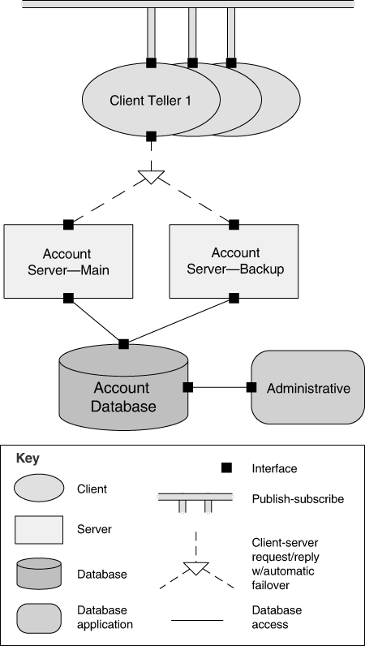

**Hình 1.2** *Một component-and-connector structure*

2. *Module structure* chia hệ thống thành các đơn vị hiện thực, mà trong cuốn sách này chúng tôi gọi là *module*. Module structure cho thấy cách một hệ thống được cấu trúc thành một tập các đơn vị code hoặc dữ liệu cần được xây dựng hoặc mua sắm. Các module được giao những trách nhiệm tính toán cụ thể, và là cơ sở để phân công công việc cho các team lập trình. Trong bất kỳ module structure nào, các element đều là module thuộc loại nào đó (có thể là class, package, layer, hoặc đơn thuần là các phần chia của chức năng, tất cả đều là đơn vị hiện thực). Module thể hiện một cách xem xét hệ thống ở dạng tĩnh. Các module được giao các vùng trách nhiệm chức năng; các structure này ít chú trọng đến cách phần mềm kết quả thể hiện ra tại runtime. Implementation của module bao gồm package, class và layer. Các relation giữa các module trong một module structure bao gồm uses, generalization (hay “is-a”) và “is part of”. [Hình 1.2](#ch01fig02) và [1.3](#ch01fig03) lần lượt cho thấy ví dụ về các module element và relation, dùng ký hiệu Unified Modeling Language (UML).

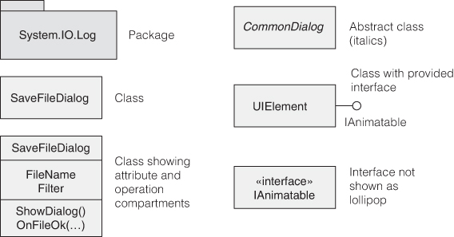

**Hình 1.3** *Các module element trong UML*

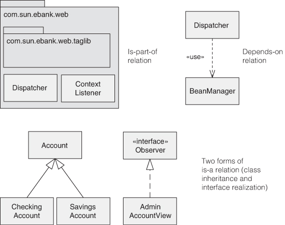

**Hình 1.4** *Các module relation trong UML*

   Module structure cho phép chúng ta trả lời các câu hỏi như sau:

   - Trách nhiệm chức năng chính được giao cho mỗi module là gì?
   - Một module được phép dùng những software element nào khác?
   - Nó thực sự dùng và phụ thuộc vào những phần mềm nào khác?
   - Những module nào liên hệ với các module khác qua các relation generalization hoặc specialization (tức là kế thừa)?

   Module structure truyền tải trực tiếp thông tin này, nhưng chúng cũng có thể được dùng để trả lời các câu hỏi về tác động lên hệ thống khi các trách nhiệm được giao cho mỗi module thay đổi. Do đó, module structure là công cụ chính để suy luận về modifiability của một hệ thống.

3. *Allocation structure* thiết lập ánh xạ từ các software structure tới các structure không phải phần mềm của hệ thống, chẳng hạn như tổ chức của nó, hoặc các môi trường phát triển, kiểm thử và thực thi. Allocation structure trả lời các câu hỏi như sau:
   - Mỗi software element thực thi trên (những) processor(s) nào?
   - Mỗi element được lưu trong những thư mục hoặc file nào trong quá trình phát triển, kiểm thử và build hệ thống?
   - Mỗi software element được giao cho team phát triển nào?

### Một số module structure hữu ích (Some Useful Module Structures)

Các module structure hữu ích bao gồm:

- *Decomposition structure.* Các đơn vị là các module liên hệ với nhau bởi relation “is-a-submodule-of”, cho thấy cách các module được phân rã đệ quy thành các module nhỏ hơn cho đến khi các module đủ nhỏ để dễ hiểu. Các module trong structure này là điểm khởi đầu chung cho thiết kế, khi kiến trúc sư liệt kê những gì các đơn vị phần mềm sẽ phải làm và giao mỗi mục cho một module để thiết kế tiếp theo (chi tiết hơn) và cuối cùng là hiện thực. Các module thường có các sản phẩm (như interface specification, code và test plan) gắn với chúng. Decomposition structure quyết định, ở mức độ lớn, modifiability của hệ thống. Tức là, các thay đổi có nằm trong phạm vi của một vài module (tốt nhất là nhỏ) hay không? Structure này thường được dùng làm cơ sở cho việc tổ chức dự án phát triển, bao gồm cấu trúc của tài liệu, và các kế hoạch tích hợp và kiểm thử của dự án. [Hình 1.5](#ch01fig05) cho thấy một ví dụ về decomposition structure.

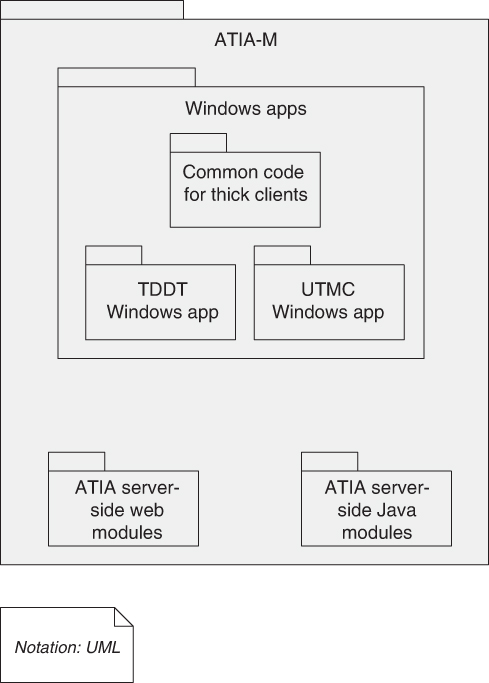

**Hình 1.5** *Một decomposition structure*

- *Uses structure.* Trong structure quan trọng nhưng thường bị bỏ qua này, các đơn vị cũng là module, và có thể là class. Các đơn vị liên hệ với nhau bởi relation *uses*, một dạng dependency chuyên biệt. Một đơn vị phần mềm uses một đơn vị khác nếu tính đúng đắn của đơn vị thứ nhất đòi hỏi sự hiện diện của một phiên bản hoạt động đúng (thay vì một stub) của đơn vị thứ hai. Uses structure được dùng để thiết kế các hệ thống có thể được mở rộng để thêm chức năng, hoặc từ đó có thể trích ra các tập con chức năng hữu ích. Khả năng dễ dàng tạo một tập con của hệ thống cho phép phát triển tăng dần (incremental development). Structure này cũng là cơ sở để đo social debt—lượng giao tiếp thực sự diễn ra, thay vì chỉ là lượng lẽ ra nên diễn ra, giữa các team—vì nó xác định những team nào nên trao đổi với nhau. [Hình 1.6](#ch01fig06) cho thấy một uses structure và làm nổi bật các module phải có mặt trong một increment nếu module admin.client có mặt.

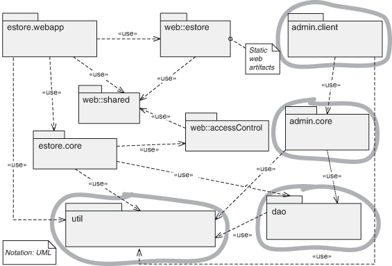

**Hình 1.6** *Uses structure*

- *Layer structure.* Các module trong structure này được gọi là layer. Một layer là một “virtual machine” trừu tượng, cung cấp một tập service gắn kết thông qua một interface được quản lý. Các layer được phép dùng các layer khác theo cách có quản lý; trong các hệ thống phân layer nghiêm ngặt, một layer chỉ được phép dùng một layer duy nhất khác. Structure này mang lại cho hệ thống tính portability—tức là khả năng thay đổi virtual machine bên dưới. [Hình 1.7](#ch01fig07) cho thấy layer structure của hệ điều hành UNIX System V.

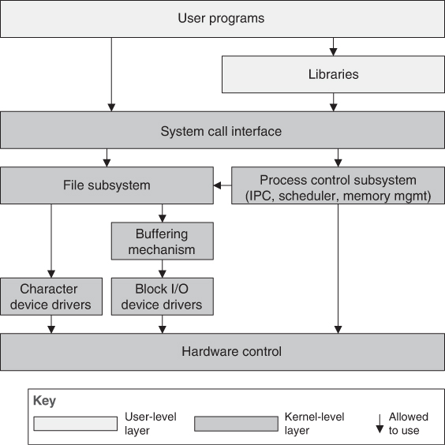

**Hình 1.7** *Layer structure*

- *Class (hay generalization) structure*. Các module trong structure này được gọi là class, và chúng liên hệ với nhau qua một relation “inherits-from” hoặc “is-an-instance-of”. View này hỗ trợ suy luận về các tập hợp hành vi hoặc năng lực tương tự nhau và các khác biệt được tham số hóa. Class structure cho phép người ta suy luận về việc tái sử dụng và việc bổ sung chức năng tăng dần. Nếu có bất kỳ tài liệu nào tồn tại cho một dự án đã theo quy trình phân tích và thiết kế object-oriented, thì thường đó là structure này. [Hình 1.8](#ch01fig08) cho thấy một generalization structure lấy từ một công cụ chuyên gia về architecture.

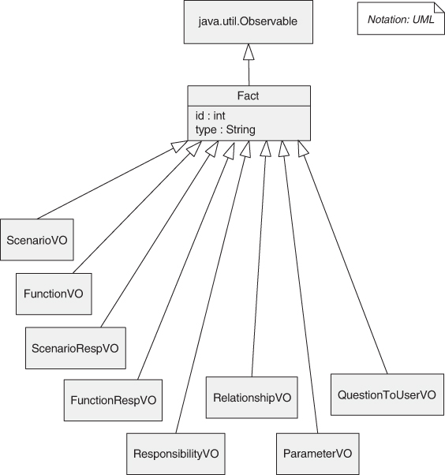

**Hình 1.8** *Generalization structure*

- *Data model.* Data model mô tả cấu trúc thông tin tĩnh dưới dạng các thực thể dữ liệu và các mối quan hệ giữa chúng. Ví dụ, trong một hệ thống ngân hàng, các thực thể thường bao gồm Account, Customer và Loan. Account có một số thuộc tính, chẳng hạn như số tài khoản, loại (tiết kiệm hoặc thanh toán), trạng thái và số dư hiện tại. Một mối quan hệ có thể quy định rằng một khách hàng có thể có một hoặc nhiều tài khoản, và một tài khoản gắn với một hoặc nhiều khách hàng. [Hình 1.9](#ch01fig09) cho thấy một ví dụ về data model.

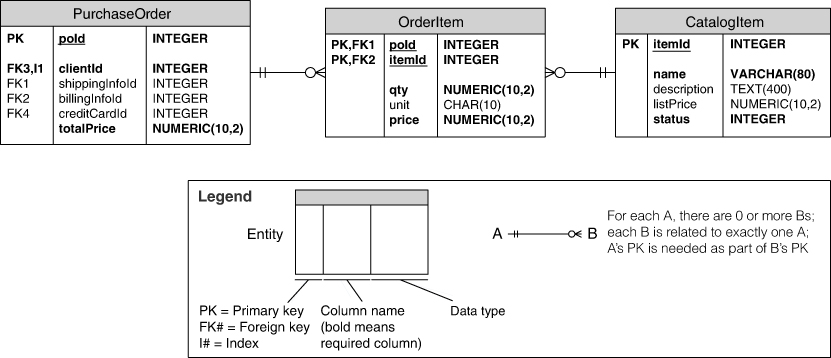

**Hình 1.9** *Data model*

### Một số C&C structure hữu ích (Some Useful C&C Structures)

C&C structure thể hiện một view runtime của hệ thống. Trong các structure này, các module vừa mô tả đều đã được compile thành dạng có thể thực thi. Do đó, mọi C&C structure đều trực giao với các structure module-based và xử lý các khía cạnh động của một hệ thống đang chạy. Ví dụ, một đơn vị code (module) có thể được compile thành một service duy nhất được nhân bản hàng nghìn lần trong một môi trường thực thi. Hoặc 1,000 module có thể được compile và link với nhau để tạo ra một runtime executable (component) duy nhất.

Relation trong mọi C&C structure là *attachment*, cho thấy cách các component và connector được gắn với nhau. (Bản thân các connector có thể là những cấu trúc quen thuộc như “invokes”.) Các C&C structure hữu ích bao gồm:

- *Service structure*. Các đơn vị ở đây là các service tương tác với nhau thông qua một cơ chế điều phối service, chẳng hạn như message. Service structure là một structure quan trọng giúp thiết kế một hệ thống gồm các component có thể đã được phát triển độc lập với nhau.
- *Concurrency structure*. C&C structure này cho phép kiến trúc sư xác định các cơ hội song song hóa và những vị trí có thể xảy ra tranh chấp tài nguyên. Các đơn vị là component và connector là các cơ chế liên lạc của chúng. Các component được sắp xếp thành các “logical thread”. Một logical thread là một chuỗi tính toán có thể được cấp phát cho một physical thread riêng ở giai đoạn sau của quá trình thiết kế. Concurrency structure được dùng từ sớm trong quá trình thiết kế để xác định và quản lý các vấn đề liên quan đến thực thi đồng thời.

### Một số allocation structure hữu ích (Some Useful Allocation Structures)

Allocation structure định nghĩa cách các element từ C&C structure hoặc module structure ánh xạ lên những thứ không phải phần mềm—thường là phần cứng (có thể được ảo hóa), team và file system. Các allocation structure hữu ích bao gồm:

- *Deployment structure*. Deployment structure cho thấy cách phần mềm được gán cho các element xử lý và liên lạc của phần cứng. Các element là software element (thường là một process từ một C&C structure), các thực thể phần cứng (processor) và các đường liên lạc. Các relation là “allocated-to”, cho thấy các software element nằm trên những đơn vị vật lý nào, và “migrates-to” nếu việc cấp phát là động. Structure này có thể được dùng để suy luận về performance, data integrity, security và availability. Nó đặc biệt được quan tâm trong các hệ thống phân tán, và là structure then chốt liên quan đến việc đạt được quality attribute deployability (xem [Chương 5](ch05_deployability.vi.md#ch05)). [Hình 1.10](#ch01fig10) cho thấy một deployment structure đơn giản trong UML.

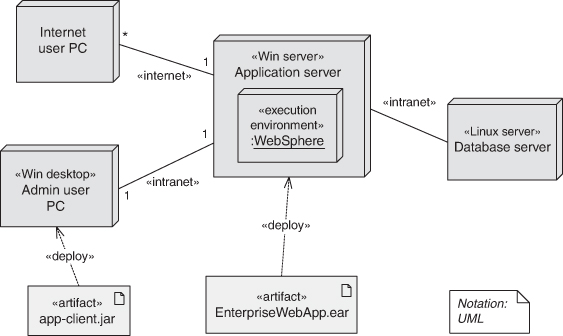

**Hình 1.10** *Deployment structure*

- *Implementation structure*. Structure này cho thấy cách các software element (thường là module) được ánh xạ tới các cấu trúc file trong môi trường phát triển, tích hợp, kiểm thử hoặc configuration control của hệ thống. Điều này rất quan trọng cho việc quản lý các hoạt động phát triển và các quy trình build.
- *Work assignment structure.* Structure này giao trách nhiệm hiện thực và tích hợp các module cho các team sẽ thực hiện những nhiệm vụ này. Việc để work assignment structure là một phần của architecture làm rõ rằng quyết định về ai làm công việc gì có hệ quả về architecture cũng như về quản lý. Kiến trúc sư sẽ biết chuyên môn cần có ở mỗi team. Ví dụ, quyết định của Amazon giao một team riêng cho mỗi microservice của mình là một tuyên bố về work assignment structure của họ. Trong các dự án phát triển lớn, sẽ hữu ích khi xác định các đơn vị chức năng chung và giao chúng cho một team duy nhất, thay vì để mọi người cần đến chúng đều tự hiện thực. Structure này cũng sẽ xác định các kênh liên lạc chính giữa các team: hội nghị web định kỳ, wiki, email list, v.v.

[Bảng 1.1](#ch01tab01) tóm tắt các structure này. Nó liệt kê ý nghĩa của các element và relation trong mỗi structure và cho biết mỗi structure có thể được dùng vào việc gì.

**Bảng 1.1** *Các structure hữu ích của architecture*

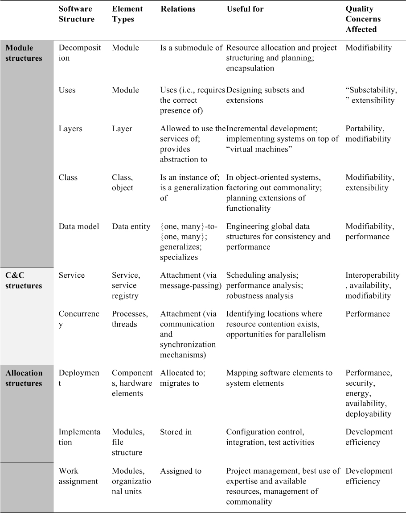

### Liên hệ các structure với nhau (Relating Structures to Each Other)

Mỗi structure này cung cấp một góc nhìn và một tay cầm thiết kế khác nhau đối với một hệ thống, và mỗi structure đều có giá trị và hữu ích theo cách riêng. Dù các structure cho những góc nhìn khác nhau về hệ thống, chúng không độc lập với nhau. Các element của một structure sẽ liên hệ với các element của các structure khác, và chúng ta cần suy luận về các mối liên hệ này. Ví dụ, một module trong một decomposition structure có thể được thể hiện thành một, một phần của một, hoặc nhiều component trong một trong các C&C structure, phản ánh alter-ego runtime của nó. Nói chung, các ánh xạ giữa các structure là nhiều với nhiều.

[Hình 1.11](#ch01fig11) cho thấy một ví dụ đơn giản về cách hai structure có thể liên hệ với nhau. Hình bên trái cho thấy một module decomposition view của một hệ thống client-server nhỏ. Trong hệ thống này, cần hiện thực hai module: phần mềm client và phần mềm server. Hình bên phải cho thấy một C&C view của cùng hệ thống đó. Tại runtime, mười client đang chạy và truy cập server. Do đó, hệ thống nhỏ này có hai module và 11 component (và mười connector).

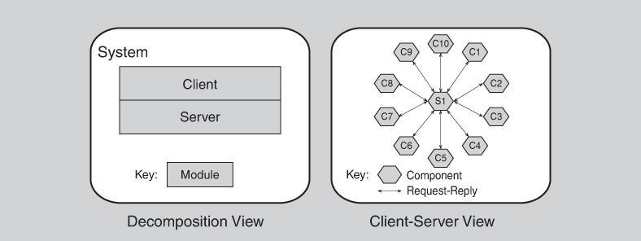

**Hình 1.11** *Hai view của một hệ thống client-server*

Dù sự tương ứng giữa các element trong decomposition structure và client-server structure là hiển nhiên, hai view này được dùng cho những mục đích rất khác nhau. Ví dụ, view bên phải có thể được dùng để phân tích performance, dự đoán nút thắt cổ chai và quản lý network traffic, những việc cực kỳ khó hoặc không thể làm được với view bên trái. (Trong [Chương 9](ch09_performance.vi.md#ch09), chúng ta sẽ học về pattern map-reduce, trong đó các bản sao của một chức năng đơn giản, giống hệt nhau được phân phối trên hàng trăm hoặc hàng nghìn node xử lý—một module cho toàn bộ hệ thống, nhưng một component cho mỗi node.)

Các dự án riêng lẻ đôi khi coi một structure là chủ đạo và, khi có thể, diễn đạt các structure khác theo structure chủ đạo đó. Thường thì structure chủ đạo là module decomposition structure, và có lý do chính đáng: Nó có xu hướng sinh ra cấu trúc dự án, vì nó phản chiếu cấu trúc team phát triển. Trong các dự án khác, structure chủ đạo có thể là một C&C structure cho thấy cách chức năng và/hoặc các quality attribute then chốt của hệ thống được đạt được tại runtime.

### Ít hơn thì tốt hơn (Fewer Is Better)

Không phải hệ thống nào cũng đáng để xem xét nhiều structure. Hệ thống càng lớn, sự khác biệt giữa các structure này càng có xu hướng rõ rệt; nhưng với các hệ thống nhỏ, chúng ta thường có thể xoay xở với ít structure hơn. Ví dụ, thay vì làm việc với từng C&C structure trong số nhiều C&C structure, thường chỉ một là đủ. Nếu chỉ có một process, thì process structure thu gọn thành một node duy nhất và không cần được biểu diễn tường minh trong thiết kế. Nếu không có phân tán (tức là, nếu hệ thống được hiện thực trên một bộ xử lý duy nhất), thì deployment structure là tầm thường và không cần xem xét thêm. Nói chung, bạn chỉ nên thiết kế và tài liệu hóa một structure nếu việc đó mang lại lợi tức dương trên khoản đầu tư, thường là dưới dạng giảm chi phí phát triển hoặc bảo trì.

### Nên chọn structure nào? (Which Structures to Choose?)

Chúng tôi đã mô tả ngắn gọn một số structure hữu ích của architecture, và chắc chắn còn có thể có nhiều structure khác nữa. Kiến trúc sư nên chọn làm việc với những structure nào? Kiến trúc sư nên chọn tài liệu hóa những structure nào? Chắc chắn không phải tất cả. Một câu trả lời tốt là bạn nên suy nghĩ về cách các structure khác nhau mà bạn có trong tay cung cấp hiểu biết sâu sắc và đòn bẩy đối với các quality attribute quan trọng nhất của hệ thống, rồi chọn những structure sẽ đóng vai trò tốt nhất trong việc mang lại các attribute đó.

### Architectural pattern (Architectural Patterns)

Trong một số trường hợp, các element của architecture được kết hợp theo những cách giải quyết các vấn đề cụ thể. Những cách kết hợp này đã được thấy là hữu ích qua thời gian và trên nhiều domain khác nhau, nên chúng đã được tài liệu hóa và phổ biến. Những cách kết hợp các element của architecture này, vốn cung cấp các chiến lược đóng gói sẵn để giải quyết một số vấn đề mà hệ thống gặp phải, được gọi là pattern. Architectural pattern được thảo luận chi tiết trong Phần 2 của cuốn sách này.

## 1.3 Điều gì làm nên một architecture “tốt”? (What Makes a “Good” Architecture?)

Không có cái gọi là một architecture vốn dĩ tốt hay xấu. Các architecture chỉ phù hợp nhiều hơn hay ít hơn cho một mục đích nào đó. Một service-oriented architecture phân layer three-tier có thể chính là thứ cần thiết cho một hệ thống B2B web-based của một doanh nghiệp lớn nhưng hoàn toàn sai cho một ứng dụng avionics. Một architecture được xây dựng cẩn thận để đạt modifiability cao không có ý nghĩa đối với một prototype throw-away (và ngược lại!). Một trong những thông điệp của cuốn sách này là trên thực tế, architecture có thể được *đánh giá*—một trong những lợi ích lớn của việc chú ý đến chúng—nhưng việc đánh giá như vậy chỉ có ý nghĩa trong bối cảnh của những mục tiêu cụ thể đã được nêu rõ.

Tuy vậy, có một số quy tắc kinh nghiệm nên được tuân theo khi thiết kế hầu hết các architecture. Việc không áp dụng bất kỳ hướng dẫn nào trong số này không tự động có nghĩa là architecture sẽ có khiếm khuyết chết người, nhưng ít nhất nó nên được coi là một dấu hiệu cảnh báo cần được điều tra. Các quy tắc này có thể được áp dụng một cách chủ động cho việc phát triển greenfield, để giúp xây dựng hệ thống “đúng”. Hoặc chúng có thể được áp dụng như các heuristic phân tích, để hiểu các vùng có thể có vấn đề trong các hệ thống hiện có và để định hướng sự tiến hóa của hệ thống.

Chúng tôi chia các nhận xét của mình thành hai nhóm: khuyến nghị về quy trình và khuyến nghị về sản phẩm (hay về cấu trúc). Các khuyến nghị về quy trình của chúng tôi như sau:

1. Một software (hoặc system) architecture nên là sản phẩm của một kiến trúc sư duy nhất hoặc một nhóm nhỏ kiến trúc sư có một trưởng nhóm kỹ thuật được xác định rõ. Cách tiếp cận này quan trọng để mang lại cho architecture tính toàn vẹn về khái niệm và tính nhất quán về kỹ thuật. Khuyến nghị này đúng với các dự án agile và open source cũng như các dự án “truyền thống”. Cần có sự kết nối chặt chẽ giữa các kiến trúc sư và team phát triển, để tránh các thiết kế “tháp ngà” không thực tế.
2. Kiến trúc sư (hoặc team architecture) nên, một cách liên tục, xây dựng architecture dựa trên một danh sách được ưu tiên các yêu cầu quality attribute được đặc tả rõ ràng (well-specified). Những yêu cầu này sẽ định hướng các tradeoff vốn luôn xảy ra. Chức năng ít quan trọng hơn.
3. Architecture nên được tài liệu hóa bằng các *view*. (Một view đơn giản là một biểu diễn của một hoặc nhiều structure thuộc architecture.) Các view nên giải quyết các mối quan tâm của những stakeholder quan trọng nhất, hỗ trợ cho tiến độ dự án. Điều này có thể có nghĩa là ban đầu chỉ có tài liệu tối thiểu, sau đó tài liệu mới được bổ sung chi tiết. Các mối quan tâm thường liên quan đến việc xây dựng, phân tích và bảo trì hệ thống, cũng như việc đào tạo các stakeholder mới.
4. Architecture nên được đánh giá về khả năng mang lại các quality attribute quan trọng của hệ thống. Việc này nên diễn ra sớm trong vòng đời, khi nó mang lại nhiều lợi ích nhất, và được lặp lại khi thích hợp, để bảo đảm rằng các thay đổi đối với architecture (hoặc môi trường mà nó hướng tới) không làm cho thiết kế trở nên lỗi thời.
5. Architecture nên phù hợp với việc hiện thực tăng dần, để tránh phải tích hợp mọi thứ cùng một lúc (điều gần như không bao giờ thành công) cũng như để phát hiện vấn đề sớm. Một cách để làm điều này là tạo ra một hệ thống “khung xương” trong đó các đường liên lạc được vận hành thử nhưng ban đầu chỉ có chức năng tối thiểu. Hệ thống khung xương này có thể được dùng để “phát triển” hệ thống một cách tăng dần, refactor khi cần.

Các quy tắc kinh nghiệm về cấu trúc của chúng tôi như sau:

1. Architecture nên có các module well-defined, với trách nhiệm chức năng được giao theo các nguyên lý information hiding và separation of concerns. Các module information-hiding nên đóng gói những thứ có khả năng thay đổi, nhờ đó cách ly phần mềm khỏi tác động của những thay đổi đó. Mỗi module nên có một interface well-defined đóng gói hoặc “che giấu” các khía cạnh có thể thay đổi khỏi những phần mềm khác dùng các tiện ích của nó. Các interface này nên cho phép các team phát triển tương ứng làm việc phần lớn độc lập với nhau.
2. Trừ khi các yêu cầu của bạn là chưa từng có—có thể xảy ra, nhưng khó—các quality attribute của bạn nên được đạt được bằng cách dùng các architectural pattern và tactic well-known (được mô tả trong [Chương 4](ch04_availability.vi.md#ch04) đến [13](ch13_usability.vi.md#ch13)) dành riêng cho từng attribute.
3. Architecture không bao giờ nên phụ thuộc vào một phiên bản cụ thể của một sản phẩm hay công cụ thương mại. Nếu buộc phải phụ thuộc, nó nên được cấu trúc sao cho việc chuyển sang một phiên bản khác là đơn giản và ít tốn kém.
4. Các module tạo ra dữ liệu nên tách biệt khỏi các module tiêu thụ dữ liệu. Điều này có xu hướng làm tăng modifiability vì các thay đổi thường chỉ giới hạn ở phía tạo hoặc phía tiêu thụ dữ liệu. Nếu dữ liệu mới được thêm vào, cả hai phía sẽ phải thay đổi, nhưng sự tách biệt cho phép nâng cấp theo từng giai đoạn (tăng dần).
5. Đừng kỳ vọng có sự tương ứng one-to-one giữa module và component. Ví dụ, trong các hệ thống có concurrency, nhiều instance của một component có thể chạy song song, trong đó mỗi component được xây dựng từ cùng một module. Với các hệ thống có nhiều thread concurrency, mỗi thread có thể dùng service từ nhiều component, mỗi component được xây dựng từ một module khác nhau.
6. Mọi process nên được viết sao cho việc gán nó cho một bộ xử lý cụ thể có thể dễ dàng thay đổi, có thể thậm chí tại runtime. Đây là một động lực thúc đẩy các xu hướng ngày càng tăng hướng tới virtualization và cloud deployment, như chúng tôi sẽ thảo luận trong [Chương 16](ch16_virtualization.vi.md#ch16) và [17](ch17_the_cloud_and_distributed_computing.vi.md#ch17).
7. Architecture nên có một số ít các pattern tương tác component đơn giản. Tức là, hệ thống nên làm những việc giống nhau theo cùng một cách ở mọi nơi. Thực hành này sẽ giúp dễ hiểu hơn, giảm thời gian phát triển, tăng reliability và nâng cao modifiability.
8. Architecture nên chứa một tập cụ thể (và nhỏ) các vùng tranh chấp tài nguyên, mà cách giải quyết của chúng được đặc tả và duy trì rõ ràng. Ví dụ, nếu mức sử dụng mạng là một vùng đáng quan tâm, kiến trúc sư nên đưa ra (và thực thi) cho mỗi team phát triển các hướng dẫn sẽ dẫn đến mức network traffic chấp nhận được. Nếu performance là một mối quan tâm, kiến trúc sư nên đưa ra (và thực thi) các ngân sách thời gian.

## 1.4 Tóm tắt (Summary)

Software architecture của một hệ thống là tập hợp các structure cần thiết để suy luận về hệ thống đó. Các structure này gồm các software element, các relation giữa chúng, và các thuộc tính của cả hai.

Có ba loại structure:

- Module structure cho thấy hệ thống như một tập các đơn vị code hoặc dữ liệu cần được xây dựng hoặc mua sắm.
- Component-and-connector structure cho thấy hệ thống như một tập các element có hành vi runtime (component) và tương tác (connector).
- Allocation structure cho thấy cách các element từ module structure và C&C structure liên hệ với các structure không phải phần mềm (như CPU, file system, mạng và team phát triển).

Các structure là những điểm đòn bẩy kỹ thuật chính của một architecture. Mỗi structure mang lại khả năng tác động đến một hoặc nhiều quality attribute. Gộp lại, các structure là một cách tiếp cận mạnh mẽ để tạo ra architecture (và sau đó, để phân tích nó và giải thích nó cho các stakeholder). Và, như chúng ta sẽ thấy trong [Chương 22](ch22_documenting_an_architecture.vi.md#ch22), các structure mà kiến trúc sư đã chọn làm điểm đòn bẩy kỹ thuật cũng là những ứng viên chính để chọn làm cơ sở cho tài liệu architecture.

Mọi hệ thống đều có một software architecture, nhưng architecture này có thể được hoặc không được tài liệu hóa và phổ biến.

Không có cái gọi là một architecture vốn dĩ tốt hay xấu. Các architecture chỉ phù hợp nhiều hơn hay ít hơn cho một mục đích nào đó.

## 1.5 Đọc thêm (For Further Reading)

Nếu bạn đặc biệt quan tâm đến software architecture như một lĩnh vực nghiên cứu, bạn có thể muốn đọc một số công trình tiên phong. Phần lớn chúng hoàn toàn không nhắc đến “software architecture”, vì cụm từ này chỉ xuất hiện vào mid-1990s, nên bạn sẽ phải đọc giữa các dòng.

Bài báo năm 1968 của Edsger Dijkstra về hệ điều hành T.H.E. đã giới thiệu khái niệm layer [Dijkstra 68]. Các công trình đầu tiên của David Parnas đã đặt nhiều nền tảng khái niệm, bao gồm information hiding [Parnas 72], program family [Parnas 76], các structure vốn có trong hệ thống phần mềm [Parnas 74], và uses structure để xây dựng các tập con và tập cha của hệ thống [Parnas 79]. Tất cả các bài báo của Parnas có thể được tìm thấy trong tuyển tập các bài báo quan trọng của ông, dễ tiếp cận hơn [Hoffman 00]. Các hệ thống phân tán hiện đại có được sự tồn tại của mình nhờ khái niệm các process tuần tự hợp tác mà (cùng với những người khác) Sir C. A. R. (Tony) Hoare đã đóng vai trò then chốt trong việc hình thành và định nghĩa [Hoare 85].

Năm 1972, Dijkstra và Hoare, cùng với Ole-Johan Dahl, lập luận rằng các chương trình nên được phân rã thành các component độc lập với các interface nhỏ và đơn giản. Họ gọi cách tiếp cận của mình là structured programming, nhưng có thể nói đây là sự ra mắt của software architecture [Dijkstra 72].

Mary Shaw và David Garlan, cùng nhau và riêng rẽ, đã tạo ra một khối lượng công trình lớn giúp hình thành lĩnh vực nghiên cứu mà chúng ta gọi là software architecture. Họ đã thiết lập một số nguyên lý nền tảng của nó và, cùng nhiều việc khác, lập danh mục một họ architectural style có tính khai phá (một khái niệm tương tự pattern), một số trong đó xuất hiện trong chương này dưới dạng các structure của architecture. Hãy bắt đầu với [Garlan 95].

Các architectural pattern của phần mềm đã được lập danh mục rộng rãi trong bộ sách *Pattern-Oriented Software Architecture* [Buschmann 96 và các tập khác]. Chúng tôi cũng đề cập đến architectural pattern trong Phần 2 của cuốn sách này.

Những bài báo đầu tiên về architectural view như được dùng trong các dự án phát triển công nghiệp là [Soni 95] và [Kruchten 95]. Bài báo thứ nhất đã phát triển thành một cuốn sách [Hofmeister 00] trình bày một bức tranh toàn diện về việc dùng view trong phát triển và phân tích.

Một số cuốn sách đã tập trung vào các vấn đề hiện thực thực tế liên quan đến architecture, chẳng hạn như *Just Enough Software Architecture* của George Fairbanks [Fairbanks 10], *Software Systems Architecture* của Woods và Rozanski [Woods 11], và *Clean Architecture: A Craftsman’s Guide to Software Structure and Design* của Martin [Martin 17].

## 1.6 Câu hỏi thảo luận (Discussion Questions)

1. Bạn có quen thuộc với một định nghĩa khác về software architecture không? Nếu có, hãy so sánh và đối chiếu nó với định nghĩa được đưa ra trong chương này. Nhiều định nghĩa bao gồm những cân nhắc như “rationale” (nêu lý do vì sao architecture lại như vậy) hoặc cách architecture sẽ tiến hóa theo thời gian. Bạn đồng ý hay không đồng ý rằng những cân nhắc này nên là một phần của định nghĩa software architecture?
2. Hãy thảo luận cách một architecture đóng vai trò cơ sở cho việc phân tích. Còn việc ra quyết định thì sao? Một architecture hỗ trợ những loại ra quyết định nào?
3. Vai trò của architecture trong việc giảm rủi ro dự án là gì?
4. Hãy tìm một định nghĩa được chấp nhận rộng rãi về *system architecture* và thảo luận những điểm chung của nó với software architecture. Làm tương tự với *enterprise architecture*.
5. Hãy tìm một ví dụ đã được công bố về một software architecture. Những structure nào được thể hiện? Với mục đích của nó, những structure nào *lẽ ra nên* được thể hiện? Architecture đó hỗ trợ phân tích gì? Hãy phê bình nó: Bạn có những câu hỏi nào mà biểu diễn đó không trả lời được?
6. Tàu buồm có architecture, nghĩa là chúng có các “structure” phù hợp cho việc suy luận về performance và các quality attribute khác của con tàu. Hãy tra cứu định nghĩa kỹ thuật của barque, brig, cutter, frigate, ketch, schooner và sloop. Hãy đề xuất một tập “structure” hữu ích để phân biệt và suy luận về architecture của tàu.
7. Máy bay có architecture có thể được đặc trưng bởi cách chúng giải quyết một số câu hỏi thiết kế chính, chẳng hạn như vị trí động cơ, vị trí cánh, bố trí càng đáp, và nhiều thứ khác. Trong nhiều thập kỷ, hầu hết các máy bay phản lực được thiết kế để chở khách có các đặc điểm sau:
   - Động cơ được đặt trong các vỏ nacelle treo bên dưới cánh (thay vì động cơ được tích hợp vào cánh, hoặc động cơ gắn ở phía sau thân máy bay)
   - Cánh nối với thân máy bay ở phía dưới (thay vì ở phía trên hoặc ở giữa)

   Trước tiên, hãy tìm kiếm trực tuyến để tìm một ví dụ và một counter-example của loại thiết kế này từ mỗi nhà sản xuất sau: Boeing, Embraer, Tupolev, Bombardier. Tiếp theo, hãy nghiên cứu trực tuyến và trả lời câu hỏi sau: Thiết kế này mang lại những chất lượng nào quan trọng đối với máy bay?
