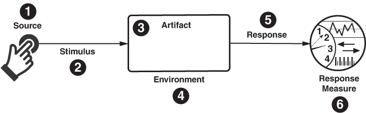
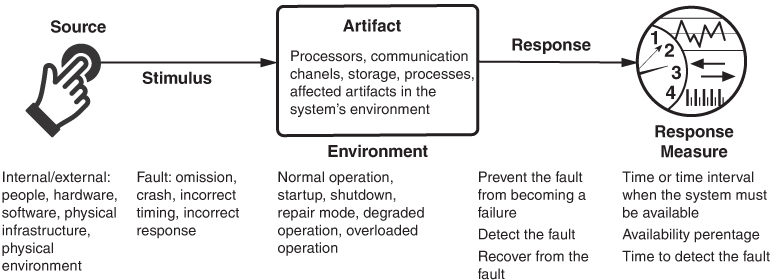
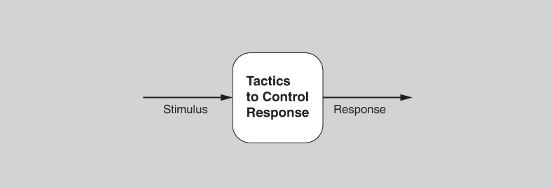

# 3. Hiểu về quality attribute (Understanding Quality Attributes)

> Chất lượng không bao giờ là ngẫu nhiên; nó luôn là kết quả của ý định cao, nỗ lực chân thành, định hướng thông minh và thực thi khéo léo. 
> —William A. Foster

Nhiều yếu tố quyết định các chất lượng phải được đáp ứng trong architecture của một hệ thống. Những chất lượng này vượt ra ngoài chức năng (functionality), vốn là phát biểu cơ bản về các năng lực, service và hành vi của hệ thống. Dù chức năng và các chất lượng khác liên quan chặt chẽ với nhau, như bạn sẽ thấy, chức năng thường chiếm vị trí ưu tiên trong kế hoạch phát triển. Tuy nhiên, sự ưu tiên này là thiển cận. Các hệ thống thường xuyên được thiết kế lại không phải vì chúng thiếu sót về chức năng—các hệ thống thay thế thường giống hệt về chức năng—mà vì chúng khó bảo trì, khó port hoặc khó mở rộng quy mô; hoặc chúng quá chậm; hoặc chúng đã bị hacker xâm nhập. Trong [Chương 2](ch02_why_is_software_architecture_important.vi.md#ch02), chúng tôi đã nói rằng architecture là nơi đầu tiên trong quá trình tạo ra phần mềm mà tại đó việc đạt được các yêu cầu chất lượng có thể được giải quyết. Chính việc ánh xạ chức năng của một hệ thống lên các software structure quyết định mức độ architecture hỗ trợ các chất lượng. Trong [Chương 4](ch04_availability.vi.md#ch04)–[14](ch14_working_with_other_quality_attributes.vi.md#ch14), chúng tôi thảo luận cách các chất lượng khác nhau được hỗ trợ bởi các quyết định thiết kế architecture. Trong [Chương 20](ch20_designing_an_architecture.vi.md#ch20), chúng tôi cho thấy cách tích hợp tất cả các driver của bạn, bao gồm các quyết định về quality attribute, thành một thiết kế mạch lạc.

Chúng tôi đã dùng thuật ngữ “quality attribute” một cách lỏng lẻo, nhưng giờ là lúc định nghĩa nó cẩn thận hơn. Một quality attribute (QA) là một thuộc tính có thể đo lường hoặc kiểm thử được của một hệ thống, được dùng để chỉ ra hệ thống thỏa mãn nhu cầu của các stakeholder tốt đến mức nào, ngoài chức năng cơ bản của hệ thống. Bạn có thể coi một quality attribute như việc đo “tính hữu dụng” (utility) của một sản phẩm theo một chiều nào đó mà stakeholder quan tâm.

Trong chương này, trọng tâm của chúng tôi là hiểu những điều sau:

- Cách biểu đạt các chất lượng mà chúng ta muốn architecture của mình thể hiện
- Cách đạt được các chất lượng đó thông qua các phương tiện architecture
- Cách xác định các quyết định thiết kế mà chúng ta có thể đưa ra liên quan đến các chất lượng đó

Chương này cung cấp bối cảnh cho các thảo luận về từng quality attribute trong [Chương 4](ch04_availability.vi.md#ch04)–[14](ch14_working_with_other_quality_attributes.vi.md#ch14).

## 3.1 Chức năng (Functionality)

Chức năng là khả năng của hệ thống thực hiện công việc mà nó được dự định làm. Trong tất cả các yêu cầu, chức năng có mối quan hệ kỳ lạ nhất với architecture.

Trước hết, chức năng không quyết định architecture. Tức là, với một tập chức năng được yêu cầu, có vô số architecture mà bạn có thể tạo ra để thỏa mãn chức năng đó. Ít nhất thì bạn có thể chia chức năng theo bất kỳ cách nào và giao các sub-pieces cho các element khác nhau của architecture.

Thực tế, nếu chức năng là thứ duy nhất quan trọng, bạn sẽ hoàn toàn không phải chia hệ thống thành các phần: Một khối monolithic duy nhất không có cấu trúc bên trong sẽ làm tốt việc đó. Thay vào đó, chúng ta thiết kế hệ thống như những tập có cấu trúc gồm các element của architecture hợp tác với nhau—module, layer, class, service, database, app, thread, peer, tier, v.v.—để làm cho chúng dễ hiểu và để hỗ trợ nhiều mục đích khác. Những “mục đích khác” đó chính là các quality attribute khác mà chúng ta sẽ xem xét trong các mục còn lại của chương này, và trong các chương về quality attribute tiếp theo ở Phần 2.

Dù chức năng độc lập với bất kỳ structure cụ thể nào, nó được đạt được bằng cách giao trách nhiệm cho các element của architecture. Quá trình này tạo ra một trong những structure cơ bản nhất của architecture—module decomposition.

Dù trách nhiệm có thể được phân bổ tùy ý cho bất kỳ module nào, software architecture ràng buộc việc phân bổ này khi các quality attribute khác là quan trọng. Ví dụ, các hệ thống thường xuyên (luôn luôn?) được chia ra để nhiều người có thể cùng nhau xây dựng chúng. Mối quan tâm của kiến trúc sư đối với chức năng là cách nó tương tác với và ràng buộc các chất lượng khác.

> **Yêu cầu chức năng (Functional Requirements)**
>
> Sau hơn 30 năm viết và thảo luận về sự phân biệt giữa yêu cầu chức năng và yêu cầu chất lượng, định nghĩa của yêu cầu chức năng vẫn khiến tôi không nắm bắt được. Các yêu cầu quality attribute được định nghĩa rõ ràng: Performance liên quan đến hành vi về thời gian của hệ thống, modifiability liên quan đến khả năng hệ thống hỗ trợ các thay đổi trong hành vi hoặc các chất lượng khác của nó sau lần deployment đầu tiên, availability liên quan đến khả năng hệ thống sống sót qua các failure, v.v.
>
> Tuy nhiên, chức năng là một khái niệm trơn trượt hơn nhiều. Một tiêu chuẩn quốc tế (ISO 25010) định nghĩa functional suitability là “khả năng của sản phẩm phần mềm cung cấp các chức năng đáp ứng các nhu cầu được nêu rõ và ngụ ý khi phần mềm được dùng trong các điều kiện xác định.” Tức là, chức năng là khả năng cung cấp các chức năng. Một cách diễn giải định nghĩa này là chức năng mô tả hệ thống làm gì còn chất lượng mô tả hệ thống thực hiện chức năng của nó tốt đến mức nào. Tức là, chất lượng là các thuộc tính của hệ thống còn chức năng là mục đích của hệ thống.
>
> Tuy nhiên, sự phân biệt này sụp đổ khi bạn xem xét bản chất của một số ”chức năng.” Nếu chức năng của phần mềm là điều khiển hành vi của động cơ, làm sao chức năng đó có thể được triển khai đúng mà không xét đến hành vi về thời gian? Chẳng lẽ khả năng kiểm soát truy cập bằng cách yêu cầu một tổ hợp user name/password không phải là một chức năng, dù nó không phải là mục đích của bất kỳ hệ thống nào?
>
> Tôi thích dùng từ “trách nhiệm” (responsibility) hơn nhiều để mô tả các tính toán mà một hệ thống phải thực hiện. Những câu hỏi như “Các ràng buộc về thời gian đối với tập trách nhiệm đó là gì?”, “Những sửa đổi nào được dự kiến đối với tập trách nhiệm đó?” và “Lớp người dùng nào được phép thực thi tập trách nhiệm đó?” đều có ý nghĩa và có thể hành động được.
>
> Việc đạt được các chất lượng sinh ra trách nhiệm; hãy nghĩ đến ví dụ user name/password vừa được nhắc đến. Hơn nữa, người ta có thể xác định các trách nhiệm là gắn với một tập yêu cầu cụ thể.
>
> Vậy điều này có nghĩa là không nên dùng thuật ngữ “yêu cầu chức năng” (functional requirement) sao? Mọi người có hiểu thuật ngữ này, nhưng khi cần sự chính xác, chúng ta nên nói về các tập trách nhiệm cụ thể thay vào đó.
>
> Paul Clements từ lâu đã chỉ trích việc dùng cẩu thả thuật ngữ “nonfunctional” (phi chức năng), và giờ đến lượt tôi chỉ trích việc dùng cẩu thả thuật ngữ “functional” (chức năng)—có lẽ cũng chẳng hiệu quả hơn.
>
> —LB

## 3.2 Những cân nhắc về quality attribute (Quality Attribute Considerations)

Cũng như các chức năng của một hệ thống không thể tự đứng vững nếu không xem xét thỏa đáng các quality attribute, các quality attribute cũng không tự đứng vững; chúng gắn với các chức năng của hệ thống. Nếu một yêu cầu chức năng là “Khi người dùng nhấn nút màu xanh lá, hộp thoại Options xuất hiện,” thì một chú thích QA về performance có thể mô tả hộp thoại sẽ xuất hiện nhanh đến mức nào; một chú thích QA về availability có thể mô tả chức năng này được phép thất bại thường xuyên đến mức nào, và nó sẽ được sửa chữa nhanh đến mức nào; một chú thích QA về usability có thể mô tả mức độ dễ học chức năng này.

Quality attribute như một chủ đề riêng biệt đã được cộng đồng phần mềm nghiên cứu ít nhất từ thập niên 1970s. Nhiều hệ thống phân loại và định nghĩa đã được công bố (chúng tôi thảo luận một số trong đó trong [Chương 14](ch14_working_with_other_quality_attributes.vi.md#ch14)), nhiều trong số đó có cộng đồng nghiên cứu và người thực hành riêng. Tuy nhiên, có ba vấn đề với hầu hết các thảo luận về quality attribute của hệ thống:

1. Các định nghĩa được đưa ra cho một attribute không thể kiểm thử được. Nói rằng một hệ thống sẽ “modifiable” là vô nghĩa. Mọi hệ thống đều modifiable đối với một tập thay đổi này và không modifiable đối với một tập khác. Các quality attribute khác cũng tương tự về mặt này: Một hệ thống có thể robust đối với một số fault và brittle đối với những fault khác, v.v.
2. Thảo luận thường tập trung vào việc một vấn đề cụ thể thuộc về chất lượng nào. Một cuộc tấn công denial-of-service vào một hệ thống là một khía cạnh của availability, của performance, của security, hay của usability? Cả bốn cộng đồng attribute đều sẽ tuyên bố “sở hữu” cuộc tấn công denial-of-service. Tất cả, ở một mức độ nào đó, đều đúng. Nhưng cuộc tranh luận về phân loại này không giúp chúng ta, với tư cách là kiến trúc sư, hiểu và tạo ra các giải pháp architecture để thực sự quản lý các attribute đáng quan tâm.
3. Mỗi cộng đồng attribute đã phát triển vốn từ vựng riêng. Cộng đồng performance có các “sự kiện” (event) đến hệ thống, cộng đồng security có các “cuộc tấn công” (attack) đến hệ thống, cộng đồng availability có các “fault” xảy đến, và cộng đồng usability có “user input”. Tất cả những thứ này thực ra có thể nói về cùng một sự việc, nhưng chúng được mô tả bằng những thuật ngữ khác nhau.

Một giải pháp cho hai vấn đề đầu tiên (định nghĩa không kiểm thử được và các vấn đề chồng chéo) là dùng *quality attribute scenario* như một phương tiện để đặc trưng các quality attribute (xem [Mục 3.3](#sec3_3)). Một giải pháp cho vấn đề thứ ba là minh họa các khái niệm nền tảng của cộng đồng attribute đó theo một dạng chung, điều mà chúng tôi làm trong [Chương 4](ch04_availability.vi.md#ch04)–[14](ch14_working_with_other_quality_attributes.vi.md#ch14).

Chúng tôi sẽ tập trung vào hai loại quality attribute. Loại thứ nhất bao gồm những attribute mô tả một thuộc tính nào đó của hệ thống tại runtime, chẳng hạn như availability, performance hoặc usability. Loại thứ hai bao gồm những attribute mô tả một thuộc tính nào đó của việc phát triển hệ thống, chẳng hạn như modifiability, testability hoặc deployability.

Các quality attribute không bao giờ có thể được đạt được một cách tách biệt. Việc đạt được bất kỳ attribute nào cũng sẽ có tác động—đôi khi tích cực và đôi khi tiêu cực—lên việc đạt được các attribute khác. Ví dụ, gần như mọi quality attribute đều ảnh hưởng tiêu cực đến performance. Hãy lấy portability làm ví dụ: Kỹ thuật chính để đạt được phần mềm portable là cô lập các phụ thuộc của hệ thống, điều này đưa overhead vào quá trình thực thi của hệ thống, thường dưới dạng ranh giới process hoặc procedure, và điều đó làm giảm performance. Việc xác định một thiết kế có thể thỏa mãn các yêu cầu quality attribute phần nào là vấn đề đưa ra các tradeoff thích hợp; chúng tôi thảo luận về thiết kế trong [Chương 21](ch21_evaluating_an_architecture.vi.md#ch21).

Trong ba mục tiếp theo, chúng tôi tập trung vào cách các quality attribute có thể được đặc tả, những quyết định architecture nào sẽ cho phép đạt được các quality attribute cụ thể, và những câu hỏi nào về quality attribute sẽ giúp kiến trúc sư đưa ra các quyết định thiết kế đúng.

## 3.3 Đặc tả yêu cầu quality attribute: quality attribute scenario (Specifying Quality Attribute Requirements: Quality Attribute Scenarios)

Chúng tôi dùng một dạng chung để đặc tả mọi yêu cầu QA dưới dạng scenario. Điều này giải quyết các vấn đề về vốn từ vựng mà chúng tôi đã xác định ở trên. Dạng chung này có thể kiểm thử được và không mơ hồ; nó không bị ảnh hưởng bởi những ý thích nhất thời trong việc phân loại. Do đó, nó mang lại sự nhất quán trong cách chúng ta xử lý mọi quality attribute.

Quality attribute scenario có sáu phần:

- *Stimulus.* Chúng tôi dùng thuật ngữ “stimulus” (tác nhân kích thích) để mô tả một sự kiện đến hệ thống hoặc dự án. Stimulus có thể là một *sự kiện* đối với cộng đồng performance, một *thao tác của người dùng* đối với cộng đồng usability, hoặc một *cuộc tấn công* đối với cộng đồng security, v.v. Chúng tôi dùng cùng thuật ngữ này để mô tả một hành động thúc đẩy đối với các chất lượng thuộc về phát triển. Do đó, một stimulus cho modifiability là một yêu cầu sửa đổi; một stimulus cho testability là việc hoàn thành một đơn vị phát triển.
- *Stimulus source.* Một stimulus phải có nguồn—nó phải đến từ đâu đó. Một thực thể nào đó (một con người, một hệ thống máy tính, hoặc bất kỳ tác nhân nào khác) phải đã tạo ra stimulus. Nguồn của stimulus có thể ảnh hưởng đến cách hệ thống xử lý nó. Một yêu cầu từ một người dùng đáng tin cậy sẽ không phải trải qua sự kiểm tra kỹ lưỡng giống như một yêu cầu từ một người dùng không đáng tin cậy.
- *Response.* Response là hoạt động xảy ra như kết quả của việc stimulus đến. Response là thứ mà kiến trúc sư cam kết thỏa mãn. Nó gồm các trách nhiệm mà hệ thống (đối với các chất lượng runtime) hoặc các developer (đối với các chất lượng development-time) nên thực hiện để phản hồi stimulus. Ví dụ, trong một performance scenario, một sự kiện đến (stimulus) và hệ thống nên xử lý sự kiện đó và tạo ra một response. Trong một modifiability scenario, một yêu cầu sửa đổi đến (stimulus) và các developer nên triển khai việc sửa đổi—không có tác dụng phụ—rồi kiểm thử và deploy sửa đổi đó.
- *Response measure.* Khi response xảy ra, nó nên đo lường được theo cách nào đó để scenario có thể được kiểm thử—tức là, để chúng ta có thể xác định liệu kiến trúc sư đã đạt được nó hay chưa. Đối với performance, đây có thể là một số đo latency hoặc throughput; đối với modifiability, nó có thể là công sức hoặc thời gian thực tế (wall clock time) cần thiết để thực hiện, kiểm thử và deploy sửa đổi.

Bốn đặc điểm này của một scenario là trái tim của các đặc tả quality attribute của chúng tôi. Nhưng còn hai đặc điểm nữa cũng quan trọng, dù thường bị bỏ qua: environment và artifact.

- *Environment.* Environment là tập các hoàn cảnh mà trong đó scenario diễn ra. Thường thì điều này chỉ một trạng thái runtime: Hệ thống có thể đang ở trong điều kiện quá tải hoặc vận hành bình thường, hoặc một trạng thái liên quan nào đó khác. Với nhiều hệ thống, vận hành “bình thường” có thể chỉ một trong số nhiều chế độ (mode). Với những loại hệ thống này, environment nên chỉ rõ hệ thống đang thực thi ở chế độ nào. Nhưng environment cũng có thể chỉ các trạng thái mà hệ thống hoàn toàn không chạy: khi nó đang trong giai đoạn phát triển, hoặc kiểm thử, hoặc làm mới dữ liệu, hoặc sạc pin giữa các lần chạy. Environment thiết lập bối cảnh cho phần còn lại của scenario. Ví dụ, một yêu cầu sửa đổi đến sau khi code đã bị đóng băng cho một bản phát hành có thể được xử lý khác với một yêu cầu đến trước khi đóng băng. Failure liên tiếp thứ năm của một component có thể được xử lý khác với failure đầu tiên của component đó.
- *Artifact.* Stimulus đến một mục tiêu nào đó. Điều này thường chỉ được ghi nhận đơn giản là bản thân hệ thống hoặc dự án, nhưng sẽ hữu ích nếu chính xác hơn khi có thể. Artifact có thể là một tập các hệ thống, toàn bộ hệ thống, hoặc một hay nhiều phần của hệ thống. Một failure hoặc một yêu cầu thay đổi có thể chỉ ảnh hưởng đến một phần nhỏ của hệ thống. Một failure trong một data store có thể được xử lý khác với một failure trong metadata store. Các sửa đổi đối với user interface có thể có thời gian phản hồi nhanh hơn các sửa đổi đối với middleware.

Tóm lại, chúng tôi ghi nhận các yêu cầu quality attribute dưới dạng các scenario six-part. Dù việc bỏ qua một hoặc nhiều phần trong sáu phần này là phổ biến, đặc biệt là ở giai đoạn đầu suy nghĩ về quality attribute, việc biết rằng tất cả các phần đều có mặt buộc kiến trúc sư phải xem xét liệu mỗi phần có liên quan hay không.

Chúng tôi đã tạo một general scenario cho mỗi quality attribute được trình bày trong [Chương 4](ch04_availability.vi.md#ch04)–[13](ch13_usability.vi.md#ch13) để hỗ trợ việc động não và thu thập các concrete scenario. Chúng tôi phân biệt các quality attribute scenario *chung* (general)—general scenario—vốn độc lập với hệ thống và có thể áp dụng cho bất kỳ hệ thống nào, với các quality attribute scenario *cụ thể* (concrete)—concrete scenario—vốn dành riêng cho hệ thống cụ thể đang được xem xét.

Để chuyển những đặc trưng attribute chung chung này thành yêu cầu cho một hệ thống cụ thể, các general scenario cần được làm cho cụ thể theo hệ thống. Nhưng, như chúng tôi đã nhận thấy, việc một stakeholder điều chỉnh một general scenario thành một scenario phù hợp với hệ thống của họ dễ hơn nhiều so với việc họ tự tạo ra một scenario từ hư không.

[Hình 3.1](#ch03fig01) cho thấy các phần của một quality attribute scenario vừa thảo luận. [Hình 3.2](#ch03fig02) cho thấy một ví dụ về general scenario, trong trường hợp này là cho availability.

**Hình 3.1** *Các phần của một quality attribute scenario*

**Hình 3.2** *Một general scenario cho availability*

> **Không phải vấn đề của tôi (Not My Problem)**
>
> Có lần tôi đang thực hiện phân tích architecture cho một hệ thống phức tạp được tạo ra bởi và dành cho Lawrence Livermore National Laboratory. Nếu bạn truy cập website của tổ chức này ([llnl.gov](http://llnl.gov/)) và cố tìm hiểu Livermore Labs làm gì, bạn sẽ thấy từ “security” được nhắc đi nhắc lại. Phòng thí nghiệm tập trung vào an ninh hạt nhân, an ninh quốc tế và quốc nội, và an ninh môi trường và năng lượng. Những thứ nghiêm túc . . .
>
> Ghi nhớ sự nhấn mạnh này, tôi đã yêu cầu các khách hàng của mình mô tả các quality attribute đáng quan tâm đối với hệ thống mà tôi đang phân tích. Chắc bạn có thể tưởng tượng tôi ngạc nhiên thế nào khi security không được nhắc đến một lần nào! Các stakeholder của hệ thống nhắc đến performance, modifiability, evolvability, interoperability, configurability và portability, và thêm một hai cái nữa, nhưng từ “security” chưa bao giờ thốt ra khỏi miệng họ.
>
> Là một nhà phân tích giỏi, tôi đặt câu hỏi về sự bỏ sót có vẻ gây sốc và hiển nhiên này. Câu trả lời của họ đơn giản và, nhìn lại thì, dễ hiểu: “Chúng tôi không quan tâm đến nó. Các hệ thống của chúng tôi không kết nối với bất kỳ mạng bên ngoài nào và chúng tôi có hàng rào barbed-wire và lính gác cầm súng máy.”
>
> Tất nhiên, *ai đó* ở Livermore Labs rất quan tâm đến security. Nhưng không phải các software architect. Bài học ở đây là software architect có thể không phải chịu trách nhiệm cho mọi yêu cầu QA.
>
> —RK

## 3.4 Đạt được quality attribute thông qua architectural pattern và tactic (Achieving Quality Attributes through Architectural Patterns and Tactics)

Giờ chúng ta chuyển sang các kỹ thuật mà kiến trúc sư có thể dùng để *đạt được* các quality attribute được yêu cầu: architectural pattern và tactic.

Một tactic là một quyết định thiết kế ảnh hưởng đến việc đạt được một quality attribute response—nó tác động trực tiếp đến response của hệ thống đối với một stimulus nào đó. Tactic có thể mang lại portability cho một thiết kế, performance cao cho một thiết kế khác, và integrability cho một thiết kế thứ ba.

Một architectural pattern mô tả một vấn đề thiết kế cụ thể lặp đi lặp lại phát sinh trong những bối cảnh thiết kế cụ thể và đưa ra một giải pháp architecture well-proven cho vấn đề đó. Giải pháp được đặc tả bằng cách mô tả vai trò của các element cấu thành, trách nhiệm và mối quan hệ của chúng, và cách thức chúng cộng tác với nhau. Giống như việc chọn tactic, việc chọn một architectural pattern có ảnh hưởng sâu sắc đến các quality attribute, thường là nhiều hơn một attribute.

Pattern thường bao gồm nhiều quyết định thiết kế và, thực tế, thường bao gồm nhiều quality attribute tactic. Chúng tôi nói rằng pattern thường gói các tactic lại với nhau và, do đó, thường tạo ra các tradeoff giữa các quality attribute.

Chúng ta sẽ xem xét các ví dụ về mối quan hệ giữa tactic và pattern trong mỗi chương dành riêng cho từng quality attribute (quality attribute–specific). [Chương 14](ch14_working_with_other_quality_attributes.vi.md#ch14) giải thích cách xây dựng một tập tactic cho một quality attribute; những bước đó, thực tế, chính là các bước chúng tôi đã dùng để tạo ra các tập tactic có trong cuốn sách này.

Dù chúng tôi thảo luận về pattern và tactic như thể chúng là những quyết định thiết kế nền tảng, thực tế là architecture thường hình thành và tiến hóa như kết quả của nhiều quyết định nhỏ và các tác động kinh doanh. Ví dụ, một hệ thống từng có modifiability chấp nhận được có thể xuống cấp theo thời gian, thông qua hành động của các developer khi thêm tính năng và sửa bug. Tương tự, performance, availability, security và bất kỳ chất lượng nào khác của một hệ thống đều có thể (và thường thì có) xuống cấp theo thời gian, cũng thông qua những hành động well-intentioned của các lập trình viên tập trung vào nhiệm vụ trước mắt chứ không phải vào việc giữ gìn tính toàn vẹn của architecture.

Kiểu “chết vì nghìn vết cắt” này phổ biến trong các dự án phần mềm. Developer có thể đưa ra những quyết định không tối ưu do thiếu hiểu biết về các structure của hệ thống, do áp lực tiến độ, hoặc có lẽ do architecture thiếu rõ ràng ngay từ đầu. Kiểu xuống cấp này là một dạng technical debt, gọi là architecture debt. Chúng tôi thảo luận về architecture debt trong [Chương 23](ch23_managing_architecture_debt.vi.md#ch23). Để đảo ngược khoản nợ này, chúng ta thường refactor.

Refactoring có thể được thực hiện vì nhiều lý do. Ví dụ, bạn có thể refactor một hệ thống để cải thiện security của nó, đặt các module khác nhau vào các hệ thống con khác nhau dựa trên các thuộc tính security của chúng. Hoặc bạn có thể refactor một hệ thống để cải thiện performance của nó, loại bỏ các nút thắt cổ chai và viết lại các phần code chậm. Hoặc bạn có thể refactor để cải thiện modifiability của hệ thống. Ví dụ, khi hai module bị ảnh hưởng bởi cùng loại thay đổi lặp đi lặp lại vì chúng là bản sao (ít nhất là một phần) của nhau, chức năng chung có thể được tách ra thành module riêng, nhờ đó cải thiện cohesion và giảm số nơi cần thay đổi khi yêu cầu thay đổi (tương tự) tiếp theo đến.

Code refactoring là một thực hành chủ lực của các dự án phát triển agile, như một bước dọn dẹp để bảo đảm các team không tạo ra code trùng lặp hoặc quá phức tạp. Tuy nhiên, khái niệm này cũng áp dụng cho các element của architecture.

Việc đạt được thành công các quality attribute thường liên quan đến các quyết định process-related, bên cạnh các quyết định architecture-related. Ví dụ, một security architecture tuyệt vời cũng trở nên vô giá trị nếu nhân viên của bạn dễ bị tấn công phishing hoặc không chọn mật khẩu mạnh. Chúng tôi không đề cập đến các khía cạnh quy trình trong cuốn sách này, nhưng hãy lưu ý rằng chúng quan trọng.

## 3.5 Thiết kế với tactic (Designing with Tactics)

Một thiết kế hệ thống gồm một tập các quyết định. Một số quyết định giúp kiểm soát các quality attribute response; những quyết định khác bảo đảm đạt được chức năng của hệ thống. Chúng tôi mô tả mối quan hệ này trong [Hình 3.3](#ch03fig03). Tactic, giống như pattern, là các kỹ thuật thiết kế mà kiến trúc sư đã dùng trong nhiều năm. Trong cuốn sách này, chúng tôi tách riêng, lập danh mục và mô tả chúng. Chúng tôi không phát minh ra tactic ở đây, mà chỉ ghi lại những gì các kiến trúc sư giỏi làm trong thực tế.

Vì sao chúng tôi tập trung vào tactic? Có ba lý do:

1. Pattern là nền tảng cho nhiều architecture, nhưng đôi khi có thể không có pattern nào giải quyết hoàn toàn vấn đề của bạn. Ví dụ, bạn có thể cần broker pattern high-availability high-security, chứ không phải broker pattern trong sách giáo khoa. Kiến trúc sư thường xuyên cần sửa đổi và điều chỉnh pattern cho bối cảnh cụ thể của họ, và tactic cung cấp một phương tiện có hệ thống để bổ sung cho một pattern hiện có nhằm lấp đầy các khoảng trống.
2. Nếu không tồn tại pattern nào để hiện thực mục tiêu thiết kế của kiến trúc sư, tactic cho phép kiến trúc sư xây dựng một mảnh thiết kế từ “các nguyên lý đầu tiên”. Tactic mang lại cho kiến trúc sư hiểu biết sâu sắc về các thuộc tính của mảnh thiết kế thu được.
3. Tactic cung cấp một cách làm cho thiết kế và phân tích có hệ thống hơn trong một số giới hạn. Chúng ta sẽ khám phá ý tưởng này trong mục tiếp theo.

**Hình 3.3** *Tactic nhằm kiểm soát response đối với stimulus.*

Như mọi khái niệm thiết kế, các tactic mà chúng tôi trình bày ở đây có thể và nên được tinh chỉnh khi chúng được áp dụng để thiết kế một hệ thống. Hãy xét performance: *Schedule resources* là một performance tactic phổ biến. Nhưng tactic này cần được tinh chỉnh thành một chiến lược lập lịch cụ thể, chẳng hạn như shortest-job-first, round-robin, v.v., cho những mục đích cụ thể. *Use an intermediary* là một modifiability tactic. Nhưng có nhiều loại intermediary (layer, broker, proxy và tier, chỉ kể ra một vài), được hiện thực theo những cách khác nhau. Do đó, một người thiết kế sẽ dùng các bước tinh chỉnh để làm cho mỗi tactic trở nên cụ thể.

Ngoài ra, việc áp dụng một tactic phụ thuộc vào bối cảnh. Một lần nữa, hãy xét performance: *Manage sampling rate* phù hợp trong một số hệ thống real-time nhưng không phải trong mọi hệ thống real-time, và chắc chắn không phù hợp trong các hệ thống database hoặc các hệ thống stock-trading, nơi việc mất dù chỉ một sự kiện cũng là một vấn đề nghiêm trọng.

Lưu ý rằng có một số “super-tactics”—những tactic nền tảng và phổ biến đến mức đáng được nhắc đến đặc biệt. Ví dụ, các modifiability tactic gồm encapsulation, hạn chế dependency, dùng intermediary, và trừu tượng hóa các service chung được tìm thấy trong việc hiện thực gần như mọi pattern từng có! Nhưng các tactic khác, chẳng hạn như scheduling tactic từ performance, cũng xuất hiện ở nhiều nơi. Ví dụ, một load balancer là một intermediary thực hiện việc lập lịch. Chúng ta thấy monitoring xuất hiện trong nhiều quality attribute: Chúng ta giám sát các khía cạnh của một hệ thống để đạt được energy efficiency, performance, availability và safety. Do đó, chúng ta không nên kỳ vọng một tactic chỉ tồn tại ở một nơi, cho một quality attribute duy nhất. Tactic là các primitive thiết kế và, như vậy, được tìm thấy lặp đi lặp lại trong những khía cạnh khác nhau của thiết kế. Đây thực ra là một lập luận cho thấy vì sao tactic mạnh mẽ đến vậy và xứng đáng được chúng tôi—và bạn—chú ý. Hãy làm quen với chúng; chúng sẽ là bạn của bạn.

## 3.6 Phân tích các quyết định thiết kế quality attribute: questionnaire dựa trên tactic (Analyzing Quality Attribute Design Decisions: Tactics-Based Questionnaires)

Trong mục này, chúng tôi giới thiệu một công cụ mà nhà phân tích có thể dùng để hiểu hành vi quality attribute tiềm năng ở các giai đoạn khác nhau trong quá trình thiết kế architecture: questionnaire tactics-based.

Phân tích mức độ các quality attribute đã được đạt được là một phần then chốt trong nhiệm vụ thiết kế một architecture. Và (không có gì ngạc nhiên) bạn không nên đợi đến khi thiết kế hoàn tất mới bắt đầu làm việc đó. Cơ hội phân tích quality attribute xuất hiện ở nhiều thời điểm khác nhau trong vòng đời phát triển phần mềm, kể cả những thời điểm rất sớm.

Tại bất kỳ thời điểm nào, nhà phân tích (có thể là kiến trúc sư) cần phản hồi thích hợp với bất kỳ artifact nào đã có sẵn để phân tích. Độ chính xác của phân tích và mức độ tin cậy kỳ vọng vào kết quả phân tích sẽ thay đổi tùy theo độ trưởng thành của các artifact có sẵn. Nhưng bất kể trạng thái của thiết kế, chúng tôi đã thấy các questionnaire tactics-based hữu ích trong việc có được hiểu biết sâu sắc về khả năng của architecture (hoặc khả năng có thể có, khi nó được tinh chỉnh) trong việc mang lại các quality attribute cần thiết.

Trong [Chương 4](ch04_availability.vi.md#ch04)–[13](ch13_usability.vi.md#ch13), chúng tôi đưa vào một questionnaire tactics-based cho mỗi quality attribute được đề cập trong các chương. Với mỗi câu hỏi trong questionnaire, nhà phân tích ghi lại các thông tin sau:

- Liệu mỗi tactic có được architecture của hệ thống hỗ trợ hay không.
- Liệu có bất kỳ rủi ro rõ ràng nào trong việc dùng (hoặc không dùng) tactic này hay không. Nếu tactic đã được dùng, hãy ghi lại cách nó được hiện thực trong hệ thống, hoặc cách nó được dự định hiện thực (ví dụ: thông qua code tùy biến, framework chung, hoặc component được sản xuất bên ngoài).
- Các quyết định thiết kế cụ thể được đưa ra để triển khai tactic và nơi có thể tìm thấy implementation (việc triển khai) trong code base. Điều này hữu ích cho mục đích kiểm toán và tái dựng architecture.
- Bất kỳ lý do (rationale) hoặc giả định nào được đưa ra trong việc hiện thực tactic này.

Để dùng các questionnaire này, chỉ cần làm theo bốn bước sau:

1. Với mỗi câu hỏi về tactic, điền vào cột “Supported” giá trị “Y” nếu tactic được hỗ trợ trong architecture và “N” nếu không.
2. Nếu câu trả lời ở cột “Supported” là “Y,” thì trong cột “Design Decisions and Location”, mô tả các quyết định thiết kế cụ thể được đưa ra để hỗ trợ tactic và liệt kê những quyết định này được, hoặc sẽ được, thể hiện (đặt) ở đâu trong architecture. Ví dụ, chỉ ra module code, framework hoặc package nào triển khai tactic này.
3. Trong cột “Risk”, chỉ ra rủi ro của việc triển khai tactic theo thang (H = High, M = Medium, L = Low).
4. Trong cột “Rationale”, mô tả lý do cho các quyết định thiết kế đã đưa ra (kể cả quyết định *không* dùng tactic này). Giải thích ngắn gọn các hệ quả của quyết định này. Ví dụ, giải thích lý do và hệ quả của quyết định xét về tác động lên chi phí, tiến độ, sự tiến hóa, v.v.

Dù cách tiếp cận questionnaire-based này nghe có vẻ đơn giản, nó thực ra có thể rất mạnh mẽ và sâu sắc. Việc giải quyết tập câu hỏi buộc kiến trúc sư lùi lại một bước và xem xét bức tranh lớn hơn. Quá trình này cũng có thể khá hiệu quả: Một questionnaire điển hình cho một quality attribute đơn lẻ mất từ 30 đến 90 phút để hoàn thành.

## 3.7 Tóm tắt (Summary)

Các yêu cầu *chức năng* được thỏa mãn bằng cách đưa một tập trách nhiệm thích hợp vào thiết kế. Các yêu cầu *quality attribute* được thỏa mãn bởi các structure và hành vi của architecture.

Một thách thức trong thiết kế architecture là các yêu cầu này thường được ghi nhận kém, nếu có. Để ghi nhận và biểu đạt một yêu cầu quality attribute, chúng tôi khuyến nghị dùng quality attribute scenario. Mỗi scenario gồm sáu phần:

1. Nguồn của stimulus (source of stimulus)
2. Stimulus
3. Environment
4. Artifact
5. Response
6. Response measure

Một architectural tactic là một quyết định thiết kế ảnh hưởng đến một quality attribute response. Trọng tâm của một tactic là một quality attribute response duy nhất. Một architectural pattern mô tả một vấn đề thiết kế cụ thể lặp đi lặp lại phát sinh trong những bối cảnh thiết kế cụ thể và đưa ra một giải pháp architecture well-proven cho vấn đề đó. Architectural pattern có thể được coi là các “gói” tactic.

Nhà phân tích có thể hiểu các quyết định được đưa ra trong một architecture thông qua việc dùng một checklist tactics-based. Kỹ thuật phân tích architecture gọn nhẹ này có thể mang lại hiểu biết sâu sắc về điểm mạnh và điểm yếu của architecture trong một khoảng thời gian rất ngắn.

## 3.8 Đọc thêm (For Further Reading)

Một số nghiên cứu tình huống mở rộng cho thấy cách tactic và pattern được dùng trong thiết kế có thể được tìm thấy trong [Cervantes 16].

Một danh mục đáng kể các architectural pattern có thể được tìm thấy trong bộ sách five-volume *Pattern-Oriented Software Architecture* của Frank Buschmann và cộng sự.

Các lập luận cho thấy nhiều architecture khác nhau có thể cung cấp cùng một chức năng—tức là architecture và chức năng phần lớn trực giao với nhau—có thể được tìm thấy trong [Shaw 95].

## 3.9 Câu hỏi thảo luận (Discussion Questions)

1. Mối quan hệ giữa một use case và một quality attribute scenario là gì? Nếu bạn muốn thêm thông tin quality attribute vào một use case, bạn sẽ làm như thế nào?
2. Bạn có cho rằng tập tactic cho một quality attribute là hữu hạn hay vô hạn? Tại sao?
3. Hãy liệt kê tập trách nhiệm mà một máy rút tiền tự động (ATM) nên hỗ trợ và đề xuất một thiết kế để đáp ứng tập trách nhiệm đó. Hãy biện minh cho đề xuất của bạn.
4. Hãy chọn một architecture mà bạn quen thuộc (hoặc chọn architecture ATM mà bạn đã định nghĩa ở câu hỏi 3) và đi qua questionnaire performance tactics (có trong [Chương 9](ch09_performance.vi.md#ch09)). Những câu hỏi này đã mang lại hiểu biết gì về các quyết định thiết kế đã được (hoặc chưa được) đưa ra?
