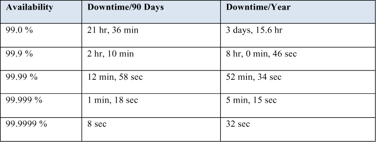
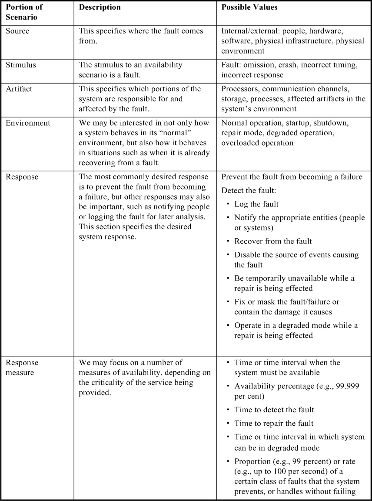
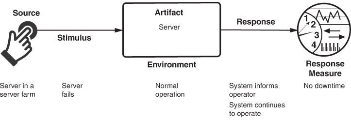
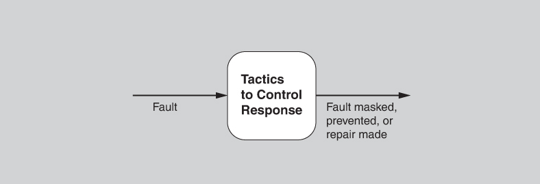
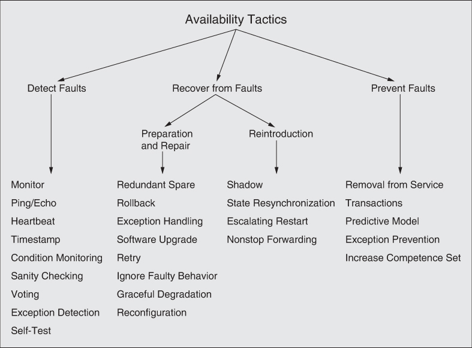
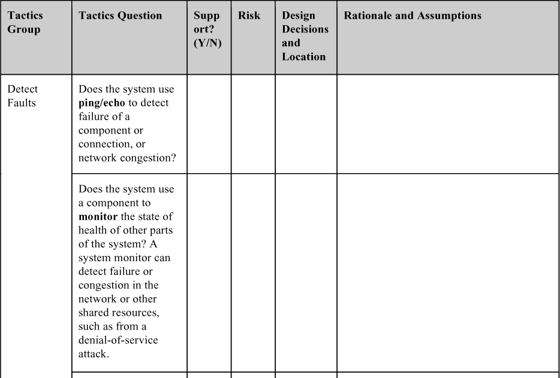
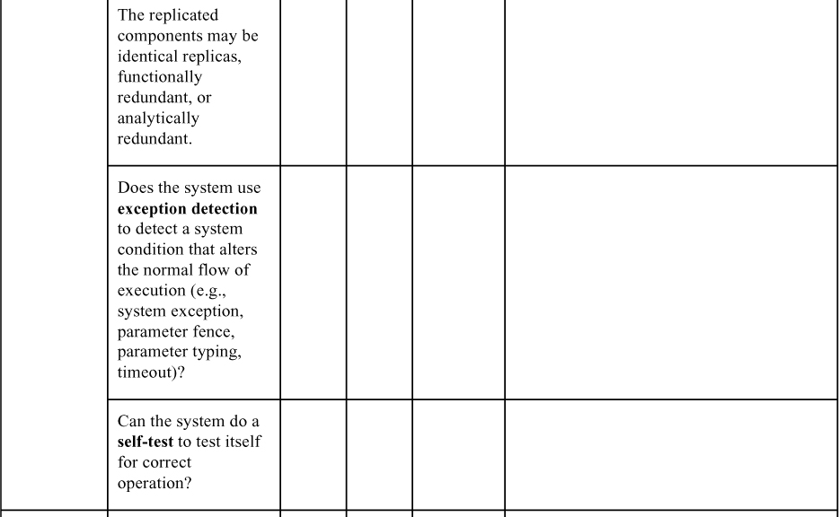
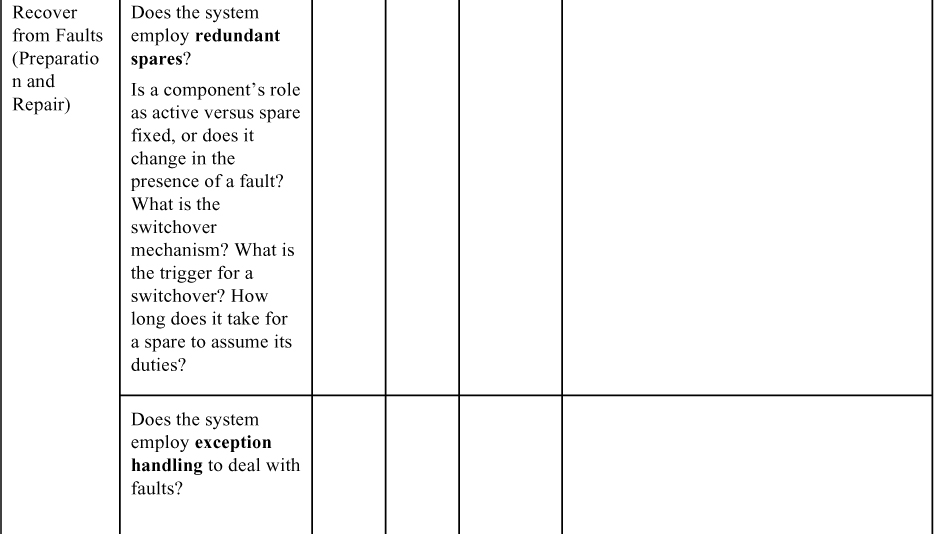

# 4. Availability

> Công nghệ không phải lúc nào cũng vần điệu 
> với sự hoàn hảo và độ tin cậy. 
> Thực tế còn xa mới được như vậy! 
> —Jean-Michel Jarre

Availability chỉ một thuộc tính của phần mềm—cụ thể là phần mềm có mặt ở đó và sẵn sàng thực hiện nhiệm vụ của mình khi bạn cần. Đây là một góc nhìn rộng và bao hàm cái thường được gọi là reliability (dù nó có thể bao hàm thêm những cân nhắc khác như downtime do bảo trì định kỳ). Availability xây dựng trên khái niệm reliability bằng cách bổ sung khái niệm phục hồi (recovery)—tức là, khi hệ thống hỏng, nó tự sửa chữa. Việc sửa chữa có thể được thực hiện bằng nhiều cách khác nhau, như chúng ta sẽ thấy trong chương này.

Availability cũng bao hàm khả năng của một hệ thống che giấu hoặc sửa chữa các fault sao cho chúng không trở thành failure, nhờ đó bảo đảm rằng tổng thời gian gián đoạn service tích lũy không vượt quá một giá trị yêu cầu trong một khoảng thời gian xác định. Định nghĩa này bao gồm các khái niệm reliability, robustness, và bất kỳ quality attribute nào khác có liên quan đến khái niệm failure không thể chấp nhận được.

Một failure là sự sai lệch của hệ thống so với đặc tả của nó, trong đó sự sai lệch đó có thể nhìn thấy từ bên ngoài. Việc xác định rằng một failure đã xảy ra đòi hỏi một người quan sát bên ngoài nào đó trong môi trường.

Nguyên nhân của một failure được gọi là *fault*. Một fault có thể nằm bên trong hoặc bên ngoài hệ thống đang được xem xét. Các trạng thái trung gian giữa lúc xảy ra fault và lúc xảy ra failure được gọi là error. Fault có thể được ngăn chặn, dung thứ, loại bỏ hoặc dự báo. Thông qua các hành động này, một hệ thống trở nên “resilient” (có khả năng chống chịu) trước fault. Trong số các lĩnh vực mà chúng ta quan tâm có: cách phát hiện fault của hệ thống, fault của hệ thống có thể xảy ra thường xuyên đến mức nào, điều gì xảy ra khi một fault xảy ra, hệ thống được phép ngừng hoạt động trong bao lâu, khi nào fault hoặc failure có thể xảy ra một cách an toàn, làm thế nào để ngăn chặn fault hoặc failure, và những loại thông báo nào được yêu cầu khi một failure xảy ra.

Availability liên quan chặt chẽ với, nhưng rõ ràng khác biệt với, security. Một cuộc tấn công denial-of-service được thiết kế một cách tường minh để khiến một hệ thống thất bại—tức là, làm cho nó không sẵn sàng. Availability cũng liên quan chặt chẽ với performance, vì có thể khó phân biệt khi nào một hệ thống đã thất bại và khi nào nó chỉ đơn giản là phản hồi chậm một cách quá mức. Cuối cùng, availability gắn bó chặt chẽ với safety, vốn quan tâm đến việc giữ cho hệ thống không đi vào một trạng thái nguy hiểm và phục hồi hoặc hạn chế thiệt hại khi điều đó xảy ra.

Một trong những nhiệm vụ đòi hỏi khắt khe nhất khi xây dựng một hệ thống high-availability fault-tolerant là hiểu bản chất của các failure có thể phát sinh trong quá trình vận hành. Một khi đã hiểu được chúng, các chiến lược giảm thiểu có thể được thiết kế vào hệ thống.

Vì người dùng có thể quan sát được một failure của hệ thống, thời gian sửa chữa là thời gian cho đến khi failure không còn quan sát được nữa. Đây có thể là một độ trễ không thể nhận thấy trong thời gian phản hồi của người dùng, hoặc có thể là thời gian cần để một người bay đến một địa điểm xa xôi ở dãy Andes để sửa một bộ phận của máy móc khai mỏ (như một người chịu trách nhiệm sửa phần mềm trong động cơ máy khai mỏ đã kể lại cho chúng tôi). Khái niệm “observability” (khả năng quan sát được) là then chốt ở đây: Nếu một failure *lẽ ra đã có thể được quan sát*, thì nó là một failure, bất kể nó có thực sự được quan sát hay không.

Ngoài ra, chúng ta thường quan tâm đến mức năng lực còn lại khi một failure đã xảy ra—một chế độ vận hành suy giảm (degraded operating mode).

Việc phân biệt giữa fault và failure cho phép chúng ta thảo luận về các chiến lược sửa chữa. Nếu code chứa một fault được thực thi nhưng hệ thống có thể phục hồi từ fault đó mà không có bất kỳ sai lệch quan sát được nào so với hành vi đã được đặc tả, chúng ta nói rằng không có failure nào xảy ra.

Availability của một hệ thống có thể được đo bằng xác suất hệ thống sẽ cung cấp các service đã được đặc tả trong các giới hạn yêu cầu trong một khoảng thời gian xác định. Một biểu thức well-known được dùng để suy ra steady-state availability (bắt nguồn từ thế giới phần cứng):

*MTBF*/(*MTBF* + *MTTR*)

trong đó *MTBF* là thời gian trung bình giữa các failure (mean time between failures) và *MTTR* là thời gian trung bình để sửa chữa (mean time to repair). Trong thế giới phần mềm, công thức này nên được hiểu là khi nghĩ về availability, bạn nên nghĩ về điều gì sẽ khiến hệ thống của bạn thất bại, khả năng một sự kiện như vậy xảy ra là bao nhiêu, và sẽ cần bao nhiêu thời gian để sửa chữa nó.

Từ công thức này, có thể tính toán xác suất và đưa ra những khẳng định như “hệ thống có availability 99.999 phần trăm” hoặc “có xác suất 0.001 phần trăm là hệ thống sẽ không hoạt động khi cần”. Các downtime theo lịch (khi hệ thống được chủ động đưa ra khỏi service) không nên được tính đến khi tính availability, vì khi đó hệ thống được coi là “không cần thiết”; tất nhiên, điều này phụ thuộc vào các yêu cầu cụ thể của hệ thống, thường được ghi trong một service level agreement (SLA). Điều này có thể dẫn đến những tình huống có vẻ kỳ lạ, khi hệ thống ngừng hoạt động và người dùng đang chờ nó, nhưng downtime đó đã được lên lịch và vì vậy không bị tính vào bất kỳ yêu cầu availability nào.

Các fault được phát hiện có thể được phân loại trước khi được báo cáo và sửa chữa. Việc phân loại này thường dựa trên mức độ nghiêm trọng của fault (critical, major hoặc minor) và tác động đến service (service-affecting hoặc non-service-affecting). Nó cung cấp cho người vận hành hệ thống trạng thái hệ thống kịp thời và chính xác, và cho phép áp dụng một chiến lược sửa chữa thích hợp. Chiến lược sửa chữa có thể được tự động hóa hoặc có thể đòi hỏi can thiệp thủ công.

Như vừa đề cập, availability kỳ vọng của một hệ thống hoặc service thường được biểu đạt dưới dạng một SLA. SLA đặc tả mức availability được bảo đảm và, thường thì, các khoản phạt mà nhà cung cấp sẽ phải chịu nếu SLA bị vi phạm. Ví dụ, Amazon cung cấp SLA sau cho cloud service EC2 của mình:

> AWS sẽ nỗ lực hợp lý về mặt thương mại để làm cho mỗi Included Service đều sẵn sàng ở mỗi AWS region với Monthly Uptime Percentage ít nhất 99.99%, trong mỗi trường hợp trong bất kỳ chu kỳ thanh toán hằng tháng nào (“Service Commitment”). Trong trường hợp bất kỳ Included Service nào không đáp ứng Service Commitment, bạn sẽ đủ điều kiện nhận một Service Credit như được mô tả bên dưới.

[Bảng 4.1](#ch04tab01) đưa ra các ví dụ về yêu cầu availability của hệ thống và các giá trị ngưỡng tương ứng cho downtime chấp nhận được của hệ thống, đo trong các khoảng quan sát 90 ngày và một năm. Thuật ngữ *high availability* thường chỉ các thiết kế nhắm đến availability từ 99.999 phần trăm (“5 nines”) trở lên. Như đã đề cập trước đó, chỉ những lần gián đoạn không theo lịch mới được tính vào downtime của hệ thống.

**Bảng 4.1** *Các yêu cầu availability của hệ thống*

## 4.1 General scenario cho availability (Availability General Scenario)

Giờ chúng ta có thể mô tả từng phần của một general scenario cho availability như được tóm tắt trong [Bảng 4.2](#ch04tab02).

**Bảng 4.2** *General scenario cho availability*

Một ví dụ về concrete availability scenario được suy ra từ general scenario trong [Bảng 4.2](#ch04tab02) được thể hiện trong [Hình 4.1](#ch04fig01). Scenario như sau: *Một server trong một server farm bị hỏng trong quá trình vận hành bình thường, và hệ thống thông báo cho người vận hành và tiếp tục hoạt động mà không có downtime*.

**Hình 4.1** *Ví dụ về concrete availability scenario*

## 4.2 Các tactic cho availability (Tactics for Availability)

Một failure xảy ra khi hệ thống không còn cung cấp một service nhất quán với đặc tả của nó và failure này có thể được các actor của hệ thống quan sát. Một fault (hoặc một tổ hợp fault) có khả năng gây ra một failure. Đến lượt mình, các availability tactic được thiết kế để giúp một hệ thống ngăn chặn hoặc chịu đựng các fault của hệ thống sao cho service mà hệ thống đang cung cấp vẫn tuân thủ đặc tả của nó. Các tactic mà chúng tôi thảo luận trong mục này sẽ ngăn fault trở thành failure hoặc ít nhất là giới hạn tác động của fault và giúp việc sửa chữa khả thi, như minh họa trong [Hình 4.2](#ch04fig02).

**Hình 4.2** *Mục tiêu của các availability tactic*

Availability tactic có một trong ba mục đích: phát hiện fault (fault detection), phục hồi từ fault (fault recovery), hoặc ngăn chặn fault (fault prevention). Các tactic cho availability được thể hiện trong [Hình 4.3](#ch04fig03). Những tactic này thường được cung cấp bởi một software infrastructure, chẳng hạn như một middleware package, nên công việc của bạn với tư cách là kiến trúc sư có thể là chọn và đánh giá (thay vì triển khai) các availability tactic phù hợp và tổ hợp tactic phù hợp.

**Hình 4.3** *Các availability tactic*

### Phát hiện fault (Detect Faults)

Trước khi bất kỳ hệ thống nào có thể hành động đối với một fault, sự hiện diện của fault đó phải được phát hiện hoặc dự đoán. Các tactic trong loại này bao gồm:

- *Monitor*. Component này được dùng để giám sát tình trạng sức khỏe của nhiều phần khác của hệ thống: processor, process, I/O, memory, v.v. Một system monitor có thể phát hiện failure hoặc tắc nghẽn trong mạng hoặc các tài nguyên dùng chung khác, chẳng hạn như do một cuộc tấn công denial-of-service. Nó điều phối phần mềm dùng các tactic khác trong loại này để phát hiện các component hoạt động sai. Ví dụ, system monitor có thể khởi tạo *self-tests*, hoặc là component phát hiện các *timestamp* sai hoặc các *heartbeat* bị bỏ lỡ.[2](#ch04fn2)

[2](#ch04fn2a) Khi cơ chế phát hiện được triển khai bằng một counter hoặc timer được reset định kỳ, dạng chuyên biệt này của system monitor được gọi là *watchdog*. Trong vận hành danh nghĩa, process đang được giám sát sẽ định kỳ reset counter/timer của watchdog như một phần tín hiệu cho biết nó đang hoạt động đúng; việc này đôi khi được gọi là “vuốt ve watchdog” (petting the watchdog).

- *Ping/echo.* Trong tactic này, một cặp message request/response bất đồng bộ được trao đổi giữa các node; nó được dùng để xác định khả năng tiếp cận (reachability) và độ trễ round-trip qua đường mạng tương ứng. Ngoài ra, echo cho biết component được ping vẫn còn sống. Ping thường được gửi bởi một system monitor. Ping/echo đòi hỏi phải đặt một ngưỡng thời gian; ngưỡng này cho component đang ping biết phải đợi echo bao lâu trước khi coi component được ping là đã thất bại (“timed out”). Các implementation tiêu chuẩn của ping/echo có sẵn cho các node được kết nối qua Internet Protocol (IP).
- *Heartbeat.* Cơ chế phát hiện fault này dùng việc trao đổi message định kỳ giữa một system monitor và một process đang được giám sát. Một trường hợp đặc biệt của heartbeat là khi process đang được giám sát định kỳ reset watchdog timer trong monitor của nó để ngăn timer hết hạn và do đó báo hiệu một fault. Với các hệ thống mà scalability là một mối quan tâm, overhead truyền tải và xử lý có thể được giảm bằng cách gửi kèm (piggyback) các message heartbeat vào các message điều khiển khác đang được trao đổi. Khác biệt giữa heartbeat và ping/echo nằm ở chỗ ai giữ trách nhiệm khởi tạo việc kiểm tra sức khỏe—monitor hay chính component.
- *Timestamp.* Tactic này được dùng để phát hiện các chuỗi sự kiện sai thứ tự, chủ yếu trong các hệ thống message-passing phân tán. Timestamp của một sự kiện có thể được thiết lập bằng cách gán trạng thái của một đồng hồ cục bộ cho sự kiện ngay sau khi sự kiện xảy ra. Số thứ tự (sequence number) cũng có thể được dùng cho mục đích này, vì timestamp trong một hệ thống phân tán có thể không nhất quán giữa các processor khác nhau. Xem [Chương 17](ch17_the_cloud_and_distributed_computing.vi.md#ch17) để có thảo luận đầy đủ hơn về chủ đề thời gian trong một hệ thống phân tán.
- *Condition monitoring.* Tactic này bao gồm việc kiểm tra các điều kiện trong một process hoặc thiết bị, hoặc xác nhận các giả định được đưa ra trong quá trình thiết kế. Bằng cách giám sát các điều kiện, tactic này ngăn hệ thống tạo ra hành vi sai. Việc tính checksum là một ví dụ phổ biến của tactic này. Tuy nhiên, bản thân monitor phải đơn giản (và, lý tưởng là có thể chứng minh là đúng) để bảo đảm rằng nó không đưa vào các lỗi phần mềm mới.
- *Sanity checking.* Tactic này kiểm tra tính hợp lệ hoặc tính hợp lý của các thao tác hoặc đầu ra cụ thể của một component. Nó thường dựa trên kiến thức về thiết kế bên trong, trạng thái của hệ thống, hoặc bản chất của thông tin đang được xem xét. Nó thường được dùng nhất tại các interface, để kiểm tra một luồng thông tin cụ thể.
- *Voting.* Voting bao gồm việc so sánh các kết quả tính toán từ nhiều nguồn lẽ ra phải tạo ra cùng kết quả và, nếu chúng không giống nhau, quyết định dùng kết quả nào. Tactic này phụ thuộc then chốt vào voting logic, thường được hiện thực dưới dạng một singleton đơn giản, được review và kiểm thử nghiêm ngặt để xác suất lỗi thấp. Voting cũng phụ thuộc then chốt vào việc có nhiều nguồn để đánh giá. Các phương án điển hình bao gồm:
- *Replication* là dạng voting đơn giản nhất; ở đây, các component là bản sao chính xác của nhau. Có nhiều bản sao của các component giống hệt nhau có thể hiệu quả trong việc bảo vệ khỏi các failure ngẫu nhiên của phần cứng nhưng không thể bảo vệ khỏi các lỗi thiết kế hoặc triển khai, trong phần cứng hay phần mềm, vì không có dạng đa dạng nào được tích hợp trong tactic này.
- *Functional redundancy*, ngược lại, nhằm giải quyết vấn đề các failure common-mode (khi các bản sao thể hiện cùng một fault vào cùng một thời điểm vì chúng có chung implementation) trong các component phần cứng hoặc phần mềm, bằng cách triển khai sự đa dạng thiết kế. Tactic này cố gắng xử lý bản chất có hệ thống của các fault thiết kế bằng cách thêm sự đa dạng vào dự phòng. Đầu ra của các component dự phòng về chức năng phải giống nhau khi có cùng đầu vào. Tactic functional redundancy vẫn dễ bị ảnh hưởng bởi các lỗi đặc tả—và, tất nhiên, các bản sao về chức năng sẽ tốn kém hơn để phát triển và kiểm chứng.
- *Analytic redundancy* cho phép không chỉ sự đa dạng giữa các phần private của component, mà còn sự đa dạng giữa đầu vào và đầu ra của các component. Tactic này nhằm dung thứ các lỗi đặc tả bằng cách dùng các đặc tả yêu cầu riêng biệt. Trong các hệ thống nhúng, analytic redundancy hữu ích khi một số nguồn đầu vào có khả năng thỉnh thoảng không sẵn sàng. Ví dụ, các chương trình avionics có nhiều cách để tính độ cao của máy bay, chẳng hạn như dùng áp suất khí quyển, dùng radar altimeter, và theo cách hình học dùng khoảng cách straight-line và góc look-down tới một điểm phía trước trên mặt đất. Cơ chế voter được dùng với analytic redundancy cần tinh vi hơn việc chỉ để đa số quyết định hoặc tính một giá trị trung bình đơn giản. Nó có thể phải hiểu cảm biến nào hiện đang đáng tin cậy (hay không), và nó có thể được yêu cầu tạo ra một giá trị higher-fidelity hơn bất kỳ component riêng lẻ nào có thể, bằng cách trộn và làm mượt các giá trị riêng lẻ theo thời gian.
- *Exception detection.* Tactic này tập trung vào việc phát hiện một điều kiện hệ thống làm thay đổi luồng thực thi bình thường. Nó có thể được tinh chỉnh thêm:
- *System exception* sẽ khác nhau tùy theo hardware architecture của processor được dùng. Chúng bao gồm các fault như chia cho không, bus fault và address fault, lệnh chương trình không hợp lệ, v.v.
- Tactic *parameter fence* đặt một mẫu dữ liệu đã biết (chẳng hạn 0xDEADBEEF) ngay sau bất kỳ tham số variable-length nào của một object. Điều này cho phép phát hiện tại runtime việc ghi đè lên memory được cấp phát cho các tham số variable-length của object.
- *Parameter typing* dùng một base class định nghĩa các function để thêm, tìm và duyệt qua các tham số message có định dạng type-length-value (TLV). Các derived class dùng các function của base class để cung cấp các function xây dựng và phân tích message. Việc dùng parameter typing bảo đảm rằng bên gửi và bên nhận message thống nhất về kiểu của nội dung, và phát hiện những trường hợp chúng không thống nhất.
- *Timeout* là một tactic phát sinh một exception khi một component phát hiện rằng nó hoặc một component khác đã không đáp ứng các ràng buộc về thời gian. Ví dụ, một component đang chờ response từ một component khác có thể phát sinh một exception nếu thời gian chờ vượt quá một giá trị nhất định.
- *Self-test.* Các component (hoặc, nhiều khả năng hơn, toàn bộ hệ thống con) có thể chạy các thủ tục để tự kiểm tra xem mình có hoạt động đúng không. Các thủ tục self-test có thể được khởi tạo bởi chính component, hoặc thỉnh thoảng được một system monitor gọi. Chúng có thể bao gồm việc dùng một số kỹ thuật có trong condition monitoring như checksum.

### Phục hồi từ fault (Recover from Faults)

Các tactic *recover from faults* được tinh chỉnh thành các tactic chuẩn bị và sửa chữa (preparation and repair) và các tactic đưa trở lại (reintroduction). Loại sau quan tâm đến việc đưa một component đã thất bại (nhưng đã được phục hồi) trở lại vận hành bình thường.

Các tactic *preparation and repair* dựa trên nhiều tổ hợp khác nhau của việc thử lại một phép tính hoặc đưa vào dự phòng:

- *Redundant spare.* Tactic này chỉ một cấu hình trong đó một hoặc nhiều component trùng lặp có thể nhảy vào và tiếp quản công việc nếu component chính thất bại. Tactic này là trái tim của các pattern hot spare, warm spare và cold spare, các pattern này khác nhau chủ yếu ở mức độ up-to-date của component dự phòng tại thời điểm tiếp quản.
- *Rollback.* Rollback cho phép hệ thống quay trở về một trạng thái tốt đã biết trước đó (được gọi là “rollback line”)—quay ngược thời gian—khi phát hiện một failure. Một khi đạt được trạng thái tốt, việc thực thi có thể tiếp tục. Tactic này thường được kết hợp với tactic transactions và tactic redundant spare để sau khi rollback xảy ra, một phiên bản standby của component bị thất bại được nâng lên trạng thái active. Rollback phụ thuộc vào việc một bản sao của trạng thái tốt trước đó (một checkpoint) có sẵn cho các component đang rollback. Checkpoint có thể được lưu ở một vị trí cố định và được cập nhật đều đặn, hoặc vào những thời điểm thuận tiện hay quan trọng trong quá trình xử lý, chẳng hạn như khi hoàn thành một thao tác phức tạp.
- *Exception handling.* Một khi một exception đã được phát hiện, hệ thống sẽ xử lý nó theo cách nào đó. Điều dễ nhất mà nó có thể làm là đơn giản là crash—nhưng, tất nhiên, đó là một ý tưởng tồi tệ xét từ góc độ availability, usability, testability và lẽ thường. Có những khả năng hiệu quả hơn nhiều. Cơ chế được dùng cho exception handling phần lớn phụ thuộc vào môi trường lập trình được dùng, từ các mã trả về đơn giản của function (error code) đến việc dùng các exception class chứa thông tin hữu ích cho việc tương quan fault, chẳng hạn như tên của exception, nguồn gốc của exception và nguyên nhân của exception Khi đó, phần mềm có thể dùng thông tin này để che giấu hoặc sửa chữa fault.
- *Software upgrade.* Mục tiêu của tactic này là đạt được việc nâng cấp in-service cho các image code thực thi theo cách non-service-affecting. Các chiến lược bao gồm:
- *Function patch*. Loại patch này, được dùng trong lập trình thủ tục, dùng một incremental linker/loader để lưu một software function đã cập nhật vào một segment đã pre-allocated của target memory. Phiên bản mới của software function sẽ dùng các điểm vào và điểm ra của function cũ đã bị loại bỏ.
- *Class patch*. Loại nâng cấp này áp dụng được cho các target thực thi code object-oriented, trong đó các định nghĩa class bao gồm một cơ chế backdoor cho phép thêm member data và function tại runtime.
- *Hitless in-service software upgrade (ISSU)*. Cách này tận dụng tactic redundant spare để đạt được các nâng cấp non-service-affecting cho phần mềm và schema liên quan.

   Trong thực tế, function patch và class patch được dùng để chuyển giao các bản sửa bug, trong khi hitless ISSU được dùng để chuyển giao các tính năng và năng lực mới.

- *Retry.* Tactic retry giả định rằng fault gây ra failure là tạm thời, và việc thử lại thao tác có thể dẫn đến thành công. Nó được dùng trong mạng và trong các server farm, nơi failure được dự kiến và phổ biến. Nên đặt một giới hạn cho số lần thử lại trước khi tuyên bố một failure vĩnh viễn.
- *Ignore faulty behavior.* Tactic này yêu cầu bỏ qua các message được gửi từ một nguồn cụ thể khi chúng ta xác định rằng các message đó là giả. Ví dụ, chúng ta muốn bỏ qua các message phát ra từ failure đang diễn ra của một cảm biến.
- *Graceful degradation.* Tactic này duy trì các chức năng quan trọng nhất của hệ thống khi có failure của component, trong khi loại bỏ các chức năng ít quan trọng hơn. Điều này được thực hiện trong những hoàn cảnh mà các failure riêng lẻ của component làm giảm chức năng của hệ thống một cách nhẹ nhàng thay vì gây ra failure toàn bộ hệ thống.
- *Reconfiguration.* Reconfiguration cố gắng phục hồi từ failure bằng cách giao lại trách nhiệm cho các tài nguyên hoặc component còn hoạt động (có thể bị hạn chế), đồng thời duy trì càng nhiều chức năng càng tốt.

*Reintroduction* xảy ra khi một component bị thất bại được đưa trở lại sau khi đã được sửa chữa. Các tactic reintroduction bao gồm:

- *Shadow.* Tactic này chỉ việc vận hành một component trước đó đã thất bại hoặc vừa được nâng cấp in-service ở “shadow mode” trong một khoảng thời gian định trước, trước khi đưa component trở lại vai trò active. Trong khoảng thời gian này, hành vi của nó có thể được giám sát để kiểm tra tính đúng đắn và nó có thể khôi phục trạng thái của mình một cách tăng dần.
- *State resynchronization.* Tactic reintroduction này là đối tác của tactic redundant spare. Khi được dùng với active redundancy—một phiên bản của tactic redundant spare—việc đồng bộ lại trạng thái diễn ra một cách tự nhiên, vì các component active và standby đều nhận và xử lý các đầu vào giống hệt nhau một cách song song. Trong thực tế, trạng thái của các component active và standby được so sánh định kỳ để bảo đảm đồng bộ. Việc so sánh này có thể dựa trên phép tính cyclic redundancy check (checksum) ‎hoặc, với các hệ thống cung cấp service safety-critical, phép tính message digest (một hàm hash one-way). Khi được dùng cùng với phiên bản passive redundancy của tactic redundant spare, việc đồng bộ lại trạng thái chỉ dựa trên thông tin trạng thái định kỳ được truyền từ (các) component active tới (các) component standby, thường thông qua checkpointing.
- *Escalating restart.* Tactic reintroduction này cho phép hệ thống phục hồi từ fault bằng cách thay đổi mức granularity của (các) component được khởi động lại và giảm thiểu mức độ ảnh hưởng đến service. Ví dụ, xét một hệ thống hỗ trợ bốn mức khởi động lại, đánh số 0–3. Mức khởi động lại thấp nhất (Level 0) có tác động ít nhất đến service và dùng passive redundancy (warm spare), trong đó mọi child thread của component bị lỗi đều bị kill và tạo lại. Bằng cách này, chỉ dữ liệu gắn với các child thread được giải phóng và khởi tạo lại. Mức khởi động lại tiếp theo (Level 1) giải phóng và khởi tạo lại toàn bộ memory không được bảo vệ; memory được bảo vệ không bị động đến. Mức khởi động lại tiếp theo (Level 2) giải phóng và khởi tạo lại toàn bộ memory, cả được bảo vệ lẫn không được bảo vệ, buộc mọi ứng dụng phải nạp lại và khởi tạo lại. Mức khởi động lại cuối cùng (Level 3) bao gồm việc nạp lại và khởi tạo lại hoàn toàn image thực thi và các data segment liên quan. Việc hỗ trợ tactic escalating restart đặc biệt hữu ích cho khái niệm graceful degradation, trong đó một hệ thống có thể giảm bớt các service mà nó cung cấp trong khi vẫn duy trì hỗ trợ cho các ứng dụng mission-critical hoặc safety-critical.
- *Nonstop forwarding.* Khái niệm này bắt nguồn từ thiết kế router, và giả định rằng chức năng được chia thành hai phần: supervisory hay control plane (quản lý thông tin kết nối và định tuyến) và data plane (thực hiện công việc thực sự là định tuyến các packet từ người gửi đến người nhận). Nếu một router gặp failure của supervisor đang active, nó có thể tiếp tục chuyển tiếp packet theo các tuyến đã biết—với các router lân cận—trong khi thông tin routing protocol được khôi phục và xác nhận. Khi control plane được khởi động lại, nó thực hiện một “graceful restart”, xây dựng lại dần database routing protocol của mình ngay cả khi data plane vẫn tiếp tục hoạt động.

### Ngăn chặn fault (Prevent Faults)

Thay vì phát hiện fault rồi cố gắng phục hồi từ chúng, sẽ ra sao nếu hệ thống của bạn có thể ngăn chúng xảy ra ngay từ đầu? Dù điều này nghe như thể sẽ cần đến khả năng tiên tri ở một mức độ nào đó, hóa ra trong nhiều trường hợp hoàn toàn có thể làm được điều đó.[3](#ch04fn3)

[3](#ch04fn3a) Các tactic này đề cập đến các phương tiện runtime để ngăn fault xảy ra. Tất nhiên, một cách tuyệt vời để ngăn fault—ít nhất là trong hệ thống bạn đang xây dựng, nếu không phải trong các hệ thống mà hệ thống của bạn phải tương tác—là viết code high-quality. Điều này có thể được thực hiện bằng các buổi kiểm tra code (code inspection), lập trình cặp (pair programming), các buổi review yêu cầu vững chắc, và rất nhiều thực hành kỹ thuật tốt khác.

- *Removal from service.* Tactic này chỉ việc tạm thời đặt một component của hệ thống vào trạng thái out-of-service nhằm giảm thiểu các failure tiềm ẩn của hệ thống. Ví dụ, một component của hệ thống có thể được đưa ra khỏi service và reset để loại bỏ các fault tiềm ẩn (chẳng hạn như memory leak, phân mảnh, hoặc soft error trong một cache không được bảo vệ) trước khi sự tích lũy fault đạt đến mức service-affecting, dẫn đến failure của hệ thống. Các thuật ngữ khác cho tactic này là *software rejuvenation* và *therapeutic reboot.* Nếu bạn khởi động lại máy tính mỗi đêm, bạn đang thực hành removal from service.
- *Transactions*. Các hệ thống nhắm đến các service high-availability tận dụng ngữ nghĩa transaction để bảo đảm rằng các message bất đồng bộ được trao đổi giữa các component phân tán là atomic, consistent, isolated và durable—các thuộc tính được gọi chung là “ACID properties”. Cách hiện thực phổ biến nhất của tactic transactions là protocol “two-phase commit” (2PC). Tactic này ngăn chặn các race condition gây ra bởi hai process cố gắng cập nhật cùng một mục dữ liệu vào cùng một thời điểm.
- *Predictive model*. Một predictive model, khi được kết hợp với một monitor, được dùng để giám sát tình trạng sức khỏe của một process hệ thống nhằm bảo đảm rằng hệ thống đang hoạt động trong các tham số vận hành danh nghĩa của nó, và để thực hiện hành động khắc phục khi hệ thống tiến gần đến một ngưỡng nguy hiểm. Các số liệu performance vận hành được giám sát được dùng để dự đoán sự khởi phát của fault; các ví dụ bao gồm tốc độ thiết lập session (trong một HTTP server), việc vượt ngưỡng (giám sát high watermark và low watermark của một tài nguyên dùng chung bị giới hạn nào đó), thống kê về trạng thái process (ví dụ: in-service, out-of-service, đang bảo trì, idle), và thống kê độ dài message queue.
- *Exception prevention.* Tactic này chỉ các kỹ thuật được dùng nhằm ngăn các system exception xảy ra. Việc dùng exception class, cho phép hệ thống phục hồi một cách trong suốt từ các system exception, đã được thảo luận ở trên. Các ví dụ khác về exception prevention bao gồm error-correcting code (được dùng trong viễn thông), các abstract data type như smart pointer, và việc dùng wrapper để ngăn các fault như dangling pointer hoặc vi phạm truy cập semaphore. Smart pointer ngăn exception bằng cách kiểm tra giới hạn (bounds checking) trên pointer, và bằng cách bảo đảm rằng tài nguyên được tự động de-allocated khi không còn dữ liệu nào tham chiếu đến chúng, nhờ đó tránh được rò rỉ tài nguyên.
- *Increase competence set.* Competence set của một chương trình là tập các trạng thái mà trong đó nó “đủ năng lực” để hoạt động. Ví dụ, trạng thái khi mẫu số bằng không nằm ngoài competence set của hầu hết các chương trình chia. Khi một component phát sinh một exception, nó đang báo hiệu rằng nó đã phát hiện ra mình đang nằm ngoài competence set của mình; về bản chất, nó không biết phải làm gì và đang đầu hàng. Tăng competence set của một component nghĩa là thiết kế nó để xử lý nhiều trường hợp hơn—các fault—như một phần của hoạt động bình thường. Ví dụ, một component giả định rằng nó có quyền truy cập một tài nguyên dùng chung có thể ném ra một exception nếu nó phát hiện việc truy cập bị chặn. Một component khác có thể chỉ đơn giản chờ được truy cập, hoặc trả về ngay lập tức kèm một dấu hiệu cho biết nó sẽ tự hoàn thành thao tác của mình vào lần tiếp theo nó có quyền truy cập. Trong ví dụ này, component thứ hai có competence set lớn hơn component thứ nhất.

## 4.3 Questionnaire dựa trên tactic cho availability (Tactics-Based Questionnaire for Availability)

Dựa trên các tactic được mô tả trong [Mục 4.2](#sec4_2), chúng ta có thể tạo một tập câu hỏi lấy cảm hứng từ các availability tactic (availability tactics–inspired), như được trình bày trong [Bảng 4.3](#ch04tab03). Để có cái nhìn tổng quan về các lựa chọn architecture được đưa ra để hỗ trợ availability, nhà phân tích đặt từng câu hỏi và ghi lại câu trả lời vào bảng. Câu trả lời cho các câu hỏi này sau đó có thể trở thành trọng tâm của các hoạt động tiếp theo: điều tra tài liệu, phân tích code hoặc các artifact khác, reverse engineering code, v.v.

**Bảng 4.3** *Questionnaire tactics-based cho availability*

## 4.4 Các pattern cho availability (Patterns for Availability)

Mục này trình bày một vài architectural pattern quan trọng nhất cho availability.

Ba pattern đầu tiên đều xoay quanh tactic redundant spare, và sẽ được mô tả như một nhóm. Chúng khác nhau chủ yếu ở mức độ trạng thái của các component dự phòng khớp với trạng thái của component active. (Một trường hợp đặc biệt xảy ra khi các component là stateless, khi đó hai pattern đầu tiên trở nên giống hệt nhau.)

- *Active redundancy (hot spare)*. Với các component stateful, điều này chỉ một cấu hình trong đó mọi node (active hoặc redundant spare) trong một protection group[4](#ch04fn4) nhận và xử lý các đầu vào giống hệt nhau một cách song song, cho phép (các) redundant spare(s) duy trì trạng thái đồng bộ với (các) node active. Vì redundant spare có trạng thái giống hệt processor active, nó có thể tiếp quản từ một component bị thất bại trong vòng vài mili giây. Trường hợp đơn giản gồm một node active và một node redundant spare thường được gọi là dự phòng one-plus-one. Active redundancy cũng có thể được dùng để bảo vệ cơ sở hạ tầng (facilities protection), trong đó các đường link mạng active và standby được dùng để bảo đảm kết nối mạng highly available.

[4](#ch04fn4a) Một protection group là một nhóm các node xử lý trong đó một hoặc nhiều node là “active”, còn các node còn lại đóng vai trò redundant spare.

- *Passive redundancy (warm spare)*. Với các component stateful, điều này chỉ một cấu hình trong đó chỉ các thành viên active của protection group xử lý input traffic. Một trong những nhiệm vụ của chúng là cung cấp cho (các) redundant spare(s) các bản cập nhật trạng thái định kỳ. Vì trạng thái được duy trì bởi các redundant spare chỉ gắn kết lỏng lẻo với trạng thái của (các) node active trong protection group (với mức độ lỏng lẻo của coupling là một hàm của chu kỳ cập nhật trạng thái), các node dự phòng được gọi là warm spare. Passive redundancy cung cấp một giải pháp đạt được sự cân bằng giữa pattern active redundancy có availability cao hơn nhưng compute-intensive hơn (và đắt hơn) với pattern cold spare có availability thấp hơn nhưng ít phức tạp hơn đáng kể (và cũng rẻ hơn đáng kể).
- *Spare (cold spare)*. Cold sparing chỉ một cấu hình trong đó các redundant spare nằm ngoài service cho đến khi xảy ra failover, tại thời điểm đó một thủ tục power-on-reset[5](#ch04fn5) được khởi tạo trên redundant spare trước khi nó được đưa vào service. Do performance phục hồi kém, và do đó mean time to repair cao, pattern này kém phù hợp với các hệ thống có yêu cầu high-availability.

[5](#ch04fn5a) Một power-on-reset bảo đảm rằng một thiết bị bắt đầu hoạt động ở một trạng thái đã biết.

   **Lợi ích:**

- Lợi ích của một redundant spare là một hệ thống tiếp tục hoạt động đúng chỉ sau một độ trễ ngắn khi có một failure. Phương án thay thế là một hệ thống ngừng hoạt động đúng, hoặc ngừng hoạt động hoàn toàn, cho đến khi component bị thất bại được sửa chữa. Việc sửa chữa này có thể mất hàng giờ hoặc hàng ngày.

   **Các tradeoff:**

- Tradeoff với bất kỳ pattern nào trong số này là chi phí và độ phức tạp tăng thêm khi cung cấp một spare.
- Tradeoff giữa ba phương án là thời gian phục hồi từ một failure so với chi phí runtime phát sinh để giữ cho spare luôn up-to-date. Ví dụ, một hot spare có chi phí cao nhất nhưng dẫn đến thời gian phục hồi nhanh nhất.

Các pattern khác cho availability bao gồm những pattern sau.

- *Triple modular redundancy (TMR)*. Implementation được dùng rộng rãi này của tactic voting dùng ba component làm cùng một việc. Mỗi component nhận các đầu vào giống hệt nhau và chuyển đầu ra của mình tới voting logic, nơi phát hiện bất kỳ sự không nhất quán nào giữa ba trạng thái đầu ra. Khi gặp một sự không nhất quán, voter báo cáo một fault. Nó cũng phải quyết định dùng đầu ra nào, và các instance khác nhau của pattern này dùng các quy tắc quyết định khác nhau. Các lựa chọn điển hình là để đa số quyết định hoặc chọn một giá trị trung bình được tính toán nào đó của các đầu ra khác nhau.

   Tất nhiên, các phiên bản khác của pattern này dùng 5, 19 hoặc 53 component dự phòng cũng khả thi. Tuy nhiên, trong hầu hết các trường hợp, 3 component là đủ để bảo đảm một kết quả đáng tin cậy.

   **Lợi ích:**

- TMR dễ hiểu và dễ triển khai. Nó hoàn toàn độc lập với những gì có thể gây ra các kết quả khác nhau, và chỉ quan tâm đến việc đưa ra một lựa chọn hợp lý để hệ thống có thể tiếp tục hoạt động.

   **Các tradeoff:**

- Có một tradeoff giữa việc tăng mức nhân bản, điều làm tăng chi phí, và availability thu được. Trong các hệ thống dùng TMR, khả năng thống kê để hai hoặc nhiều component cùng thất bại là cực kỳ nhỏ, và ba component đại diện cho điểm cân bằng tối ưu giữa availability và chi phí.
- *Circuit breaker*. Một availability tactic thường được dùng là retry. Trong trường hợp xảy ra timeout hoặc fault khi gọi một service, bên gọi chỉ đơn giản là thử lại—và lại, và lại. Một circuit breaker ngăn bên gọi thử vô số lần, chờ một response không bao giờ đến. Bằng cách này, nó phá vỡ vòng lặp retry vô tận khi nó cho rằng hệ thống đang phải xử lý một fault. Đó là tín hiệu để hệ thống bắt đầu xử lý fault. Cho đến khi circuit break được “reset”, các lần gọi tiếp theo sẽ trả về ngay lập tức mà không chuyển tiếp yêu cầu service.

   **Lợi ích:**

- Pattern này có thể loại bỏ khỏi từng component chính sách về việc cho phép bao nhiêu lần thử lại trước khi tuyên bố một failure.
- Trong trường hợp xấu nhất, những lần thử lại vô tận và vô ích sẽ khiến component gọi trở nên vô dụng như chính component được gọi đã thất bại. Vấn đề này đặc biệt nghiêm trọng trong các hệ thống phân tán, nơi bạn có thể có nhiều bên gọi cùng gọi một component không phản hồi và thực chất chính chúng cũng bị ngừng service, khiến failure lan truyền dây chuyền trên toàn hệ thống. Circuit breaker, *kết hợp với phần mềm lắng nghe nó và bắt đầu các thủ tục phục hồi*, ngăn chặn vấn đề đó.

   **Các tradeoff:**

- Phải cẩn thận khi chọn các giá trị timeout (hoặc retry). Nếu timeout quá dài, thì độ trễ không cần thiết bị thêm vào. Nhưng nếu timeout quá ngắn, thì circuit breaker sẽ ngắt khi không cần thiết—một kiểu “false positive” —điều có thể làm giảm availability và performance của các service này.

Các pattern availability khác thường được dùng bao gồm:

- *Process pairs*. Pattern này dùng checkpointing và rollback. Trong trường hợp failure, bản dự phòng đã liên tục checkpointing và (nếu cần) rollback về một trạng thái an toàn, nên sẵn sàng tiếp quản khi một failure xảy ra.
- *Forward error recovery*. Pattern này cung cấp một cách thoát khỏi một trạng thái không mong muốn bằng cách *tiến về phía trước* đến một trạng thái mong muốn. Điều này thường dựa vào các khả năng error-correction built-in, chẳng hạn như dự phòng dữ liệu, để các lỗi có thể được sửa mà không cần quay về trạng thái trước đó hoặc thử lại. Forward error recovery tìm một trạng thái an toàn, có thể đã suy giảm, mà từ đó việc vận hành có thể tiến về phía trước.

## 4.5 Đọc thêm (For Further Reading)

*Các pattern cho availability*:

- Bạn có thể đọc về các pattern cho fault tolerance trong [Hanmer 13].

*Các tactic chung cho availability*:

- Một thảo luận chi tiết hơn về một số availability tactic trong chương này được đưa ra trong [Scott 09]. Đây là nguồn của phần lớn tài liệu trong chương này.
- Internet Engineering Task Force đã ban hành một số tiêu chuẩn hỗ trợ các availability tactic. Các tiêu chuẩn này bao gồm *Non-Stop Forwarding* [IETF 2004], *Ping/Echo* [(*ICMP* [IETF 1981] hoặc *ICMPv6* ‎[RFC 2006b] *Echo Request/Response*), và mạng MPLS (LSP Ping) ‎[IETF 2006a].

*Các tactic cho availability—phát hiện fault*:

- Triple modular redundancy (TMR) được Lyons phát triển vào early 1960s [Lyons 62].
- Việc phát hiện fault trong tactic voting dựa trên những đóng góp nền tảng cho lý thuyết automata của Von Neumann, người đã chứng minh cách xây dựng các hệ thống có reliability định trước từ các component không đáng tin cậy ‎[Von Neumann 56].

*Các tactic cho availability—phục hồi từ fault*:

- Các cách hiện thực active redundancy dựa trên tiêu chuẩn (Standards-based) tồn tại để bảo vệ các đường link mạng (tức là, facilities) ở cả physical layer của mô hình OSI (Open Systems Interconnection) seven-layer [Bellcore 98, 99; Telcordia 00] và network/link layer ‎[IETF 2005].
- Một số ví dụ về cách một hệ thống có thể suy giảm qua quá trình sử dụng (degradation) được đưa ra trong [Nygard 18].
- Có hàng núi bài báo đã được viết về parameter typing, nhưng [Utas 05] viết về nó trong bối cảnh availability (thay vì ngăn chặn bug, bối cảnh thường thấy của nó). [Utas 05] cũng đã viết về escalating restart.
- Các kỹ sư phần cứng thường dùng các tactic preparation and repair. Các ví dụ bao gồm mã hóa error detection and correction (EDAC), forward error correction (FEC) và temporal redundancy. Mã EDAC thường được dùng để bảo vệ các cấu trúc control memory trong các hệ thống nhúng real-time phân tán high-availability ‎[Hamming 80]. Ngược lại, mã FEC thường được dùng để phục hồi từ các lỗi physical layer xảy ra trong các đường link mạng bên ngoài ‎[Morelos-Zaragoza 06]. Temporal redundancy bao gồm việc lấy mẫu các đường clock hoặc dữ liệu dự phòng về không gian tại các khoảng thời gian vượt quá độ rộng xung của bất kỳ xung tạm thời nào cần dung thứ, rồi bỏ phiếu loại bỏ mọi khiếm khuyết được phát hiện ‎[Mavis 02].

*Các tactic cho availability—ngăn chặn fault*:

- Parnas và Madey đã viết về việc tăng competence set của một element [Parnas 95].
- Các ACID property, quan trọng trong tactic transactions, được Gray giới thiệu vào thập niên 1970s và được thảo luận sâu trong [Gray 93].

*Khôi phục sau thảm họa (Disaster recovery)*:

- Thảm họa là một sự kiện như động đất, lũ lụt hoặc bão phá hủy toàn bộ một data center. National Institute of Standards and Technology (NIST) của Hoa Kỳ xác định tám loại kế hoạch khác nhau nên được xem xét trong trường hợp xảy ra thảm họa, Xem [Mục 2.2](ch02_why_is_software_architecture_important.vi.md#sec2_2) của NIST Special Publication 800-34, *Contingency Planning Guide for Federal Information Systems*, [https://nvlpubs.nist.gov/nistpubs/Legacy/SP/nistspecialpublication800-34r1.pdf](https://nvlpubs.nist.gov/nistpubs/Legacy/SP/nistspecialpublication800-34r1.pdf).

## 4.6 Câu hỏi thảo luận (Discussion Questions)

1. Hãy viết một tập concrete scenario cho availability, dùng từng response có thể có trong general scenario.
2. Hãy viết một concrete availability scenario cho phần mềm của một chiếc xe tự lái (giả định).
3. Hãy viết một concrete availability scenario cho một chương trình như Microsoft Word.
4. Dự phòng (redundancy) là một chiến lược then chốt để đạt được high availability. Hãy xem các pattern và tactic được trình bày trong chương này và quyết định xem có bao nhiêu trong số đó khai thác một dạng dự phòng nào đó và bao nhiêu thì không.
5. Availability đánh đổi với modifiability và deployability như thế nào? Bạn sẽ thực hiện một thay đổi đối với một hệ thống được yêu cầu có availability 24/7 (tức là không bao giờ có down time, dù theo lịch hay không theo lịch) như thế nào?
6. Hãy xem xét các tactic phát hiện fault (ping/echo, heartbeat, system monitor, voting và exception detection). Hệ quả về performance của việc dùng các tactic này là gì?
7. Những tactic nào được một load balancer (xem [Chương 17](ch17_the_cloud_and_distributed_computing.vi.md#ch17)) dùng khi nó phát hiện failure của một instance?
8. Hãy tra cứu recovery point objective (RPO) và recovery time objective (RTO) và giải thích cách chúng có thể được dùng để đặt khoảng checkpoint khi dùng tactic rollback.
