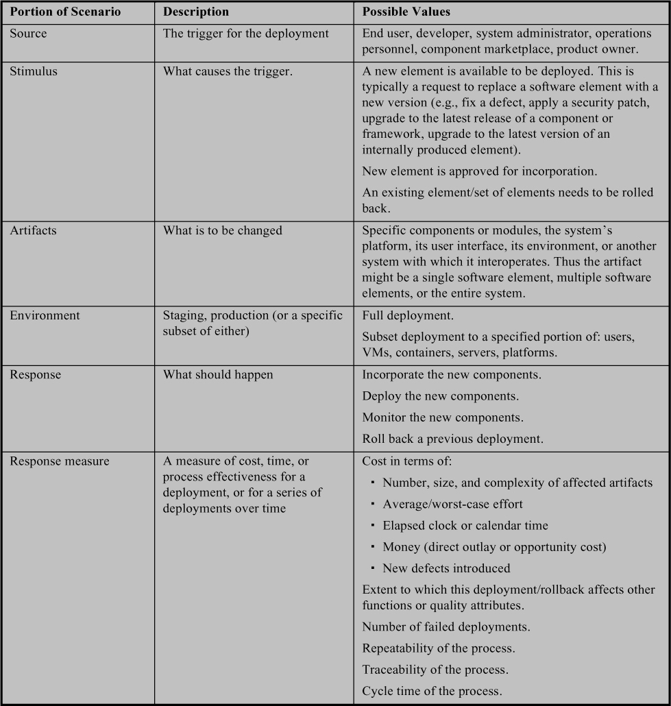
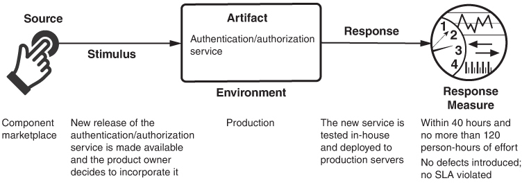
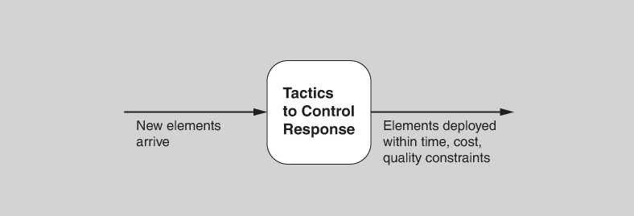
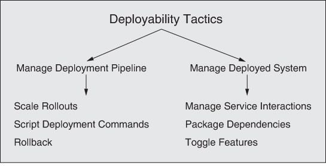
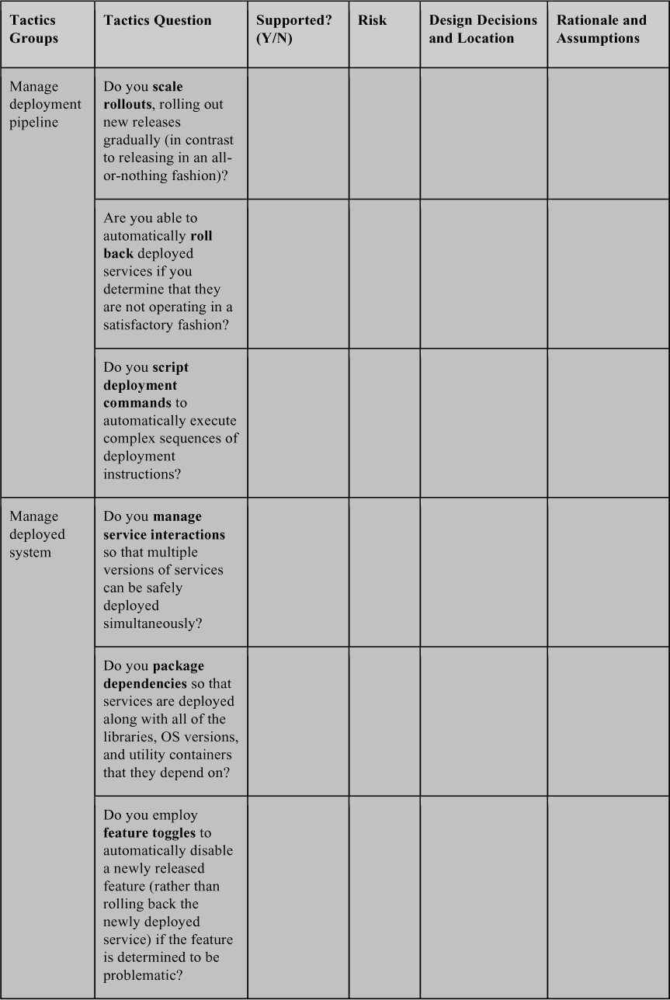
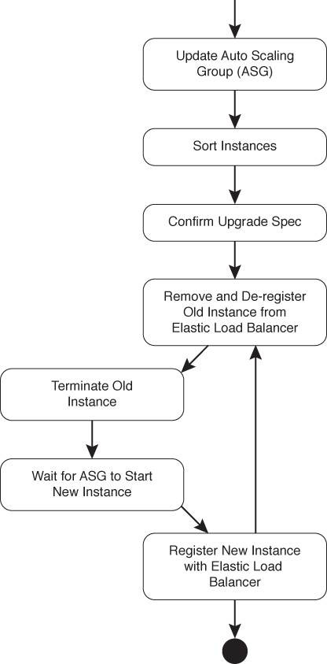

# 5. Deployability

> Từ ngày ta đến hành tinh này 
> Chớp mắt, bước vào ánh mặt trời 
> Có nhiều thứ để thấy hơn những gì ta có thể thấy 
> Nhiều việc để làm hơn những gì ta có thể làm 
> —*The Lion King*

Sẽ đến một ngày phần mềm, giống như tất cả chúng ta, phải rời khỏi nhà, phiêu lưu ra thế giới và trải nghiệm cuộc sống thực. Khác với chúng ta, phần mềm thường thực hiện chuyến đi này nhiều lần, khi các thay đổi và cập nhật được thực hiện. Chương này nói về việc làm cho quá trình chuyển đổi đó trật tự nhất, hiệu quả nhất và—trên hết—*nhanh* nhất có thể. Đó là lĩnh vực của continuous deployment, thứ được hỗ trợ nhiều nhất bởi quality attribute deployability.

Vì sao deployability lại chiếm được một vị trí front-row trong thế giới các quality attribute?

Trong “những ngày tồi tệ xưa kia”, các bản phát hành không thường xuyên—một lượng lớn thay đổi được gói vào các bản phát hành và được lên lịch. Một bản phát hành chứa các tính năng mới và các bản sửa bug. Một bản phát hành mỗi tháng, mỗi quý, hoặc thậm chí mỗi năm là chuyện phổ biến. Áp lực cạnh tranh trong nhiều domain—với e-commerce dẫn đầu—đã dẫn đến nhu cầu về các chu kỳ phát hành ngắn hơn nhiều. Trong những bối cảnh này, các bản phát hành có thể diễn ra bất cứ lúc nào—có thể hàng trăm bản phát hành mỗi ngày—và mỗi bản có thể được khởi xướng bởi một team khác nhau trong tổ chức. Có thể phát hành thường xuyên nghĩa là đặc biệt các bản sửa bug không phải chờ đến bản phát hành theo lịch tiếp theo, mà có thể được thực hiện và phát hành ngay khi bug được phát hiện và sửa. Nó cũng có nghĩa là các tính năng mới không cần được gói vào một bản phát hành, mà có thể được đưa vào production bất cứ lúc nào.

Điều này không đáng mong muốn, hoặc thậm chí không khả thi, trong mọi domain. Nếu phần mềm của bạn tồn tại trong một hệ sinh thái phức tạp với nhiều dependency, có thể không thể phát hành chỉ một phần của nó mà không phối hợp bản phát hành đó với các phần khác. Ngoài ra, nhiều hệ thống nhúng, các hệ thống ở những vị trí hard-to-access, và các hệ thống không được kết nối mạng sẽ là những ứng viên kém cho tư duy continuous deployment.

Chương này tập trung vào số lượng lớn và ngày càng tăng các hệ thống mà với chúng các bản phát hành tính năng just-in-time là một lợi thế cạnh tranh đáng kể, và các bản sửa bug just-in-time là thiết yếu đối với safety, security hoặc vận hành liên tục. Thường thì các hệ thống này là microservice và cloud-based, dù các kỹ thuật ở đây không giới hạn ở những công nghệ đó.

## 5.1 Continuous deployment (Continuous Deployment)

Deployment là một quá trình bắt đầu từ việc viết code và kết thúc với những người dùng thực tương tác với hệ thống trong môi trường production. Nếu quá trình này được tự động hóa hoàn toàn—tức là, nếu không có sự can thiệp của con người—thì nó được gọi là continuous deployment. Nếu quá trình được tự động hóa đến tận điểm đưa (các phần của) hệ thống vào production và cần sự can thiệp của con người (có thể do quy định hoặc chính sách) cho bước cuối cùng này, quá trình được gọi là continuous delivery.

Để tăng tốc các bản phát hành, chúng ta cần đưa vào khái niệm *deployment pipeline*: chuỗi công cụ và hoạt động bắt đầu khi bạn check code vào một hệ thống version control và kết thúc khi ứng dụng của bạn đã được deploy để người dùng gửi request đến nó. Ở giữa hai điểm đó, một loạt công cụ tích hợp và tự động kiểm thử code vừa được commit, kiểm thử chức năng của code đã tích hợp, và kiểm thử ứng dụng về các mối quan tâm như performance khi chịu tải, security và tuân thủ giấy phép.

Mỗi giai đoạn trong deployment pipeline diễn ra trong một môi trường được thiết lập để hỗ trợ việc cô lập giai đoạn đó và thực hiện các hành động phù hợp với giai đoạn đó. Các môi trường chính như sau:

- Code được phát triển trong một *development environment* cho một module duy nhất, nơi nó trải qua các unit test độc lập. Một khi vượt qua các test, và sau khi được review thích hợp, code được commit vào một hệ thống version control, hệ thống này kích hoạt các hoạt động build trong integration environment.
- Một *integration environment* build một phiên bản thực thi được của service của bạn. Một continuous integration server compile[1](#ch05fn1) code mới hoặc đã thay đổi của bạn, cùng với các phiên bản tương thích mới nhất của code cho các phần khác của service, và xây dựng một image thực thi cho service của bạn.[2](#ch05fn2) Các test trong integration environment bao gồm các unit test từ các module khác nhau (giờ được chạy trên hệ thống đã build) cũng như các integration test được thiết kế riêng cho toàn bộ hệ thống. Khi vượt qua các test khác nhau, service đã build được nâng lên staging environment.

[1](#ch05fn1a) Nếu bạn đang phát triển phần mềm bằng một ngôn ngữ thông dịch như Python hoặc JavaScript, sẽ không có bước compile.

[2](#ch05fn2a) Trong chương này, chúng tôi dùng thuật ngữ “service” để chỉ bất kỳ đơn vị nào có thể deploy độc lập.

- Một *staging environment* kiểm thử các chất lượng khác nhau của toàn bộ hệ thống. Chúng bao gồm performance testing, security testing, kiểm tra tuân thủ giấy phép và, có thể, user testing. Với các hệ thống nhúng, đây là nơi các trình mô phỏng môi trường vật lý (cung cấp đầu vào tổng hợp cho hệ thống) được đưa vào sử dụng. Một ứng dụng vượt qua mọi test của staging environment—có thể bao gồm field testing—được deploy lên production environment, dùng mô hình blue/green hoặc rolling upgrade (xem [Mục 5.6](#sec5_6)). Trong một số trường hợp, deployment một phần được dùng để kiểm soát chất lượng hoặc để kiểm tra phản ứng của thị trường đối với một thay đổi hoặc sản phẩm được đề xuất.
- Một khi đã ở trong *production environment*, service được giám sát chặt chẽ cho đến khi mọi bên có được một mức độ tin tưởng nhất định vào chất lượng của nó. Tại thời điểm đó, nó được coi là một phần bình thường của hệ thống và nhận được cùng mức độ chú ý như các phần khác của hệ thống.

Bạn thực hiện một tập test khác nhau trong mỗi môi trường, mở rộng phạm vi kiểm thử từ unit testing của một module duy nhất trong development environment, đến functional testing của mọi component tạo nên service của bạn trong integration environment, và kết thúc bằng quality testing diện rộng trong staging environment và giám sát việc sử dụng trong production environment.

Nhưng không phải mọi thứ đều diễn ra theo kế hoạch. Nếu bạn phát hiện vấn đề sau khi phần mềm đã ở trong production environment, thường cần roll back về một phiên bản trước trong khi lỗi đang được xử lý.

Các lựa chọn architecture ảnh hưởng đến deployability. Ví dụ, bằng cách dùng microservice architecture pattern (xem [Mục 5.6](#sec5_6)), mỗi team chịu trách nhiệm về một microservice có thể tự đưa ra các lựa chọn công nghệ của mình; điều này loại bỏ các vấn đề không tương thích mà trước đây lẽ ra sẽ được phát hiện vào lúc tích hợp (ví dụ, các lựa chọn không tương thích về phiên bản library nào được dùng). Vì microservice là các service độc lập, những lựa chọn như vậy không gây ra vấn đề.

Tương tự, tư duy continuous deployment buộc bạn phải nghĩ về testing infrastructure sớm hơn trong quá trình phát triển. Điều này là cần thiết vì thiết kế cho continuous deployment đòi hỏi kiểm thử tự động liên tục. Ngoài ra, nhu cầu có thể roll back hoặc vô hiệu hóa tính năng dẫn đến các quyết định architecture về các cơ chế như feature toggle và khả năng tương thích ngược của interface. Những quyết định này tốt nhất nên được đưa ra từ sớm.

> **Ảnh hưởng của virtualization đến các môi trường khác nhau (The Effect of Virtualization on the Different Environments)**
>
> Trước khi công nghệ virtualization được dùng rộng rãi, các môi trường mà chúng tôi mô tả ở đây là các cơ sở vật lý. Trong hầu hết các tổ chức, development environment, integration environment và staging environment gồm phần cứng và phần mềm được mua sắm và vận hành bởi các nhóm khác nhau. Development environment có thể gồm một vài máy tính để bàn mà team phát triển tận dụng làm server. Integration environment được vận hành bởi team kiểm thử hoặc quality-assurance, và có thể gồm một số rack, chứa thiết bị previous-generation từ data center. Staging environment được vận hành bởi team vận hành và có thể có phần cứng tương tự phần cứng dùng trong production.
>
> Rất nhiều thời gian đã được dành để cố tìm hiểu vì sao một test vượt qua trong môi trường này lại thất bại trong môi trường khác. Một lợi ích của các môi trường dùng virtualization là khả năng có *environment parity* (sự tương đồng giữa các môi trường), trong đó các môi trường có thể khác nhau về quy mô nhưng không khác về loại phần cứng hay cấu trúc cơ bản. Nhiều công cụ provisioning hỗ trợ environment parity bằng cách cho phép mọi team dễ dàng xây dựng một môi trường chung và bằng cách bảo đảm môi trường chung này mô phỏng production environment càng sát càng tốt.

Ba cách quan trọng để đo chất lượng của pipeline như sau:

- *Cycle time* là nhịp độ tiến triển qua pipeline. Nhiều tổ chức sẽ deploy lên production vài lần hoặc thậm chí hàng trăm lần mỗi ngày. Việc deploy nhanh như vậy là không thể nếu cần sự can thiệp của con người. Nó cũng không thể nếu một team phải phối hợp với các team khác trước khi đưa service của mình vào production. Ở phần sau của chương này, chúng ta sẽ thấy các kỹ thuật architecture cho phép các team thực hiện continuous deployment mà không cần tham khảo ý kiến các team khác.
- *Traceability* là khả năng khôi phục mọi artifact đã dẫn đến một element có vấn đề. Điều đó bao gồm toàn bộ code và dependency có trong element đó. Nó cũng bao gồm các test case đã được chạy trên element đó và các công cụ đã được dùng để tạo ra element. Lỗi trong các công cụ được dùng trong deployment pipeline có thể gây ra vấn đề trong production. Thông thường, thông tin traceability được lưu trong một *artifact database*. Database này sẽ chứa số phiên bản code, số phiên bản của các element mà hệ thống phụ thuộc vào (như library), số phiên bản test và số phiên bản công cụ.
- *Repeatability* là việc có được cùng một kết quả khi bạn thực hiện cùng một hành động với cùng các artifact. Điều này không dễ như nghe. Ví dụ, giả sử quá trình build của bạn lấy phiên bản mới nhất của một library. Lần tiếp theo bạn thực thi quá trình build, một phiên bản mới của library có thể đã được phát hành. Một ví dụ khác, giả sử một test sửa đổi một số giá trị trong database. Nếu các giá trị ban đầu không được khôi phục, các test tiếp theo có thể không cho ra cùng kết quả.

> **DevOps**
>
> DevOps—từ ghép của “development” và “operations”—là một khái niệm gắn chặt với continuous deployment. Nó là một phong trào (rất giống phong trào Agile), một mô tả về một tập thực hành và công cụ (một lần nữa, rất giống phong trào Agile), và một công thức marketing được các nhà cung cấp bán những công cụ đó quảng bá. Mục tiêu của DevOps là rút ngắn time to market (hay time to release). Mục tiêu là rút ngắn đáng kể thời gian từ khi một developer thực hiện thay đổi đối với một hệ thống hiện có—triển khai một tính năng hoặc sửa một bug—đến khi hệ thống đến tay người dùng cuối, so với các thực hành phát triển phần mềm truyền thống.
>
> Một định nghĩa hình thức của DevOps nắm bắt cả tần suất phát hành lẫn khả năng sửa bug theo yêu cầu:
>
> > DevOps là một tập thực hành nhằm giảm thời gian từ khi commit một thay đổi vào hệ thống đến khi thay đổi đó được đưa vào production bình thường, đồng thời bảo đảm chất lượng cao. [Bass 15]
>
> Triển khai DevOps là một nỗ lực cải tiến quy trình. DevOps không chỉ bao hàm các yếu tố văn hóa và tổ chức của bất kỳ nỗ lực cải tiến quy trình nào, mà còn dựa mạnh vào công cụ và thiết kế architecture. Tất nhiên, mọi môi trường đều khác nhau, nhưng các công cụ và sự tự động hóa mà chúng tôi mô tả có thể được tìm thấy trong các tool chain điển hình được xây dựng để hỗ trợ DevOps.
>
> Chiến lược continuous deployment mà chúng tôi mô tả ở đây là trái tim về khái niệm của DevOps. Đến lượt mình, kiểm thử tự động là một thành phần cực kỳ quan trọng của continuous deployment, và công cụ cho việc đó thường là rào cản công nghệ lớn nhất đối với DevOps. Một số dạng DevOps bao gồm việc ghi log và giám sát post-deployment các log đó, để tự động phát hiện lỗi tại “trụ sở chính”, hoặc thậm chí giám sát để hiểu trải nghiệm người dùng. Tất nhiên, điều này đòi hỏi một khả năng “phone home” hoặc gửi log trong hệ thống, điều có thể khả thi hoặc không, được phép hoặc không, trong một số hệ thống.
>
> DevSecOps là một biến thể của DevOps tích hợp các cách tiếp cận cho security (cho infrastructure và cho các ứng dụng mà nó tạo ra) vào toàn bộ quy trình. DevSecOps ngày càng phổ biến trong các ứng dụng hàng không vũ trụ và quốc phòng, nhưng cũng có giá trị trong bất kỳ lĩnh vực ứng dụng nào mà DevOps hữu ích và một vụ vi phạm security sẽ đặc biệt tốn kém. Nhiều ứng dụng IT thuộc loại này.

## 5.2 Deployability

*Deployability* chỉ một thuộc tính của phần mềm cho biết nó có thể được deploy—tức là được cấp phát vào một môi trường để thực thi—trong một lượng thời gian và công sức có thể dự đoán và chấp nhận được. Hơn nữa, nếu deployment mới không đáp ứng đặc tả của nó, nó có thể được roll back, cũng trong một lượng thời gian và công sức có thể dự đoán và chấp nhận được. Khi thế giới ngày càng chuyển sang virtualization và cloud infrastructure, và khi quy mô của các hệ thống software-intensive được deploy chắc chắn sẽ tăng lên, một trong những trách nhiệm của kiến trúc sư là bảo đảm deployment được thực hiện theo cách hiệu quả và có thể dự đoán, giảm thiểu rủi ro tổng thể của hệ thống.[3](#ch05fn3)

[3](#ch05fn3a) Chắc chắn quality attribute testability (xem [Chương 12](ch12_testability.vi.md#ch12)) đóng vai trò then chốt trong continuous deployment, và kiến trúc sư có thể hỗ trợ quan trọng cho continuous deployment bằng cách bảo đảm hệ thống có thể kiểm thử được, theo mọi cách vừa nêu. Tuy nhiên, mối quan tâm của chúng tôi ở đây là quality attribute liên quan trực tiếp đến continuous deployment, ngoài testability: deployability.

Để đạt được những mục tiêu này, kiến trúc sư cần xem xét cách một executable được cập nhật trên một nền tảng host, và cách nó sau đó được gọi, đo lường, giám sát và kiểm soát. Đặc biệt, các hệ thống di động đặt ra thách thức về deployability xét về cách chúng được cập nhật, vì những lo ngại về băng thông. Một số vấn đề liên quan đến việc deploy phần mềm như sau:

- Nó đến host của mình như thế nào (tức là push, khi các bản cập nhật được deploy mà không cần yêu cầu, hay pull, khi người dùng hoặc quản trị viên phải yêu cầu cập nhật một cách tường minh)?
- Nó được tích hợp vào một hệ thống hiện có như thế nào? Việc này có thể được thực hiện trong khi hệ thống hiện có đang thực thi không?
- Phương tiện là gì, chẳng hạn DVD, ổ USB hay phân phối qua Internet?
- Cách đóng gói là gì (ví dụ: executable, app, plug-in)?
- Việc tích hợp vào một hệ thống hiện có sẽ ra sao?
- Hiệu quả của việc thực thi quá trình là gì?
- Khả năng kiểm soát quá trình là gì?

Với tất cả những mối quan tâm này, kiến trúc sư phải có khả năng đánh giá các rủi ro liên quan. Kiến trúc sư chủ yếu quan tâm đến mức độ architecture hỗ trợ các deployment có tính:

- *Granular*. Deployment có thể là của toàn bộ hệ thống hoặc của các element bên trong hệ thống. Nếu architecture cung cấp các tùy chọn cho granularity deployment mịn hơn, thì một số rủi ro nhất định có thể được giảm bớt.
- *Controllable*. Architecture nên cung cấp khả năng deploy ở các mức granularity khác nhau, giám sát hoạt động của các đơn vị đã deploy, và roll back các deployment không thành công.
- *Efficient.* Architecture nên hỗ trợ deployment nhanh (và, nếu cần, rollback) với mức công sức hợp lý.

Những đặc điểm này sẽ được phản ánh trong các response measure của general scenario cho deployability.

## 5.3 General scenario cho deployability (Deployability General Scenario)

[Bảng 5.1](#ch05tab01) liệt kê các element của general scenario đặc trưng cho deployability.

**Bảng 5.1** *General scenario cho deployability*

[Hình 5.1](#ch05fig01) minh họa một concrete deployability scenario: “Một bản phát hành mới của một service authentication/authorization (mà sản phẩm của chúng ta dùng) được cung cấp trên component marketplace và product owner quyết định đưa phiên bản này vào bản phát hành. Service mới được kiểm thử và deploy lên production environment trong vòng 40 giờ thời gian trôi qua và không quá 120 person-hours công sức. Việc deployment không đưa vào lỗi nào và không SLA nào bị vi phạm.”

**Hình 5.1** *Ví dụ về concrete deployability scenario*

## 5.4 Các tactic cho deployability (Tactics for Deployability)

Một deployment được kích hoạt bởi việc phát hành một software element hoặc hardware element mới. Deployment thành công nếu các element mới này được deploy trong các ràng buộc chấp nhận được về thời gian, chi phí và chất lượng. Chúng tôi minh họa mối quan hệ này—và do đó là mục tiêu của các deployability tactic—trong [Hình 5.2](#ch05fig02).

**Hình 5.2** *Mục tiêu của các deployability tactic*

Các tactic cho deployability được thể hiện trong [Hình 5.3](#ch05fig03). Trong nhiều trường hợp, những tactic này sẽ được cung cấp, ít nhất là một phần, bởi một CI/CD (continuous integration/continuous deployment) infrastructure mà bạn mua thay vì tự xây dựng. Trong trường hợp đó, công việc của bạn với tư cách kiến trúc sư thường là chọn và đánh giá (thay vì triển khai) các deployability tactic phù hợp và tổ hợp tactic phù hợp.

**Hình 5.3** *Các deployability tactic*

Tiếp theo, chúng tôi mô tả chi tiết hơn sáu deployability tactic này. Loại deployability tactic thứ nhất tập trung vào các chiến lược quản lý deployment pipeline và loại thứ hai xử lý việc quản lý hệ thống trong khi nó đang được deploy và sau khi nó đã được deploy.

### Quản lý deployment pipeline (Manage Deployment Pipeline)

- *Scale rollouts*. Thay vì deploy cho toàn bộ người dùng, scaled rollout deploy một phiên bản mới của một service một cách từ từ, cho các tập con được kiểm soát của nhóm người dùng, thường không có thông báo tường minh cho những người dùng đó. (Phần còn lại của người dùng tiếp tục dùng phiên bản trước của service.) Bằng cách phát hành từ từ, tác động của các deployment mới có thể được giám sát, đo lường và, nếu cần, roll back. Tactic này giảm thiểu tác động tiêu cực tiềm ẩn của việc deploy một service có lỗi. Nó đòi hỏi một cơ chế architecture (không phải là một phần của service đang được deploy) để định tuyến một request từ người dùng tới service mới hoặc cũ, tùy thuộc vào danh tính của người dùng đó.
- *Roll back*. Nếu phát hiện ra rằng một deployment có lỗi hoặc không đáp ứng kỳ vọng của người dùng, thì nó có thể được “roll back” về trạng thái trước đó. Vì deployment có thể bao gồm nhiều bản cập nhật phối hợp của nhiều service và dữ liệu của chúng, cơ chế rollback phải có khả năng theo dõi tất cả những thứ này, hoặc phải có khả năng đảo ngược hệ quả của bất kỳ bản cập nhật nào do một deployment thực hiện, lý tưởng là theo cách hoàn toàn tự động.
- *Script deployment commands*. Deployment thường phức tạp và đòi hỏi nhiều bước được thực hiện và điều phối một cách chính xác. Vì lý do này, deployment thường được viết thành script. Các deployment script này nên được đối xử như code—được tài liệu hóa, review, kiểm thử và quản lý phiên bản. Một scripting engine tự động thực thi deployment script, tiết kiệm thời gian và giảm thiểu cơ hội xảy ra lỗi do con người.

### Quản lý hệ thống đã deploy (Manage Deployed System)

- *Manage service interactions*. Tactic này cho phép deploy và thực thi đồng thời nhiều phiên bản của các service hệ thống. Nhiều request từ một client có thể được chuyển tới bất kỳ phiên bản nào theo bất kỳ thứ tự nào. Tuy nhiên, việc có nhiều phiên bản của cùng một service đang hoạt động có thể gây ra sự không tương thích giữa các phiên bản. Trong những trường hợp như vậy, các tương tác giữa các service cần được làm trung gian để chủ động tránh sự không tương thích giữa các phiên bản. Tactic này là một chiến lược quản lý tài nguyên, loại bỏ nhu cầu nhân bản hoàn toàn tài nguyên để deploy riêng phiên bản cũ và mới.
- *Package dependencies*. Tactic này đóng gói một element cùng với các dependency của nó để chúng được deploy cùng nhau và để các phiên bản của các dependency nhất quán khi element đi từ development vào production. Các dependency có thể bao gồm library, phiên bản OS, và utility container (ví dụ: sidecar, service mesh), mà chúng tôi sẽ thảo luận trong [Chương 9](ch09_performance.vi.md#ch09). Ba cách đóng gói dependency là dùng container, pod hoặc virtual machine; những cách này được thảo luận chi tiết hơn trong [Chương 16](ch16_virtualization.vi.md#ch16).
- *Feature toggle*. Ngay cả khi code của bạn đã được kiểm thử đầy đủ, bạn vẫn có thể gặp vấn đề sau khi deploy các tính năng mới. Vì lý do đó, sẽ tiện lợi nếu có thể tích hợp một “kill switch” (hay feature toggle) cho các tính năng mới. Kill switch tự động vô hiệu hóa một tính năng trong hệ thống của bạn tại runtime, mà không buộc bạn phải khởi tạo một deployment mới. Điều này mang lại khả năng kiểm soát các tính năng đã deploy mà không tốn chi phí và rủi ro của việc thực sự deploy lại các service.

## 5.5 Questionnaire dựa trên tactic cho deployability (Tactics-Based Questionnaire for Deployability)

Dựa trên các tactic được mô tả trong [Mục 5.4](#sec5_4), chúng ta có thể tạo một tập câu hỏi lấy cảm hứng từ các deployability tactic (deployability tactics–inspired), như được trình bày trong [Bảng 5.2](#ch05tab02). Để có cái nhìn tổng quan về các lựa chọn architecture được đưa ra để hỗ trợ deployability, nhà phân tích đặt từng câu hỏi và ghi lại câu trả lời vào bảng. Câu trả lời cho các câu hỏi này sau đó có thể trở thành trọng tâm của các hoạt động tiếp theo: điều tra tài liệu, phân tích code hoặc các artifact khác, reverse engineering code, v.v.

**Bảng 5.2** *Questionnaire tactics-based cho deployability*

## 5.6 Các pattern cho deployability (Patterns for Deployability)

Các pattern cho deployability có thể được tổ chức thành hai loại. Loại thứ nhất chứa các pattern để cấu trúc các service sẽ được deploy. Loại thứ hai chứa các pattern về cách deploy service, có thể được chia thành hai loại con lớn: deployment all-or-nothing hoặc deployment một phần. Hai loại chính cho deployability không hoàn toàn độc lập với nhau, vì một số deployment pattern nhất định phụ thuộc vào một số thuộc tính cấu trúc nhất định của các service.

### Các pattern để cấu trúc service (Patterns for Structuring Services)

#### Microservice architecture (Microservice Architecture)

Microservice architecture pattern cấu trúc hệ thống như một tập các service có thể deploy độc lập, chỉ giao tiếp với nhau qua message thông qua các service interface. Không cho phép bất kỳ hình thức giao tiếp liên process nào khác: không link trực tiếp, không đọc trực tiếp data store của team khác, không model shared-memory, không back-doors dưới bất kỳ hình thức nào. Các service thường là stateless, và (vì chúng được phát triển bởi một team duy nhất tương đối nhỏ[4](#ch05fn4)) tương đối nhỏ — do đó có thuật ngữ *microservice*. Các dependency giữa các service là không có chu trình. Một phần không thể thiếu của pattern này là một discovery service để các message có thể được định tuyến thích hợp.

[4](#ch05fn4a) Tại Amazon, các service team bị giới hạn về quy mô bởi “quy tắc hai chiếc pizza”: Team không được lớn hơn số người có thể ăn no với hai chiếc pizza.

**Lợi ích:**

- Time to market được giảm. Vì mỗi service nhỏ và có thể deploy độc lập, một sửa đổi đối với một service có thể được deploy mà không cần phối hợp với các team sở hữu các service khác. Do đó, một khi một team hoàn thành công việc của mình trên một phiên bản mới của một service và phiên bản đó đã được kiểm thử, nó có thể được deploy ngay lập tức.
- Mỗi team có thể tự đưa ra các lựa chọn công nghệ cho service của mình, miễn là các lựa chọn công nghệ đó hỗ trợ message passing. Không cần phối hợp về phiên bản library hay ngôn ngữ lập trình. Điều này giảm các lỗi do sự không tương thích phát sinh trong quá trình tích hợp—vốn là một nguồn chính gây ra lỗi tích hợp.
- Service dễ mở rộng quy mô hơn các ứng dụng coarser-grained. Vì mỗi service độc lập, việc thêm động các instance của service rất đơn giản. Bằng cách này, nguồn cung service có thể dễ dàng khớp với nhu cầu hơn.

**Các tradeoff:**

- Overhead tăng lên, so với giao tiếp in-memory, vì mọi giao tiếp giữa các service đều diễn ra qua message trên mạng. Điều này có thể được giảm nhẹ phần nào bằng cách dùng service mesh pattern (xem [Chương 9](ch09_performance.vi.md#ch09)), pattern này ràng buộc việc deploy một số service lên cùng một host để giảm network traffic. Hơn nữa, do bản chất động của các microservice deployment, các discovery service được dùng rất nhiều, làm tăng thêm overhead. Cuối cùng, các discovery service đó có thể trở thành nút thắt cổ chai về performance.
- Microservice kém phù hợp với các transaction phức tạp vì khó đồng bộ hóa các hoạt động trên các hệ thống phân tán.
- Sự tự do cho mỗi team chọn công nghệ riêng đi kèm với một cái giá—tổ chức phải duy trì những công nghệ đó và nền tảng kinh nghiệm cần thiết.
- Việc kiểm soát về mặt trí tuệ đối với toàn bộ hệ thống có thể khó khăn do số lượng lớn microservice. Điều này đưa ra yêu cầu về các catalog và database interface để hỗ trợ duy trì sự kiểm soát về mặt trí tuệ. Ngoài ra, quá trình kết hợp đúng cách các service để đạt được kết quả mong muốn có thể phức tạp và tinh tế.
- Thiết kế các service để có trách nhiệm phù hợp và mức granularity phù hợp là một nhiệm vụ thiết kế đầy thách thức.
- Để đạt được khả năng deploy các phiên bản một cách độc lập, architecture của các service phải được thiết kế để cho phép chiến lược deployment đó. Dùng tactic manage service interactions được mô tả trong [Mục 5.4](#sec5_4) có thể giúp đạt được mục tiêu này.

Các tổ chức đã dùng nhiều microservice architecture pattern bao gồm Google, Netflix, PayPal, Twitter, Facebook và Amazon. Nhiều tổ chức khác cũng đã áp dụng microservice architecture pattern; có cả sách và hội nghị tập trung vào cách một tổ chức có thể áp dụng microservice architecture pattern cho nhu cầu riêng của mình.

### Các pattern để thay thế hoàn toàn service (Patterns for Complete Replacement of Services)

Giả sử có *N* instance của Service A và bạn muốn thay thế chúng bằng *N* instance của một phiên bản mới của Service A, không để lại instance nào của phiên bản gốc. Bạn muốn làm việc này mà không giảm chất lượng service đối với các client của service, nên phải luôn có *N* instance của service đang chạy.

Có thể có hai pattern khác nhau cho chiến lược thay thế hoàn toàn, cả hai đều là cách hiện thực tactic scale rollouts. Chúng tôi sẽ trình bày cả hai cùng nhau:

1. *Blue/green.* Trong một blue/green deployment, *N* instance mới của service sẽ được tạo ra và mỗi instance được nạp Service A mới (hãy gọi chúng là các instance green). Sau khi *N* instance của Service A mới được cài đặt, DNS server hoặc discovery service sẽ được thay đổi để trỏ đến phiên bản mới của Service A. Một khi xác định được rằng các instance mới đang hoạt động tốt, thì khi đó, và chỉ khi đó, *N* instance của Service A gốc mới bị loại bỏ. Trước thời điểm chuyển đổi này, nếu phát hiện vấn đề trong phiên bản mới, chỉ cần đơn giản chuyển trở lại bản gốc (các service blue) mà hầu như không có gián đoạn.
2. *Rolling upgrade.* Một rolling upgrade thay thế từng instance của Service A bằng instance của phiên bản mới của Service A, mỗi lần một instance. (Trong thực tế, bạn có thể thay thế nhiều hơn một instance mỗi lần, nhưng chỉ một phần nhỏ được thay thế trong mỗi bước.) Các bước của rolling upgrade như sau:

**a.** Cấp phát tài nguyên cho một instance mới của Service A (ví dụ: một virtual machine).

**b.** Cài đặt và đăng ký phiên bản mới của Service A.

**c.** Bắt đầu chuyển các request tới phiên bản mới của Service A.

**d.** Chọn một instance của Service A cũ, cho phép nó hoàn thành mọi xử lý đang diễn ra, rồi hủy instance đó.

**e.** Lặp lại các bước trên cho đến khi mọi instance của phiên bản cũ đã được thay thế.

[Hình 5.4](#ch05fig04) cho thấy một quy trình rolling upgrade như được triển khai bởi công cụ Asgard của Netflix trên nền tảng cloud EC2 của Amazon.

**Hình 5.4** *Lưu đồ của rolling upgrade pattern như được triển khai bởi công cụ Asgard của Netflix*

**Lợi ích:**

- Lợi ích của các pattern này là khả năng thay thế hoàn toàn các phiên bản service đã deploy mà không phải đưa hệ thống ra khỏi service, nhờ đó tăng availability của hệ thống.

**Các tradeoff:**

- Mức sử dụng tài nguyên cao nhất cho cách tiếp cận blue/green là 2*N* instance, trong khi mức sử dụng cao nhất cho rolling upgrade là *N* + 1 instance. Trong cả hai trường hợp, tài nguyên để chạy các instance này phải được mua sắm. Trước khi cloud computing được áp dụng rộng rãi, mua sắm có nghĩa là mua: Một tổ chức phải mua máy tính vật lý để thực hiện việc nâng cấp. Phần lớn thời gian không có nâng cấp nào đang diễn ra, nên những máy tính bổ sung này phần lớn nằm không. Điều này làm cho tradeoff tài chính trở nên rõ ràng, và rolling upgrade là cách tiếp cận tiêu chuẩn. Giờ đây, khi tài nguyên tính toán có thể được thuê theo nhu cầu (as-needed), thay vì phải mua, tradeoff tài chính ít thuyết phục hơn nhưng vẫn còn đó.
- Giả sử bạn phát hiện một lỗi trong Service A mới khi deploy nó. Bất chấp mọi kiểm thử bạn đã thực hiện trong development environment, integration environment và staging environment, khi service của bạn được deploy lên production, vẫn có thể còn các lỗi tiềm ẩn. Nếu bạn đang dùng blue/green deployment, vào lúc bạn phát hiện lỗi trong Service A mới, mọi instance gốc có thể đã bị xóa và việc roll back về phiên bản cũ có thể mất nhiều thời gian. Ngược lại, một rolling upgrade có thể cho phép bạn phát hiện lỗi trong phiên bản mới của service trong khi các instance của phiên bản cũ vẫn còn sẵn.
- Từ góc nhìn của client, nếu bạn đang dùng mô hình blue/green deployment, thì tại bất kỳ thời điểm nào, hoặc phiên bản mới hoặc phiên bản cũ đang active, nhưng không phải cả hai. Nếu bạn đang dùng rolling upgrade pattern, cả hai phiên bản đều active đồng thời. Điều này dẫn đến khả năng xảy ra hai loại vấn đề: *temporal inconsistency* (không nhất quán về thời gian) và *interface mismatch* (không khớp interface).
- *Temporal inconsistency*. Trong một chuỗi request từ Client C tới Service A, một số có thể được phục vụ bởi phiên bản cũ của service và một số có thể được phục vụ bởi phiên bản mới. Nếu các phiên bản hành xử khác nhau, điều này có thể khiến Client C tạo ra kết quả sai, hoặc ít nhất là không nhất quán. (Điều này có thể được ngăn chặn bằng cách dùng tactic manage service interactions.)
- *Interface mismatch*. Nếu interface của phiên bản mới của Service A khác với interface của phiên bản cũ của Service A, thì các lời gọi bởi những client của Service A chưa được cập nhật để phản ánh interface mới sẽ tạo ra kết quả không thể dự đoán. Điều này có thể được ngăn chặn bằng cách mở rộng interface nhưng không sửa đổi interface hiện có, và dùng mediator pattern (xem [Chương 7](ch07_integrability.vi.md#ch07)) để chuyển đổi từ interface mở rộng sang một interface nội bộ tạo ra hành vi đúng. Xem [Chương 15](ch15_software_interfaces.vi.md#ch15) để có thảo luận đầy đủ hơn.

### Các pattern để thay thế một phần service (Patterns for Partial Replacement of Services)

Đôi khi việc thay đổi mọi instance của một service là không mong muốn. Các pattern partial-deployment nhằm cung cấp đồng thời nhiều phiên bản của một service cho các nhóm người dùng khác nhau; chúng được dùng cho các mục đích như kiểm soát chất lượng (canary testing) và kiểm thử marketing (A/B testing).

#### Canary testing (Canary Testing)

Trước khi triển khai một bản phát hành mới, điều khôn ngoan là kiểm thử nó trong production environment, nhưng với một tập người dùng giới hạn. *Canary testing* là phiên bản tương đương của beta testing trong continuous deployment.[5](#ch05fn5) Canary testing chỉ định một tập nhỏ người dùng sẽ kiểm thử bản phát hành mới. Đôi khi, những tester này là những người dùng so-called power user hoặc preview-stream từ bên ngoài tổ chức của bạn, những người có nhiều khả năng chạy qua các đường code và các edge case mà người dùng thông thường có thể ít dùng hơn. Người dùng có thể biết hoặc không biết rằng họ đang bị dùng làm chuột bạch—ờ, ý là, chim hoàng yến. Một cách tiếp cận khác là dùng các tester từ bên trong tổ chức đang phát triển phần mềm. Ví dụ, nhân viên Google hầu như không bao giờ dùng bản phát hành mà người dùng bên ngoài đang dùng, mà thay vào đó đóng vai trò tester cho các bản phát hành sắp tới. Khi trọng tâm của việc kiểm thử là xác định các tính năng mới được đón nhận tốt đến mức nào, một biến thể của canary testing gọi là dark launch được sử dụng.

[5](#ch05fn5a) Canary testing được đặt tên theo tập quán 19th-century là mang chim hoàng yến (canary) vào hầm than. Việc khai thác than giải phóng các loại khí dễ nổ và độc hại. Vì chim hoàng yến nhạy cảm với những loại khí này hơn con người, thợ mỏ mang chim hoàng yến vào hầm và quan sát chúng để tìm dấu hiệu phản ứng với khí. Chim hoàng yến đóng vai trò như thiết bị cảnh báo sớm cho thợ mỏ, báo hiệu một môi trường không an toàn.

Trong cả hai trường hợp, người dùng được chỉ định làm canary và được định tuyến tới phiên bản thích hợp của một service thông qua cấu hình DNS hoặc thông qua cấu hình discovery-service. Sau khi kiểm thử hoàn tất, tất cả người dùng được chuyển tới phiên bản mới hoặc phiên bản cũ, và các instance của phiên bản bị loại bỏ sẽ bị hủy. Rolling upgrade hoặc blue/green deployment có thể được dùng để deploy phiên bản mới.

**Lợi ích:**

- Canary testing cho phép người dùng thực “nện thử” phần mềm theo những cách mà kiểm thử mô phỏng không thể làm được. Điều này cho phép tổ chức deploy service thu thập dữ liệu “đang sử dụng” và thực hiện các thử nghiệm có kiểm soát với rủi ro tương đối thấp.
- Canary testing phát sinh chi phí phát triển bổ sung tối thiểu, vì hệ thống đang được kiểm thử dù sao cũng đang trên đường đến production.
- Canary testing giảm thiểu số người dùng có thể bị ảnh hưởng bởi một lỗi nghiêm trọng trong hệ thống mới.

**Các tradeoff:**

- Canary testing đòi hỏi thêm lập kế hoạch up-front và tài nguyên, và cần xây dựng một chiến lược để đánh giá kết quả của các test.
- Nếu canary testing nhắm vào power user, những người dùng đó phải được xác định và phiên bản mới phải được định tuyến tới họ.

#### A/B testing (A/B Testing)

A/B testing được các nhà marketing dùng để thực hiện một thử nghiệm với người dùng thực nhằm xác định phương án nào trong số nhiều phương án mang lại kết quả kinh doanh tốt nhất. Một số lượng nhỏ nhưng có ý nghĩa người dùng nhận được sự đối xử khác với phần còn lại của người dùng. Sự khác biệt có thể nhỏ, chẳng hạn như thay đổi kích thước font hoặc bố cục form, hoặc có thể đáng kể hơn. Ví dụ, HomeAway (nay là Vrbo) đã dùng A/B testing để thay đổi định dạng, nội dung và look-and-feel của các website toàn cầu của mình, theo dõi phiên bản nào tạo ra nhiều lượt thuê nhất. “Người thắng” sẽ được giữ lại, “người thua” bị loại bỏ, và một ứng viên khác được thiết kế và deploy. Một ví dụ khác là một ngân hàng đưa ra các chương trình khuyến mãi khác nhau để mở tài khoản mới. Một câu chuyện oft-repeated là Google đã thử nghiệm 41 sắc thái xanh dương khác nhau để quyết định dùng sắc thái nào cho việc hiển thị kết quả tìm kiếm.

Như trong canary testing, các DNS server và cấu hình discovery-service được thiết lập để gửi request của client tới các phiên bản khác nhau. Trong A/B testing, các phiên bản khác nhau được giám sát để xem phiên bản nào mang lại phản hồi tốt nhất từ góc độ kinh doanh.

**Lợi ích:**

- A/B testing cho phép các team marketing và phát triển sản phẩm chạy thử nghiệm trên, và thu thập dữ liệu từ, người dùng thực.
- A/B testing có thể cho phép nhắm đến người dùng dựa trên một tập đặc điểm tùy ý.

**Các tradeoff:**

- A/B testing đòi hỏi triển khai các phương án, một trong số đó sẽ bị loại bỏ.
- Các lớp người dùng khác nhau, và đặc điểm của họ, cần được xác định up front.

## 5.7 Đọc thêm (For Further Reading)

Phần lớn tài liệu trong chương này được phỏng theo *Deployment and Operations for Software Enginee*rs của Len Bass và John Klein [Bass 19] và từ [Kazman 20b].

Một thảo luận chung về deployability và architecture trong bối cảnh DevOps có thể được tìm thấy trong [Bass 15].

Các tactic cho deployability phần lớn dựa trên công trình của Martin Fowler và các đồng nghiệp của ông, có thể được tìm thấy trong [Fowler 10], [Lewis 14] và [Sato 14].

Deployment pipeline được mô tả chi tiết hơn nhiều trong [Humble 10]

Microservice và quá trình chuyển đổi sang microservice được mô tả lần đầu trong [Newman 15].

## 5.8 Câu hỏi thảo luận (Discussion Questions)

1. Hãy viết một tập concrete scenario cho deployability, dùng từng response có thể có trong general scenario.
2. Hãy viết một concrete deployability scenario cho phần mềm của một chiếc xe hơi (chẳng hạn như Tesla).
3. Hãy viết một concrete deployability scenario cho một app smartphone. Giờ hãy viết một scenario cho infrastructure server-side giao tiếp với app này.
4. Nếu bạn cần hiển thị kết quả của một thao tác tìm kiếm, bạn sẽ thực hiện A/B testing hay chỉ đơn giản dùng màu mà Google đã chọn? Tại sao?
5. Tham chiếu đến các structure được mô tả trong [Chương 1](ch01_what_is_software_architecture.vi.md#ch01), những structure nào sẽ liên quan đến việc triển khai tactic package dependencies? Bạn có dùng uses structure không? Tại sao có hoặc tại sao không? Có những structure nào khác bạn cần xem xét không?
6. Tham chiếu đến các structure được mô tả trong [Chương 1](ch01_what_is_software_architecture.vi.md#ch01), những structure nào sẽ liên quan đến việc triển khai tactic manage service interactions? Bạn có dùng uses structure không? Tại sao có hoặc tại sao không? Có những structure nào khác bạn cần xem xét không?
7. Trong những hoàn cảnh nào bạn sẽ thích roll forward lên một phiên bản service mới hơn là roll back về một phiên bản trước? Khi nào roll forward là một lựa chọn tồi?
