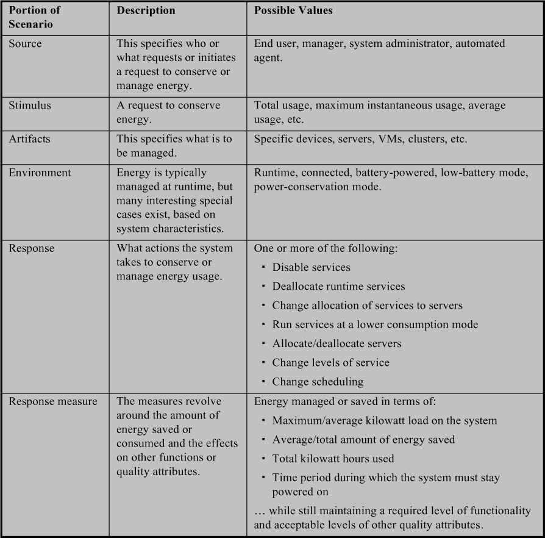
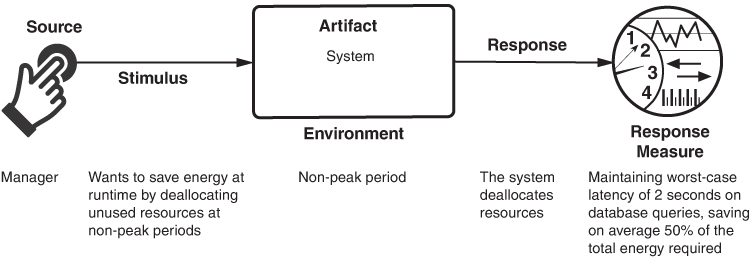
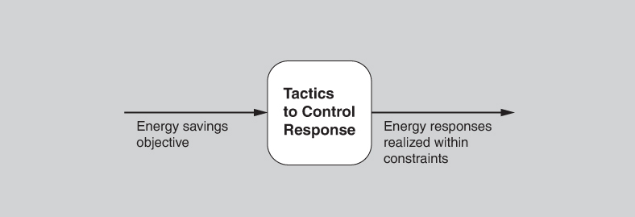
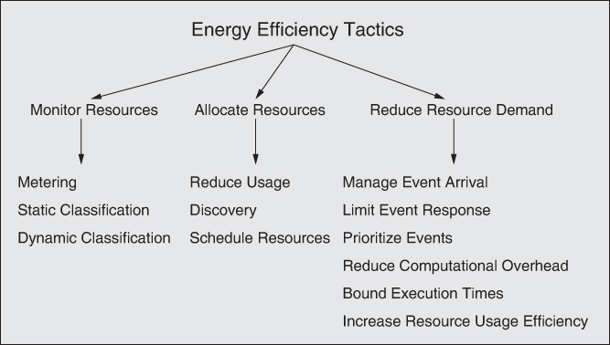
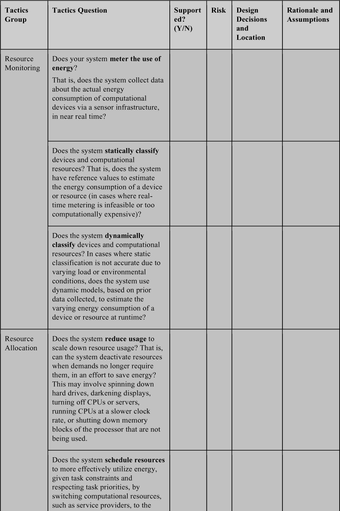
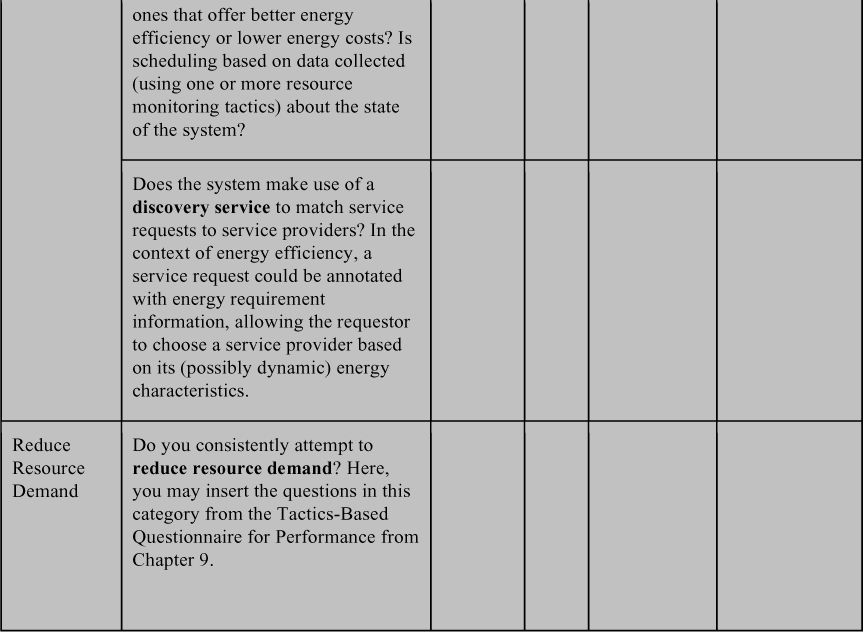

# 6. Energy Efficiency

> Năng lượng cũng giống tiền bạc đôi chút: Nếu bạn có số dư dương, bạn có thể phân phối nó theo nhiều cách, nhưng theo các định luật cổ điển được tin tưởng vào đầu thế kỷ, bạn không được phép rút quá số dư. 
> —Stephen Hawking

Năng lượng mà máy tính sử dụng từng là miễn phí và không giới hạn—hoặc ít nhất đó là cách chúng ta đã hành xử. Trước đây, các kiến trúc sư hiếm khi quan tâm nhiều đến mức tiêu thụ năng lượng của phần mềm. Nhưng những ngày đó giờ đã qua. Với sự thống trị của thiết bị di động như hình thức điện toán chính của hầu hết mọi người, với việc Internet of Things (IoT) ngày càng được áp dụng trong công nghiệp và chính phủ, và với sự phổ biến của các cloud service như xương sống của hạ tầng điện toán, năng lượng đã trở thành một vấn đề mà kiến trúc sư không thể bỏ qua được nữa. Điện năng không còn “miễn phí” và không giới hạn. Energy efficiency của thiết bị di động ảnh hưởng đến tất cả chúng ta. Tương tự, các cloud provider ngày càng quan tâm đến energy efficiency của các server farm của họ. Năm 2016, có báo cáo rằng các data center trên toàn cầu tiêu thụ nhiều năng lượng hơn (thêm 40 phần trăm) so với toàn bộ Vương quốc Anh—khoảng 3 phần trăm tổng năng lượng tiêu thụ trên toàn thế giới. Các ước tính gần đây hơn đẩy tỷ lệ đó lên tới 10 phần trăm. Chi phí năng lượng gắn với việc vận hành và, quan trọng hơn, làm mát các data center lớn đã khiến người ta tính toán chi phí đặt toàn bộ data center ngoài không gian, nơi việc làm mát là miễn phí và mặt trời cung cấp năng lượng không giới hạn. Với giá phóng hiện nay, bài toán kinh tế thực ra đang bắt đầu trông có lợi. Đáng chú ý, các server farm đặt dưới nước và ở vùng khí hậu bắc cực đã là hiện thực.

Ở cả phân khúc thấp lẫn phân khúc cao, mức tiêu thụ năng lượng của các thiết bị tính toán đã trở thành một vấn đề mà chúng ta nên xem xét. Điều này có nghĩa là chúng ta, với tư cách kiến trúc sư, giờ cần thêm *energy efficiency* vào danh sách dài các chất lượng cạnh tranh nhau mà chúng ta xem xét khi thiết kế một hệ thống. Và, như với mọi quality attribute khác, có những tradeoff không tầm thường cần cân nhắc: mức sử dụng năng lượng so với performance hoặc availability hoặc modifiability hoặc time to market. Do đó, việc coi energy efficiency là một quality attribute first-class là quan trọng vì những lý do sau:

1. Một cách tiếp cận architecture là cần thiết để kiểm soát *bất kỳ* quality attribute quan trọng nào của hệ thống, và energy efficiency cũng không ngoại lệ. Nếu thiếu các kỹ thuật system-wide để giám sát và quản lý năng lượng, thì các developer phải tự mình phát minh ra chúng. Trong trường hợp tốt nhất, điều này sẽ dẫn đến một cách tiếp cận ad hoc đối với energy efficiency, tạo ra một hệ thống khó bảo trì, đo lường và tiến hóa. Trong trường hợp xấu nhất, nó sẽ tạo ra một cách tiếp cận đơn giản là không đạt được các mục tiêu energy efficiency mong muốn một cách có thể dự đoán.
2. Hầu hết các kiến trúc sư và developer không biết đến energy efficiency như một quality attribute đáng quan tâm, và do đó không biết cách thiết kế kỹ thuật và viết code cho nó. Căn bản hơn, họ thiếu hiểu biết về các yêu cầu energy efficiency—cách thu thập chúng và phân tích chúng về tính đầy đủ. Energy efficiency không được dạy, hoặc thậm chí thường không được nhắc đến, như một mối quan tâm của lập trình viên trong các chương trình giáo dục hiện nay. Hệ quả là sinh viên có thể tốt nghiệp với bằng kỹ thuật hoặc khoa học máy tính mà chưa bao giờ tiếp xúc với những vấn đề này.
3. Hầu hết các kiến trúc sư và developer thiếu các khái niệm thiết kế phù hợp—model, pattern, tactic, v.v.—để thiết kế cho energy efficiency, cũng như để quản lý và giám sát nó tại runtime. Nhưng vì energy efficiency là một mối quan tâm tương đối mới đối với cộng đồng software engineering, các khái niệm thiết kế này vẫn còn ở giai đoạn sơ khai và chưa có danh mục nào tồn tại.

Các cloud platform thường không phải lo lắng về việc cạn kiệt năng lượng (trừ các kịch bản thảm họa), trong khi đây là mối lo hằng ngày đối với người dùng thiết bị di động và một số thiết bị IoT. Trong môi trường cloud, scale up và scale down là các năng lực cốt lõi, nên các quyết định về phân bổ tài nguyên tối ưu phải được đưa ra một cách thường xuyên. Với các thiết bị IoT, kích thước, form factor và lượng nhiệt tỏa ra của chúng đều ràng buộc không gian thiết kế—không có chỗ cho những viên pin cồng kềnh. Ngoài ra, chỉ riêng số lượng thiết bị IoT dự kiến được triển khai trong thập kỷ tới đã khiến mức sử dụng năng lượng của chúng trở thành một mối lo ngại.

Trong tất cả các bối cảnh này, energy efficiency phải được cân bằng với performance và availability, đòi hỏi các kỹ sư phải suy luận có ý thức về những tradeoff như vậy. Trong bối cảnh cloud, phân bổ nhiều tài nguyên hơn—nhiều server hơn, nhiều storage hơn, v.v.—tạo ra năng lực performance được cải thiện cũng như khả năng chống chịu tốt hơn trước failure của từng thiết bị riêng lẻ, nhưng phải trả giá bằng năng lượng và chi phí đầu tư. Trong bối cảnh di động và IoT, phân bổ nhiều tài nguyên hơn thường không phải là một lựa chọn (dù có thể chuyển gánh nặng tính toán từ thiết bị di động sang một cloud back-end), nên các tradeoff có xu hướng xoay quanh energy efficiency so với performance và usability. Cuối cùng, trong mọi bối cảnh, đều có các tradeoff giữa một bên là energy efficiency và bên kia là buildability và modifiability.

## 6.1 General scenario cho energy efficiency (Energy Efficiency General Scenario)

Từ những cân nhắc này, giờ chúng ta có thể xác định các phần khác nhau của general scenario cho energy efficiency, như được trình bày trong [Bảng 6.1](#ch06tab01).

**Bảng 6.1** *General scenario cho energy efficiency*

[Hình 6.1](#ch06fig01) minh họa một concrete energy efficiency scenario: *Một người quản lý muốn tiết kiệm năng lượng tại runtime bằng cách giải phóng các tài nguyên không dùng đến vào những thời kỳ non-peak. Hệ thống giải phóng tài nguyên trong khi vẫn duy trì độ trễ worst-case 2 giây cho các truy vấn database, tiết kiệm trung bình 50 phần trăm tổng năng lượng cần thiết*.

**Hình 6.1** *Ví dụ về energy efficiency scenario*

## 6.2 Các tactic cho energy efficiency (Tactics for Energy Efficiency)

Một energy efficiency scenario được kích hoạt bởi mong muốn tiết kiệm hoặc quản lý năng lượng trong khi vẫn cung cấp chức năng được yêu cầu (dù không nhất thiết là đầy đủ). Scenario này thành công nếu các response về năng lượng đạt được trong các ràng buộc chấp nhận được về thời gian, chi phí và chất lượng. Chúng tôi minh họa mối quan hệ đơn giản này—và do đó là mục tiêu của các energy efficiency tactic—trong [Hình 6.2](#ch06fig02).

**Hình 6.2** *Mục tiêu của các energy efficiency tactic*

Về cốt lõi, energy efficiency là về việc sử dụng tài nguyên một cách hiệu quả. Chúng tôi nhóm các tactic thành ba loại lớn: giám sát tài nguyên (resource monitoring), phân bổ tài nguyên (resource allocation) và thích ứng tài nguyên (resource adaptation) ([Hình 6.3](#ch06fig03)). Khi nói “tài nguyên” (resource), chúng tôi muốn nói đến một thiết bị tính toán tiêu thụ năng lượng trong khi cung cấp chức năng của nó. Điều này tương tự định nghĩa về một tài nguyên *phần cứng* trong [Chương 9](ch09_performance.vi.md#ch09), bao gồm CPU, data store, truyền thông mạng và memory.

**Hình 6.3** *Các energy efficiency tactic*

### Giám sát tài nguyên (Monitor Resources)

Bạn không thể quản lý những gì bạn không thể đo lường, vì vậy chúng ta bắt đầu với việc giám sát tài nguyên. Các tactic giám sát tài nguyên là metering, static classification và dynamic classification.

- *Metering*. Tactic metering bao gồm việc thu thập dữ liệu về mức tiêu thụ năng lượng của các tài nguyên tính toán thông qua một hạ tầng cảm biến, gần như real time. Ở mức thô nhất, mức tiêu thụ năng lượng của toàn bộ một data center có thể được đo từ đồng hồ điện của nó. Từng server hoặc ổ cứng có thể được đo bằng các công cụ bên ngoài như ampe kế hoặc công tơ watt-hour, hoặc bằng các công cụ built-in như những công cụ đi kèm với rack PDU (power distribution unit) có đồng hồ đo, ASIC (application-specific integrated circuit), v.v. Trong các hệ thống battery-operated, năng lượng còn lại trong pin có thể được xác định thông qua một battery management system, vốn là một thành phần của pin hiện đại.
- *Static classification*. Đôi khi việc thu thập dữ liệu real-time là không khả thi. Ví dụ, nếu một tổ chức đang dùng một cloud off-premises, họ có thể không có quyền truy cập trực tiếp vào dữ liệu năng lượng real-time. Static classification cho phép chúng ta ước tính mức tiêu thụ năng lượng bằng cách lập danh mục các tài nguyên tính toán được dùng và các đặc tính năng lượng đã biết của chúng—ví dụ như lượng năng lượng một thiết bị memory dùng cho mỗi lần fetch. Các đặc tính này có sẵn dưới dạng benchmark, hoặc từ đặc tả của nhà sản xuất.
- *Dynamic classification*. Trong những trường hợp mà một model tĩnh của một tài nguyên tính toán là không đủ, có thể cần một model động. Khác với model tĩnh, model động ước tính mức tiêu thụ năng lượng dựa trên kiến thức về các điều kiện tạm thời như workload. Model có thể là một bảng tra cứu đơn giản, một regression model dựa trên dữ liệu thu thập được trong các lần thực thi trước, hoặc một mô phỏng.

### Phân bổ tài nguyên (Allocate Resources)

Phân bổ tài nguyên nghĩa là giao tài nguyên để thực hiện công việc theo cách có lưu tâm đến mức tiêu thụ năng lượng. Các tactic phân bổ tài nguyên là reduce usage, discovery và scheduling.

- *Reduce usage*. Mức sử dụng có thể được giảm ở mức thiết bị bằng các hoạt động device-specific như giảm tần số làm mới của màn hình hoặc làm tối nền. Loại bỏ hoặc vô hiệu hóa tài nguyên khi nhu cầu không còn cần đến chúng là một phương pháp khác để giảm mức tiêu thụ năng lượng. Điều này có thể bao gồm dừng quay ổ cứng, tắt CPU hoặc server, chạy CPU ở tần số clock chậm hơn, hoặc ngắt dòng điện tới các khối của processor không được sử dụng. Nó cũng có thể ở dạng di chuyển các VM lên số lượng server vật lý tối thiểu (consolidation), kết hợp với việc tắt các tài nguyên tính toán đang rảnh. Trong các ứng dụng di động, có thể tiết kiệm năng lượng bằng cách gửi một phần tính toán lên cloud, với giả định rằng mức tiêu thụ năng lượng cho giao tiếp thấp hơn mức tiêu thụ năng lượng cho tính toán.
- *Discovery*. Như chúng ta sẽ thấy trong [Chương 7](ch07_integrability.vi.md#ch07), một discovery service ghép các service request (từ client) với các service provider, hỗ trợ việc nhận diện và gọi từ xa các service đó. Theo truyền thống, các discovery service thực hiện việc ghép này dựa trên mô tả của service request (thường là một API). Trong bối cảnh energy efficiency, request này có thể được chú thích thêm thông tin năng lượng, cho phép bên yêu cầu chọn một service provider (tài nguyên) dựa trên các đặc tính năng lượng (có thể động) của nó. Đối với cloud, thông tin năng lượng này có thể được lưu trong một “green service directory” được điền thông tin từ metering, static classification hoặc dynamic classification (các tactic giám sát tài nguyên). Đối với smartphone, thông tin có thể được lấy từ app store. Hiện tại, thông tin như vậy cùng lắm là ad hoc, và thường không tồn tại trong các service API.
- *Schedule resources*. Scheduling là việc phân bổ các tác vụ cho các tài nguyên tính toán. Như chúng ta sẽ thấy trong [Chương 9](ch09_performance.vi.md#ch09), tactic schedule resources có thể tăng performance. Trong bối cảnh năng lượng, nó có thể được dùng để quản lý hiệu quả mức sử dụng năng lượng, với các ràng buộc của tác vụ và tôn trọng mức ưu tiên của tác vụ. Scheduling có thể dựa trên dữ liệu thu thập được bằng một hoặc nhiều tactic giám sát tài nguyên. Dùng một energy discovery service trong bối cảnh cloud, hoặc một controller trong bối cảnh multi-core, một tác vụ tính toán có thể chuyển đổi động giữa các tài nguyên tính toán, chẳng hạn như các service provider, chọn những tài nguyên mang lại energy efficiency tốt hơn hoặc chi phí năng lượng thấp hơn. Ví dụ, một provider có thể chịu tải nhẹ hơn provider khác, cho phép nó điều chỉnh mức sử dụng năng lượng, có thể bằng một số tactic được mô tả ở trên, và tiêu thụ ít năng lượng hơn, tính trung bình, trên mỗi đơn vị công việc.

### Giảm nhu cầu tài nguyên (Reduce Resource Demand)

Loại tactic này được trình bày chi tiết trong [Chương 9](ch09_performance.vi.md#ch09). Các tactic trong loại này—manage event arrival, limit event response, prioritize events (có thể để các sự kiện low-priority không được phục vụ), reduce computational overhead, bound execution times và increase resource usage efficiency—đều trực tiếp tăng energy efficiency bằng cách làm ít việc hơn. Đây là tactic bổ sung cho reduce usage, ở chỗ tactic reduce usage giả định rằng nhu cầu giữ nguyên, trong khi các tactic reduce resource demand là phương tiện để quản lý (và giảm) nhu cầu một cách tường minh.

## 6.3 Questionnaire dựa trên tactic cho energy efficiency (Tactics-Based Questionnaire for Energy Efficiency)

Như đã mô tả trong [Chương 3](ch03_understanding_quality_attributes.vi.md#ch03), questionnaire tactics-based này nhằm giúp hiểu thật nhanh mức độ một architecture dùng các tactic cụ thể để quản lý energy efficiency.

Dựa trên các tactic được mô tả trong [Mục 6.2](#sec6_2), chúng ta có thể tạo một tập câu hỏi tactics-inspired, như được trình bày trong [Bảng 6.2](#ch06tab02). Để có cái nhìn tổng quan về các lựa chọn architecture được đưa ra để hỗ trợ energy efficiency, nhà phân tích đặt từng câu hỏi và ghi lại câu trả lời vào bảng. Câu trả lời cho các câu hỏi này sau đó có thể trở thành trọng tâm của các hoạt động tiếp theo: điều tra tài liệu, phân tích code hoặc các artifact khác, reverse engineering code, v.v.

**Bảng 6.2** *Questionnaire tactics-based cho energy efficiency*

## 6.4 Các pattern (Patterns)

Một số ví dụ về pattern được dùng cho energy efficiency bao gồm sensor fusion, kill abnormal tasks và power monitor.

### Sensor fusion (Sensor Fusion)

Các app di động và hệ thống IoT thường thu thập dữ liệu từ môi trường bằng nhiều cảm biến. Trong pattern này, dữ liệu từ các cảm biến low-power có thể được dùng để suy ra liệu có cần thu thập dữ liệu từ các cảm biến higher-power hay không. Một ví dụ phổ biến trong bối cảnh điện thoại di động là dùng dữ liệu gia tốc kế để đánh giá xem người dùng đã di chuyển chưa và, nếu có, thì cập nhật vị trí GPS. Pattern này giả định rằng việc truy cập cảm biến low-power rẻ hơn nhiều, xét về mức tiêu thụ năng lượng, so với việc truy cập cảm biến higher-power.

**Lợi ích:**

- Lợi ích hiển nhiên của pattern này là khả năng giảm thiểu việc sử dụng các thiết bị energy-intensive hơn một cách thông minh, thay vì, ví dụ, chỉ giảm tần suất tham khảo cảm biến energy-intensive hơn.

**Các tradeoff:**

- Việc tham khảo và so sánh nhiều cảm biến làm tăng độ phức tạp up-front.
- Cảm biến higher-energy-consuming sẽ cung cấp dữ liệu higher-quality, dù phải trả giá bằng mức tiêu thụ điện năng tăng lên. Và nó sẽ cung cấp dữ liệu này nhanh hơn, vì chỉ dùng riêng cảm biến energy-intensive hơn tốn ít thời gian hơn so với việc trước tiên tham khảo một cảm biến phụ.
- Trong những trường hợp mà việc suy luận thường xuyên dẫn đến truy cập cảm biến higher-power, pattern này có thể dẫn đến mức sử dụng năng lượng tổng thể cao hơn.

### Kill abnormal tasks (Kill Abnormal Tasks)

Các hệ thống di động, vì thường xuyên thực thi các app có nguồn gốc không rõ, có thể vô tình chạy một số app power-hungry đặc biệt. Pattern này cung cấp một cách để giám sát mức sử dụng năng lượng của các app như vậy và để ngắt hoặc kill các thao tác energy-greedy. Ví dụ, nếu một app đang phát ra một cảnh báo âm thanh và làm điện thoại rung mà người dùng không phản hồi các cảnh báo này, thì sau một khoảng timeout định trước, tác vụ sẽ bị kill.

**Lợi ích:**

- Pattern này cung cấp một lựa chọn “fail-safe” để quản lý mức tiêu thụ năng lượng của các app có thuộc tính năng lượng chưa biết.

**Các tradeoff:**

- Bất kỳ process giám sát nào cũng thêm một lượng overhead nhỏ vào hoạt động của hệ thống, điều có thể ảnh hưởng đến performance và, ở mức độ nhỏ, mức sử dụng năng lượng.
- Cần xem xét usability của pattern này. Việc kill các tác vụ energy-hungry có thể đi ngược ý định của người dùng.

### Power monitor (Power Monitor)

Pattern power monitor giám sát và quản lý các thiết bị của hệ thống, giảm thiểu thời gian chúng ở trạng thái active. Pattern này cố gắng tự động vô hiệu hóa các thiết bị và interface không đang được ứng dụng sử dụng tích cực. Nó đã được dùng từ lâu trong các mạch tích hợp, nơi các khối của mạch được tắt khi không được sử dụng, nhằm tiết kiệm năng lượng.

**Lợi ích:**

- Pattern này có thể cho phép tiết kiệm điện năng một cách thông minh với tác động ít hoặc không có đến người dùng cuối, với giả định rằng các thiết bị bị tắt thực sự không cần thiết.

**Các tradeoff:**

- Một khi một thiết bị đã bị tắt, việc bật lại nó thêm một độ trễ trước khi nó có thể phản hồi, so với việc giữ nó chạy liên tục. Và, trong một số trường hợp, việc khởi động có thể tốn năng lượng hơn một khoảng thời gian vận hành steady-state nhất định.
- Power monitor cần có kiến thức về từng thiết bị và các đặc tính tiêu thụ năng lượng của nó, điều này làm tăng độ phức tạp up-front cho thiết kế hệ thống.

## 6.5 Đọc thêm (For Further Reading)

Tập energy tactic đầu tiên được công bố xuất hiện trong [Procaccianti 14]. Chúng một phần là nguồn cảm hứng cho các tactic được trình bày ở đây. Bài báo năm 2014 sau đó đã truyền cảm hứng cho [Paradis 21]. Nhiều tactic được trình bày trong chương này mang ơn hai bài báo này.

Để có một phần giới thiệu tổng quát tốt về việc sử dụng năng lượng trong phát triển phần mềm—và những gì developer không biết—bạn nên đọc [Pang 16].

Một số bài báo nghiên cứu đã khảo sát hệ quả của các lựa chọn thiết kế đối với mức tiêu thụ năng lượng, chẳng hạn như [Kazman 18] và [Chowdhury 19].

Một thảo luận chung về tầm quan trọng của việc tạo ra phần mềm “energy-aware” có thể được tìm thấy trong [Fonseca 19].

Các energy pattern cho thiết bị di động đã được [Cruz 19] và [Schaarschmidt 20] lập danh mục.

## 6.6 Câu hỏi thảo luận (Discussion Questions)

1. Hãy viết một tập concrete scenario cho energy efficiency, dùng từng response có thể có trong general scenario.
2. Hãy tạo một concrete energy efficiency scenario cho một app smartphone (ví dụ, một app theo dõi sức khỏe).
3. Hãy tạo một concrete energy efficiency scenario cho một cụm data server trong một data center. Những khác biệt quan trọng giữa scenario này và scenario bạn đã tạo cho câu hỏi 2 là gì?
4. Hãy liệt kê các kỹ thuật energy efficiency hiện đang được laptop hoặc smartphone của bạn sử dụng.
5. Các tradeoff về năng lượng trong smartphone của bạn giữa việc dùng Wi-Fi và mạng di động là gì?
6. Hãy tính lượng khí nhà kính dưới dạng carbon dioxide mà bạn, trong một đời người trung bình, sẽ thở ra vào khí quyển. Con số này tương đương với bao nhiêu lượt tìm kiếm Google?
7. Giả sử Google giảm mức sử dụng năng lượng cho mỗi lượt tìm kiếm đi 1 phần trăm. Điều đó sẽ tiết kiệm được bao nhiêu năng lượng mỗi năm?
8. Bạn đã dùng bao nhiêu năng lượng để trả lời câu hỏi 7?
