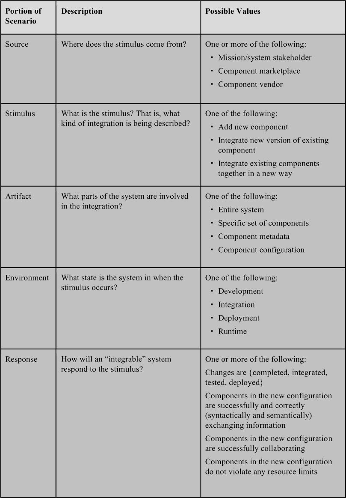
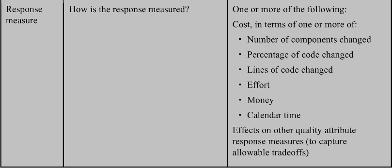
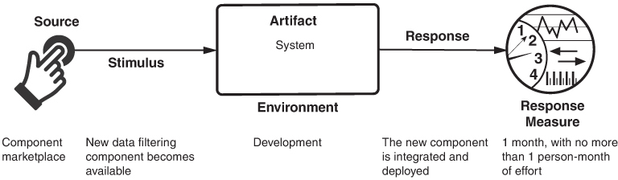
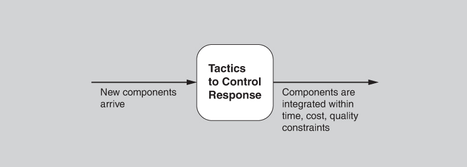
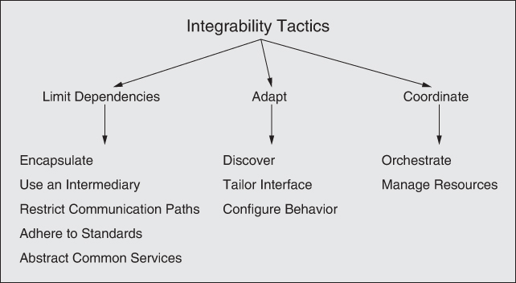
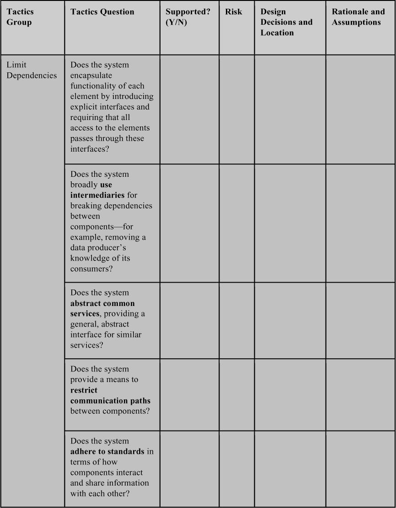
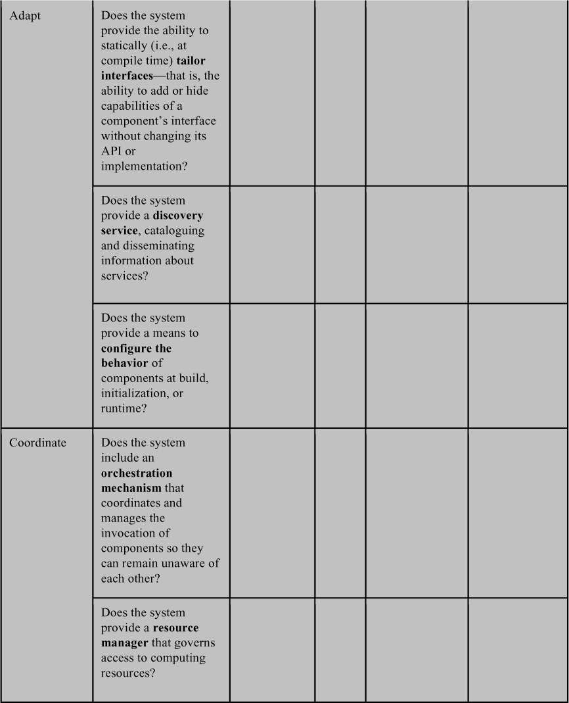

# 7. Integrability

> Tích hợp là một quy luật cơ bản của cuộc sống; khi chúng ta chống lại nó, sự tan rã là kết quả tự nhiên, cả bên trong lẫn bên ngoài chúng ta. Vì vậy, chúng ta đi đến khái niệm hài hòa thông qua tích hợp. 
> —Norman Cousins

Theo từ điển Merriam-Webster, tính từ *integrable* có nghĩa là “có khả năng được tích hợp”. Chúng tôi sẽ cho bạn một chút thời gian để lấy lại hơi thở và thấm nhuần hiểu biết sâu sắc đó. Nhưng đối với các hệ thống phần mềm thực tế, software architect cần quan tâm đến nhiều thứ hơn là chỉ làm cho các component được phát triển riêng rẽ hợp tác với nhau; họ cũng quan tâm đến *chi phí* và *rủi ro kỹ thuật* của các tác vụ tích hợp trong tương lai, cả được dự kiến lẫn (ở các mức độ khác nhau) không được dự kiến. Những rủi ro này có thể liên quan đến tiến độ, performance hoặc công nghệ.

Một biểu diễn tổng quát, trừu tượng của bài toán tích hợp là một dự án cần tích hợp một đơn vị phần mềm *C*, hoặc một tập các đơn vị *C*1, *C*2, … *C**n*, vào một hệ thống *S*. *S* có thể là một nền tảng mà chúng ta tích hợp {*C**i*} vào, hoặc có thể là một hệ thống hiện có đã chứa {*C*1, *C*2, …, *C**n*} và nhiệm vụ của chúng ta là thiết kế cho, và phân tích chi phí và rủi ro kỹ thuật của, việc tích hợp {*C**n*+1, … *C**m*}.

Chúng ta giả định rằng mình có quyền kiểm soát *S*, nhưng các {*C**i*} có thể nằm ngoài tầm kiểm soát của chúng ta—ví dụ, được cung cấp bởi các nhà cung cấp bên ngoài, nên mức độ hiểu biết của chúng ta về mỗi *C**i* có thể khác nhau. Chúng ta càng hiểu rõ *C**i*, thiết kế sẽ càng có năng lực và phân tích sẽ càng chính xác.

Tất nhiên, *S* không tĩnh mà sẽ tiến hóa, và sự tiến hóa này có thể đòi hỏi phân tích lại. Integrability (giống như các quality attribute khác như modifiability) là đầy thách thức vì nó là việc lập kế hoạch cho một tương lai khi thông tin trong tay chúng ta chưa đầy đủ. Nói đơn giản, một số lần tích hợp sẽ đơn giản hơn những lần khác vì chúng đã được dự kiến và được tính đến trong architecture, trong khi những lần khác sẽ phức tạp hơn vì chúng chưa được tính đến.

Hãy xét một phép so sánh đơn giản: Để cắm một phích cắm Bắc Mỹ (một ví dụ về *C**i*) vào một ổ cắm Bắc Mỹ (một interface được cung cấp bởi hệ thống điện *S*), việc “tích hợp” là tầm thường. Tuy nhiên, việc tích hợp một phích cắm Bắc Mỹ vào một ổ cắm Anh sẽ cần một bộ chuyển đổi. Và thiết bị có phích cắm Bắc Mỹ có thể chỉ chạy được với nguồn 110-volt, đòi hỏi chuyển đổi thêm trước khi nó có thể hoạt động trong một ổ cắm 220-volt của Anh. Hơn nữa, nếu component được thiết kế để chạy ở 60 Hz và hệ thống cung cấp 70 Hz, component có thể không hoạt động như dự định dù nó cắm vào hoàn toàn ổn. Các quyết định architecture do những người tạo ra *S* và *C**i* đưa ra—ví dụ, cung cấp bộ chuyển đổi phích cắm hoặc bộ chuyển đổi điện áp, hoặc làm cho component hoạt động giống hệt nhau ở các tần số khác nhau—sẽ ảnh hưởng đến chi phí và rủi ro của việc tích hợp.

## 7.1 Đánh giá integrability của một architecture (Evaluating the Integrability of an Architecture)

Độ khó tích hợp—chi phí và rủi ro kỹ thuật—có thể được coi là một hàm của kích thước và “khoảng cách” giữa các interface của {*C**i*} và *S*:

Kích thước (size) là số lượng dependency tiềm năng giữa {*C**i*} và *S*.

Khoảng cách (distance) là độ khó của việc giải quyết các khác biệt tại mỗi dependency.

Dependency thường được đo về mặt cú pháp. Ví dụ, chúng ta nói rằng module A phụ thuộc vào component B nếu A gọi B, nếu A kế thừa từ B, hoặc nếu A uses B. Nhưng dù dependency cú pháp là quan trọng, và sẽ tiếp tục quan trọng trong tương lai, dependency có thể xuất hiện dưới những dạng không thể phát hiện được bằng bất kỳ relation cú pháp nào. Hai component có thể được couple về *thời gian* (temporally) hoặc thông qua *tài nguyên* (resources) vì chúng chia sẻ và cạnh tranh một tài nguyên hữu hạn tại runtime (ví dụ: memory, băng thông, CPU), cùng chia sẻ quyền điều khiển một thiết bị bên ngoài, hoặc có một dependency về thời gian. Hoặc chúng có thể được couple về *ngữ nghĩa* (semantically) vì chúng cùng chia sẻ kiến thức về cùng một protocol, định dạng file, đơn vị đo, metadata, hoặc một khía cạnh nào đó khác. Lý do những phân biệt này quan trọng là các dependency về thời gian và ngữ nghĩa thường không được hiểu rõ, không được thừa nhận một cách tường minh, hoặc không được tài liệu hóa đúng cách. Kiến thức bị thiếu hoặc ngầm định luôn là một rủi ro đối với một dự án lớn, long-lived, và những khoảng trống kiến thức như vậy chắc chắn sẽ làm tăng chi phí và rủi ro của việc tích hợp và kiểm thử tích hợp.

Hãy xem xét xu hướng hướng tới service và microservice trong điện toán ngày nay. Cách tiếp cận này về cơ bản là tách rời (decouple) các component để giảm số lượng và khoảng cách của các dependency giữa chúng. Các service chỉ “biết” nhau thông qua các interface đã công bố của chúng và, nếu interface đó là một sự trừu tượng hóa thích hợp, các thay đổi đối với một service sẽ ít có khả năng lan sang các service khác trong hệ thống. Việc tách rời các component ngày càng nhiều (ever-increasing) là một xu hướng industry-wide đã diễn ra trong nhiều thập kỷ. Bản thân việc định hướng service chỉ giải quyết (tức là giảm bớt) các khía cạnh cú pháp của dependency; nó không giải quyết các khía cạnh thời gian hay ngữ nghĩa. Các component được cho là đã tách rời nhưng lại có kiến thức chi tiết về nhau và đưa ra các giả định về nhau thực tế là bị couple chặt chẽ, và việc thay đổi chúng trong tương lai rất có thể sẽ tốn kém.

Vì mục đích integrability, “interface” phải được hiểu là nhiều hơn rất nhiều so với chỉ API. Chúng phải đặc trưng cho mọi dependency liên quan giữa các element. Khi cố gắng hiểu các dependency giữa các component, khái niệm “khoảng cách” là hữu ích. Khi các component tương tác, chúng ăn khớp với nhau đến mức nào xét về cách chúng hợp tác để thực hiện thành công một tương tác? Khoảng cách có thể có nghĩa là:

- *Syntactic distance* (khoảng cách cú pháp). Các element hợp tác với nhau phải thống nhất về số lượng và kiểu của các phần tử dữ liệu được chia sẻ. Ví dụ, nếu một element gửi một số nguyên và element kia mong đợi một số dấu phẩy động, hoặc có thể các bit trong một trường dữ liệu được diễn giải khác nhau, sự khác biệt này tạo ra một khoảng cách cú pháp cần được bắc cầu. Khác biệt về kiểu dữ liệu thường dễ quan sát và dự đoán. Ví dụ, những sự không khớp kiểu như vậy có thể được compiler bắt được. Khác biệt về bit mask, dù tương tự về bản chất, thường khó phát hiện hơn, và nhà phân tích có thể cần dựa vào tài liệu hoặc xem xét kỹ code để nhận ra chúng.
- *Data semantic distance* (khoảng cách ngữ nghĩa dữ liệu). Các element hợp tác với nhau phải thống nhất về ngữ nghĩa dữ liệu; tức là, ngay cả khi hai element dùng chung một kiểu dữ liệu, giá trị của chúng lại được diễn giải khác nhau. Ví dụ, nếu một giá trị dữ liệu biểu diễn độ cao theo mét và giá trị kia biểu diễn độ cao theo feet, điều này tạo ra một khoảng cách ngữ nghĩa dữ liệu cần được bắc cầu. Loại không khớp này thường khó quan sát và dự đoán, dù cuộc sống của nhà phân tích được cải thiện phần nào nếu các element liên quan dùng metadata. Sự không khớp về ngữ nghĩa dữ liệu có thể được phát hiện bằng cách so sánh tài liệu interface hoặc mô tả metadata, nếu có, hoặc bằng cách kiểm tra code, nếu có.
- *Behavioral semantic distance* (khoảng cách ngữ nghĩa hành vi). Các element hợp tác với nhau phải thống nhất về hành vi, đặc biệt là về các trạng thái và chế độ của hệ thống. Ví dụ, một phần tử dữ liệu có thể được diễn giải khác nhau ở chế độ khởi động, tắt hoặc phục hồi của hệ thống. Trong một số trường hợp, các trạng thái và chế độ như vậy có thể được ghi nhận một cách tường minh trong protocol. Một ví dụ khác, *C**i* và *C**j* có thể đưa ra các giả định khác nhau về quyền điều khiển, chẳng hạn như mỗi bên đều mong đợi bên kia khởi tạo tương tác.
- *Temporal distance* (khoảng cách thời gian). Các element hợp tác với nhau phải thống nhất về các giả định liên quan đến thời gian. Các ví dụ về khoảng cách thời gian bao gồm hoạt động ở các tốc độ khác nhau (ví dụ: một element phát ra giá trị ở tốc độ 10 Hz và element kia mong đợi giá trị ở 60 Hz) hoặc đưa ra các giả định khác nhau về thời gian (ví dụ: một element mong đợi sự kiện A theo sau sự kiện B và element kia mong đợi sự kiện A theo sau sự kiện B với độ trễ không quá 50 ms). Dù điều này có thể được coi là một trường hợp con của ngữ nghĩa hành vi, nó quan trọng đến mức (và thường tinh tế) nên chúng tôi nêu nó ra một cách tường minh.
- *Resource distance* (khoảng cách tài nguyên). Các element hợp tác với nhau phải thống nhất về các giả định liên quan đến tài nguyên dùng chung. Các ví dụ về khoảng cách tài nguyên có thể liên quan đến thiết bị (ví dụ: một element đòi hỏi quyền truy cập độc quyền vào một thiết bị, trong khi element khác mong đợi quyền truy cập chia sẻ) hoặc tài nguyên tính toán (ví dụ: một element cần 12 GB memory để chạy tối ưu và element kia cần 10 GB, nhưng CPU đích chỉ có 16 GB memory vật lý; hoặc ba element đồng thời tạo ra dữ liệu ở tốc độ 3 Mbps mỗi element, nhưng kênh truyền thông chỉ cung cấp dung lượng đỉnh 5 Mbps). Một lần nữa, khoảng cách này có thể được coi là liên quan đến khoảng cách hành vi, nhưng nó nên được phân tích một cách có ý thức.

Những chi tiết như vậy thường không được nhắc đến trong mô tả interface của một ngôn ngữ lập trình. Tuy nhiên, trong bối cảnh tổ chức, những interface ngầm định, không được nói ra này thường làm tăng thời gian và độ phức tạp của các tác vụ tích hợp (và các tác vụ sửa đổi và debug). Đây là lý do vì sao interface là các mối quan tâm của architecture, như chúng tôi sẽ thảo luận thêm trong [Chương 15](ch15_software_interfaces.vi.md#ch15).

Về bản chất, integrability là về việc nhận ra và bắc cầu khoảng cách giữa các element của mỗi dependency tiềm năng. Đây là một dạng lập kế hoạch cho modifiability. Chúng tôi sẽ quay lại chủ đề này trong [Chương 8](ch08_modifiability.vi.md#ch08).

## 7.2 General scenario cho integrability (General Scenario for Integrability)

[Bảng 7.1](#ch07tab01) trình bày general scenario cho integrability.

**Bảng 7.1** *General scenario cho integrability*

[Hình 7.1](#ch07fig01) minh họa một ví dụ integrability scenario được xây dựng từ general scenario: *Một component lọc dữ liệu mới đã có sẵn trên component marketplace. Component mới được tích hợp vào hệ thống và deploy trong 1 tháng, với công sức không quá 1 person-month*.

**Hình 7.1** *Ví dụ về integrability scenario*

## 7.3 Các integrability tactic (Integrability Tactics)

Mục tiêu của các integrability tactic là giảm chi phí và rủi ro của việc thêm các component mới, tích hợp lại các component đã thay đổi, và tích hợp các tập component với nhau để đáp ứng các yêu cầu tiến hóa, như minh họa trong [Hình 7.2](#ch07fig02).

**Hình 7.2** *Mục tiêu của các integrability tactic*

Các tactic đạt được những mục tiêu này bằng cách giảm số lượng dependency tiềm năng giữa các component hoặc bằng cách giảm khoảng cách kỳ vọng giữa các component. [Hình 7.3](#ch07fig03) cho thấy tổng quan về các integrability tactic.

**Hình 7.3** *Các integrability tactic*

### Hạn chế dependency (Limit Dependencies)

#### Đóng gói (Encapsulate)

Encapsulation là nền tảng mà mọi integrability tactic khác được xây dựng trên đó. Do đó, nó hiếm khi được thấy đứng riêng, nhưng việc sử dụng nó được ngầm định trong các tactic khác được mô tả ở đây.

Encapsulation đưa vào một interface tường minh cho một element và bảo đảm rằng mọi truy cập vào element đều đi qua interface này. Các dependency vào phần bên trong của element bị loại bỏ, vì mọi dependency đều phải đi qua interface. Encapsulation giảm xác suất một thay đổi đối với một element sẽ lan sang các element khác, bằng cách giảm số lượng dependency hoặc khoảng cách của chúng. Tuy nhiên, những điểm mạnh này bị giảm bớt vì interface giới hạn những cách mà các trách nhiệm bên ngoài có thể tương tác với element (có thể thông qua một wrapper). Hệ quả là các trách nhiệm bên ngoài chỉ có thể tương tác trực tiếp với element thông qua interface được phơi ra (các tương tác gián tiếp, chẳng hạn như sự phụ thuộc vào quality of service, có thể sẽ vẫn không thay đổi).

Encapsulation cũng có thể che giấu các interface không liên quan đến một tác vụ tích hợp cụ thể. Một ví dụ là một library được một service dùng, có thể được che giấu hoàn toàn khỏi mọi bên sử dụng và được thay đổi mà các thay đổi này không lan sang các bên sử dụng.

Như vậy, encapsulation có thể giảm số lượng dependency cũng như các khoảng cách cú pháp, ngữ nghĩa dữ liệu và ngữ nghĩa hành vi giữa *C* và *S*.

#### Dùng một intermediary (Use an Intermediary)

Intermediary được dùng để phá vỡ dependency giữa một tập component *C**i* hoặc giữa *C**i* và hệ thống *S*. Intermediary có thể được dùng để giải quyết các loại dependency khác nhau. Ví dụ, các intermediary như publish–subscribe bus, shared data repository hoặc dynamic service discovery đều giảm dependency giữa bên tạo dữ liệu và bên tiêu thụ dữ liệu bằng cách loại bỏ mọi nhu cầu để bên này biết danh tính của bên kia. Các intermediary khác, chẳng hạn như data transformer và protocol translator, giải quyết các dạng khoảng cách cú pháp và ngữ nghĩa dữ liệu.

Việc xác định các lợi ích cụ thể của một intermediary cụ thể đòi hỏi kiến thức về những gì intermediary đó thực sự làm. Nhà phân tích cần xác định liệu intermediary có giảm số lượng dependency giữa một component và hệ thống hay không và nó giải quyết những chiều khoảng cách nào, nếu có.

Intermediary thường được đưa vào trong quá trình tích hợp để giải quyết các dependency cụ thể, nhưng chúng cũng có thể được đưa vào một architecture để thúc đẩy integrability đối với các scenario được dự kiến. Việc đưa một communication intermediary như publish–subscribe bus vào một architecture, rồi giới hạn các đường giao tiếp đến và đi từ các cảm biến vào bus này, là một ví dụ về việc dùng intermediary với mục tiêu thúc đẩy integrability của các cảm biến.

#### Hạn chế đường giao tiếp (Restrict Communication Paths)

Tactic này hạn chế tập các element mà một element cho trước có thể giao tiếp. Trong thực tế, tactic này được hiện thực bằng cách hạn chế khả năng nhìn thấy của một element (khi developer không thể nhìn thấy một interface, họ không thể dùng nó) và bằng authorization (tức là chỉ cho phép các element được ủy quyền truy cập). Tactic restrict communication paths được thấy trong các service-oriented architecture (SOA), trong đó các request point-to-point không được khuyến khích, thay vào đó buộc mọi request phải đi qua một enterprise service bus để việc định tuyến và tiền xử lý có thể được thực hiện một cách nhất quán.

#### Tuân thủ tiêu chuẩn (Adhere to Standards)

Việc chuẩn hóa trong các implementation hệ thống là một yếu tố chính giúp đạt được integrability và interoperability, trên cả các nền tảng lẫn các nhà cung cấp. Các tiêu chuẩn khác nhau đáng kể về phạm vi những gì chúng quy định. Một số tập trung vào định nghĩa cú pháp và ngữ nghĩa dữ liệu. Một số khác bao gồm các mô tả phong phú hơn, chẳng hạn như những mô tả về protocol có bao gồm ngữ nghĩa hành vi và thời gian.

Tương tự, các tiêu chuẩn khác nhau về phạm vi áp dụng hoặc mức độ được chấp nhận. Ví dụ, các tiêu chuẩn được công bố bởi các tổ chức standards-setting được công nhận rộng rãi như Institute of Electrical and Electronics Engineers (IEEE), International Organization for Standardization (ISO) và Object Management Group (OMG) có nhiều khả năng được chấp nhận rộng rãi hơn. Các quy ước cục bộ trong một tổ chức, đặc biệt nếu được tài liệu hóa và thực thi tốt, có thể mang lại lợi ích tương tự như các “tiêu chuẩn cục bộ”, dù với kỳ vọng thấp hơn về lợi ích khi tích hợp các component từ bên ngoài phạm vi áp dụng của tiêu chuẩn cục bộ đó.

Việc áp dụng một tiêu chuẩn có thể là một integrability tactic hiệu quả, dù hiệu quả của nó bị giới hạn ở những lợi ích dựa trên các chiều khác biệt được tiêu chuẩn đề cập và khả năng các nhà cung cấp component trong tương lai sẽ tuân theo tiêu chuẩn. Việc hạn chế giao tiếp với một hệ thống *S* để bắt buộc dùng tiêu chuẩn thường làm giảm số lượng dependency tiềm năng. Tùy thuộc vào những gì được định nghĩa trong một tiêu chuẩn, nó cũng có thể giải quyết các chiều khoảng cách cú pháp, ngữ nghĩa dữ liệu, ngữ nghĩa hành vi và thời gian.

#### Trừu tượng hóa các service chung (Abstract Common Services)

Khi hai element cung cấp các service tương tự nhau nhưng không hoàn toàn giống nhau, có thể hữu ích khi che giấu cả hai element cụ thể đằng sau một sự trừu tượng hóa chung cho một service tổng quát hơn. Sự trừu tượng hóa này có thể được hiện thực dưới dạng một interface chung được cả hai hiện thực, hoặc có thể bao gồm một intermediary chuyển các request cho service trừu tượng thành các request cụ thể hơn cho các element ẩn đằng sau sự trừu tượng hóa đó. Việc đóng gói thu được che giấu chi tiết của các element khỏi các component khác trong hệ thống. Xét về integrability, điều này có nghĩa là các component trong tương lai có thể được tích hợp với một sự trừu tượng hóa duy nhất thay vì được tích hợp riêng rẽ với từng element cụ thể.

Khi tactic abstract common services được kết hợp với một intermediary (chẳng hạn như một wrapper hoặc adapter), nó cũng có thể chuẩn hóa các biến thể cú pháp và ngữ nghĩa giữa các element cụ thể. Ví dụ, chúng ta thấy điều này khi các hệ thống dùng nhiều cảm biến cùng loại từ các nhà sản xuất khác nhau, mỗi loại có device driver, độ chính xác hoặc đặc tính thời gian riêng, nhưng architecture cung cấp một interface chung cho chúng. Một ví dụ khác, trình duyệt của bạn có thể chấp nhận nhiều loại plug-ins ad-blocking khác nhau, nhưng nhờ plug-in interface, bản thân trình duyệt có thể hoàn toàn không cần biết đến lựa chọn của bạn.

Việc trừu tượng hóa các service chung cho phép sự nhất quán khi xử lý các mối quan tâm chung về infrastructure (ví dụ: chuyển đổi, cơ chế security và logging). Khi các tính năng này thay đổi, hoặc khi các phiên bản mới của các component hiện thực các tính năng này thay đổi, các thay đổi có thể được thực hiện ở ít chỗ hơn. Một abstract service thường được ghép với một intermediary có thể thực hiện xử lý để che giấu các khác biệt cú pháp và ngữ nghĩa dữ liệu giữa các element cụ thể.

### Thích ứng (Adapt)

#### Khám phá (Discover)

Một discovery service là một danh mục các địa chỉ liên quan, hữu ích bất cứ khi nào cần chuyển từ một dạng địa chỉ sang dạng khác, bất cứ khi nào địa chỉ đích có thể đã được bind động, hoặc khi có nhiều đích. Nó là cơ chế mà qua đó các ứng dụng và service định vị nhau. Một discovery service có thể được dùng để liệt kê các biến thể của các element cụ thể được dùng trong các sản phẩm khác nhau.

Các mục trong một discovery service có mặt ở đó vì chúng đã được đăng ký. Việc đăng ký này có thể diễn ra tĩnh, hoặc có thể diễn ra động khi một service được khởi tạo. Các mục trong discovery service nên được de-registered khi chúng không còn liên quan. Một lần nữa, việc này có thể được thực hiện tĩnh, chẳng hạn như với một DNS server, hoặc động. Việc de-registration động có thể được xử lý bởi chính discovery service thực hiện health check trên các mục của nó, hoặc có thể được thực hiện bởi một phần mềm bên ngoài biết khi nào một mục cụ thể trong danh mục không còn liên quan.

Một discovery service có thể bao gồm các mục mà bản thân chúng là các discovery service. Tương tự, các mục trong một discovery service có thể có các thuộc tính bổ sung mà một truy vấn có thể tham chiếu. Ví dụ, một weather discovery service có thể có thuộc tính “chi phí dự báo”; khi đó bạn có thể yêu cầu weather discovery service một service cung cấp dự báo miễn phí.

Tactic discover hoạt động bằng cách giảm dependency giữa các service hợp tác với nhau, vốn nên được viết mà không cần biết về nhau. Điều này cho phép linh hoạt trong việc bind giữa các service, cũng như thời điểm việc bind đó xảy ra.

#### Điều chỉnh interface (Tailor Interface)

Tailoring một interface là một tactic thêm năng lực vào, hoặc che giấu năng lực trong, một interface hiện có mà không thay đổi API hay implementation. Các năng lực như chuyển đổi, buffering và làm mượt dữ liệu có thể được thêm vào một interface mà không thay đổi nó. Một ví dụ về loại bỏ năng lực là che giấu các function hoặc tham số cụ thể khỏi những người dùng không đáng tin cậy. Một cách áp dụng động phổ biến của tactic này là các intercepting filter bổ sung chức năng như kiểm tra hợp lệ dữ liệu để giúp ngăn chặn SQL injection hoặc các tấn công khác, hoặc để chuyển đổi giữa các định dạng dữ liệu. Một ví dụ khác là dùng các kỹ thuật từ aspect-oriented programming đan xen chức năng tiền xử lý và hậu xử lý vào lúc compile.

Tactic tailor interface cho phép chức năng mà nhiều service cần được thêm vào hoặc che giấu dựa trên bối cảnh và được quản lý độc lập. Nó cũng cho phép các service có khác biệt cú pháp tương tác với nhau mà không cần sửa đổi service nào.

Tactic này thường được áp dụng trong quá trình tích hợp; tuy nhiên, việc thiết kế một architecture sao cho nó hỗ trợ việc tailor interface có thể hỗ trợ integrability. Interface tailoring thường được dùng để giải quyết khoảng cách cú pháp và ngữ nghĩa dữ liệu trong quá trình tích hợp. Nó cũng có thể được áp dụng để giải quyết một số dạng khoảng cách ngữ nghĩa hành vi, dù việc này có thể phức tạp hơn (ví dụ: duy trì trạng thái phức tạp để đáp ứng các khác biệt về protocol) và có lẽ được phân loại chính xác hơn là việc đưa vào một intermediary.

#### Cấu hình hành vi (Configure Behavior)

Tactic configure behavior được dùng bởi các software component được hiện thực để có thể cấu hình theo những cách định sẵn, cho phép chúng tương tác dễ dàng hơn với nhiều loại component. Hành vi của một component có thể được cấu hình trong giai đoạn build (compile lại với một flag khác), trong quá trình khởi tạo hệ thống (đọc một file cấu hình hoặc lấy dữ liệu từ database), hoặc trong runtime (chỉ định một phiên bản protocol như một phần của các request). Một ví dụ đơn giản là cấu hình một component để hỗ trợ các phiên bản khác nhau của một tiêu chuẩn trên các interface của nó. Việc bảo đảm có sẵn nhiều tùy chọn làm tăng khả năng các giả định của *S* và của một *C* trong tương lai sẽ khớp nhau.

Việc tích hợp hành vi có thể cấu hình vào các phần của *S* là một integrability tactic cho phép *S* hỗ trợ một phạm vi rộng hơn các *C* tiềm năng. Tactic này có khả năng giải quyết các chiều khoảng cách cú pháp, ngữ nghĩa dữ liệu, ngữ nghĩa hành vi và thời gian.

### Điều phối (Coordinate)

#### Orchestrate

Orchestrate là một tactic dùng một cơ chế điều khiển để điều phối và quản lý việc gọi các service cụ thể sao cho chúng có thể vẫn không biết về nhau.

Orchestration giúp tích hợp một tập các service có thể tái sử dụng, loosely coupled, để tạo ra một hệ thống đáp ứng một nhu cầu mới. Chi phí tích hợp được giảm khi orchestration được đưa vào một architecture theo cách hỗ trợ các service có khả năng được tích hợp trong tương lai. Tactic này cho phép các hoạt động tích hợp trong tương lai tập trung vào việc tích hợp với cơ chế orchestration thay vì tích hợp point-to-point với nhiều component.

Các workflow engine thường dùng tactic orchestrate. Một workflow là một tập các hoạt động có tổ chức, sắp xếp thứ tự và điều phối các software component để hoàn thành một quy trình nghiệp vụ. Nó có thể gồm các workflow khác, mỗi workflow đó lại có thể gồm các service được tổng hợp. Mô hình workflow khuyến khích tái sử dụng và sự linh hoạt, dẫn đến các quy trình nghiệp vụ linh hoạt hơn. Các quy trình nghiệp vụ có thể được quản lý theo triết lý business process management (BPM), vốn coi các quy trình là một tập tài sản cạnh tranh cần được quản lý. Orchestration phức tạp có thể được đặc tả bằng một ngôn ngữ như BPEL (Business Process Execution Language).

Orchestration hoạt động bằng cách giảm số lượng dependency giữa một hệ thống *S* và các component mới {*C**i*}, và loại bỏ hoàn toàn các dependency tường minh giữa các component {*C**i*}, bằng cách tập trung những dependency đó tại cơ chế orchestration. Nó cũng có thể giảm khoảng cách cú pháp và ngữ nghĩa dữ liệu nếu cơ chế orchestration được dùng kết hợp với các tactic như tuân thủ tiêu chuẩn.

#### Quản lý tài nguyên (Manage Resources)

Một resource manager là một dạng intermediary cụ thể quản lý quyền truy cập vào tài nguyên tính toán; nó tương tự tactic restrict communication paths. Với tactic này, các software component không được phép truy cập trực tiếp một số tài nguyên tính toán (ví dụ: thread hoặc các khối memory), mà thay vào đó yêu cầu những tài nguyên đó từ một resource manager. Resource manager thường chịu trách nhiệm phân bổ quyền truy cập tài nguyên cho nhiều component theo cách bảo toàn một số bất biến (ví dụ: tránh cạn kiệt tài nguyên hoặc sử dụng đồng thời), thực thi một chính sách truy cập công bằng nào đó, hoặc cả hai. Các ví dụ về resource manager bao gồm hệ điều hành, cơ chế transaction trong database, việc dùng thread pool trong các hệ thống doanh nghiệp, và việc dùng tiêu chuẩn ARINC 653 cho phân vùng không gian và thời gian trong các hệ thống safety-critical.

Tactic manage resource hoạt động bằng cách giảm khoảng cách tài nguyên giữa một hệ thống *S* và một component *C*, bằng cách phơi bày rõ ràng các yêu cầu tài nguyên và quản lý việc sử dụng chung của chúng.

## 7.4 Questionnaire dựa trên tactic cho integrability (Tactics-Based Questionnaire for Integrability)

Dựa trên các tactic được mô tả trong [Mục 7.3](#sec7_3), chúng ta có thể tạo một tập câu hỏi lấy cảm hứng từ các integrability tactic (integrability tactics–inspired), như được trình bày trong [Bảng 7.2](#ch07tab02). Để có cái nhìn tổng quan về các lựa chọn architecture được đưa ra để hỗ trợ integrability, nhà phân tích đặt từng câu hỏi và ghi lại câu trả lời vào bảng. Câu trả lời cho các câu hỏi này sau đó có thể trở thành trọng tâm của các hoạt động tiếp theo: điều tra tài liệu, phân tích code hoặc các artifact khác, reverse engineering code, v.v.

**Bảng 7.2** *Questionnaire tactics-based cho integrability*

## 7.5 Các pattern (Patterns)

Ba pattern đầu tiên đều xoay quanh tactic tailor interface, và được mô tả ở đây như một nhóm:

- *Wrappers*. Một wrapper là một dạng encapsulation trong đó một component nào đó được bọc bên trong một sự trừu tượng hóa thay thế. Wrapper là element duy nhất được phép dùng component đó; mọi phần mềm khác dùng các service của component bằng cách đi qua wrapper. Wrapper biến đổi dữ liệu hoặc thông tin điều khiển cho component mà nó bọc. Ví dụ, một component có thể mong đợi đầu vào dùng đơn vị đo Anh (Imperial) nhưng lại thấy mình nằm trong một hệ thống mà mọi component khác đều tạo ra đơn vị đo hệ mét. Wrapper có thể:
- Chuyển một element của interface component thành một element thay thế
- Che giấu một element của interface component
- Giữ nguyên một element của base interface của component mà không thay đổi
- *Bridges*. Một bridge chuyển một số giả định “requires” của một component bất kỳ thành một số giả định “provides” của một component khác. Khác biệt chính giữa một bridge và một wrapper là bridge độc lập với bất kỳ component cụ thể nào. Ngoài ra, bridge phải được gọi một cách tường minh bởi một tác nhân bên ngoài nào đó—có thể nhưng không nhất thiết là bởi một trong các component mà bridge kết nối. Điểm cuối cùng này nên truyền đạt ý tưởng rằng bridge thường mang tính tạm thời và việc chuyển đổi cụ thể được định nghĩa vào thời điểm xây dựng bridge (ví dụ: lúc compile bridge). Ý nghĩa của cả hai phân biệt này sẽ được làm rõ trong phần thảo luận về mediator.

   Bridge thường tập trung vào một phạm vi chuyển đổi interface hẹp hơn so với wrapper vì bridge giải quyết các giả định cụ thể. Một bridge càng cố gắng giải quyết nhiều giả định, nó càng áp dụng được cho ít component hơn.

- *Mediators*. Mediator thể hiện các thuộc tính của cả bridge lẫn wrapper. Khác biệt chính giữa bridge và mediator, là mediator tích hợp một chức năng lập kế hoạch dẫn đến việc xác định chuyển đổi tại runtime, trong khi bridge thiết lập việc chuyển đổi này vào thời điểm xây dựng bridge.

   Một mediator cũng tương tự một wrapper ở chỗ nó trở thành một component tường minh trong system architecture. Tức là, các bridge nguyên thủy về ngữ nghĩa, thường mang tính tạm thời, có thể được coi là các cơ chế sửa chữa tình cờ mà vai trò của chúng trong một thiết kế có thể vẫn ngầm định. Ngược lại, mediator có đủ độ phức tạp ngữ nghĩa và tính tự chủ runtime (persistence) để đóng một vai trò first-class trong một software architecture.

**Lợi ích:**

- Cả ba pattern đều cho phép truy cập một element mà không buộc phải thay đổi element đó hay interface của nó.

**Các tradeoff:**

- Việc tạo ra bất kỳ pattern nào trong số này đều đòi hỏi công việc phát triển up-front.
- Mọi pattern đều sẽ đưa vào một ít overhead performance khi truy cập element, dù thường thì overhead này nhỏ.

### Pattern Service-Oriented Architecture

Pattern service-oriented architecture (SOA) mô tả một tập các component phân tán cung cấp và/hoặc sử dụng các service. Trong một SOA, các component *service provider* và các component *service consumer* có thể dùng các ngôn ngữ hiện thực và nền tảng khác nhau. Các service phần lớn là các thực thể độc lập: Service provider và service consumer thường được deploy độc lập, và thường thuộc về các hệ thống khác nhau hoặc thậm chí các tổ chức khác nhau. Các component có các interface mô tả các service mà chúng yêu cầu từ các component khác và các service mà chúng cung cấp. Các quality attribute của một service có thể được đặc tả và bảo đảm bằng một service level agreement (SLA), đôi khi có thể ràng buộc về mặt pháp lý. Các component thực hiện tính toán của mình bằng cách yêu cầu service từ nhau. Giao tiếp giữa các service thường được thực hiện bằng các tiêu chuẩn web service như WSDL (Web Services Description Language) hoặc SOAP (Simple Object Access Protocol).

SOA pattern liên quan đến microservice architecture pattern (xem [Chương 5](ch05_deployability.vi.md#ch05)). Tuy nhiên, các microservice architecture được giả định là tạo thành một hệ thống duy nhất và được quản lý bởi một tổ chức duy nhất, trong khi SOA cung cấp các component có thể tái sử dụng được giả định là không đồng nhất và được quản lý bởi các tổ chức khác nhau.

**Lợi ích:**

- Các service được thiết kế để được nhiều loại client sử dụng, khiến chúng trở nên tổng quát hơn. Nhiều tổ chức thương mại sẽ cung cấp và tiếp thị service của họ với mục tiêu được chấp nhận rộng rãi.
- Các service là độc lập. Cách duy nhất để truy cập một service là thông qua interface của nó và thông qua message trên mạng. Do đó, một service và phần còn lại của hệ thống không tương tác với nhau ngoại trừ thông qua interface của chúng.
- Các service có thể được hiện thực một cách không đồng nhất, dùng bất kỳ ngôn ngữ và công nghệ nào phù hợp nhất.

**Các tradeoff:**

- SOA, do tính không đồng nhất và quyền sở hữu khác nhau, đi kèm với rất nhiều tính năng interoperability như WSDL và SOAP. Điều này làm tăng độ phức tạp và overhead.

### Dynamic discovery (Dynamic Discovery)

Dynamic discovery áp dụng tactic discover để cho phép khám phá các service provider tại runtime. Do đó, một binding runtime có thể xảy ra giữa một service consumer và một service cụ thể.

Việc dùng một năng lực dynamic discovery đặt ra kỳ vọng rằng hệ thống sẽ quảng bá rõ ràng cả các service có sẵn để tích hợp với các component trong tương lai lẫn thông tin tối thiểu sẽ có sẵn cho mỗi service. Thông tin cụ thể có sẵn sẽ khác nhau, nhưng thường bao gồm dữ liệu có thể được tìm kiếm một cách máy móc trong quá trình discovery và tích hợp runtime (ví dụ: xác định một phiên bản cụ thể của một tiêu chuẩn interface bằng so khớp chuỗi).

**Lợi ích:**

- Pattern này cho phép linh hoạt trong việc bind các service với nhau thành một tổng thể hợp tác. Ví dụ, các service có thể được chọn lúc khởi động hoặc tại runtime dựa trên giá cả hoặc availability của chúng.

**Các tradeoff:**

- Việc đăng ký và de-registration cho dynamic discovery phải được tự động hóa, và các công cụ cho mục đích này phải được mua hoặc tự tạo ra.

## 7.6 Đọc thêm (For Further Reading)

Phần lớn tài liệu cho chương này được lấy cảm hứng và rút ra từ [Kazman 20a].

Một thảo luận in-depth về quality attribute integrability có thể được tìm thấy trong [Hentonnen 07].

[MacCormack 06] và [Mo 16] định nghĩa và cung cấp bằng chứng thực nghiệm cho các số đo coupling architecture-level, có thể hữu ích trong việc đo lường các thiết kế về integrability.

Cuốn sách *Design Patterns: Elements of Reusable Object-Oriented Software* [Gamma 94] định nghĩa và phân biệt các pattern bridge, wrapper và adapter.

## 7.7 Câu hỏi thảo luận (Discussion Questions)

1. Hãy nghĩ về một lần tích hợp mà bạn đã thực hiện trước đây—có thể là tích hợp một library hoặc một framework vào code của bạn. Hãy xác định các “khoảng cách” khác nhau mà bạn đã phải xử lý, như đã thảo luận trong [Mục 7.1](#sec7_1). Khoảng cách nào trong số đó đòi hỏi nhiều công sức nhất để giải quyết?
2. Hãy viết một concrete integrability scenario cho một hệ thống mà bạn đang làm việc (có thể là một scenario khám phá cho một component nào đó mà bạn đang cân nhắc tích hợp).
3. Bạn nghĩ integrability tactic nào sẽ dễ hiện thực nhất trong thực tế, và tại sao? Tactic nào sẽ khó nhất, và tại sao?
4. Nhiều integrability tactic tương tự các modifiability tactic. Nếu bạn làm cho hệ thống của mình có modifiability cao, điều đó có tự động có nghĩa là nó sẽ dễ tích hợp vào một bối cảnh khác không?
5. Một cách dùng tiêu chuẩn của SOA là thêm tính năng giỏ hàng vào một trang e-commerce. Những nền tảng SOA thương mại nào cung cấp các service giỏ hàng khác nhau? Các thuộc tính của các giỏ hàng là gì? Các thuộc tính này có thể được khám phá tại runtime không?
6. Hãy viết một chương trình truy cập Google Play Store, thông qua API của nó, và trả về danh sách các ứng dụng dự báo thời tiết cùng các thuộc tính của chúng.
7. Hãy phác thảo một thiết kế cho một dynamic discovery service. Service này giúp giảm nhẹ những loại khoảng cách nào?
