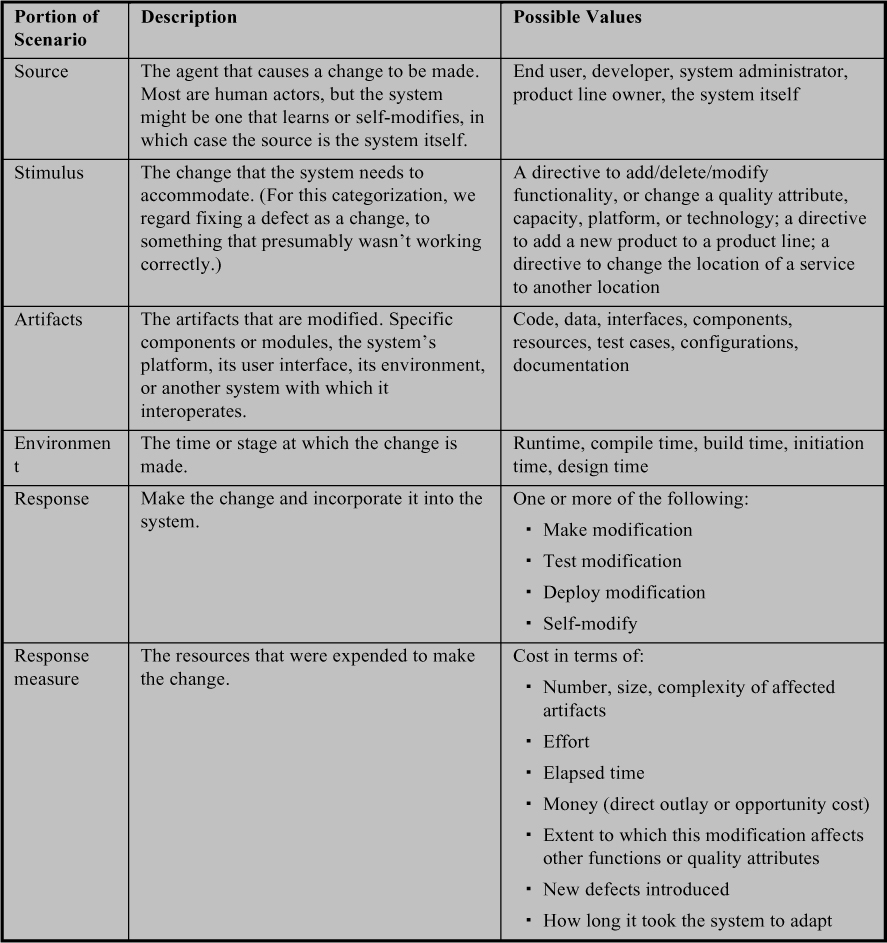
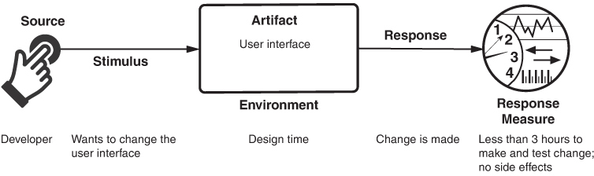
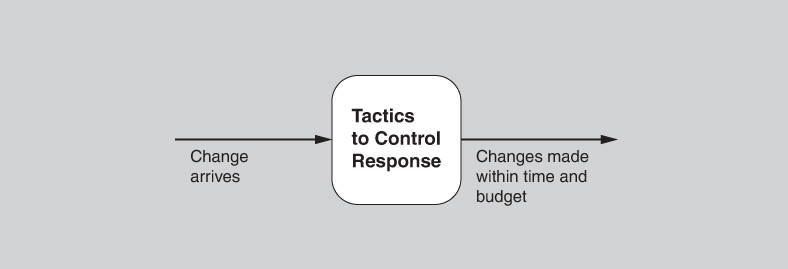
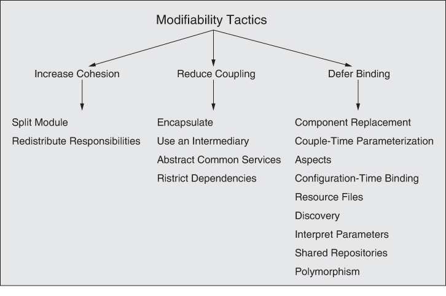

# 8. Modifiability

> Không phải loài mạnh nhất sống sót, cũng không phải loài thông minh nhất, mà là loài phản ứng nhanh nhạy nhất với sự thay đổi. 
> —Charles Darwin

Thay đổi luôn xảy ra.

Hết nghiên cứu này đến nghiên cứu khác cho thấy phần lớn chi phí của một hệ thống phần mềm điển hình phát sinh *sau* khi nó được phát hành lần đầu. Nếu thay đổi là hằng số duy nhất trong vũ trụ, thì thay đổi phần mềm không chỉ là hằng số mà còn có mặt ở khắp nơi. Thay đổi xảy ra để thêm tính năng mới, để sửa đổi hoặc thậm chí loại bỏ tính năng cũ. Thay đổi xảy ra để sửa lỗi, thắt chặt security, hoặc cải thiện performance. Thay đổi xảy ra để nâng cao trải nghiệm người dùng. Thay đổi xảy ra để đón nhận công nghệ mới, nền tảng mới, protocol mới, tiêu chuẩn mới. Thay đổi xảy ra để làm cho các hệ thống làm việc được với nhau, ngay cả khi chúng chưa bao giờ được thiết kế để làm vậy.

Modifiability là về sự thay đổi, và mối quan tâm của chúng ta đối với nó là giảm chi phí và rủi ro của việc thực hiện thay đổi. Để lập kế hoạch cho modifiability, kiến trúc sư phải xem xét bốn câu hỏi:

- *Cái gì có thể thay đổi?* Một thay đổi có thể xảy ra với bất kỳ khía cạnh nào của một hệ thống: các chức năng mà hệ thống tính toán, nền tảng (phần cứng, hệ điều hành, middleware), môi trường mà hệ thống hoạt động trong đó (các hệ thống mà nó phải tương tác, các protocol nó dùng để giao tiếp với phần còn lại của thế giới), các chất lượng mà hệ thống thể hiện (performance, reliability của nó, và thậm chí cả các sửa đổi trong tương lai của nó), và năng lực của nó (số người dùng được hỗ trợ, số thao tác đồng thời).
- *Khả năng xảy ra thay đổi là bao nhiêu?* Không ai có thể lập kế hoạch một hệ thống cho mọi thay đổi tiềm năng—hệ thống sẽ không bao giờ hoàn thành, hoặc nếu hoàn thành thì sẽ quá đắt đỏ và có thể sẽ gặp vấn đề quality attribute ở các chiều khác. Dù bất cứ thứ gì cũng *có thể* thay đổi, kiến trúc sư phải đưa ra những quyết định khó khăn về việc thay đổi nào có khả năng xảy ra, và do đó thay đổi nào sẽ được hỗ trợ và thay đổi nào không.
- *Khi nào thay đổi được thực hiện và ai thực hiện nó?* Trước đây, phổ biến nhất là thay đổi được thực hiện trên source code. Tức là, một developer phải thực hiện thay đổi, thay đổi đó được kiểm thử rồi deploy trong một bản phát hành mới. Tuy nhiên, giờ đây câu hỏi khi nào một thay đổi được thực hiện đan xen với câu hỏi ai thực hiện nó. Một người dùng cuối thay đổi screen saver rõ ràng đang thực hiện một thay đổi đối với một khía cạnh của hệ thống. Cũng rõ ràng như vậy, nó không thuộc cùng loại với việc thay đổi hệ thống để nó dùng một hệ quản trị database khác. Thay đổi có thể được thực hiện đối với implementation (bằng cách sửa source code), trong quá trình compile (dùng các compile-time switch), trong quá trình build (bằng cách chọn library), trong quá trình thiết lập cấu hình (bằng nhiều kỹ thuật, bao gồm thiết lập tham số), hoặc trong quá trình thực thi (bằng thiết lập tham số, plug-ins, cấp phát lên phần cứng, v.v.). Một thay đổi cũng có thể được thực hiện bởi một developer, một người dùng cuối, hoặc một quản trị viên hệ thống. Các hệ thống có khả năng học hỏi và thích nghi đưa ra một câu trả lời hoàn toàn khác cho câu hỏi khi nào một thay đổi được thực hiện và “ai” thực hiện nó—chính hệ thống là tác nhân của sự thay đổi.
- *Chi phí của thay đổi là bao nhiêu?* Làm cho một hệ thống có modifiability cao hơn liên quan đến hai loại chi phí:
- Chi phí đưa vào (các) cơ chế để làm cho hệ thống có modifiability cao hơn
- Chi phí thực hiện sửa đổi bằng (các) cơ chế đó

Ví dụ, cơ chế đơn giản nhất để thực hiện một thay đổi là chờ một yêu cầu thay đổi đến, rồi sửa source code để đáp ứng yêu cầu đó. Trong trường hợp này, chi phí đưa vào cơ chế bằng không (vì không có cơ chế đặc biệt nào); chi phí sử dụng nó là chi phí sửa source code và kiểm chứng lại hệ thống.

Ở đầu kia của phổ là một application generator, chẳng hạn như một user interface builder. Builder nhận đầu vào là một mô tả của UI được thiết kế, tạo ra thông qua các kỹ thuật thao tác trực tiếp, và sau đó có thể tạo ra source code. Chi phí đưa vào cơ chế là chi phí mua UI builder, có thể đáng kể. Chi phí sử dụng cơ chế là chi phí tạo ra đầu vào để đưa vào builder (chi phí này có thể đáng kể hoặc không đáng kể), chi phí chạy builder (gần bằng không), và cuối cùng là chi phí của bất kỳ kiểm thử nào được thực hiện trên kết quả (thường ít hơn nhiều so với hand-coding).

Xa hơn nữa trên phổ là các hệ thống phần mềm tự khám phá môi trường, học hỏi và tự sửa đổi để đáp ứng mọi thay đổi. Với những hệ thống đó, chi phí thực hiện sửa đổi bằng không, nhưng khả năng đó đã được mua cùng với việc triển khai và kiểm thử các cơ chế học, vốn có thể đã khá tốn kém.

Với *N* sửa đổi tương tự nhau, một lập luận đơn giản hóa để biện minh cho một cơ chế thay đổi là

*N \* Chi phí thực hiện thay đổi khi không có cơ chế ≤*

*Chi phí tạo ra cơ chế + (N \* chi phí thực hiện thay đổi khi dùng cơ chế)*

Ở đây, *N* là số lượng sửa đổi dự kiến sẽ dùng cơ chế modifiability—nhưng nó cũng là một dự đoán. Nếu có ít thay đổi hơn dự kiến, thì một cơ chế sửa đổi đắt tiền có thể không đáng. Ngoài ra, chi phí tạo ra cơ chế modifiability có thể được dùng vào việc khác (chi phí cơ hội)—vào việc thêm chức năng mới, cải thiện performance, hoặc thậm chí vào các khoản đầu tư non-software như tuyển dụng hay đào tạo. Ngoài ra, phương trình không tính đến thời gian. Về lâu dài, có thể rẻ hơn nếu xây dựng một cơ chế change-handling tinh vi, nhưng bạn có thể không đợi được đến khi nó hoàn thành. Tuy nhiên, nếu code của bạn bị sửa đổi thường xuyên, việc không đưa vào một cơ chế architecture nào đó mà chỉ chồng thay đổi lên thay đổi thường dẫn đến technical debt đáng kể. Chúng tôi đề cập đến chủ đề architectural debt trong [Chương 23](ch23_managing_architecture_debt.vi.md#ch23).

Thay đổi phổ biến đến mức trong vòng đời của các hệ thống phần mềm, những biến thể cụ thể của modifiability đã được đặt những cái tên riêng. Một số tên phổ biến được nêu bật ở đây:

- *Scalability* là về việc đáp ứng nhiều hơn một thứ gì đó. Xét về performance, scalability nghĩa là thêm nhiều tài nguyên hơn. Hai loại performance scalability là horizontal scalability và vertical scalability. Horizontal scalability (scaling out) chỉ việc thêm nhiều tài nguyên hơn vào các đơn vị logic, chẳng hạn như thêm một server nữa vào một cụm server. Vertical scalability (scaling up) chỉ việc thêm nhiều tài nguyên hơn vào một đơn vị vật lý, chẳng hạn như thêm memory cho một máy tính đơn lẻ. Vấn đề phát sinh với cả hai kiểu scaling là làm thế nào để sử dụng hiệu quả các tài nguyên bổ sung. *Hiệu quả* nghĩa là các tài nguyên bổ sung tạo ra sự cải thiện đo lường được cho một chất lượng nào đó của hệ thống, không đòi hỏi công sức quá mức để thêm vào, và không làm gián đoạn quá mức hoạt động. Trong các môi trường cloud-based, horizontal scalability được gọi là *elasticity*. Elasticity là một thuộc tính cho phép khách hàng thêm hoặc bớt virtual machine khỏi resource pool (xem [Chương 17](ch17_the_cloud_and_distributed_computing.vi.md#ch17) để thảo luận thêm về các môi trường như vậy).
- *Variability* chỉ khả năng của một hệ thống và các artifact hỗ trợ của nó, như code, yêu cầu, test plan và tài liệu, trong việc hỗ trợ tạo ra một tập các biến thể khác nhau theo một cách được lên kế hoạch trước. Variability là một quality attribute đặc biệt quan trọng trong một product line, tức một họ các hệ thống tương tự nhau nhưng khác nhau về tính năng và chức năng. Nếu các tài sản kỹ thuật gắn với các hệ thống này có thể được chia sẻ giữa các thành viên của họ, thì tổng chi phí của product line giảm mạnh. Điều này đạt được bằng cách đưa vào các cơ chế cho phép các artifact được lựa chọn và/hoặc thích ứng với cách sử dụng trong các bối cảnh sản phẩm khác nhau thuộc phạm vi của product line. Mục tiêu của variability trong một software product line là giúp dễ dàng xây dựng và bảo trì các sản phẩm trong họ đó qua một khoảng thời gian.
- *Portability* chỉ mức độ dễ dàng mà phần mềm được xây dựng để chạy trên một nền tảng có thể được thay đổi để chạy trên một nền tảng khác. Portability đạt được bằng cách giảm thiểu các dependency vào nền tảng trong phần mềm, cô lập các dependency vào những vị trí well-identified, và viết phần mềm để chạy trên một “virtual machine” (ví dụ, Java Virtual Machine) đóng gói mọi dependency vào nền tảng. Các scenario mô tả portability xử lý việc chuyển phần mềm sang một nền tảng mới với công sức không vượt quá một mức nhất định hoặc bằng cách đếm số chỗ trong phần mềm sẽ phải thay đổi. Các cách tiếp cận architecture để xử lý portability đan xen với các cách tiếp cận cho *deployability*, một chủ đề được đề cập trong [Chương 5](ch05_deployability.vi.md#ch05).
- *Location independence* chỉ trường hợp hai phần mềm phân tán tương tác với nhau và vị trí của một hoặc cả hai phần không được biết trước runtime. Hoặc, vị trí của các phần này có thể thay đổi trong runtime. Trong các hệ thống phân tán, các service thường được deploy đến các vị trí tùy ý, và các client của những service đó phải khám phá vị trí của chúng một cách động. Ngoài ra, các service trong một hệ thống phân tán thường phải làm cho vị trí của mình có thể được khám phá một khi chúng đã được deploy đến một vị trí. Thiết kế hệ thống cho location independence nghĩa là vị trí sẽ dễ sửa đổi với tác động tối thiểu đến phần còn lại của hệ thống.

## 8.1 General scenario cho modifiability (Modifiability General Scenario)

Từ những cân nhắc này, chúng ta có thể xây dựng general scenario cho modifiability. [Bảng 8.1](#ch08tab01) tóm tắt scenario này.

**Bảng 8.1** *General scenario cho modifiability*

[Hình 8.1](#ch08fig01) minh họa một concrete modifiability scenario: *Một developer muốn thay đổi user interface. Thay đổi này sẽ được thực hiện trên code tại thời điểm thiết kế, sẽ mất chưa đến ba giờ để thực hiện và kiểm thử thay đổi, và sẽ không có tác dụng phụ nào xảy ra.*

**Hình 8.1** *Ví dụ về concrete modifiability scenario*

## 8.2 Các tactic cho modifiability (Tactics for Modifiability)

Các tactic kiểm soát modifiability có mục tiêu là kiểm soát độ phức tạp của việc thực hiện thay đổi, cũng như thời gian và chi phí để thực hiện thay đổi. [Hình 8.2](#ch08fig02) cho thấy mối quan hệ này.

**Hình 8.2** *Mục tiêu của các modifiability tactic*

Để hiểu modifiability, chúng ta bắt đầu với một số thước đo độ phức tạp sớm nhất và cơ bản nhất của thiết kế phần mềm—coupling và cohesion—vốn được mô tả lần đầu vào thập niên 1960s.

Nói chung, một thay đổi ảnh hưởng đến một module thì dễ hơn và ít tốn kém hơn một thay đổi ảnh hưởng đến nhiều module. Tuy nhiên, nếu trách nhiệm của hai module chồng lấn nhau theo một cách nào đó, thì một thay đổi duy nhất rất có thể sẽ ảnh hưởng đến cả hai. Chúng ta có thể định lượng sự chồng lấn này bằng cách đo xác suất một sửa đổi đối với một module sẽ lan sang module kia. Mối quan hệ này được gọi là *coupling*, và coupling cao là kẻ thù của modifiability. Giảm coupling giữa hai module sẽ làm giảm chi phí kỳ vọng của bất kỳ sửa đổi nào ảnh hưởng đến một trong hai module. Các tactic giảm coupling là những tactic đặt các loại intermediary khác nhau giữa hai module mà nếu không có chúng thì sẽ bị couple cao.

*Cohesion* đo mức độ liên quan chặt chẽ giữa các trách nhiệm của một module. Nói một cách không chính thức, nó đo “sự thống nhất về mục đích” của module. Sự thống nhất về mục đích có thể được đo bằng các change scenario ảnh hưởng đến một module. Cohesion của một module là xác suất một change scenario ảnh hưởng đến một trách nhiệm cũng sẽ ảnh hưởng đến các trách nhiệm khác (khác biệt). Cohesion càng cao, xác suất một thay đổi cho trước sẽ ảnh hưởng đến nhiều module càng thấp. Cohesion cao là tốt cho modifiability; cohesion thấp là xấu cho nó. Nếu module A có cohesion thấp, thì cohesion có thể được cải thiện bằng cách loại bỏ các trách nhiệm không bị ảnh hưởng bởi các thay đổi được dự kiến.

Đặc điểm thứ ba ảnh hưởng đến chi phí và độ phức tạp của một thay đổi là *kích thước của một module*. Khi mọi điều kiện khác như nhau, module lớn hơn thì khó thay đổi hơn, tốn kém hơn khi thay đổi, và dễ có bug hơn.

Cuối cùng, chúng ta cần quan tâm đến thời điểm trong vòng đời phát triển phần mềm mà một thay đổi xảy ra. Nếu bỏ qua chi phí chuẩn bị architecture cho việc sửa đổi, chúng ta muốn một thay đổi được bind càng muộn càng tốt. Các thay đổi chỉ có thể được thực hiện thành công (tức là nhanh chóng và với chi phí thấp) muộn trong vòng đời nếu architecture được chuẩn bị thích hợp để đáp ứng chúng. Do đó, tham số thứ tư và cũng là cuối cùng trong một model modifiability là *thời điểm bind của sửa đổi* (binding time of modification). Một architecture được trang bị thích hợp để đáp ứng các sửa đổi muộn trong vòng đời, tính trung bình, sẽ tốn ít chi phí hơn một architecture buộc cùng sửa đổi đó phải được thực hiện sớm hơn. Sự chuẩn bị sẵn sàng của hệ thống có nghĩa là một số chi phí sẽ bằng không, hoặc rất thấp, đối với các sửa đổi xảy ra muộn trong vòng đời.

Giờ chúng ta có thể hiểu các tactic và hệ quả của chúng như là tác động đến một hoặc nhiều tham số sau: giảm kích thước, tăng cohesion, giảm coupling và trì hoãn thời điểm bind. Các tactic này được thể hiện trong [Hình 8.3](#ch08fig03).

**Hình 8.3** *Các modifiability tactic*

### Tăng cohesion (Increase Cohesion)

Một số tactic liên quan đến việc phân bổ lại trách nhiệm giữa các module. Bước này được thực hiện để giảm khả năng một thay đổi duy nhất sẽ ảnh hưởng đến nhiều module.

- *Split module*. Nếu module đang được sửa đổi bao gồm các trách nhiệm không gắn kết với nhau, chi phí sửa đổi nhiều khả năng sẽ cao. Refactor module thành nhiều module gắn kết hơn sẽ giảm chi phí trung bình của các thay đổi trong tương lai. Việc tách một module không nên đơn giản chỉ là đặt một nửa số dòng code vào mỗi submodule; thay vào đó, nó nên tạo ra một cách hợp lý và thích hợp một loạt submodule tự thân đã gắn kết.
- *Redistribute responsibilities*. Nếu các trách nhiệm A, A′ và A″ (đều là các trách nhiệm tương tự nhau) nằm rải rác ở nhiều module khác nhau, chúng nên được đặt cùng nhau. Việc refactor này có thể bao gồm tạo một module mới, hoặc có thể bao gồm chuyển trách nhiệm vào các module hiện có. Một phương pháp để xác định các trách nhiệm cần chuyển là giả định một tập các thay đổi có khả năng xảy ra dưới dạng scenario. Nếu các scenario liên tục chỉ ảnh hưởng đến một phần của một module, thì có lẽ các phần khác có trách nhiệm riêng và nên được chuyển đi. Ngược lại, nếu một số scenario đòi hỏi sửa đổi nhiều module, thì có lẽ các trách nhiệm bị ảnh hưởng nên được nhóm lại với nhau thành một module mới.

### Giảm coupling (Reduce Coupling)

Giờ chúng ta chuyển sang các tactic giảm coupling giữa các module. Các tactic này chồng lấn với các integrability tactic được mô tả trong [Chương 7](ch07_integrability.vi.md#ch07), vì việc giảm dependency giữa các component độc lập (cho integrability) tương tự như việc giảm coupling giữa các module (cho modifiability).

- *Encapsulate*. Xem phần thảo luận trong [Chương 7](ch07_integrability.vi.md#ch07).
- *Use an intermediary*. Xem phần thảo luận trong [Chương 7](ch07_integrability.vi.md#ch07).
- *Abstract common services*. Xem phần thảo luận trong [Chương 7](ch07_integrability.vi.md#ch07).
- *Restrict dependencies.* Tactic này hạn chế những module mà một module cho trước tương tác hoặc phụ thuộc vào. Trong thực tế, tactic này được triển khai bằng cách hạn chế khả năng nhìn thấy của một module (khi developer không thể nhìn thấy một interface, họ không thể dùng nó) và bằng authorization (chỉ cho phép các module được ủy quyền truy cập). Tactic restrict dependencies được thấy trong các layered architecture, trong đó một layer chỉ được phép dùng các layer thấp hơn (đôi khi chỉ layer thấp hơn kế tiếp), và trong việc dùng wrapper, khi các thực thể bên ngoài chỉ có thể nhìn thấy (và do đó phụ thuộc vào) wrapper, chứ không phải chức năng bên trong mà nó bọc.

### Trì hoãn binding (Defer Binding)

Vì công việc của con người hầu như luôn đắt hơn và dễ sai hơn (error-prone) so với công việc của máy tính, việc để máy tính xử lý một thay đổi càng nhiều càng tốt hầu như luôn làm giảm chi phí thực hiện thay đổi đó. Nếu chúng ta thiết kế các artifact với sự linh hoạt built-in, thì việc tận dụng sự linh hoạt đó thường rẻ hơn hand-coding một thay đổi cụ thể.

Tham số có lẽ là cơ chế best-known để đưa vào sự linh hoạt, và việc sử dụng chúng gợi nhớ đến tactic abstract common services. Một function có tham số *f*(*a*, *b*) tổng quát hơn function tương tự *f*(*a*) vốn giả định *b* = 0. Khi chúng ta bind giá trị của một số tham số ở một giai đoạn trong vòng đời khác với giai đoạn mà chúng ta đã định nghĩa các tham số, chúng ta đang trì hoãn binding.

Nói chung, chúng ta có thể bind giá trị càng muộn trong vòng đời thì càng tốt. Tuy nhiên, việc đặt sẵn các cơ chế để hỗ trợ việc bind muộn đó có xu hướng tốn kém hơn—một tradeoff well-known. Và vì vậy phương trình được đưa ra ở phần trước của chương phát huy tác dụng. Chúng ta muốn bind càng muộn càng tốt, miễn là cơ chế cho phép điều đó cost-effective.

Các tactic sau có thể được dùng để bind giá trị lúc compile hoặc lúc build:

- Thay thế component (ví dụ, trong một build script hoặc makefile)
- Tham số hóa compile-time
- Aspect

Các tactic sau có sẵn để bind giá trị lúc deployment, lúc khởi động hoặc lúc khởi tạo:

- Binding configuration-time
- Resource file

Các tactic để bind giá trị tại runtime bao gồm:

- Discovery (xem [Chương 7](ch07_integrability.vi.md#ch07))
- Diễn giải tham số (interpret parameters)
- Shared repository
- Polymorphism

Việc tách việc xây dựng một cơ chế cho modifiability khỏi việc sử dụng cơ chế đó để thực hiện một sửa đổi mở ra khả năng có các stakeholder khác nhau tham gia—một stakeholder (thường là developer) cung cấp cơ chế và một stakeholder khác (quản trị viên hoặc người cài đặt) sử dụng nó sau này, có thể trong một giai đoạn life-cycle hoàn toàn khác. Việc cài đặt một cơ chế để người khác có thể thực hiện thay đổi đối với hệ thống mà không phải thay đổi bất kỳ code nào đôi khi được gọi là *externalizing* (ngoại hóa) thay đổi.

## 8.3 Questionnaire dựa trên tactic cho modifiability (Tactics-Based Questionnaire for Modifiability)

Dựa trên các tactic được mô tả trong [Mục 8.2](#sec8_2), chúng ta có thể tạo một tập câu hỏi tactics-inspired, như được trình bày trong [Bảng 8.2](#ch08tab02). Để có cái nhìn tổng quan về các lựa chọn architecture được đưa ra để hỗ trợ modifiability, nhà phân tích đặt từng câu hỏi và ghi lại câu trả lời vào bảng. Câu trả lời cho các câu hỏi này sau đó có thể trở thành trọng tâm của các hoạt động tiếp theo: điều tra tài liệu, phân tích code hoặc các artifact khác, reverse engineering code, v.v.

**Bảng 8.2** *Questionnaire tactics-based cho modifiability*

## 8.4 Các pattern (Patterns)

Các pattern cho modifiability chia hệ thống thành các module theo cách mà các module có thể được phát triển và tiến hóa riêng rẽ với ít tương tác giữa chúng, nhờ đó hỗ trợ portability, modifiability và tái sử dụng. Có lẽ có nhiều pattern được thiết kế để hỗ trợ modifiability hơn bất kỳ quality attribute nào khác. Ở đây, chúng tôi trình bày một vài pattern nằm trong số những pattern được dùng phổ biến nhất.

### Pattern Client-Server

Pattern client-server gồm một server cung cấp service đồng thời cho nhiều client phân tán. Ví dụ phổ biến nhất là một web server cung cấp thông tin cho nhiều người dùng đồng thời của một website.

Các tương tác giữa một server và các client của nó tuân theo trình tự sau:

- *Khám phá (Discovery):*
- Giao tiếp được khởi tạo bởi một client, client này dùng một discovery service để xác định vị trí của server.
- Server phản hồi client bằng một protocol agreed-upon.
- *Tương tác (Interaction):*
- Client gửi request tới server.
- Server xử lý các request và phản hồi.

Một số điểm về trình tự này đáng được lưu ý:

- Server có thể có nhiều instance nếu số lượng client tăng vượt quá năng lực của một instance duy nhất.
- Nếu server là stateless đối với các client, mỗi request từ một client được xử lý độc lập.
- Nếu server duy trì trạng thái đối với các client, thì:
- Mỗi request phải xác định client theo cách nào đó.
- Client nên gửi một message “end of session” để server có thể giải phóng các tài nguyên gắn với client cụ thể đó.
- Server có thể time out nếu client không gửi request trong một khoảng thời gian xác định, để các tài nguyên gắn với client có thể được giải phóng.

**Lợi ích:**

- Kết nối giữa một server và các client của nó được thiết lập một cách động. Server không có kiến thức a priori về các client của mình; tức là, coupling giữa server và các client của nó thấp.
- Không có coupling giữa các client.
- Số lượng client có thể dễ dàng mở rộng, và chỉ bị giới hạn bởi năng lực của server. Chức năng của server cũng có thể mở rộng nếu năng lực của nó bị vượt quá.
- Client và server có thể tiến hóa độc lập.
- Các service chung có thể được chia sẻ giữa nhiều client.
- Tương tác với người dùng được cô lập ở client. Yếu tố này đã dẫn đến việc phát triển các ngôn ngữ và công cụ chuyên biệt để quản lý user interface.

**Các tradeoff:**

- Pattern này được triển khai sao cho giao tiếp diễn ra qua mạng, có thể thậm chí là Internet. Do đó, message có thể bị trễ do tắc nghẽn mạng, dẫn đến suy giảm (hoặc ít nhất là không thể dự đoán) performance.
- Với các client giao tiếp với server qua một mạng được chia sẻ bởi các ứng dụng khác, phải có các biện pháp đặc biệt để đạt được security (đặc biệt là tính bí mật) và duy trì tính toàn vẹn.

### Pattern Plug-in (Microkernel)

Pattern plug-in có hai loại element—các element cung cấp một tập chức năng cốt lõi và các biến thể chuyên biệt (gọi là plug-ins) bổ sung chức năng cho phần cốt lõi thông qua một tập interface cố định. Hai loại này thường được bind với nhau lúc build hoặc muộn hơn.

Các ví dụ sử dụng bao gồm những trường hợp sau:

- Chức năng cốt lõi có thể là một hệ điều hành stripped-down (microkernel) cung cấp các cơ chế cần thiết để triển khai các service của hệ điều hành, chẳng hạn như quản lý không gian địa chỉ low-level, quản lý thread và giao tiếp liên process (IPC). Các plug-ins cung cấp chức năng thực sự của hệ điều hành, chẳng hạn như device driver, quản lý tác vụ và quản lý request I/O.
- Chức năng cốt lõi là một sản phẩm cung cấp service cho người dùng của nó. Các plug-ins cung cấp portability, chẳng hạn như khả năng tương thích hệ điều hành hoặc khả năng tương thích library hỗ trợ. Các plug-ins cũng có thể cung cấp chức năng bổ sung không có trong sản phẩm cốt lõi. Ngoài ra, chúng có thể đóng vai trò adapter để cho phép tích hợp với các hệ thống bên ngoài (xem [Chương 7](ch07_integrability.vi.md#ch07)).

**Lợi ích:**

- Plug-ins cung cấp một cơ chế có kiểm soát để mở rộng một sản phẩm cốt lõi và làm cho nó hữu ích trong nhiều bối cảnh.
- Các plug-ins có thể được phát triển bởi các team hoặc tổ chức khác với những người phát triển microkernel. Điều này cho phép phát triển hai thị trường khác nhau: cho sản phẩm cốt lõi và cho các plug-ins.
- Các plug-ins có thể tiến hóa độc lập với microkernel. Vì chúng tương tác thông qua các interface cố định, chừng nào các interface không thay đổi, hai loại element không bị couple theo cách nào khác.

**Các tradeoff:**

- Vì plug-ins có thể được phát triển bởi các tổ chức khác nhau, việc đưa vào các lỗ hổng security và các mối đe dọa quyền riêng tư dễ xảy ra hơn.

### Pattern Layers (Layers Pattern)

Pattern layers chia hệ thống theo cách mà các module có thể được phát triển và tiến hóa riêng rẽ với ít tương tác giữa các phần, điều này hỗ trợ portability, modifiability và tái sử dụng. Để đạt được sự separation of concerns này, pattern layers chia phần mềm thành các đơn vị gọi là layer. Mỗi layer là một nhóm module cung cấp một tập service gắn kết. Relationship *allowed-to-use* giữa các layer phải tuân theo một ràng buộc then chốt: Các relation phải là một chiều.

Các layer phân chia hoàn toàn một tập phần mềm, và mỗi phần được phơi ra thông qua một public interface. Các layer được tạo ra để tương tác theo một relation thứ tự nghiêm ngặt. Nếu (A, B) nằm trong relation này, chúng ta nói rằng phần mềm được giao cho layer A được phép dùng bất kỳ tiện ích public nào do layer B cung cấp. (Trong một biểu diễn layer sắp xếp theo chiều dọc, vốn gần như phổ biến khắp nơi, A sẽ được vẽ cao hơn B.) Trong một số trường hợp, các module trong một layer buộc phải dùng trực tiếp các module trong một layer thấp hơn không kề cận, dù thông thường chỉ cho phép dùng next-lower-layer. Trường hợp phần mềm ở một layer cao hơn dùng các module trong một layer thấp hơn không kề cận này được gọi là *layer bridging*. Pattern này không cho phép dùng theo chiều lên trên.

**Lợi ích:**

- Vì một layer bị ràng buộc chỉ được dùng các layer thấp hơn, phần mềm ở các layer thấp hơn có thể được thay đổi (miễn là interface không thay đổi) mà không ảnh hưởng đến các layer phía trên.
- Các layer lower-level có thể được tái sử dụng trên các ứng dụng khác nhau. Ví dụ, giả sử một layer nhất định cho phép portability giữa các hệ điều hành. Layer này sẽ hữu ích trong bất kỳ hệ thống nào phải chạy trên nhiều hệ điều hành khác nhau. Các layer thấp nhất thường được cung cấp bởi phần mềm thương mại—ví dụ, một hệ điều hành, hoặc phần mềm truyền thông mạng.
- Vì các relation *allowed-to-use* bị ràng buộc, số lượng interface mà bất kỳ team nào cũng phải hiểu được giảm bớt.

**Các tradeoff:**

- Nếu việc phân layer không được thiết kế đúng, nó có thể thực sự gây cản trở, khi không cung cấp các abstraction lower-level mà lập trình viên ở các mức cao hơn cần.
- Việc phân layer thường làm giảm performance của một hệ thống. Nếu một lời gọi được thực hiện từ một function trong layer top-most, nó có thể phải đi qua nhiều layer thấp hơn trước khi được phần cứng thực thi.
- Nếu xảy ra nhiều trường hợp layer bridging, hệ thống có thể không đạt được các mục tiêu portability và modifiability, những mục tiêu mà việc phân layer nghiêm ngặt giúp đạt được.

### Pattern Publish-Subscribe

Publish-subscribe là một architectural pattern trong đó các component giao tiếp chủ yếu thông qua các message bất đồng bộ, đôi khi được gọi là “event” hoặc “topic”. Publisher không biết gì về subscriber, và subscriber chỉ biết về các loại message. Các hệ thống dùng pattern publish-subscribe dựa vào implicit invocation; tức là, component publish một message không trực tiếp gọi bất kỳ component nào khác. Các component publish message trên một hoặc nhiều event hoặc topic, và các component khác đăng ký quan tâm đến việc publish đó. Tại runtime, khi một message được publish, publish–subscribe (hay event) bus thông báo cho mọi element đã đăng ký quan tâm đến event hoặc topic đó. Bằng cách này, việc publish message gây ra một implicit invocation tới (các method trong) các component khác. Kết quả là loose coupling giữa publisher và subscriber.

Pattern publish-subscribe có ba loại element:

- *Publisher component*. Gửi (publish) message.
- *Subscriber component*. Đăng ký nhận và sau đó nhận message.
- *Event* *bus*. Quản lý các subscription và việc phân phối message như một phần của runtime infrastructure.

**Lợi ích:**

- Publisher và subscriber độc lập với nhau và do đó loosely coupled. Việc thêm hoặc thay đổi subscriber chỉ đòi hỏi đăng ký một event và không gây ra thay đổi nào cho publisher.
- Hành vi của hệ thống có thể dễ dàng thay đổi bằng cách thay đổi event hoặc topic của một message đang được publish, và do đó thay đổi những subscriber nào có thể nhận và xử lý message này. Thay đổi có vẻ nhỏ này có thể có hệ quả lớn, vì các tính năng có thể được bật hoặc tắt bằng cách thêm hoặc chặn message.
- Event có thể được log dễ dàng để cho phép ghi lại và phát lại, nhờ đó tái tạo các điều kiện lỗi vốn có thể khó tái tạo thủ công.

**Các tradeoff:**

- Một số implementation của pattern publish-subscribe có thể ảnh hưởng tiêu cực đến performance (latency). Việc dùng một cơ chế điều phối phân tán sẽ giảm nhẹ sự suy giảm performance.
- Trong một số trường hợp, một component không thể chắc chắn sẽ mất bao lâu để nhận được một message đã publish. Nói chung, performance của hệ thống và việc quản lý tài nguyên khó suy luận hơn trong các hệ thống publish-subscribe.
- Việc dùng pattern này có thể ảnh hưởng tiêu cực đến tính tất định của các hệ thống đồng bộ. Thứ tự mà các method được gọi, như kết quả của một event, có thể khác nhau trong một số implementation.
- Việc dùng pattern publish-subscribe có thể ảnh hưởng tiêu cực đến testability. Những thay đổi có vẻ nhỏ trong event bus—chẳng hạn như thay đổi component nào được gắn với event nào—có thể có tác động rộng đến hành vi của hệ thống và quality of service.
- Một số implementation publish-subscribe hạn chế các cơ chế có sẵn để triển khai security (integrity) một cách linh hoạt. Vì publisher không biết danh tính của subscriber của mình, và ngược lại, mã hóa end-to-end bị hạn chế. Message từ một publisher tới event bus có thể được mã hóa riêng, và message từ event bus tới một subscriber có thể được mã hóa riêng; tuy nhiên, bất kỳ giao tiếp mã hóa end-to-end nào cũng đòi hỏi mọi publisher và subscriber liên quan phải dùng chung một key.

## 8.5 Đọc thêm (For Further Reading)

Những người nghiêm túc nghiên cứu software engineering và lịch sử của nó nên đọc hai bài báo đầu tiên về thiết kế cho modifiability. Bài thứ nhất là bài báo năm 1968 của Edsger Dijkstra về hệ điều hành T.H.E., là bài báo đầu tiên nói về việc thiết kế hệ thống dùng layer, và các lợi ích modifiability mà cách tiếp cận này mang lại [Dijkstra 68]. Bài thứ hai là bài báo năm 1972 của David Parnas đã giới thiệu khái niệm information hiding. [Parnas 72] đề xuất định nghĩa module không phải theo chức năng của chúng, mà theo khả năng nội hóa tác động của các thay đổi.

Thêm các pattern cho modifiability được đưa ra trong *Software Systems Architecture: Working With Stakeholders Using Viewpoints and Perspectives* [Woods 11].

Số đo Decoupling Level [Mo 16] là một số đo coupling architecture-level có thể mang lại hiểu biết về mức độ một architecture bị couple trên toàn cục. Thông tin này có thể được dùng để theo dõi coupling theo thời gian, như một chỉ báo cảnh báo sớm về technical debt.

Một cách hoàn toàn tự động để phát hiện các vi phạm modularity—và các loại lỗi thiết kế khác—đã được mô tả trong [Mo 19]. Các vi phạm được phát hiện có thể được dùng làm hướng dẫn cho việc refactor, nhằm tăng cohesion và giảm coupling.

Các software module dành cho việc dùng trong một software product line thường được trang bị các cơ chế biến thể cho phép chúng được sửa đổi nhanh chóng để phục vụ trong các ứng dụng khác nhau—tức là, trong các thành viên khác nhau của product line. Danh sách các cơ chế biến thể cho component trong một product line có thể được tìm thấy trong các công trình của Bachmann và Clements [Bachmann 05], Jacobson và cộng sự [Jacobson 97] và Anastasopoulos và cộng sự [Anastasopoulos 00].

Pattern layers có nhiều dạng và biến thể—ví dụ, “layers with a sidecar”. [Mục 2.4](ch02_why_is_software_architecture_important.vi.md#sec2_4) của [DSA2] phân loại tất cả chúng, và thảo luận vì sao (đáng ngạc nhiên đối với một architectural pattern được phát minh hơn một half-century trước) hầu hết các sơ đồ layer cho phần mềm mà bạn từng thấy đều rất mơ hồ. Nếu bạn không muốn bỏ tiền mua cuốn sách, thì [Bachmann 00a] là một thay thế tốt.

## 8.6 Câu hỏi thảo luận (Discussion Questions)

1. Modifiability có nhiều biến thể và được biết đến với nhiều cái tên; chúng tôi đã thảo luận một vài trong phần mở đầu của chương này, nhưng thảo luận đó chỉ mới chạm vào bề mặt. Hãy tìm một trong các tiêu chuẩn IEEE hoặc ISO liên quan đến quality attribute, và lập danh sách các quality attribute đề cập đến một dạng modifiability nào đó. Hãy thảo luận về các khác biệt.
2. Trong danh sách bạn đã lập cho câu hỏi 1, những tactic và pattern nào đặc biệt hữu ích cho mỗi attribute?
3. Với mỗi quality attribute mà bạn khám phá được qua câu hỏi 2, hãy viết một modifiability scenario biểu đạt nó.
4. Trong nhiều tiệm giặt tự động, máy giặt và máy sấy nhận tiền xu nhưng không trả lại tiền thừa. Thay vào đó, có các máy riêng để đổi tiền. Trong một tiệm giặt trung bình, có sáu hoặc tám máy giặt và máy sấy cho mỗi máy đổi tiền. Bạn thấy những modifiability tactic nào đang được áp dụng trong cách bố trí này? Bạn có thể nói gì về availability?
5. Đối với tiệm giặt ở câu hỏi 4, hãy mô tả dạng modifiability cụ thể (dùng một modifiability scenario) dường như là mục đích của việc bố trí các máy như đã mô tả.
6. Một *wrapper*, được giới thiệu trong [Chương 7](ch07_integrability.vi.md#ch07), là một architectural pattern phổ biến để hỗ trợ modifiability. Một wrapper thể hiện những modifiability tactic nào?
7. Các architectural pattern phổ biến khác có thể làm tăng modifiability của một hệ thống bao gồm blackboard, broker, peer-to-peer, model-view-controller và reflection. Hãy thảo luận về từng pattern xét theo các modifiability tactic mà nó đóng gói.
8. Một khi một intermediary đã được đưa vào một architecture, một số module có thể cố gắng vượt qua nó, hoặc vô tình (vì chúng không biết đến intermediary) hoặc cố ý (vì performance, vì tiện lợi, hoặc vì thói quen). Hãy thảo luận một số phương tiện architecture để ngăn chặn việc vượt qua intermediary một cách không mong muốn. Hãy thảo luận cả một số phương tiện non-architectural.
9. Tactic abstract common services nhằm giảm coupling nhưng cũng có thể làm giảm cohesion. Hãy thảo luận.
10. Hãy thảo luận mệnh đề cho rằng pattern client-server là pattern microkernel với runtime binding.
