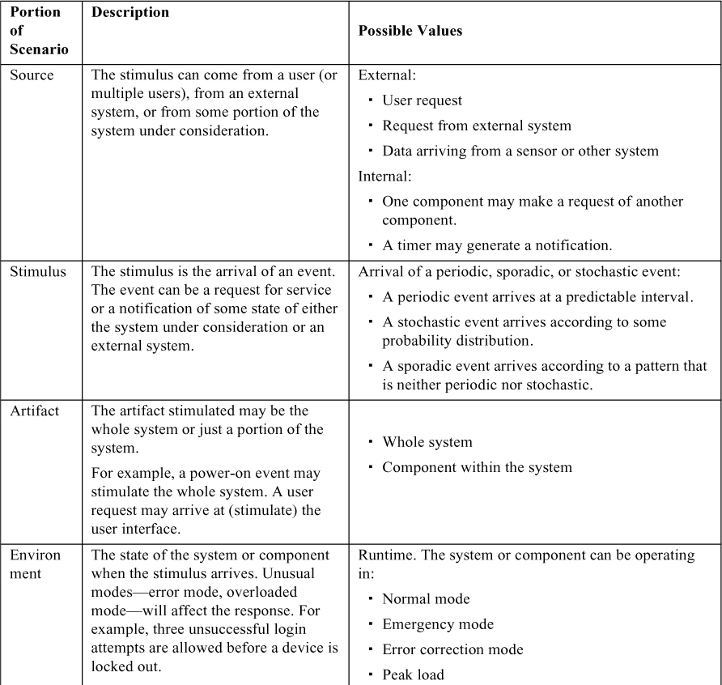
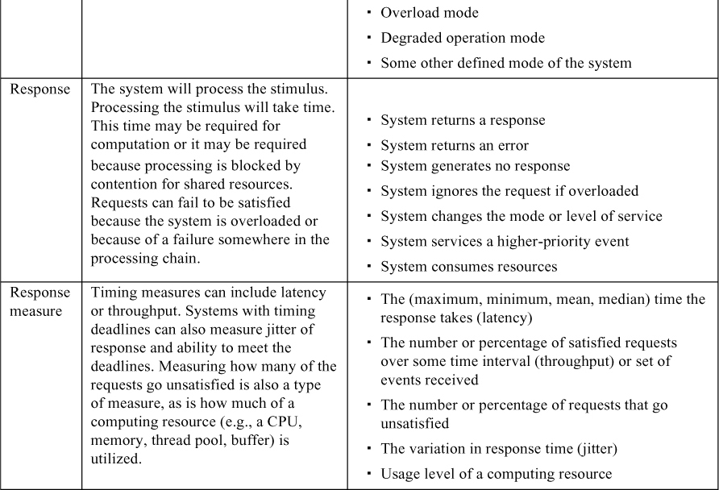
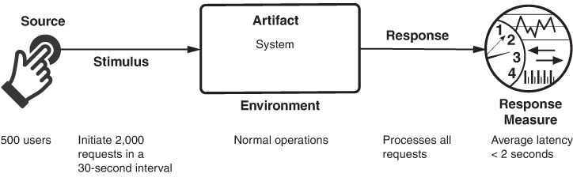
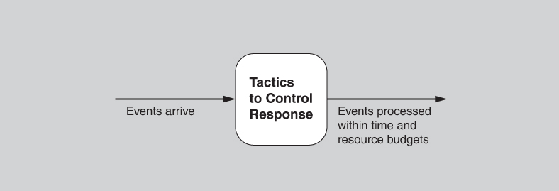
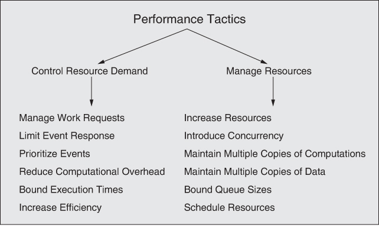
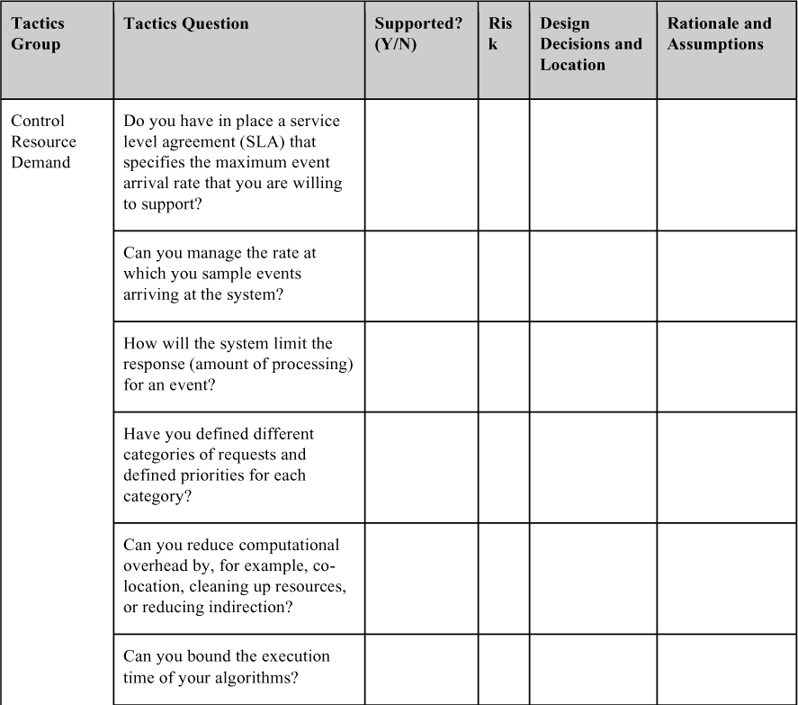
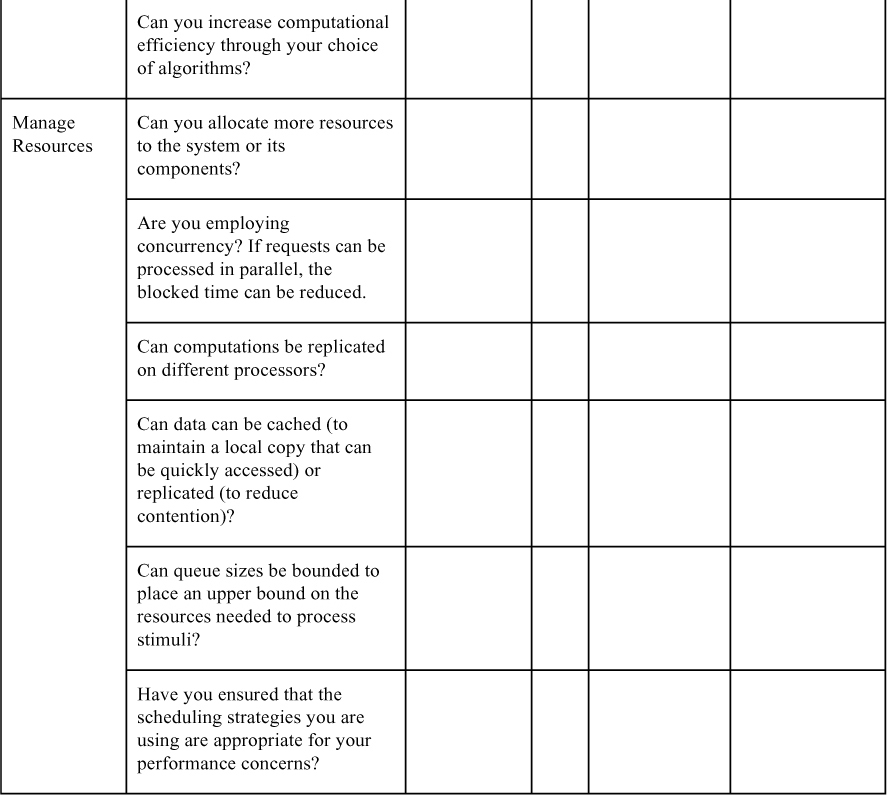

<a id="ch09"></a>

# 9. Performance

> Một chút performance đáng giá hơn cả đống lời hứa.<br>
> —Mae West

Tất cả là chuyện thời gian.

Performance, nghĩa là: Nó là chuyện thời gian và khả năng của hệ thống phần mềm trong việc đáp ứng các yêu cầu về thời gian. Sự thật đáng buồn là các thao tác trên máy tính đều tốn thời gian. Các phép tính tốn thời gian cỡ hàng nghìn nano giây, truy cập đĩa (dù là solid state hay đĩa quay) tốn thời gian cỡ hàng chục mili giây, và truy cập mạng tốn thời gian từ hàng trăm micro giây trong cùng một data center cho đến hơn 100 mili giây đối với các message liên lục địa. Thời gian phải được tính đến khi thiết kế hệ thống của bạn cho performance.

Khi các sự kiện xảy ra—interrupt, message, request từ người dùng hoặc hệ thống khác, hoặc các sự kiện đồng hồ đánh dấu thời gian trôi qua—hệ thống, hoặc một element nào đó của hệ thống, phải phản hồi chúng kịp thời. Việc đặc trưng các sự kiện có thể xảy ra (và khi nào chúng có thể xảy ra) cùng response time-based của hệ thống hoặc element đối với các sự kiện đó là cốt lõi của việc thảo luận về performance.

Các sự kiện của hệ thống web-based đến dưới dạng request từ người dùng (với số lượng từ hàng chục đến hàng chục triệu) thông qua các client của họ như trình duyệt web. Các service nhận sự kiện từ các service khác. Trong một hệ thống điều khiển cho động cơ đốt trong, sự kiện đến từ các nút điều khiển của người vận hành và từ thời gian trôi qua; hệ thống phải điều khiển cả việc đánh lửa khi một xi lanh ở đúng vị trí lẫn tỷ lệ hỗn hợp nhiên liệu để tối đa hóa công suất và hiệu suất và giảm thiểu ô nhiễm.

Đối với một hệ thống web-based, một hệ thống database-centric, hoặc một hệ thống xử lý tín hiệu đầu vào từ môi trường của nó, response mong muốn có thể được biểu đạt bằng số request có thể được xử lý trong một đơn vị thời gian. Đối với hệ thống điều khiển động cơ, response có thể là độ biến thiên cho phép của thời điểm đánh lửa. Trong mỗi trường hợp, mẫu các sự kiện đến và mẫu các response đều có thể được đặc trưng, và sự đặc trưng này tạo thành ngôn ngữ để xây dựng các performance scenario.

Trong phần lớn lịch sử của software engineering, vốn bắt đầu khi máy tính còn chậm và đắt và các tác vụ cần thực hiện vượt xa khả năng thực hiện chúng, performance đã là yếu tố chi phối trong architecture. Vì vậy, nó thường xuyên làm tổn hại việc đạt được mọi chất lượng khác. Khi tỷ lệ giá/performance của phần cứng tiếp tục giảm mạnh và chi phí phát triển phần mềm tiếp tục tăng, các chất lượng khác đã nổi lên như những đối thủ cạnh tranh quan trọng với performance.

Nhưng performance vẫn có tầm quan trọng nền tảng. Vẫn còn (và có lẽ sẽ luôn còn) những bài toán quan trọng mà chúng ta biết *cách* giải bằng máy tính, nhưng không thể giải đủ nhanh để hữu ích.

Mọi hệ thống đều có yêu cầu performance, ngay cả khi chúng không được nêu ra. Ví dụ, một công cụ soạn thảo văn bản có thể không có bất kỳ yêu cầu performance tường minh nào, nhưng chắc chắn bạn sẽ đồng ý rằng phải đợi một giờ (hoặc một phút, hoặc một giây) mới thấy một ký tự vừa gõ xuất hiện trên màn hình là không thể chấp nhận được. Performance tiếp tục là một quality attribute có tầm quan trọng nền tảng đối với mọi phần mềm.

Performance thường được gắn với scalability—tức là tăng năng lực làm việc của hệ thống trong khi vẫn hoạt động tốt. Chúng chắc chắn có liên quan, dù về mặt kỹ thuật scalability là việc làm cho hệ thống dễ thay đổi theo một cách cụ thể, và do đó là một loại modifiability, như đã thảo luận trong [Chương 8](ch08_modifiability.vi.md#ch08). Ngoài ra, scalability của các service trong cloud được thảo luận tường minh trong [Chương 17](ch17_the_cloud_and_distributed_computing.vi.md#ch17).

Thường thì việc cải thiện performance diễn ra sau khi bạn đã xây dựng một phiên bản của hệ thống và thấy performance của nó chưa đạt. Bạn có thể đón đầu điều này bằng cách thiết kế architecture cho hệ thống với performance trong đầu. Ví dụ, nếu bạn đã thiết kế hệ thống với một resource pool có thể mở rộng, và sau đó bạn xác định (từ dữ liệu đo đạc) rằng pool này là một nút thắt cổ chai, thì bạn có thể dễ dàng tăng kích thước của pool. Nếu không, các lựa chọn của bạn bị hạn chế—và hầu hết đều tệ—và chúng có thể đòi hỏi làm lại đáng kể.

Dành nhiều thời gian để tối ưu một phần của hệ thống chỉ chiếm một tỷ lệ nhỏ trong tổng thời gian là không hữu ích. Đo đạc hệ thống bằng cách ghi log thông tin thời gian sẽ giúp bạn xác định thời gian thực sự được tiêu tốn ở đâu và cho phép bạn tập trung vào việc cải thiện performance của các phần then chốt của hệ thống.

<a id="sec9_1"></a>

## 9.1 General scenario cho performance (Performance General Scenario)

Một performance scenario bắt đầu với một sự kiện đến hệ thống. Việc phản hồi đúng sự kiện đòi hỏi tiêu tốn tài nguyên (kể cả thời gian). Trong khi điều này đang diễn ra, hệ thống có thể đồng thời phục vụ các sự kiện khác.

> **Concurrency (tính đồng thời)**
>
> Concurrency là một trong những khái niệm quan trọng hơn mà kiến trúc sư phải hiểu và là một trong những chủ đề least-taught trong các khóa học khoa học máy tính. Concurrency chỉ các thao tác diễn ra song song. Ví dụ, giả sử có một thread thực thi các câu lệnh
>
> ```
> x = 1;
> x++;
> ```
>
> và một thread khác thực thi cùng các câu lệnh đó. Giá trị của *x* sau khi cả hai thread đã thực thi các câu lệnh đó là bao nhiêu? Nó có thể là 2 hoặc 3. Tôi để bạn tự tìm ra giá trị 3 có thể xảy ra như thế nào—hay tôi nên nói là tôi “interleave” (đan xen) nó cho bạn?
>
> Concurrency xảy ra bất cứ khi nào hệ thống của bạn tạo một thread mới, vì thread, theo định nghĩa, là các chuỗi điều khiển độc lập. Multitasking trên hệ thống của bạn được hỗ trợ bởi các thread độc lập. Nhiều người dùng được hỗ trợ đồng thời trên hệ thống của bạn thông qua việc dùng thread. Concurrency cũng xảy ra bất cứ khi nào hệ thống của bạn thực thi trên nhiều hơn một processor, dù các processor đó được đóng gói riêng hay dưới dạng processor multi-core. Ngoài ra, bạn phải xem xét concurrency khi dùng các algorithm song song, các infrastructure song song hóa như map-reduce, hoặc database NoSQL, hoặc khi bạn dùng một trong nhiều scheduling algorithm đồng thời. Nói cách khác, concurrency là một công cụ có sẵn cho bạn theo nhiều cách.
>
> Concurrency, khi bạn có nhiều CPU hoặc các trạng thái chờ có thể khai thác nó, là một điều tốt. Cho phép các thao tác diễn ra song song cải thiện performance, vì độ trễ phát sinh ở một thread cho phép processor tiến triển trên một thread khác. Nhưng vì hiện tượng đan xen vừa mô tả (được gọi là *race condition*), concurrency cũng phải được quản lý cẩn thận.
>
> Như ví dụ của chúng tôi cho thấy, race condition có thể xảy ra khi có hai luồng điều khiển và có trạng thái dùng chung. Việc quản lý concurrency thường quy về việc quản lý cách trạng thái được chia sẻ. Một kỹ thuật để ngăn race condition là dùng lock để buộc truy cập trạng thái theo tuần tự. Một kỹ thuật khác là phân chia trạng thái dựa trên thread đang thực thi một phần code. Tức là, nếu chúng ta có hai instance của *x*, thì *x* không bị hai thread dùng chung và sẽ không xảy ra race condition.
>
> Race condition nằm trong số những loại bug khó phát hiện nhất; bug xảy ra lẻ tẻ và phụ thuộc vào những khác biệt (có thể rất nhỏ) về thời gian. Tôi từng gặp một race condition trong một hệ điều hành mà tôi không thể truy ra. Tôi đặt một kiểm tra vào code để lần sau khi race condition xảy ra, một process debug sẽ được kích hoạt. Phải mất hơn một năm bug mới xảy ra lại để có thể xác định nguyên nhân.
>
> Đừng để những khó khăn gắn với concurrency khiến bạn ngần ngại sử dụng kỹ thuật rất quan trọng này. Chỉ cần dùng nó với ý thức rằng bạn phải xác định cẩn thận các critical section trong code và bảo đảm (hoặc hành động để bảo đảm) rằng race condition sẽ không xảy ra trong các section đó.
>
> —LB

[Bảng 9.1](#ch09tab01) tóm tắt general scenario cho performance.

<a id="ch09tab01"></a>

**Bảng 9.1** *General scenario cho performance*





[Hình 9.1](#ch09fig01) đưa ra một ví dụ về concrete performance scenario: *Năm trăm người dùng khởi tạo 2,000 request trong một khoảng 30-second, trong điều kiện vận hành bình thường. Hệ thống xử lý mọi request với độ trễ trung bình hai giây*.

<a id="ch09fig01"></a>



**Hình 9.1** *Ví dụ về performance scenario*

<a id="sec9_2"></a>

## 9.2 Các tactic cho performance (Tactics for Performance)

Mục tiêu của các performance tactic là tạo ra response cho các sự kiện đến hệ thống dưới một ràng buộc time-based hoặc resource-based nào đó. Sự kiện có thể là một sự kiện đơn lẻ hoặc một dòng sự kiện, và là tác nhân kích hoạt việc tính toán. Các performance tactic kiểm soát thời gian hoặc tài nguyên được dùng để tạo ra response, như minh họa trong [Hình 9.2](#ch09fig02).

<a id="ch09fig02"></a>



**Hình 9.2** *Mục tiêu của các performance tactic*

Tại bất kỳ thời điểm nào trong khoảng thời gian sau khi một sự kiện đến nhưng trước khi response của hệ thống đối với nó hoàn tất, hoặc hệ thống đang làm việc để phản hồi sự kiện đó, hoặc việc xử lý đang bị chặn vì một lý do nào đó. Điều này dẫn đến hai thành phần cơ bản đóng góp vào thời gian phản hồi và mức sử dụng tài nguyên: thời gian xử lý (khi hệ thống đang làm việc để phản hồi và tích cực tiêu thụ tài nguyên) và thời gian bị chặn (khi hệ thống không thể phản hồi).

- *Thời gian xử lý và mức sử dụng tài nguyên (Processing time and resource usage).* Việc xử lý tiêu thụ tài nguyên, điều này tốn thời gian. Các sự kiện được xử lý bằng việc thực thi một hoặc nhiều component, mà thời gian tiêu tốn của chúng là một tài nguyên. Tài nguyên phần cứng bao gồm CPU, data store, băng thông truyền thông mạng và memory. Tài nguyên phần mềm bao gồm các thực thể được định nghĩa bởi hệ thống đang thiết kế. Ví dụ, thread pool và buffer phải được quản lý và việc truy cập các critical section phải được thực hiện tuần tự.

   Ví dụ, giả sử một message được tạo ra bởi một component. Nó có thể được đưa lên mạng, sau đó đến một component khác. Rồi nó được đặt vào một buffer; được biến đổi theo cách nào đó; được xử lý theo một algorithm nào đó; được biến đổi để xuất ra; được đặt vào một output buffer; và được gửi tiếp tới một component nào đó, một hệ thống khác, hoặc một actor nào đó. Mỗi bước này đóng góp vào tổng độ trễ và mức tiêu thụ tài nguyên của việc xử lý sự kiện đó.

   Các tài nguyên khác nhau hành xử khác nhau khi mức sử dụng của chúng tiến gần đến năng lực—tức là khi chúng trở nên bão hòa. Ví dụ, khi một CPU chịu tải nặng hơn, performance thường suy giảm khá đều đặn. Ngược lại, khi bạn bắt đầu cạn memory, đến một lúc nào đó việc page swapping trở nên quá tải và performance sụp đổ đột ngột.

- *Thời gian bị chặn và tranh chấp tài nguyên (Blocked time and resource contention).* Một phép tính có thể bị chặn do tranh chấp một tài nguyên cần thiết nào đó, do tài nguyên không sẵn sàng, hoặc do phép tính phụ thuộc vào kết quả của các phép tính khác chưa có sẵn:
- *Tranh chấp tài nguyên (Contention for resources).* Nhiều tài nguyên chỉ có thể được một client dùng tại một thời điểm. Hệ quả là các client khác phải chờ để truy cập những tài nguyên đó. [Hình 9.2](#ch09fig02) cho thấy các sự kiện đến hệ thống. Các sự kiện này có thể nằm trong một dòng duy nhất hoặc trong nhiều dòng. Nhiều dòng tranh giành cùng một tài nguyên hoặc các sự kiện khác nhau trong cùng một dòng tranh giành cùng một tài nguyên đều góp phần làm tăng độ trễ. Tranh chấp một tài nguyên xảy ra càng nhiều, độ trễ càng tăng.
- *Tính sẵn có của tài nguyên (Availability of resources)*. Ngay cả khi không có tranh chấp, phép tính không thể tiếp tục nếu một tài nguyên không sẵn sàng. Tình trạng không sẵn sàng có thể do tài nguyên đang offline hoặc do failure của component vì bất kỳ lý do nào.
- *Phụ thuộc vào phép tính khác (Dependency on other computation).* Một phép tính có thể phải chờ vì nó phải đồng bộ với kết quả của một phép tính khác hoặc vì nó đang chờ kết quả của một phép tính mà nó đã khởi tạo. Nếu một component gọi một component khác và phải chờ component đó phản hồi, thời gian có thể đáng kể nếu component được gọi nằm ở đầu kia của một mạng (thay vì co-located trên cùng processor), hoặc nếu component được gọi đang chịu tải nặng.

Bất kể nguyên nhân là gì, bạn phải xác định những chỗ trong architecture mà giới hạn tài nguyên có thể đóng góp đáng kể vào tổng độ trễ.

Với nền tảng này, chúng ta chuyển sang các loại tactic. Chúng ta có thể giảm nhu cầu tài nguyên (kiểm soát nhu cầu tài nguyên) hoặc làm cho các tài nguyên sẵn có xử lý nhu cầu hiệu quả hơn (quản lý tài nguyên).

### Kiểm soát nhu cầu tài nguyên (Control Resource Demand)

Một cách để tăng performance là quản lý cẩn thận nhu cầu tài nguyên. Điều này có thể được thực hiện bằng cách giảm số sự kiện được xử lý hoặc bằng cách giới hạn tốc độ mà hệ thống phản hồi các sự kiện. Ngoài ra, có thể áp dụng một số kỹ thuật để bảo đảm rằng các tài nguyên bạn đang có được sử dụng một cách khôn ngoan:

- *Manage work requests.* Một cách để giảm công việc là giảm số request đến hệ thống yêu cầu thực hiện công việc. Các cách để làm điều đó bao gồm:
- *Manage event arrival*. Một cách phổ biến để quản lý các sự kiện đến từ một hệ thống bên ngoài là thiết lập một service level agreement (SLA) đặc tả tốc độ đến tối đa của sự kiện mà bạn sẵn sàng hỗ trợ. Một SLA là một thỏa thuận có dạng “Hệ thống hoặc component sẽ xử lý X sự kiện đến mỗi đơn vị thời gian với thời gian phản hồi Y.” Thỏa thuận này ràng buộc cả hệ thống—nó phải cung cấp response đó—lẫn client—nếu client gửi nhiều hơn X request mỗi đơn vị thời gian, response không được bảo đảm. Do đó, từ góc nhìn của client, nếu nó cần hơn X request mỗi đơn vị thời gian được phục vụ, nó phải dùng nhiều instance của element xử lý request. SLA là một phương pháp để quản lý scalability cho các hệ thống Internet-based.
- *Manage sampling rate.* Trong những trường hợp hệ thống không thể duy trì mức phản hồi đầy đủ, bạn có thể giảm tần số lấy mẫu của các stimulus—ví dụ, tốc độ nhận dữ liệu từ một cảm biến hoặc số khung hình video mỗi giây mà bạn xử lý. Tất nhiên, cái giá phải trả ở đây là độ trung thực của dòng video hoặc của thông tin bạn thu thập từ dữ liệu cảm biến. Tuy vậy, đây là một chiến lược khả thi nếu kết quả là “đủ tốt”. Cách tiếp cận như vậy thường được dùng trong các hệ thống xử lý tín hiệu, nơi, ví dụ, có thể chọn các codices khác nhau với các tốc độ lấy mẫu và định dạng dữ liệu khác nhau. Lựa chọn thiết kế này nhằm duy trì mức độ trễ có thể dự đoán; bạn phải quyết định liệu một dòng dữ liệu có độ trung thực thấp hơn nhưng nhất quán có tốt hơn một độ trễ thất thường hay không. Một số hệ thống quản lý tốc độ lấy mẫu một cách động để đáp ứng các số đo độ trễ hoặc nhu cầu về độ chính xác.
- *Limit event response*. Khi các sự kiện rời rạc đến hệ thống (hoặc component) quá nhanh để được xử lý, thì các sự kiện phải được xếp hàng cho đến khi có thể được xử lý, hoặc chúng đơn giản là bị loại bỏ. Bạn có thể chọn chỉ xử lý sự kiện tới một tốc độ tối đa định sẵn, nhờ đó bảo đảm việc xử lý có thể dự đoán đối với những sự kiện thực sự được xử lý. Tactic này có thể được kích hoạt bởi kích thước hàng đợi hoặc mức sử dụng processor vượt quá một mức cảnh báo nào đó. Ngoài ra, nó có thể được kích hoạt bởi một tốc độ sự kiện vi phạm SLA. Nếu bạn áp dụng tactic này và việc mất bất kỳ sự kiện nào là không thể chấp nhận, thì bạn phải bảo đảm hàng đợi đủ lớn để xử lý trường hợp xấu nhất. Ngược lại, nếu bạn chọn bỏ sự kiện, thì bạn cần chọn một chính sách: Bạn có log các sự kiện bị bỏ, hay đơn giản là bỏ qua chúng? Bạn có thông báo cho các hệ thống khác, người dùng hoặc quản trị viên không?
- *Prioritize events*. Nếu không phải mọi sự kiện đều quan trọng như nhau, bạn có thể áp đặt một cơ chế ưu tiên xếp hạng các sự kiện theo mức độ quan trọng của việc phục vụ chúng. Nếu không có đủ tài nguyên để phục vụ chúng khi chúng phát sinh, các sự kiện low-priority có thể bị bỏ qua. Việc bỏ qua sự kiện tiêu tốn tài nguyên tối thiểu (kể cả thời gian), nhờ đó tăng performance so với một hệ thống phục vụ mọi sự kiện mọi lúc. Ví dụ, một hệ thống quản lý tòa nhà có thể phát ra nhiều loại cảnh báo. Các cảnh báo life-threatening như cảnh báo cháy nên được ưu tiên cao hơn các cảnh báo mang tính thông tin như phòng quá lạnh.
- *Reduce computational overhead.* Với các sự kiện thực sự vào được hệ thống, có thể triển khai các cách tiếp cận sau để giảm lượng công việc liên quan đến việc xử lý mỗi sự kiện:
- *Reduce indirection*. Việc dùng intermediary (rất quan trọng đối với modifiability, như chúng ta đã thấy trong [Chương 8](ch08_modifiability.vi.md#ch08)) làm tăng overhead tính toán khi xử lý một dòng sự kiện, nên loại bỏ chúng cải thiện độ trễ. Đây là một tradeoff modifiability/performance kinh điển. Separation of concerns—một trụ cột khác của modifiability—cũng có thể làm tăng overhead xử lý cần thiết để phục vụ một sự kiện nếu nó dẫn đến việc một sự kiện được phục vụ bởi một chuỗi component thay vì một component duy nhất. Tuy nhiên, bạn có thể đạt được điều tốt nhất của cả hai: Việc tối ưu code khéo léo có thể cho phép bạn *lập trình* bằng các intermediary và interface hỗ trợ encapsulation (và do đó giữ được modifiability), nhưng giảm, hoặc trong một số trường hợp loại bỏ, sự gián tiếp tốn kém tại runtime. Tương tự, một số broker cho phép giao tiếp trực tiếp giữa client và server (sau khi ban đầu thiết lập mối quan hệ thông qua broker), nhờ đó loại bỏ bước gián tiếp cho mọi request tiếp theo.
- *Co-locate communicating resources*. Chi phí chuyển ngữ cảnh (context switching) và giao tiếp giữa các component cộng dồn lại, đặc biệt khi các component nằm trên các node khác nhau trong mạng. Một chiến lược để giảm overhead tính toán là đặt các tài nguyên ở cùng chỗ (co-locate). Co-location có thể có nghĩa là đặt các component hợp tác trên cùng một processor để tránh độ trễ thời gian của giao tiếp mạng; có thể có nghĩa là đặt các tài nguyên vào cùng một runtime software component để tránh cả chi phí của một lời gọi subroutine; hoặc có thể có nghĩa là đặt các tier của một architecture multi-tier trên cùng một rack trong data center.
- *Periodic cleaning.* Một trường hợp đặc biệt khi giảm overhead tính toán là thực hiện dọn dẹp định kỳ các tài nguyên đã trở nên kém hiệu quả. Ví dụ, hash table và virtual memory map có thể cần tính lại và khởi tạo lại. Nhiều quản trị viên hệ thống và thậm chí người dùng máy tính bình thường khởi động lại hệ thống định kỳ chính vì lý do này.
- *Bound execution times*. Bạn có thể đặt giới hạn cho lượng thời gian thực thi được dùng để phản hồi một sự kiện. Với các algorithm lặp, data-dependent, giới hạn số lần lặp là một phương pháp để giới hạn thời gian thực thi. Tuy nhiên, cái giá thường là một phép tính kém chính xác hơn. Nếu bạn áp dụng tactic này, bạn sẽ cần đánh giá tác động của nó lên độ chính xác và xem kết quả có “đủ tốt” không. Tactic quản lý tài nguyên này thường được kết hợp với tactic manage sampling rate.
- *Increase efficiency of resource usage.* Cải thiện hiệu quả của các algorithm được dùng trong các vùng then chốt có thể giảm độ trễ và cải thiện throughput và mức tiêu thụ tài nguyên. Đối với một số lập trình viên, đây là performance tactic *chính* của họ. Nếu hệ thống không hoạt động đủ tốt, họ cố gắng “tinh chỉnh” logic xử lý của mình. Như bạn có thể thấy, cách tiếp cận này thực ra chỉ là một trong nhiều tactic có sẵn.

### Quản lý tài nguyên (Manage Resources)

Ngay cả khi nhu cầu tài nguyên không thể kiểm soát được, việc quản lý những tài nguyên này thì có thể. Đôi khi một tài nguyên có thể được đánh đổi lấy một tài nguyên khác. Ví dụ, dữ liệu trung gian có thể được giữ trong cache hoặc có thể được tạo lại tùy thuộc vào tài nguyên nào quan trọng hơn: thời gian, không gian hay băng thông mạng. Dưới đây là một số tactic quản lý tài nguyên:

- *Increase resources.* Processor nhanh hơn, thêm processor, thêm memory và mạng nhanh hơn đều có khả năng cải thiện performance. Chi phí thường là một yếu tố cân nhắc trong việc lựa chọn tài nguyên, nhưng việc tăng tài nguyên, trong nhiều trường hợp, là cách rẻ nhất để có được cải thiện tức thì.
- *Introduce concurrency*. Nếu các request có thể được xử lý song song, thời gian bị chặn có thể được giảm. Concurrency có thể được đưa vào bằng cách xử lý các dòng sự kiện khác nhau trên các thread khác nhau hoặc bằng cách tạo thêm thread để xử lý các tập hoạt động khác nhau. (Một khi concurrency đã được đưa vào, bạn có thể chọn các chính sách lập lịch để đạt được các mục tiêu mà bạn thấy đáng mong muốn bằng tactic schedule resources.)
- *Maintain multiple copies of computations*. Tactic này giảm sự tranh chấp sẽ xảy ra nếu mọi request phục vụ đều được phân bổ cho một instance duy nhất. Các service được nhân bản trong một microservice architecture hoặc các web server được nhân bản trong một server pool là ví dụ về các bản sao của tính toán. Một *load balancer* là một phần mềm giao công việc mới cho một trong các server trùng lặp đang sẵn sàng; tiêu chí phân giao khác nhau nhưng có thể đơn giản như một phương án round-robin hoặc giao request tiếp theo cho server ít bận nhất. Pattern load balancer được thảo luận chi tiết trong [Mục 9.4](#sec9_4).
- *Maintain multiple copies of data.* Hai ví dụ phổ biến về việc duy trì nhiều bản sao dữ liệu là data replication và caching. *Data replication* bao gồm việc giữ các bản sao riêng biệt của dữ liệu để giảm tranh chấp do nhiều truy cập đồng thời. Vì dữ liệu được nhân bản thường là bản sao của dữ liệu hiện có, việc giữ các bản sao nhất quán và đồng bộ trở thành một trách nhiệm mà hệ thống phải đảm nhận. *Caching* cũng bao gồm việc giữ các bản sao dữ liệu (trong đó một tập dữ liệu có thể là tập con của tập kia), nhưng trên bộ lưu trữ có tốc độ truy cập khác nhau. Các tốc độ truy cập khác nhau có thể là do tốc độ memory so với tốc độ bộ lưu trữ thứ cấp, hoặc tốc độ giao tiếp cục bộ so với từ xa. Một trách nhiệm khác với caching là chọn dữ liệu để cache. Một số cache hoạt động bằng cách chỉ giữ bản sao của bất cứ thứ gì vừa được yêu cầu, nhưng cũng có thể dự đoán các request tương lai của người dùng dựa trên các mẫu hành vi, và bắt đầu các phép tính hoặc prefetch cần thiết để đáp ứng những request đó trước khi người dùng đưa ra chúng.
- *Bound queue sizes*. Tactic này kiểm soát số lượng tối đa các mục đến được xếp hàng và do đó kiểm soát tài nguyên được dùng để xử lý các mục đến đó. Nếu bạn áp dụng tactic này, bạn cần thiết lập một chính sách cho điều xảy ra khi hàng đợi tràn và quyết định liệu việc không phản hồi các sự kiện bị mất có chấp nhận được không. Tactic này thường được kết hợp với tactic limit event response.
- *Schedule resources*. Bất cứ khi nào xảy ra tranh chấp một tài nguyên, tài nguyên đó phải được lập lịch. Processor được lập lịch, buffer được lập lịch, và mạng được lập lịch. Mối quan tâm của bạn với tư cách kiến trúc sư là hiểu các đặc điểm sử dụng của từng tài nguyên và chọn chiến lược lập lịch tương thích với nó. (Xem sidebar “[Scheduling Policies](#ch09sb01)”.)

[Hình 9.3](#ch09fig03) tóm tắt các tactic cho performance.

<a id="ch09fig03"></a>



**Hình 9.3** *Các performance tactic*

> <a id="ch09sb01"></a>
>
> **Các chính sách lập lịch (Scheduling Policies)**
>
> Một *scheduling policy* về mặt khái niệm có hai phần: gán mức ưu tiên và điều phối (dispatching). Mọi scheduling policy đều gán mức ưu tiên. Trong một số trường hợp, việc gán đơn giản là first-in/first-out (hay FIFO). Trong các trường hợp khác, nó có thể gắn với deadline của request hoặc tầm quan trọng ngữ nghĩa của nó. Các tiêu chí cạnh tranh cho việc lập lịch bao gồm sử dụng tài nguyên tối ưu, tầm quan trọng của request, giảm thiểu số tài nguyên được dùng, giảm thiểu độ trễ, tối đa hóa throughput, ngăn starvation để bảo đảm công bằng, v.v. Bạn cần biết về những tiêu chí có thể xung đột này và tác động của scheduling policy được chọn lên khả năng của hệ thống trong việc đáp ứng chúng.
>
> Một dòng sự kiện high-priority chỉ có thể được dispatch—gán cho một tài nguyên—nếu tài nguyên đó sẵn sàng. Đôi khi điều này phụ thuộc vào việc preempt người dùng hiện tại của tài nguyên. Các tùy chọn preemption khả dĩ như sau: có thể xảy ra bất cứ lúc nào, chỉ có thể xảy ra tại các điểm preemption cụ thể, hoặc các process đang thực thi không thể bị preempt. Một số scheduling policy phổ biến như sau:
>
> - *First-in/first-out.* Hàng đợi FIFO đối xử mọi request tài nguyên như nhau và đáp ứng chúng theo lượt. Một khả năng với hàng đợi FIFO là một request sẽ bị kẹt sau một request khác mất nhiều thời gian để tạo ra response. Chừng nào mọi request thực sự ngang nhau, đây không phải là vấn đề—nhưng nếu một số request có mức ưu tiên cao hơn các request khác, nó tạo ra một thách thức.
>
> - *Fixed-priority scheduling.* Fixed-priority scheduling gán cho mỗi nguồn request tài nguyên một mức ưu tiên cụ thể và cấp phát tài nguyên theo thứ tự ưu tiên đó. Chiến lược này bảo đảm service tốt hơn cho các request higher-priority. Tuy nhiên, nó cũng mở ra khả năng một request lower-priority, nhưng vẫn quan trọng, có thể mất thời gian dài tùy ý để được phục vụ, vì nó bị kẹt sau một loạt request higher-priority. Ba chiến lược ưu tiên phổ biến như sau:
>
> - *Semantic importance.* Semantic importance gán mức ưu tiên một cách tĩnh theo một đặc điểm domain nào đó của tác vụ tạo ra nó.
>
> - *Deadline monotonic.* Deadline monotonic là cách gán mức ưu tiên tĩnh, gán mức ưu tiên cao hơn cho các dòng có deadline ngắn hơn. Scheduling policy này được dùng khi lập lịch các dòng có mức ưu tiên khác nhau với deadline real-time.
>
> - *Rate monotonic.* Rate monotonic là cách gán mức ưu tiên tĩnh cho các dòng định kỳ, gán mức ưu tiên cao hơn cho các dòng có chu kỳ ngắn hơn. Scheduling policy này là một trường hợp đặc biệt của deadline monotonic, nhưng được biết đến nhiều hơn và có nhiều khả năng được hệ điều hành hỗ trợ hơn.
>
> - *Dynamic priority scheduling*. Các chiến lược bao gồm:
>
> - *Round-robin.* Chiến lược lập lịch round-robin sắp xếp thứ tự các request và sau đó, tại mỗi khả năng gán, gán tài nguyên cho request tiếp theo theo thứ tự đó. Một dạng đặc biệt của round-robin là cyclic executive, trong đó các thời điểm gán khả dĩ được chỉ định tại những khoảng thời gian cố định.
>
> - *Earliest-deadline-first.* Earliest-deadline-first gán mức ưu tiên dựa trên các request đang chờ có deadline sớm nhất.
>
> - *Least-slack-first.* Chiến lược này gán mức ưu tiên cao nhất cho job có “slack time” ít nhất, tức là hiệu giữa thời gian thực thi còn lại và thời gian đến deadline của job.
>
>    Với một processor duy nhất và các process có thể bị preempt, cả hai chiến lược lập lịch earliest-deadline-first và least-slack-first đều là lựa chọn tối ưu. Tức là, nếu tập process có thể được lập lịch sao cho mọi deadline đều được đáp ứng, thì các chiến lược này sẽ có thể lập lịch thành công tập đó.
>
> - *Static scheduling*. Một cyclic executive schedule là một chiến lược lập lịch trong đó các điểm preemption và trình tự gán cho tài nguyên được xác định offline. Nhờ đó, overhead runtime của một scheduler được loại bỏ.

> **Performance tactic trên đường phố (Performance Tactics on the Road)**
>
> Tactic là các nguyên lý thiết kế tổng quát. Để minh chứng điểm này, hãy nghĩ về thiết kế hệ thống đường sá và xa lộ nơi bạn sống. Các kỹ sư giao thông dùng hàng loạt “mẹo” thiết kế để tối ưu performance của những hệ thống phức tạp này, nơi performance có nhiều thước đo, chẳng hạn như throughput (bao nhiêu xe mỗi giờ đi từ vùng ngoại ô đến sân vận động bóng đá), độ trễ average-case (trung bình mất bao lâu để đi từ nhà bạn vào trung tâm thành phố) và độ trễ worst-case (mất bao lâu để một xe cấp cứu đưa bạn đến bệnh viện). Những mẹo này là gì? Không gì khác ngoài những người bạn cũ thân thiết của chúng ta, các tactic.
>
> Hãy xem xét một số ví dụ:
>
> - *Manage event rate.* Đèn ở các lối vào xa lộ chỉ cho xe vào xa lộ theo những khoảng thời gian định sẵn, và xe phải chờ (xếp hàng) trên đường dẫn đến lượt mình.
>
> - *Prioritize events.* Xe cứu thương và cảnh sát, khi bật đèn và còi, có mức ưu tiên cao hơn công dân bình thường; một số xa lộ có làn high-occupancy vehicle (HOV), dành ưu tiên cho các xe có từ hai người trở lên.
>
> - *Maintain multiple copies.* Thêm làn xe cho các con đường hiện có, hoặc xây các tuyến đường song song.
>
> Ngoài ra, người dùng hệ thống có thể dùng các mẹo của riêng họ:
>
> - *Increase resources.* Ví dụ, mua một chiếc Ferrari. Khi mọi điều kiện khác như nhau, là chiếc xe nhanh nhất với một tài xế giỏi trên một con đường thông thoáng sẽ đưa bạn đến đích nhanh hơn.
>
> - *Increase efficiency.* Tìm một tuyến đường mới nhanh hơn và/hoặc ngắn hơn tuyến hiện tại của bạn.
>
> - *Reduce computational overhead.* Lái sát xe phía trước hơn, hoặc chở nhiều người hơn trên cùng một xe (tức là đi chung xe).
>
> Mục đích của cuộc thảo luận này là gì? Diễn giải lời Gertrude Stein: Performance là performance là performance. Các kỹ sư đã phân tích và tối ưu các hệ thống phức tạp trong nhiều thế kỷ, cố gắng cải thiện performance của chúng, và họ đã dùng cùng những chiến lược thiết kế để làm điều đó. Vì vậy, bạn có thể yên tâm phần nào khi biết rằng khi cố gắng cải thiện performance của hệ thống computer-based của mình, bạn đang áp dụng các tactic đã được “road tested” (thử nghiệm trên đường) kỹ lưỡng.
>
> —RK

<a id="sec9_3"></a>

## 9.3 Questionnaire dựa trên tactic cho performance (Tactics-Based Questionnaire for Performance)

Dựa trên các tactic được mô tả trong [Mục 9.2](#sec9_2), chúng ta có thể tạo một tập câu hỏi tactics-inspired, như được trình bày trong [Bảng 9.2](#ch09tab02). Để có cái nhìn tổng quan về các lựa chọn architecture được đưa ra để hỗ trợ performance, nhà phân tích đặt từng câu hỏi và ghi lại câu trả lời vào bảng. Câu trả lời cho các câu hỏi này sau đó có thể trở thành trọng tâm của các hoạt động tiếp theo: điều tra tài liệu, phân tích code hoặc các artifact khác, reverse engineering code, v.v.

<a id="ch09tab02"></a>

**Bảng 9.2** *Questionnaire tactics-based cho performance*





<a id="sec9_4"></a>

## 9.4 Các pattern cho performance (Patterns for Performance)

Các mối lo về performance đã làm khổ các kỹ sư phần mềm trong nhiều thập kỷ, nên không có gì ngạc nhiên khi một tập pattern phong phú đã được phát triển để quản lý các khía cạnh khác nhau của performance. Trong mục này, chúng tôi chỉ lấy mẫu một vài pattern trong số đó. Lưu ý rằng một số pattern phục vụ nhiều mục đích. Ví dụ, chúng ta đã thấy pattern circuit breaker trong [Chương 4](ch04_availability.vi.md#ch04), nơi nó được xác định là một availability pattern, nhưng nó cũng có lợi cho performance—vì nó giảm thời gian bạn phải ngồi chờ các service không phản hồi.

Các pattern mà chúng tôi sẽ giới thiệu ở đây là service mesh, load balancer, throttling và map-reduce.

### Service mesh (Service Mesh)

Pattern service mesh được dùng trong các microservice architecture. Đặc điểm chính của mesh là một sidecar—một loại proxy đi kèm mỗi microservice, cung cấp các năng lực hữu ích rộng rãi để giải quyết các mối quan tâm application-independent như giao tiếp giữa các service, giám sát và security. Một sidecar thực thi bên cạnh mỗi microservice và xử lý mọi giao tiếp và điều phối giữa các service. (Như chúng tôi sẽ mô tả trong [Chương 16](ch16_virtualization.vi.md#ch16), các element này thường được đóng gói vào *pod*.) Chúng được deploy cùng nhau, điều này cắt giảm độ trễ do mạng, nhờ đó tăng performance.

Cách tiếp cận này cho phép developer tách chức năng—business logic cốt lõi—của microservice khỏi việc triển khai, quản lý và bảo trì các mối quan tâm cross-cutting, chẳng hạn như authentication và authorization, service discovery, load balancing, mã hóa và observability.

**Lợi ích:**

- Phần mềm quản lý các mối quan tâm cross-cutting có thể được mua sẵn hoặc được triển khai và bảo trì bởi một team chuyên biệt không làm gì khác, cho phép những người phát triển business logic chỉ tập trung vào mối quan tâm đó.
- Một service mesh buộc việc deploy các utility function lên cùng processor với các service dùng những utility function đó. Điều này cắt giảm thời gian giao tiếp giữa service và các utility của nó vì việc giao tiếp không cần dùng message mạng.
- Service mesh có thể được cấu hình để làm cho việc giao tiếp phụ thuộc vào ngữ cảnh, nhờ đó đơn giản hóa các chức năng như canary testing và A/B testing được mô tả trong [Chương 3](ch03_understanding_quality_attributes.vi.md#ch03).

**Các tradeoff:**

- Các sidecar đưa vào thêm nhiều process đang thực thi, và mỗi process sẽ tiêu thụ một ít năng lực xử lý, làm tăng overhead của hệ thống.
- Một sidecar thường bao gồm nhiều chức năng, và không phải tất cả những chức năng này đều cần thiết trong mọi service hoặc mọi lần gọi một service.

### Load balancer (Load Balancer)

Một load balancer là một loại intermediary xử lý các message xuất phát từ một tập client nào đó, và xác định instance nào của một service nên phản hồi những message đó. Điểm then chốt của pattern này là load balancer đóng vai trò điểm liên lạc duy nhất cho các message đến—ví dụ, một địa chỉ IP duy nhất—nhưng sau đó nó phân phát các request tới một pool các provider (server hoặc service) có thể phản hồi request. Bằng cách này, tải có thể được cân bằng trên pool provider. Load balancer triển khai một dạng nào đó của tactic schedule resources. Scheduling algorithm có thể rất đơn giản, như round-robin, hoặc có thể tính đến tải trên mỗi provider, hoặc số request đang chờ được phục vụ tại mỗi provider.

**Lợi ích:**

- Bất kỳ failure nào của một server đều vô hình đối với client (giả sử vẫn còn một số tài nguyên xử lý).
- Bằng cách chia sẻ tải giữa nhiều provider, độ trễ có thể được giữ thấp hơn và dễ dự đoán hơn đối với client.
- Tương đối đơn giản để thêm tài nguyên (thêm server, server nhanh hơn) vào pool mà load balancer có thể dùng, và không client nào cần biết về điều này.

**Các tradeoff:**

- Load balancing algorithm phải rất nhanh; nếu không, bản thân nó có thể góp phần gây ra vấn đề performance.
- Load balancer là một nút thắt cổ chai tiềm ẩn hoặc một single point of failure, nên bản thân nó thường được nhân bản (và thậm chí được load balance).

Load balancer được thảo luận chi tiết hơn nhiều trong [Chương 17](ch17_the_cloud_and_distributed_computing.vi.md#ch17).

### Throttling (Throttling)

Pattern throttling là một cách đóng gói tactic manage work requests. Nó được dùng để giới hạn truy cập vào một tài nguyên hoặc service quan trọng nào đó. Trong pattern này, thường có một intermediary—một throttler—giám sát (các request tới) service và xác định liệu một request đến có thể được phục vụ hay không.

**Lợi ích:**

- Bằng cách throttle các request đến, bạn có thể xử lý nhẹ nhàng các biến động về nhu cầu. Nhờ vậy, các service không bao giờ bị quá tải; chúng có thể được giữ ở “điểm tối ưu” performance, nơi chúng xử lý request hiệu quả.

**Các tradeoff:**

- Logic throttling phải rất nhanh; nếu không, bản thân nó có thể góp phần gây ra vấn đề performance.
- Nếu nhu cầu của client thường xuyên vượt quá năng lực, buffer sẽ cần rất lớn, nếu không sẽ có rủi ro mất request.
- Pattern này có thể khó thêm vào một hệ thống hiện có trong đó client và server bị couple chặt chẽ.

### Map-Reduce

Pattern map-reduce thực hiện hiệu quả việc sắp xếp phân tán và song song một tập dữ liệu lớn, và cung cấp một phương tiện đơn giản để lập trình viên đặc tả phân tích cần thực hiện. Khác với các pattern performance khác của chúng tôi, vốn độc lập với bất kỳ ứng dụng nào, pattern map-reduce được thiết kế đặc biệt để mang lại performance cao cho một loại bài toán lặp lại cụ thể: sắp xếp và phân tích một tập dữ liệu lớn. Bài toán này xảy ra với bất kỳ tổ chức nào xử lý dữ liệu khổng lồ—hãy nghĩ đến Google, Facebook, Yahoo và Netflix—và tất cả các tổ chức này thực tế đều dùng map-reduce.

Pattern map-reduce có ba phần:

- Phần thứ nhất là một infrastructure chuyên biệt đảm nhận việc cấp phát phần mềm cho các node phần cứng trong một môi trường tính toán song song quy mô lớn và xử lý việc sắp xếp dữ liệu khi cần. Một node có thể là một virtual machine, một processor độc lập, hoặc một core trong một chip multi-core.
- Phần thứ hai và thứ ba là hai function programmer-coded, được gọi, khá dễ đoán, là *map* và *reduce*.
- Function *map* nhận đầu vào là một key và một tập dữ liệu. Nó dùng key để hash dữ liệu vào một tập bucket. Ví dụ, nếu tập dữ liệu của chúng ta gồm các lá bài, key có thể là chất bài. Function map cũng được dùng để lọc dữ liệu—tức là xác định một bản ghi dữ liệu sẽ được đưa vào xử lý tiếp hay bị loại bỏ. Tiếp tục ví dụ lá bài, chúng ta có thể chọn loại bỏ lá joker hoặc các lá chữ (A, K, Q, J), chỉ giữ các lá số, và sau đó chúng ta có thể map mỗi lá bài vào một bucket, dựa trên chất của nó. Performance của giai đoạn map trong pattern map-reduce được nâng cao bằng cách có nhiều instance map, mỗi instance xử lý một phần khác nhau của tập dữ liệu. Một file đầu vào được chia thành các phần, và một số instance map được tạo ra để xử lý mỗi phần. Tiếp tục ví dụ, giả sử chúng ta có 1 tỷ lá bài, không chỉ một bộ bài. Vì mỗi lá bài có thể được xem xét riêng lẻ, process map có thể được thực hiện bởi hàng chục hoặc hàng trăm nghìn instance song song, mà không cần giao tiếp giữa chúng. Một khi toàn bộ dữ liệu đầu vào đã được map, các bucket này được infrastructure map-reduce xáo trộn, rồi được giao cho các node xử lý mới (có thể dùng lại các node đã dùng trong giai đoạn map) cho giai đoạn reduce. Ví dụ, tất cả các lá chuồn có thể được giao cho một cụm instance, tất cả các lá rô cho một cụm khác, v.v.
- Mọi phân tích nặng đều diễn ra trong function *reduce*. Số instance reduce tương ứng với số bucket do function map xuất ra. Giai đoạn reduce thực hiện một phân tích programmer-specified nào đó rồi xuất ra kết quả của phân tích đó. Ví dụ, chúng ta có thể đếm số lá chuồn, rô, cơ và bích, hoặc chúng ta có thể cộng giá trị số của mọi lá bài trong mỗi bucket. Tập đầu ra gần như luôn nhỏ hơn nhiều so với các tập đầu vào—do đó có tên “reduce”.

Các instance map là stateless và không giao tiếp với nhau. Giao tiếp duy nhất giữa các instance map và các instance reduce là dữ liệu được các instance map phát ra dưới dạng các cặp \<key, value>.

**Lợi ích:**

- Các tập dữ liệu cực lớn, chưa sắp xếp, có thể được phân tích hiệu quả thông qua việc khai thác tính song song.
- Failure của bất kỳ instance nào cũng chỉ có tác động nhỏ đến việc xử lý, vì map-reduce thường chia các dataset đầu vào lớn thành nhiều dataset nhỏ hơn để xử lý, giao mỗi dataset cho instance riêng của nó.

**Các tradeoff:**

- Nếu bạn không có các tập dữ liệu lớn, overhead do pattern map-reduce gây ra là không đáng.
- Nếu bạn không thể chia tập dữ liệu thành các tập con có kích thước tương tự nhau, lợi thế của tính song song sẽ bị mất.
- Các thao tác đòi hỏi nhiều lần reduce rất phức tạp để điều phối.

<a id="sec9_5"></a>

## 9.5 Đọc thêm (For Further Reading)

Performance là chủ đề của một khối lượng tài liệu phong phú. Dưới đây là một số cuốn sách chúng tôi khuyến nghị như những tổng quan chung về performance:

- *Foundations of Software and System Performance Engineering: Process, Performance Modeling, Requirements, Testing, Scalability, and Practice* [Bondi 14]. Cuốn sách này cung cấp một tổng quan toàn diện về performance engineering, từ các thực hành kỹ thuật đến các thực hành tổ chức.
- *Software Performance and Scalability: A Quantitative Approach* [Liu 09]. Cuốn sách này đề cập đến performance hướng tới các ứng dụng doanh nghiệp, với trọng tâm là lý thuyết hàng đợi và đo lường.
- *Performance Solutions: A Practical Guide to Creating Responsive, Scalable Software* [Smith 01]. Cuốn sách này đề cập đến thiết kế có tính đến performance, với trọng tâm là xây dựng (và điền dữ liệu thực vào) các predictive performance model thực tế.

Để có cái nhìn tổng quan về một số trong nhiều pattern cho performance, hãy xem *Real-Time Design Patterns: Robust Scalable Architecture for Real-Time Systems* [Douglass 99] và *Pattern-Oriented Software Architecture Volume 3: Patterns for Resource Management* [Kircher 03]. Ngoài ra, Microsoft đã công bố một danh mục các pattern performance và scalability cho các ứng dụng cloud-based: [https://docs.microsoft.com/en-us/azure/architecture/patterns/category/performance-scalability](https://docs.microsoft.com/en-us/azure/architecture/patterns/category/performance-scalability).

<a id="sec9_6"></a>

## 9.6 Câu hỏi thảo luận (Discussion Questions)

1. “Mọi hệ thống đều có các ràng buộc performance real-time.” Hãy thảo luận. Bạn có thể đưa ra một phản ví dụ không?
2. Hãy viết một concrete performance scenario mô tả performance trung bình về việc hạ cánh on-time của các chuyến bay của một hãng hàng không.
3. Hãy viết một vài performance scenario cho một trang đấu giá trực tuyến. Hãy nghĩ xem mối quan tâm chính của bạn là độ trễ worst-case, độ trễ average-case, throughput, hay một response measure nào khác. Bạn sẽ dùng những tactic nào để thỏa mãn các scenario của mình?
4. Các hệ thống web-based thường dùng *proxy server*, là element đầu tiên của hệ thống nhận request từ một client (chẳng hạn như trình duyệt của bạn). Proxy server có thể phục vụ các trang web often-requested, như trang chủ của một công ty, mà không làm phiền các application server thực sự thực hiện transaction. Một hệ thống có thể bao gồm nhiều proxy server, và chúng thường được đặt gần về mặt địa lý với các cộng đồng người dùng lớn, để giảm thời gian phản hồi cho các request thường lệ. Bạn thấy những performance tactic nào đang được áp dụng ở đây?
5. Một khác biệt cơ bản giữa các cơ chế tương tác là tương tác đồng bộ hay bất đồng bộ. Hãy thảo luận ưu điểm và nhược điểm của mỗi loại đối với từng performance response sau: độ trễ, deadline, throughput, jitter, tỷ lệ trễ hạn (miss rate), mất dữ liệu, hoặc bất kỳ response performance-related bắt buộc nào khác mà bạn có thể đã quen.
6. Hãy tìm các ví dụ physical-world (tức là non-software) về việc áp dụng từng tactic quản lý tài nguyên. Ví dụ, giả sử bạn đang quản lý một cửa hàng bán lẻ brick-and-mortar big-box. Bạn sẽ đưa mọi người qua các quầy thanh toán nhanh hơn như thế nào bằng các tactic này?
7. Các framework user interface thường là single-threaded. Tại sao lại như vậy? Hệ quả về performance là gì? (Gợi ý: Hãy nghĩ về race condition.)
