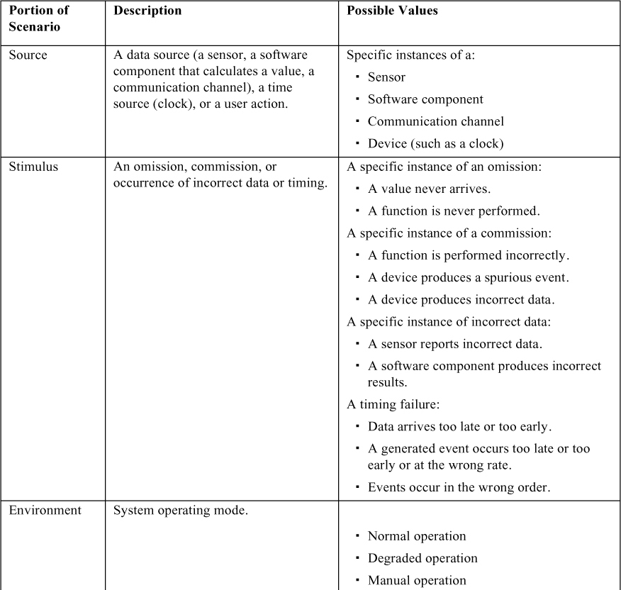
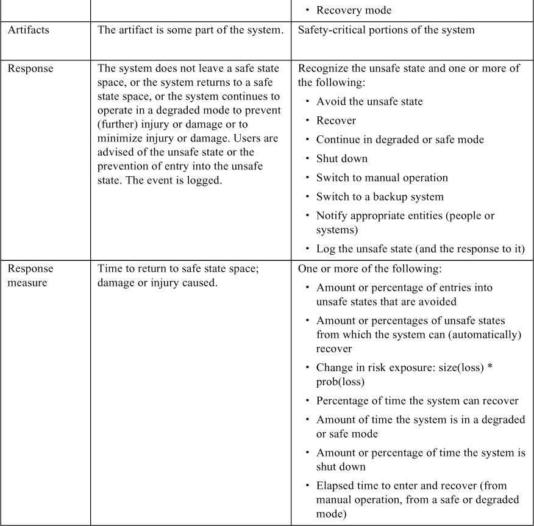
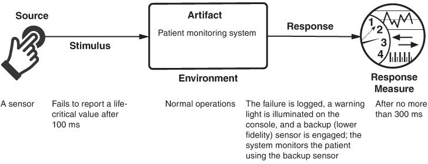
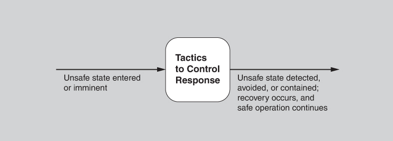
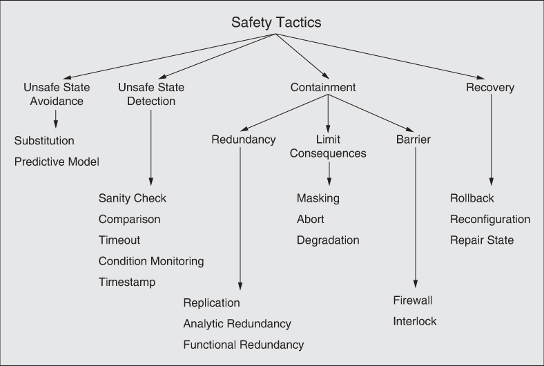
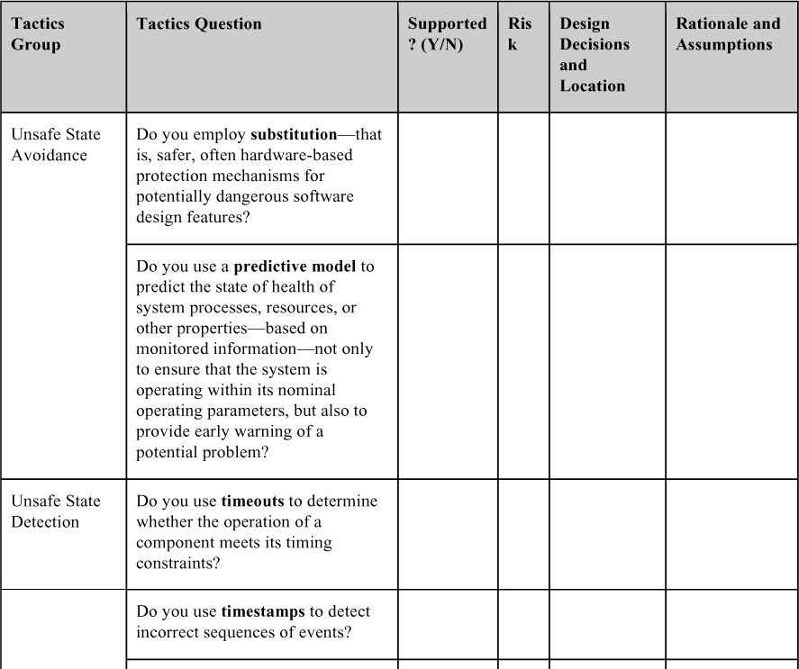
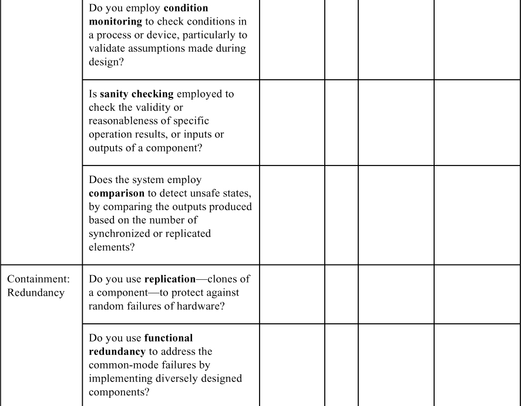
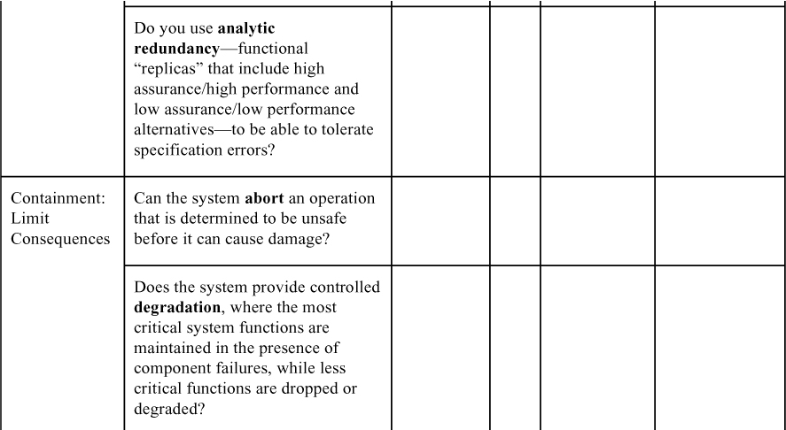
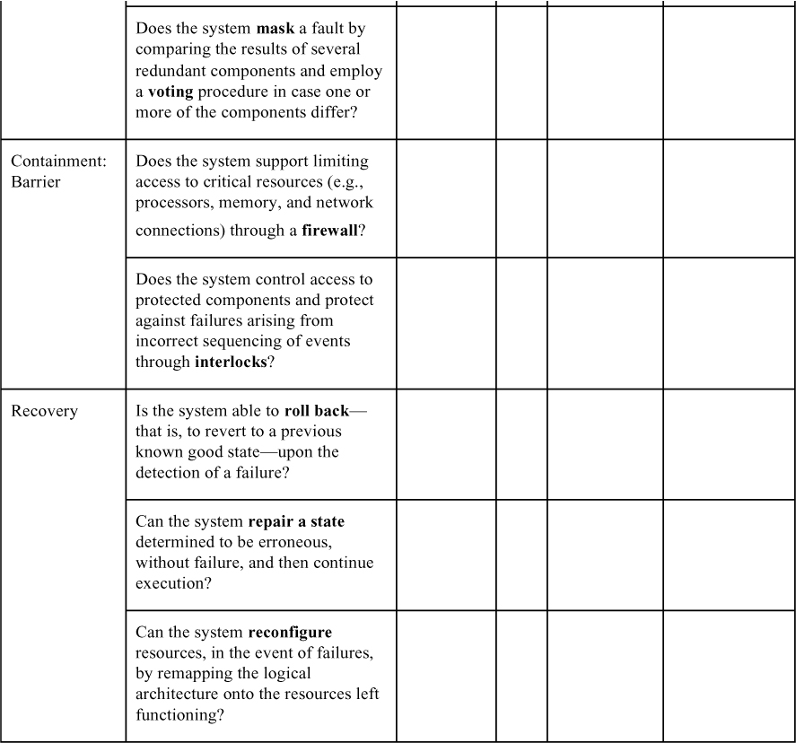

# 10. Safety

> Giles: Này, vì Chúa, hãy cẩn thận… Nếu các cậu bị thương hay bị giết, tôi sẽ phật lòng đấy. 
> Willow: À, bọn cháu cố không để bị giết. Đó là một phần trong toàn bộ tuyên bố sứ mệnh của bọn cháu: Đừng để bị giết. 
> Giles: Tốt. 
> —*Buffy the Vampire Slayer*, Mùa 3, tập “Anne”

“Đừng giết ai cả” nên là một phần trong tuyên bố sứ mệnh của mọi software architect.

Ý nghĩ rằng phần mềm có thể giết người hoặc gây thương tích hay thiệt hại từng thuộc hẳn về thể loại khoa học viễn tưởng computers-run-amok; hãy nghĩ đến HAL lịch sự từ chối mở cửa khoang tàu trong bộ phim now-aged nhưng still-classic *2001: A Space Odyssey,* bỏ Dave mắc kẹt ngoài không gian.

Đáng buồn thay, nó đã không ở yên đó. Khi phần mềm ngày càng điều khiển nhiều thiết bị hơn trong cuộc sống của chúng ta, software safety đã trở thành một mối quan tâm then chốt.

Ý nghĩ rằng phần mềm (những chuỗi số 0 và 1) có thể giết người, gây tàn tật hay phá hủy vẫn là một khái niệm thiếu tự nhiên. Công bằng mà nói, không phải các số 0 và 1 gây ra tai họa—ít nhất là không trực tiếp. Mà là những thứ chúng được kết nối tới. Phần mềm, và chiếc máy tính mà nó chạy trên đó, phải được kết nối với thế giới bên ngoài theo cách nào đó thì mới có thể gây hại. Đó là tin tốt. Tin xấu là tin tốt đó cũng không tốt đến thế. Phần mềm *luôn* được kết nối với thế giới bên ngoài. Nếu chương trình của bạn hoàn toàn không có tác động nào quan sát được bên ngoài chính nó, có lẽ nó chẳng phục vụ mục đích gì.

Năm 2009, một nhân viên của nhà máy thủy điện Shushenskaya đã dùng một mạng máy tính để kích hoạt từ xa—và một cách vô tình—một tuabin không sử dụng chỉ bằng vài lần gõ phím nhầm. Tuabin đang offline đã tạo ra một “water hammer” (búa nước) làm ngập rồi phá hủy nhà máy và giết chết hàng chục công nhân.

Còn nhiều ví dụ khét tiếng không kém khác. Vụ quá liều bức xạ chết người của Therac 25, vụ nổ Ariane 5, và hàng trăm tai nạn ít được biết đến hơn đều gây ra thiệt hại vì máy tính được kết nối với môi trường: một tuabin, một máy phát X-ray, và hệ thống điều khiển lái của một tên lửa, trong các ví dụ vừa nêu. Virus Stuxnet khét tiếng được tạo ra để cố ý gây thiệt hại và phá hủy. Trong những trường hợp này, phần mềm đã ra lệnh cho phần cứng nào đó trong môi trường của nó thực hiện một hành động thảm khốc, và phần cứng đã tuân lệnh. Actuator là các thiết bị kết nối phần cứng với phần mềm; chúng là cây cầu giữa thế giới của các số 0 và 1 với thế giới của chuyển động và điều khiển. Gửi một giá trị số tới một actuator (hoặc ghi một chuỗi bit vào hardware register tương ứng với actuator) và giá trị đó được chuyển thành một hành động cơ học nào đó, dù tốt hay xấu.

Nhưng kết nối với thế giới bên ngoài không nhất thiết phải là cánh tay robot, máy ly tâm uranium hay bệ phóng tên lửa: Kết nối với một màn hình hiển thị đơn giản là đủ. Đôi khi tất cả những gì máy tính phải làm là gửi thông tin sai cho người vận hành. Tháng Chín năm 1983, một vệ tinh Liên Xô gửi dữ liệu về máy tính của hệ thống mặt đất, và máy tính diễn giải dữ liệu đó là một tên lửa được phóng từ Hoa Kỳ nhắm vào Moscow. Vài giây sau, máy tính báo cáo một tên lửa thứ hai đang bay. Chẳng bao lâu sau, tên lửa thứ ba, rồi thứ tư, rồi thứ năm xuất hiện. Trung tá Stanislav Yevgrafovich Petrov của Lực lượng Tên lửa Chiến lược Liên Xô đã đưa ra quyết định đáng kinh ngạc là bỏ qua các máy tính, tin rằng chúng đang lỗi. Ông cho rằng cực kỳ khó có khả năng Hoa Kỳ chỉ bắn vài tên lửa, qua đó mời gọi sự trả đũa hủy diệt hàng loạt. Ông quyết định chờ xem, để biết liệu các tên lửa có thật không—tức là, để xem thủ đô của đất nước mình có sắp bị thiêu rụi không. Như chúng ta biết, điều đó đã không xảy ra. Hệ thống Liên Xô đã nhầm một điều kiện ánh sáng mặt trời hiếm gặp với tên lửa đang bay. Bạn và/hoặc cha mẹ bạn rất có thể nợ Trung tá Petrov mạng sống của mình.

Tất nhiên, không phải lúc nào con người cũng làm đúng khi máy tính làm sai. Vào đêm giông bão ngày 1 tháng Sáu, 2009, chuyến bay 447 của Air France từ Rio de Janeiro đến Paris đã lao xuống Đại Tây Dương, giết chết toàn bộ 228 người trên máy bay, dù động cơ và hệ thống điều khiển bay của máy bay hoạt động hoàn hảo. Hộp đen của chiếc Airbus A-330, vốn chỉ được tìm thấy vào tháng Năm 2011, cho thấy các phi công không hề biết rằng máy bay đã rơi vào tình trạng mất lực nâng (stall) ở high-altitude. Các cảm biến đo tốc độ không khí đã bị băng làm tắc và do đó không đáng tin cậy; hệ quả là chế độ lái tự động tự ngắt. Các phi công nghĩ rằng máy bay đang bay quá nhanh (và có nguy cơ hỏng cấu trúc) trong khi thực tế nó đang bay quá chậm (và đang rơi). Trong suốt cú lao xuống 3-minute-plus từ độ cao 35,000 feet, các phi công liên tục cố kéo mũi máy bay lên và giảm ga để giảm tốc độ, trong khi tất cả những gì họ cần làm là hạ mũi xuống để tăng tốc độ và trở lại bay bình thường. Rất có thể điều làm tăng thêm sự bối rối là cách hệ thống cảnh báo stall của A-330 hoạt động. Khi hệ thống phát hiện stall, nó phát ra một cảnh báo âm thanh lớn. Phần mềm tắt cảnh báo stall khi nó “cho rằng” các số đo góc tấn là không hợp lệ. Điều này có thể xảy ra khi số đọc tốc độ không khí rất thấp. Đó là điều đã xảy ra với AF447: Tốc độ tiến của nó giảm xuống dưới 60 hải lý/giờ, và góc tấn cực kỳ cao. Hệ quả của quy tắc trong phần mềm điều khiển bay này là cảnh báo stall tắt rồi bật nhiều lần. Tệ hơn, nó bật lên mỗi khi phi công đẩy cần lái về phía trước (làm tăng tốc độ không khí và đưa số đọc vào khoảng “hợp lệ”, nhưng vẫn đang stall) rồi tắt khi anh ta kéo cần về. Tức là, làm đúng lại dẫn đến phản hồi hoàn toàn sai, và ngược lại. Đây là một hệ thống không an toàn, hay là một hệ thống an toàn được vận hành không an toàn? Rốt cuộc, những câu hỏi như thế này được quyết định tại tòa án.

Khi ấn bản này sắp được xuất bản, Boeing vẫn đang lao đao vì việc dòng máy bay 737 MAX của họ bị cấm bay sau hai vụ rơi có vẻ được gây ra ít nhất một phần bởi một phần mềm gọi là MCAS, phần mềm này đã đẩy mũi máy bay xuống vào sai thời điểm. Các cảm biến bị lỗi dường như cũng liên quan ở đây, cũng như một quyết định thiết kế khó hiểu khiến phần mềm chỉ dựa vào một cảm biến để xác định hành vi của nó, thay vì hai cảm biến có trên máy bay. Có vẻ như Boeing cũng chưa bao giờ kiểm thử phần mềm đó trong điều kiện một cảm biến bị hỏng. Công ty có cung cấp một cách để vô hiệu hóa hệ thống trong khi bay, dù việc nhớ cách làm điều đó khi máy bay của bạn đang cố hết sức để giết bạn có thể là đòi hỏi quá nhiều đối với tổ bay—đặc biệt khi họ chưa bao giờ được thông báo về sự tồn tại của MCAS ngay từ đầu. Tổng cộng, 346 người đã chết trong hai vụ rơi 737 MAX.

Được rồi, đủ chuyện đáng sợ rồi. Hãy nói về các nguyên lý đằng sau chúng khi chúng ảnh hưởng đến phần mềm và architecture.

Safety quan tâm đến khả năng của một hệ thống tránh đi lạc vào các trạng thái gây ra hoặc dẫn đến thiệt hại, thương tích hoặc mất mạng cho các tác nhân trong môi trường của nó. Những trạng thái không an toàn này có thể được gây ra bởi nhiều yếu tố:

- *Omission* (bỏ sót: một sự kiện lẽ ra phải xảy ra nhưng không xảy ra).
- *Commission* (thực hiện thừa: sự xuất hiện giả mạo của một sự kiện không mong muốn). Sự kiện có thể chấp nhận được ở một số trạng thái hệ thống nhưng không mong muốn ở các trạng thái khác.
- *Timing.* Thời điểm sớm (sự kiện xảy ra trước thời điểm yêu cầu) hoặc muộn (sự kiện xảy ra sau thời điểm yêu cầu) đều có thể gây ra vấn đề.
- *Vấn đề với giá trị của hệ thống (Problems with system values)*. Chúng thuộc hai loại: Giá trị sai thô (coarse) là sai nhưng có thể phát hiện được, trong khi giá trị sai tinh vi (subtle) thường không thể phát hiện được.
- *Sequence omission và commission*. Trong một chuỗi sự kiện, hoặc một sự kiện bị thiếu (omission) hoặc một sự kiện không mong đợi bị chèn vào (commission).
- *Sai thứ tự (Out of sequence)*. Một chuỗi sự kiện đến, nhưng không theo thứ tự quy định.

Safety cũng quan tâm đến việc phát hiện và phục hồi từ những trạng thái không an toàn này để ngăn chặn hoặc ít nhất giảm thiểu thiệt hại gây ra.

Bất kỳ phần nào của hệ thống cũng có thể dẫn đến một trạng thái không an toàn: Phần mềm, các phần cứng, hoặc môi trường có thể hành xử theo cách không lường trước, không an toàn. Một khi phát hiện một trạng thái không an toàn, các response có thể có của hệ thống tương tự như những response đã được liệt kê cho availability (trong [Chương 4](ch04_availability.vi.md#ch04)). Trạng thái không an toàn nên được nhận ra và hệ thống nên được đưa về an toàn, thông qua:

- Tiếp tục hoạt động sau khi phục hồi từ trạng thái không an toàn hoặc đặt hệ thống vào một chế độ an toàn (safe mode), hoặc
- Tắt máy (fail safe), hoặc
- Chuyển sang một trạng thái đòi hỏi vận hành thủ công (ví dụ: lái thủ công nếu trợ lực lái của xe hơi bị hỏng).

Ngoài ra, trạng thái không an toàn nên được báo cáo ngay lập tức và/hoặc được ghi log.

Thiết kế architecture cho safety bắt đầu bằng việc xác định các chức năng safety-critical của hệ thống—những chức năng có thể gây hại như vừa nêu—bằng các kỹ thuật như failure mode and effects analysis (FMEA; còn gọi là hazard analysis) và fault tree analysis (FTA). FTA là một cách tiếp cận suy diễn top-down để xác định các failure có thể dẫn đến việc đưa hệ thống vào một trạng thái không an toàn. Một khi các failure đã được xác định, kiến trúc sư cần thiết kế các cơ chế để phát hiện và giảm thiểu fault (và cuối cùng là hazard).

Các kỹ thuật được trình bày trong chương này nhằm khám phá các hazard có thể phát sinh từ việc vận hành hệ thống và giúp tạo ra các chiến lược để đối phó với những hazard này.

## 10.1 General scenario cho safety (Safety General Scenario)

Với nền tảng này, chúng ta có thể xây dựng general scenario cho safety, được trình bày trong [Bảng 10.1](#ch10tab01).

**Bảng 10.1** *General scenario cho safety*

Một ví dụ về safety scenario là: *Một cảm biến trong hệ thống theo dõi bệnh nhân không báo cáo một giá trị life-critical sau 100 ms. Failure được ghi log, một đèn cảnh báo sáng lên trên console, và một cảm biến dự phòng (lower-fidelity) được kích hoạt. Hệ thống theo dõi bệnh nhân bằng cảm biến dự phòng sau không quá 300 ms.* [Hình 10.1](#ch10fig01) minh họa scenario này.

**Hình 10.1** *Ví dụ về concrete safety scenario*

## 10.2 Các tactic cho safety (Tactics for Safety)

Các safety tactic có thể được phân loại rộng thành tránh trạng thái không an toàn (unsafe state avoidance), phát hiện trạng thái không an toàn (unsafe state detection), hoặc khắc phục trạng thái không an toàn (unsafe state remediation). [Hình 10.2](#ch10fig02) cho thấy mục tiêu của tập safety tactic.

**Hình 10.2** *Mục tiêu của các safety tactic*

Một điều kiện tiên quyết hợp lý để tránh hoặc phát hiện việc đi vào một trạng thái không an toàn là khả năng nhận ra điều gì cấu thành một trạng thái không an toàn. Các tactic sau giả định có năng lực đó, nghĩa là bạn nên tự thực hiện hazard analysis hoặc FTA một khi đã có architecture trong tay. Bản thân các quyết định thiết kế của bạn có thể đã đưa vào những lỗ hổng safety mới chưa được tính đến trong quá trình phân tích yêu cầu.

Bạn sẽ nhận thấy có sự chồng lấn đáng kể giữa các tactic được trình bày ở đây và các tactic được trình bày trong [Chương 4](ch04_availability.vi.md#ch04) về availability. Sự chồng lấn này xảy ra vì các vấn đề availability thường có thể dẫn đến các vấn đề safety, và vì nhiều giải pháp thiết kế để sửa chữa các vấn đề này được dùng chung giữa các chất lượng.

[Hình 10.3](#ch10fig03) tóm tắt các architectural tactic để đạt được safety.

**Hình 10.3** *Các safety tactic*

### Tránh trạng thái không an toàn (Unsafe State Avoidance)

#### Thay thế (Substitution)

Tactic này dùng các cơ chế bảo vệ—thường là hardware-based—cho các đặc điểm thiết kế phần mềm có khả năng nguy hiểm. Ví dụ, các thiết bị bảo vệ phần cứng như watchdog, monitor và interlock có thể được dùng thay cho các phiên bản phần mềm. Các phiên bản phần mềm của những cơ chế này có thể bị thiếu tài nguyên, trong khi một thiết bị phần cứng riêng biệt tự cung cấp và kiểm soát tài nguyên của nó. Substitution thường chỉ có lợi khi chức năng được thay thế tương đối đơn giản.

#### Predictive model (Predictive Model)

Tactic predictive model, như đã giới thiệu trong [Chương 4](ch04_availability.vi.md#ch04), dự đoán tình trạng sức khỏe của các process, tài nguyên hoặc thuộc tính khác của hệ thống (dựa trên việc giám sát trạng thái) không chỉ để bảo đảm hệ thống đang hoạt động trong các tham số vận hành danh nghĩa của nó, mà còn để cảnh báo sớm về một vấn đề tiềm ẩn. Ví dụ, một số hệ thống cruise control trên ô tô tính tốc độ tiến lại gần giữa xe và một chướng ngại vật (hoặc một xe khác) phía trước và cảnh báo tài xế trước khi khoảng cách và thời gian trở nên quá nhỏ để tránh va chạm. Một predictive model thường được kết hợp với condition monitoring, mà chúng tôi sẽ thảo luận sau.

### Phát hiện trạng thái không an toàn (Unsafe State Detection)

#### Timeout

Tactic timeout được dùng để xác định liệu hoạt động của một component có đáp ứng các ràng buộc về thời gian của nó hay không. Điều này có thể được hiện thực dưới dạng phát sinh một exception, để chỉ ra failure của một component nếu các ràng buộc về thời gian của nó không được đáp ứng. Do đó, tactic này có thể phát hiện các failure về thời điểm muộn và bỏ sót. Timeout là một tactic đặc biệt phổ biến trong các hệ thống real-time hoặc nhúng và các hệ thống phân tán. Nó liên quan đến các availability tactic system monitor, heartbeat và ping-echo.

#### Timestamp

Như đã mô tả trong [Chương 4](ch04_availability.vi.md#ch04), tactic timestamp được dùng để phát hiện các chuỗi sự kiện sai thứ tự, chủ yếu trong các hệ thống message-passing phân tán. Timestamp của một sự kiện có thể được thiết lập bằng cách gán trạng thái của một đồng hồ cục bộ cho sự kiện ngay sau khi sự kiện xảy ra. Số thứ tự cũng có thể được dùng cho mục đích này, vì timestamp trong một hệ thống phân tán có thể không nhất quán giữa các processor khác nhau.

#### Condition monitoring (Condition Monitoring)

Tactic này bao gồm việc kiểm tra các điều kiện trong một process hoặc thiết bị, hoặc xác nhận các giả định được đưa ra trong quá trình thiết kế, có thể bằng cách dùng assertion. Condition monitoring xác định các trạng thái hệ thống có thể dẫn đến hành vi nguy hiểm. Tuy nhiên, monitor nên đơn giản (và, lý tưởng là có thể chứng minh được) để bảo đảm rằng nó không đưa vào các lỗi phần mềm mới hoặc đóng góp đáng kể vào tổng workload. Condition monitoring cung cấp đầu vào cho một predictive model và cho sanity checking.

#### Sanity checking (Sanity Checking)

Tactic sanity checking kiểm tra tính hợp lệ hoặc tính hợp lý của các kết quả thao tác cụ thể, hoặc đầu vào hay đầu ra của một component. Tactic này thường dựa trên kiến thức về thiết kế bên trong, trạng thái của hệ thống, hoặc bản chất của thông tin đang được xem xét. Nó thường được dùng nhất tại các interface, để kiểm tra một luồng thông tin cụ thể.

#### So sánh (Comparison)

Tactic comparison cho phép hệ thống phát hiện các trạng thái không an toàn bằng cách so sánh các đầu ra được tạo ra bởi một số element được đồng bộ hoặc được nhân bản. Do đó, tactic comparison hoạt động cùng với một redundancy tactic, thường là tactic active redundancy được trình bày trong phần thảo luận về availability. Khi số bản sao từ ba trở lên, tactic comparison không chỉ có thể phát hiện một trạng thái không an toàn mà còn chỉ ra component nào đã dẫn đến nó. Comparison liên quan đến tactic voting được dùng trong availability. Tuy nhiên, một phép so sánh không phải lúc nào cũng dẫn đến bỏ phiếu; một lựa chọn khác là đơn giản tắt máy nếu các đầu ra khác nhau.

### Ngăn chặn lan rộng (Containment)

Các tactic containment tìm cách giới hạn thiệt hại gắn với một trạng thái không an toàn đã bị đi vào. Loại này bao gồm ba loại con: redundancy, limit consequences và barrier.

#### Dự phòng (Redundancy)

Thoạt nhìn, các redundancy tactic có vẻ tương tự các tactic sparing/redundancy khác nhau được trình bày trong phần thảo luận về availability. Rõ ràng, các tactic này chồng lấn nhau, nhưng vì mục tiêu của safety và availability khác nhau, việc sử dụng các component dự phòng cũng khác nhau. Trong lĩnh vực safety, redundancy cho phép hệ thống tiếp tục hoạt động trong trường hợp việc tắt hoàn toàn hoặc suy giảm thêm sẽ là điều không mong muốn.

Replication là redundancy tactic đơn giản nhất, vì nó chỉ bao gồm việc có các bản sao của một component. Có nhiều bản sao của các component giống hệt nhau có thể hiệu quả trong việc bảo vệ khỏi các failure ngẫu nhiên của phần cứng, nhưng nó không thể bảo vệ khỏi các lỗi thiết kế hoặc hiện thực trong phần cứng hay phần mềm vì không có dạng đa dạng nào được tích hợp trong tactic này.

Ngược lại, functional redundancy nhằm giải quyết vấn đề các failure common-mode (khi các bản sao thể hiện cùng một fault vào cùng một thời điểm vì chúng có chung implementation) trong các component phần cứng hoặc phần mềm, bằng cách hiện thực sự đa dạng thiết kế. Tactic này cố gắng xử lý bản chất có hệ thống của các fault thiết kế bằng cách thêm sự đa dạng vào dự phòng. Đầu ra của các component dự phòng về chức năng phải giống nhau khi có cùng đầu vào. Tuy nhiên, tactic functional redundancy vẫn dễ bị ảnh hưởng bởi các lỗi đặc tả, và, tất nhiên, các bản sao về chức năng sẽ tốn kém hơn để phát triển và kiểm chứng.

Cuối cùng, tactic analytic redundancy cho phép không chỉ sự đa dạng của các component, mà còn sự đa dạng higher-level có thể nhìn thấy ở mức đầu vào và đầu ra. Hệ quả là nó có thể dung thứ các lỗi đặc tả bằng cách dùng các đặc tả yêu cầu riêng biệt. Analytic redundancy thường bao gồm việc phân chia hệ thống thành phần high assurance và phần high performance (low assurance). Phần high assurance được thiết kế để đơn giản và đáng tin cậy, trong khi phần high performance thường được thiết kế để phức tạp hơn và chính xác hơn, nhưng kém ổn định hơn: Nó thay đổi nhanh hơn, và có thể không đáng tin cậy bằng phần high assurance. (Do đó, ở đây chúng tôi không muốn nói high performance theo nghĩa latency hay throughput; mà là phần này “thực hiện” nhiệm vụ của nó tốt hơn phần high assurance.)

#### Giới hạn hệ quả (Limit Consequences)

Loại con thứ hai của các tactic containment được gọi là limit consequences. Các tactic này đều nhằm giới hạn những tác động xấu có thể phát sinh khi hệ thống đi vào một trạng thái không an toàn.

Tactic abort về mặt khái niệm là đơn giản nhất. Nếu một thao tác được xác định là không an toàn, nó bị hủy bỏ trước khi có thể gây ra thiệt hại. Kỹ thuật này được dùng rộng rãi để bảo đảm các hệ thống thất bại một cách an toàn.

Tactic degradation duy trì các chức năng quan trọng nhất của hệ thống khi có failure của component, loại bỏ hoặc thay thế chức năng theo cách có kiểm soát. Cách tiếp cận này cho phép các failure riêng lẻ của component làm giảm chức năng của hệ thống một cách nhẹ nhàng theo cách đã lên kế hoạch, có chủ đích và an toàn, thay vì gây ra failure toàn bộ hệ thống. Ví dụ, một hệ thống dẫn đường trên ô tô có thể tiếp tục hoạt động bằng một algorithm dead reckoning (kém chính xác hơn) trong một đường hầm dài, nơi nó đã mất tín hiệu vệ tinh GPS.

Tactic masking che giấu một fault bằng cách so sánh kết quả của nhiều component dự phòng và dùng một thủ tục bỏ phiếu trong trường hợp một hoặc nhiều component cho kết quả khác. Để tactic này hoạt động như dự định, voter phải đơn giản và có độ tin cậy cao.

#### Rào chắn (Barrier)

Các tactic barrier khoanh vùng vấn đề bằng cách ngăn chúng lan rộng.

Tactic firewall là một cách hiện thực cụ thể của tactic limit access, được mô tả trong [Chương 11](ch11_security.vi.md#ch11). Một firewall giới hạn truy cập vào các tài nguyên được chỉ định, thường là processor, memory và kết nối mạng.

Tactic interlock bảo vệ khỏi các failure phát sinh từ việc sắp xếp trình tự sự kiện không đúng. Các cách hiện thực tactic này cung cấp các phương án bảo vệ phức tạp bằng cách kiểm soát mọi truy cập vào các component được bảo vệ, bao gồm kiểm soát trình tự đúng của các sự kiện ảnh hưởng đến những component đó.

### Phục hồi (Recovery)

Loại safety tactic cuối cùng là recovery, có tác dụng đưa hệ thống vào một trạng thái an toàn. Nó bao gồm ba tactic: rollback, repair state và reconfiguration.

Tactic rollback cho phép hệ thống quay trở về một bản sao đã lưu của một trạng thái tốt đã biết trước đó—rollback line—khi phát hiện một failure. Tactic này thường được kết hợp với checkpointing và transaction, để bảo đảm rollback là đầy đủ và nhất quán. Một khi đạt được trạng thái tốt, việc thực thi có thể tiếp tục, có thể dùng các tactic khác như retry hoặc degradation để bảo đảm failure không tái diễn.

Tactic repair state sửa chữa một trạng thái lỗi—thực chất là mở rộng tập trạng thái mà một component có thể xử lý một cách thành thạo (tức là không gặp failure)—rồi tiếp tục thực thi. Ví dụ, tính năng hỗ trợ giữ làn đường của xe sẽ giám sát xem tài xế có đang ở trong làn của mình không và chủ động đưa xe trở lại vị trí giữa các vạch kẻ—một trạng thái an toàn—nếu xe trôi ra ngoài. Tactic này không phù hợp làm phương tiện phục hồi từ các fault không lường trước.

Reconfiguration cố gắng phục hồi từ failure của component bằng cách ánh xạ lại logical architecture lên các tài nguyên (có thể bị giới hạn) còn hoạt động. Lý tưởng nhất, việc ánh xạ lại này cho phép duy trì đầy đủ chức năng. Khi điều này không khả thi, hệ thống có thể duy trì một phần chức năng khi kết hợp với tactic degradation.

## 10.3 Questionnaire dựa trên tactic cho safety (Tactics-Based Questionnaire for Safety)

Dựa trên các tactic được mô tả trong [Mục 10.2](#sec10_2), chúng ta có thể tạo một tập câu hỏi tactics-inspired, như được trình bày trong [Bảng 10.2](#ch10tab02). Để có cái nhìn tổng quan về các lựa chọn architecture được đưa ra để hỗ trợ safety, nhà phân tích đặt từng câu hỏi và ghi lại câu trả lời vào bảng. Câu trả lời cho các câu hỏi này sau đó có thể trở thành trọng tâm của các hoạt động tiếp theo: điều tra tài liệu, phân tích code hoặc các artifact khác, reverse engineering code, v.v.

**Bảng 10.2** *Questionnaire tactics-based cho safety*

Trước khi bắt đầu questionnaire tactics-based cho safety, bạn nên đánh giá xem dự án đang được review đã thực hiện hazard analysis hoặc FTA để xác định điều gì cấu thành một trạng thái không an toàn (cần được phát hiện, tránh, khoanh vùng hoặc phục hồi) trong hệ thống của bạn hay chưa. Không có phân tích này, việc thiết kế cho safety có thể sẽ kém hiệu quả hơn.

## 10.4 Các pattern cho safety (Patterns for Safety)

Một hệ thống bất ngờ ngừng hoạt động, hoặc bắt đầu hoạt động sai, hoặc rơi vào một chế độ vận hành suy giảm có khả năng ảnh hưởng tiêu cực đến safety, nếu không muốn nói là thảm khốc. Do đó, nơi đầu tiên để tìm safety pattern là trong các pattern cho availability, chẳng hạn như những pattern được mô tả trong [Chương 4](ch04_availability.vi.md#ch04). Tất cả chúng đều áp dụng ở đây.

- *Redundant sensors*. Nếu dữ liệu do một cảm biến tạo ra là quan trọng để xác định một trạng thái là an toàn hay không an toàn, cảm biến đó nên được nhân bản. Điều này bảo vệ khỏi failure của bất kỳ cảm biến đơn lẻ nào. Ngoài ra, phần mềm độc lập nên giám sát mỗi cảm biến—về bản chất, đó là tactic redundant spare từ [Chương 4](ch04_availability.vi.md#ch04) được áp dụng cho phần cứng safety-critical.

   **Lợi ích:**

- Dạng dự phòng này, được áp dụng cho cảm biến, bảo vệ khỏi failure của một cảm biến đơn lẻ.

   **Các tradeoff:**

- Cảm biến dự phòng làm tăng chi phí của hệ thống, và việc xử lý đầu vào từ nhiều cảm biến phức tạp hơn việc xử lý đầu vào từ một cảm biến duy nhất.
- *Monitor-actuator*. Pattern này tập trung vào hai software element—một monitor và một actuator controller—được dùng trước khi gửi một lệnh tới một actuator vật lý. Actuator controller thực hiện các phép tính cần thiết để xác định các giá trị cần gửi tới actuator vật lý. Monitor kiểm tra tính hợp lý của các giá trị này trước khi gửi chúng đi. Điều này tách việc tính toán giá trị khỏi việc kiểm tra giá trị.

   **Lợi ích:**

- Trong dạng dự phòng này được áp dụng cho việc điều khiển actuator, monitor đóng vai trò một bước kiểm tra dự phòng đối với các phép tính của actuator controller.

   **Các tradeoff:**

- Việc phát triển và bảo trì monitor tốn thời gian và tài nguyên.
- Do sự tách biệt mà pattern này đạt được giữa điều khiển actuator và giám sát, tradeoff cụ thể này dễ điều chỉnh bằng cách làm cho monitor đơn giản (dễ tạo ra nhưng có thể bỏ sót lỗi) hoặc tinh vi (phức tạp hơn nhưng bắt được nhiều lỗi hơn) tùy theo nhu cầu.
- *Separated safety*. Safety-critical system thường phải được một cơ quan có thẩm quyền chứng nhận là an toàn. Chứng nhận một hệ thống lớn là tốn kém, nhưng việc chia hệ thống thành các phần safety-critical và các phần non-safety-critical có thể giảm những chi phí đó. Phần safety-critical vẫn phải được chứng nhận. Tương tự, việc phân chia thành các phần safety-critical và non-critical phải được chứng nhận để bảo đảm rằng không có ảnh hưởng nào từ phần non-safety-critical lên phần safety-critical.

   **Lợi ích:**

- Chi phí chứng nhận hệ thống được giảm vì bạn chỉ cần chứng nhận một phần (thường là nhỏ) của toàn bộ hệ thống.
- Lợi ích về chi phí và safety được tích lũy vì công sức tập trung vào chỉ những phần của hệ thống liên quan đến safety.

   **Các tradeoff:**

- Công việc thực hiện việc tách biệt có thể tốn kém, chẳng hạn như lắp đặt hai mạng khác nhau trong một hệ thống để phân chia các message safety-critical và non-safety-critical. Tuy nhiên, cách tiếp cận này hạn chế rủi ro và hệ quả của việc bug trong phần non-safety-critical ảnh hưởng đến phần safety-critical.
- Việc tách hệ thống và thuyết phục cơ quan chứng nhận rằng việc tách đã được thực hiện đúng và không có ảnh hưởng nào từ phần non-safety-critical lên phần safety-critical là khó khăn, nhưng dễ hơn nhiều so với phương án thay thế: để cơ quan chứng nhận mọi thứ ở cùng một mức nghiêm ngặt.

> **Các mức bảo đảm thiết kế (Design Assurance Levels)**
>
> Pattern separated safety nhấn mạnh việc chia hệ thống phần mềm thành các phần safety-critical và các phần non-safety-critical. Trong avionics, sự phân biệt finer-grained hơn. DO-178C, “Software Considerations in Airborne Systems and Equipment Certification”, là tài liệu chính mà các cơ quan chứng nhận như Federal Aviation Administration (FAA), European Union Aviation Safety Agency (EASA) và Transport Canada dựa vào để phê duyệt mọi hệ thống hàng không vũ trụ software-based thương mại. Nó định nghĩa một thang xếp hạng gọi là Design Assurance Level (DAL) cho mỗi software function. DAL được xác định từ quá trình đánh giá safety và hazard analysis bằng cách xem xét tác động của một điều kiện failure trong hệ thống. Các điều kiện failure được phân loại theo tác động của chúng lên máy bay, tổ bay và hành khách:
>
> - *A: Catastrophic (thảm khốc).* Failure có thể gây ra tử vong, thường kèm theo mất máy bay.
>
> - *B: Hazardous (nguy hiểm).* Failure có tác động tiêu cực lớn lên safety hoặc performance, hoặc làm giảm khả năng điều khiển máy bay của tổ bay do căng thẳng thể chất hoặc workload cao hơn, hoặc gây thương tích nghiêm trọng hoặc tử vong cho hành khách.
>
> - *C: Major (lớn).* Failure làm giảm đáng kể biên safety hoặc tăng đáng kể workload của tổ bay, và có thể gây khó chịu cho hành khách (hoặc thậm chí thương tích nhẹ).
>
> - *D: Minor (nhỏ).* Failure làm giảm nhẹ biên safety hoặc tăng nhẹ workload của tổ bay. Các ví dụ có thể bao gồm gây bất tiện cho hành khách hoặc một thay đổi kế hoạch bay thông thường.
>
> - *E: No effect (không ảnh hưởng).* Failure không có tác động lên safety, vận hành máy bay hay workload của tổ bay.
>
> Việc kiểm chứng và kiểm thử phần mềm là một nhiệm vụ cực kỳ tốn kém, được thực hiện với ngân sách rất hữu hạn. DAL giúp bạn quyết định đặt nguồn lực kiểm thử hạn chế của mình vào đâu. Lần tới khi bạn đi một chuyến bay thương mại, nếu bạn thấy hệ thống giải trí trục trặc hoặc đèn đọc sách của bạn cứ nhấp nháy tắt, hãy yên tâm khi nghĩ đến tất cả số tiền kiểm chứng đã được chi để bảo đảm hệ thống điều khiển bay hoạt động hoàn toàn tốt.
>
> —PC

## 10.5 Đọc thêm (For Further Reading)

Để thấy được tầm quan trọng của software safety, chúng tôi gợi ý đọc một số câu chuyện thảm họa phát sinh khi phần mềm thất bại. Một nguồn lâu đời là ACM Risks Forum, có tại [risks.org](http://risks.org/). Diễn đàn này đã được Peter Neumann điều hành từ năm 1985 và vẫn đang hoạt động mạnh mẽ.

Hai *quy trình* safety tiêu chuẩn nổi bật được mô tả trong ARP-4761, “Guidelines and Methods for Conducting the Safety Assessment Process on Civil Airborne Systems and Equipment”, do SAE International phát triển, và MIL STD 882E, “Standard Practice: System Safety”, do Bộ Quốc phòng Hoa Kỳ phát triển.

Wu và Kelly [Wu 04] đã công bố một tập safety tactic vào năm 2004, dựa trên một khảo sát các cách tiếp cận architecture hiện có, và nó đã truyền cảm hứng cho phần lớn tư duy trong chương này.

Nancy Leveson là một người dẫn dắt tư tưởng trong lĩnh vực phần mềm và safety. Nếu bạn đang làm việc với các hệ thống safety-critical, bạn nên làm quen với công trình của bà. Bạn có thể bắt đầu từ những thứ nhỏ với một bài báo như [Leveson 04], thảo luận một số yếu tố software-related đã góp phần gây ra các tai nạn tàu vũ trụ. Hoặc bạn có thể bắt đầu từ đỉnh với [Leveson 11], một cuốn sách xem xét safety trong bối cảnh các hệ thống phức tạp, socio-technical, software-intensive ngày nay.

Federal Aviation Administration là cơ quan chính phủ Hoa Kỳ chịu trách nhiệm giám sát hệ thống không phận Hoa Kỳ, và cực kỳ quan tâm đến safety. *System Safety Handbook* năm 2019 của cơ quan này là một tổng quan thực tế tốt về chủ đề này. [Chương 10](#ch10) của cuốn sổ tay này đề cập đến software safety. Bạn có thể tải nó từ [faa.gov/regulations_policies/handbooks_manuals/aviation/risk_management/ss_handbook/](http://faa.gov/regulations_policies/handbooks_manuals/aviation/risk_management/ss_handbook/).

Phil Koopman nổi tiếng trong lĩnh vực safety ô tô. Ông có một số bài hướng dẫn trực tuyến đề cập đến các safety-critical pattern. Ví dụ, xem [youtube.com/watch?v=JA5wdyOjoXg](http://youtube.com/watch?v=JA5wdyOjoXg) và [youtube.com/watch?v=4Tdh3jq6W4Y](http://youtube.com/watch?v=4Tdh3jq6W4Y). Cuốn sách của Koopman, *Better Embedded System Software*, cung cấp nhiều chi tiết hơn về các safety pattern [Koopman 10].

Fault tree analysis có từ early 1960s, nhưng nguồn tài liệu “ông tổ” cho nó là *Fault Tree Handbook* của U.S. Nuclear Regulatory Commission, xuất bản năm 1981. *Fault Tree Handbook with Aerospace Applications* năm 2002 của NASA là một tài liệu nhập môn toàn diện cập nhật từ sổ tay của NRC. Cả hai đều có sẵn trực tuyến dưới dạng file PDF có thể tải xuống.

Tương tự như Design Assurance Level, Safety Integrity Level (SIL) cung cấp các định nghĩa về mức độ safety-critical của các chức năng khác nhau. Những định nghĩa này tạo ra sự hiểu biết chung giữa các kiến trúc sư tham gia thiết kế hệ thống, đồng thời hỗ trợ việc đánh giá safety. Tiêu chuẩn IEC 61508 có tựa đề “Functional Safety of Electrical/Electronic/Programmable Electronic Safety-related Systems” định nghĩa bốn SIL, trong đó SIL 4 là đáng tin cậy nhất và SIL 1 là kém đáng tin cậy nhất. Tiêu chuẩn này được cụ thể hóa thông qua các tiêu chuẩn domain-specific như IEC 62279 cho ngành đường sắt, có tựa đề “Railway Applications: Communication, Signaling and Processing Systems: Software for Railway Control and Protection Systems”.

Trong một thế giới mà xe semi-autonomous và xe tự hành là chủ đề của rất nhiều hoạt động nghiên cứu và phát triển, functional safety ngày càng trở nên nổi bật. Trong một thời gian dài, ISO 26026 đã là tiêu chuẩn về functional safety của phương tiện giao thông đường bộ. Cũng có một làn sóng các chuẩn mực mới như ANSI/UL 4600, “Standard for Safety for the Evaluation of Autonomous Vehicles and Other Products”, giải quyết những thách thức nảy sinh khi phần mềm cầm lái, theo cả nghĩa bóng lẫn nghĩa đen.

## 10.6 Câu hỏi thảo luận (Discussion Questions)

1. Hãy liệt kê 10 thiết bị computer-controlled là một phần trong cuộc sống hằng ngày của bạn hiện nay, và giả định những cách mà một hệ thống độc hại hoặc trục trặc có thể dùng chúng để làm hại bạn.
2. Hãy viết một safety scenario được thiết kế để ngăn một thiết bị robot cố định (chẳng hạn như một cánh tay lắp ráp trên dây chuyền sản xuất) làm bị thương ai đó, và thảo luận các tactic để đạt được nó.
3. Máy bay chiến đấu F/A-18 Hornet của Hải quân Hoa Kỳ là một trong những ứng dụng đầu tiên của công nghệ fly-by-wire, trong đó các máy tính trên máy bay gửi lệnh số tới các bề mặt điều khiển (cánh liệng, bánh lái, v.v.) dựa trên đầu vào của phi công trên cần lái và bàn đạp bánh lái. Phần mềm điều khiển bay được lập trình để ngăn phi công ra lệnh thực hiện một số động tác cơ động dữ dội có thể khiến máy bay đi vào một chế độ bay không an toàn. Trong giai đoạn bay thử nghiệm ban đầu, vốn thường bao gồm việc đẩy máy bay đến (và vượt quá) các giới hạn tối đa của nó, một chiếc máy bay đã rơi vào một trạng thái không an toàn và “các động tác cơ động dữ dội” chính là những gì cần thiết để cứu nó—nhưng các máy tính đã ngăn chúng một cách mẫn cán. Chiếc máy bay đã lao xuống biển vì phần mềm được thiết kế để giữ cho nó an toàn. Hãy viết một safety scenario để giải quyết tình huống này, và thảo luận các tactic lẽ ra đã ngăn được kết cục này.
4. Theo [slate.com](http://slate.com/) và các nguồn khác, một cô gái tuổi teen ở Đức “đã phải đi trốn sau khi cô quên đặt lời mời sinh nhật trên Facebook của mình ở chế độ riêng tư và vô tình mời cả Internet. Sau khi 15,000 người xác nhận sẽ đến, cha mẹ cô gái đã hủy bữa tiệc, báo cảnh sát, và thuê bảo vệ tư nhân canh gác nhà mình.” Dù vậy, vẫn có một nghìn năm trăm người xuất hiện, dẫn đến một số vụ bị thương nhẹ và hỗn loạn không kể xiết. Facebook có không an toàn không? Hãy thảo luận.
5. Hãy viết một safety scenario để bảo vệ cô gái kém may mắn ở Đức khỏi Facebook.
6. Ngày 25 tháng Hai, 1991, trong Chiến tranh Vùng Vịnh, một khẩu đội tên lửa Patriot của Hoa Kỳ đã không đánh chặn được một tên lửa Scud đang bay tới, tên lửa này đã đánh trúng một doanh trại, giết chết 28 binh sĩ và làm bị thương hàng chục người. Nguyên nhân của failure là một phép tính không chính xác về thời gian kể từ lúc khởi động, do các lỗi số học trong phần mềm tích lũy theo thời gian. Hãy viết một safety scenario giải quyết failure của Patriot và thảo luận các tactic có thể đã ngăn chặn được nó.
7. Tác giả James Gleick (“A Bug and a Crash”, [around.com/ariane.html](http://around.com/ariane.html)) viết rằng “Cơ quan Vũ trụ Châu Âu đã mất 10 năm và $7 tỷ để tạo ra Ariane 5, một tên lửa khổng lồ có khả năng phóng một cặp vệ tinh three-ton vào quỹ đạo trong mỗi lần phóng. … Tất cả những gì cần để làm nổ tung tên lửa đó chưa đầy một phút sau khi bắt đầu chuyến bay đầu tiên … là một chương trình máy tính nhỏ cố nhét một số 64-bit vào một không gian 16-bit. Một bug, một vụ nổ. Trong tất cả những dòng code cẩu thả được ghi lại trong biên niên sử của khoa học máy tính, dòng này có thể là dòng có hiệu quả tàn phá khủng khiếp nhất.” Hãy viết một safety scenario giải quyết thảm họa Ariane 5, và thảo luận các tactic có thể đã ngăn chặn được nó.
8. Hãy thảo luận cách bạn nghĩ safety có xu hướng “đánh đổi” với các quality attribute performance, availability và interoperability.
9. Hãy thảo luận mối quan hệ giữa safety và testability.
10. Mối quan hệ giữa safety và modifiability là gì?
11. Với câu chuyện chuyến bay 447 của Air France trong đầu, hãy thảo luận mối quan hệ giữa safety và usability.
12. Hãy tạo một danh sách fault hoặc một fault tree cho một máy rút tiền tự động. Hãy bao gồm các fault liên quan đến failure của component phần cứng, failure giao tiếp, failure phần mềm, cạn vật tư, lỗi người dùng và các cuộc tấn công security. Bạn sẽ dùng các tactic như thế nào để đối phó với những fault này?
