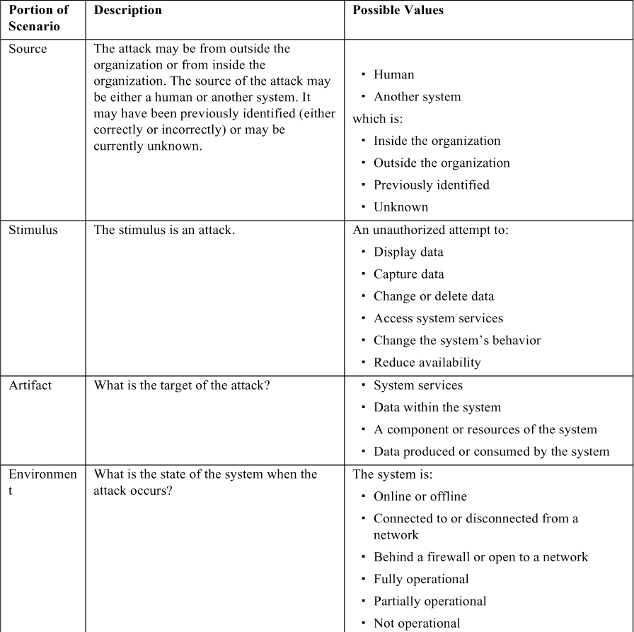
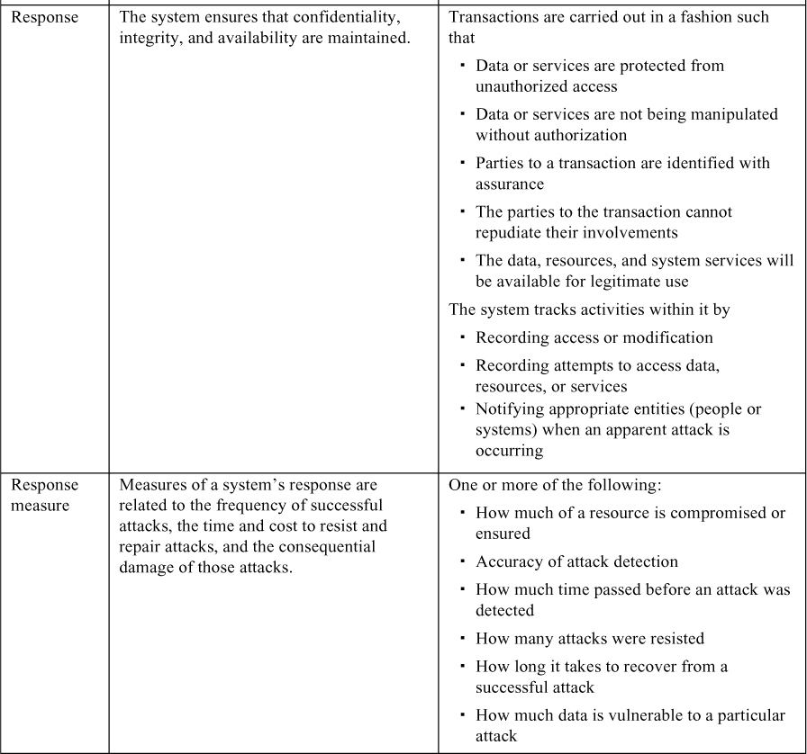
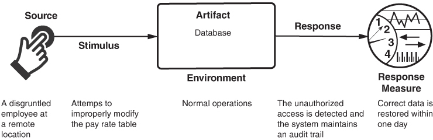
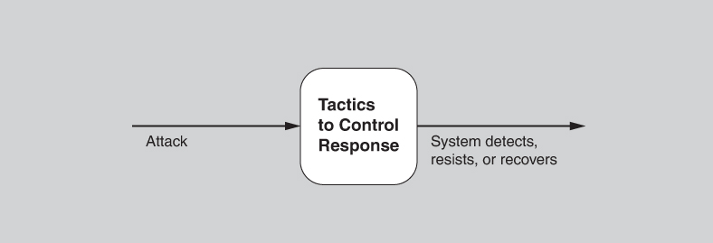
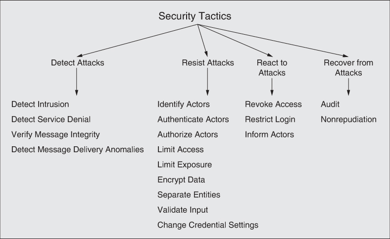
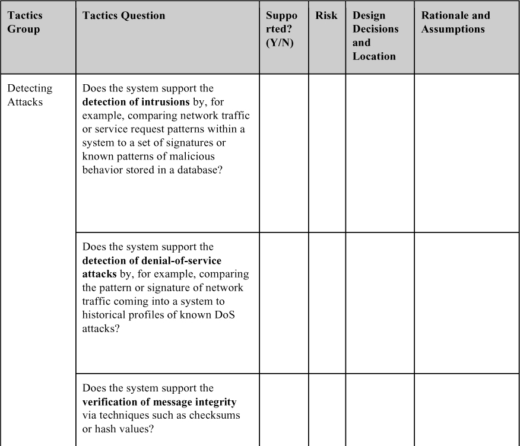
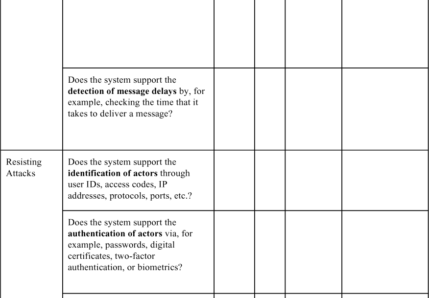
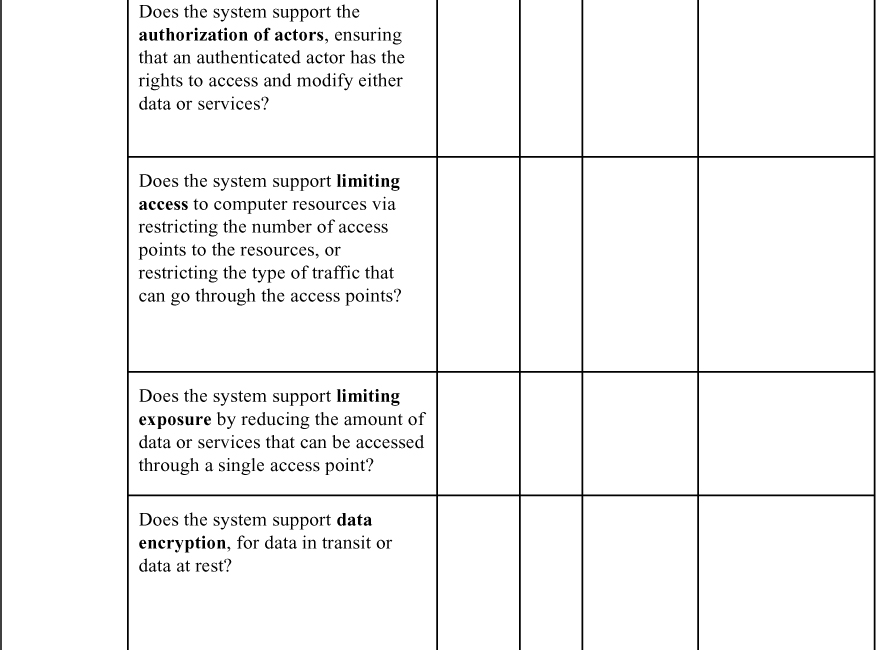
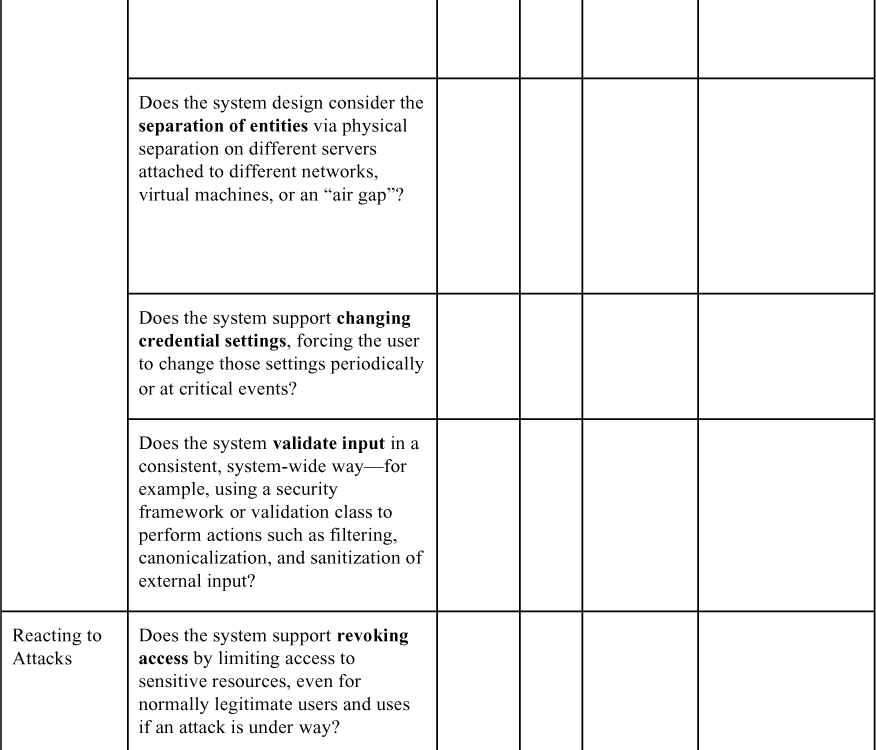
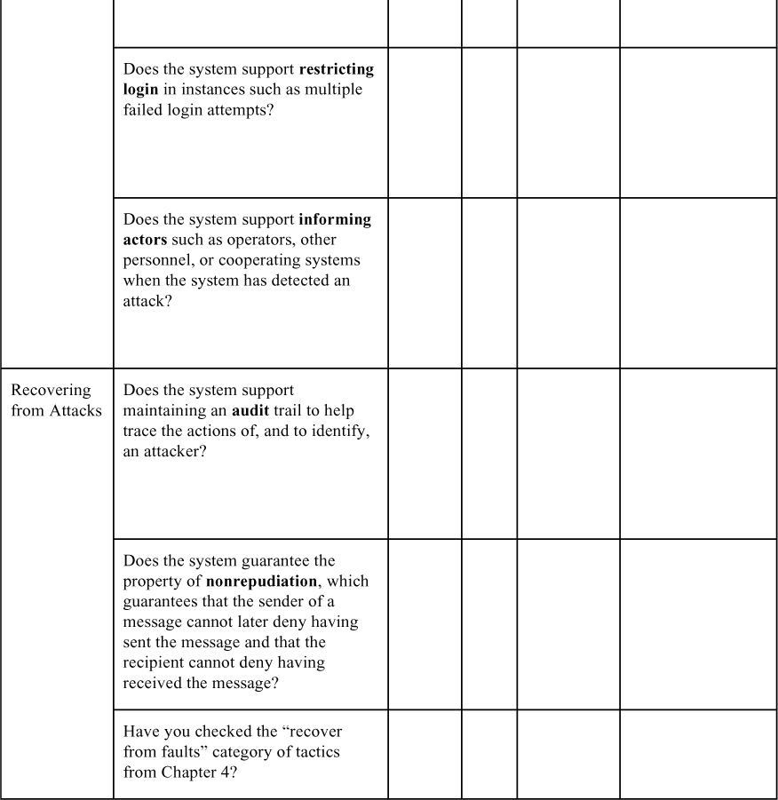

# 11. Security

> Nếu bạn tiết lộ bí mật của mình cho gió, bạn không nên trách gió đã tiết lộ chúng cho cây. 
> —Kahlil Gibran

Security là thước đo khả năng của hệ thống trong việc bảo vệ dữ liệu và thông tin khỏi truy cập trái phép trong khi vẫn cung cấp quyền truy cập cho những người và hệ thống được ủy quyền. Một cuộc tấn công (attack)—tức là một hành động nhắm vào một hệ thống máy tính với ý định gây hại—có thể có nhiều dạng. Nó có thể là một nỗ lực trái phép nhằm truy cập dữ liệu hoặc service hay nhằm sửa đổi dữ liệu, hoặc nó có thể nhằm từ chối service đối với những người dùng hợp pháp.

Cách tiếp cận đơn giản nhất để đặc trưng security tập trung vào ba đặc điểm: confidentiality (tính bí mật), integrity (tính toàn vẹn) và availability (tính sẵn sàng) (CIA):

- *Confidentiality* là thuộc tính rằng dữ liệu hoặc service được bảo vệ khỏi truy cập trái phép. Ví dụ, một hacker không thể truy cập tờ khai thuế thu nhập của bạn trên một máy tính của chính phủ.
- *Integrity* là thuộc tính rằng dữ liệu hoặc service không bị thao túng trái phép. Ví dụ, điểm của bạn không bị thay đổi kể từ khi giảng viên chấm.
- *Availability* là thuộc tính rằng hệ thống sẽ sẵn sàng cho việc sử dụng hợp pháp. Ví dụ, một cuộc tấn công denial-of-service sẽ không ngăn bạn đặt mua *cuốn* sách này từ một hiệu sách trực tuyến.

Chúng tôi sẽ dùng các đặc điểm này trong general scenario cho security.

Một kỹ thuật được dùng trong lĩnh vực security là threat modeling. Một “attack tree”, tương tự fault tree đã được thảo luận trong [Chương 4](ch04_availability.vi.md#ch04), được các kỹ sư security dùng để xác định các mối đe dọa có thể có. Gốc của cây là một cuộc tấn công thành công, và các node là những nguyên nhân trực tiếp có thể có của cuộc tấn công thành công đó. Các node con phân rã các nguyên nhân trực tiếp, và cứ thế tiếp tục. Một cuộc tấn công là một nỗ lực xâm phạm CIA, với các lá của attack tree là stimulus trong scenario. Response đối với cuộc tấn công là bảo toàn CIA hoặc răn đe kẻ tấn công thông qua giám sát hoạt động của chúng.

> **Quyền riêng tư (Privacy)**
>
> Một vấn đề liên quan chặt chẽ với security là chất lượng privacy. Các mối quan tâm về privacy đã trở nên quan trọng hơn trong những năm gần đây và được ghi vào luật ở Liên minh Châu Âu thông qua General Data Protection Regulation (GDPR). Các khu vực pháp lý khác cũng đã áp dụng các quy định tương tự.
>
> Đạt được privacy là việc hạn chế truy cập thông tin, mà đến lượt nó lại là việc thông tin nào nên bị hạn chế truy cập (access-limited) và ai nên được phép truy cập. Thuật ngữ chung cho thông tin nên được giữ riêng tư là personally identifiable information (PII). National Institute of Standards and Technology (NIST) định nghĩa PII là “bất kỳ thông tin nào về một cá nhân được một cơ quan lưu giữ, bao gồm (1) bất kỳ thông tin nào có thể được dùng để phân biệt hoặc truy ra danh tính của một cá nhân, như tên, số an sinh xã hội, ngày và nơi sinh, tên thời con gái của mẹ, hoặc hồ sơ sinh trắc học; và (2) bất kỳ thông tin nào khác được liên kết hoặc có thể liên kết với một cá nhân, như thông tin y tế, giáo dục, tài chính và việc làm.”
>
> Câu hỏi ai được phép truy cập dữ liệu như vậy phức tạp hơn. Người dùng thường xuyên được yêu cầu xem xét và đồng ý với các thỏa thuận về quyền riêng tư do các tổ chức đưa ra. Những thỏa thuận này nêu chi tiết ai, bên ngoài tổ chức thu thập dữ liệu, được quyền xem PII. Bản thân tổ chức thu thập nên có các chính sách quy định ai trong tổ chức đó có thể truy cập dữ liệu như vậy. Ví dụ, hãy xét một tester cho một hệ thống phần mềm. Để thực hiện kiểm thử, nên dùng dữ liệu thực tế. Dữ liệu đó có bao gồm PII không? Nói chung, PII được che giấu cho mục đích kiểm thử.
>
> Thường thì kiến trúc sư, có thể thay mặt quản lý dự án, được yêu cầu xác minh rằng PII được che giấu khỏi những thành viên của team phát triển không cần truy cập PII.

## 11.1 General scenario cho security (Security General Scenario)

Từ những cân nhắc này, giờ chúng ta có thể mô tả từng phần của một general scenario cho security, được tóm tắt trong [Bảng 11.1](#ch11tab01).

**Bảng 11.1** *General scenario cho security*

[Hình 11.1](#ch11fig01) cho thấy một ví dụ concrete scenario được suy ra từ general scenario: *Một nhân viên bất mãn ở một địa điểm từ xa cố gắng sửa đổi trái phép bảng mức lương trong quá trình vận hành bình thường. Truy cập trái phép bị phát hiện, hệ thống duy trì một audit trail, và dữ liệu đúng được khôi phục trong vòng một ngày.*

**Hình 11.1** *Ví dụ scenario cho security*

## 11.2 Các tactic cho security (Tactics for Security)

Một phương pháp để suy nghĩ về cách đạt được security trong một hệ thống là tập trung vào security vật lý. Các cơ sở an toàn chỉ cho phép truy cập hạn chế (ví dụ, bằng cách dùng hàng rào và các trạm kiểm soát security), có phương tiện phát hiện kẻ xâm nhập (ví dụ, bằng cách yêu cầu khách hợp lệ đeo thẻ), có cơ chế răn đe (ví dụ, có lính gác vũ trang), có cơ chế phản ứng (ví dụ, tự động khóa cửa), và có cơ chế phục hồi (ví dụ, sao lưu off-site). Những điều này dẫn đến bốn loại tactic của chúng tôi: phát hiện (detect), chống chịu (resist), phản ứng (react) và phục hồi (recover). Mục tiêu của các security tactic được thể hiện trong [Hình 11.2](#ch11fig02), và [Hình 11.3](#ch11fig03) phác thảo các loại tactic này.

**Hình 11.2** *Mục tiêu của các security tactic*

**Hình 11.3** *Các security tactic*

### Phát hiện tấn công (Detect Attacks)

Loại detect attacks gồm bốn tactic: detect intrusion, detect service denial, verify message integrity và detect message delay.

- *Detect intrusion.* Tactic này so sánh network traffic hoặc các mẫu service request trong một hệ thống với một tập signature hoặc các mẫu hành vi độc hại đã biết được lưu trong một database. Các signature có thể dựa trên đặc điểm protocol, đặc điểm request, kích thước payload, ứng dụng, địa chỉ nguồn hoặc đích, hoặc số port.
- *Detect service denial.* Tactic này so sánh mẫu hoặc signature của network traffic đi vào một hệ thống với các hồ sơ lịch sử của các cuộc tấn công denial-of-service (DoS) đã biết.
- *Verify message integrity.* Tactic này dùng các kỹ thuật như checksum hoặc hash value để xác minh tính toàn vẹn của message, resource file, deployment file và file cấu hình. Checksum là một cơ chế kiểm tra trong đó hệ thống duy trì riêng thông tin dư thừa cho các file và message, và dùng thông tin dư thừa này để xác minh file hoặc message. Hash value là một chuỗi duy nhất được tạo ra bởi một hash function, mà đầu vào có thể là file hoặc message. Ngay cả một thay đổi nhỏ trong file hoặc message gốc cũng dẫn đến một thay đổi đáng kể trong hash value.
- *Detect message delivery anomalies.* Tactic này tìm cách phát hiện các man-in-the-middle-attacks tiềm ẩn, trong đó một bên độc hại đang chặn (và có thể sửa đổi) message. Nếu thời gian chuyển phát message thường ổn định, thì bằng cách kiểm tra thời gian cần để chuyển hoặc nhận một message, có thể phát hiện hành vi thời gian đáng ngờ. Tương tự, số lượng kết nối và ngắt kết nối bất thường có thể chỉ ra một cuộc tấn công như vậy.

### Chống chịu tấn công (Resist Attacks)

Có một số phương tiện well-known để chống chịu một cuộc tấn công:

- *Identify actors*. Việc định danh actor (người dùng hoặc máy tính từ xa) tập trung vào việc xác định nguồn của bất kỳ đầu vào bên ngoài nào vào hệ thống. Người dùng thường được định danh thông qua user ID. Các hệ thống khác có thể được “định danh” thông qua mã truy cập, địa chỉ IP, protocol, port, hoặc một phương tiện nào khác.
- *Authenticate actors*. Authentication nghĩa là bảo đảm rằng một actor thực sự là người hoặc thứ mà nó tự nhận. Mật khẩu, mật khẩu one-time, chứng chỉ số, xác thực two-factor và nhận dạng sinh trắc học cung cấp phương tiện để xác thực. Một ví dụ khác là CAPTCHA (Completely Automated Public Turing test to tell Computers and Humans Apart), một loại kiểm tra challenge–response được dùng để xác định người dùng có phải là con người không. Hệ thống có thể yêu cầu xác thực lại định kỳ, chẳng hạn như khi smartphone của bạn tự động khóa sau một khoảng thời gian không hoạt động.
- *Authorize actors*. Authorization nghĩa là bảo đảm rằng một actor đã được xác thực có quyền truy cập và sửa đổi dữ liệu hoặc service. Cơ chế này thường được hiện thực bằng cách cung cấp một số cơ chế kiểm soát truy cập (access control) trong hệ thống. Kiểm soát truy cập có thể được gán theo từng actor, theo từng lớp actor, hoặc theo từng vai trò.
- *Limit access*. Tactic này bao gồm việc hạn chế truy cập vào tài nguyên máy tính. Hạn chế truy cập có thể có nghĩa là giới hạn số điểm truy cập vào tài nguyên, hoặc giới hạn loại traffic có thể đi qua các điểm truy cập. Cả hai loại giới hạn đều làm giảm attack surface của một hệ thống. Ví dụ, một vùng phi quân sự (DMZ) được dùng khi một tổ chức muốn cho phép người dùng bên ngoài truy cập một số service nhưng không truy cập các service khác. DMZ nằm giữa Internet và một intranet, và được bảo vệ bởi một cặp firewall, mỗi bên một cái. Firewall bên trong là điểm truy cập duy nhất vào intranet; nó vừa đóng vai trò giới hạn số điểm truy cập vừa kiểm soát loại traffic được phép đi vào intranet.
- *Limit exposure.* Tactic này tập trung vào việc giảm thiểu tác động của thiệt hại do một hành động thù địch gây ra. Đây là một biện pháp phòng thủ thụ động vì nó không chủ động ngăn kẻ tấn công gây hại. Việc hạn chế phơi nhiễm thường được hiện thực bằng cách giảm lượng dữ liệu hoặc service có thể được truy cập qua một điểm truy cập duy nhất, và do đó có thể bị xâm phạm trong một cuộc tấn công duy nhất.
- *Encrypt data*. Tính bí mật thường được đạt được bằng cách áp dụng một dạng mã hóa nào đó cho dữ liệu và cho việc giao tiếp. Mã hóa cung cấp thêm sự bảo vệ cho dữ liệu được lưu trữ lâu dài, vượt ra ngoài sự bảo vệ do authorization mang lại. Ngược lại, các đường liên lạc có thể không có kiểm soát authorization. Trong những trường hợp như vậy, mã hóa là sự bảo vệ duy nhất cho việc truyền dữ liệu qua các đường liên lạc truy cập công khai. Mã hóa có thể là đối xứng (bên đọc và bên ghi dùng cùng một key) hoặc bất đối xứng (bên đọc và bên ghi dùng cặp public key và private key).
- *Separate entities*. Tách biệt các thực thể khác nhau giới hạn phạm vi của một cuộc tấn công. Việc tách biệt trong hệ thống có thể được thực hiện thông qua tách biệt vật lý trên các server khác nhau gắn vào các mạng khác nhau, việc dùng virtual machine, hoặc một “air gap”—tức là không có kết nối điện tử giữa các phần khác nhau của một hệ thống. Cuối cùng, dữ liệu nhạy cảm thường được tách khỏi dữ liệu không nhạy cảm để giảm khả năng bị tấn công bởi những người dùng có quyền truy cập dữ liệu không nhạy cảm.
- *Validate input*. Làm sạch và kiểm tra đầu vào khi nó được hệ thống, hoặc một phần của hệ thống, nhận vào là một tuyến phòng thủ sớm quan trọng trong việc chống chịu tấn công. Điều này thường được hiện thực bằng cách dùng một security framework hoặc validation class để thực hiện các hành động như lọc, chuẩn hóa (canonicalization) và làm sạch (sanitization) đầu vào. Kiểm tra hợp lệ dữ liệu là hình thức phòng thủ chính chống lại các cuộc tấn công như SQL injection, trong đó code độc hại được chèn vào các câu lệnh SQL, và cross-site scripting (XSS), trong đó code độc hại từ một server chạy trên một client.
- *Change credential settings*. Nhiều hệ thống có các thiết lập security mặc định được gán khi hệ thống được bàn giao. Buộc người dùng thay đổi các thiết lập đó sẽ ngăn kẻ tấn công truy cập hệ thống thông qua các thiết lập có thể được công khai. Tương tự, nhiều hệ thống yêu cầu người dùng chọn mật khẩu mới sau một khoảng thời gian tối đa nào đó.

### Phản ứng với tấn công (React to Attacks)

Một số tactic nhằm phản ứng với một cuộc tấn công tiềm ẩn.

- *Revoke access.* Nếu hệ thống hoặc một quản trị viên hệ thống tin rằng một cuộc tấn công đang diễn ra, thì quyền truy cập vào các tài nguyên nhạy cảm có thể bị hạn chế nghiêm ngặt, ngay cả đối với những người dùng và cách sử dụng thông thường là hợp pháp. Ví dụ, nếu máy tính để bàn của bạn đã bị một virus xâm nhập, quyền truy cập của bạn vào một số tài nguyên có thể bị hạn chế cho đến khi virus được gỡ khỏi hệ thống.
- *Restrict login*. Các lần đăng nhập thất bại lặp đi lặp lại có thể chỉ ra một cuộc tấn công tiềm ẩn. Nhiều hệ thống hạn chế truy cập từ một máy tính cụ thể nếu có nhiều lần thất bại lặp lại khi cố truy cập một tài khoản từ máy tính đó. Tất nhiên, người dùng hợp pháp có thể nhầm lẫn khi cố đăng nhập, nên việc hạn chế truy cập có thể chỉ kéo dài trong một khoảng thời gian nhất định. Trong một số trường hợp, hệ thống tăng gấp đôi khoảng thời gian lock-out sau mỗi lần đăng nhập không thành công.
- *Inform actors*. Các cuộc tấn công đang diễn ra có thể đòi hỏi hành động của người vận hành, nhân sự khác, hoặc các hệ thống hợp tác. Những nhân sự hoặc hệ thống đó—tập các actor liên quan—phải được thông báo khi hệ thống đã phát hiện một cuộc tấn công.

### Phục hồi sau tấn công (Recover from Attacks)

Một khi hệ thống đã phát hiện và cố gắng chống chịu một cuộc tấn công, nó cần phục hồi. Một phần của việc phục hồi là khôi phục service. Ví dụ, các server hoặc kết nối mạng bổ sung có thể được giữ dự trữ cho mục đích đó. Vì một cuộc tấn công thành công có thể được coi là một loại failure, tập các availability tactic (từ [Chương 4](ch04_availability.vi.md#ch04)) xử lý việc phục hồi từ failure cũng có thể được áp dụng cho khía cạnh này của security.

Ngoài các availability tactic cho việc phục hồi, có thể dùng các tactic audit và nonrepudiation:

- *Audit.* Chúng ta audit hệ thống—tức là lưu lại hồ sơ về các hành động của người dùng và hệ thống cùng tác động của chúng—để giúp truy vết hành động của, và xác định danh tính, kẻ tấn công. Chúng ta có thể phân tích audit trail để cố gắng truy tố kẻ tấn công, hoặc để tạo ra các biện pháp phòng thủ tốt hơn trong tương lai.
- *Nonrepudiation.* Tactic này bảo đảm rằng người gửi một message sau này không thể chối đã gửi message đó và người nhận không thể chối đã nhận message. Ví dụ, bạn không thể chối đã đặt mua thứ gì đó từ Internet, và người bán không thể chối đã nhận đơn hàng của bạn. Điều này có thể đạt được bằng một tổ hợp nào đó của chữ ký số và xác thực bởi bên thứ ba đáng tin cậy.

## 11.3 Questionnaire dựa trên tactic cho security (Tactics-Based Questionnaire for Security)

Dựa trên các tactic được mô tả trong [Mục 11.2](#sec11_2), chúng ta có thể tạo một tập câu hỏi lấy cảm hứng từ các security tactic (security tactics–inspired), như được trình bày trong [Bảng 11.2](#ch11tab02). Để có cái nhìn tổng quan về các lựa chọn architecture được đưa ra để hỗ trợ security, nhà phân tích đặt từng câu hỏi và ghi lại câu trả lời vào bảng. Câu trả lời cho các câu hỏi này sau đó có thể trở thành trọng tâm của các hoạt động tiếp theo: điều tra tài liệu, phân tích code hoặc các artifact khác, reverse engineering code, v.v.

**Bảng 11.2** *Questionnaire tactics-based cho security*

## 11.4 Các pattern cho security (Patterns for Security)

Hai trong số các pattern well-known hơn cho security là intercepting validator và intrusion prevention system.

### Intercepting validator (Intercepting Validator)

Pattern này chèn một software element—một wrapper—vào giữa nguồn và đích của các message. Cách tiếp cận này càng quan trọng hơn khi nguồn của message nằm ngoài hệ thống. Trách nhiệm phổ biến nhất của pattern này là hiện thực tactic verify message integrity, nhưng nó cũng có thể tích hợp các tactic như detect intrusion và detect service denial (bằng cách so sánh message với các mẫu xâm nhập đã biết), hoặc detect message delivery anomalies.

**Lợi ích:**

- Tùy thuộc vào validator cụ thể mà bạn tạo và deploy, pattern này có thể bao quát phần lớn loại tactic “detect attack”, tất cả trong một gói.

**Các tradeoff:**

- Như mọi khi, việc đưa vào một intermediary phải trả giá bằng performance.
- Các mẫu xâm nhập thay đổi và tiến hóa theo thời gian, nên component này phải được giữ up-to-date để duy trì hiệu quả. Điều này đặt ra nghĩa vụ bảo trì cho tổ chức chịu trách nhiệm về hệ thống.

### Intrusion prevention system (Intrusion Prevention System)

Một intrusion prevention system (IPS) là một element độc lập có mục đích chính là xác định và phân tích bất kỳ hoạt động đáng ngờ nào. Nếu hoạt động được coi là chấp nhận được, nó được cho phép. Ngược lại, nếu nó đáng ngờ, hoạt động bị ngăn chặn và báo cáo. Các hệ thống này tìm kiếm các mẫu sử dụng tổng thể đáng ngờ, không chỉ các message bất thường.

**Lợi ích:**

- Các hệ thống này có thể bao quát phần lớn các tactic “detect attacks” và “react to attacks”.

**Các tradeoff:**

- Các mẫu hoạt động mà một IPS tìm kiếm thay đổi và tiến hóa theo thời gian, nên database mẫu phải được cập nhật liên tục.
- Các hệ thống dùng IPS phải chịu chi phí về performance.
- IPS có sẵn dưới dạng các component thương mại off-the-shelf, điều này khiến chúng không cần phải phát triển nhưng có lẽ không hoàn toàn phù hợp với một ứng dụng cụ thể.

Các security pattern đáng chú ý khác bao gồm compartmentalization và distributed responsibility. Cả hai đều kết hợp các tactic “limit access” và “limit exposure”—pattern thứ nhất đối với thông tin, pattern thứ hai đối với các hoạt động.

Cũng như chúng tôi đã đưa (bằng cách tham chiếu) các tactic cho availability vào danh sách security tactic, các pattern cho availability cũng áp dụng cho security bằng cách chống lại các cuộc tấn công tìm cách khiến hệ thống ngừng hoạt động. Hãy xem xét cả các availability pattern được thảo luận trong [Chương 4](ch04_availability.vi.md#ch04) ở đây.

## 11.5 Đọc thêm (For Further Reading)

Các architectural tactic mà chúng tôi mô tả trong chương này chỉ là một khía cạnh của việc làm cho một hệ thống an toàn. Các khía cạnh khác bao gồm:

- Viết code. *Secure Coding in C and C++*[Seacord 13] mô tả cách viết code an toàn.
- Quy trình tổ chức. Các tổ chức phải có các quy trình chịu trách nhiệm về các khía cạnh khác nhau của security, bao gồm bảo đảm các hệ thống được nâng cấp để áp dụng các biện pháp bảo vệ mới nhất. NIST 800-53 cung cấp một danh sách các quy trình tổ chức [NIST 09]. Các quy trình tổ chức phải tính đến các mối đe dọa từ người trong nội bộ (insider threat), chiếm 15–20 phần trăm các cuộc tấn công. [Cappelli 12] thảo luận về insider threat.
- Quy trình kỹ thuật. Security Development Lifecycle của Microsoft bao gồm việc mô hình hóa mối đe dọa: [microsoft.com/download/en/details.aspx?id=16420](http://microsoft.com/download/en/details.aspx?id=16420).

Common Weakness Enumeration là danh sách các loại lỗ hổng phổ biến nhất được phát hiện trong các hệ thống, bao gồm SQL injection và XSS: [https://cwe.mitre.org/](https://cwe.mitre.org/).

NIST đã công bố một số tài liệu đưa ra định nghĩa các thuật ngữ security [NIST 04], các loại kiểm soát security [NIST 06], và danh sách các kiểm soát security mà một tổ chức có thể dùng [NIST 09]. Một kiểm soát security có thể là một tactic, nhưng cũng có thể mang bản chất tổ chức, viết code hoặc kỹ thuật.

Những cuốn sách hay về kỹ thuật xây dựng hệ thống an toàn bao gồm *Security Engineering: A Guide to Building Dependable Distributed Systems*, ấn bản thứ ba, của Ross Anderson [Anderson 20] và loạt sách của Bruce Schneier.

Các domain khác nhau có các tập thực hành security khác nhau liên quan đến domain của họ. Ví dụ, Payment Card Industry (PCI) đã thiết lập một tập tiêu chuẩn dành cho những bên tham gia xử lý thẻ tín dụng ([pcisecuritystandards.org/](http://pcisecuritystandards.org/)).

Trang Wikipedia về “Security Patterns” chứa các định nghĩa ngắn gọn về một số lượng lớn security pattern.

Kiểm soát truy cập thường được thực hiện bằng một tiêu chuẩn gọi là OAuth. Bạn có thể đọc về OAuth tại [https://en.wikipedia.org/wiki/OAuth](https://en.wikipedia.org/wiki/OAuth).

## 11.6 Câu hỏi thảo luận (Discussion Questions)

1. Hãy viết một tập concrete scenario về security cho một chiếc ô tô. Đặc biệt hãy xem xét cách bạn sẽ đặc tả các scenario liên quan đến việc điều khiển xe.
2. Một trong những cuộc tấn công tinh vi nhất từng được ghi nhận được thực hiện bởi một virus có tên Stuxnet. Stuxnet xuất hiện lần đầu năm 2009, nhưng được biết đến rộng rãi năm 2011 khi người ta tiết lộ rằng nó dường như đã làm hỏng nghiêm trọng hoặc vô hiệu hóa các máy ly tâm high-speed tham gia chương trình làm giàu uranium của Iran. Hãy đọc về Stuxnet và xem liệu bạn có thể đưa ra một chiến lược phòng thủ chống lại nó dựa trên các tactic được mô tả trong chương này không.
3. Security và usability thường được xem là đối nghịch nhau. Security thường áp đặt các thủ tục và quy trình có vẻ như overhead không cần thiết đối với người dùng thông thường. Tuy vậy, một số người nói rằng security và usability đi cùng nhau (hoặc nên đi cùng nhau), và lập luận rằng làm cho hệ thống dễ sử dụng một cách an toàn là cách tốt nhất để thúc đẩy security đối với người dùng. Hãy thảo luận.
4. Hãy liệt kê một số ví dụ về các tài nguyên then chốt cho security mà một cuộc tấn công DoS có thể nhắm vào và cố làm cạn kiệt. Những cơ chế architecture nào có thể được dùng để ngăn chặn loại tấn công này?
5. Tactic nào trong số các tactic được trình bày chi tiết trong chương này sẽ bảo vệ khỏi insider threat? Bạn có thể nghĩ ra tactic nào nên được bổ sung không?
6. Ở Hoa Kỳ, Netflix thường chiếm hơn 10 phần trăm toàn bộ traffic Internet. Bạn sẽ nhận ra một cuộc tấn công DoS vào [Netflix.com](http://netflix.com/) như thế nào? Bạn có thể tạo một scenario để đặc trưng tình huống này không?
7. Việc công khai các lỗ hổng trong các hệ thống production của một tổ chức là một vấn đề gây tranh cãi. Hãy thảo luận vì sao lại như vậy, và xác định ưu và nhược điểm của việc công khai lỗ hổng. Vấn đề này có thể ảnh hưởng đến vai trò kiến trúc sư của bạn như thế nào?
8. Tương tự, việc công khai các biện pháp security của một tổ chức và phần mềm để đạt được chúng (ví dụ, thông qua phần mềm open source) là một vấn đề gây tranh cãi. Hãy thảo luận vì sao lại như vậy, xác định ưu và nhược điểm của việc công khai các biện pháp security, và mô tả điều này có thể ảnh hưởng đến vai trò kiến trúc sư của bạn như thế nào.
