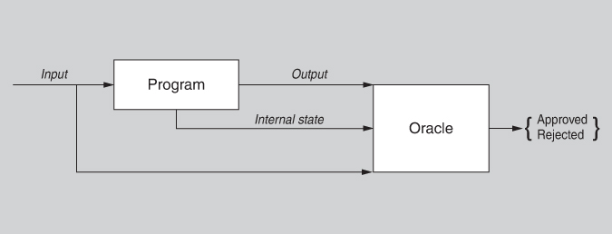
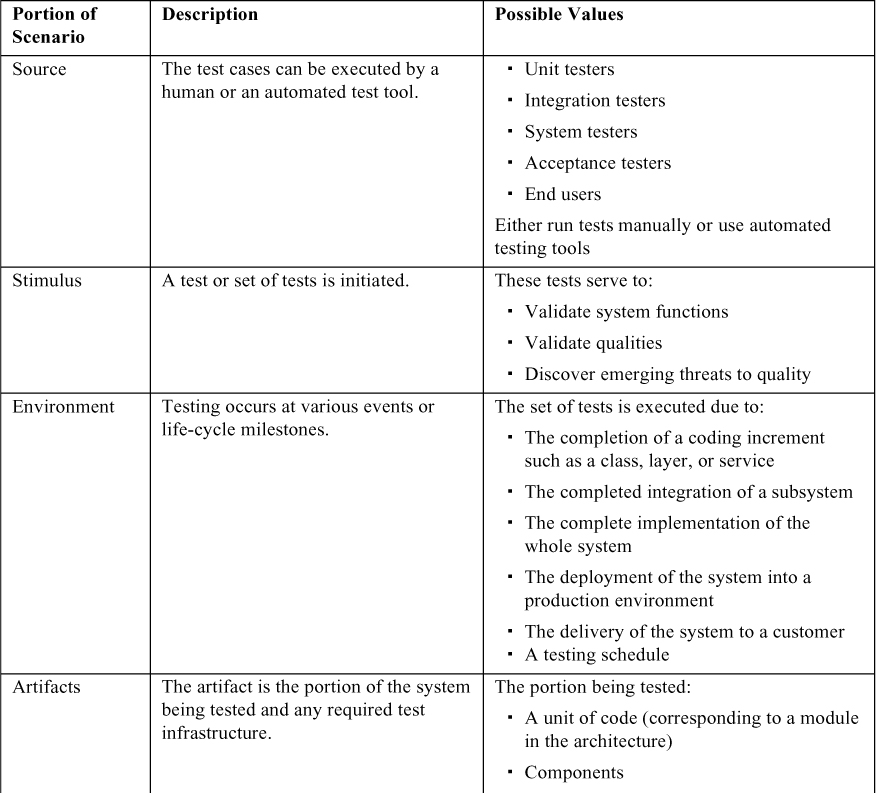
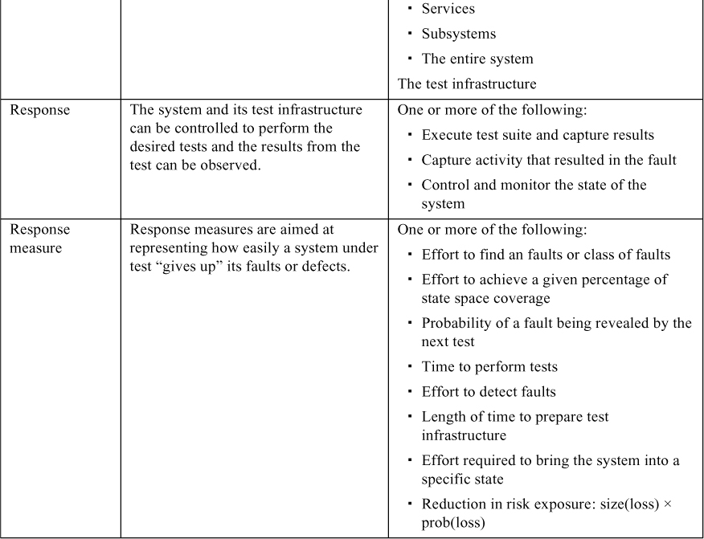
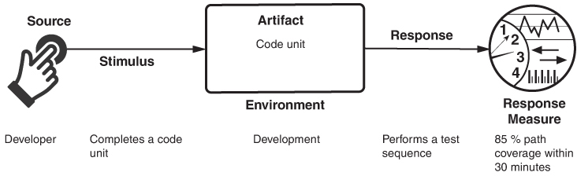
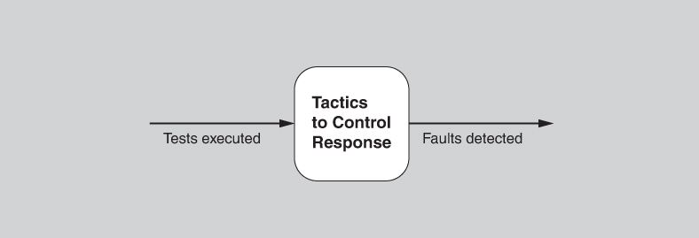
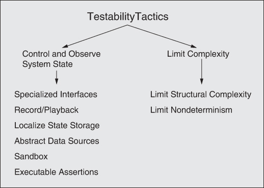
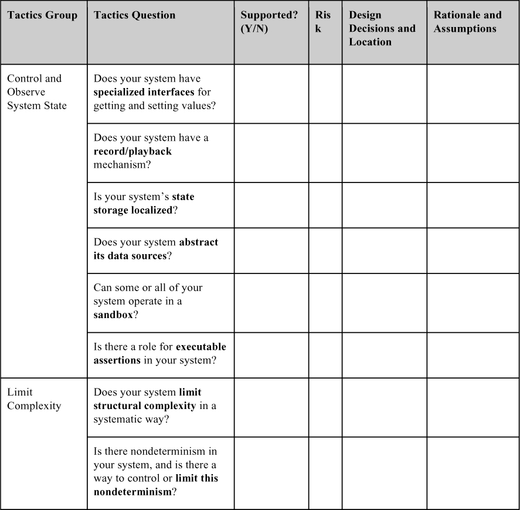

# 12. Testability

> Kiểm thử dẫn đến thất bại, và thất bại dẫn đến hiểu biết. 
> —Burt Rutan

Một phần đáng kể chi phí phát triển các hệ thống well-engineered bị chiếm bởi việc kiểm thử. Nếu một software architecture được thought-out một cách cẩn thận có thể giảm chi phí này, lợi ích sẽ rất lớn.

Software testability chỉ mức độ dễ dàng mà phần mềm có thể được làm cho bộc lộ các fault của nó thông qua kiểm thử (thường là execution-based). Cụ thể, testability chỉ xác suất, giả sử phần mềm có ít nhất một fault, mà nó sẽ thất bại trong lần thực thi test tiếp theo. Một cách trực quan, một hệ thống là testable nếu nó dễ dàng “để lộ” các fault của mình. Nếu có một fault trong hệ thống, thì chúng ta muốn nó thất bại trong quá trình kiểm thử càng nhanh càng tốt. Tất nhiên, việc tính xác suất này không dễ và—như bạn sẽ thấy khi chúng tôi thảo luận các response measure cho testability—các thước đo khác sẽ được dùng. Ngoài ra, một architecture có thể tăng cường testability bằng cách giúp dễ dàng hơn cả việc tái hiện một bug lẫn việc thu hẹp các nguyên nhân gốc có thể có của bug. Chúng ta thường không coi các hoạt động này là một phần của bản thân testability, nhưng rốt cuộc chỉ để lộ một bug thôi là chưa đủ: Bạn còn cần tìm và sửa bug!

[Hình 12.1](#ch12fig01) cho thấy một model kiểm thử đơn giản trong đó một chương trình xử lý đầu vào và tạo ra đầu ra. Một oracle là một tác nhân (con người hoặc máy tính) quyết định đầu ra có đúng không bằng cách so sánh đầu ra với kết quả mong đợi. Đầu ra không chỉ là giá trị được tạo ra về mặt chức năng, mà còn có thể bao gồm các số đo được suy ra về quality attribute, chẳng hạn như mất bao lâu để tạo ra đầu ra. [Hình 12.1](#ch12fig01) cũng chỉ ra rằng trạng thái bên trong của chương trình có thể được cho oracle thấy, và oracle có thể quyết định trạng thái đó có đúng không—tức là, nó có thể phát hiện chương trình đã đi vào một trạng thái lỗi hay chưa và đưa ra phán xét về tính đúng đắn của chương trình. Việc thiết lập và xem xét trạng thái bên trong của một chương trình là một khía cạnh của kiểm thử sẽ nổi bật trong các tactic cho testability của chúng tôi.

**Hình 12.1** *Một model kiểm thử*

Để một hệ thống có thể kiểm thử đúng cách, phải có khả năng kiểm soát đầu vào của mỗi component (và có thể thao túng trạng thái bên trong của nó) rồi quan sát đầu ra của nó (và có thể cả trạng thái bên trong của nó, sau khi hoặc trong khi tính toán đầu ra). Việc kiểm soát và quan sát này thường được thực hiện thông qua một *test harness*, một tập phần mềm chuyên biệt (hoặc trong một số trường hợp, phần cứng) được thiết kế để chạy thử phần mềm đang được kiểm thử. Test harness có nhiều dạng, và có thể bao gồm các năng lực như năng lực record-and-playback cho dữ liệu được gửi qua interface, một trình mô phỏng môi trường bên ngoài mà trong đó một phần mềm nhúng được kiểm thử, hoặc thậm chí phần mềm riêng biệt chạy trong production (xem sidebar “[Netflix’s Simian Army](#ch12sb01)”). Test harness có thể hỗ trợ việc thực thi các thủ tục test và ghi lại đầu ra. Bản thân một test harness và infrastructure đi kèm có thể là những phần mềm đáng kể, với architecture, stakeholder và các yêu cầu quality attribute riêng.

> 
>
> **Simian Army của Netflix (Netflix’s Simian Army)**
>
> Netflix phân phối phim và chương trình truyền hình qua cả DVD lẫn video streaming. Service video streaming của họ đã cực kỳ thành công. Thực tế, năm 2018, video streaming của Netflix chiếm 15 phần trăm traffic Internet toàn cầu. Đương nhiên, high availability là quan trọng đối với Netflix.
>
> Netflix đặt các service máy tính của mình trên cloud Amazon EC2, và công ty dùng một tập service ban đầu được gọi là “Simian Army” (đội quân khỉ) như một phần của quy trình kiểm thử. Netflix bắt đầu với một Chaos Monkey, thứ kill ngẫu nhiên các process trong hệ thống đang chạy. Điều này cho phép giám sát tác động của các process bị hỏng và mang lại khả năng bảo đảm rằng hệ thống sẽ không thất bại hoặc bị suy giảm nghiêm trọng do một process thất bại.
>
> Chaos Monkey có thêm một số người bạn để hỗ trợ việc kiểm thử. Simian Army của Netflix bao gồm những con khỉ sau, ngoài Chaos Monkey:
>
> - Latency Monkey tạo ra độ trễ nhân tạo trong giao tiếp mạng để mô phỏng sự suy giảm service và đo xem các upstream service có phản hồi thích hợp không.
>
> - Conformity Monkey xác định các instance không tuân theo best practice và tắt chúng. Ví dụ, nếu một instance không thuộc một nhóm auto-scaling, nó sẽ không scale thích hợp khi nhu cầu tăng lên.
>
> - Doctor Monkey khai thác các health check chạy trên mỗi instance cũng như giám sát các dấu hiệu sức khỏe bên ngoài khác (ví dụ: tải CPU) để phát hiện các instance không khỏe.
>
> - Janitor Monkey bảo đảm môi trường cloud của Netflix chạy mà không có sự lộn xộn và lãng phí. Nó tìm kiếm các tài nguyên không dùng đến và loại bỏ chúng.
>
> - Security Monkey là một phần mở rộng của Conformity Monkey. Nó tìm các vi phạm hoặc lỗ hổng security, chẳng hạn như các security group được cấu hình không đúng, và kết thúc các instance vi phạm. Nó cũng bảo đảm mọi chứng chỉ SSL và digital rights management (DRM) đều hợp lệ và không sắp đến hạn gia hạn.
>
> - 10-18 Monkey (localization-internationalization) phát hiện các vấn đề cấu hình và runtime trong các instance phục vụ khách hàng ở nhiều khu vực địa lý, dùng các ngôn ngữ và bộ ký tự khác nhau. Cái tên 10-18 bắt nguồn từ *L10n-i18n*, một kiểu viết tắt cho các từ “localization” và “internationalization”.
>
> Một số thành viên của Simian Army dùng fault injection để đặt các fault vào hệ thống đang chạy theo cách có kiểm soát và được giám sát. Các thành viên khác giám sát các khía cạnh chuyên biệt khác nhau của hệ thống và môi trường của nó. Cả hai kỹ thuật này đều có khả năng áp dụng rộng hơn chứ không chỉ cho Netflix.
>
> Vì không phải mọi fault đều ngang nhau về mức độ nghiêm trọng, nên nhấn mạnh việc tìm các fault nghiêm trọng nhất hơn là tìm các fault khác. Simian Army phản ánh quyết tâm của Netflix rằng các fault được nhắm đến là những fault nghiêm trọng nhất xét về tác động của chúng.
>
> Chiến lược của Netflix minh họa rằng một số hệ thống quá phức tạp và thích nghi để có thể được kiểm thử đầy đủ, vì một số hành vi của chúng là phát sinh (emergent). Một khía cạnh của kiểm thử trong lĩnh vực đó là ghi log dữ liệu vận hành do hệ thống tạo ra, để khi failure xảy ra, dữ liệu đã log có thể được phân tích trong phòng thí nghiệm nhằm cố tái hiện các fault.
>
> —LB

Việc kiểm thử được thực hiện bởi các developer, người dùng hoặc nhân viên quality assurance khác nhau. Có thể kiểm thử một phần của hệ thống hoặc toàn bộ hệ thống. Các response measure cho testability liên quan đến mức độ hiệu quả của các test trong việc phát hiện fault và mất bao lâu để thực hiện các test đến một mức coverage mong muốn nào đó. Test case có thể được viết bởi developer, nhóm kiểm thử hoặc khách hàng. Trong một số trường hợp, kiểm thử thực sự dẫn dắt việc phát triển, như trong trường hợp test-driven development.

Kiểm thử code là một trường hợp đặc biệt của validation, vốn đòi hỏi bảo đảm rằng một artifact được thiết kế đáp ứng nhu cầu của các stakeholder hoặc phù hợp để sử dụng. Trong [Chương 21](ch21_evaluating_an_architecture.vi.md#ch21), chúng tôi sẽ thảo luận về review thiết kế architecture—một loại validation khác, trong đó artifact được kiểm thử là architecture.

## 12.1 General scenario cho testability (Testability General Scenario)

[Bảng 12.1](#ch12tab01) liệt kê các element của general scenario đặc trưng cho testability.

**Bảng 12.1** *General scenario cho testability*

[Hình 12.2](#ch12fig02) cho thấy một concrete scenario cho testability: *Developer hoàn thành một đơn vị code trong quá trình phát triển và thực hiện một chuỗi test có kết quả được ghi lại và đạt 85 phần trăm path coverage trong vòng 30 phút.*

**Hình 12.2** *Ví dụ về testability scenario*

## 12.2 Các tactic cho testability (Tactics for Testability)

Các tactic cho testability nhằm thúc đẩy việc kiểm thử dễ hơn, hiệu quả hơn và có năng lực hơn. [Hình 12.3](#ch12fig03) minh họa mục tiêu của các testability tactic. Các kỹ thuật architecture để tăng cường testability của phần mềm chưa nhận được nhiều sự chú ý như các lĩnh vực quality attribute khác như modifiability, performance và availability, nhưng như chúng tôi đã nói trước đó, bất cứ điều gì kiến trúc sư có thể làm để giảm chi phí kiểm thử cao sẽ mang lại lợi ích đáng kể.

**Hình 12.3** *Mục tiêu của các testability tactic*

Có hai loại tactic cho testability. Loại thứ nhất xử lý việc thêm khả năng kiểm soát (controllability) và khả năng quan sát (observability) vào hệ thống. Loại thứ hai xử lý việc giới hạn độ phức tạp trong thiết kế của hệ thống.

### Kiểm soát và quan sát trạng thái hệ thống (Control and Observe System State)

Kiểm soát và quan sát là trung tâm của testability đến mức một số tác giả định nghĩa testability theo những thuật ngữ đó. Hai thứ này đi đôi với nhau (hand-in-hand); kiểm soát một thứ gì đó là vô nghĩa nếu bạn không thể quan sát điều gì xảy ra khi bạn làm vậy. Dạng kiểm soát và quan sát đơn giản nhất là cung cấp cho một software component một tập đầu vào, để nó làm việc, rồi quan sát đầu ra của nó. Tuy nhiên, loại tactic testability control-and-observe mang lại hiểu biết về phần mềm vượt ra ngoài đầu vào và đầu ra của nó. Các tactic này khiến một component duy trì một loại thông tin trạng thái nào đó, cho phép tester gán giá trị cho thông tin trạng thái đó, và làm cho thông tin đó có thể truy cập được bởi tester theo yêu cầu. Thông tin trạng thái có thể là một trạng thái vận hành, giá trị của một biến then chốt nào đó, tải performance, các bước xử lý trung gian, hoặc bất cứ thứ gì khác hữu ích cho việc tái tạo (re-creating) hành vi của component. Các tactic cụ thể bao gồm:

- *Specialized interfaces.* Có các testing interface chuyên biệt cho phép bạn kiểm soát hoặc thu thập giá trị biến cho một component thông qua việc áp dụng một test harness hoặc thông qua thực thi bình thường. Các ví dụ về các test routine chuyên biệt, một số trong đó có thể không có sẵn ngoài mục đích kiểm thử, bao gồm:
- Một method *set* và *get* cho các biến, chế độ hoặc thuộc tính quan trọng
- Một method *report* trả về toàn bộ trạng thái của object
- Một method *reset* để đặt trạng thái bên trong (ví dụ: mọi thuộc tính của một class) về một trạng thái bên trong được chỉ định
- Một method để bật đầu ra verbose, các mức ghi log sự kiện khác nhau, đo đạc performance, hoặc giám sát tài nguyên

   Các testing interface và method chuyên biệt nên được xác định rõ ràng hoặc được giữ tách biệt khỏi các access method và interface cho chức năng được yêu cầu, để chúng có thể được gỡ bỏ nếu cần. Tuy nhiên, lưu ý rằng trong các hệ thống performance-critical và một số hệ thống safety-critical, việc đưa vào sử dụng code khác với code đã được kiểm thử là có vấn đề. Nếu bạn gỡ bỏ test code, làm sao bạn biết code được phát hành có cùng hành vi, đặc biệt là cùng hành vi về thời gian, như code bạn đã kiểm thử? Do đó, chiến lược này hiệu quả hơn đối với các loại hệ thống khác.

- *Record/playback*. Trạng thái gây ra một fault thường khó tái tạo (re-create). Việc ghi lại trạng thái khi nó đi qua một interface cho phép trạng thái đó được dùng để “phát lại hệ thống” và tái tạo (re-create) fault. *Record* chỉ việc thu thập thông tin đi qua một interface và *playback* chỉ việc dùng nó làm đầu vào cho các kiểm thử tiếp theo.
- *Localize state storage*. Để khởi động một hệ thống, hệ thống con hoặc component ở một trạng thái tùy ý cho một test, thuận tiện nhất là trạng thái đó được lưu ở một nơi duy nhất. Ngược lại, nếu trạng thái bị chôn vùi hoặc phân tán, cách tiếp cận này trở nên khó khăn, nếu không muốn nói là không thể. Trạng thái có thể fine-grained, thậm chí bit-level, hoặc coarse-grained để biểu diễn các abstraction rộng hoặc các chế độ vận hành tổng thể. Việc chọn granularity phụ thuộc vào cách các trạng thái sẽ được dùng trong kiểm thử. Một cách thuận tiện để “ngoại hóa” việc lưu trữ trạng thái (tức là làm cho nó có thể được thao túng thông qua các tính năng của interface) là dùng một state machine (hoặc state machine object) làm cơ chế để theo dõi và báo cáo trạng thái hiện tại.
- *Abstract data sources.* Tương tự trường hợp kiểm soát trạng thái của một chương trình, khả năng kiểm soát dữ liệu đầu vào của nó giúp việc kiểm thử dễ hơn. Trừu tượng hóa các interface cho phép bạn thay thế dữ liệu test dễ dàng hơn. Ví dụ, nếu bạn có một database các giao dịch khách hàng, bạn có thể thiết kế architecture của mình sao cho bạn có thể dễ dàng trỏ hệ thống test của mình tới các database test khác, hoặc thậm chí có thể tới các file dữ liệu test, mà không phải thay đổi code chức năng.
- *Sandbox*. “Sandboxing” chỉ việc cô lập một instance của hệ thống khỏi thế giới thực để cho phép thử nghiệm mà không bị ràng buộc bởi bất kỳ lo lắng nào về việc phải hoàn tác hệ quả của thử nghiệm. Việc kiểm thử được hỗ trợ nhờ khả năng vận hành hệ thống theo cách không có hệ quả vĩnh viễn, hoặc sao cho mọi hệ quả đều có thể được roll back. Tactic sandbox có thể được dùng cho phân tích scenario, đào tạo và mô phỏng. Đặc biệt, mô phỏng là một chiến lược thường được dùng cho kiểm thử và đào tạo trong các bối cảnh mà failure trong thế giới thực có thể dẫn đến hệ quả nghiêm trọng.

   Một dạng sandboxing phổ biến là ảo hóa tài nguyên. Kiểm thử một hệ thống thường bao gồm việc tương tác với các tài nguyên có hành vi nằm ngoài sự kiểm soát của hệ thống. Dùng một sandbox, bạn có thể xây dựng một phiên bản của tài nguyên có hành vi nằm trong sự kiểm soát của bạn. Ví dụ, hành vi của đồng hồ hệ thống thường không nằm trong sự kiểm soát của chúng ta—nó tăng một giây mỗi giây. Do đó, nếu chúng ta muốn khiến hệ thống nghĩ rằng đang là nửa đêm của ngày mà mọi cấu trúc dữ liệu đều được cho là sẽ tràn, chúng ta cần một cách để làm điều đó, vì ngồi chờ là một lựa chọn tồi. Khi chúng ta có thể trừu tượng hóa thời gian hệ thống khỏi thời gian đồng hồ, chúng ta có thể cho phép hệ thống (hoặc các component) chạy nhanh hơn thời gian wall-clock, và kiểm thử hệ thống (hoặc các component) tại các mốc thời gian then chốt như lần chuyển tiếp tới hoặc từ giờ mùa hè (Daylight Savings Time) tiếp theo. Việc ảo hóa tương tự có thể được thực hiện cho các tài nguyên khác, như memory, pin, mạng, v.v. Stub, mock và dependency injection là các dạng ảo hóa đơn giản nhưng hiệu quả.

- *Executable assertions*. Với tactic này, các assertion (thường) được viết tay (hand-coded) và đặt tại những vị trí mong muốn để chỉ ra khi nào và ở đâu một chương trình ở trạng thái lỗi. Các assertion thường được thiết kế để kiểm tra rằng các giá trị dữ liệu thỏa mãn các ràng buộc đã đặc tả. Assertion được định nghĩa dựa trên các khai báo dữ liệu cụ thể, và chúng phải được đặt tại những nơi giá trị dữ liệu được tham chiếu hoặc sửa đổi. Assertion có thể được biểu đạt dưới dạng pre- và post-conditions cho mỗi method và cũng dưới dạng các bất biến class-level. Điều này làm tăng observability của hệ thống, vì một assertion có thể được đánh dấu là đã thất bại. Các assertion được chèn một cách có hệ thống tại những nơi giá trị dữ liệu thay đổi có thể được coi là một cách thủ công để tạo ra một kiểu “mở rộng”. Về bản chất, người dùng đang chú thích một kiểu bằng code kiểm tra bổ sung. Bất cứ khi nào một object của kiểu đó bị sửa đổi, code kiểm tra tự động thực thi, với các cảnh báo được tạo ra nếu có bất kỳ điều kiện nào bị vi phạm. Trong chừng mực các assertion bao phủ các test case, chúng thực chất nhúng test oracle vào trong code—giả sử các assertion là đúng và được viết code đúng.

Tất cả các tactic này đều thêm một năng lực hoặc sự trừu tượng hóa nào đó vào phần mềm, thứ mà (nếu chúng ta không quan tâm đến kiểm thử) lẽ ra sẽ không có ở đó. Chúng có thể được coi là việc bổ sung cho phần mềm bare-bones, get-the-job-done bằng phần mềm công phu hơn có một số năng lực đặc biệt được thiết kế để nâng cao hiệu suất và hiệu quả của kiểm thử.

Ngoài các testability tactic, có một số kỹ thuật để thay thế một component bằng một phiên bản khác của chính nó giúp hỗ trợ kiểm thử:

- *Component replacement* đơn giản là hoán đổi implementation của một component bằng một implementation khác (trong trường hợp testability) có các tính năng hỗ trợ kiểm thử. Component replacement thường được thực hiện trong các build script của hệ thống.
- *Preprocessor macro*, khi được kích hoạt, có thể mở rộng thành code báo cáo trạng thái (state-reporting) hoặc kích hoạt các câu lệnh probe trả về hoặc hiển thị thông tin, hoặc trả quyền điều khiển về một testing console.
- *Aspect* (trong các chương trình aspect-oriented) có thể xử lý mối quan tâm cross-cutting về cách trạng thái được báo cáo.

### Giới hạn độ phức tạp (Limit Complexity)

Phần mềm phức tạp khó kiểm thử hơn nhiều. Không gian trạng thái vận hành của nó lớn, và (khi mọi điều kiện khác như nhau) việc tái tạo (re-create) chính xác một trạng thái trong một không gian trạng thái lớn khó hơn so với trong một không gian trạng thái nhỏ. Vì kiểm thử không chỉ là làm cho phần mềm thất bại, mà còn là tìm ra fault đã gây ra failure để có thể loại bỏ nó, chúng ta thường quan tâm đến việc làm cho hành vi có thể lặp lại. Loại này bao gồm hai tactic:

- *Limit structural complexity.* Tactic này bao gồm việc tránh hoặc giải quyết các dependency vòng giữa các component, cô lập và đóng gói các dependency vào môi trường bên ngoài, và giảm dependency giữa các component nói chung (thường được hiện thực bằng cách giảm coupling giữa các component). Ví dụ, trong các hệ thống object-oriented, bạn có thể đơn giản hóa hệ thống phân cấp kế thừa:
- Giới hạn số class mà một class được dẫn xuất từ đó, hoặc số class được dẫn xuất từ một class.
- Giới hạn độ sâu của cây kế thừa, và số class con của một class.
- Giới hạn polymorphism và các lời gọi động.

   Một số đo cấu trúc đã được chứng minh thực nghiệm là có tương quan với testability là *response* của một class. Response của class C là tổng số method của C cộng với số method của các class khác được gọi bởi các method của C. Giữ số đo này thấp có thể làm tăng testability. Ngoài ra, các số đo coupling architecture-level, như propagation cost và decoupling level, có thể được dùng để đo và theo dõi mức coupling tổng thể trong architecture của một hệ thống.

   Bảo đảm hệ thống có cohesion cao, loose coupling và separation of concerns—tất cả đều là modifiability tactic (xem [Chương 8](ch08_modifiability.vi.md#ch08))—cũng có thể giúp ích cho testability. Những đặc điểm này giới hạn độ phức tạp của các element của architecture bằng cách giao cho mỗi element một nhiệm vụ tập trung sao cho nó có ít tương tác với các element khác. Separation of concerns có thể giúp đạt được controllability và observability, cũng như giảm kích thước không gian trạng thái của toàn bộ chương trình.

   Cuối cùng, một số architectural pattern tự thân phù hợp với testability. Trong một layered pattern, bạn có thể kiểm thử các layer thấp hơn trước, rồi kiểm thử các layer cao hơn với sự tin tưởng vào các layer thấp hơn.

- *Limit nondeterminism.* Đối tác của việc giới hạn độ phức tạp cấu trúc là giới hạn độ phức tạp hành vi. Khi nói đến kiểm thử, tính không tất định (nondeterminism) là một dạng hành vi phức tạp nguy hại, và các hệ thống không tất định khó kiểm thử hơn các hệ thống tất định. Tactic này bao gồm việc tìm mọi nguồn không tất định, chẳng hạn như song song không bị ràng buộc, và loại bỏ chúng trong phạm vi có thể. Một số nguồn không tất định là không thể tránh khỏi—ví dụ, trong các hệ thống multi-threaded phản hồi các sự kiện không thể dự đoán—nhưng đối với những hệ thống như vậy, có các tactic khác (như record/playback) để giúp quản lý độ phức tạp này.

[Hình 12.4](#ch12fig04) tóm tắt các tactic được dùng cho testability.

**Hình 12.4** *Các testability tactic*

## 12.3 Questionnaire dựa trên tactic cho testability (Tactics-Based Questionnaire for Testability)

Dựa trên các tactic được mô tả trong [Mục 12.2](#sec12_2), chúng ta có thể tạo một tập câu hỏi tactics-inspired, như được trình bày trong [Bảng 12.2](#ch12tab02). Để có cái nhìn tổng quan về các lựa chọn architecture được đưa ra để hỗ trợ testability, nhà phân tích đặt từng câu hỏi và ghi lại câu trả lời vào bảng. Câu trả lời cho các câu hỏi này sau đó có thể trở thành trọng tâm của các hoạt động tiếp theo: điều tra tài liệu, phân tích code hoặc các artifact khác, reverse engineering code, v.v.

**Bảng 12.2** *Questionnaire tactics-based cho testability*

## 12.5 Các pattern cho testability (Patterns for Testability)

Các pattern cho testability đều giúp dễ dàng tách code test-specific khỏi chức năng thực sự của hệ thống. Chúng tôi thảo luận ba pattern ở đây: dependency injection, strategy và intercepting filter.

### Pattern dependency injection (Dependency Injection Pattern)

Trong pattern dependency injection, các dependency của một client được tách khỏi hành vi của nó. Pattern này sử dụng inversion of control. Khác với lập trình khai báo truyền thống, nơi quyền điều khiển và các dependency nằm tường minh trong code, inversion of control dependencies có nghĩa là quyền điều khiển và các dependency được cung cấp từ, và được inject vào code, bởi một nguồn bên ngoài nào đó.

Trong pattern này, có bốn vai trò:

- Một service (mà bạn muốn cung cấp rộng rãi)
- Một client của service
- Một interface (được client dùng, được service hiện thực)
- Một injector (tạo một instance của service và inject nó vào client)

Khi một interface tạo service và inject nó vào client, client được viết mà không cần biết về implementation cụ thể. Nói cách khác, mọi chi tiết hiện thực đều được inject, thường là tại runtime.

**Lợi ích:**

- Có thể inject các instance test (thay vì các instance production), và các instance test này có thể quản lý và giám sát trạng thái của service. Do đó, client có thể được viết mà không cần biết nó sẽ được kiểm thử như thế nào. Thực tế, đây là cách nhiều testing framework hiện đại được hiện thực.

**Các tradeoff:**

- Dependency injection làm cho performance runtime khó dự đoán hơn, vì nó có thể thay đổi hành vi đang được kiểm thử.
- Việc thêm pattern này làm tăng một chút độ phức tạp up-front và có thể đòi hỏi đào tạo lại developer để suy nghĩ theo inversion of control.

### Pattern strategy (Strategy Pattern)

Trong pattern strategy, hành vi của một class có thể được thay đổi tại runtime. Pattern này thường được dùng khi có thể dùng nhiều algorithm để thực hiện một tác vụ cho trước, và algorithm cụ thể được dùng có thể được chọn một cách động. Class chỉ đơn giản chứa một abstract method cho chức năng mong muốn, với phiên bản cụ thể của method này được chọn dựa trên các yếu tố ngữ cảnh. Pattern này thường được dùng để thay thế các phiên bản non-test của một chức năng nào đó bằng các phiên bản test cung cấp thêm đầu ra, thêm sanity checking bên trong, v.v.

**Lợi ích:**

- Pattern này làm cho các class đơn giản hơn, bằng cách không kết hợp nhiều mối quan tâm (như các algorithm khác nhau cho cùng một chức năng) vào một class duy nhất.

**Các tradeoff:**

- Pattern strategy, như mọi design pattern, làm tăng một chút độ phức tạp up-front. Nếu class đơn giản hoặc nếu có ít lựa chọn runtime, độ phức tạp tăng thêm này có lẽ là lãng phí.
- Với các class nhỏ, pattern strategy có thể làm cho code hơi khó đọc hơn. Tuy nhiên, khi độ phức tạp tăng, việc chia nhỏ class theo cách này có thể tăng khả năng đọc hiểu.

### Pattern intercepting filter (Intercepting Filter Pattern)

Pattern intercepting filter được dùng để inject tiền xử lý và hậu xử lý (pre- and post-processing) vào một request hoặc một response giữa một client và một service. Có thể định nghĩa và áp dụng bất kỳ số lượng filter nào, theo thứ tự tùy ý, cho request trước khi chuyển request tới service cuối cùng. Ví dụ, các service logging và authentication là những filter thường hữu ích khi được hiện thực một lần và áp dụng ở mọi nơi. Các testing filter có thể được chèn vào theo cách này, mà không làm xáo trộn bất kỳ xử lý nào khác trong hệ thống.

**Lợi ích:**

- Pattern này, giống như pattern strategy, làm cho các class đơn giản hơn, bằng cách không đặt toàn bộ logic tiền xử lý và hậu xử lý (pre- and post-processing) vào class.
- Dùng một intercepting filter có thể là một động lực mạnh cho việc tái sử dụng và có thể giảm đáng kể kích thước của code base.

**Các tradeoff:**

- Nếu một lượng lớn dữ liệu được chuyển tới service, pattern này có thể rất kém hiệu quả và có thể thêm một lượng độ trễ không nhỏ, vì mỗi filter thực hiện một lượt duyệt đầy đủ qua toàn bộ đầu vào.

## 12.6 Đọc thêm (For Further Reading)

Tài liệu về kiểm thử phần mềm nhiều đến mức có thể đánh chìm một chiến hạm, nhưng các bài viết về cách làm cho hệ thống dễ kiểm thử hơn từ góc độ architecture thì ít hơn. Để có một tổng quan tốt về kiểm thử, hãy xem [Binder 00]. Công trình nền tảng của Jeff Voas về testability và mối quan hệ giữa testability và reliability cũng đáng để tìm hiểu. Có nhiều bài báo để lựa chọn, nhưng [Voas 95] là một điểm khởi đầu tốt sẽ dẫn bạn đến các bài khác.

Bertolino và Strigini [Bertolino 96a, 96b] là những người phát triển model kiểm thử được thể hiện trong [Hình 12.1](#ch12fig01).

“Uncle Bob” Martin đã viết nhiều về test-driven development và mối quan hệ giữa architecture và kiểm thử. Cuốn sách hay nhất về chủ đề này là *Clean Architecture: A Craftsman’s Guide to Software Structure and Design* của Robert C. Martin [Martin 17]. Một tài liệu tham khảo sớm và có thẩm quyền về test-driven development được viết bởi Kent Beck: *Test-Driven Development by Example* [Beck 02].

Số đo coupling propagation cost được mô tả lần đầu trong [MacCormack 06]. Số đo decoupling level được mô tả trong [Mo 16].

Model checking là một kỹ thuật thực thi một cách tượng trưng mọi đường code có thể có. Kích thước của một hệ thống có thể được kiểm chứng bằng model checking là có giới hạn, nhưng device driver và microkernel đã được model check thành công. Xem [https://en.wikipedia.org/wiki/Model_checking](https://en.wikipedia.org/wiki/Model_checking) để có danh sách các công cụ model checking.

## 12.7 Câu hỏi thảo luận (Discussion Questions)

1. Một hệ thống testable là hệ thống dễ dàng để lộ các fault của nó. Tức là, nếu một hệ thống chứa một fault, thì không mất nhiều thời gian hay công sức để làm cho fault đó xuất hiện. Ngược lại, fault tolerance hoàn toàn là việc thiết kế các hệ thống khư khư che giấu fault của chúng; ở đó, toàn bộ ý tưởng là làm cho hệ thống rất khó để lộ fault của mình. Có thể thiết kế một hệ thống vừa có testability cao *vừa* có fault tolerance cao không, hay hai mục tiêu thiết kế này vốn dĩ không tương thích? Hãy thảo luận.
2. Bạn nghĩ testability xung đột nhiều nhất với những quality attribute nào khác? Bạn nghĩ testability tương thích nhất với những quality attribute nào khác?
3. Nhiều tactic cho testability cũng hữu ích để đạt được modifiability. Bạn nghĩ vì sao lại như vậy?
4. Hãy viết một số concrete testability scenario cho một app dẫn đường GPS-based. Bạn sẽ dùng những tactic nào trong thiết kế để đáp ứng các scenario này?
5. Một trong các tactic của chúng tôi là giới hạn tính không tất định, và một phương pháp là dùng locking để buộc đồng bộ hóa. Việc dùng lock có tác động gì đến các quality attribute khác?
6. Giả sử bạn đang xây dựng hệ thống mạng xã hội vĩ đại tiếp theo. Bạn dự đoán rằng trong vòng một tháng sau khi ra mắt, bạn sẽ có nửa triệu người dùng. Bạn không thể trả tiền cho nửa triệu người để kiểm thử hệ thống, nhưng nó vẫn phải robust và dễ sử dụng khi cả nửa triệu người đó cùng nện vào nó. Bạn nên làm gì? Những tactic nào sẽ giúp bạn? Hãy viết một testability scenario cho hệ thống mạng xã hội này.
7. Giả sử bạn dùng executable assertion để cải thiện testability. Hãy lập luận ủng hộ, rồi lập luận phản đối, việc cho phép các assertion chạy trong hệ thống production thay vì gỡ bỏ chúng sau khi kiểm thử.
