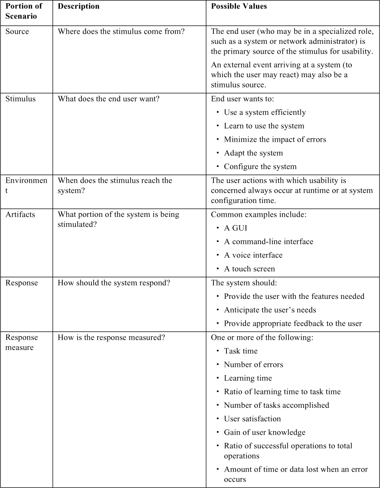
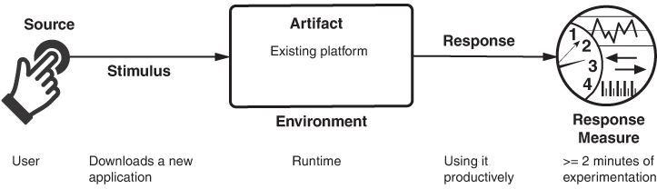
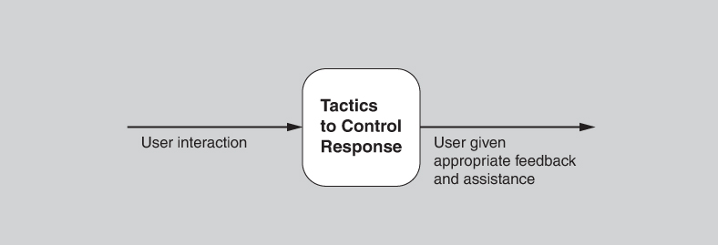
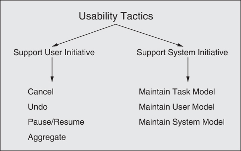
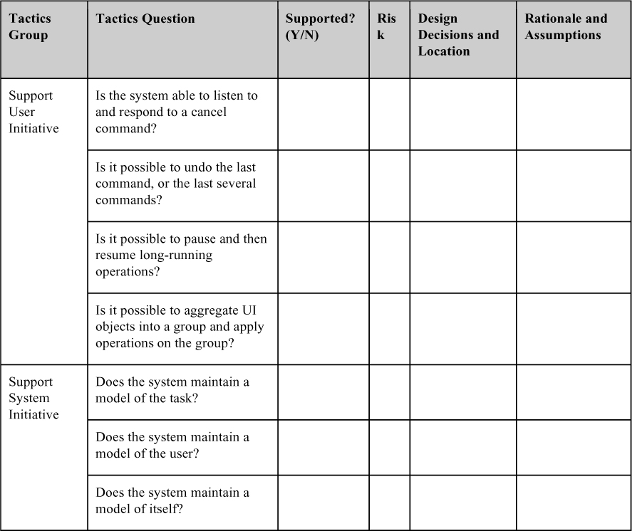

# 13. Usability

> Người ta phớt lờ những thiết kế phớt lờ con người. 
> —Frank Chimero

Usability quan tâm đến mức độ dễ dàng để người dùng hoàn thành một tác vụ mong muốn và loại hỗ trợ người dùng mà hệ thống cung cấp. Qua nhiều năm, việc tập trung vào usability đã chứng tỏ là một trong những cách rẻ nhất và dễ nhất để cải thiện chất lượng của một hệ thống (hay chính xác hơn, cảm nhận của người dùng về chất lượng) và do đó cải thiện sự hài lòng end-user.

Usability bao gồm các lĩnh vực sau:

- *Học các tính năng của hệ thống (Learning system features)*. Nếu người dùng không quen với một hệ thống cụ thể hoặc một khía cạnh cụ thể của nó, hệ thống có thể làm gì để việc học dễ dàng hơn? Điều này có thể bao gồm việc cung cấp các tính năng trợ giúp.
- *Sử dụng hệ thống hiệu quả (Using a system efficiently)*. Hệ thống có thể làm gì để người dùng thao tác với nó hiệu quả hơn? Điều này có thể bao gồm việc cho phép người dùng điều hướng lại hệ thống sau khi đã ra lệnh. Ví dụ, người dùng có thể muốn tạm dừng một tác vụ, thực hiện vài thao tác, rồi tiếp tục tác vụ đó.
- *Giảm thiểu tác động của lỗi người dùng (Minimizing the impact of user errors)*. Hệ thống có thể làm gì để bảo đảm một lỗi của người dùng có tác động tối thiểu? Ví dụ, người dùng có thể muốn hủy một lệnh đã ra không đúng hoặc hoàn tác tác động của nó.
- *Thích ứng hệ thống với nhu cầu người dùng (Adapting the system to user needs).* Người dùng (hoặc chính hệ thống) có thể thích ứng như thế nào để làm cho tác vụ của người dùng dễ dàng hơn? Ví dụ, hệ thống có thể tự động điền URL dựa trên các mục người dùng đã nhập trước đây.
- *Tăng sự tin tưởng và hài lòng (Increasing confidence and satisfaction)*. Hệ thống làm gì để người dùng tin tưởng rằng hành động đúng đang được thực hiện? Ví dụ, cung cấp phản hồi cho biết hệ thống đang thực hiện một tác vụ long-running, cùng với phần trăm hoàn thành cho đến lúc đó, sẽ tăng sự tin tưởng của người dùng vào hệ thống.

Các nhà nghiên cứu tập trung vào tương tác người–máy (human–computer interaction) đã dùng các thuật ngữ *user initiative*, *system initiative* và *mixed initiative* để mô tả bên nào trong cặp người–máy chủ động thực hiện một số hành động nhất định và tương tác diễn ra như thế nào. Các usability scenario có thể kết hợp các sự chủ động từ cả hai góc nhìn. Ví dụ, khi hủy một lệnh, người dùng ra lệnh hủy (user initiative) và hệ thống phản hồi. Tuy nhiên, trong khi hủy, hệ thống có thể hiển thị một chỉ báo tiến độ (system initiative). Do đó, thao tác hủy có thể bao gồm một mixed initiative. Trong chương này, chúng tôi sẽ dùng sự phân biệt giữa user initiative và system initiative để thảo luận các tactic mà kiến trúc sư dùng để đạt được các scenario khác nhau.

Có một mối liên hệ chặt chẽ giữa việc đạt được usability và modifiability. Quy trình thiết kế user interface gồm việc tạo ra rồi kiểm thử một thiết kế user interface. Rất khó có khả năng bạn làm đúng ngay lần đầu, nên bạn nên lên kế hoạch lặp lại quy trình này—và do đó bạn nên thiết kế architecture để việc lặp lại đó ít khổ sở hơn. Đây là lý do usability liên hệ chặt chẽ với modifiability. Khi bạn lặp lại, những thiếu sót trong thiết kế—hy vọng là vậy—được sửa và quy trình lặp lại.

Mối liên hệ này đã dẫn đến các pattern tiêu chuẩn để hỗ trợ thiết kế user interface. Thật vậy, một trong những điều hữu ích nhất bạn có thể làm để đạt được usability là sửa đổi hệ thống của mình, lặp đi lặp lại, để làm cho nó tốt hơn khi bạn học hỏi từ người dùng và khám phá ra những cải tiến cần thực hiện.

## 13.1 General scenario cho usability (Usability General Scenario)

[Bảng 13.1](#ch13tab01) liệt kê các element của general scenario đặc trưng cho usability.

**Bảng 13.1** *General scenario cho usability*

[Hình 13.1](#ch13fig01) đưa ra một ví dụ về concrete usability scenario mà bạn có thể tạo ra bằng [Bảng 13.1](#ch13tab01): *Người dùng tải về một ứng dụng mới và đang sử dụng nó hiệu quả sau 2 phút thử nghiệm*.

**Hình 13.1** *Ví dụ về usability scenario*

## 13.2 Các tactic cho usability (Tactics for Usability)

[Hình 13.2](#ch13fig02) cho thấy mục tiêu của tập usability tactic.

**Hình 13.2** *Mục tiêu của các usability tactic*

### Hỗ trợ sự chủ động của người dùng (Support User Initiative)

Một khi hệ thống đang thực thi, usability được nâng cao bằng cách cung cấp cho người dùng phản hồi về những gì hệ thống đang làm và bằng cách cho phép người dùng đưa ra các phản hồi thích hợp. Ví dụ, các tactic được mô tả tiếp theo—*cancel*, *undo*, *pause/resume* và *aggregate*—hỗ trợ người dùng trong việc sửa lỗi hoặc làm việc hiệu quả hơn.

Kiến trúc sư thiết kế một response cho user initiative bằng cách liệt kê và phân bổ các trách nhiệm của hệ thống để phản hồi lệnh của người dùng. Dưới đây là một số ví dụ phổ biến về các tactic hỗ trợ user initiative:

- *Cancel*. Khi người dùng ra lệnh hủy, hệ thống phải đang lắng nghe lệnh đó (do đó, có trách nhiệm phải có một listener thường trực không bị chặn bởi hành động của bất cứ thứ gì đang bị hủy); hoạt động đang bị hủy phải được kết thúc; mọi tài nguyên đang được hoạt động bị hủy sử dụng phải được giải phóng; và các component đang cộng tác với hoạt động bị hủy phải được thông báo để chúng cũng có thể thực hiện hành động thích hợp.
- *Undo*. Để hỗ trợ khả năng undo, hệ thống phải duy trì đủ thông tin về trạng thái hệ thống để có thể khôi phục một trạng thái trước đó, theo yêu cầu của người dùng. Bản ghi như vậy có thể ở dạng các “snapshot” trạng thái—ví dụ, checkpoint—hoặc một tập các thao tác có thể đảo ngược. Không phải mọi thao tác đều có thể dễ dàng đảo ngược. Ví dụ, thay mọi chữ “a” thành chữ “b” trong một tài liệu không thể được đảo ngược bằng cách thay mọi chữ “b” thành “a”, vì một số chữ “b” đó có thể đã tồn tại trước lần thay đổi ban đầu. Trong trường hợp như vậy, hệ thống phải duy trì một bản ghi chi tiết hơn về thay đổi. Tất nhiên, một số thao tác hoàn toàn không thể hoàn tác: Ví dụ, bạn không thể “hủy gửi” một kiện hàng hay “hủy bắn” một tên lửa.

   Undo có nhiều biến thể. Một số hệ thống cho phép undo một lần (trong đó gọi undo một lần nữa sẽ đưa bạn trở về trạng thái lúc bạn ra lệnh undo đầu tiên, về bản chất là undo chính lần undo đó). Trong các hệ thống khác, ra lệnh undo nhiều lần sẽ đưa bạn lùi qua nhiều trạng thái trước đó, hoặc đến một giới hạn nào đó hoặc lùi hẳn về thời điểm ứng dụng được mở lần cuối.

- *Pause/resume*. Khi người dùng đã khởi tạo một thao tác long-running—chẳng hạn tải về một file lớn hoặc một tập file từ một server—thường sẽ hữu ích nếu cung cấp khả năng tạm dừng và tiếp tục thao tác. Việc tạm dừng một thao tác long-running có thể được thực hiện để tạm thời giải phóng tài nguyên sao cho chúng có thể được phân bổ lại cho các tác vụ khác.
- *Aggregate*. Khi người dùng đang thực hiện các thao tác lặp đi lặp lại, hoặc các thao tác ảnh hưởng đến một số lượng lớn object theo cùng một cách, sẽ hữu ích nếu cung cấp khả năng gộp các object lower-level thành một nhóm duy nhất, để thao tác có thể được áp dụng cho cả nhóm, nhờ đó giải phóng người dùng khỏi sự nhàm chán, và khả năng mắc lỗi, khi thực hiện cùng một thao tác lặp đi lặp lại. Một ví dụ là gộp mọi object trong một slide và đổi văn bản sang font 14-point.

### Hỗ trợ sự chủ động của hệ thống (Support System Initiative)

Khi hệ thống nắm thế chủ động, nó phải dựa vào một model của người dùng, một model của tác vụ mà người dùng đang thực hiện, hoặc một model của trạng thái hệ thống. Mỗi model đòi hỏi các loại đầu vào khác nhau để thực hiện sự chủ động của nó. Các tactic support system initiative xác định các model mà hệ thống dùng để dự đoán hành vi của chính nó hoặc ý định của người dùng. Việc đóng gói thông tin này sẽ giúp dễ dàng điều chỉnh hoặc sửa đổi nó. Việc điều chỉnh và sửa đổi có thể diễn ra động dựa trên hành vi trước đây của người dùng hoặc offline trong quá trình phát triển. Các tactic liên quan được mô tả ở đây:

- *Maintain task model*. Task model được dùng để xác định ngữ cảnh để hệ thống có thể có ý niệm về điều người dùng đang cố gắng làm và cung cấp hỗ trợ. Ví dụ, nhiều search engine cung cấp các năng lực type-ahead dự đoán, và nhiều mail client cung cấp spell-correction. Cả hai chức năng này đều dựa trên task model.
- *Maintain user model*. Model này biểu diễn tường minh kiến thức của người dùng về hệ thống, hành vi của người dùng xét về thời gian phản hồi kỳ vọng, và các khía cạnh khác dành riêng cho một người dùng hoặc một lớp người dùng. Ví dụ, các app language-learning liên tục theo dõi những chỗ người dùng mắc lỗi rồi cung cấp thêm bài tập để sửa những hành vi đó. Một trường hợp đặc biệt của tactic này thường thấy trong việc *tùy biến* (customization) user interface, trong đó người dùng có thể sửa đổi tường minh user model của hệ thống.
- *Maintain system model*. Hệ thống duy trì một model tường minh về chính nó. Model này được dùng để xác định hành vi kỳ vọng của hệ thống để có thể đưa ra phản hồi thích hợp cho người dùng. Một biểu hiện phổ biến của system model là một thanh tiến độ dự đoán thời gian cần để hoàn thành hoạt động hiện tại.

[Hình 13.3](#ch13fig03) tóm tắt các tactic để đạt được usability.

**Hình 13.3** *Các usability tactic*

## 13.3 Questionnaire dựa trên tactic cho usability (Tactics-Based Questionnaire for Usability)

Dựa trên các tactic được mô tả trong [Mục 13.2](#sec13_2), chúng ta có thể tạo một tập câu hỏi lấy cảm hứng từ các usability tactic (usability tactics–inspired), như được trình bày trong [Bảng 13.2](#ch13tab02). Để có cái nhìn tổng quan về các lựa chọn architecture được đưa ra để hỗ trợ usability, nhà phân tích đặt từng câu hỏi và ghi lại câu trả lời vào bảng. Câu trả lời cho các câu hỏi này sau đó có thể trở thành trọng tâm của các hoạt động tiếp theo: điều tra tài liệu, phân tích code hoặc các artifact khác, reverse engineering code, v.v.

**Bảng 13.2** *Questionnaire tactics-based cho usability*

## 13.4 Các pattern cho usability (Patterns for Usability)

Chúng tôi sẽ thảo luận ngắn gọn ba usability pattern: model-view-controller (MVC) và các biến thể của nó, observer, và memento. Các pattern này chủ yếu thúc đẩy usability bằng cách thúc đẩy separation of concerns, điều này đến lượt nó giúp dễ dàng lặp lại thiết kế của một user interface. Các loại pattern khác cũng khả thi—bao gồm các pattern được dùng trong thiết kế bản thân user interface, như breadcrumbs, shopping cart hoặc progressive disclosure—nhưng chúng tôi sẽ không thảo luận chúng ở đây.

### Model-View-Controller

MVC có lẽ là pattern được biết đến rộng rãi nhất cho usability. Nó có nhiều biến thể, như MVP (model-view-presenter), MVVM (model-view-view-model), MVA (model-view-adapter), v.v. Về cơ bản, tất cả các pattern này đều tập trung vào việc tách model—business logic “bên dưới” của hệ thống—khỏi việc hiện thực nó trong một hoặc nhiều UI view. Trong model MVC ban đầu, model gửi cập nhật tới một view, view mà người dùng nhìn thấy và tương tác. Các tương tác của người dùng—nhấn phím, nhấp nút, di chuột, v.v.—được truyền tới controller, controller diễn giải chúng thành các thao tác trên model rồi gửi những thao tác đó tới model, và model thay đổi trạng thái của nó để đáp lại. Đường ngược lại cũng là một phần của MVC pattern ban đầu. Tức là, model có thể bị thay đổi và controller sẽ gửi cập nhật tới view.

Việc gửi cập nhật phụ thuộc vào việc MVC nằm trong một process hay được phân tán trên nhiều process (và có thể trên mạng). Nếu MVC nằm trong một process, thì các cập nhật được gửi bằng observer pattern (được thảo luận trong tiểu mục tiếp theo). Nếu MVC được phân tán trên nhiều process, thì publish-subscribe pattern thường được dùng để gửi cập nhật (xem [Chương 8](ch08_modifiability.vi.md#ch08)).

**Lợi ích:**

- Vì MVC thúc đẩy separation of concerns rõ ràng, các thay đổi đối với một khía cạnh của hệ thống, như bố cục của UI (view), thường không có hệ quả gì đối với model hay controller.
- Ngoài ra, vì MVC thúc đẩy separation of concerns, developer có thể làm việc trên mọi khía cạnh của pattern—model, view và controller—tương đối độc lập và song song. Các khía cạnh riêng biệt này cũng có thể được kiểm thử song song.
- Một model có thể được dùng trong các hệ thống có view khác nhau, hoặc một view có thể được dùng trong các hệ thống có model khác nhau.

**Các tradeoff:**

- MVC có thể trở nên nặng nề đối với các UI phức tạp, vì thông tin thường nằm rải rác ở nhiều component. Ví dụ, nếu có nhiều view của cùng một model, một thay đổi đối với model có thể đòi hỏi thay đổi ở nhiều component vốn không liên quan với nhau.
- Với các UI đơn giản, MVC làm tăng độ phức tạp up-front mà có thể không được bù đắp bằng sự tiết kiệm ở khâu sau.
- MVC thêm một lượng nhỏ độ trễ vào các tương tác người dùng. Dù điều này thường chấp nhận được, nó có thể là vấn đề đối với các ứng dụng đòi hỏi độ trễ rất thấp.

### Observer

Observer pattern là một cách liên kết một chức năng nào đó với một hoặc nhiều view. Pattern này có một *subject*—thực thể được quan sát—và một hoặc nhiều *observer* của subject đó. Các observer cần tự đăng ký với subject; sau đó, khi trạng thái của subject thay đổi, các observer được thông báo. Pattern này thường được dùng để hiện thực MVC (và các biến thể của nó)— ví dụ, như một cách thông báo cho các view khác nhau về những thay đổi đối với model.

**Lợi ích:**

- Pattern này tách một chức năng bên dưới nào đó khỏi mối quan tâm về cách thức, và bao nhiêu lần, chức năng này được trình bày.
- Observer pattern giúp dễ dàng thay đổi các binding giữa subject và các observer tại runtime.

**Các tradeoff:**

- Observer pattern là quá mức cần thiết nếu không cần nhiều view của subject.
- Observer pattern đòi hỏi mọi observer đăng ký và de-register với subject. Nếu observer quên de-register, thì memory của chúng không bao giờ được giải phóng, điều này thực chất dẫn đến memory leak. Ngoài ra, điều này có thể ảnh hưởng tiêu cực đến performance, vì các observer lỗi thời sẽ tiếp tục được gọi.
- Observer có thể cần làm khá nhiều việc để xác định có nên và làm thế nào để phản ánh một cập nhật trạng thái, và công việc này có thể bị lặp lại cho mỗi observer. Ví dụ, giả sử subject đang thay đổi trạng thái ở granularity mịn, như một cảm biến nhiệt độ báo cáo các dao động 1/100 độ, nhưng view chỉ cập nhật các thay đổi theo từng độ nguyên. Trong những trường hợp có “impedance mismatch” (không khớp trở kháng) như vậy, có thể lãng phí đáng kể tài nguyên xử lý.

### Memento

Memento pattern là một cách phổ biến để hiện thực tactic undo. Pattern này có ba component chính: *originator*, *caretaker* và *memento*. Originator đang xử lý một dòng sự kiện làm thay đổi trạng thái của nó (bắt nguồn từ tương tác người dùng). Caretaker đang gửi các sự kiện tới originator khiến nó thay đổi trạng thái. Khi caretaker sắp thay đổi trạng thái của originator, nó có thể yêu cầu một memento—một snapshot của trạng thái hiện có—và có thể dùng artifact này để khôi phục trạng thái hiện có đó nếu cần, chỉ bằng cách chuyển memento trở lại originator. Bằng cách này, caretaker không biết gì về cách trạng thái được quản lý; memento đơn giản là một abstraction mà caretaker sử dụng.

**Lợi ích:**

- Lợi ích hiển nhiên của pattern này là bạn ủy thác quy trình phức tạp của việc hiện thực undo, và việc tìm ra trạng thái nào cần giữ lại, cho class thực sự tạo ra và quản lý trạng thái đó. Do đó, abstraction của originator được bảo toàn và phần còn lại của hệ thống không cần biết các chi tiết.

**Các tradeoff:**

- Tùy thuộc vào bản chất của trạng thái được giữ lại, memento có thể tiêu tốn lượng memory lớn tùy ý, điều này có thể ảnh hưởng đến performance. Trong một tài liệu rất lớn, hãy thử cắt và dán nhiều đoạn lớn, rồi undo toàn bộ. Điều này nhiều khả năng sẽ khiến trình soạn thảo văn bản của bạn chậm đi rõ rệt.
- Trong một số ngôn ngữ lập trình, khó buộc memento phải là một abstraction mờ đục (opaque).

## 13.5 Đọc thêm (For Further Reading)

Claire Marie Karat đã nghiên cứu mối quan hệ giữa usability và lợi thế kinh doanh [Karat 94].

Jakob Nielsen cũng đã viết nhiều về chủ đề này, bao gồm cách tính ROI của usability [Nielsen 08].

Bonnie John và Len Bass đã nghiên cứu mối quan hệ giữa usability và software architecture. Họ đã liệt kê khoảng hai chục usability scenario có tác động đến architecture và đưa ra các pattern tương ứng cho những scenario này [Bass 03].

Greg Hartman đã định nghĩa attentiveness là khả năng của hệ thống hỗ trợ user initiative và cho phép cancel hoặc pause/resume [Hartman 10].

## 13.6 Câu hỏi thảo luận (Discussion Questions)

1. Hãy viết một concrete usability scenario cho chiếc ô tô của bạn, đặc tả bạn mất bao lâu để cài đặt các đài radio yêu thích. Giờ hãy xem xét một phần khác trong trải nghiệm lái xe và tạo các scenario kiểm tra các khía cạnh khác của response measure từ bảng general scenario ([Bảng 13.1](#ch13tab01)).
2. Usability có thể đánh đổi với security như thế nào? Nó có thể đánh đổi với performance như thế nào?
3. Hãy chọn một vài website yêu thích của bạn làm những việc tương tự nhau, như mạng xã hội hoặc mua sắm trực tuyến. Giờ hãy chọn một hoặc hai response thích hợp từ general scenario cho usability (như “dự đoán nhu cầu của người dùng”) và một response measure tương ứng thích hợp. Dùng response và response measure bạn đã chọn, hãy so sánh usability của các website.
4. Tại sao trong rất nhiều hệ thống, nút cancel trong một hộp thoại dường như không phản hồi? Bạn nghĩ những nguyên lý architecture nào đã bị bỏ qua trong các hệ thống này?
5. Bạn nghĩ vì sao các thanh tiến độ thường hành xử thất thường, nhảy từ 10 lên 90 phần trăm trong một bước rồi bị kẹt ở 90 phần trăm?
6. Hãy tìm hiểu vụ rơi máy bay của chuyến bay 296 của Air France xuống khu rừng ở Habsheim, Pháp, năm 1988. Các phi công nói rằng họ không thể đọc màn hình hiển thị số của radio altimeter hoặc nghe phần đọc số bằng âm thanh của nó. Trong bối cảnh này, hãy thảo luận mối quan hệ giữa usability và safety.
