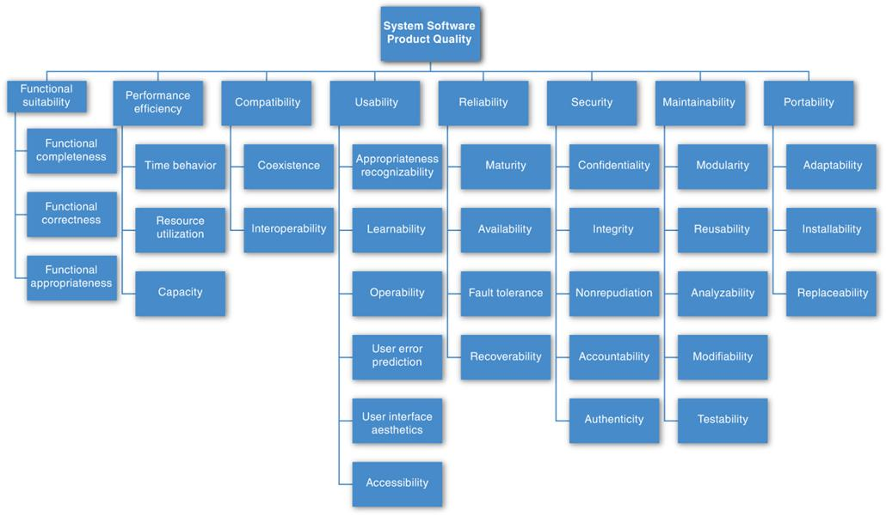
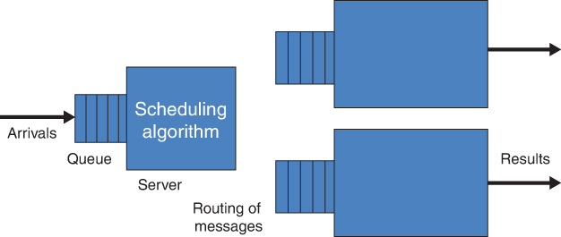

# 14. Làm việc với các quality attribute khác (Working with Other Quality Attributes)

> Chất lượng không phải là điều xảy ra khi những gì bạn làm khớp với ý định của bạn. Nó là điều xảy ra khi những gì bạn làm khớp với kỳ vọng của khách hàng. 
> —Guaspari

[Chương 4](ch04_availability.vi.md#ch04)–[13](ch13_usability.vi.md#ch13) mỗi chương đề cập đến một quality attribute (QA) cụ thể quan trọng đối với các hệ thống phần mềm. Mỗi chương đó đã thảo luận cách QA cụ thể của nó được định nghĩa, đưa ra một general scenario cho QA đó, và cho thấy cách viết các scenario cụ thể để biểu đạt các sắc thái ý nghĩa chính xác liên quan đến QA đó. Ngoài ra, mỗi chương cung cấp một tập kỹ thuật để đạt được QA đó trong một architecture. Tóm lại, mỗi chương đã trình bày một kiểu danh mục (portfolio) để đặc tả và thiết kế nhằm đạt được một QA cụ thể.

Tuy nhiên, như bạn chắc chắn có thể suy ra, mười chương đó mới chỉ bắt đầu chạm vào bề mặt của các QA khác nhau mà bạn có thể cần trong một hệ thống phần mềm bạn đang làm việc.

Chương này sẽ cho thấy cách xây dựng cùng kiểu cách tiếp cận đặc tả và thiết kế cho một QA không nằm trong “danh sách A” (“A list”) của chúng tôi.

## 14.1 Các loại quality attribute khác (Other Kinds of Quality Attributes)

Các quality attribute được đề cập cho đến giờ trong Phần 2 của cuốn sách này đều có một điểm chung: Chúng liên quan đến hoặc hệ thống đang vận hành, hoặc dự án phát triển tạo ra và đưa hệ thống vào sử dụng. Nói cách khác, để đo một trong các QA đó, hoặc bạn đo hệ thống trong khi nó đang chạy (availability, energy efficiency, performance, security, safety, usability), hoặc bạn đo những người đang làm gì đó với hệ thống trong khi nó không chạy (modifiability, deployability, integrability, testability). Dù những QA này chắc chắn tạo cho bạn một “danh sách A” các QA quan trọng, vẫn có những chất lượng khác có thể hữu ích không kém.

### Quality attribute của architecture (Quality Attributes of the Architecture)

Một loại QA khác tập trung vào việc đo chính architecture. Dưới đây là ba ví dụ:

- *Buildability.* QA này đo mức độ architecture phù hợp với việc phát triển nhanh và hiệu quả. Nó được đo bằng chi phí (thường là tiền hoặc thời gian) cần để biến architecture thành một sản phẩm hoạt động được đáp ứng mọi yêu cầu của nó. Theo nghĩa đó, nó giống các QA khác đo một dự án phát triển, nhưng nó khác ở chỗ kiến thức mà phép đo nhắm đến liên quan đến chính architecture.
- *Conceptual integrity.* Conceptual integrity chỉ sự nhất quán trong thiết kế của architecture, và nó góp phần vào khả năng dễ hiểu của architecture và dẫn đến ít nhầm lẫn hơn và khả năng dự đoán cao hơn trong việc hiện thực và bảo trì nó. Conceptual integrity đòi hỏi cùng một việc được làm theo cùng một cách trên toàn architecture. Trong một architecture có conceptual integrity, ít hơn là nhiều hơn. Ví dụ, có vô số cách để các component gửi thông tin cho nhau: message, cấu trúc dữ liệu, báo hiệu sự kiện, v.v. Một architecture có conceptual integrity sẽ chỉ có một số ít cách, và chỉ cung cấp các phương án thay thế nếu có lý do thuyết phục để làm vậy. Tương tự, các component đều nên báo cáo và xử lý lỗi theo cùng một cách, ghi log sự kiện hoặc transaction theo cùng một cách, tương tác với người dùng theo cùng một cách, làm sạch dữ liệu theo cùng một cách, v.v.
- *Marketability*. “Marketability” (khả năng tiếp thị) của một architecture là một QA khác đáng quan tâm. Một số hệ thống nổi tiếng nhờ architecture của chúng, và những architecture này đôi khi mang một ý nghĩa riêng, độc lập với những QA khác mà chúng mang lại cho hệ thống. Sự nhấn mạnh hiện nay vào việc xây dựng các hệ thống cloud-based và micro-service-based đã dạy chúng ta rằng nhận thức về một architecture có thể ít nhất cũng quan trọng như các chất lượng thực tế mà architecture mang lại. Ví dụ, nhiều tổ chức đã cảm thấy buộc phải xây dựng các hệ thống cloud-based (hoặc một *technologie du jour* (công nghệ thời thượng) nào khác) bất kể đó có phải là lựa chọn kỹ thuật đúng hay không.

### Development distributability (Development Distributability)

Development distributability là chất lượng của việc thiết kế phần mềm để hỗ trợ phát triển phần mềm phân tán. Giống như modifiability, chất lượng này được đo dựa trên các hoạt động của một dự án phát triển. Nhiều hệ thống ngày nay được phát triển bằng các team phân tán trên toàn cầu. Một vấn đề phải vượt qua khi áp dụng cách tiếp cận này là điều phối hoạt động của các team. Hệ thống nên được thiết kế sao cho việc phối hợp giữa các team được giảm thiểu—tức là các hệ thống con chính nên có coupling thấp. Sự phối hợp tối thiểu này cần đạt được cả đối với code lẫn đối với data model. Các team làm việc trên các module giao tiếp với nhau có thể cần đàm phán interface của các module đó. Khi một module được nhiều module khác dùng, mỗi module do một team khác nhau phát triển, việc giao tiếp và đàm phán trở nên phức tạp và nặng nề hơn. Do đó, cấu trúc architecture và cấu trúc xã hội (và kinh doanh) của dự án cần được căn chỉnh hợp lý với nhau. Những cân nhắc tương tự áp dụng cho data model. Các scenario cho development distributability sẽ xử lý tính tương thích giữa cấu trúc giao tiếp và data model của hệ thống đang được phát triển với các cơ chế phối hợp được các tổ chức thực hiện việc phát triển sử dụng.

### Quality attribute của hệ thống (System Quality Attributes)

Các hệ thống vật lý, như máy bay, ô tô và đồ gia dụng nhà bếp, dựa vào phần mềm được nhúng bên trong chúng, được thiết kế để đáp ứng cả một loạt QA: trọng lượng, kích thước, mức tiêu thụ điện, công suất đầu ra, lượng ô nhiễm thải ra, khả năng chống chịu thời tiết, thời lượng pin, và còn nhiều nữa. Thường thì software architecture có thể có ảnh hưởng sâu sắc đến các QA của hệ thống. Ví dụ, phần mềm sử dụng tài nguyên tính toán kém hiệu quả có thể đòi hỏi thêm memory, một processor nhanh hơn, một viên pin lớn hơn, hoặc thậm chí thêm một processor (chúng tôi đã đề cập đến chủ đề energy efficiency như một QA trong [Chương 6](ch06_energy_efficiency.vi.md#ch06)). Tất nhiên, các processor bổ sung sẽ làm tăng mức tiêu thụ điện của hệ thống, nhưng cũng làm tăng trọng lượng, kích thước vật lý và chi phí của nó.

Ngược lại, architecture hoặc việc hiện thực của một hệ thống có thể cho phép hoặc ngăn cản phần mềm đáp ứng các yêu cầu QA của nó. Ví dụ:

1. Performance của một phần mềm về cơ bản bị giới hạn bởi performance của processor chạy nó. Dù bạn thiết kế phần mềm tốt đến đâu, bạn cũng không thể chạy các model dự báo thời tiết whole-earth mới nhất trên chiếc laptop của ông nội và kỳ vọng biết được ngày mai có mưa hay không.
2. Security vật lý có lẽ quan trọng hơn và hiệu quả hơn software security trong việc ngăn chặn gian lận và trộm cắp. Nếu bạn không tin điều này, hãy viết mật khẩu laptop của bạn lên một mẩu giấy, dán nó lên laptop, và để laptop trong một chiếc xe không khóa với cửa kính hạ xuống. (Thực ra, xin đừng làm vậy. Hãy coi đây là một thí nghiệm tư duy.)

Bài học ở đây là nếu bạn là kiến trúc sư cho phần mềm nằm trong một hệ thống vật lý, bạn sẽ cần hiểu các QA quan trọng mà toàn bộ hệ thống cần đạt được, và làm việc với các kiến trúc sư và kỹ sư *hệ thống* để bảo đảm software architecture của bạn đóng góp tích cực vào việc đạt được chúng.

Các kỹ thuật scenario mà chúng tôi giới thiệu cho các software QA cũng hoạt động tốt như vậy cho các system QA. Nếu các kỹ sư và kiến trúc sư hệ thống chưa dùng chúng, hãy cố gắng giới thiệu chúng.

## 14.2 Dùng các danh sách quality attribute tiêu chuẩn—hay không (Using Standard Lists of Quality Attributes—Or Not)

Kiến trúc sư không thiếu các danh sách QA cho hệ thống phần mềm để sử dụng. Tiêu chuẩn có tựa đề pause-and-take-a-breath (phải dừng lại lấy hơi) “ISO/IEC FCD 25010: Systems and Software Engineering: Systems and Software Product Quality Requirements and Evaluation (SQuaRE): System and Software Quality Models” là một ví dụ tốt ([Hình 14.1](#ch14fig01)). Tiêu chuẩn này chia các QA thành những QA hỗ trợ một model “quality in use” và những QA hỗ trợ một model “product quality”. Sự phân chia đó hơi gượng ép ở một số chỗ, nhưng dù sao nó cũng bắt đầu một cuộc hành trình divide-and-conquer qua một loạt chất lượng đáng kinh ngạc.

**Hình 14.1** *Tiêu chuẩn chất lượng sản phẩm ISO/IEC FCD 25010*

ISO 25010 liệt kê các QA sau liên quan đến chất lượng sản phẩm:

- *Functional suitability*. Mức độ một sản phẩm hoặc hệ thống cung cấp các chức năng đáp ứng các nhu cầu được nêu rõ và ngụ ý khi được dùng trong các điều kiện xác định.
- *Performance efficiency*. Performance tương đối so với lượng tài nguyên được dùng trong các điều kiện đã nêu.
- *Compatibility*. Mức độ một sản phẩm, hệ thống hoặc component có thể trao đổi thông tin với các sản phẩm, hệ thống hoặc component khác, và/hoặc thực hiện các chức năng được yêu cầu của nó, trong khi dùng chung cùng một môi trường phần cứng hoặc phần mềm.
- *Usability*. Mức độ một sản phẩm hoặc hệ thống có thể được những người dùng xác định sử dụng để đạt được các mục tiêu xác định với tính hiệu lực, hiệu suất và sự hài lòng trong một bối cảnh sử dụng xác định.
- *Reliability*. Mức độ một hệ thống, sản phẩm hoặc component thực hiện các chức năng đã đặc tả trong các điều kiện xác định trong một khoảng thời gian xác định.
- *Security*. Mức độ một sản phẩm hoặc hệ thống bảo vệ thông tin và dữ liệu sao cho con người hoặc các sản phẩm hay hệ thống khác có mức truy cập dữ liệu phù hợp với loại và mức ủy quyền của họ.
- *Maintainability*. Mức độ hiệu lực và hiệu suất mà một sản phẩm hoặc hệ thống có thể được sửa đổi bởi những người bảo trì dự định.
- *Portability*. Mức độ hiệu lực và hiệu suất mà một hệ thống, sản phẩm hoặc component có thể được chuyển từ một môi trường phần cứng, phần mềm, hoặc môi trường vận hành hay sử dụng khác sang một môi trường khác.

Trong ISO 25010, mỗi “quality characteristic” này gồm các “quality sub-characteristics” (ví dụ, nonrepudiation là một sub-characteristic của security). Tiêu chuẩn này lê bước qua gần năm chục mô tả riêng biệt về các quality sub-characteristics theo cách này. Nó định nghĩa cho chúng ta các chất lượng “pleasure (niềm vui) và “comfort” (sự thoải mái). Nó phân biệt giữa “functional correctness” và “functional completeness”, rồi thêm “functional appropriateness” cho đủ bộ. Để thể hiện “compatibility”, các hệ thống phải có hoặc “interoperability” hoặc chỉ đơn thuần là “coexistence”. “Usability” là một chất lượng sản phẩm, không phải chất lượng quality-in-use, dù nó bao gồm “satisfaction”, thứ *là* một chất lượng quality-in-use. “Modifiability” và “testability” đều là một phần của “maintainability”. “Modularity” cũng vậy, thứ vốn là một chiến lược để đạt được một chất lượng chứ không phải một mục tiêu tự thân. “Availability” là một phần của “reliability”. “Interoperability” là một phần của “compatibility”. Và “scalability” thì hoàn toàn không được nhắc đến.

Hiểu hết chưa?

Những danh sách như thế này—và có rất nhiều danh sách như vậy trôi nổi khắp nơi—đều phục vụ một mục đích. Chúng có thể là các checklist hữu ích giúp những người thu thập yêu cầu bảo đảm không có nhu cầu quan trọng nào bị bỏ sót. Hữu ích hơn cả các danh sách độc lập, chúng có thể làm cơ sở để tạo checklist của riêng bạn chứa các QA đáng quan tâm trong domain, ngành, tổ chức và sản phẩm của bạn. Danh sách QA cũng có thể làm cơ sở để thiết lập các thước đo, dù bản thân các tên gọi hầu như không gợi ý cách làm điều này. Nếu “fun” (vui) hóa ra là một mối quan tâm quan trọng trong hệ thống của bạn, bạn đo nó như thế nào để biết hệ thống của mình có mang lại đủ niềm vui không?

Những danh sách chung như thế này cũng có một số nhược điểm. Thứ nhất, không danh sách nào sẽ đầy đủ. Với tư cách kiến trúc sư, chắc chắn bạn sẽ được yêu cầu thiết kế một hệ thống đáp ứng một mối quan tâm của stakeholder mà không người lập danh sách (list-maker) nào lường trước. Ví dụ, một số tác giả nói về “manageability”, biểu thị mức độ dễ dàng để quản trị viên hệ thống quản lý ứng dụng. Điều này có thể đạt được bằng cách chèn các công cụ đo đạc hữu ích để giám sát hoạt động và để debug và tinh chỉnh performance. Chúng tôi biết một architecture được thiết kế với mục tiêu có ý thức là giữ chân nhân sự chủ chốt và thu hút những người new-hires tài năng đến một vùng yên tĩnh ở miền Trung Tây nước Mỹ. Các kiến trúc sư của hệ thống đó nói về việc thấm nhuần “Iowability” vào hệ thống. Họ đạt được điều đó bằng cách đưa vào công nghệ state-of-the-art và trao cho các team phát triển sự tự do sáng tạo rộng rãi. Chúc may mắn nếu bạn tìm “Iowability” trong bất kỳ danh sách QA tiêu chuẩn nào, nhưng QA đó quan trọng đối với tổ chức đó không kém bất kỳ QA nào khác.

Thứ hai, danh sách thường tạo ra nhiều tranh cãi hơn là hiểu biết. Bạn có thể lập luận một cách thuyết phục rằng “functional correctness” nên là một phần của “reliability”, hoặc “portability” chỉ là một loại “modifiability”, hoặc “maintainability” là một loại “modifiability” (chứ không phải ngược lại). Những người viết ISO 25010 dường như đã tốn thời gian và công sức để quyết định cho security thành một characteristic riêng, thay vì là một sub-characteristic của functionality như trong phiên bản trước. Chúng tôi tin chắc rằng công sức dành cho những tranh luận như vậy có thể được dùng tốt hơn ở nơi khác.

Thứ ba, những danh sách này thường được cho là các *taxonomy* (hệ thống phân loại)—tức là các danh sách có thuộc tính đặc biệt là mọi thành viên có thể được xếp vào đúng một chỗ. Nhưng các QA nổi tiếng là khó phân định về mặt này. Ví dụ, chúng tôi đã thảo luận denial of service là một phần của security, availability, performance và usability trong [Chương 3](ch03_understanding_quality_attributes.vi.md#ch03).

Những nhận xét này củng cố bài học đã được giới thiệu trong [Chương 3](ch03_understanding_quality_attributes.vi.md#ch03): Bản thân tên gọi QA phần lớn là vô dụng và cùng lắm chỉ là lời mời bắt đầu một cuộc trò chuyện. Hơn nữa, việc dành thời gian lo lắng xem chất lượng nào là chất lượng con của chất lượng nào khác gần như vô ích. Thay vào đó, các scenario mang lại cách tốt nhất để chúng ta đặc tả chính xác điều chúng ta muốn nói khi nói về một QA.

Hãy dùng các danh sách QA tiêu chuẩn trong chừng mực chúng hữu ích như checklist, nhưng đừng cảm thấy cần phải tuân theo một cách mù quáng thuật ngữ hay cấu trúc của chúng. Và đừng tự lừa mình rằng một checklist như vậy loại bỏ nhu cầu phân tích sâu hơn.

## 14.3 Xử lý “X-Ability:” đưa một QA mới vào khuôn khổ

Giả sử, với tư cách kiến trúc sư, bạn phải xử lý một QA mà không có một khối kiến thức cô đọng nào, không có “danh mục” nào như [Chương 4](ch04_availability.vi.md#ch04)–[13](ch13_usability.vi.md#ch13) đã cung cấp cho các QA đó. Giả sử bạn thấy mình phải xử lý một QA như “development distributability” hoặc “manageability” hoặc thậm chí “Iowability”? Bạn làm gì?

### Thu thập scenario cho quality attribute mới (Capture Scenarios for the New Quality Attribute)

Bước đầu tiên là phỏng vấn các stakeholder có mối quan tâm đã dẫn đến nhu cầu về QA này. Bạn có thể làm việc với họ, riêng lẻ hoặc theo nhóm, để xây dựng một tập đặc trưng attribute làm rõ ý nghĩa của QA. Ví dụ, bạn có thể phân rã development distributability thành các attribute con (subattribute) là phân đoạn phần mềm, kết hợp phần mềm và phối hợp team. Sau bước làm rõ đó, bạn có thể làm việc với các stakeholder để soạn một tập scenario cụ thể đặc trưng cho ý nghĩa của QA đó. Một ví dụ về quy trình này có thể được tìm thấy trong [Chương 22](ch22_documenting_an_architecture.vi.md#ch22), nơi chúng tôi mô tả việc xây dựng một “utility tree”.

Một khi bạn có một tập scenario cụ thể, bạn có thể làm việc để tổng quát hóa tập đó. Hãy xem tập stimulus bạn đã thu thập, tập response, tập response measure, v.v. Dùng chúng để xây dựng một general scenario bằng cách làm cho mỗi phần của general scenario là sự tổng quát hóa của các trường hợp cụ thể bạn đã thu thập.

### Mô hình hóa quality attribute (Model the Quality Attribute)

Nếu bạn có thể xây dựng (hoặc tốt hơn nữa, tìm thấy) một model khái niệm của QA, nền tảng đó có thể hữu ích trong việc tạo ra một tập cách tiếp cận thiết kế cho nó. Khi nói “model”, chúng tôi không muốn nói gì hơn là sự hiểu biết về tập tham số mà QA nhạy cảm và tập đặc điểm architecture ảnh hưởng đến các tham số đó. Ví dụ, một model của modifiability có thể cho chúng ta biết rằng modifiability là một hàm của số chỗ trong hệ thống phải được thay đổi để đáp ứng một sửa đổi, và mức độ liên kết giữa những chỗ đó. Một model cho performance có thể cho chúng ta biết rằng throughput là một hàm của workload transaction, các dependency giữa các transaction, và số transaction có thể được xử lý song song.

[Hình 14.2](#ch14fig02) cho thấy một queuing model đơn giản cho performance. Những model như vậy được dùng rộng rãi để phân tích độ trễ và throughput của nhiều loại hệ thống hàng đợi, bao gồm các môi trường sản xuất và dịch vụ cũng như các hệ thống máy tính.

**Hình 14.2** *Một queuing model tổng quát*

Trong model này, bảy tham số có thể ảnh hưởng đến độ trễ mà model dự đoán:

- Tốc độ đến (arrival rate)
- Kỷ luật hàng đợi (queuing discipline)
- Scheduling algorithm
- Thời gian phục vụ (service time)
- Topology
- Băng thông mạng (network bandwidth)
- Routing algorithm

Đây là những tham số *duy nhất* có thể ảnh hưởng đến độ trễ trong model này. Đây là điều mang lại sức mạnh cho model. Hơn nữa, mỗi tham số này có thể bị ảnh hưởng bởi nhiều quyết định architecture khác nhau. Đây là điều làm cho model hữu ích đối với kiến trúc sư. Ví dụ, routing algorithm có thể cố định hoặc có thể là một algorithm load-balancing. Phải chọn một scheduling algorithm. Topology có thể bị ảnh hưởng bằng cách thêm hoặc bớt server mới một cách động. Và cứ thế.

Nếu bạn đang tạo model của riêng mình, tập scenario của bạn sẽ định hướng cho việc tìm hiểu. Các tham số của model có thể được suy ra từ các stimulus (và nguồn của chúng), các response (và các thước đo của chúng), các artifact (và thuộc tính của chúng), và environment (và các đặc điểm của nó).

### Tập hợp các cách tiếp cận thiết kế cho quality attribute mới (Assemble Design Approaches for the New Quality Attribute)

Quy trình tạo ra một tập cơ chế dựa trên một model bao gồm các bước sau:

- Liệt kê các tham số của model.
- Với mỗi tham số, liệt kê các đặc điểm architecture (và các cơ chế để đạt được những đặc điểm đó) có thể ảnh hưởng đến tham số này. Bạn có thể làm điều này bằng cách:
- Xem lại một khối cơ chế mà bạn quen thuộc và tự hỏi mỗi cơ chế ảnh hưởng đến tham số QA như thế nào.
- Tìm kiếm các thiết kế đã xử lý thành công QA này. Bạn có thể tìm theo tên bạn đã đặt cho chính QA, nhưng bạn cũng có thể tìm theo các thuật ngữ bạn đã chọn khi làm rõ QA thành các attribute con.
- Tìm kiếm các ấn phẩm và bài blog về QA này và cố gắng tổng quát hóa các nhận xét và phát hiện của chúng.
- Tìm các chuyên gia trong lĩnh vực này và phỏng vấn họ hoặc đơn giản là viết thư xin họ lời khuyên.

Kết quả là một danh sách cơ chế để, trong trường hợp ví dụ, kiểm soát performance và, trong trường hợp tổng quát hơn, để kiểm soát QA mà model quan tâm. Điều này làm cho bài toán thiết kế dễ xử lý hơn nhiều. Danh sách cơ chế này hữu hạn và khá nhỏ, vì số tham số của model là có giới hạn và với mỗi tham số, số quyết định architecture có thể ảnh hưởng đến tham số đó là có hạn.

## 14.4 Đọc thêm (For Further Reading)

“Mẹ của mọi danh sách QA” có lẽ là danh sách trên—còn ở đâu khác nữa?—Wikipedia. Danh sách này có thể được tìm thấy, khá tự nhiên, dưới tên “List of system quality attributes”. Khi cuốn sách này được xuất bản, bạn có thể ngấu nghiến các định nghĩa của hơn 80 QA khác nhau. QA yêu thích của chúng tôi là “demonstrability”, được định nghĩa một cách đầy hữu ích là chất lượng của việc có thể chứng minh được. Ai bảo bạn không thể tin những gì bạn đọc trên Internet?

Xem [Chương 8](ch08_modifiability.vi.md#ch08) của [Bass 19] để có danh sách các chất lượng của một deployment pipeline. Chúng bao gồm traceability, testability (của deployment pipeline), tooling và cycle time.

## 14.5 Câu hỏi thảo luận (Discussion Questions)

1. Vương quốc Bhutan đo lường hạnh phúc của người dân, và chính sách của chính phủ được xây dựng để tăng GNH (gross national happiness—tổng hạnh phúc quốc gia) của Bhutan. Hãy đọc về cách GNH được đo (thử [grossnationalhappiness.com](http://grossnationalhappiness.com/)) rồi phác thảo một general scenario cho QA *hạnh phúc* (happiness) cho phép bạn biểu đạt các yêu cầu hạnh phúc cụ thể cho một hệ thống phần mềm.
2. Hãy chọn một QA không được mô tả trong [Chương 4](ch04_availability.vi.md#ch04)–[13](ch13_usability.vi.md#ch13). Với QA đó, hãy tập hợp một tập scenario cụ thể mô tả điều bạn muốn nói về nó. Dùng tập scenario đó để xây dựng một general scenario cho nó.
3. Với QA bạn đã chọn cho câu hỏi 2, hãy tập hợp một tập cơ chế thiết kế (pattern và tactic) giúp bạn đạt được nó.
4. Lặp lại câu hỏi 2 và 3 cho QA *chi phí phát triển* (development cost), rồi cho QA *chi phí vận hành* (operating cost).
5. Điều gì có thể khiến bạn thêm một tactic hoặc pattern vào các tập QA đã được mô tả trong [Chương 4](ch04_availability.vi.md#ch04)–[13](ch13_usability.vi.md#ch13) (hoặc vào bất kỳ QA nào khác)?
6. Hãy thảo luận cách bạn nghĩ development distributability có xu hướng đánh đổi với các QA performance, availability, modifiability và integrability.
7. Hãy tìm hiểu một số danh sách QA cho những thứ không phải hệ thống phần mềm: các chất lượng của một chiếc xe tốt, chẳng hạn, hoặc của một người tốt để gắn bó trong một mối quan hệ. Hãy thêm các chất lượng do bạn tự chọn vào danh sách hoặc các danh sách bạn tìm thấy.
8. Các tactic development-time liên quan đến việc tách biệt và đóng gói trách nhiệm. Các performance tactic liên quan đến việc đặt mọi thứ lại với nhau. Đó là lý do vì sao chúng luôn xung đột. Có nhất thiết phải luôn như vậy không? Có cách nào có nguyên tắc để định lượng các tradeoff không?
9. Có một taxonomy của các tactic không? Các nhà hóa học có bảng tuần hoàn và các định luật tương tác phân tử, các nhà vật lý nguyên tử có danh mục các hạt hạ nguyên tử và các định luật về điều xảy ra khi chúng va chạm, các nhà dược học có danh mục hóa chất và các định luật về tương tác của chúng với thụ thể và hệ chuyển hóa, v.v. Điều tương đương cho tactic là gì? Và có các định luật cho sự tương tác giữa chúng không?
10. Security là một QA đặc biệt nhạy cảm với các quy trình diễn ra trong thế giới vật lý bên ngoài máy tính: quy trình áp dụng bản vá, quy trình chọn và bảo vệ mật khẩu, quy trình bảo vệ vật lý các cơ sở nơi đặt máy tính và dữ liệu, quy trình quyết định có tin tưởng một phần mềm nhập vào hay không, quy trình quyết định có tin tưởng một developer hay người dùng hay không, v.v. Các quy trình tương ứng quan trọng đối với performance là gì? Hoặc usability? Có quy trình nào không? Tại sao security lại process-sensitive đến vậy? Quy trình có nên là một phần của cấu trúc QA hay chúng trực giao với nó?
11. Mối quan hệ giữa mỗi cặp QA trong danh sách sau là gì?
   - Performance và security
   - Security và buildability
   - Energy efficiency và time to market
