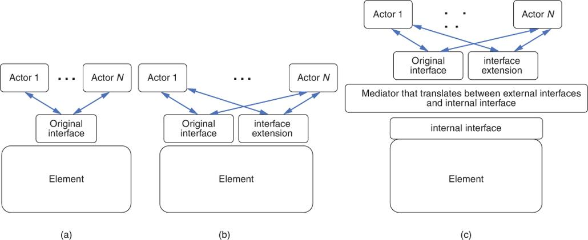
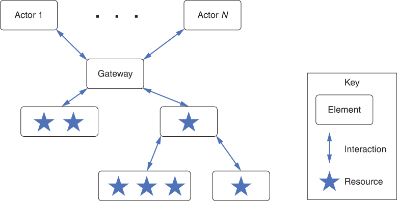
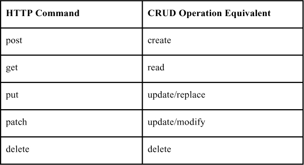

# 15. Software interface (Software Interfaces)

Cùng với Cesare Pautasso

> NASA đã mất con tàu Mars Climate Orbiter trị giá $125-million vì các kỹ sư tàu vũ trụ đã không chuyển đổi từ đơn vị đo Anh sang hệ mét khi trao đổi dữ liệu quan trọng trước khi con tàu được phóng.… 
> Một nhóm dẫn đường tại [NASA] dùng hệ mét gồm milimét và mét trong các phép tính của mình, trong khi [công ty] thiết kế và chế tạo tàu vũ trụ cung cấp dữ liệu gia tốc then chốt theo hệ đo Anh gồm inch, feet và pound.… 
> Theo một nghĩa nào đó, con tàu vũ trụ đã bị lạc trong khâu dịch thuật. 
> —Robert Lee Hotz, “Mars Probe Lost Due to Simple Math Error,” *Los Angeles Times*, ngày 1 tháng Mười, 1999

Chương này mô tả các khái niệm xoay quanh interface, và thảo luận cách thiết kế và tài liệu hóa chúng.

Một interface, dù là phần mềm hay không, là một ranh giới mà qua đó các element gặp nhau và tương tác, giao tiếp và phối hợp. Các element có interface kiểm soát việc truy cập vào phần bên trong của chúng. Các element cũng có thể được chia nhỏ, với mỗi sub-element có interface riêng.

*Actor* của một element là các element, người dùng hoặc hệ thống khác mà nó tương tác. Tập hợp các actor mà một element tương tác được gọi là *environment* (môi trường) của element đó. Khi nói “tương tác”, chúng tôi muốn nói đến bất cứ điều gì một element làm có thể tác động đến việc xử lý của một element khác. Sự tương tác này là một phần của interface của element. Tương tác có thể ở nhiều dạng, dù hầu hết đều liên quan đến việc chuyển giao quyền điều khiển và/hoặc dữ liệu. Một số được hỗ trợ bởi các cấu trúc programming-language tiêu chuẩn, như lời gọi thủ tục cục bộ hoặc từ xa (remote procedure call, RPC), data stream, shared memory và message passing.

Các cấu trúc này, vốn cung cấp các điểm tương tác trực tiếp với một element, được gọi là *resource*. Các tương tác khác là gián tiếp. Ví dụ, việc dùng resource X trên element A khiến element B ở một trạng thái cụ thể là điều mà các element khác dùng resource đó có thể cần biết nếu nó ảnh hưởng đến việc xử lý của chúng, dù chúng không bao giờ tương tác trực tiếp với element A. Thực tế đó về A là một phần của interface giữa A và các element khác trong môi trường của A. Trong chương này, chúng tôi chỉ tập trung vào các tương tác trực tiếp.

Hãy nhớ lại rằng, trong [Chương 1](ch01_what_is_software_architecture.vi.md#ch01), chúng tôi đã định nghĩa architecture dựa trên các element và mối quan hệ giữa chúng. Trong chương này, chúng tôi tập trung vào một loại quan hệ. Interface là một cơ chế trừu tượng hóa nền tảng cần thiết để kết nối các element với nhau. Chúng có tác động rất lớn đến modifiability, usability, testability, performance, integrability, v.v. của một hệ thống. Hơn nữa, các interface bất đồng bộ, vốn thường là một phần của các hệ thống phân tán, đòi hỏi event handler—một element của architecture.

Đối với interface của một element cho trước, có thể có một hoặc nhiều implementation, mỗi implementation có thể có các bảo đảm khác nhau về performance, scalability hoặc availability. Tương tự, các implementation khác nhau cho cùng một interface có thể được xây dựng cho các nền tảng khác nhau.

Ba điểm được ngụ ý từ phần thảo luận cho đến giờ:

1. *Mọi element đều có interface.* Mọi element đều tương tác với một số actor nào đó; nếu không, element tồn tại để làm gì?
2. *Interface là hai chiều (two-way).* Khi xem xét interface, hầu hết các kỹ sư phần mềm trước tiên nghĩ đến bản tóm tắt những gì một element cung cấp. Element cung cấp những method nào? Nó xử lý những sự kiện nào? Nhưng một element cũng tương tác với môi trường của nó bằng cách sử dụng các tài nguyên bên ngoài nó hoặc bằng cách giả định rằng môi trường của nó hành xử theo một cách nhất định. Nếu những tài nguyên này bị thiếu hoặc nếu môi trường không hành xử như mong đợi, element không thể hoạt động đúng. Vì vậy, một interface không chỉ là những gì được element *cung cấp*; một interface còn bao gồm những gì element *đòi hỏi*.
3. *Một element có thể tương tác với nhiều actor thông qua cùng một interface*. Ví dụ, các web server thường giới hạn số kết nối HTTP có thể được mở đồng thời.

## 15.1 Các khái niệm về interface (Interface Concepts)

Trong mục này, chúng tôi thảo luận các khái niệm multiple interface, resource, operation, property và event, cũng như sự tiến hóa của interface.

### Nhiều interface (Multiple Interfaces)

Có thể chia một interface thành nhiều interface. Mỗi interface có một mục đích logic liên quan, và phục vụ một lớp actor khác nhau. Multiple interface cung cấp một dạng separation of concerns. Một lớp actor cụ thể có thể chỉ cần một tập con chức năng có sẵn; chức năng này có thể được cung cấp bởi một trong các interface. Ngược lại, bên cung cấp một element có thể muốn trao cho các actor các quyền truy cập khác nhau, như đọc hoặc ghi, hoặc muốn hiện thực một chính sách security. Multiple interface hỗ trợ các mức truy cập khác nhau. Ví dụ, một element có thể phơi chức năng của nó thông qua interface chính và cấp quyền truy cập vào dữ liệu debug hoặc giám sát performance hay các chức năng quản trị thông qua các interface riêng biệt. Có thể có các interface read-only công khai cho các actor ẩn danh và các interface private cho phép các actor đã được xác thực và ủy quyền sửa đổi trạng thái của một element.

### Resource (Resources)

Resource có cú pháp và ngữ nghĩa:

- *Cú pháp resource (Resource syntax)*. Cú pháp là signature của resource, bao gồm mọi thông tin mà một chương trình khác sẽ cần để viết một chương trình đúng cú pháp sử dụng resource đó. Signature bao gồm tên của resource, tên và kiểu dữ liệu của các đối số, nếu có, v.v.
- *Ngữ nghĩa resource (Resource semantics)*. Kết quả của việc gọi resource này là gì? Ngữ nghĩa có nhiều dạng, bao gồm:
- Gán giá trị cho dữ liệu mà actor gọi resource có thể truy cập. Việc gán giá trị có thể đơn giản như đặt giá trị của một đối số trả về hoặc far-reaching như cập nhật một database trung tâm.
- Các giả định về các giá trị đi qua interface.
- Những thay đổi trong trạng thái của element do việc sử dụng resource gây ra. Điều này bao gồm các điều kiện ngoại lệ, chẳng hạn như tác dụng phụ từ một thao tác hoàn thành dở dang.
- Các sự kiện sẽ được báo hiệu hoặc các message sẽ được gửi như kết quả của việc sử dụng resource.
- Các resource khác sẽ hành xử khác đi như thế nào trong tương lai như kết quả của việc sử dụng resource này. Ví dụ, nếu bạn yêu cầu một resource hủy một object, việc cố truy cập object đó trong tương lai thông qua các resource khác có thể dẫn đến lỗi.
- Các kết quả con người có thể quan sát được. Chúng phổ biến trong các hệ thống nhúng. Ví dụ, gọi một chương trình bật một màn hình trong buồng lái có một tác động rất dễ quan sát—màn hình bật lên. Ngoài ra, phát biểu về ngữ nghĩa nên làm rõ liệu việc thực thi resource sẽ là atomic hay có thể bị tạm dừng hoặc bị ngắt.

### Operation, event và property (Operations, Events, and Properties)

Các resource của các interface được cung cấp gồm operation, event và property. Các resource này được bổ sung bằng một mô tả tường minh về hành vi được gây ra hoặc dữ liệu được trao đổi khi truy cập mỗi resource của interface, xét về cú pháp, cấu trúc và ngữ nghĩa. (Không có mô tả này, làm sao lập trình viên hay actor biết có nên dùng và dùng các resource như thế nào?)

*Operation* được gọi để chuyển quyền điều khiển và dữ liệu tới element để xử lý. Hầu hết các operation cũng trả về một kết quả. Operation có thể thất bại, và như một phần của interface, cần làm rõ cách actor có thể phát hiện lỗi, được báo hiệu như một phần của đầu ra hoặc thông qua một kênh exception-handling chuyên dụng.

Ngoài ra, *event*—thường là bất đồng bộ—có thể được mô tả trong interface. Event đến có thể biểu diễn việc nhận một message lấy từ hàng đợi, hoặc việc một stream element cần được tiêu thụ đến. Các element active—những element không thụ động chờ được các element khác gọi—tạo ra các event đi ra dùng để thông báo cho các listener (hoặc subscriber) về những điều đáng chú ý đang xảy ra bên trong element.

Ngoài dữ liệu được chuyển qua operation và event, một khía cạnh quan trọng của interface là metadata, như quyền truy cập, đơn vị đo, hoặc các giả định về định dạng. Một tên khác cho metadata của interface là *property*. Giá trị property có thể ảnh hưởng đến hành vi của operation, như được nêu bật trong trích dẫn mở đầu chương này. Giá trị property cũng ảnh hưởng đến hành vi của element, tùy thuộc vào trạng thái của nó.

Các interface phức tạp của những element vừa stateful vừa active sẽ có sự kết hợp của operation, event và property.

### Sự tiến hóa của interface (Interface Evolution)

Mọi phần mềm đều tiến hóa, kể cả interface. Phần mềm được đóng gói bởi một interface có thể tự do tiến hóa mà không ảnh hưởng đến các element dùng interface này, miễn là bản thân interface không thay đổi. Tuy nhiên, một interface là một hợp đồng (contract) giữa một element và các actor của nó. Cũng như một hợp đồng pháp lý chỉ có thể được thay đổi trong những ràng buộc nhất định, các software interface nên được thay đổi một cách cẩn thận. Có thể dùng ba kỹ thuật để thay đổi một interface: deprecation, versioning và extension.

- *Deprecation*. Deprecation nghĩa là loại bỏ một interface. Thực hành tốt nhất khi deprecate một interface là thông báo sớm và rộng rãi cho các actor của element. Về lý thuyết, cảnh báo này cho phép các actor có thời gian điều chỉnh với việc interface bị loại bỏ. Trong thực tế, nhiều actor sẽ không điều chỉnh trước, mà chỉ phát hiện ra việc deprecation khi interface bị loại bỏ. Một kỹ thuật khi deprecate một interface là đưa vào một mã lỗi cho biết interface này sẽ bị deprecate vào (ngày cụ thể) hoặc interface này đã bị deprecate.
- *Versioning*. Multiple interface hỗ trợ sự tiến hóa bằng cách giữ interface cũ và thêm một interface mới. Interface cũ có thể bị deprecate khi không còn cần thiết hoặc khi đã có quyết định không hỗ trợ nó nữa. Điều này đòi hỏi actor chỉ rõ phiên bản interface nào nó đang dùng.
- *Extension*. Mở rộng một interface nghĩa là giữ nguyên interface ban đầu và thêm các resource mới vào interface thể hiện các thay đổi mong muốn. [Hình 15.1](#ch15fig01)(a) cho thấy interface ban đầu. Nếu phần mở rộng không chứa bất kỳ sự không tương thích nào với interface ban đầu, thì element có thể hiện thực trực tiếp interface bên ngoài, như trong [Hình 15.1](#ch15fig01)(b). Ngược lại, nếu phần mở rộng đưa vào một số sự không tương thích, thì cần có một interface nội bộ cho element và thêm một mediator để chuyển đổi giữa interface bên ngoài và interface nội bộ, như trong [Hình 15.1](#ch15fig01)(c). Lấy một ví dụ về sự không tương thích, giả sử interface ban đầu giả định rằng số căn hộ được đưa vào trong địa chỉ nhưng interface mở rộng tách số căn hộ thành một tham số riêng. Interface nội bộ sẽ có số căn hộ là một tham số riêng. Khi đó, mediator, nếu được gọi từ interface ban đầu, sẽ phân tích địa chỉ để xác định số căn hộ nếu có, trong khi mediator sẽ chuyển nguyên số căn hộ có trong tham số riêng tới interface nội bộ.

**Hình 15.1** *(a) Interface ban đầu. (b) Mở rộng interface. (c) Dùng một intermediary*

## 15.2 Thiết kế một interface (Designing an Interface)

Các quyết định về việc resource nào nên được nhìn thấy từ bên ngoài nên được dẫn dắt bởi nhu cầu của các actor sử dụng resource đó. Thêm resource vào một interface ngụ ý một cam kết duy trì những resource đó như một phần của interface chừng nào element còn được sử dụng. Một khi các actor bắt đầu phụ thuộc vào một resource bạn cung cấp, các element của họ sẽ hỏng nếu resource bị thay đổi hoặc bị loại bỏ. Reliability của architecture của bạn bị ảnh hưởng khi hợp đồng interface giữa các element bị phá vỡ.

Một số nguyên lý thiết kế bổ sung cho interface được nêu bật ở đây:

- *Principle of least surprise* (nguyên lý ít bất ngờ nhất). Interface nên hành xử nhất quán với kỳ vọng của actor. Tên gọi đóng một vai trò ở đây: Một resource được đặt tên phù hợp sẽ cho actor một gợi ý tốt về việc resource có thể được dùng vào việc gì.
- *Small interfaces principle* (nguyên lý interface nhỏ). Nếu hai element cần tương tác, hãy để chúng trao đổi càng ít thông tin càng tốt.
- *Uniform access principle* (nguyên lý truy cập đồng nhất). Tránh làm rò rỉ chi tiết hiện thực qua interface. Một resource nên được các actor của nó truy cập theo cùng một cách bất kể chúng được hiện thực như thế nào. Ví dụ, một actor không nên biết một giá trị được trả về từ cache, từ một phép tính, hay từ một lần lấy mới giá trị từ một nguồn bên ngoài nào đó.
- *Don’t repeat yourself principle* (nguyên lý đừng lặp lại chính mình). Interface nên cung cấp một tập các primitive có thể kết hợp với nhau thay vì nhiều cách dư thừa để đạt được cùng một mục tiêu.

Tính nhất quán là một khía cạnh quan trọng của việc thiết kế interface rõ ràng. Với tư cách kiến trúc sư, bạn nên thiết lập và tuân theo các quy ước về cách đặt tên resource, cách sắp xếp thứ tự tham số API, và cách xử lý lỗi. Tất nhiên, không phải mọi interface đều nằm trong tầm kiểm soát của kiến trúc sư, nhưng trong chừng mực có thể, thiết kế interface nên nhất quán trên mọi element của cùng một architecture. Developer cũng sẽ đánh giá cao nếu interface tuân theo các quy ước của nền tảng bên dưới hoặc các idiom của ngôn ngữ lập trình mà họ mong đợi. Tuy nhiên, hơn cả việc chiếm được thiện cảm của developer, tính nhất quán sẽ giúp giảm thiểu số lỗi phát triển do hiểu nhầm.

Một tương tác thành công với một interface đòi hỏi sự thống nhất về các khía cạnh sau:

1. Phạm vi interface (interface scope)
2. Kiểu tương tác (interaction style)
3. Biểu diễn và cấu trúc của dữ liệu được trao đổi
4. Xử lý lỗi (error handling)

Mỗi điều này cấu thành một khía cạnh quan trọng của việc thiết kế một interface. Chúng tôi sẽ lần lượt đề cập đến từng điều.

### Phạm vi interface (Interface Scope)

Phạm vi của một interface định nghĩa tập các resource mà actor có thể truy cập trực tiếp. Bạn, với tư cách người thiết kế interface, có thể muốn tiết lộ mọi resource; hoặc, bạn có thể muốn hạn chế truy cập vào một số resource nhất định hoặc đối với một số actor nhất định. Ví dụ, bạn có thể muốn hạn chế truy cập vì lý do security, quản lý performance và khả năng mở rộng.

Một pattern phổ biến để hạn chế và làm trung gian truy cập vào resource của một element hoặc một nhóm element là thiết lập một element *gateway*. Một gateway—thường được gọi là message gateway—chuyển các request của actor thành các request tới resource của element đích (hoặc các element đích), và do đó trở thành một actor đối với element hoặc các element đích. [Hình 15.2](#ch15fig02) đưa ra một ví dụ về gateway. Gateway hữu ích vì những lý do sau:

- Granularity của resource do một element cung cấp có thể khác với những gì actor cần. Một gateway có thể chuyển đổi giữa element và actor.
- Actor có thể cần truy cập vào, hoặc bị giới hạn ở, các tập con cụ thể của resource.
- Các đặc điểm cụ thể của resource—số lượng, protocol, kiểu, vị trí và property của chúng—có thể thay đổi theo thời gian, và gateway có thể cung cấp một interface ổn định hơn.

**Hình 15.2** *Một gateway cung cấp truy cập tới nhiều resource khác nhau*

Giờ chúng ta chuyển sang chi tiết của việc thiết kế các interface cụ thể. Điều này có nghĩa là quyết định interface nên có những operation, event và property nào. Ngoài ra, bạn phải chọn các định dạng biểu diễn dữ liệu và ngữ nghĩa dữ liệu phù hợp để bảo đảm khả năng tương thích và khả năng tương tác giữa các element của architecture. Trích dẫn mở đầu của chúng tôi đưa ra một ví dụ về tầm quan trọng của những quyết định này.

### Kiểu tương tác (Interaction Styles)

Interface được thiết kế để được kết nối với nhau để các element khác nhau có thể giao tiếp (chuyển dữ liệu) và phối hợp (chuyển quyền điều khiển). Có nhiều cách để những tương tác như vậy diễn ra, tùy thuộc vào tỷ lệ giữa giao tiếp và phối hợp, và vào việc các element sẽ được đặt cùng chỗ (co-located) hay được deploy từ xa. Ví dụ:

- Interface của các element co-located có thể cung cấp truy cập hiệu quả tới lượng lớn dữ liệu thông qua các buffer shared memory cục bộ.
- Các element được kỳ vọng sẵn sàng cùng lúc có thể dùng lời gọi đồng bộ để gọi các operation mà chúng cần.
- Các element được deploy trong một môi trường phân tán không đáng tin cậy sẽ cần dựa vào các tương tác bất đồng bộ dựa trên việc tiêu thụ và tạo ra event, được trao đổi qua message queue hoặc data stream.

Có nhiều kiểu tương tác khác nhau, nhưng chúng tôi sẽ tập trung vào hai kiểu được dùng rộng rãi nhất: RPC và REST.

- *Remote Procedure Call (RPC)*. RPC được mô hình hóa theo lời gọi thủ tục trong các ngôn ngữ mệnh lệnh, ngoại trừ việc thủ tục được gọi nằm ở nơi khác trên mạng. Lập trình viên viết code cho lời gọi thủ tục như thể một thủ tục cục bộ đang được gọi (với một số khác biệt về cú pháp); sau đó lời gọi được chuyển thành một message gửi tới một element từ xa, nơi thủ tục thực sự được gọi. Cuối cùng, kết quả được gửi trở lại dưới dạng một message tới element gọi.

   RPC có từ thập niên 1980s và đã trải qua nhiều sửa đổi kể từ khi ra đời. Các phiên bản đầu của protocol này là đồng bộ, với các tham số của message được gửi dưới dạng văn bản. Phiên bản RPC gần đây nhất, gọi là gRPC, truyền tham số dưới dạng nhị phân, là bất đồng bộ, và hỗ trợ authentication, streaming hai chiều và flow control, binding blocking hoặc nonblocking, cũng như hủy bỏ và timeout. gRPC dùng HTTP 2.0 để vận chuyển.

- *Representational State Transfer (REST)*. REST là một protocol cho web service. Nó phát triển từ protocol ban đầu được dùng khi World Wide Web ra đời. REST gồm một tập sáu ràng buộc được áp đặt lên các tương tác giữa các element:
- *Uniform interface*. Mọi tương tác đều dùng cùng một dạng (thường là HTTP). Resource ở phía cung cấp của interface được chỉ định qua URI (Uniform Resource Identifier). Các quy ước đặt tên nên nhất quán và, nói chung, nên tuân theo principle of least surprise.
- *Client-server*. Actor là client và bên cung cấp resource là server, dùng pattern client-server.
- *Stateless*. Mọi tương tác client-server đều stateless. Tức là, client không nên giả định rằng server đã giữ lại bất kỳ thông tin nào về request trước của client. Hệ quả là, các tương tác như authorization được encode vào một token và token được gửi kèm mỗi request.
- *Cacheable*. Caching được áp dụng cho resource khi thích hợp. Caching có thể được hiện thực ở phía server hoặc phía client.
- *Tiered system architecture*. “Server” có thể được chia thành nhiều element độc lập, có thể được deploy độc lập. Ví dụ, business logic và database có thể được deploy độc lập.
- *Code on demand (tùy chọn)*. Server có thể cung cấp code cho client thực thi. JavaScript là một ví dụ.

Dù không phải là protocol duy nhất có thể dùng với REST, HTTP là lựa chọn phổ biến nhất. HTTP, vốn được World Wide Web Consortium (W3C) chuẩn hóa, có dạng cơ bản \<command>\<URI>. Có thể đưa thêm các tham số khác, nhưng cốt lõi của protocol là command và URI. [Bảng 15.1](#ch15tab01) liệt kê năm command quan trọng nhất trong HTTP và mô tả mối quan hệ của chúng với các thao tác database CRUD (create, read, update, delete) truyền thống.

**Bảng 15.1** *Các command quan trọng nhất trong HTTP và mối quan hệ của chúng với các thao tác database CRUD*

### Biểu diễn và cấu trúc của dữ liệu được trao đổi (Representation and Structure of Exchanged Data)

Mọi interface đều mang lại cơ hội trừu tượng hóa biểu diễn dữ liệu nội bộ, thường được xây dựng bằng các kiểu dữ liệu của ngôn ngữ lập trình (ví dụ: object, array, collection), thành một biểu diễn khác—tức là một biểu diễn phù hợp hơn để được trao đổi giữa các implementation ngôn ngữ lập trình khác nhau và được gửi qua mạng. Việc chuyển từ biểu diễn nội bộ sang biểu diễn bên ngoài được gọi là “serialization”, “marshaling” hoặc “translation”.

Trong phần thảo luận sau, chúng tôi tập trung vào việc chọn một định dạng hoặc biểu diễn trao đổi dữ liệu general-purpose để gửi thông tin qua mạng. Quyết định này dựa trên các mối quan tâm sau:

- *Expressiveness* (tính biểu đạt). Biểu diễn có thể serialize các cấu trúc dữ liệu tùy ý không? Nó có được tối ưu cho cây object không? Nó có cần mang văn bản được viết bằng các ngôn ngữ khác nhau không?
- *Interoperability*. Biểu diễn mà interface dùng có khớp với những gì actor của nó mong đợi và biết cách phân tích không? Một biểu diễn tiêu chuẩn (như JSON, được mô tả ở phần sau của mục này) sẽ giúp actor dễ dàng chuyển các bit được truyền qua mạng thành các cấu trúc dữ liệu nội bộ. Interface có hiện thực một tiêu chuẩn không?
- *Performance*. Biểu diễn được chọn có cho phép sử dụng hiệu quả băng thông truyền thông có sẵn không? Độ phức tạp thuật toán của việc phân tích biểu diễn để đọc nội dung của nó vào biểu diễn nội bộ của element là bao nhiêu? Mất bao nhiêu thời gian để chuẩn bị message trước khi có thể gửi đi? Chi phí tiền bạc của băng thông cần thiết là bao nhiêu?
- *Implicit coupling* (coupling ngầm). Những giả định nào được chia sẻ giữa actor và element có thể dẫn đến lỗi và mất dữ liệu khi giải mã message?
- *Transparency* (tính trong suốt). Có thể chặn các message được trao đổi và dễ dàng quan sát nội dung của chúng không? Đây là một con dao double-edged (hai lưỡi). Một mặt, nếu các message self-describing giúp developer debug payload của message dễ hơn và giúp kẻ nghe lén chặn và diễn giải nội dung của chúng dễ hơn. Mặt khác, các biểu diễn nhị phân, đặc biệt là các biểu diễn được mã hóa, đòi hỏi các công cụ debug đặc biệt, nhưng an toàn hơn.

Các kiểu biểu diễn dữ liệu programming-language–independent phổ biến nhất có thể được chia thành các lựa chọn dạng văn bản (ví dụ: XML hoặc JSON) và dạng nhị phân (ví dụ: protocol buffers).

#### EXtensible Markup Language (XML)

XML được World Wide Web Consortium (W3C) chuẩn hóa năm 1998. Các chú thích XML cho một tài liệu văn bản, gọi là *tag*, được dùng để chỉ định cách diễn giải thông tin trong tài liệu bằng cách chia thông tin thành các khối hoặc trường và xác định kiểu dữ liệu của mỗi trường. Tag có thể được chú thích bằng attribute.

XML là một meta-language: Ở dạng có sẵn, nó không làm gì ngoài việc cho phép bạn định nghĩa một ngôn ngữ tùy biến để mô tả dữ liệu của mình. Ngôn ngữ tùy biến của bạn được định nghĩa bởi một *XML schema*, bản thân nó là một tài liệu XML đặc tả các tag bạn sẽ dùng, kiểu dữ liệu nên được dùng để diễn giải các trường được bao bởi mỗi tag, và các ràng buộc áp dụng cho cấu trúc của tài liệu. XML schema cho phép bạn với tư cách kiến trúc sư đặc tả một cấu trúc thông tin phong phú.

Tài liệu XML được dùng làm biểu diễn của dữ liệu có cấu trúc cho nhiều mục đích: cho các message được trao đổi trong một hệ thống phân tán (SOAP), nội dung trang web (XHTML), ảnh vector (SVG), tài liệu kinh doanh (DOCX), mô tả interface của web service (WSDL), và các file cấu hình tĩnh (ví dụ: property list của MacOS).

Một điểm mạnh của XML là một tài liệu được chú thích bằng ngôn ngữ này có thể được kiểm tra để xác nhận rằng nó tuân theo một schema. Điều này ngăn chặn các fault do tài liệu bị sai định dạng và loại bỏ nhu cầu về một số loại kiểm tra lỗi trong code đọc và xử lý tài liệu. Tradeoff là việc phân tích tài liệu và kiểm tra hợp lệ nó tương đối tốn kém về xử lý và memory. Một tài liệu phải được đọc toàn bộ trước khi có thể được kiểm tra hợp lệ và có thể đòi hỏi nhiều lượt đọc để unmarshal. Yêu cầu này, cùng với sự dài dòng của XML, có thể dẫn đến performance runtime và mức tiêu thụ băng thông không thể chấp nhận. Dù trong thời hoàng kim của XML người ta thường lập luận rằng “XML con người đọc được”, ngày nay lợi ích này ít được nhắc đến hơn nhiều.

#### JavaScript Object Notation (JSON)

JSON cấu trúc dữ liệu dưới dạng các cặp name/value lồng nhau và các kiểu dữ liệu array. Ký hiệu JSON phát triển từ ngôn ngữ JavaScript và được chuẩn hóa lần đầu năm 2013; tuy nhiên, ngày nay nó độc lập với mọi ngôn ngữ lập trình. Giống như XML, JSON là một biểu diễn dạng văn bản có ngôn ngữ schema riêng. Tuy nhiên, so với XML, JSON ít dài dòng hơn đáng kể, vì tên trường chỉ xuất hiện một lần. Dùng biểu diễn name/value thay vì tag mở và tag đóng, tài liệu JSON có thể được phân tích ngay khi đang đọc.

Các kiểu dữ liệu JSON được suy ra từ các kiểu dữ liệu JavaScript, và giống với các kiểu dữ liệu của mọi ngôn ngữ lập trình hiện đại. Điều này làm cho việc serialize và deserialize JSON hiệu quả hơn nhiều so với XML. Trường hợp sử dụng ban đầu của ký hiệu này là gửi các object JavaScript giữa trình duyệt và web server—ví dụ, để chuyển một biểu diễn dữ liệu gọn nhẹ để được render thành HTML trong trình duyệt, thay vì thực hiện việc render ở phía server và phải tải về các view dài dòng hơn được biểu diễn bằng HTML.

#### Protocol Buffers

Công nghệ Protocol Buffer bắt nguồn từ Google và được dùng nội bộ trong vài năm trước khi được phát hành dưới dạng open source năm 2008. Giống như JSON, Protocol Buffers dùng các kiểu dữ liệu gần với các kiểu dữ liệu của programming-language, giúp việc serialize và deserialize hiệu quả. Như với XML, message Protocol Buffer có một schema định nghĩa cấu trúc hợp lệ, và schema đó có thể đặc tả cả các element bắt buộc lẫn tùy chọn và các element lồng nhau. Tuy nhiên, khác với cả XML lẫn JSON, Protocol Buffers là một định dạng nhị phân, nên chúng cực kỳ gọn và sử dụng tài nguyên memory và băng thông mạng khá hiệu quả. Về mặt này, Protocol Buffers gợi nhớ đến một biểu diễn nhị phân xưa hơn nhiều gọi là Abstract Syntax Notation One (ASN.1), vốn ra đời vào đầu thập niên 1980s khi băng thông mạng là một tài nguyên quý giá và không bit nào được phép lãng phí.

Dự án open source Protocol Buffers cung cấp các code generator để cho phép dùng Protocol Buffers dễ dàng với nhiều ngôn ngữ lập trình. Bạn đặc tả schema message của mình trong một file *proto*, file này sau đó được compile bởi một protocol buffer compiler language-specific. Các thủ tục được các compiler tạo ra sẽ được một actor dùng để serialize và được một element dùng để deserialize dữ liệu.

Như khi dùng XML và JSON, các element tương tác có thể được viết bằng các ngôn ngữ khác nhau. Khi đó, mỗi element dùng compiler Protocol Buffer dành riêng cho ngôn ngữ của nó. Dù Protocol Buffers có thể được dùng cho bất kỳ mục đích data-structuring nào, chúng chủ yếu được dùng như một phần của protocol gRPC.

Protocol Buffers được đặc tả bằng một interface description language. Vì chúng được compile bởi các compiler language-specific, đặc tả là cần thiết để bảo đảm hành vi đúng của interface. Nó cũng đóng vai trò tài liệu cho các interface. Đặt đặc tả interface vào một database cho phép tìm kiếm nó để xem các giá trị lan truyền qua các element khác nhau như thế nào.

### Xử lý lỗi (Error Handling)

Khi thiết kế một interface, kiến trúc sư tự nhiên tập trung vào cách nó được dùng trong trường hợp danh nghĩa, khi mọi thứ hoạt động theo kế hoạch. Tất nhiên, thế giới thực còn xa mới là trường hợp danh nghĩa, và một hệ thống well-designed phải biết cách hành động thích hợp khi đối mặt với các hoàn cảnh không mong muốn. Điều gì xảy ra khi một operation được gọi với tham số không hợp lệ? Điều gì xảy ra khi một resource đòi hỏi nhiều memory hơn mức có sẵn? Điều gì xảy ra khi một lời gọi operation không bao giờ trả về, vì nó đã thất bại? Điều gì xảy ra khi interface được cho là phải kích hoạt một event thông báo dựa trên giá trị của một cảm biến, nhưng cảm biến không phản hồi hoặc phản hồi bằng dữ liệu vô nghĩa?

Actor cần biết element có đang hoạt động đúng không, tương tác của chúng có thành công không, và có lỗi nào xảy ra không. Các chiến lược để làm điều đó bao gồm:

- Các operation thất bại có thể ném ra một exception.
- Các operation có thể trả về một chỉ báo trạng thái với các mã định sẵn, cần được kiểm tra để phát hiện các kết quả lỗi.
- Property có thể được dùng để lưu dữ liệu cho biết operation gần nhất có thành công hay không, hoặc các element stateful có đang ở trạng thái lỗi hay không.
- Các error event như timeout có thể được kích hoạt cho các tương tác bất đồng bộ thất bại.
- Error log có thể được đọc bằng cách kết nối tới một output data stream cụ thể.

Đặc tả về những exception nào, những status code nào, những event nào và những thông tin nào được dùng để mô tả các kết quả lỗi trở thành một phần của interface của một element. Các nguồn lỗi phổ biến (mà interface nên xử lý một cách nhẹ nhàng) bao gồm:

- Thông tin sai, không hợp lệ hoặc không được phép được gửi tới interface—ví dụ, gọi một operation với một tham số giá trị null trong khi nó không được phép null. Gắn một điều kiện lỗi với resource là điều khôn ngoan nên làm.
- Element đang ở trạng thái sai để xử lý request. Element có thể đã đi vào trạng thái không đúng do một hành động trước đó hoặc do thiếu một hành động trước đó từ phía cùng actor hoặc một actor khác. Các ví dụ về trường hợp sau bao gồm gọi một operation hoặc đọc một property trước khi việc khởi tạo element hoàn tất, và ghi vào một thiết bị lưu trữ đã bị người vận hành hệ thống đưa offline.
- Một lỗi phần cứng hoặc phần mềm đã xảy ra, ngăn element thực thi thành công. Failure của processor, mạng không phản hồi và không thể cấp phát thêm memory là các ví dụ về loại điều kiện lỗi này.
- Element không được cấu hình đúng. Ví dụ, chuỗi kết nối database của nó trỏ tới sai database server.

Việc chỉ ra nguồn gốc của lỗi giúp hệ thống chọn chiến lược sửa chữa và phục hồi thích hợp. Các lỗi tạm thời với các operation idempotent có thể được xử lý bằng cách chờ và thử lại. Các lỗi do đầu vào không hợp lệ đòi hỏi sửa các request sai và gửi lại. Các dependency bị thiếu nên được cài đặt lại trước khi thử dùng lại interface. Các bug hiện thực nên được sửa bằng cách thêm scenario thất bại khi sử dụng như một test case bổ sung để tránh regression.

## 15.3 Tài liệu hóa interface (Documenting the Interface)

Dù một interface bao gồm mọi khía cạnh của sự tương tác mà một element có với môi trường của nó, những gì chúng ta chọn công bố về một interface—tức là những gì chúng ta đưa vào tài liệu của interface—thì hạn chế hơn. Ghi lại mọi khía cạnh của mọi tương tác có thể có là không thực tế và hầu như không bao giờ đáng mong muốn. Thay vào đó, bạn chỉ nên phơi ra những gì actor trên một interface *cần* biết để tương tác với nó. Nói cách khác, bạn chọn thông tin nào là được phép và thích hợp để mọi người giả định về element.

Tài liệu interface chỉ ra những gì các developer khác cần biết về một interface để dùng nó kết hợp với các element khác. Một developer sau đó có thể quan sát thấy các property là biểu hiện của cách element được hiện thực, nhưng không được mô tả chi tiết trong tài liệu interface. Vì những property này không phải là một phần của tài liệu interface, chúng có thể thay đổi, và developer dùng chúng thì phải tự chịu rủi ro.

Cũng cần nhận ra rằng những người khác nhau cần biết những loại thông tin khác nhau về interface. Bạn có thể phải đưa các phần riêng biệt vào tài liệu interface để đáp ứng các stakeholder khác nhau của interface. Khi tài liệu hóa interface của một element, hãy ghi nhớ các vai trò stakeholder sau:

- *Developer của element.* Cần biết về hợp đồng mà interface của họ phải đáp ứng. Developer chỉ có thể kiểm thử thông tin được thể hiện trong mô tả interface.
- *Người bảo trì (Maintainer)*. Một loại developer đặc biệt thực hiện các thay đổi được giao đối với element và interface của nó trong khi giảm thiểu sự gián đoạn đối với các actor hiện có.
- *Developer của một element dùng interface*. Cần hiểu hợp đồng của interface và cách dùng nó. Những developer như vậy có thể đóng góp đầu vào cho quy trình thiết kế và tài liệu hóa interface dưới dạng các use case mà interface nên hỗ trợ.
- *Người tích hợp hệ thống và tester*. Ghép hệ thống lại từ các element cấu thành và rất quan tâm đến hành vi của tổng thể được lắp ráp. Vai trò này cần thông tin chi tiết về mọi resource và chức năng được một element cung cấp và đòi hỏi.
- *Nhà phân tích (Analyst)*. Vai trò này phụ thuộc vào loại phân tích được thực hiện. Ví dụ, đối với một nhà phân tích performance, tài liệu interface nên bao gồm một bảo đảm service level agreement (SLA), để actor có thể điều chỉnh request của mình một cách thích hợp.
- *Kiến trúc sư tìm kiếm tài sản để tái sử dụng trong một hệ thống mới*. Thường bắt đầu bằng việc xem xét interface của các element từ một hệ thống trước đó. Kiến trúc sư cũng có thể tìm trên thị trường thương mại các element off-the-shelf có thể mua và làm được việc. Để xem một element có phải là ứng viên hay không, kiến trúc sư quan tâm đến năng lực của các resource của interface, quality attribute của chúng, và bất kỳ khả năng biến đổi (variability) nào mà element cung cấp.

Mô tả interface của một element có nghĩa là đưa ra những phát biểu về element mà các element khác có thể phụ thuộc vào. Tài liệu hóa một interface có nghĩa là bạn phải mô tả service và property nào là một phần của hợp đồng—một bước thể hiện lời hứa với actor rằng element sẽ thực sự đáp ứng hợp đồng này. Mọi implementation của element không vi phạm hợp đồng đều là implementation hợp lệ.

Phải phân biệt giữa interface của một element và tài liệu của interface đó. Những gì bạn có thể quan sát về một element là một phần của interface của nó—ví dụ, một operation mất bao lâu. Tài liệu của interface bao quát một tập con của hành vi đó: Nó trình bày những gì chúng ta *muốn* actor có thể phụ thuộc vào.

“Hyrum’s law” ([www.hyrumslaw.com](http://www.hyrumslaw.com/)) phát biểu: “Với một số lượng đủ lớn người dùng của một interface, việc bạn hứa gì trong hợp đồng không còn quan trọng: Mọi hành vi quan sát được của hệ thống của bạn sẽ bị ai đó phụ thuộc vào.” Đúng là vậy. Nhưng, như chúng tôi đã nói trước đó, một actor phụ thuộc vào những gì bạn không công bố về interface của một element thì phải tự chịu rủi ro.

## 15.4 Tóm tắt (Summary)

Các element của architecture có interface, là các ranh giới mà qua đó các element tương tác với nhau. Thiết kế interface là một nhiệm vụ của architecture, vì các interface tương thích cho phép những architecture có nhiều element cùng nhau làm được điều gì đó có ích và hữu dụng. Một công dụng chính của interface là đóng gói implementation của một element, để implementation này có thể thay đổi mà không ảnh hưởng đến các element khác.

Element có thể có nhiều interface, cung cấp các loại truy cập và đặc quyền khác nhau cho các lớp actor khác nhau. Interface nêu rõ element cung cấp những resource nào cho actor của nó cũng như element cần gì từ môi trường để hoạt động đúng. Giống như bản thân architecture, interface nên đơn giản nhất có thể, nhưng không đơn giản hơn.

Interface có operation, event và property; đây là những phần của interface mà kiến trúc sư có thể thiết kế. Để làm điều đó, kiến trúc sư phải quyết định các vấn đề sau của element:

- Phạm vi interface
- Kiểu tương tác
- Biểu diễn, cấu trúc và ngữ nghĩa của dữ liệu được trao đổi
- Xử lý lỗi

Một số vấn đề này có thể được giải quyết bằng các phương tiện đã chuẩn hóa. Ví dụ, việc trao đổi dữ liệu có thể dùng các cơ chế như XML, JSON hoặc Protocol Buffers.

Mọi phần mềm đều tiến hóa, kể cả interface. Ba kỹ thuật có thể được dùng để thay đổi một interface là deprecation, versioning và extension.

Tài liệu interface chỉ ra những gì các developer khác cần biết về một interface để dùng nó kết hợp với các element khác. Việc tài liệu hóa một interface bao gồm quyết định operation, event và property nào của element sẽ được phơi ra cho actor của element, và mô tả chi tiết cú pháp và ngữ nghĩa của interface.

## 15.5 Đọc thêm (For Further Reading)

Để thấy sự khác biệt giữa biểu diễn XML, biểu diễn JSON và biểu diễn Protocol Buffer của một địa chỉ bưu chính, hãy xem [https://schema.org/PostalAddress](https://schema.org/PostalAddress), [https://schema.org/PostalAddress](https://schema.org/PostalAddress) và [https://github.com/mgravell/protobuf-net/blob/master/src/protogen.site/wwwroot/protoc/google/type/postal_address.proto](https://github.com/mgravell/protobuf-net/blob/master/src/protogen.site/wwwroot/protoc/google/type/postal_address.proto).

Bạn có thể đọc thêm về gRPC tại [https://grpc.io/](https://grpc.io/).

REST được Roy Fielding định nghĩa trong luận án PhD của ông: [ics.uci.edu/~fielding/pubs/dissertation/top.htm](http://ics.uci.edu/~fielding/pubs/dissertation/top.htm).

## 15.6 Câu hỏi thảo luận (Discussion Questions)

1. Hãy mô tả interface với một con chó, hoặc một loài động vật khác mà bạn quen thuộc. Hãy mô tả các operation, event và property của nó. Một con chó có nhiều interface không (ví dụ: một cho người quen và một cho người lạ)?
2. Hãy tài liệu hóa interface của một bóng đèn. Hãy tài liệu hóa các operation, event và property của nó. Hãy tài liệu hóa performance và mức sử dụng tài nguyên của nó. Hãy tài liệu hóa mọi trạng thái lỗi mà nó có thể đi vào và kết quả sẽ là gì. Bạn có thể nghĩ ra nhiều implementation có cùng interface mà bạn vừa mô tả không?
3. Trong những hoàn cảnh nào performance (ví dụ: một operation mất bao lâu) nên là một phần của interface được công bố của một element? Trong những hoàn cảnh nào thì không nên?
4. Giả sử một element của architecture sẽ được dùng trong một hệ thống high-availability. Điều đó có thể ảnh hưởng đến tài liệu interface của nó như thế nào? Giả sử cùng element đó giờ sẽ được dùng trong một hệ thống high-security. Bạn có thể tài liệu hóa khác đi những gì?
5. Mục “Xử lý lỗi” (Error Handling) đã liệt kê một số chiến lược error-handling khác nhau. Với mỗi chiến lược, khi nào việc dùng nó là thích hợp? Không thích hợp? Mỗi chiến lược sẽ tăng cường hoặc làm giảm những quality attribute nào?
6. Bạn sẽ làm gì để ngăn chặn lỗi interface đã dẫn đến việc mất Mars Climate Orbiter, như được mô tả ở đầu chương này?
7. Ngày 4 tháng Sáu, 1996, một tên lửa Ariane 5 đã thất bại khá ngoạn mục, chỉ 37 giây sau khi phóng. Hãy tìm hiểu failure này, và thảo luận việc tuân thủ kỷ luật interface tốt hơn có thể đã ngăn chặn nó như thế nào.
8. Một database schema biểu diễn một interface giữa một element và một database; nó cung cấp metadata để truy cập database. Với góc nhìn này, sự tiến hóa schema là một dạng tiến hóa interface. Hãy thảo luận những cách mà một schema có thể tiến hóa mà không phá vỡ interface hiện có, và những cách mà nó phá vỡ interface. Hãy mô tả cách deprecation, versioning và extension áp dụng cho sự tiến hóa schema.
