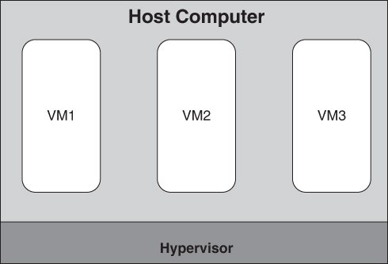
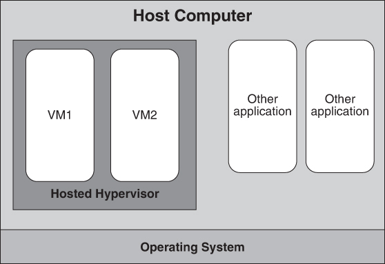
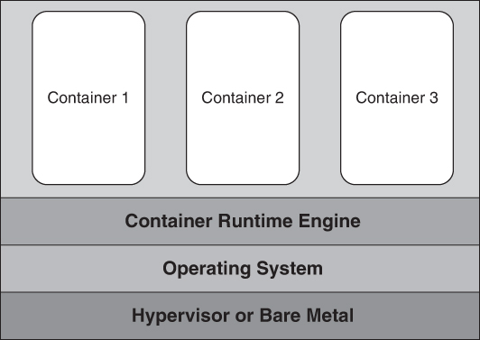
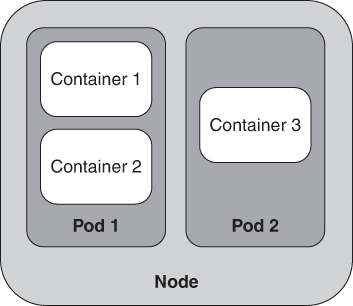

# 16. Virtualization

> Virtual nghĩa là không bao giờ biết byte tiếp theo của bạn đến từ đâu. 
> —Khuyết danh

Vào thập niên 1960s, cộng đồng điện toán thất vọng vì vấn đề chia sẻ các tài nguyên như memory, đĩa, kênh I/O và thiết bị nhập liệu của người dùng trên một máy vật lý giữa nhiều ứng dụng độc lập. Việc không thể chia sẻ tài nguyên có nghĩa là mỗi lúc chỉ có thể chạy một ứng dụng. Máy tính thời đó có giá hàng triệu đô la—tiền thật vào thời ấy—và hầu hết các ứng dụng chỉ dùng một phần nhỏ, thường khoảng 10%, tài nguyên có sẵn, nên tình trạng này có ảnh hưởng đáng kể đến chi phí điện toán.

Virtual machine và, sau đó, container đã xuất hiện để giải quyết việc chia sẻ. Mục tiêu của các virtual machine và container này là cô lập ứng dụng này khỏi ứng dụng khác, trong khi vẫn chia sẻ tài nguyên. Sự cô lập cho phép developer viết ứng dụng như thể họ là người duy nhất dùng máy tính, trong khi việc chia sẻ tài nguyên cho phép nhiều ứng dụng chạy trên máy tính cùng lúc. Vì các ứng dụng đang chia sẻ một máy tính vật lý với một tập tài nguyên cố định, có những giới hạn đối với ảo giác mà sự cô lập tạo ra. Ví dụ, nếu một ứng dụng tiêu thụ toàn bộ tài nguyên CPU, thì các ứng dụng khác không thể thực thi. Tuy nhiên, với hầu hết các mục đích, những cơ chế này đã thay đổi bộ mặt của system architecture và software architecture. Chúng thay đổi căn bản cách chúng ta hình dung, deploy và trả tiền cho tài nguyên điện toán.

Vì sao chủ đề này đáng quan tâm và đáng lo ngại đối với kiến trúc sư? Với tư cách kiến trúc sư, bạn có thể có xu hướng—hoặc thậm chí bắt buộc—phải dùng một dạng virtualization nào đó để deploy phần mềm bạn tạo ra. Với một tập ứng dụng ngày càng lớn, bạn sẽ deploy lên cloud (sẽ được đề cập trong [Chương 17](ch17_the_cloud_and_distributed_computing.vi.md#ch17)) và dùng container để làm điều đó. Hơn nữa, trong những trường hợp bạn sẽ deploy lên phần cứng chuyên dụng, virtualization cho phép bạn thực hiện kiểm thử trong một môi trường dễ tiếp cận hơn nhiều so với phần cứng chuyên dụng.

Mục đích của chương này là giới thiệu một số thuật ngữ, cân nhắc và tradeoff quan trọng nhất khi dùng tài nguyên ảo.

## 16.1 Tài nguyên dùng chung (Shared Resources)

Vì lý do kinh tế, nhiều tổ chức đã áp dụng một số dạng tài nguyên dùng chung. Chúng có thể giảm đáng kể chi phí deploy một hệ thống. Có bốn tài nguyên mà chúng ta thường quan tâm đến việc chia sẻ:

1. *Central processor unit (CPU)*. Máy tính hiện đại có nhiều CPU (và mỗi CPU có thể có nhiều core xử lý). Chúng cũng có thể có một hoặc nhiều graphics processing unit (GPU), hoặc các processor special-purpose khác, chẳng hạn như tensor processing unit (TPU).
2. *Memory*. Một máy tính vật lý có một lượng memory vật lý cố định.
3. *Disk storage*. Đĩa cung cấp bộ lưu trữ bền vững cho lệnh và dữ liệu, qua các lần khởi động lại và tắt máy tính. Một máy tính vật lý thường có một hoặc nhiều đĩa gắn kèm, mỗi đĩa có dung lượng lưu trữ cố định. Disk storage có thể chỉ một thiết bị ổ đĩa cứng từ tính hoặc quang học dạng quay, hoặc một thiết bị ổ đĩa solid-state; loại sau không có đĩa cũng không có bộ phận chuyển động nào để dẫn động.
4. *Network connection*. Ngày nay, mọi máy tính vật lý không tầm thường đều có một hoặc nhiều kết nối mạng mà qua đó mọi message đi qua.

Giờ chúng ta đã liệt kê các tài nguyên muốn chia sẻ, chúng ta cần nghĩ về *cách* chia sẻ chúng, và cách làm điều này theo một cách đủ “cô lập” để các ứng dụng khác nhau không biết đến sự tồn tại của nhau.

Việc chia sẻ processor đạt được thông qua một cơ chế thread-scheduling. Scheduler chọn và gán một execution thread cho một processor đang rảnh, và thread đó giữ quyền điều khiển cho đến khi processor được lập lịch lại. Không thread ứng dụng nào có thể giành quyền điều khiển một processor mà không đi qua scheduler. Việc lập lịch lại xảy ra khi thread nhường quyền điều khiển processor, khi một khoảng thời gian cố định hết hạn, hoặc khi một interrupt xảy ra.

Trong lịch sử, khi các ứng dụng lớn lên, toàn bộ code và dữ liệu không còn vừa trong memory vật lý. Công nghệ virtual memory được phát triển để giải quyết thách thức này. Phần cứng quản lý memory chia không gian địa chỉ của một process thành các page, và hoán đổi các page giữa memory vật lý và bộ lưu trữ thứ cấp khi cần. Các page nằm trong memory vật lý có thể được truy cập ngay lập tức, và các page khác được lưu trên bộ nhớ thứ cấp cho đến khi cần đến chúng. Phần cứng hỗ trợ việc cô lập một không gian địa chỉ khỏi không gian địa chỉ khác.

Việc chia sẻ và cô lập đĩa đạt được bằng một số cơ chế. Thứ nhất, các đĩa vật lý chỉ có thể được truy cập thông qua một disk controller bảo đảm rằng các luồng dữ liệu đến và đi từ mỗi thread được chuyển giao theo thứ tự. Ngoài ra, hệ điều hành có thể gắn tag cho các thread đang thực thi và nội dung đĩa như file và thư mục bằng các thông tin như user ID và group, và hạn chế khả năng nhìn thấy hoặc truy cập bằng cách so sánh tag của thread yêu cầu truy cập với tag của nội dung đĩa.

Việc cô lập mạng đạt được thông qua việc định danh message. Mọi virtual machine (VM) hoặc container đều có một địa chỉ Internet Protocol (IP), được dùng để định danh các message đến hoặc đi từ VM hoặc container đó. Về bản chất, địa chỉ IP được dùng để định tuyến response tới đúng VM hoặc container. Một cơ chế mạng khác để gửi và nhận message dựa vào việc dùng port. Mọi message dành cho một service đều có một số port gắn với nó. Một service lắng nghe trên một port và nhận các message đến thiết bị mà service đang thực thi trên đó, được chỉ định cho port mà service đang lắng nghe.

## 16.2 Virtual machine (Virtual Machines)

Giờ chúng ta đã thấy cách việc sử dụng tài nguyên của một ứng dụng có thể được cô lập khỏi việc sử dụng tài nguyên của một ứng dụng khác, chúng ta có thể dùng và kết hợp các cơ chế này. *Virtual machine* cho phép thực thi nhiều máy tính mô phỏng, hay ảo, trong một máy tính vật lý duy nhất.

[Hình 16.1](#ch16fig01) mô tả một số VM nằm trong một máy tính vật lý. Máy tính vật lý được gọi là “host computer” và các VM được gọi là “guest computer”. [Hình 16.1](#ch16fig01) cũng cho thấy một *hypervisor*, là một hệ điều hành cho các VM. Hypervisor này chạy trực tiếp trên phần cứng máy tính vật lý và thường được gọi là hypervisor *bare-metal* hoặc *Type 1*. Các VM mà nó host triển khai các ứng dụng và service. Bare-metal hypervisor thường chạy trong một data center hoặc cloud.

**Hình 16.1** *Bare-metal hypervisor và các VM*

[Hình 16.2](#ch16fig02) mô tả một loại hypervisor khác, gọi là hypervisor *hosted* hoặc *Type 2*. Trong trường hợp này, hypervisor chạy như một service trên một host operating system, và đến lượt mình hypervisor host một hoặc nhiều VM. Hosted hypervisor thường được dùng trên máy tính để bàn hoặc laptop. Chúng cho phép developer chạy và kiểm thử các ứng dụng không tương thích với host operating system của máy tính (ví dụ, để chạy ứng dụng Linux trên máy tính Windows hoặc chạy ứng dụng Windows trên máy tính Apple). Chúng cũng có thể được dùng để tái tạo một môi trường production trên máy tính phát triển ngay cả khi hệ điều hành ở cả hai nơi là như nhau. Cách tiếp cận này bảo đảm môi trường phát triển và môi trường production khớp nhau.

**Hình 16.2** *Hosted hypervisor*

Một hypervisor đòi hỏi các guest VM của nó dùng cùng instruction set với CPU vật lý bên dưới—hypervisor không dịch hoặc mô phỏng việc thực thi lệnh. Ví dụ, nếu bạn có một VM cho thiết bị di động hoặc nhúng dùng processor ARM, bạn không thể chạy virtual machine đó trên một hypervisor dùng processor x86. Một công nghệ khác, liên quan đến hypervisor, hỗ trợ thực thi cross-processor; nó được gọi là *emulator*. Một emulator đọc binary code cho processor đích hoặc processor guest và mô phỏng việc thực thi các lệnh guest trên processor host. Emulator thường cũng mô phỏng các thiết bị phần cứng I/O của guest. Ví dụ, emulator QEMU open source[1](#ch16fn1) có thể giả lập một hệ thống PC đầy đủ, bao gồm BIOS, processor x86 và memory, sound card, graphics card, và thậm chí cả ổ đĩa mềm.

[1](#ch16fn1a) [qemu.org](http://qemu.org/)

Hypervisor Hosted/Type 2 và emulator cho phép người dùng tương tác với các ứng dụng đang chạy bên trong VM thông qua màn hình on-screen, bàn phím và chuột/touchpad của máy host. Các developer làm việc với ứng dụng desktop hoặc làm việc với các thiết bị chuyên dụng, như nền tảng di động hoặc thiết bị Internet of Things, có thể dùng một hypervisor hosted/Type 2 và/hoặc một emulator như một phần của toolchain build/test/integrate của họ.

Một hypervisor thực hiện hai chức năng chính: (1) Nó quản lý code chạy trong mỗi VM, và (2) nó quản lý bản thân các VM. Cụ thể:

1. Code giao tiếp ra ngoài VM bằng cách truy cập một đĩa hoặc network interface được ảo hóa sẽ bị hypervisor chặn và được hypervisor thực thi thay mặt VM. Điều này cho phép hypervisor gắn tag cho các request bên ngoài này để response cho các request này có thể được định tuyến tới đúng VM.

   Response cho một request bên ngoài tới một thiết bị I/O hoặc mạng là một interrupt bất đồng bộ. Interrupt này ban đầu được hypervisor xử lý. Vì nhiều VM đang hoạt động trên một máy host vật lý duy nhất và mỗi VM có thể có các request I/O đang chờ, hypervisor phải có một phương pháp để chuyển interrupt tới đúng VM. Đây là mục đích của việc gắn tag đã nhắc đến ở trên.

2. Các VM phải được quản lý. Ví dụ, chúng phải được tạo ra và hủy, cùng nhiều việc khác. Quản lý VM là một chức năng của hypervisor. Hypervisor không tự quyết định tạo hay hủy một VM, mà hành động theo chỉ thị từ một người dùng hoặc, thường xuyên hơn, từ một cloud infrastructure (bạn sẽ đọc thêm về điều này trong [Chương 17](ch17_the_cloud_and_distributed_computing.vi.md#ch17)). Quá trình tạo một VM bao gồm việc nạp một *VM image* (được thảo luận trong mục tiếp theo).

   Ngoài việc tạo và hủy VM, hypervisor còn giám sát chúng. Health check và mức sử dụng tài nguyên là một phần của việc giám sát. Hypervisor cũng nằm bên trong vành đai security phòng thủ của các VM, như một biện pháp phòng thủ chống tấn công.

   Cuối cùng, hypervisor chịu trách nhiệm bảo đảm một VM không vượt quá giới hạn sử dụng tài nguyên của nó. Mỗi VM có giới hạn về mức sử dụng CPU, memory, và băng thông I/O đĩa và mạng. Trước khi khởi động một VM, hypervisor trước tiên bảo đảm có đủ tài nguyên vật lý để thỏa mãn nhu cầu của VM đó, rồi hypervisor thực thi các giới hạn đó trong khi VM đang chạy.

Một VM được khởi động giống như một máy vật lý bare-metal được khởi động. Khi máy bắt đầu thực thi, nó tự động đọc một chương trình đặc biệt gọi là boot loader từ bộ lưu trữ đĩa, hoặc nằm bên trong máy tính hoặc được kết nối qua mạng. Boot loader đọc code hệ điều hành từ đĩa vào memory, rồi chuyển việc thực thi cho hệ điều hành. Trong trường hợp máy tính vật lý, kết nối tới ổ đĩa được thực hiện trong quá trình power-up. Trong trường hợp VM, kết nối tới ổ đĩa được hypervisor thiết lập khi nó khởi động VM. Mục “[VM Images](#sec16_3)” thảo luận chi tiết hơn về quá trình này.

Từ góc nhìn của hệ điều hành và các software service bên trong một VM, có vẻ như phần mềm đang thực thi bên trong một máy vật lý bare-metal. VM cung cấp CPU, memory, thiết bị I/O và kết nối mạng.

Với nhiều mối quan tâm mà nó phải giải quyết, hypervisor là một phần mềm phức tạp. Một mối quan tâm với VM là overhead do việc chia sẻ và cô lập cần thiết cho virtualization gây ra. Tức là, một service chạy trên virtual machine chậm hơn bao nhiêu so với chạy trực tiếp trên một máy vật lý bare-metal? Câu trả lời cho câu hỏi này phức tạp: Nó phụ thuộc vào đặc điểm của service và công nghệ virtualization được dùng. Ví dụ, các service thực hiện nhiều I/O đĩa và mạng hơn phải chịu nhiều overhead hơn so với các service không chia sẻ các tài nguyên host này. Công nghệ virtualization không ngừng được cải tiến, nhưng Microsoft đã báo cáo overhead khoảng 10% trên hypervisor Hyper-V của họ.[2](#ch16fn2)

[2](#ch16fn2a) [https://docs.microsoft.com/en-us/biztalk/technical-guides/system-resource-costs-on-hyper-v](https://docs.microsoft.com/en-us/biztalk/technical-guides/system-resource-costs-on-hyper-v)

VM có hai hệ quả chính đối với kiến trúc sư:

1. *Performance*. Virtualization gây ra chi phí về performance. Trong khi hypervisor Type 1 chỉ gây ra mức giảm performance khiêm tốn, hypervisor Type 2 có thể áp đặt overhead lớn hơn đáng kể.
2. *Separation of concerns*. Virtualization cho phép kiến trúc sư coi tài nguyên runtime như hàng hóa, trì hoãn các quyết định provisioning và deployment cho một người hoặc tổ chức khác.

## 16.3 VM image (VM Images)

Chúng tôi gọi nội dung của bộ lưu trữ đĩa mà từ đó chúng ta khởi động một VM là một *VM image.* Image này chứa các bit biểu diễn lệnh và dữ liệu tạo nên phần mềm mà chúng ta sẽ chạy (tức là hệ điều hành và các service). Các bit được tổ chức thành file và thư mục theo file system mà hệ điều hành của bạn dùng. Image cũng chứa chương trình boot load, được lưu ở vị trí định trước của nó.

Có ba cách tiếp cận bạn có thể theo để tạo một VM image mới:

1. Bạn có thể tìm một máy đang chạy phần mềm bạn muốn và tạo một bản sao snapshot của các bit trong memory của máy đó.
2. Bạn có thể bắt đầu từ một image có sẵn và thêm phần mềm bổ sung.
3. Bạn có thể tạo một image từ đầu. Ở đây, bạn bắt đầu bằng việc lấy phương tiện cài đặt cho hệ điều hành đã chọn. Bạn khởi động máy mới từ phương tiện cài đặt, và nó định dạng ổ đĩa của máy, sao chép hệ điều hành vào ổ đĩa, và thêm boot loader vào vị trí định trước.

Đối với hai cách tiếp cận đầu, có sẵn các kho machine image (thường chứa phần mềm open-source) cung cấp nhiều loại image tối giản chỉ có OS kernel, các image khác bao gồm ứng dụng hoàn chỉnh, và mọi thứ ở giữa. Những điểm khởi đầu hiệu quả này có thể giúp bạn nhanh chóng thử một package hoặc chương trình mới.

Tuy nhiên, một số vấn đề có thể phát sinh khi bạn kéo về và chạy một image mà bạn (hoặc tổ chức của bạn) không tạo ra:

- Bạn không thể kiểm soát phiên bản của OS và phần mềm.
- Image có thể có phần mềm chứa lỗ hổng hoặc không được cấu hình an toàn; tệ hơn nữa, image có thể chứa malware.

Các khía cạnh quan trọng khác của VM image là:

- Các image này rất lớn, nên việc truyền chúng qua mạng có thể rất chậm.
- Một image được đóng gói cùng mọi dependency của nó.
- Bạn có thể build một VM image trên máy tính phát triển của mình rồi deploy nó lên cloud.
- Bạn có thể muốn thêm các service của riêng mình vào VM.

Dù bạn có thể dễ dàng cài đặt các service khi tạo image, điều này sẽ dẫn đến một image riêng cho mỗi phiên bản của mỗi service. Ngoài chi phí lưu trữ, sự gia tăng số lượng image này trở nên khó theo dõi và quản lý. Do đó, thông lệ là tạo các image chỉ chứa hệ điều hành và các chương trình thiết yếu khác, rồi thêm các service vào những image này sau khi VM đã được khởi động, trong một quá trình gọi là cấu hình (configuration).

## 16.4 Container (Containers)

VM giải quyết vấn đề chia sẻ tài nguyên và duy trì sự cô lập. Tuy nhiên, VM image có thể lớn, và việc truyền VM image qua mạng tốn thời gian. Giả sử bạn có một VM image 8 GB(yte). Bạn muốn chuyển nó từ một vị trí trên mạng tới một vị trí khác. Về lý thuyết, trên một mạng 1 Gb(it) mỗi giây, việc này sẽ mất 64 giây. Tuy nhiên, trong thực tế một mạng 1 Gbps hoạt động ở hiệu suất khoảng 35%. Do đó, việc truyền một VM image 8 GB sẽ mất hơn 3 phút trong thế giới thực. Dù bạn có thể áp dụng một số kỹ thuật để giảm thời gian truyền này, kết quả vẫn sẽ là một khoảng thời gian tính bằng phút. Sau khi image được truyền xong, VM phải khởi động hệ điều hành và khởi động các service của bạn, việc này tốn thêm thời gian nữa.

*Container* là một cơ chế để duy trì phần lớn lợi ích của virtualization trong khi giảm thời gian truyền image và thời gian khởi động. Giống như VM và VM image, container được đóng gói thành các container image có thể thực thi để truyền đi. (Tuy nhiên, thuật ngữ này không phải lúc nào cũng được tuân theo trong thực tế.)

Xem lại [Hình 16.1](#ch16fig01), chúng ta thấy một VM thực thi trên phần cứng được ảo hóa dưới sự kiểm soát của hypervisor. Trong [Hình 16.3](#ch16fig03), chúng ta thấy nhiều container hoạt động dưới sự kiểm soát của một *container runtime engine*, mà đến lượt nó lại chạy trên một hệ điều hành cố định. Container runtime engine đóng vai trò một hệ điều hành được ảo hóa. Cũng như mọi VM trên một host vật lý dùng chung cùng phần cứng vật lý bên dưới, mọi container trong một host dùng chung cùng operating system kernel thông qua runtime engine (và thông qua hệ điều hành, chúng dùng chung cùng phần cứng vật lý bên dưới). Hệ điều hành có thể được nạp lên một máy vật lý bare-metal hoặc một virtual machine.

**Hình 16.3** *Container trên một container runtime engine, trên một hệ điều hành, trên một hypervisor (hoặc bare metal)*

VM được cấp phát bằng cách tìm một máy vật lý có đủ tài nguyên chưa dùng để hỗ trợ thêm một VM. Về mặt khái niệm, việc này được thực hiện bằng cách truy vấn các hypervisor để tìm một hypervisor còn dư năng lực. Container được cấp phát bằng cách tìm một container runtime engine có đủ tài nguyên chưa dùng để hỗ trợ thêm một container. Đến lượt mình, điều này có thể đòi hỏi tạo thêm một VM để hỗ trợ thêm một container runtime engine. [Hình 16.3](#ch16fig03) mô tả các container chạy trên một container runtime engine chạy trên một hệ điều hành chạy trong một VM dưới sự kiểm soát của một hypervisor.

Việc chia sẻ hệ điều hành này là một nguồn cải thiện performance khi truyền image. Chừng nào máy đích có một container runtime engine tiêu chuẩn đang chạy trên đó (và ngày nay mọi container runtime engine đều được xây dựng theo tiêu chuẩn), không cần truyền hệ điều hành như một phần của container image.

Nguồn cải thiện performance thứ hai là việc dùng các “layer” trong container image. (Lưu ý rằng các layer container khác với khái niệm layer trong module structure mà chúng tôi đã giới thiệu trong [Chương 1](ch01_what_is_software_architecture.vi.md#ch01).) Để hiểu rõ hơn các layer container, chúng tôi sẽ mô tả cách một container image được xây dựng. Trong trường hợp này, chúng tôi sẽ minh họa việc xây dựng một container để chạy *LAMP stack*, và chúng tôi sẽ build image theo từng layer. (LAMP—viết tắt của Linux, Apache, MySQL và PHP—là một stack được dùng rộng rãi để xây dựng ứng dụng web.)

Quá trình build một image dùng LAMP stack như sau:

1. Tạo một container image chứa một bản phân phối Linux. (Image này có thể được tải về từ một thư viện bằng một hệ thống quản lý container.)
2. Một khi bạn tạo image và xác định nó là một image, hãy thực thi nó (tức là khởi tạo instance của nó).
3. Dùng container đó để nạp các service—Apache, trong ví dụ của chúng ta, dùng các tính năng của Linux.
4. Thoát container và thông báo cho hệ thống quản lý container rằng đây là image thứ hai.
5. Thực thi image thứ hai này và nạp MySQL.
6. Thoát container và đặt tên cho image thứ ba này.
7. Lặp lại quá trình này thêm một lần nữa và nạp PHP. Giờ bạn có container image thứ tư; image này chứa toàn bộ LAMP stack.

Vì image này được tạo ra theo từng bước và bạn đã bảo hệ thống quản lý container biến mỗi bước thành một image, hệ thống quản lý container coi image cuối cùng gồm nhiều “layer”.

Giờ bạn có thể chuyển container image LAMP stack tới một vị trí khác để sử dụng trong production. Lần chuyển đầu tiên đòi hỏi chuyển mọi element của stack. Tuy nhiên, giả sử bạn cập nhật PHP lên một phiên bản mới hơn và chuyển stack đã sửa đổi này vào production (Bước 7 trong quy trình trên). Hệ thống quản lý container biết rằng chỉ PHP đã được sửa đổi và chỉ chuyển layer PHP của image. Điều này tiết kiệm công sức chuyển phần còn lại của stack. Vì việc thay đổi một software component trong một image xảy ra thường xuyên hơn nhiều so với việc tạo image ban đầu, việc đưa một phiên bản mới của container vào production trở thành một quá trình nhanh hơn nhiều so với khi dùng VM. Trong khi nạp một VM mất cỡ vài phút, nạp một phiên bản mới của container mất cỡ micro giây hoặc mili giây. Lưu ý rằng quá trình này chỉ hoạt động với layer trên cùng của stack. Ví dụ, nếu bạn muốn cập nhật MySQL lên một phiên bản mới hơn, bạn sẽ cần thực hiện các Bước 5 đến 7 trong danh sách trên.

Bạn có thể tạo một script với các bước tạo container image và lưu nó trong một file. File này dành riêng cho công cụ bạn đang dùng để tạo container image. Một file như vậy cho phép bạn chỉ định những phần mềm nào sẽ được nạp vào container và được lưu thành image. Dùng version control cho file đặc tả bảo đảm mỗi thành viên trong team có thể tạo ra một container image giống hệt nhau và sửa đổi file đặc tả khi cần. Đối xử với những script này như code mang lại vô số lợi ích: Các script này có thể được thiết kế có ý thức, kiểm thử, quản lý cấu hình, review, tài liệu hóa và chia sẻ.

## 16.5 Container và VM (Containers and VMs)

Các tradeoff giữa việc cung cấp service của bạn trong một VM và cung cấp service trong một container là gì?

Như chúng tôi đã nói ở trên, một VM ảo hóa phần cứng vật lý: CPU, đĩa, memory và mạng. Phần mềm bạn chạy trên VM bao gồm cả một hệ điều hành hoàn chỉnh, và bạn có thể chạy gần như bất kỳ hệ điều hành nào trong một VM. Bạn cũng có thể chạy gần như bất kỳ chương trình nào trong một VM (trừ khi nó phải tương tác trực tiếp với phần cứng vật lý), điều quan trọng khi làm việc với phần mềm legacy hoặc phần mềm mua về. Có toàn bộ hệ điều hành cũng cho phép bạn chạy nhiều service trong cùng một VM—một kết quả đáng mong muốn khi các service bị couple chặt chẽ hoặc dùng chung các tập dữ liệu lớn, hoặc nếu bạn muốn tận dụng việc giao tiếp và phối hợp hiệu quả giữa các service vốn có sẵn khi các service chạy trong ngữ cảnh của cùng một VM. Hypervisor bảo đảm hệ điều hành khởi động, giám sát việc thực thi của nó, và khởi động lại hệ điều hành nếu nó bị crash.

Các container instance dùng chung một hệ điều hành. Hệ điều hành phải tương thích với container runtime engine, điều này giới hạn phần mềm có thể chạy trên một container. Container runtime engine khởi động, giám sát và khởi động lại service chạy trong một container. Engine này thường chỉ khởi động và giám sát một chương trình trong một container instance. Nếu chương trình đó hoàn thành và thoát bình thường, việc thực thi của container đó kết thúc. Vì lý do này, container thường chạy một service duy nhất (dù service đó có thể multi-threaded). Hơn nữa, một lợi ích của việc dùng container là kích thước của container image nhỏ, chỉ bao gồm những chương trình và library cần thiết để hỗ trợ service chúng ta muốn chạy. Nhiều service trong một container có thể làm phình kích thước image, làm tăng thời gian khởi động container và memory footprint runtime. Như chúng ta sẽ thấy ngay sau đây, chúng ta có thể nhóm các container instance chạy các service liên quan để chúng thực thi trên cùng một máy vật lý và có thể giao tiếp hiệu quả. Một số container runtime engine thậm chí còn cho phép các container trong một nhóm dùng chung memory và các cơ chế phối hợp như semaphore.

Các khác biệt khác giữa VM và container như sau:

- Trong khi một VM có thể chạy bất kỳ hệ điều hành nào, container hiện chỉ giới hạn ở Linux, Windows hoặc IOS.
- Các service bên trong VM được khởi động, dừng và tạm dừng thông qua các chức năng của hệ điều hành, trong khi các service bên trong container được khởi động và dừng thông qua các chức năng của container runtime engine.
- VM vẫn tồn tại sau khi các service chạy bên trong chúng kết thúc; container thì không.
- Có một số hạn chế về việc sử dụng port khi dùng container mà không có khi dùng VM.

## 16.6 Tính portability của container (Container Portability)

Chúng tôi đã giới thiệu khái niệm container runtime manager mà container tương tác. Một số nhà cung cấp cung cấp container runtime engine, nổi bật nhất là Docker, containerd và Mesos. Mỗi nhà cung cấp này có một container runtime engine cung cấp các năng lực để tạo container image và để cấp phát và thực thi các container instance. Interface giữa container runtime engine và container đã được Open Container Initiative chuẩn hóa, cho phép một container được tạo bởi package của một nhà cung cấp—chẳng hạn Docker—được thực thi trên một container runtime engine do một nhà cung cấp khác cung cấp—chẳng hạn containerd.

Điều này có nghĩa là bạn có thể phát triển một container trên máy tính phát triển của mình, deploy nó lên một máy tính production, và để nó thực thi ở đó. Tất nhiên, tài nguyên có sẵn sẽ khác nhau trong mỗi trường hợp, nên việc deployment vẫn không tầm thường. Nếu bạn chỉ định mọi tài nguyên như các tham số cấu hình, việc chuyển container của bạn vào production sẽ được đơn giản hóa.

## 16.7 Pod (Pods)

Kubernetes là phần mềm orchestration open source để deploy, quản lý và mở rộng quy mô container. Nó có thêm một element nữa trong hệ thống phân cấp của mình: Pod. Một *Pod* là một nhóm các container liên quan. Trong Kubernetes, các node (phần cứng hoặc VM) chứa Pod, và Pod chứa container, như trong [Hình 16.4](#ch16fig04). Các container trong một Pod dùng chung một địa chỉ IP và không gian port để nhận request từ các service khác. Chúng có thể giao tiếp với nhau bằng các cơ chế giao tiếp liên process (IPC) như semaphore hoặc shared memory, và chúng có thể dùng chung các storage volume tạm thời tồn tại trong suốt vòng đời của Pod. Chúng có cùng vòng đời—các container trong Pod được cấp phát và giải phóng cùng nhau. Ví dụ, service mesh, được thảo luận trong [Chương 9](ch09_performance.vi.md#ch09), thường được đóng gói dưới dạng một Pod.

**Hình 16.4** *Node với các Pod, mà đến lượt chúng lại chứa container*

Mục đích của một Pod là giảm chi phí giao tiếp giữa các container liên quan chặt chẽ với nhau. Trong [Hình 16.4](#ch16fig04), nếu container 1 và container 2 giao tiếp thường xuyên, việc chúng được deploy thành một Pod, và do đó được cấp phát lên cùng một VM, cho phép dùng các cơ chế giao tiếp nhanh hơn message passing.

## 16.8 Serverless architecture (Serverless Architecture)

Hãy nhớ lại rằng việc cấp phát một VM bắt đầu bằng việc tìm một máy vật lý có đủ năng lực trống rồi nạp một VM image vào máy vật lý đó. Do đó, các máy tính vật lý tạo thành một pool mà từ đó bạn có thể cấp phát tài nguyên. Giờ giả sử rằng thay vì cấp phát VM vào máy vật lý, bạn muốn cấp phát container vào container runtime engine. Tức là, bạn có một pool container runtime engine, mà container được cấp phát vào đó.

Thời gian nạp một container rất ngắn—chỉ mất vài giây cho một lần cold start và vài mili giây để cấp phát lại. Giờ hãy tiến thêm một bước nữa. Vì việc cấp phát và nạp VM tương đối tốn thời gian, có thể mất vài phút để nạp và khởi động instance, bạn thường để một VM instance chạy ngay cả khi có thời gian rảnh giữa các request. So sánh lại, vì việc cấp phát một container vào một container runtime engine rất nhanh, không cần để container chạy. Chúng ta có thể chấp nhận cấp phát lại một container instance mới cho mỗi request. Khi service của bạn hoàn thành xử lý một request, thay vì quay lại để nhận request khác, nó thoát, và container ngừng chạy và được giải phóng.

Cách tiếp cận thiết kế hệ thống này được gọi là *serverless architecture*—dù thực ra nó không phải là không có server. Có các server, host các container runtime engine, nhưng vì chúng được cấp phát động với mỗi request, các server và container runtime engine được thể hiện trong infrastructure. Bạn, với tư cách developer, không chịu trách nhiệm cấp phát hay giải phóng chúng. Các tính năng của cloud service provider hỗ trợ năng lực này được gọi là function-as-a-service (FaaS).

Một hệ quả của việc cấp phát và giải phóng động để đáp ứng từng request riêng lẻ là các container short-lived này không thể duy trì bất kỳ trạng thái nào: Các container phải là stateless. Trong một serverless architecture, mọi trạng thái cần cho việc phối hợp phải được lưu trong một infrastructure service do cloud provider cung cấp hoặc được truyền dưới dạng tham số.

Các cloud provider áp đặt một số giới hạn thực tế đối với các tính năng FaaS. Thứ nhất là các provider có một lựa chọn hạn chế về base container image, điều này giới hạn các lựa chọn ngôn ngữ lập trình và dependency library của bạn. Việc này được thực hiện để giảm thời gian nạp container—service của bạn bị ràng buộc là một image layer mỏng trên base image layer của provider. Giới hạn tiếp theo là thời gian “cold start”, khi container của bạn được cấp phát và nạp lần đầu, có thể là vài giây. Các request tiếp theo được xử lý gần như tức thì, vì container image của bạn được cache trên một node. Cuối cùng, thời gian thực thi cho một request bị giới hạn—service của bạn phải xử lý request và thoát trong giới hạn thời gian của provider, nếu không nó sẽ bị kết thúc. Các cloud provider làm điều này vì lý do kinh tế, để họ có thể điều chỉnh việc định giá FaaS so với các cách chạy container khác, và để bảo đảm không người dùng FaaS nào tiêu thụ quá nhiều resource pool. Một số người thiết kế hệ thống serverless dành nhiều công sức để lách hoặc vượt qua các giới hạn này—ví dụ, khởi động trước các service để tránh độ trễ cold-start, gửi các request giả để giữ service trong cache, và fork hoặc nối chuỗi request từ service này sang service khác để kéo dài thời gian thực thi thực tế.

## 16.9 Tóm tắt (Summary)

Virtualization đã là một ân huệ đối với các software architect và system architect, vì nó cung cấp các nền tảng cấp phát hiệu quả, cost-effective cho các service được kết nối mạng (thường là web-based). Hardware virtualization cho phép tạo nhiều virtual machine dùng chung cùng một máy vật lý. Nó làm điều này trong khi thực thi sự cô lập CPU, memory, bộ lưu trữ đĩa và mạng. Do đó, tài nguyên của máy vật lý có thể được chia sẻ giữa nhiều VM, trong khi số máy vật lý mà một tổ chức phải mua hoặc thuê được giảm thiểu.

Một VM image là tập bit được nạp vào một VM để cho phép nó thực thi. VM image có thể được tạo ra bằng nhiều kỹ thuật provisioning, bao gồm dùng các chức năng của hệ điều hành hoặc nạp một image pre-created.

Container là một cơ chế đóng gói ảo hóa hệ điều hành. Một container có thể được chuyển từ môi trường này sang môi trường khác nếu có sẵn một container runtime engine tương thích. Interface tới các container runtime engine đã được chuẩn hóa.

Đặt nhiều container vào một Pod có nghĩa là chúng đều được cấp phát cùng nhau và mọi giao tiếp giữa các container có thể được thực hiện nhanh chóng.

Serverless architecture cho phép các container được khởi tạo nhanh chóng và chuyển trách nhiệm cấp phát và giải phóng sang infrastructure của cloud provider.

## 16.10 Đọc thêm (For Further Reading)

Tài liệu trong chương này được lấy từ *Deployment and Operations for Software Engineers* [Bass 19], nơi bạn có thể tìm thấy các thảo luận chi tiết hơn.

Wikipedia luôn là một nơi tốt để tìm các chi tiết hiện hành về protocol, container runtime engine và serverless architecture.

## 16.11 Câu hỏi thảo luận (Discussion Questions)

1. Hãy tạo một container LAMP bằng Docker. So sánh kích thước container image của bạn với một image bạn tìm thấy trên Internet. Nguồn gốc của sự khác biệt là gì? Trong những hoàn cảnh nào điều này là một mối lo ngại đối với bạn với tư cách kiến trúc sư?
2. Hệ thống quản lý container làm thế nào để biết chỉ một layer đã bị thay đổi để nó chỉ cần truyền một layer?
3. Chúng tôi đã tập trung vào sự cô lập giữa các VM đang chạy cùng lúc trên một hypervisor. VM có thể tắt và ngừng thực thi, và các VM mới có thể khởi động. Một hypervisor làm gì để duy trì sự cô lập, hay ngăn rò rỉ, giữa các VM chạy ở những thời điểm khác nhau? Gợi ý: Hãy nghĩ về việc quản lý memory, đĩa, virtual MAC và địa chỉ IP.
4. Tập service nào hợp lý để nhóm vào một Pod (như đã làm với service mesh) và vì sao?
5. Các vấn đề security gắn với container là gì? Bạn sẽ giảm thiểu chúng như thế nào?
6. Những mối lo ngại gắn với việc dùng các công nghệ virtualization trong hệ thống nhúng là gì?
7. Loại lỗi tích hợp và deployment nào có thể tránh được với VM, container và Pod? Loại nào thì không thể?
