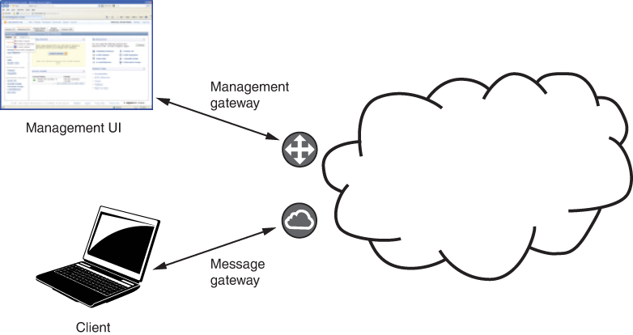
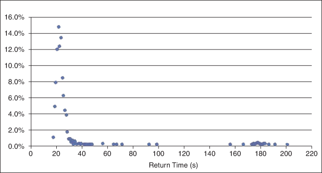
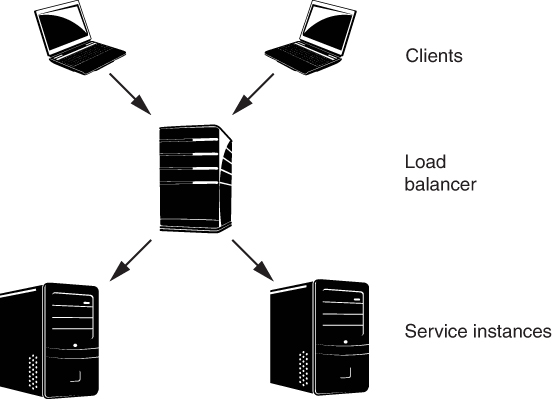
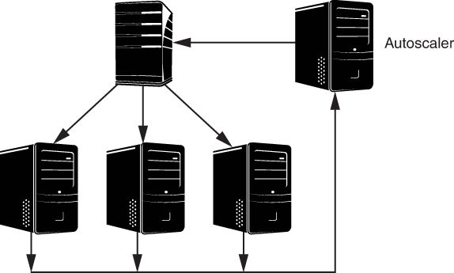

# 17. Cloud và điện toán phân tán (The Cloud and Distributed Computing)

> Một hệ thống phân tán là hệ thống trong đó failure của một máy tính mà bạn thậm chí không biết là tồn tại có thể khiến chính máy tính của bạn không dùng được. 
> —Leslie Lamport

*Cloud computing* là về tính sẵn có theo nhu cầu (on-demand) của tài nguyên. Thuật ngữ này được dùng để chỉ một phạm vi rộng các năng lực điện toán. Ví dụ, bạn có thể nói: “Tất cả ảnh của tôi đều được sao lưu lên cloud.” Nhưng điều đó có nghĩa là gì? Nó có nghĩa là:

- Ảnh của tôi được lưu trên máy tính của người khác. Họ lo về khoản đầu tư vốn, việc bảo trì, duy tu và sao lưu.
- Tôi có thể truy cập ảnh của mình qua Internet.
- Tôi chỉ trả tiền cho dung lượng mà tôi dùng, hoặc mà tôi yêu cầu.
- Service lưu trữ có tính đàn hồi (elastic), nghĩa là nó có thể tăng hoặc giảm khi nhu cầu của tôi thay đổi.
- Việc tôi dùng cloud là self-provisioned: Tôi tạo một tài khoản và có thể ngay lập tức bắt đầu dùng nó để lưu tài liệu của mình.

Các năng lực điện toán được cung cấp từ cloud trải từ các ứng dụng như lưu trữ ảnh (hoặc các loại artifact số khác), đến các service fine-grained được phơi ra qua API (ví dụ: dịch văn bản hoặc chuyển đổi tiền tệ), đến các infrastructure service low-level như ảo hóa processor, mạng và lưu trữ.

Trong chương này, chúng tôi sẽ tập trung vào cách một software architect có thể dùng các infrastructure service từ cloud để cung cấp các service mà kiến trúc sư đang thiết kế và phát triển. Trên đường đi, chúng ta sẽ có một hành trình qua một số nguyên lý và kỹ thuật quan trọng nhất của điện toán phân tán. Điều này có nghĩa là dùng nhiều máy tính (thật hoặc ảo) để làm việc hợp tác cùng nhau, nhờ đó tạo ra performance nhanh hơn và một hệ thống robust hơn so với một máy tính duy nhất làm mọi việc. Chúng tôi đưa chủ đề này vào chương này vì không ở đâu điện toán phân tán lại ăn sâu như trong các hệ thống cloud-based. Cách trình bày chúng tôi đưa ra ở đây là một tổng quan ngắn gọn về các nguyên lý liên quan nhất đến architecture.

Trước tiên, chúng tôi thảo luận cách cloud cung cấp và quản lý virtual machine.

## 17.1 Những điều cơ bản về cloud (Cloud Basics)

*Public cloud* được sở hữu và cung cấp bởi các cloud service provider. Các tổ chức này cung cấp infrastructure service cho bất kỳ ai đồng ý với các điều khoản dịch vụ và có thể trả tiền để sử dụng service. Nói chung, các service bạn xây dựng bằng infrastructure này có thể được truy cập trên Internet công cộng, dù bạn có thể thiết lập các cơ chế như firewall để hạn chế khả năng nhìn thấy và truy cập.

Một số tổ chức vận hành một *private cloud*. Một private cloud được một tổ chức sở hữu và vận hành để các thành viên của tổ chức đó sử dụng. Một tổ chức có thể chọn vận hành private cloud vì những mối quan tâm như quyền kiểm soát, security và chi phí. Trong trường hợp này, cloud infrastructure và các service được phát triển trên nó chỉ có thể được nhìn thấy và truy cập trong mạng của tổ chức.

Cách tiếp cận *hybrid cloud* là một model hỗn hợp, trong đó một số workload được chạy trong private cloud và các workload khác được chạy trong public cloud. Một hybrid cloud có thể được dùng trong quá trình chuyển từ private cloud sang public cloud (hoặc ngược lại), hoặc có thể được dùng vì một số dữ liệu bị pháp luật yêu cầu phải chịu sự kiểm soát và giám sát chặt chẽ hơn mức có thể với một public cloud.

Đối với một kiến trúc sư thiết kế phần mềm dùng các cloud service, xét từ góc độ kỹ thuật, không có nhiều khác biệt giữa private cloud và public cloud. Do đó, chúng tôi sẽ tập trung thảo luận ở đây về các public cloud infrastructure-as-a-service.

Một data center public cloud điển hình có hàng chục nghìn thiết bị vật lý—gần 100,000 hơn là 50,000. Yếu tố giới hạn kích thước của một data center là điện năng mà nó tiêu thụ và lượng nhiệt mà thiết bị tạo ra: Có những giới hạn thực tế đối với việc đưa điện vào tòa nhà, phân phối nó tới thiết bị, và loại bỏ nhiệt mà thiết bị sinh ra. [Hình 17.1](#ch17fig01) cho thấy một cloud data center điển hình. Mỗi rack gồm hơn 25 máy tính (mỗi máy có nhiều CPU), với con số chính xác phụ thuộc vào điện năng và khả năng làm mát có sẵn. Data center gồm hàng dãy rack như vậy, với các network switch high-speed kết nối các rack. Cloud data center là một lý do khiến energy efficiency (một chủ đề được thảo luận trong [Chương 6](ch06_energy_efficiency.vi.md#ch06)) đã trở thành một quality attribute then chốt trong một số ứng dụng.

**Hình 17.1** *Một cloud data center*

Khi bạn truy cập một cloud thông qua một public cloud provider, thực ra bạn đang truy cập các data center nằm rải rác khắp thế giới. Cloud provider tổ chức các data center của mình thành các *region*. Một cloud region vừa là một cấu trúc logic vừa là một cấu trúc vật lý. Vì các service bạn phát triển và deploy lên cloud được truy cập qua Internet, các cloud region có thể giúp bạn chắc chắn rằng service ở gần người dùng về mặt vật lý, nhờ đó giảm độ trễ mạng khi truy cập service. Ngoài ra, một số ràng buộc pháp lý, như General Data Protection Regulation (GDPR), có thể hạn chế việc truyền một số loại dữ liệu qua biên giới quốc gia, nên các cloud region giúp cloud provider tuân thủ các quy định này.

Một cloud region có nhiều data center được phân bố về mặt vật lý và có các nguồn điện và kết nối Internet khác nhau. Các data center trong một region được nhóm thành các *availability zone*, sao cho xác suất mọi data center trong hai availability zone khác nhau cùng thất bại một lúc là cực kỳ thấp.

Chọn cloud region mà service của bạn sẽ chạy là một quyết định thiết kế quan trọng. Khi bạn yêu cầu được cung cấp một virtual machine (VM) mới chạy trên cloud, bạn có thể chỉ định region mà VM sẽ chạy. Đôi khi availability zone có thể được chọn tự động, nhưng bạn thường sẽ muốn tự chọn zone, vì lý do availability và tính liên tục của hoạt động kinh doanh.

Mọi truy cập vào một public cloud đều diễn ra qua Internet. Có hai gateway chính vào một cloud: một management gateway và một message gateway ([Hình 17.2](#ch17fig02)). Ở đây chúng tôi sẽ tập trung vào management gateway; chúng tôi đã thảo luận message gateway trong [Chương 15](ch15_software_interfaces.vi.md#ch15).

**Hình 17.2** *Các gateway vào một public cloud*

Giả sử bạn muốn được cấp phát một VM trên cloud. Bạn gửi một request tới management gateway yêu cầu một VM instance mới. Request này có nhiều tham số, nhưng ba tham số thiết yếu là cloud region nơi instance mới sẽ chạy, loại instance (ví dụ: CPU và kích thước memory), và ID của một VM image. Management gateway chịu trách nhiệm về hàng chục nghìn máy tính vật lý, và mỗi máy tính vật lý có một hypervisor quản lý các VM trên nó. Vì vậy, management gateway sẽ xác định một hypervisor có thể quản lý thêm một VM thuộc loại bạn đã chọn bằng cách hỏi: Có đủ năng lực CPU và memory chưa được cấp phát trên máy vật lý đó để đáp ứng nhu cầu của bạn không? Nếu có, nó sẽ yêu cầu hypervisor đó tạo thêm một VM; hypervisor sẽ thực hiện nhiệm vụ này và trả địa chỉ IP của VM mới về cho management gateway. Sau đó, management gateway gửi địa chỉ IP đó cho bạn. Cloud provider bảo đảm có đủ tài nguyên phần cứng vật lý trong các data center của mình để request của bạn sẽ không bao giờ thất bại vì thiếu tài nguyên.

Management gateway không chỉ trả về địa chỉ IP cho VM mới được cấp phát, mà còn trả về một hostname. Hostname được trả về sau khi cấp phát một VM phản ánh thực tế rằng địa chỉ IP đã được thêm vào Domain Name System (DNS) của cloud. Bất kỳ VM image nào cũng có thể được dùng để tạo VM instance mới; tức là, VM image có thể bao gồm một service đơn giản hoặc chỉ là một bước trong quy trình deployment để tạo ra một hệ thống phức tạp.

Management gateway thực hiện các chức năng khác ngoài việc cấp phát VM mới. Nó hỗ trợ thu thập thông tin tính phí về VM, và nó cung cấp năng lực giám sát và hủy VM.

Management gateway được truy cập thông qua các message qua Internet tới API của nó. Các message này có thể đến từ một service khác, như một deployment service, hoặc có thể được tạo ra từ một chương trình command-line trên máy tính của bạn (cho phép bạn viết script cho các thao tác). Management gateway cũng có thể được truy cập thông qua một ứng dụng web-based do cloud service provider vận hành, dù loại giao diện tương tác này không hiệu quả cho bất kỳ thao tác nào ngoài những thao tác tầm thường nhất.

## 17.2 Failure trên cloud (Failure in the Cloud)

Khi một data center chứa hàng chục nghìn máy tính vật lý, gần như chắc chắn rằng một hoặc nhiều máy sẽ hỏng mỗi ngày. Amazon báo cáo rằng trong một data center có khoảng 64,000 máy tính, mỗi máy có hai ổ đĩa quay, khoảng 5 máy tính và 17 ổ đĩa sẽ hỏng mỗi ngày. Google báo cáo các số liệu thống kê tương tự. Ngoài các failure của máy tính và ổ đĩa, network switch có thể hỏng; data center có thể quá nóng, khiến mọi máy tính thất bại; hoặc một thảm họa thiên nhiên nào đó có thể làm sập toàn bộ data center. Dù cloud provider của bạn sẽ có tương đối ít sự cố ngừng hoạt động toàn bộ, máy tính vật lý mà VM cụ thể của bạn đang chạy trên đó có thể hỏng. Nếu availability quan trọng đối với service của bạn, bạn cần suy nghĩ cẩn thận về mức availability bạn muốn đạt được và cách đạt được nó.

Chúng tôi sẽ thảo luận hai khái niệm đặc biệt liên quan đến failure trên cloud: timeout và long tail latency.

### Timeout (Timeouts)

Hãy nhớ lại từ [Chương 4](ch04_availability.vi.md#ch04) rằng timeout là một tactic cho availability. Trong một hệ thống phân tán, timeout được dùng để phát hiện failure. Có một số hệ quả của việc dùng timeout:

- Timeout không thể phân biệt giữa một máy tính bị hỏng hoặc một kết nối mạng bị đứt với một phản hồi chậm cho một message vượt quá thời hạn timeout. Điều này sẽ khiến bạn gán nhãn failure cho một số phản hồi chậm.
- Một timeout sẽ không cho bạn biết failure hoặc sự chậm trễ xảy ra ở đâu.
- Nhiều lần, một request tới một service kích hoạt service đó gửi request tới các service khác, các service này lại gửi thêm request. Ngay cả khi mỗi response trong chuỗi này có độ trễ gần với (nhưng chậm hơn) thời gian phản hồi trung bình kỳ vọng, tổng độ trễ có thể (một cách sai lầm) gợi ý một failure.

Một timeout—một quyết định rằng một response đã mất quá lâu—thường được dùng để phát hiện failure. Một timeout không thể khoanh vùng liệu failure là do lỗi trong phần mềm của service được yêu cầu, do máy ảo hay máy vật lý mà service đang chạy trên đó, hay do kết nối mạng tới service. Trong hầu hết các trường hợp, nguyên nhân không quan trọng: Bạn đã gửi một request, hoặc bạn đang chờ một message keep-alive hoặc heartbeat định kỳ, và đã không nhận được phản hồi kịp thời, và giờ bạn cần hành động để khắc phục điều này.

Điều này có vẻ đơn giản, nhưng trong các hệ thống thực, nó có thể phức tạp. Thường có một chi phí, như một mức phạt về độ trễ, cho một hành động phục hồi. Bạn có thể cần khởi động một VM mới, việc có thể mất vài phút trước khi nó sẵn sàng nhận request mới. Bạn có thể cần thiết lập một session mới với một service instance khác, điều có thể ảnh hưởng đến usability của hệ thống. Thời gian phản hồi trong các hệ thống cloud có thể dao động đáng kể. Vội kết luận rằng đã có failure, trong khi thực ra chỉ là một độ trễ tạm thời, có thể làm phát sinh chi phí phục hồi khi không cần thiết.

Các nhà thiết kế hệ thống phân tán thường tham số hóa cơ chế phát hiện timeout để nó có thể được tinh chỉnh cho một hệ thống hoặc infrastructure. Một tham số là khoảng timeout—hệ thống nên chờ bao lâu trước khi quyết định rằng một response đã thất bại. Hầu hết các hệ thống không kích hoạt việc phục hồi failure sau một lần bỏ lỡ response duy nhất. Thay vào đó, cách tiếp cận điển hình là tìm một số lần bỏ lỡ response trong một khoảng thời gian dài hơn. Số lần bỏ lỡ response là tham số thứ hai cho cơ chế timeout. Ví dụ, có thể đặt timeout là 200 mili giây, và việc phục hồi failure được kích hoạt sau 3 message bị bỏ lỡ trong một khoảng 1-second.

Với các hệ thống chạy với một data center duy nhất, timeout và ngưỡng có thể được đặt một cách quyết liệt, vì độ trễ mạng là tối thiểu và các response bị bỏ lỡ nhiều khả năng là do phần mềm crash hoặc phần cứng hỏng. Ngược lại, với các hệ thống hoạt động trên một mạng diện rộng, một mạng vô tuyến di động, hoặc thậm chí một liên kết vệ tinh, cần suy nghĩ nhiều hơn khi đặt các tham số, vì những hệ thống này có thể gặp độ trễ mạng gián đoạn nhưng dài hơn. Trong những trường hợp như vậy, các tham số có thể được nới lỏng để phản ánh khả năng này và tránh kích hoạt các hành động phục hồi không cần thiết.

### Long tail latency (Long Tail Latency)

Bất kể nguyên nhân là một failure thực sự hay chỉ là một phản hồi chậm, response cho request ban đầu của bạn có thể thể hiện cái được gọi là long tail latency. [Hình 17.3](#ch17fig03) cho thấy biểu đồ histogram độ trễ của 1,000 request “launch instance” tới Amazon Web Services (AWS). Lưu ý rằng một số request mất rất nhiều thời gian để được đáp ứng. Khi đánh giá các tập số đo như thế này, bạn phải cẩn thận về việc dùng thống kê nào để đặc trưng tập dữ liệu. Trong trường hợp này, histogram đạt đỉnh ở độ trễ 22 giây; tuy nhiên, độ trễ trung bình trên mọi số đo là 28 giây, và độ trễ trung vị (một nửa số request hoàn thành với độ trễ nhỏ hơn giá trị này) là 23 giây. Ngay cả sau độ trễ 57 giây, 5 phần trăm số request vẫn chưa hoàn thành (tức là bách phân vị thứ 95 là 57 giây). Vì vậy, dù độ trễ trung bình cho mỗi request service-to-service tới một service cloud-based có thể nằm trong giới hạn chấp nhận được, một số lượng đáng kể các request này có thể có độ trễ lớn hơn nhiều—trong trường hợp này, dài hơn từ 2 đến 10 lần so với mức trung bình. Đây là các số đo trong phần đuôi dài (long tail) ở phía bên phải của histogram.

**Hình 17.3** *Phân bố long tail của 1,000 request “launch instance” tới AWS*

Long tail latency là kết quả của sự tắc nghẽn hoặc failure ở đâu đó trên đường đi của service request. Nhiều yếu tố có thể góp phần gây tắc nghẽn—hàng đợi server, việc lập lịch của hypervisor, hoặc các yếu tố khác—nhưng nguyên nhân của tắc nghẽn nằm ngoài tầm kiểm soát của bạn với tư cách developer service. Các kỹ thuật giám sát của bạn và các chiến lược để đạt được performance và availability được yêu cầu phải phản ánh thực tế của một phân bố long tail.

Hai kỹ thuật để xử lý vấn đề long tail là hedged request và alternative request.

- *Hedged requests*. Gửi nhiều request hơn mức cần thiết rồi hủy các request (hoặc bỏ qua các response) sau khi đã nhận đủ response. Ví dụ, giả sử cần khởi chạy 10 instance của một microservice (xem [Chương 5](ch05_deployability.vi.md#ch05)). Hãy gửi 11 request và sau khi 10 request đã hoàn thành, hãy kết thúc request chưa phản hồi.
- *Alternative requests.* Một biến thể của kỹ thuật hedged request được gọi là alternative request. Trong scenario just-described, hãy gửi 10 request. Khi 8 request đã hoàn thành, gửi thêm 2 request nữa, và khi đã nhận được tổng cộng 10 response, hủy 2 request vẫn còn lại.

## 17.3 Dùng nhiều instance để cải thiện performance và availability (Using Multiple Instances to Improve Performance and Availability)

Nếu một service được host trên cloud nhận nhiều request hơn mức nó có thể xử lý trong độ trễ được yêu cầu, service đó trở nên quá tải. Điều này có thể xảy ra vì không đủ băng thông I/O, chu kỳ CPU, memory, hoặc một tài nguyên nào đó khác. Trong một số trường hợp, bạn có thể giải quyết vấn đề quá tải service bằng cách chạy service trên một loại instance khác cung cấp nhiều hơn tài nguyên cần thiết. Cách tiếp cận này đơn giản: Thiết kế của service không thay đổi; thay vào đó, service chỉ chạy trên một virtual machine lớn hơn. Được gọi là vertical scaling hay scaling up, cách tiếp cận này tương ứng với performance tactic increase resources từ [Chương 9](ch09_performance.vi.md#ch09).

Có những giới hạn đối với những gì có thể đạt được bằng vertical scaling. Đặc biệt, có thể không có loại VM instance nào đủ lớn để hỗ trợ workload. Trong trường hợp này, horizontal scaling hay scaling out cung cấp thêm tài nguyên thuộc loại cần thiết. Horizontal scaling bao gồm việc có nhiều bản sao của cùng một service và dùng một load balancer để phân phối request giữa chúng—tương đương lần lượt với tactic maintain multiple copies of computations và pattern load balancer từ [Chương 9](ch09_performance.vi.md#ch09).

### Điện toán phân tán và load balancer (Distributed Computing and Load Balancers)

Load balancer có thể là các hệ thống độc lập, hoặc có thể được đóng gói cùng các chức năng khác. Một load balancer phải rất hiệu quả vì nó nằm trên đường đi của mọi message từ một client tới một service, và ngay cả khi nó được đóng gói cùng các chức năng khác, nó vẫn được cô lập về mặt logic. Ở đây, chúng tôi chia phần thảo luận thành hai khía cạnh chính: load balancer hoạt động như thế nào và các service nằm sau một load balancer phải được thiết kế như thế nào để quản lý trạng thái service. Một khi hiểu được các quá trình này, chúng ta có thể khám phá việc quản lý sức khỏe của hệ thống và cách load balancer có thể cải thiện availability của nó.

Một load balancer giải quyết vấn đề sau: Có một instance duy nhất của một service đang chạy trên một VM hoặc trong một container, và có quá nhiều request đến instance này để nó có thể cung cấp độ trễ chấp nhận được. Một giải pháp là có nhiều instance của service và phân phối request giữa chúng. Cơ chế phân phối trong trường hợp như vậy là một service riêng biệt—load balancer. [Hình 17.4](#ch17fig04) cho thấy một load balancer phân phối request giữa hai VM instance (service). Phần thảo luận tương tự sẽ áp dụng nếu có hai container instance. (Container đã được thảo luận trong [Chương 16](ch16_virtualization.vi.md#ch16).)

**Hình 17.4** *Một load balancer phân phối request từ hai client tới hai service instance*

Bạn có thể đang thắc mắc điều gì cấu thành “quá nhiều request” và “thời gian phản hồi hợp lý”. Chúng tôi sẽ quay lại những câu hỏi này ở phần sau của chương khi thảo luận về autoscaling. Hiện tại, hãy tập trung vào cách một load balancer hoạt động.

Trong [Hình 17.4](#ch17fig04), mỗi request được gửi tới một load balancer. Vì mục đích thảo luận, giả sử load balancer gửi request thứ nhất tới instance 1, request thứ hai tới instance 2, request thứ ba trở lại instance 1, v.v. Điều này gửi một nửa số request tới mỗi instance, *cân bằng* *tải* (balancing the load) giữa hai instance—do đó có tên gọi như vậy.

Một số nhận xét về ví dụ đơn giản này của một load balancer:

- Algorithm mà chúng tôi đưa ra—luân phiên message giữa hai instance—được gọi là “round-robin”. Algorithm này chỉ cân bằng tải đồng đều giữa các service instance nếu mọi request tiêu thụ tài nguyên gần như nhau trong việc phản hồi. Có các algorithm khác để phân phối message cho những trường hợp mà mức tiêu thụ tài nguyên cần để xử lý request thay đổi.
- Từ góc nhìn của client, địa chỉ IP của service thực ra là địa chỉ của load balancer. Địa chỉ này có thể được gắn với một hostname trong DNS. Client không biết, hoặc không cần biết, có bao nhiêu instance của service tồn tại hay địa chỉ IP của bất kỳ service instance nào. Điều này làm cho client không bị ảnh hưởng khi thông tin này thay đổi—một ví dụ về việc dùng intermediary, như đã thảo luận trong [Chương 8](ch08_modifiability.vi.md#ch08).
- Nhiều client có thể cùng tồn tại. Mỗi client gửi message của mình tới load balancer, vốn không quan tâm đến nguồn của message. Load balancer phân phối message khi chúng đến. (Tạm thời chúng ta sẽ bỏ qua khái niệm được gọi là “sticky session” hay “session affinity”.)
- Load balancer có thể bị quá tải. Trong trường hợp này, giải pháp là cân bằng tải cho chính load balancer, đôi khi được gọi là global load balancing. Tức là, một message đi qua một hệ thống phân cấp các load balancer trước khi đến service instance.

Cho đến giờ, phần thảo luận của chúng tôi về load balancer đã tập trung vào việc tăng lượng công việc có thể được xử lý. Ở đây, chúng tôi sẽ xem xét cách load balancer cũng giúp tăng availability của service.

[Hình 17.4](#ch17fig04) cho thấy các message từ client đi qua load balancer, nhưng không cho thấy các message trả về. Các message trả về đi trực tiếp từ service instance tới client (được xác định bởi trường “from” trong header của message IP), bỏ qua load balancer. Hệ quả là load balancer không có thông tin về việc một message đã được một service instance xử lý hay chưa, hay mất bao lâu để xử lý một message. Không có các cơ chế bổ sung, load balancer sẽ không biết liệu có service instance nào còn sống và đang xử lý không, hay có instance nào hoặc mọi instance đã thất bại.

Health check là một cơ chế cho phép load balancer xác định một instance có đang hoạt động đúng không. Đây là mục đích của loại availability tactic “fault detection” từ [Chương 4](ch04_availability.vi.md#ch04). Load balancer sẽ định kỳ kiểm tra sức khỏe của các instance được giao cho nó. Nếu một instance không phản hồi health check, nó bị đánh dấu là không khỏe và không còn message nào được gửi tới nó. Health check có thể gồm việc ping từ load balancer tới instance, mở một kết nối TCP tới instance hoặc thậm chí gửi một message để xử lý. Trong trường hợp sau, địa chỉ IP trả về là địa chỉ của load balancer.

Một instance có thể chuyển từ khỏe sang không khỏe, và ngược lại. Ví dụ, giả sử instance có một hàng đợi quá tải. Khi được liên lạc lần đầu, nó có thể không phản hồi health check của load balancer, nhưng một khi hàng đợi đã được xử lý hết, nó có thể sẵn sàng phản hồi trở lại. Vì lý do này, load balancer kiểm tra nhiều lần trước khi chuyển một instance vào danh sách không khỏe, rồi định kỳ kiểm tra danh sách không khỏe để xác định liệu một instance có phản hồi trở lại không. Trong các trường hợp khác, một hard failure hoặc crash có thể khiến instance bị lỗi khởi động lại và re-register với load balancer, hoặc một instance thay thế mới có thể được khởi động và đăng ký với load balancer, nhằm duy trì năng lực cung cấp service tổng thể.

Một load balancer có health checking cải thiện availability bằng cách che giấu failure của một service instance khỏi client. Pool service instance có thể được định kích thước để đáp ứng một số lượng failure service instance đồng thời nào đó trong khi vẫn cung cấp đủ năng lực service tổng thể để xử lý khối lượng request client được yêu cầu trong độ trễ mong muốn. Tuy nhiên, ngay cả khi dùng health checking, một service instance đôi khi có thể bắt đầu xử lý một request của client nhưng không bao giờ trả về response. Client phải được thiết kế sao cho chúng gửi lại request nếu không nhận được phản hồi kịp thời, cho phép load balancer phân phối request tới một service instance khác. Tương ứng, service phải được thiết kế sao cho có thể đáp ứng nhiều request giống hệt nhau.

### Quản lý trạng thái trong hệ thống phân tán (State Management in Distributed Systems)

*State* (trạng thái) chỉ thông tin bên trong một service ảnh hưởng đến việc tính toán response cho một request của client. State—hay chính xác hơn, tập các giá trị của các biến hoặc cấu trúc dữ liệu lưu trữ state—phụ thuộc vào lịch sử các request tới service.

Việc quản lý state trở nên quan trọng khi một service có thể xử lý nhiều hơn một request của client cùng lúc, hoặc vì một service instance là multi-threaded, vì có nhiều service instance đằng sau một load balancer, hoặc cả hai. Vấn đề then chốt là state được lưu ở đâu. Ba lựa chọn là:

1. Lịch sử được duy trì trong mỗi service instance, trong trường hợp này service được mô tả là “stateful”.
2. Lịch sử được duy trì trong mỗi client, trong trường hợp này service được mô tả là “stateless”.
3. Lịch sử được lưu bền vững bên ngoài service và client, trong một database, trong trường hợp này service được mô tả là “stateless”.

Thực hành phổ biến là thiết kế và hiện thực service là stateless. Các service stateful mất lịch sử của mình nếu chúng thất bại, và việc khôi phục state đó có thể khó khăn. Ngoài ra, như chúng ta sẽ thấy trong mục tiếp theo, các service instance mới có thể được tạo ra, và việc thiết kế service là stateless cho phép một service instance mới xử lý một request của client và tạo ra cùng response như bất kỳ service instance nào khác.

Trong một số trường hợp, có thể khó hoặc kém hiệu quả để thiết kế một service là stateless, nên chúng ta có thể muốn một chuỗi message từ một client được xử lý bởi cùng một service instance. Chúng ta có thể làm điều này bằng cách để request đầu tiên trong chuỗi được load balancer xử lý và phân phối tới một service instance, rồi cho phép client thiết lập một session trực tiếp với service instance đó và các request tiếp theo bỏ qua Load balancer. Ngoài ra, một số load balancer có thể được cấu hình để coi một số loại request nhất định là sticky, khiến load balancer gửi các request tiếp theo từ một client tới cùng service instance đã xử lý message cuối cùng từ client này. Những cách tiếp cận này—session trực tiếp và sticky message—chỉ nên được dùng trong những hoàn cảnh đặc biệt vì khả năng instance bị failure và rủi ro instance mà các message đang “dính” vào có thể bị quá tải.

Thường thì có nhu cầu chia sẻ thông tin giữa mọi instance của một service. Thông tin này có thể gồm thông tin state, như đã thảo luận ở trên, hoặc có thể là thông tin khác cần thiết để các service instance làm việc cùng nhau hiệu quả—ví dụ, địa chỉ IP của load balancer cho service. Có một giải pháp để quản lý lượng thông tin tương đối nhỏ được chia sẻ giữa mọi instance của một service, như được thảo luận tiếp theo.

### Phối hợp thời gian trong một hệ thống phân tán (Time Coordination in a Distributed System)

Xác định chính xác bây giờ là mấy giờ có vẻ là một nhiệm vụ tầm thường, nhưng thực ra nó không dễ. Đồng hồ phần cứng trong máy tính sẽ nhanh hoặc chậm một giây sau khoảng mỗi 12 ngày. Nếu thiết bị tính toán của bạn ở ngoài thế giới, có thể nói như vậy, nó có thể truy cập tín hiệu thời gian từ một vệ tinh Global Positioning System (GPS), vốn cung cấp thời gian chính xác trong phạm vi 100 nano giây hoặc ít hơn.

Để hai hoặc nhiều thiết bị thống nhất về thời gian hiện tại thậm chí còn khó khăn hơn. Số đọc đồng hồ từ hai thiết bị khác nhau trên một mạng *sẽ* khác nhau. Network Time Protocol (NTP) được dùng để đồng bộ thời gian giữa các thiết bị khác nhau được kết nối qua mạng cục bộ hoặc mạng diện rộng. Nó bao gồm việc trao đổi message giữa một time server và các thiết bị client để ước tính độ trễ mạng, rồi áp dụng các algorithm để đồng bộ đồng hồ của một thiết bị client với time server. NTP chính xác khoảng 1 mili giây trên mạng cục bộ và khoảng 10 mili giây trên mạng công cộng. Tắc nghẽn có thể gây ra sai số 100 mili giây hoặc hơn.

Các cloud service provider cung cấp các mốc thời gian rất chính xác cho time server của họ. Ví dụ, Amazon và Google dùng đồng hồ nguyên tử, vốn có độ trôi gần như không đo được. Do đó, cả hai đều có thể đưa ra một câu trả lời cực kỳ chính xác cho câu hỏi “Bây giờ là mấy giờ?” Tất nhiên, bây giờ là mấy giờ khi bạn nhận được câu trả lời lại là chuyện khác.

May thay, cho nhiều mục đích, thời gian almost-accurate là đủ tốt. Tuy nhiên, xét về mặt thực tế, bạn nên giả định có một mức sai số nào đó giữa số đọc đồng hồ trên hai thiết bị khác nhau. Vì lý do này, hầu hết các hệ thống phân tán được thiết kế sao cho việc đồng bộ thời gian giữa các thiết bị không bắt buộc để ứng dụng hoạt động đúng. Bạn có thể dùng thời gian của thiết bị để kích hoạt các hành động định kỳ, để gắn timestamp cho các mục log, và cho một vài mục đích khác mà không cần phối hợp chính xác với các thiết bị khác.

Cũng may mắn là, cho nhiều mục đích, việc biết thứ tự của các sự kiện quan trọng hơn thời điểm các sự kiện đó xảy ra. Các quyết định giao dịch trên thị trường chứng khoán thuộc loại này, cũng như các cuộc đấu giá trực tuyến dưới mọi hình thức. Cả hai đều dựa vào việc xử lý các packet theo đúng thứ tự mà chúng được truyền.

Đối với việc phối hợp then chốt giữa các thiết bị, hầu hết các hệ thống phân tán dùng các cơ chế như vector clock (vốn không thực sự là đồng hồ, mà là các bộ đếm theo dõi các hành động khi chúng lan truyền qua các service trong một ứng dụng) để xác định liệu một sự kiện có xảy ra trước một sự kiện khác hay không, thay vì so sánh thời gian. Điều này bảo đảm ứng dụng có thể áp dụng các hành động theo đúng thứ tự. Hầu hết các cơ chế phối hợp dữ liệu mà chúng tôi thảo luận trong mục tiếp theo dựa vào kiểu sắp xếp thứ tự hành động này.

Đối với một kiến trúc sư, việc phối hợp thời gian thành công bao gồm việc biết liệu bạn có thực sự cần dựa vào thời gian đồng hồ thực tế, hay việc bảo đảm đúng trình tự là đủ. Nếu điều thứ nhất là quan trọng, thì hãy biết các yêu cầu về độ chính xác của bạn và chọn giải pháp tương ứng.

### Phối hợp dữ liệu trong một hệ thống phân tán (Data Coordination in a Distributed System)

Hãy xét vấn đề tạo một resource lock được chia sẻ giữa các máy phân tán. Giả sử một tài nguyên then chốt nào đó đang được truy cập bởi các service instance trên hai VM khác nhau chạy trên hai máy tính vật lý khác nhau. Chúng ta giả định tài nguyên then chốt này là một mục dữ liệu—ví dụ, số dư tài khoản ngân hàng của bạn. Việc thay đổi số dư tài khoản đòi hỏi đọc số dư hiện tại, cộng hoặc trừ số tiền giao dịch, rồi ghi lại số dư mới. Nếu chúng ta cho phép cả hai service instance hoạt động độc lập trên mục dữ liệu này, có khả năng xảy ra race condition, chẳng hạn như hai lần gửi tiền đồng thời ghi đè lên nhau. Giải pháp tiêu chuẩn trong tình huống này là lock mục dữ liệu, để một service không thể truy cập số dư tài khoản của bạn cho đến khi nó có được lock. Chúng ta tránh được race condition vì service instance 1 được cấp lock trên tài khoản ngân hàng của bạn và có thể làm việc độc lập để thực hiện việc gửi tiền cho đến khi nó nhường lock. Sau đó service instance 2, vốn đang chờ lock trở nên khả dụng, có thể lock tài khoản ngân hàng và thực hiện lần gửi tiền thứ hai.

Giải pháp dùng shared lock này dễ hiện thực khi các service là các process chạy trên một máy duy nhất, và việc yêu cầu và giải phóng lock là các thao tác truy cập memory đơn giản rất nhanh và atomic. Tuy nhiên, trong một hệ thống phân tán, hai vấn đề phát sinh với phương án này. Thứ nhất, protocol two-phase commit vốn được dùng theo truyền thống để giành lock đòi hỏi nhiều message được truyền qua mạng. Trong trường hợp tốt nhất, điều này chỉ thêm độ trễ cho các hành động, nhưng trong trường hợp xấu nhất, bất kỳ message nào trong số này cũng có thể không được chuyển tới. Thứ hai, service instance 1 có thể thất bại sau khi đã giành được lock, ngăn service instance 2 tiếp tục.

Giải pháp cho những vấn đề này bao gồm các algorithm phối hợp phân tán phức tạp. Leslie Lamport, người được trích dẫn ở đầu chương, đã phát triển một trong những algorithm đầu tiên như vậy, mà ông đặt tên là “Paxos”. Paxos và các algorithm phối hợp phân tán khác dựa vào một cơ chế đồng thuận (consensus) để cho phép các bên tham gia đạt được thỏa thuận ngay cả khi xảy ra failure của máy tính hoặc mạng. Những algorithm này nổi tiếng là phức tạp để thiết kế đúng, và ngay cả việc hiện thực một algorithm đã được chứng minh cũng khó khăn do những điểm tinh tế trong ngữ nghĩa của ngôn ngữ lập trình và network interface. Thực tế, phối hợp phân tán là một trong những vấn đề mà bạn *không* nên tự mình cố giải quyết. Dùng một trong các gói giải pháp hiện có, như Apache Zookeeper, Consul và etcd, hầu như luôn là ý tưởng tốt hơn so với tự xây dựng. Khi các service instance cần chia sẻ thông tin, chúng lưu nó trong một service dùng cơ chế phối hợp phân tán để bảo đảm mọi service đều thấy cùng các giá trị.

Chủ đề điện toán phân tán cuối cùng của chúng tôi là việc tự động tạo và hủy instance.

### Autoscaling: tự động tạo và hủy instance (Autoscaling: Automatic Creation and Destruction of Instances)

Hãy xét một data center truyền thống, nơi tổ chức của bạn sở hữu mọi tài nguyên vật lý. Trong môi trường này, tổ chức của bạn cần cấp phát đủ phần cứng vật lý cho một hệ thống để xử lý đỉnh của workload lớn nhất mà nó đã cam kết xử lý. Khi workload thấp hơn đỉnh, một phần (hoặc phần lớn) năng lực phần cứng được cấp phát cho hệ thống ở trạng thái rảnh. Giờ hãy so sánh điều này với một môi trường cloud. Hai trong những đặc điểm định nghĩa của cloud là bạn chỉ trả tiền cho những tài nguyên bạn yêu cầu và bạn có thể dễ dàng và nhanh chóng thêm và giải phóng tài nguyên (elasticity). Cùng nhau, những đặc điểm này cho phép bạn tạo ra các hệ thống có năng lực xử lý workload của bạn, và bạn không phải trả tiền cho bất kỳ năng lực dư thừa nào.

Elasticity áp dụng ở các thang thời gian khác nhau. Một số hệ thống có workload tương đối ổn định, trong trường hợp đó bạn có thể cân nhắc xem xét và thay đổi thủ công việc phân bổ tài nguyên theo thang thời gian hằng tháng hoặc hằng quý để khớp với workload thay đổi chậm này. Các hệ thống khác có workload động hơn với tốc độ request tăng và giảm nhanh, và do đó cần một cách để tự động hóa việc thêm và giải phóng service instance.

Autoscaling là một infrastructure service tự động tạo instance mới khi cần và giải phóng các instance dư thừa khi chúng không còn cần thiết. Nó thường hoạt động kết hợp với load balancing để tăng và giảm pool service instance đằng sau một load balancer. Autoscaling container hơi khác với autoscaling VM. Chúng tôi thảo luận autoscaling VM trước rồi sau đó thảo luận những khác biệt khi container được autoscale.

#### Autoscaling VM (Autoscaling VMs)

Quay lại [Hình 17.4](#ch17fig04), giả sử hai client tạo ra nhiều request hơn mức hai service instance được thể hiện có thể xử lý. Autoscaling tạo một instance thứ ba, dựa trên cùng virtual machine image đã được dùng cho hai instance đầu tiên. Instance mới được đăng ký với load balancer để các request tiếp theo được phân phối giữa ba instance thay vì hai. [Hình 17.5](#ch17fig05) cho thấy một component mới, autoscaler, giám sát và autoscale mức sử dụng của các server instance. Một khi autoscaler tạo một service instance mới, nó thông báo cho load balancer về địa chỉ IP mới để load balancer có thể phân phối request tới instance mới, bên cạnh các request mà nó phân phối tới các instance khác.

**Hình 17.5** *Một autoscaler giám sát mức sử dụng*

Vì client không biết có bao nhiêu instance tồn tại hay instance nào đang phục vụ request của chúng, các hoạt động autoscaling là vô hình đối với client của service. Hơn nữa, nếu tốc độ request của client giảm, một instance có thể được gỡ khỏi pool của load balancer, dừng lại và giải phóng, cũng mà không để client hay biết.

Với tư cách kiến trúc sư của một service cloud-based, bạn có thể thiết lập một tập quy tắc cho autoscaler để chi phối hành vi của nó. Thông tin cấu hình bạn cung cấp cho autoscaler bao gồm các mục sau:

- VM image sẽ được khởi chạy khi một instance mới được tạo, và mọi tham số cấu hình instance mà cloud provider yêu cầu, chẳng hạn như các thiết lập security
- Ngưỡng mức sử dụng CPU (đo theo thời gian) cho bất kỳ instance nào mà vượt trên ngưỡng đó thì một instance mới sẽ được khởi chạy
- Ngưỡng mức sử dụng CPU (đo theo thời gian) cho bất kỳ instance nào mà dưới ngưỡng đó thì một instance hiện có sẽ bị tắt
- Các ngưỡng băng thông I/O mạng (đo theo thời gian) để tạo và xóa instance
- Số lượng instance tối thiểu và tối đa bạn muốn trong nhóm này

Autoscaler không tạo hoặc gỡ instance dựa trên các giá trị tức thời của các số đo mức sử dụng CPU hoặc băng thông I/O mạng, vì hai lý do. Thứ nhất, các số đo này có những đỉnh và đáy và chỉ có ý nghĩa khi được lấy trung bình trên một khoảng thời gian hợp lý. Thứ hai, việc cấp phát và khởi động một VM mới mất một thời gian tương đối dài, cỡ vài phút. VM image phải được nạp và kết nối với mạng, và hệ điều hành phải khởi động trước khi nó sẵn sàng xử lý message. Do đó, các quy tắc autoscaler thường có dạng: “Tạo một VM mới khi mức sử dụng CPU trên 80 phần trăm trong 5 phút.”

Ngoài việc tạo và hủy VM dựa trên các số đo mức sử dụng, bạn có thể đặt quy tắc để cung cấp số lượng VM tối thiểu hoặc tối đa hoặc để tạo VM theo lịch thời gian. Ví dụ, trong một tuần điển hình, tải có thể nặng hơn trong giờ làm việc; dựa trên hiểu biết này, bạn có thể cấp phát thêm VM trước khi bắt đầu một ngày làm việc và gỡ một số VM sau khi ngày làm việc kết thúc. Những việc cấp phát theo lịch này nên dựa trên dữ liệu lịch sử về mẫu sử dụng các service của bạn.

Khi autoscaler gỡ một instance, nó không thể chỉ đơn giản tắt VM. Trước tiên, nó phải thông báo cho load balancer ngừng gửi request tới service instance. Tiếp theo, vì instance có thể đang trong quá trình phục vụ một request, autoscaler phải thông báo cho instance rằng nó nên kết thúc các hoạt động và tắt, sau đó instance mới có thể bị hủy. Quá trình này được gọi là “draining” (làm cạn) instance. Với tư cách developer service, bạn chịu trách nhiệm hiện thực interface thích hợp để nhận chỉ thị kết thúc và drain một instance của service của bạn.

#### Autoscaling container (Autoscaling Containers)

Vì container đang thực thi trên các runtime engine được host trên VM, việc scale container bao gồm hai loại quyết định khác nhau. Khi scale VM, autoscaler quyết định rằng cần thêm VM, rồi cấp phát một VM mới và nạp phần mềm thích hợp vào đó. Scale container có nghĩa là đưa ra một quyết định two-level. Thứ nhất, quyết định rằng cần thêm một container (hoặc Pod) cho workload hiện tại. Thứ hai, quyết định liệu container (hoặc Pod) mới có thể được cấp phát trên một runtime engine instance hiện có hay phải cấp phát một instance mới. Nếu phải cấp phát một instance mới, bạn cần kiểm tra xem có sẵn một VM có đủ năng lực không hay cần cấp phát thêm một VM.

Phần mềm điều khiển việc scale container độc lập với phần mềm điều khiển việc scale VM. Điều này cho phép việc scale container có tính portable giữa các cloud provider khác nhau. Có thể sự tiến hóa của container sẽ tích hợp hai loại scaling. Trong trường hợp như vậy, bạn nên biết rằng mình có thể đang tạo ra một sự phụ thuộc giữa phần mềm của bạn và cloud provider, thứ có thể khó phá vỡ.

## 17.4 Tóm tắt (Summary)

Cloud gồm các data center phân tán, với mỗi data center chứa hàng chục nghìn máy tính. Nó được quản lý thông qua một management gateway có thể truy cập qua Internet và chịu trách nhiệm cấp phát, giải phóng và giám sát VM, cũng như đo mức sử dụng tài nguyên và tính phí.

Vì số lượng lớn máy tính trong một data center, failure của một máy tính trong một trung tâm như vậy xảy ra khá thường xuyên. Bạn, với tư cách kiến trúc sư của một service, nên giả định rằng tại một thời điểm nào đó, các VM mà service của bạn đang thực thi trên đó sẽ thất bại. Bạn cũng nên giả định rằng các request của bạn tới các service khác sẽ thể hiện một phân bố long tail, sao cho có tới 5 phần trăm số request của bạn sẽ mất thời gian dài hơn từ 5 đến 10 lần so với request trung bình. Do đó, bạn phải quan tâm đến availability của service của mình.

Vì các instance đơn lẻ của service có thể không đáp ứng kịp thời mọi request, bạn có thể quyết định chạy nhiều VM hoặc container chứa các instance của service của mình. Nhiều instance này nằm đằng sau một load balancer. Load balancer nhận request từ client và phân phối request tới các instance khác nhau.

Sự tồn tại của nhiều instance của service và nhiều client có tác động đáng kể đến cách bạn xử lý state. Các quyết định khác nhau về nơi giữ state sẽ dẫn đến các kết quả khác nhau. Thực hành phổ biến nhất là giữ service stateless, vì service stateless cho phép phục hồi từ failure dễ hơn và thêm instance mới dễ hơn. Lượng dữ liệu nhỏ có thể được chia sẻ giữa các service instance bằng cách dùng một distributed coordination service. Distributed coordination service rất phức tạp để hiện thực, nhưng có sẵn một số implementation open source đã được chứng minh để bạn sử dụng.

Cloud infrastructure có thể tự động scale service của bạn bằng cách tạo instance mới khi nhu cầu tăng và gỡ instance khi nhu cầu giảm. Bạn đặc tả hành vi của autoscaler thông qua một tập quy tắc nêu các điều kiện để tạo hoặc xóa instance.

## 17.5 Đọc thêm (For Further Reading)

Thêm chi tiết về cách mạng và virtualization hoạt động có thể được tìm thấy trong [Bass 19].

Hiện tượng long tail trong bối cảnh cloud được xác định lần đầu trong [Dean 13].

Paxos được trình bày lần đầu bởi [Lamport 98]. Mọi người thấy bài báo gốc khó hiểu, nhưng một mô tả rất kỹ lưỡng về Paxos có thể được tìm thấy trên Wikipedia—[https://en.wikipedia.org/wiki/Paxos_(computer_science)](https://en.wikipedia.org/wiki/Paxos_(computer_science)). Cũng vào khoảng thời gian đó, Brian Oki và Barbara Liskov đã độc lập phát triển và công bố một algorithm gọi là Viewstamped Replication, sau này được chứng minh là tương đương với Paxos của Lamport [Oki 88].

Mô tả về Apache Zookeeper có thể được tìm thấy tại [https://zookeeper.apache.org/](https://zookeeper.apache.org/). Consul có thể được tìm thấy tại [https://www.consul.io/](https://www.consul.io/), và etcd có thể được tìm thấy tại [https://etcd.io/](https://etcd.io/)

Thảo luận về các loại load balancer khác nhau có thể được tìm thấy tại [https://docs.aws.amazon.com/AmazonECS/latest/developerguide/load-balancer-types.html](https://docs.aws.amazon.com/AmazonECS/latest/developerguide/load-balancer-types.html).

Thời gian trong một hệ thống phân tán được thảo luận trong [https://medium.com/coinmonks/time-and-clocks-and-ordering-of-events-in-a-distributed-system-cdd3f6075e73](https://medium.com/coinmonks/time-and-clocks-and-ordering-of-events-in-a-distributed-system-cdd3f6075e73).

Việc quản lý state trong một hệ thống phân tán được thảo luận trong [https://conferences.oreilly.com/software-architecture/sa-ny-2018/public/schedule/detail/64127](https://conferences.oreilly.com/software-architecture/sa-ny-2018/public/schedule/detail/64127).

## 17.6 Câu hỏi thảo luận (Discussion Questions)

1. Load balancer là một loại intermediary. Intermediary tăng cường modifiability nhưng làm giảm performance, vậy mà load balancer tồn tại để tăng performance. Hãy giải thích nghịch lý bề ngoài này.
2. Một context diagram hiển thị một thực thể và các thực thể khác mà nó giao tiếp. Nó tách các trách nhiệm được giao cho thực thể được chọn khỏi các trách nhiệm được giao cho các thực thể khác, và cho thấy các tương tác cần thiết để hoàn thành các trách nhiệm của thực thể được chọn. Hãy vẽ một context diagram cho một load balancer.
3. Hãy phác thảo tập các bước để cấp phát một VM trên cloud và hiển thị địa chỉ IP của nó.
4. Hãy tìm hiểu các sản phẩm của một cloud provider lớn. Hãy viết một tập quy tắc chi phối việc autoscaling cho một service mà bạn sẽ hiện thực trên cloud này.
5. Một số load balancer dùng một kỹ thuật gọi là message queue. Hãy tìm hiểu về message queue và mô tả sự khác biệt giữa load balancer có và không có message queue.
