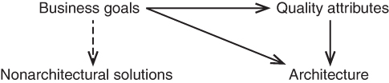
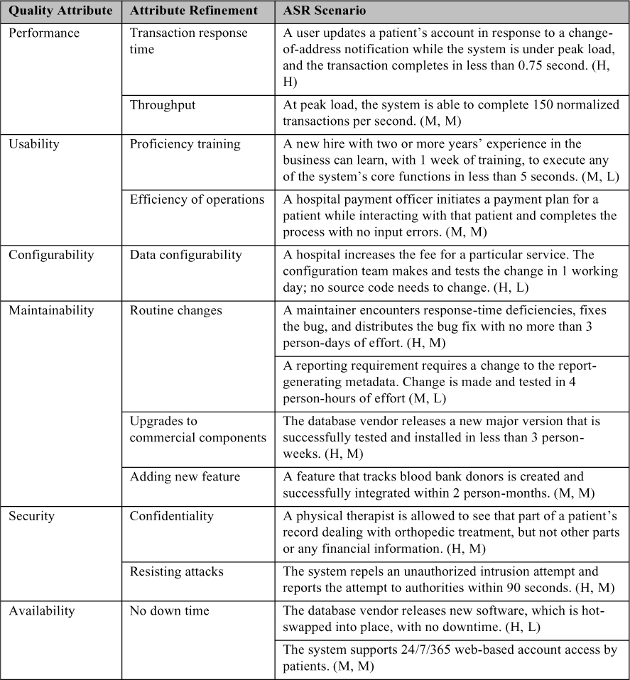

# 19. Các yêu cầu có ý nghĩa về architecture (Architecturally Significant Requirements)

> Khía cạnh quan trọng nhất của phát triển phần mềm là phải rõ ràng về thứ bạn đang cố xây dựng. 
> —Bjarne Stroustrup, cha đẻ của C++

Architecture tồn tại để xây dựng các hệ thống thỏa mãn yêu cầu. Khi nói “yêu cầu”, chúng tôi không nhất thiết muốn nói đến một danh mục được tài liệu hóa, được tạo ra bằng những kỹ thuật tốt nhất mà requirements engineering có thể cung cấp. Thay vào đó, chúng tôi muốn nói đến tập các thuộc tính mà, nếu hệ thống của bạn không thỏa mãn, sẽ khiến hệ thống thất bại. Yêu cầu tồn tại ở nhiều dạng như số lượng dự án phát triển phần mềm—từ các đặc tả được trau chuốt đến sự hiểu biết chung bằng lời nói (thực hoặc tưởng tượng) giữa các stakeholder chính. Các lý lẽ kỹ thuật, kinh tế và triết học biện minh cho các thực hành về yêu cầu trong dự án của bạn nằm ngoài phạm vi của cuốn sách này. Điều nằm trong phạm vi là, bất kể chúng được ghi nhận như thế nào, chúng thiết lập tiêu chí thành công hay thất bại, và kiến trúc sư cần biết chúng.

Đối với một kiến trúc sư, không phải mọi yêu cầu đều như nhau. Một số có tác động sâu sắc đến architecture hơn nhiều so với những yêu cầu khác. Một *architecturally significant requirement (ASR)* là một yêu cầu sẽ có tác động sâu sắc đến architecture—tức là, architecture rất có thể sẽ khác đi đáng kể nếu không có yêu cầu đó.

Bạn không thể hy vọng thiết kế một architecture thành công nếu không biết các ASR. ASR thường, nhưng không phải luôn luôn, có dạng các yêu cầu quality attribute (QA)—performance, security, modifiability, availability, usability, v.v., mà architecture phải cung cấp cho hệ thống. Trong [Chương 4](ch04_availability.vi.md#ch04)–[14](ch14_working_with_other_quality_attributes.vi.md#ch14), chúng tôi đã giới thiệu các pattern và tactic để đạt được các QA. Mỗi lần bạn chọn một pattern hoặc tactic để dùng trong architecture của mình, bạn làm vậy vì nhu cầu đáp ứng các yêu cầu QA. Yêu cầu QA càng khó và càng quan trọng, nó càng có khả năng ảnh hưởng đáng kể đến architecture, và do đó càng có khả năng là một ASR.

Kiến trúc sư phải xác định các ASR, thường là sau khi đã làm một khối lượng công việc đáng kể để khám phá các ASR ứng viên. Các kiến trúc sư có năng lực biết điều này. Thật vậy, khi quan sát các kiến trúc sư giàu kinh nghiệm thực hiện nhiệm vụ của họ, chúng tôi nhận thấy điều đầu tiên họ làm là bắt đầu trò chuyện với các stakeholder quan trọng. Họ đang thu thập thông tin cần thiết để tạo ra architecture đáp ứng nhu cầu của dự án—dù thông tin này đã được xác định trước đó hay chưa.

Chương này cung cấp một số kỹ thuật có hệ thống để xác định các ASR và các yếu tố khác sẽ định hình architecture.

## 19.1 Thu thập ASR từ tài liệu yêu cầu (Gathering ASRs from Requirements Documents)

Một nơi hiển nhiên để tìm ASR ứng viên là trong tài liệu yêu cầu hoặc trong các user story. Suy cho cùng, chúng ta đang tìm yêu cầu, và yêu cầu thì (hiển nhiên rồi) phải nằm trong tài liệu yêu cầu. Đáng tiếc, điều này thường không phải vậy, dù thông tin trong tài liệu yêu cầu chắc chắn có thể hữu ích.

### Đừng hy vọng quá nhiều (Don’t Get Your Hopes Up)

Nhiều dự án không tạo ra hoặc duy trì loại tài liệu yêu cầu mà các giáo sư trong lớp software engineering hoặc tác giả các sách software engineering truyền thống thích quy định. Hơn nữa, không kiến trúc sư nào chỉ ngồi chờ cho đến khi các yêu cầu được “hoàn tất” rồi mới bắt đầu làm việc. Kiến trúc sư *phải* bắt đầu trong khi các yêu cầu vẫn đang biến động. Do đó, các yêu cầu QA rất có thể còn chưa chắc chắn khi kiến trúc sư bắt đầu làm việc. Ngay cả khi chúng tồn tại và ổn định, tài liệu yêu cầu thường khiến kiến trúc sư thất vọng theo hai cách:

- Phần lớn thông tin có trong một đặc tả yêu cầu không ảnh hưởng đến architecture. Như chúng ta đã thấy hết lần này đến lần khác, architecture chủ yếu được dẫn dắt hay “định hình” bởi các yêu cầu QA, vốn quyết định và ràng buộc các quyết định architecture quan trọng nhất. Dù vậy, phần lớn nội dung của hầu hết các đặc tả yêu cầu tập trung vào các tính năng và chức năng được yêu cầu của một hệ thống, những thứ định hình architecture ít nhất. Các thực hành software engineering tốt nhất có quy định việc ghi nhận các yêu cầu QA. Ví dụ, Software Engineering Body of Knowledge (SWEBOK) nói rằng các yêu cầu QA giống như mọi yêu cầu khác: Chúng phải được ghi nhận nếu chúng quan trọng, và chúng nên được đặc tả một cách không mơ hồ và có thể kiểm thử được.

   Tuy nhiên, trong thực tế, chúng tôi hiếm khi thấy các yêu cầu QA được ghi nhận đầy đủ. Đã bao nhiêu lần bạn thấy một yêu cầu có dạng “Hệ thống phải mang tính module” hoặc “Hệ thống phải thể hiện usability cao” hoặc “Hệ thống phải đáp ứng kỳ vọng về performance của người dùng”? Đây không phải là những yêu cầu hữu ích vì chúng không thể kiểm thử được; chúng không thể bác bỏ được. Nhưng, nhìn vào mặt tích cực, chúng có thể được coi là lời mời để kiến trúc sư bắt đầu một cuộc trò chuyện về việc các yêu cầu trong những lĩnh vực này thực sự là gì.

- Nhiều thứ hữu ích đối với kiến trúc sư sẽ không được tìm thấy ngay cả trong tài liệu yêu cầu tốt nhất. Nhiều mối quan tâm dẫn dắt một architecture hoàn toàn không thể hiện ra như những điều quan sát được trong hệ thống đang được đặc tả, và vì vậy không phải là đối tượng của các đặc tả yêu cầu. ASR thường xuất phát từ các mục tiêu kinh doanh của chính tổ chức phát triển; chúng tôi sẽ khám phá mối liên hệ này trong [Mục 19.3](#sec19_3). Các chất lượng thuộc về phát triển cũng nằm ngoài phạm vi; ví dụ, bạn sẽ hiếm khi thấy một tài liệu yêu cầu mô tả các giả định về việc tổ chức team. Trong bối cảnh mua sắm (acquisition), tài liệu yêu cầu đại diện cho lợi ích của bên mua, không phải của bên phát triển. Các stakeholder, môi trường kỹ thuật, và chính tổ chức đều đóng vai trò ảnh hưởng đến architecture. Khi chúng tôi thảo luận về thiết kế architecture, trong [Chương 20](ch20_designing_an_architecture.vi.md#ch20), chúng tôi sẽ khám phá chi tiết hơn những yêu cầu này.

### Đánh hơi ASR từ một tài liệu yêu cầu (Sniffing out ASRs from a Requirements Document)

Dù tài liệu yêu cầu sẽ không cho kiến trúc sư biết toàn bộ câu chuyện, chúng vẫn là một nguồn ASR quan trọng. Tất nhiên, ASR sẽ không được gắn nhãn sẵn một cách tiện lợi; kiến trúc sư nên chuẩn bị làm một chút điều tra và khảo cổ để lùng ra chúng.

Một số điều cụ thể cần tìm là các loại thông tin sau:

- *Sử dụng (Usage)*. Vai trò người dùng so với các chế độ hệ thống, quốc tế hóa, khác biệt ngôn ngữ.
- *Thời gian (Time)*. Tính kịp thời và sự phối hợp giữa các element.
- *Các element bên ngoài (External elements)*. Các hệ thống bên ngoài, protocol, cảm biến hoặc actuator (thiết bị), middleware.
- *Mạng (Networking)*. Các thuộc tính và cấu hình mạng (bao gồm các thuộc tính security của chúng).
- *Điều phối (Orchestration)*. Các bước xử lý, luồng thông tin.
- *Các thuộc tính security (Security properties)*. Vai trò người dùng, quyền hạn, authentication.
- *Dữ liệu (Data)*. Tính bền vững (persistence) và tính cập nhật (currency).
- *Tài nguyên (Resources)*. Thời gian, concurrency, memory footprint, lập lịch, nhiều người dùng, nhiều hoạt động, thiết bị, mức sử dụng năng lượng, tài nguyên mềm (ví dụ: buffer, hàng đợi) và các yêu cầu scalability.
- *Quản lý dự án (Project management)*. Kế hoạch tổ chức team, bộ kỹ năng, đào tạo, phối hợp team.
- *Lựa chọn phần cứng (Hardware choices)*. Processor, họ processor, sự tiến hóa của processor.
- *Tính linh hoạt của chức năng, portability, hiệu chuẩn, cấu hình.*
- *Các công nghệ được nêu tên, các gói thương mại.*

Bất cứ điều gì đã biết về sự tiến hóa được lên kế hoạch hoặc dự kiến của chúng cũng sẽ là thông tin hữu ích.

Không chỉ các loại này tự thân có ý nghĩa về architecture, mà khả năng thay đổi và tiến hóa của mỗi loại cũng có khả năng có ý nghĩa về architecture. Ngay cả khi tài liệu yêu cầu bạn đang khai thác không nhắc đến sự tiến hóa, hãy xem xét mục nào trong danh sách trên có khả năng thay đổi theo thời gian, và thiết kế hệ thống tương ứng.

## 19.2 Thu thập ASR bằng cách phỏng vấn stakeholder (Gathering ASRs by Interviewing Stakeholders)

Giả sử dự án của bạn không tạo ra một tài liệu yêu cầu toàn diện. Hoặc có thể có, nhưng nó sẽ chưa chốt được các QA vào lúc bạn cần bắt đầu công việc thiết kế. Bạn làm gì?

Thứ nhất, các stakeholder thường không biết các yêu cầu QA của họ thực sự là gì. Trong trường hợp đó, kiến trúc sư được kêu gọi giúp thiết lập các yêu cầu QA cho một hệ thống. Các dự án nhận ra nhu cầu hợp tác này và khuyến khích nó có nhiều khả năng thành công hơn nhiều so với những dự án không làm vậy. Hãy tận hưởng cơ hội này! Dù có cằn nhằn các stakeholder bao nhiêu đi nữa cũng sẽ không đột nhiên truyền cho họ những hiểu biết cần thiết. Nếu bạn khăng khăng đòi các yêu cầu QA định lượng, bạn có thể nhận được những con số tùy tiện và ít nhất một số yêu cầu trong đó sẽ khó thỏa mãn và, rốt cuộc, thực sự làm giảm sự thành công của hệ thống.

Các kiến trúc sư giàu kinh nghiệm thường có hiểu biết sâu sắc về những QA response nào đã được thể hiện bởi các hệ thống tương tự, và những QA response nào là hợp lý để kỳ vọng và cung cấp trong bối cảnh hiện tại. Kiến trúc sư cũng thường có thể đưa ra phản hồi nhanh về những QA response nào sẽ dễ đạt được và những QA response nào có thể sẽ có vấn đề hoặc thậm chí quá tốn kém.

Ví dụ, một stakeholder có thể yêu cầu availability 24/7—ai mà không muốn điều đó chứ? Tuy nhiên, kiến trúc sư có thể giải thích yêu cầu đó có khả năng tốn bao nhiêu, điều sẽ cung cấp cho các stakeholder thông tin để đưa ra tradeoff giữa availability và khả năng chi trả. Ngoài ra, kiến trúc sư là những người duy nhất trong cuộc trò chuyện có thể nói: “Tôi thực sự có thể cung cấp một architecture sẽ làm tốt hơn những gì các anh chị đã nghĩ—điều đó có hữu ích với các anh chị không?”

Phỏng vấn các stakeholder liên quan là cách chắc chắn nhất để biết họ biết gì và cần gì. Một lần nữa, dự án nên ghi nhận thông tin then chốt này theo một cách có hệ thống, rõ ràng và có thể lặp lại. Việc thu thập thông tin này từ các stakeholder có thể đạt được bằng nhiều phương pháp. Một phương pháp như vậy là Quality Attribute Workshop (QAW), được mô tả trong sidebar.

> **Quality Attribute Workshop (The Quality Attribute Workshop)**
>
> QAW là một phương pháp stakeholder-focused, có điều phối viên, để tạo ra, sắp xếp mức ưu tiên và tinh chỉnh các quality attribute scenario trước khi software architecture hoàn tất. Nó nhấn mạnh các mối quan tâm system-level và đặc biệt là vai trò mà phần mềm sẽ đóng trong hệ thống. QAW phụ thuộc rất nhiều vào sự tham gia của các stakeholder của hệ thống.
>
> Sau phần giới thiệu và tổng quan về các bước của workshop, QAW bao gồm các thành phần sau:
>
> - *Trình bày về kinh doanh/sứ mệnh (Business/mission presentation).* Stakeholder đại diện cho các mối quan tâm kinh doanh đằng sau hệ thống (thường là một người quản lý hoặc đại diện ban quản lý) dành khoảng một giờ trình bày bối cảnh kinh doanh của hệ thống, các yêu cầu chức năng tổng quát, các ràng buộc và các yêu cầu QA đã biết. Các QA sẽ được tinh chỉnh ở các bước sau sẽ được suy ra phần lớn từ các nhu cầu kinh doanh/sứ mệnh được trình bày trong bước này.
>
> - *Trình bày về kế hoạch architecture (Architectural plan presentation).* Dù có thể chưa tồn tại một system architecture hoặc software architecture chi tiết, có thể đã có các mô tả hệ thống tổng quát, các bản vẽ ngữ cảnh, hoặc các artifact khác mô tả một số chi tiết kỹ thuật của hệ thống. Tại thời điểm này trong workshop, kiến trúc sư sẽ trình bày các kế hoạch architecture của hệ thống như hiện trạng. Điều này cho các stakeholder biết tư duy architecture hiện tại, trong chừng mực nó tồn tại.
>
> - *Xác định các architectural driver (Identification of architectural drivers).* Các điều phối viên sẽ chia sẻ danh sách các architectural driver then chốt mà họ đã tập hợp trong hai bước trước, và đề nghị các stakeholder làm rõ, bổ sung, xóa bỏ và sửa chữa. Ý tưởng là đạt được sự đồng thuận về một danh sách cô đọng các architectural driver bao gồm các yêu cầu tổng thể, các business driver, các ràng buộc và các quality attribute.
>
> - *Động não scenario (Scenario brainstorming).* Mỗi stakeholder biểu đạt một scenario đại diện cho các mối quan tâm của mình đối với hệ thống. Các điều phối viên bảo đảm rằng mỗi scenario giải quyết một mối quan tâm QA, bằng cách đặc tả một stimulus và response tường minh.
>
> - *Hợp nhất scenario (Scenario consolidation).* Sau khi động não scenario, các scenario tương tự được hợp nhất khi hợp lý. Các điều phối viên đề nghị các stakeholder xác định những scenario rất giống nhau về nội dung. Các scenario tương tự được gộp lại, miễn là những người đề xuất chúng đồng ý và cảm thấy scenario của họ sẽ không bị pha loãng trong quá trình này.
>
> - *Sắp xếp mức ưu tiên scenario (Scenario prioritization).* Việc sắp xếp mức ưu tiên các scenario được thực hiện bằng cách phân bổ cho mỗi stakeholder một số phiếu bằng 30 phần trăm tổng số scenario được tạo ra sau khi hợp nhất. Các stakeholder có thể phân bổ bất kỳ số phiếu nào của mình cho bất kỳ scenario hoặc tổ hợp scenario nào. Các phiếu được đếm, và các scenario được sắp xếp mức ưu tiên tương ứng.
>
> - *Tinh chỉnh scenario (Scenario refinement).* Sau khi sắp xếp mức ưu tiên, các scenario hàng đầu được tinh chỉnh và làm chi tiết. Các điều phối viên giúp các stakeholder đưa các scenario vào dạng scenario six-part source–stimulus–artifact–environment–response–response measure mà chúng tôi đã mô tả trong [Chương 3](ch03_understanding_quality_attributes.vi.md#ch03). Khi các scenario được tinh chỉnh, các vấn đề xung quanh việc thỏa mãn chúng sẽ xuất hiện, và nên được ghi lại. Bước này kéo dài chừng nào thời gian và nguồn lực cho phép.

Kết quả của các cuộc phỏng vấn stakeholder nên bao gồm một danh sách các architectural driver và một tập QA scenario mà các stakeholder (với tư cách một nhóm) đã sắp xếp mức ưu tiên. Thông tin này có thể được dùng cho các mục đích sau:

- Tinh chỉnh các yêu cầu hệ thống và phần mềm
- Hiểu và làm rõ các architectural driver của hệ thống
- Cung cấp lý do cho việc vì sao kiến trúc sư sau đó đưa ra một số quyết định thiết kế nhất định
- Dẫn dắt việc phát triển các prototype và mô phỏng
- Ảnh hưởng đến thứ tự phát triển architecture

> **Tôi không biết yêu cầu đó nên là gì (I Don’t Know What That Requirement Should Be)**
>
> Không hiếm khi, lúc phỏng vấn các stakeholder và thăm dò ASR, họ sẽ than phiền: “Tôi không biết yêu cầu đó nên là gì.” Dù đúng là họ *cảm thấy* như vậy, cũng thường xuyên có trường hợp họ biết *điều gì đó* về yêu cầu, đặc biệt nếu các stakeholder có kinh nghiệm trong domain. Trong trường hợp này, việc khơi ra “điều gì đó” này tốt hơn nhiều so với việc đơn giản tự mình bịa ra yêu cầu. Ví dụ, bạn có thể hỏi: “Hệ thống nên phản hồi request giao dịch này nhanh đến mức nào?” Nếu câu trả lời là “Tôi không biết”, lời khuyên của tôi ở đây là hãy giả ngốc. Bạn có thể nói: “Vậy … 24 giờ thì được chứ?” Phản hồi thường là một tiếng “Không!” đầy phẫn nộ và kinh ngạc. “Thế còn 1 giờ? “Không!” “Năm phút? “Không!” “Thế còn 10 giây thì sao?” “Ờ, \<grumble, mumble> (càu nhàu, lầm bầm) Tôi nghĩ tôi có thể chấp nhận được thứ gì đó như vậy. …”
>
> Bằng cách giả ngốc, bạn thường có thể khiến mọi người ít nhất đưa cho bạn một khoảng giá trị chấp nhận được, ngay cả khi họ không biết chính xác yêu cầu nên là gì. Và khoảng này thường đủ để bạn chọn các cơ chế architecture. Thời gian phản hồi 24 giờ so với 10 phút so với 10 giây so với 100 mili giây có nghĩa là, đối với một kiến trúc sư, chọn những cách tiếp cận architecture rất khác nhau. Có được thông tin này, giờ bạn có thể đưa ra các quyết định thiết kế có căn cứ.
>
> —RK

## 19.3 Thu thập ASR bằng cách hiểu mục tiêu kinh doanh (Gathering ASRs by Understanding the Business Goals)

Mục tiêu kinh doanh (business goal) là *raison d’être* (lý do tồn tại) của việc xây dựng một hệ thống. Không tổ chức nào xây dựng một hệ thống mà không có lý do; thay vào đó, những người tham gia muốn thúc đẩy sứ mệnh và tham vọng của tổ chức và của chính họ. Các mục tiêu kinh doanh phổ biến tất nhiên bao gồm kiếm lợi nhuận, nhưng hầu hết các tổ chức có nhiều mối quan tâm hơn là chỉ lợi nhuận. Trong những tổ chức khác (ví dụ: tổ chức phi lợi nhuận, từ thiện, chính phủ), lợi nhuận là điều xa vời nhất trong tâm trí mọi người.

Mục tiêu kinh doanh đáng quan tâm đối với kiến trúc sư vì chúng thường dẫn trực tiếp đến ASR. Có ba mối quan hệ có thể có giữa mục tiêu kinh doanh và một architecture:

1. *Mục tiêu kinh doanh thường dẫn đến các yêu cầu quality attribute*. Mọi yêu cầu quality attribute—như thời gian phản hồi user-visible, tính linh hoạt về nền tảng, security iron-clad, hoặc bất kỳ trong số hàng chục nhu cầu khác—đều bắt nguồn từ một mục đích cao hơn nào đó có thể được mô tả dưới dạng giá trị gia tăng. Mong muốn tạo sự khác biệt cho một sản phẩm so với đối thủ cạnh tranh và giúp tổ chức phát triển chiếm thị phần có thể dẫn đến một yêu cầu về một thời gian phản hồi có vẻ nhanh bất thường. Ngoài ra, biết mục tiêu kinh doanh đằng sau một yêu cầu đặc biệt khắt khe cho phép kiến trúc sư chất vấn yêu cầu đó một cách có ý nghĩa—hoặc huy động nguồn lực để đáp ứng nó.
2. *Mục tiêu kinh doanh có thể ảnh hưởng đến architecture mà hoàn toàn không tạo ra một yêu cầu quality attribute nào.* Một software architect đã kể với chúng tôi rằng vài năm trước anh ấy đã nộp một bản nháp sớm của architecture cho người quản lý. Người quản lý nhận xét rằng architecture thiếu một database. Kiến trúc sư, hài lòng vì người quản lý đã nhận ra, giải thích rằng anh ấy (kiến trúc sư) đã nghĩ ra một cách tiếp cận thiết kế loại bỏ nhu cầu về một database cồng kềnh, đắt tiền. Tuy nhiên, người quản lý vẫn ép thiết kế phải có một database, *vì tổ chức có một đơn vị database với một số nhân viên kỹ thuật lương cao hiện đang chưa được phân công và cần có việc làm*. Không đặc tả yêu cầu nào ghi nhận một yêu cầu như vậy, cũng không người quản lý nào cho phép ghi nhận một động cơ như vậy. Và dù vậy, architecture đó, nếu được bàn giao mà không có database, sẽ thiếu sót không kém—theo quan điểm của người quản lý—như thể nó đã không cung cấp một chức năng hoặc QA quan trọng.
3. *Mục tiêu kinh doanh không ảnh hưởng đến architecture*. Không phải mọi mục tiêu kinh doanh đều dẫn đến quality attribute. Ví dụ, một mục tiêu kinh doanh “giảm chi phí” có thể được hiện thực bằng cách hạ nhiệt độ máy điều nhiệt của cơ sở vào mùa đông hoặc giảm lương hoặc lương hưu của nhân viên.

[Hình 19.1](#ch19fig01) minh họa các điểm chính từ thảo luận này. Trong hình, các mũi tên có nghĩa là “dẫn đến”. Các mũi tên liền nét làm nổi bật các mối quan hệ đáng quan tâm nhất đối với kiến trúc sư.

**Hình 19.1** *Một số mục tiêu kinh doanh có thể dẫn đến các yêu cầu quality attribute, hoặc dẫn trực tiếp đến các quyết định architecture, hoặc dẫn đến các giải pháp non-architectural.*

Kiến trúc sư thường nhận biết về hoạt động kinh doanh và các mục tiêu kinh doanh của một tổ chức thông qua sự thẩm thấu—làm việc, lắng nghe, trò chuyện, và hấp thụ các mục tiêu đang vận hành trong một tổ chức. Sự thẩm thấu không phải không có lợi ích, nhưng các cách có hệ thống hơn để xác định những mục tiêu như vậy vừa khả thi vừa đáng mong muốn. Hơn nữa, việc ghi nhận các mục tiêu kinh doanh một cách tường minh là đáng giá, vì chúng thường ngụ ý các ASR mà nếu không sẽ không được phát hiện cho đến khi quá muộn hoặc quá tốn kém để xử lý.

Một cách để làm điều này là dùng phương pháp PALM, bao gồm việc tổ chức một workshop với kiến trúc sư và các stakeholder kinh doanh chủ chốt. Cốt lõi của PALM gồm các bước sau:

- *Khơi gợi mục tiêu kinh doanh (Business goals elicitation)*. Dùng các loại được đưa ra ở phần sau của mục này để dẫn dắt thảo luận, thu thập từ các stakeholder tập các mục tiêu kinh doanh quan trọng cho hệ thống này. Làm chi tiết các mục tiêu kinh doanh và biểu đạt chúng dưới dạng business goal scenario.[1](#ch19fn1) Hợp nhất các mục tiêu kinh doanh almost-alike để loại bỏ trùng lặp. Để những người tham gia sắp xếp mức ưu tiên tập kết quả nhằm xác định các mục tiêu quan trọng nhất.

[1](#ch19fn1a) Một business goal scenario là một biểu thức seven-part có cấu trúc ghi nhận một mục tiêu kinh doanh, tương tự về ý định và cách dùng với một QA scenario. Mục “Đọc thêm” (For Further Reading) của chương này có một tài liệu tham khảo mô tả PALM, và business goal scenario, một cách đầy đủ chi tiết.

- *Xác định các QA tiềm năng từ mục tiêu kinh doanh*. Với mỗi business goal scenario quan trọng, để những người tham gia mô tả một QA và giá trị response measure mà (nếu được đưa vào architecture của hệ thống) sẽ giúp đạt được mục tiêu đó.

Quá trình thu thập mục tiêu kinh doanh được hỗ trợ tốt khi có sẵn một tập mục tiêu kinh doanh ứng viên để dùng như những conversation-starters. Ví dụ, nếu bạn biết nhiều doanh nghiệp muốn giành thị phần, bạn có thể dùng động lực đó để thu hút đúng các stakeholder trong tổ chức của mình: “Tham vọng của chúng ta về thị phần cho sản phẩm này là gì, và architecture có thể đóng góp như thế nào để đạt được chúng?”

Nghiên cứu của chúng tôi về mục tiêu kinh doanh đã dẫn chúng tôi đến việc áp dụng các loại được nêu trong danh sách sau. Các loại này có thể được dùng để hỗ trợ việc động não và khơi gợi. Bằng cách dùng danh sách các loại, và hỏi các stakeholder về các mục tiêu kinh doanh có thể có trong mỗi loại, ta có được một mức bảo đảm nhất định về độ bao phủ.

1. Tăng trưởng và duy trì sự liên tục của tổ chức
2. Đáp ứng các mục tiêu tài chính
3. Đáp ứng các mục tiêu cá nhân
4. Đáp ứng trách nhiệm đối với nhân viên
5. Đáp ứng trách nhiệm đối với xã hội
6. Đáp ứng trách nhiệm đối với nhà nước
7. Đáp ứng trách nhiệm đối với cổ đông
8. Quản lý vị thế thị trường
9. Cải tiến quy trình kinh doanh
10. Quản lý chất lượng và danh tiếng của sản phẩm
11. Quản lý sự thay đổi của môi trường theo thời gian

## 19.4 Ghi nhận ASR trong một utility tree (Capturing ASRs in a Utility Tree)

Trong một thế giới hoàn hảo, các kỹ thuật được mô tả trong [Mục 19.2](#sec19_2) và [19.3](#sec19_3) sẽ được áp dụng sớm trong quy trình phát triển của bạn: Bạn sẽ phỏng vấn các stakeholder chủ chốt, khơi gợi các mục tiêu kinh doanh và các yêu cầu architecture chủ đạo của họ, và để họ sắp xếp mức ưu tiên tất cả những đầu vào này cho bạn. Tất nhiên, thật đáng tiếc, thế giới thực không hoàn hảo đến vậy. Thường xảy ra trường hợp bạn không tiếp cận được những stakeholder này khi cần họ, vì lý do tổ chức hoặc kinh doanh. Vậy bạn làm gì?

Kiến trúc sư có thể dùng một cấu trúc gọi là *utility tree* khi các “nguồn chính” của yêu cầu không có sẵn. Một utility tree là một biểu diễn top-down của những gì bạn, với tư cách kiến trúc sư, tin là các ASR QA-related then chốt đối với sự thành công của hệ thống.

Một utility tree bắt đầu với từ “Utility” làm node gốc. Utility là biểu hiện của “mức độ tốt” tổng thể của hệ thống. Sau đó bạn làm chi tiết node gốc này bằng cách liệt kê các QA chính mà hệ thống được yêu cầu thể hiện. (Bạn có thể nhớ rằng chúng tôi đã nói trong [Chương 3](ch03_understanding_quality_attributes.vi.md#ch03) rằng bản thân tên QA không hữu ích lắm. Đừng lo—chúng chỉ đang được dùng như những placeholder trung gian cho việc làm chi tiết và tinh chỉnh tiếp theo!)

Dưới mỗi QA, hãy ghi lại các tinh chỉnh cụ thể của QA đó. Ví dụ, performance có thể được phân rã thành “độ trễ dữ liệu” và “throughput transaction” hoặc, theo cách khác, “thời gian chờ của người dùng” và “thời gian làm mới trang web”. Các tinh chỉnh bạn chọn nên là những tinh chỉnh liên quan đến hệ thống của bạn. Dưới mỗi tinh chỉnh, bạn có thể ghi lại các ASR cụ thể, được biểu đạt dưới dạng QA scenario.

Một khi các ASR được ghi lại dưới dạng scenario và đặt ở các lá của cây, bạn có thể đánh giá các scenario này theo hai tiêu chí: giá trị kinh doanh của scenario ứng viên và rủi ro kỹ thuật của việc đạt được nó. Bạn có thể dùng bất kỳ thang nào bạn thích, nhưng chúng tôi thấy một hệ thống chấm điểm đơn giản “H” (high), “M” (medium) và “L” (low) là đủ cho mỗi tiêu chí. Đối với giá trị kinh doanh, “high” chỉ một yêu cầu must-have, “medium” xác định một yêu cầu quan trọng nhưng sẽ không dẫn đến thất bại của dự án nếu bị bỏ qua, và “low” mô tả một yêu cầu đáp ứng được thì tốt nhưng không đáng bỏ nhiều công sức. Đối với rủi ro kỹ thuật, “high” nghĩa là việc đáp ứng ASR này khiến bạn mất ngủ, “medium” nghĩa là việc đáp ứng ASR này đáng lo ngại nhưng không mang rủi ro cao, và “low” nghĩa là bạn tự tin vào khả năng đáp ứng ASR này.

[Bảng 19.1](#ch19tab01) cho thấy một phần của một utility tree ví dụ. Mỗi ASR được gắn nhãn với một chỉ báo về giá trị kinh doanh và rủi ro kỹ thuật của nó.

**Bảng 19.1** *Dạng bảng của utility tree cho một hệ thống trong lĩnh vực y tế*

Một khi đã điền xong một utility tree, bạn có thể dùng nó để thực hiện các kiểm tra quan trọng. Ví dụ:

- Một QA hoặc tinh chỉnh QA không có ASR scenario nào không nhất thiết là một lỗi hoặc thiếu sót cần được khắc phục, mà là một dấu hiệu cho thấy bạn nên điều tra xem có các ASR scenario chưa được ghi lại trong lĩnh vực đó hay không.
- Các ASR scenario nhận đánh giá (H, H) rõ ràng là những scenario đáng được bạn chú ý nhất; đây là những yêu cầu có ý nghĩa nhất trong số các yêu cầu có ý nghĩa. Một số lượng rất lớn các scenario như vậy có thể là nguyên nhân để lo ngại về việc liệu hệ thống, trên thực tế, có khả thi hay không.

## 19.5 Thay đổi luôn xảy ra (Change Happens)

Edward Berard đã nói: “Đi trên mặt nước và phát triển phần mềm từ một đặc tả đều dễ nếu cả hai đều đóng băng.” Không điều gì trong chương này nên được hiểu là giả định rằng một tình trạng kỳ diệu như vậy có khả năng tồn tại. Các yêu cầu—dù được ghi nhận hay không—luôn thay đổi. Kiến trúc sư phải thích nghi và theo kịp, để bảo đảm rằng architecture của họ vẫn là những architecture đúng sẽ mang lại thành công cho dự án. Trong [Chương 25](ch25_architecture_competence.vi.md#ch25), nơi chúng tôi thảo luận về năng lực architecture, chúng tôi sẽ khuyên rằng kiến trúc sư cần là những người giao tiếp xuất sắc, và điều này có nghĩa là những người giao tiếp hai chiều xuất sắc, vừa tiếp nhận vừa cung cấp thông tin. Hãy luôn giữ một kênh mở tới các stakeholder chủ chốt quyết định các ASR để bạn có thể theo kịp các yêu cầu thay đổi. Các phương pháp được đưa ra trong chương này có thể được áp dụng lặp đi lặp lại để đáp ứng sự thay đổi.

Thậm chí tốt hơn việc theo kịp thay đổi là đi trước nó một bước. Nếu bạn nghe phong thanh về một thay đổi đối với các ASR, bạn có thể thực hiện các bước sơ bộ để thiết kế cho nó, như một bài tập để hiểu các hệ quả. Nếu thay đổi sẽ tốn kém quá mức, việc chia sẻ thông tin đó với các stakeholder sẽ là một đóng góp có giá trị, và họ biết càng sớm càng tốt. Thậm chí có giá trị hơn có thể là các đề xuất về những thay đổi sẽ đáp ứng các mục tiêu (gần như) tốt bằng nhưng không làm vỡ ngân sách.

## 19.6 Tóm tắt (Summary)

Architecture được dẫn dắt bởi các architecturally significant requirement. Một ASR phải có:

- Một tác động sâu sắc đến architecture. Việc đưa yêu cầu này vào nhiều khả năng sẽ dẫn đến một architecture khác so với khi không đưa nó vào.
- Một giá trị kinh doanh hoặc sứ mệnh cao. Nếu architecture sẽ thỏa mãn yêu cầu này—có thể phải trả giá bằng việc không thỏa mãn những yêu cầu khác—nó phải có giá trị cao đối với các stakeholder quan trọng.

ASR có thể được trích xuất từ một tài liệu yêu cầu, được thu thập từ các stakeholder trong một workshop (ví dụ: một QAW), được thu thập từ kiến trúc sư trong một utility tree, hoặc được suy ra từ các mục tiêu kinh doanh. Sẽ hữu ích nếu ghi lại chúng ở một nơi để danh sách có thể được review, tham chiếu, dùng để biện minh cho các quyết định thiết kế, và xem lại theo thời gian hoặc khi có các thay đổi lớn của hệ thống.

Khi thu thập các yêu cầu này, bạn nên lưu tâm đến các mục tiêu kinh doanh của tổ chức. Mục tiêu kinh doanh có thể được biểu đạt theo một dạng chung, có cấu trúc và được biểu diễn dưới dạng business goal scenario. Những mục tiêu như vậy có thể được khơi gợi và tài liệu hóa bằng PALM, một phương pháp điều phối có cấu trúc.

Một cách biểu diễn hữu ích cho các yêu cầu QA là utility tree. Cách mô tả bằng đồ họa như vậy giúp ghi nhận các yêu cầu này theo một dạng có cấu trúc, bắt đầu từ các khái niệm QA thô, trừu tượng và dần dần tinh chỉnh chúng đến mức chúng được ghi nhận dưới dạng scenario. Các scenario này sau đó được sắp xếp mức ưu tiên, với tập được sắp xếp mức ưu tiên này xác định “mệnh lệnh hành quân” của bạn với tư cách kiến trúc sư.

## 19.7 Đọc thêm (For Further Reading)

The Open Group Architecture Framework, có tại [opengroup.org/togaf/](http://opengroup.org/togaf/), cung cấp một template đầy đủ để tài liệu hóa một business scenario, chứa rất nhiều thông tin hữu ích. Dù chúng tôi tin rằng kiến trúc sư có thể dùng một phương tiện lighter-weight để ghi nhận một mục tiêu kinh doanh, nó vẫn đáng để xem.

Nguồn tham khảo chính thức cho Quality Attribute Workshop là [Barbacci 03].

Thuật ngữ *architecturally significant requirement* được tạo ra bởi nhóm SARA (Software Architecture Review and Assessment), như một phần của một tài liệu có thể lấy tại [http://pkruchten.wordpress.com/architecture/SARAv1.pdf](http://pkruchten.wordpress.com/architecture/SARAv1.pdf).

Software Engineering Body of Knowledge (SWEBOK), ấn bản thứ ba, có thể được tải về tại đây: [computer.org/education/bodies-of-knowledge/software-engineering/v3](http://computer.org/education/bodies-of-knowledge/software-engineering/v3). Vào lúc chúng tôi đưa sách đi in, ấn bản thứ tư đang được phát triển.

Mô tả đầy đủ về PALM [Clements 10b] có thể được tìm thấy tại đây: [https://resources.sei.cmu.edu/asset_files/TechnicalNote/2010_004_001_15179.pdf](https://resources.sei.cmu.edu/asset_files/TechnicalNote/2010_004_001_15179.pdf).

## 19.8 Câu hỏi thảo luận (Discussion Questions)

1. Hãy phỏng vấn các stakeholder đại diện cho một hệ thống kinh doanh đang được dùng tại công ty hoặc trường đại học của bạn và thu thập ít nhất ba mục tiêu kinh doanh cho nó. Để làm điều đó, hãy dùng dàn ý business goal scenario seven-part của PALM, được tham chiếu trong mục “Đọc thêm” (For Further Reading).
2. Dựa trên các mục tiêu kinh doanh bạn đã khám phá cho câu hỏi 1, hãy đề xuất một tập ASR tương ứng.
3. Hãy tạo một utility tree cho một máy ATM. (Hãy phỏng vấn một số bạn bè và đồng nghiệp nếu bạn muốn họ đóng góp các cân nhắc và scenario về QA.) Hãy xem xét tối thiểu bốn QA khác nhau. Hãy bảo đảm rằng các scenario bạn tạo ra ở các node lá có response và response measure tường minh.
4. Hãy tìm một đặc tả yêu cầu phần mềm mà bạn coi là có chất lượng cao. Dùng bút màu (bút thật nếu tài liệu được in ra; bút ảo nếu tài liệu ở dạng trực tuyến), tô màu đỏ mọi nội dung mà bạn thấy hoàn toàn không liên quan đến software architecture của hệ thống đó. Tô màu vàng mọi nội dung mà bạn nghĩ *có thể* liên quan, nhưng cần thảo luận và làm chi tiết thêm. Tô màu xanh lá mọi nội dung mà bạn chắc chắn có ý nghĩa về architecture. Khi bạn làm xong, mọi phần của tài liệu không phải khoảng trắng đều nên có màu đỏ, vàng hoặc xanh lá. Tài liệu của bạn rốt cuộc có xấp xỉ bao nhiêu phần trăm mỗi màu? Kết quả có làm bạn ngạc nhiên không?
