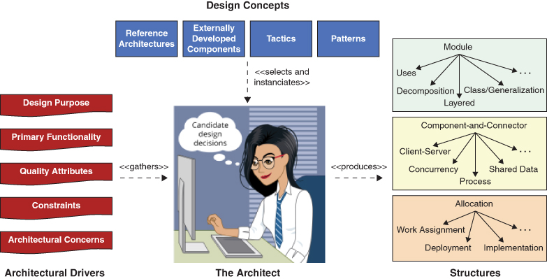
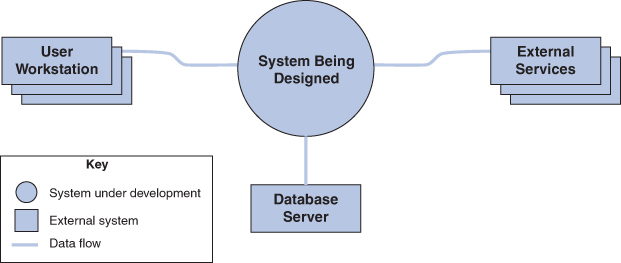
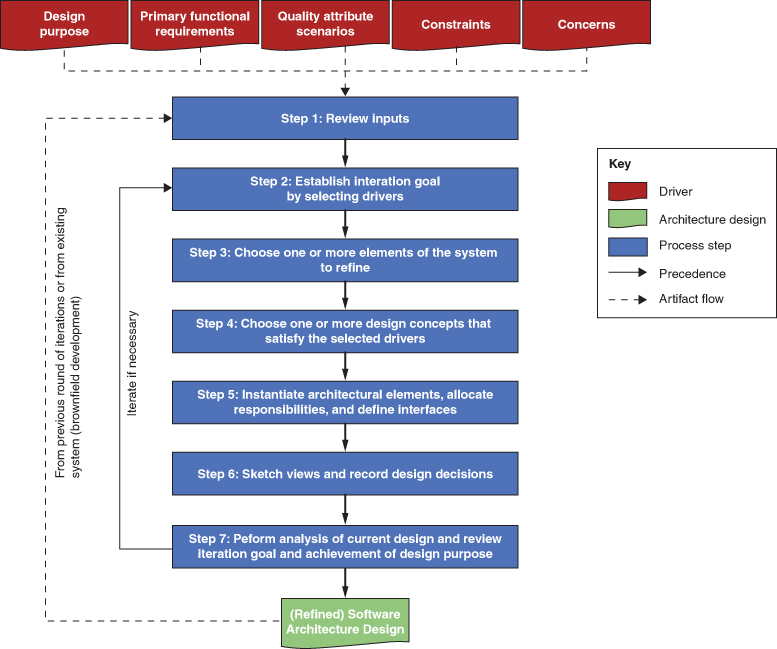
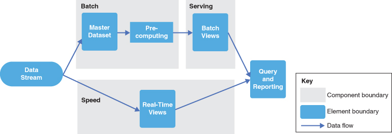
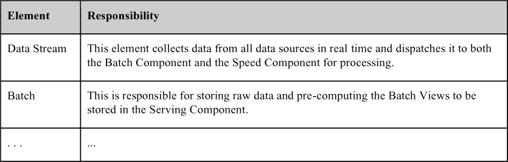
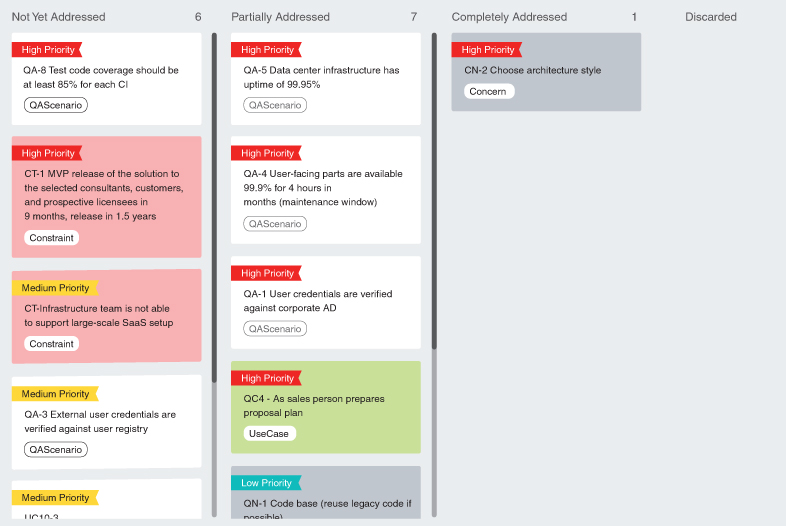

# 20. Thiết kế một architecture (Designing an Architecture)

Cùng với Humberto Cervantes

> Một nhà thiết kế biết mình đã đạt đến sự hoàn hảo không phải khi không còn gì để thêm vào, mà là khi không còn gì để bớt đi. 
> —Antoine de Saint-Exupéry.

Thiết kế—bao gồm cả thiết kế architecture—là một hoạt động phức tạp để thực hiện. Nó bao gồm việc đưa ra vô số quyết định có tính đến nhiều khía cạnh của một hệ thống. Trước đây, nhiệm vụ này chỉ được giao cho các kỹ sư phần mềm cấp cao—những bậc thầy—với hàng chục năm kinh nghiệm hard-won. Một phương pháp có hệ thống cung cấp hướng dẫn để thực hiện hoạt động phức tạp này sao cho những người bình thường cũng có thể học và thực hiện nó một cách thành thạo.

Trong chương này, chúng tôi đưa ra một thảo luận chi tiết về một phương pháp—Attribute-Driven Design (ADD)—cho phép thiết kế một architecture theo cách có hệ thống, có thể lặp lại và cost-effective. Khả năng lặp lại và khả năng giảng dạy là dấu hiệu đặc trưng của một ngành kỹ thuật. Để làm cho một phương pháp có thể lặp lại và có thể giảng dạy, chúng ta cần một tập các bước mà bất kỳ kỹ sư nào được đào tạo phù hợp cũng có thể làm theo.

Chúng tôi bắt đầu bằng việc đưa ra tổng quan về ADD và các bước của nó. Phần tổng quan này được tiếp nối bằng các thảo luận chi tiết hơn về một số bước then chốt.

## 20.1 Attribute-Driven Design

Thiết kế architecture cho các hệ thống phần mềm không khác gì thiết kế nói chung: Nó bao gồm việc đưa ra quyết định, và làm việc với các vật liệu và kỹ năng sẵn có, để thỏa mãn các yêu cầu và ràng buộc. Trong thiết kế architecture, chúng ta biến các quyết định về architectural driver thành các structure, như trong [Hình 20.1](#ch20fig01). Architectural driver bao gồm các architecturally significant requirement (ASR—chủ đề của [Chương 19](ch19_architecturally_significant_requirements.vi.md#ch19)), nhưng cũng bao gồm chức năng, ràng buộc, các mối quan tâm về architecture và mục đích thiết kế. Các structure thu được sau đó được dùng để dẫn dắt dự án theo nhiều cách mà chúng tôi đã trình bày trong [Chương 2](ch02_why_is_software_architecture_important.vi.md#ch02): Chúng dẫn dắt việc phân tích và xây dựng. Chúng đóng vai trò nền tảng để đào tạo một thành viên mới của dự án. Chúng dẫn dắt việc ước tính chi phí và tiến độ, việc lập team, phân tích và giảm thiểu rủi ro, và tất nhiên là việc triển khai.

**Hình 20.1** *Tổng quan về hoạt động thiết kế architecture*

Trước khi bắt đầu thiết kế architecture, điều quan trọng là xác định phạm vi của hệ thống—cái gì nằm bên trong và cái gì nằm bên ngoài hệ thống bạn đang tạo ra, và hệ thống sẽ tương tác với những thực thể bên ngoài nào. Bối cảnh này có thể được biểu diễn bằng một system context diagram, giống như trong [Hình 20.2](#ch20fig02). Context diagram được thảo luận chi tiết hơn trong [Chương 22](ch22_documenting_an_architecture.vi.md#ch22).

**Hình 20.2** *Ví dụ về một system context diagram*

Trong ADD, thiết kế architecture được thực hiện theo từng vòng (round), mỗi vòng có thể gồm một chuỗi các vòng lặp thiết kế (design iteration). Một round bao gồm các hoạt động thiết kế architecture được thực hiện trong một chu kỳ phát triển. Thông qua một hoặc nhiều iteration, bạn tạo ra một architecture phù hợp với mục đích thiết kế đã được thiết lập cho round này.

Trong mỗi iteration, một chuỗi các bước thiết kế được thực hiện. ADD cung cấp hướng dẫn chi tiết về các bước cần được thực hiện bên trong mỗi iteration. [Hình 20.3](#ch20fig03) cho thấy các bước và artifact gắn với ADD. Trong hình, các bước 1–7 tạo thành một round. Trong một round, các bước 2–7 tạo thành một hoặc nhiều iteration bên trong round. Trong các tiểu mục sau, chúng tôi đưa ra tổng quan về từng bước này.

**Hình 20.3** *Các bước và artifact của ADD*

## 20.2 Các bước của ADD (The Steps of ADD)

Các mục tiếp theo mô tả các bước của ADD.

### Bước 1: Xem xét các đầu vào

Trước khi bắt đầu một design round, bạn cần bảo đảm rằng các architectural driver (các đầu vào của quá trình thiết kế) có sẵn và đúng. Chúng bao gồm:

- Mục đích của design round
- Các yêu cầu chức năng chính
- Các quality attribute (QA) scenario chính
- Mọi ràng buộc
- Mọi mối quan tâm

Vì sao chúng ta ghi nhận tường minh mục đích thiết kế? Bạn cần bảo đảm rằng mình rõ ràng về các mục tiêu cho một round. Trong một bối cảnh thiết kế tăng dần gồm nhiều round, mục đích của một design round có thể là, ví dụ, tạo ra một thiết kế để ước tính sớm, tinh chỉnh một thiết kế hiện có để xây dựng một increment mới của hệ thống, hoặc thiết kế và tạo một prototype để giảm thiểu một số rủi ro kỹ thuật nhất định. Ngoài ra, bạn cần biết thiết kế của architecture hiện có, nếu đây không phải là phát triển greenfield.

Tại thời điểm này, chức năng chính—thường được ghi nhận dưới dạng một tập use case hoặc user story—và các QA scenario lẽ ra đã được sắp xếp mức ưu tiên, lý tưởng là bởi các stakeholder quan trọng nhất của dự án. (Bạn có thể dùng nhiều kỹ thuật khác nhau để khơi gợi và sắp xếp mức ưu tiên cho chúng, như đã thảo luận trong [Chương 19](ch19_architecturally_significant_requirements.vi.md#ch19)). Bạn, kiến trúc sư, giờ phải “sở hữu” những thứ này. Ví dụ, bạn cần kiểm tra xem có stakeholder quan trọng nào bị bỏ sót trong quá trình khơi gợi yêu cầu ban đầu không, và có điều kiện kinh doanh nào đã thay đổi kể từ khi việc sắp xếp mức ưu tiên được thực hiện không. Những đầu vào này thực sự “dẫn dắt” thiết kế, nên việc làm đúng chúng và sắp xếp đúng mức ưu tiên của chúng là then chốt. Chúng tôi không thể nhấn mạnh điểm này đủ mạnh. Thiết kế software architecture, giống như hầu hết các hoạt động trong software engineering, là một quá trình “garbage-in-garbage-out”. Kết quả của ADD không thể tốt nếu các đầu vào được hình thành kém.

Các driver trở thành một phần của một architectural design backlog mà bạn nên dùng để thực hiện các design iteration khác nhau. Khi bạn đã đưa ra các quyết định thiết kế tính đến mọi mục trong backlog, bạn đã hoàn thành round này. (Chúng tôi thảo luận ý tưởng về backlog sâu hơn trong [Mục 20.8](#sec20_8).)

Các bước 2–7 tạo nên các hoạt động cho mỗi design iteration được thực hiện trong design round này.

### Bước 2: Thiết lập mục tiêu iteration bằng cách chọn driver

Mỗi design iteration tập trung vào việc đạt được một mục tiêu cụ thể. Mục tiêu như vậy thường bao gồm thiết kế để thỏa mãn một tập con các driver. Ví dụ, một mục tiêu iteration có thể là tạo các structure từ các element sẽ cho phép đạt được một performance scenario cụ thể, hoặc một use case. Vì lý do này, khi thực hiện các hoạt động thiết kế, bạn cần thiết lập một mục tiêu trước khi bắt đầu một design iteration cụ thể.

### Bước 3: Chọn một hoặc nhiều element của hệ thống để tinh chỉnh

Việc thỏa mãn các driver đòi hỏi bạn đưa ra các quyết định thiết kế architecture, những quyết định này sau đó thể hiện ra trong một hoặc nhiều structure thuộc architecture. Các structure này gồm các element liên hệ với nhau—module và/hoặc component, như được định nghĩa trong [Chương 1](ch01_what_is_software_architecture.vi.md#ch01)—và các element này thường có được bằng cách tinh chỉnh các element khác mà bạn đã xác định trước đó trong một iteration trước. Tinh chỉnh có thể có nghĩa là phân rã thành các element finer-grained (cách tiếp cận top-down), kết hợp các element thành các element coarser-grained (cách tiếp cận bottom-up), hoặc cải thiện các element đã xác định trước đó. Với phát triển greenfield, bạn có thể bắt đầu bằng cách thiết lập bối cảnh hệ thống rồi chọn element duy nhất có sẵn—tức là chính hệ thống—để tinh chỉnh bằng cách phân rã. Với các hệ thống hiện có hoặc với các design iteration sau này trong các hệ thống greenfield, bạn thường chọn tinh chỉnh các element đã được xác định trong các iteration trước.

Các element bạn sẽ chọn là những element tham gia vào việc thỏa mãn các driver cụ thể. Vì lý do này, khi thiết kế xử lý một hệ thống hiện có, bạn cần hiểu rõ các element là một phần của architecture as-built của hệ thống. Việc có được thông tin này có thể bao gồm một số “công việc thám tử”, reverse engineering, hoặc thảo luận với các developer.

Trong một số trường hợp, bạn có thể cần đảo thứ tự các bước 2 và 3. Ví dụ, khi thiết kế một hệ thống greenfield hoặc khi làm chi tiết một số loại reference architecture nhất định, ít nhất ở các giai đoạn đầu của thiết kế, bạn sẽ tập trung vào các element của hệ thống và bắt đầu iteration bằng cách chọn một element cụ thể rồi xem xét các driver mà bạn muốn giải quyết.

### Bước 4: Chọn một hoặc nhiều design concept thỏa mãn các driver đã chọn

Chọn (các) design concept có lẽ là quyết định khó khăn nhất bạn sẽ đối mặt trong quá trình thiết kế, vì nó đòi hỏi bạn xác định các design concept khác nhau có thể hợp lý được dùng để đạt được mục tiêu iteration, rồi đưa ra lựa chọn từ các phương án đó. Có nhiều loại design concept khác nhau—ví dụ, tactic, pattern, reference architecture và các component được phát triển bên ngoài—và, với mỗi loại, có thể tồn tại nhiều lựa chọn. Điều này có thể dẫn đến một số lượng đáng kể các phương án cần được phân tích trước khi đưa ra lựa chọn cuối cùng. Trong [Mục 20.3](#sec20_3), chúng tôi thảo luận chi tiết hơn về việc xác định và lựa chọn design concept.

### Bước 5: Khởi tạo các element của architecture, phân bổ trách nhiệm và định nghĩa interface

Một khi bạn đã chọn một hoặc nhiều design concept, bạn phải đưa ra một loại quyết định thiết kế khác: cách *khởi tạo* (instantiate) các element từ các design concept vừa chọn. Ví dụ, nếu bạn đã chọn pattern layers làm design concept, bạn phải quyết định sẽ dùng bao nhiêu layer, và các mối quan hệ được phép giữa chúng, vì bản thân pattern không quy định những điều này.

Sau khi khởi tạo các element, bạn cần phân bổ trách nhiệm cho từng element. Ví dụ, trong một app, thường có ít nhất ba layer: presentation, business và data. Trách nhiệm của các layer này khác nhau: Trách nhiệm của presentation layer bao gồm quản lý mọi tương tác của người dùng, business layer quản lý logic ứng dụng và thực thi các business rule, và data layer quản lý tính bền vững và tính nhất quán của dữ liệu.

Khởi tạo element chỉ là một phần của việc tạo ra các structure thỏa mãn một driver hoặc một mối quan tâm. Các element đã được khởi tạo cũng cần được kết nối, qua đó cho phép chúng cộng tác với nhau. Điều này đòi hỏi sự tồn tại của các *relationship* giữa các element và việc trao đổi thông tin thông qua một loại interface nào đó. Interface là một đặc tả mang tính hợp đồng chỉ ra cách thông tin nên lưu chuyển giữa các element. Trong [Mục 20.4](#sec20_4), chúng tôi trình bày thêm chi tiết về cách các loại design concept khác nhau được khởi tạo, cách các structure được tạo ra, và cách các interface được định nghĩa.

### Bước 6: Phác thảo view và ghi lại các quyết định thiết kế

Tại thời điểm này, bạn đã hoàn thành các hoạt động thiết kế cho iteration. Tuy nhiên, có thể bạn chưa thực hiện hành động nào để bảo đảm rằng các view—các biểu diễn của những structure bạn đã tạo—được lưu giữ. Ví dụ, nếu bạn thực hiện bước 5 trong một phòng họp, có lẽ bạn đã có một loạt sơ đồ trên bảng trắng. Thông tin này là thiết yếu cho phần còn lại của quá trình, và bạn phải ghi lại nó để sau này có thể phân tích và truyền đạt nó cho các stakeholder khác. Việc ghi lại các view có thể đơn giản như chụp ảnh bảng trắng.

Các view bạn đã tạo gần như chắc chắn là chưa đầy đủ; do đó, các sơ đồ này có thể cần được xem lại và tinh chỉnh trong một iteration tiếp theo. Điều này thường được thực hiện để đáp ứng các element phát sinh từ các quyết định thiết kế khác mà bạn sẽ đưa ra để hỗ trợ các driver bổ sung. Đây là lý do chúng tôi nói đến việc “phác thảo” (sketching) các view trong ADD, trong đó một “sketch” chỉ một loại tài liệu sơ bộ. Tài liệu hình thức hơn, fleshed-out đầy đủ hơn của các view này— nếu bạn chọn tạo ra nó (xem [Chương 22](ch22_documenting_an_architecture.vi.md#ch22))—chỉ diễn ra sau khi các design iteration đã hoàn tất (như một phần của hoạt động tài liệu hóa architecture).

Ngoài việc ghi lại các sketch của view, bạn nên ghi lại các quyết định quan trọng được đưa ra trong design iteration, cũng như các lý do đã thúc đẩy những quyết định này (tức là rationale), để hỗ trợ việc phân tích và hiểu các quyết định sau này. Ví dụ, các quyết định về những tradeoff quan trọng nên được ghi lại vào thời điểm này. Trong một design iteration, các quyết định chủ yếu được đưa ra ở các bước 4 và 5. Trong [Mục 20.5](#sec20_5), chúng tôi giải thích cách tạo tài liệu sơ bộ *trong* quá trình thiết kế, bao gồm ghi lại các quyết định thiết kế và rationale của chúng.

### Bước 7: Phân tích thiết kế hiện tại, xem xét mục tiêu iteration và việc đạt được mục đích thiết kế

Đến bước 7, bạn lẽ ra đã tạo được một thiết kế một phần giải quyết mục tiêu đã thiết lập cho iteration. Bảo đảm rằng điều này thực sự đúng là một ý tưởng tốt, để tránh các stakeholder không hài lòng và việc làm lại sau này. Bạn có thể tự thực hiện phân tích bằng cách review các sketch của view và các quyết định thiết kế bạn đã ghi lại, nhưng một ý tưởng thậm chí tốt hơn là nhờ người khác giúp bạn review thiết kế này. Chúng ta làm điều này vì cùng lý do mà các tổ chức thường có một nhóm testing/quality assurance riêng: Một người khác sẽ không chia sẻ các giả định của bạn, và sẽ có một nền tảng kinh nghiệm khác và một góc nhìn khác. Sự đa dạng này giúp tìm ra “bug”, cả trong code lẫn trong architecture. Chúng tôi thảo luận sâu hơn về phân tích architecture trong [Chương 21](ch21_evaluating_an_architecture.vi.md#ch21).

Một khi thiết kế được thực hiện trong iteration đã được phân tích, bạn nên xem xét trạng thái architecture của mình xét theo mục đích thiết kế đã thiết lập. Điều này có nghĩa là xem xét liệu, tại thời điểm này, bạn đã thực hiện đủ design iteration để thỏa mãn các driver gắn với design round chưa. Nó cũng có nghĩa là xem xét liệu mục đích thiết kế đã đạt được chưa hay cần thêm các design round trong các increment tương lai của dự án. Trong [Mục 20.6](#sec20_6), chúng tôi thảo luận các kỹ thuật đơn giản cho phép bạn theo dõi tiến độ thiết kế.

### Lặp lại nếu cần (Iterate If Necessary)

Bạn nên thực hiện thêm các iteration và lặp lại các bước 2–7 cho mọi driver đã được xem xét. Tuy nhiên, thường thì kiểu lặp lại này sẽ không khả thi vì các ràng buộc về thời gian hoặc nguồn lực buộc bạn phải dừng các hoạt động thiết kế và chuyển sang triển khai.

Tiêu chí để đánh giá liệu có cần thêm design iteration không là gì? Hãy để *rủi ro* dẫn đường. Ít nhất bạn nên đã giải quyết các driver có mức ưu tiên cao nhất. Lý tưởng nhất, bạn nên chắc chắn rằng các driver then chốt đã được thỏa mãn hoặc, ít nhất, rằng thiết kế là “đủ tốt” để thỏa mãn chúng.

## 20.3 Thêm về ADD bước 4: chọn một hoặc nhiều design concept

Hầu hết thời gian, bạn, với tư cách kiến trúc sư, không cần, và không nên, phát minh lại cái bánh xe. Thay vào đó, hoạt động thiết kế chính của bạn là xác định và chọn các design concept để đáp ứng những thách thức quan trọng nhất và giải quyết các driver then chốt qua các design iteration. Thiết kế vẫn là một nỗ lực độc đáo và sáng tạo, nhưng sự sáng tạo nằm ở việc xác định đúng những giải pháp hiện có này, tiếp theo là kết hợp và điều chỉnh chúng cho vấn đề trước mắt. Ngay cả khi có sẵn một kho giải pháp để lựa chọn—và không phải lúc nào chúng ta cũng may mắn có một kho phong phú—đây vẫn là phần khó nhất của thiết kế.

### Xác định design concept (Identification of Design Concepts)

Việc xác định design concept có vẻ đáng ngại, vì số lượng lựa chọn có sẵn rất lớn. Có lẽ có hàng chục design pattern và component được phát triển bên ngoài mà bạn có thể dùng để giải quyết bất kỳ vấn đề cụ thể nào. Tệ hơn nữa, những design concept này nằm rải rác ở nhiều nguồn khác nhau: trong blog và website của người thực hành, trong tài liệu nghiên cứu và trong sách. Hơn nữa, trong nhiều trường hợp, không có định nghĩa chuẩn mực nào cho một concept. Ví dụ, các trang khác nhau sẽ định nghĩa broker pattern theo những cách khác nhau, phần lớn không chính thức. Cuối cùng, một khi bạn đã xác định các phương án có khả năng giúp bạn đạt được các mục tiêu thiết kế của iteration, bạn cần chọn (các) phương án tốt nhất cho mục đích của mình.

Để giải quyết một vấn đề thiết kế cụ thể, bạn có thể và thường sẽ dùng và kết hợp các loại design concept khác nhau. Ví dụ, để xây dựng một security driver, bạn có thể dùng một security pattern, một security tactic, một security framework, hoặc một tổ hợp nào đó của chúng.

Một khi bạn đã rõ hơn về các loại design concept mà bạn muốn dùng, bạn vẫn cần xác định các phương án—tức là các design candidate. Bạn có thể làm điều này theo nhiều cách, dù có lẽ bạn sẽ dùng một tổ hợp các kỹ thuật này thay vì một phương pháp duy nhất:

- *Tận dụng các best practice hiện có*. Bạn có thể xác định các phương án bằng cách sử dụng các danh mục hiện có. Một số design concept, như pattern, được tài liệu hóa rộng rãi; những thứ khác, như các component được phát triển bên ngoài, được tài liệu hóa kém kỹ lưỡng hơn. Lợi ích của cách tiếp cận này là bạn có thể xác định nhiều phương án và tận dụng kiến thức và kinh nghiệm đáng kể của người khác. Nhược điểm là việc tìm kiếm và nghiên cứu thông tin có thể đòi hỏi một lượng thời gian đáng kể, chất lượng của kiến thức được tài liệu hóa thường không rõ, và các giả định và thiên kiến của tác giả cũng không rõ.
- *Tận dụng kiến thức và kinh nghiệm của chính bạn*. Nếu hệ thống bạn đang thiết kế tương tự các hệ thống khác bạn đã thiết kế trước đây, có lẽ bạn sẽ muốn bắt đầu với một số design concept mà bạn đã dùng trước đó. Lợi ích của cách tiếp cận này là việc xác định phương án có thể được thực hiện nhanh chóng và tự tin. Nhược điểm là bạn có thể kết thúc với việc dùng đi dùng lại cùng những ý tưởng, ngay cả khi chúng không phải là phù hợp nhất cho mọi vấn đề thiết kế bạn đang đối mặt, hoặc nếu chúng đã bị các cách tiếp cận mới hơn, tốt hơn thay thế. Như câu nói: Nếu tất cả những gì bạn có là một cái búa, cả thế giới trông như một cái đinh.
- *Tận dụng kiến thức và kinh nghiệm của người khác*. Với tư cách kiến trúc sư, bạn có một nền tảng và kiến thức mà bạn đã tích lũy qua nhiều năm. Nền tảng và kiến thức này sẽ khác nhau ở mỗi người, đặc biệt nếu các loại vấn đề thiết kế họ đã giải quyết trong quá khứ khác nhau. Bạn có thể tận dụng thông tin này bằng cách thực hiện việc xác định và lựa chọn design concept cùng một số đồng nghiệp thông qua động não.

### Lựa chọn design concept (Selection of Design Concepts)

Một khi bạn đã xác định một danh sách các design concept thay thế, bạn cần chọn phương án nào là phù hợp nhất để giải quyết vấn đề thiết kế trước mắt. Bạn có thể làm điều này theo một cách tương đối đơn giản, bằng cách tạo một bảng liệt kê ưu và nhược điểm gắn với mỗi phương án và chọn một trong các phương án dựa trên những tiêu chí đó và các driver của bạn. Bảng cũng có thể chứa các tiêu chí khác, như chi phí gắn với việc dùng phương án. Các phương pháp như phân tích SWOT (strengths, weaknesses, opportunities, threats) có thể giúp bạn đưa ra quyết định này.

Khi xác định và lựa chọn design concept, hãy ghi nhớ các ràng buộc là một phần của các architectural driver, vì một số ràng buộc sẽ ngăn bạn chọn một số phương án cụ thể. Ví dụ, một ràng buộc có thể là mọi library và framework phải dùng một giấy phép được phê duyệt. Trong trường hợp đó, ngay cả khi bạn đã tìm thấy một framework có thể hữu ích cho nhu cầu của mình, bạn có thể cần loại bỏ nó nếu nó không có giấy phép được phê duyệt.

Bạn cũng cần ghi nhớ rằng các quyết định liên quan đến việc lựa chọn design concept mà bạn đã đưa ra trong các iteration trước có thể hạn chế các design concept bạn có thể chọn bây giờ do không tương thích. Một ví dụ là chọn một web architecture trong một iteration ban đầu rồi chọn một framework user interface cho ứng dụng cục bộ trong một iteration tiếp theo.

### Tạo prototype (Creation of Prototypes)

Trong trường hợp các kỹ thuật phân tích nêu trên không dẫn bạn đến một lựa chọn design concept thích hợp, bạn có thể cần tạo prototype và thu thập số đo từ chúng. Tạo các prototype “dùng một lần” (throwaway) sớm là một kỹ thuật hữu ích giúp lựa chọn các component được phát triển bên ngoài. Loại prototype này thường được tạo ra mà không cân nhắc đến maintainability, tái sử dụng, hay việc cho phép đạt được các mục tiêu quan trọng khác. Một prototype như vậy không nên được dùng làm cơ sở cho việc phát triển tiếp theo.

Dù việc tạo prototype có thể tốn kém, một số scenario nhất định thúc đẩy mạnh mẽ việc tạo chúng. Khi suy nghĩ về việc có nên tạo prototype không, hãy đặt những câu hỏi sau:

- Dự án có kết hợp các công nghệ mới nổi không?
- Công nghệ có mới đối với công ty không?
- Có driver nào, đặc biệt là QA, mà việc thỏa mãn chúng bằng công nghệ đã chọn tiềm ẩn rủi ro không (tức là chưa hiểu rõ liệu chúng có thể được thỏa mãn hay không)?
- Có thiếu thông tin đáng tin cậy, nội bộ hoặc bên ngoài, có thể mang lại một mức độ chắc chắn nào đó rằng công nghệ đã chọn sẽ hữu ích để thỏa mãn các driver của dự án không?
- Có các tùy chọn cấu hình gắn với công nghệ cần được kiểm thử hoặc tìm hiểu không?
- Có chưa rõ liệu công nghệ đã chọn có thể dễ dàng tích hợp với các công nghệ khác được dùng trong dự án hay không?

Nếu hầu hết câu trả lời của bạn cho những câu hỏi này là “có”, thì bạn nên cân nhắc nghiêm túc việc tạo một prototype throwaway.

> **Làm prototype hay không làm prototype? (To Prototype or Not to Prototype?)**
>
> Thường xảy ra trường hợp các quyết định architecture phải được đưa ra với kiến thức không hoàn hảo. Để quyết định nên đi theo hướng nào, một team có thể chạy một loạt thử nghiệm (chẳng hạn như xây dựng prototype) để cố gắng giảm sự không chắc chắn về con đường nên theo. Vấn đề là những thử nghiệm như vậy có thể tốn chi phí đáng kể, và các kết luận rút ra từ chúng có thể không dứt khoát.
>
> Ví dụ, giả sử một team cần quyết định liệu hệ thống họ đang thiết kế nên dựa trên một three-tier architecture truyền thống hay nên gồm các microservice. Vì đây là dự án đầu tiên của team với microservice, họ không tự tin vào cách tiếp cận đó. Họ ước tính chi phí cho hai phương án, và dự kiến rằng chi phí phát triển three-tier architecture sẽ là $500,000 và chi phí phát triển microservice sẽ là $650,000. Nếu, sau khi đã phát triển three-tier architecture, team sau đó kết luận rằng đã chọn sai architecture, chi phí refactor ước tính sẽ là $300,000. Nếu microservices architecture được phát triển trước, và sau đó cần refactor, chi phí bổ sung ước tính của nó sẽ là $100,000.
>
> Team nên làm gì?
>
> Để quyết định liệu có đáng tiến hành các thử nghiệm không, hoặc chúng ta nên sẵn sàng chi bao nhiêu cho việc thử nghiệm so với độ tin cậy có được và chi phí của việc sai lầm, team có thể dùng một kỹ thuật được gọi là Value of Information (VoI) để giải quyết các câu hỏi. Kỹ thuật VoI được dùng để tính lợi ích kỳ vọng từ việc giảm sự không chắc chắn xung quanh một quyết định thông qua một dạng hoạt động thu thập dữ liệu nào đó—trong trường hợp này, việc xây dựng prototype. Để dùng VoI, team sẽ cần đánh giá các tham số sau: chi phí của việc đưa ra lựa chọn thiết kế sai, chi phí thực hiện các thử nghiệm, mức độ tin tưởng của team vào mỗi lựa chọn thiết kế. và mức độ tin tưởng của họ vào kết quả của các thử nghiệm. Dùng những ước tính này, VoI sau đó áp dụng Định lý Bayes để tính hai đại lượng: giá trị kỳ vọng của thông tin hoàn hảo (expected value of perfect information, EVPI) và giá trị kỳ vọng của thông tin mẫu hay thông tin không hoàn hảo (expected value of sample or imperfect information, EVSI). EVPI biểu thị số tiền tối đa người ta nên sẵn sàng trả cho các thử nghiệm, nếu chúng mang lại kết quả dứt khoát (ví dụ: không có false positive hoặc false negative). EVSI biểu thị số tiền người ta nên sẵn sàng chi khi biết rằng kết quả của thử nghiệm có thể không xác định được giải pháp đúng với độ chắc chắn 100 phần trăm.
>
> Vì những kết quả này biểu thị các giá trị kỳ vọng, chúng nên được đánh giá trong bối cảnh khẩu vị rủi ro của team.
>
> —Eduardo Miranda

## 20.4 Thêm về ADD bước 5: tạo ra structure

Bản thân các design concept sẽ không giúp bạn thỏa mãn các driver trừ khi bạn tạo ra các *structure*; tức là, bạn cần xác định và kết nối các element được suy ra từ các design concept đã chọn. Đây là giai đoạn “khởi tạo” (instantiation) cho các element của architecture trong ADD: tạo element và các mối quan hệ giữa chúng, và gắn trách nhiệm với các element này. Hãy nhớ rằng architecture của một hệ thống phần mềm gồm một tập structure. Như chúng ta đã thấy trong [Chương 1](ch01_what_is_software_architecture.vi.md#ch01), các structure này có thể được nhóm thành ba loại chính:

- Module structure, gồm các element tồn tại vào thời điểm phát triển, như file, module và class
- Component and connector (C&C) structure, gồm các element tồn tại tại runtime, như process và thread
- Allocation structure, gồm cả software element (từ một module structure hoặc C&C structure) lẫn các element non-software có thể tồn tại cả vào thời điểm phát triển lẫn tại runtime, như file system, phần cứng và team phát triển

Khi bạn khởi tạo một design concept, bạn có thể thực sự ảnh hưởng đến nhiều hơn một structure. Ví dụ, trong một iteration cụ thể, bạn có thể khởi tạo pattern passive redundancy (warm spare), được giới thiệu trong [Chương 4](ch04_availability.vi.md#ch04). Điều này sẽ dẫn đến cả một C&C structure lẫn một allocation structure. Như một phần của việc áp dụng pattern này, bạn sẽ cần chọn số lượng spare, mức độ mà trạng thái của các spare được giữ nhất quán với trạng thái của node active, một cơ chế để quản lý và chuyển giao trạng thái, và một cơ chế để phát hiện failure của một node. Những quyết định này là các trách nhiệm phải nằm ở đâu đó trong các element của một module structure.

### Khởi tạo element (Instantiating Elements)

Dưới đây là cách việc khởi tạo có thể trông như thế nào cho từng loại design concept:

- *Reference architecture.* Trong trường hợp reference architecture, việc khởi tạo thường có nghĩa là bạn thực hiện một kiểu tùy biến nào đó. Điều này sẽ đòi hỏi bạn thêm hoặc bớt các element là một phần của structure được reference architecture định nghĩa. Ví dụ, nếu bạn đang thiết kế một ứng dụng web cần giao tiếp với một ứng dụng bên ngoài để xử lý thanh toán, có lẽ bạn sẽ cần thêm một integration component bên cạnh các tier truyền thống presentation, business và data.
- *Pattern*. Pattern cung cấp một structure chung gồm các element, cùng với các mối quan hệ và trách nhiệm của chúng. Vì structure này mang tính chung, bạn sẽ cần điều chỉnh nó cho vấn đề cụ thể của mình. Việc khởi tạo thường bao gồm việc biến đổi structure chung được pattern định nghĩa thành một structure cụ thể được điều chỉnh theo nhu cầu của vấn đề bạn đang giải quyết. Ví dụ, hãy xét architectural pattern client-server. Nó thiết lập các element tính toán cơ bản (tức là client và server) và các mối quan hệ của chúng (tức là kết nối và giao tiếp), nhưng không chỉ định bạn nên dùng bao nhiêu client hoặc server cho vấn đề của mình, hay chức năng của mỗi cái nên là gì, hay client nào nên nói chuyện với server nào, hay chúng nên dùng communication protocol nào. Việc khởi tạo lấp đầy những chỗ trống này.
- *Tactic*. Design concept này không quy định một structure cụ thể. Do đó, để khởi tạo một tactic, bạn có thể điều chỉnh một loại design concept khác (mà bạn đang dùng) để hiện thực tactic. Hoặc, bạn có thể dùng một design concept mà, không cần điều chỉnh gì, đã hiện thực sẵn tactic. Ví dụ, bạn có thể (1) chọn một security tactic *authenticating actors* và khởi tạo nó thông qua một giải pháp custom-coded mà bạn đan vào quy trình đăng nhập sẵn có của mình; hoặc (2) áp dụng một security pattern có bao gồm xác thực actor; hoặc (3) tích hợp một component được phát triển bên ngoài như một security framework xác thực actor.
- *Component được phát triển bên ngoài (Externally developed components)*. Việc khởi tạo các component này có thể hoặc không ngụ ý việc tạo ra các element mới. Ví dụ, trong trường hợp các framework object-oriented, việc khởi tạo có thể đòi hỏi bạn tạo các class mới kế thừa từ các base class được định nghĩa trong framework. Điều này sẽ dẫn đến các element mới. Một ví dụ không liên quan đến việc tạo element mới là chỉ định các tùy chọn cấu hình cho một công nghệ đã chọn, như số thread trong một thread pool.

### Gắn trách nhiệm và xác định thuộc tính (Associating Responsibilities and Identifying Properties)

Khi bạn tạo element bằng cách khởi tạo các design concept, bạn cần xem xét các trách nhiệm được phân bổ cho các element này. Ví dụ, nếu bạn khởi tạo microservices architecture pattern ([Chương 5](ch05_deployability.vi.md#ch05)), bạn cần quyết định các microservice sẽ làm gì, bạn sẽ deploy bao nhiêu instance của mỗi loại, và các thuộc tính của những microservice đó sẽ là gì. Khi khởi tạo element và phân bổ trách nhiệm, bạn nên ghi nhớ nguyên lý thiết kế rằng các element nên có cohesion cao (bên trong), được định nghĩa bởi một tập trách nhiệm hẹp, và thể hiện coupling thấp (bên ngoài).

Một khía cạnh quan trọng mà bạn cần xem xét khi khởi tạo design concept là các thuộc tính của element. Điều này có thể bao gồm các khía cạnh như tùy chọn cấu hình, tính stateful, quản lý tài nguyên, mức ưu tiên, hoặc thậm chí đặc điểm phần cứng (nếu các element bạn đã tạo là các node vật lý) của các công nghệ đã chọn. Việc xác định các thuộc tính này hỗ trợ việc phân tích và việc tài liệu hóa design rationale của bạn.

### Thiết lập các mối quan hệ giữa các element (Establishing Relationships between the Elements)

Việc tạo structure cũng đòi hỏi đưa ra các quyết định liên quan đến các mối quan hệ tồn tại giữa các element và các thuộc tính của chúng. Hãy xét lại pattern client-server. Khi khởi tạo pattern này, bạn cần quyết định client nào sẽ nói chuyện với server nào, thông qua port và protocol nào. Bạn cũng cần quyết định việc giao tiếp sẽ đồng bộ hay bất đồng bộ. Ai khởi tạo tương tác? Bao nhiêu thông tin được truyền và với tốc độ nào?

Những quyết định thiết kế này có thể có tác động đáng kể đến việc đạt được các QA như performance.

### Định nghĩa interface (Defining Interfaces)

Interface thiết lập một đặc tả mang tính hợp đồng cho phép các element cộng tác và trao đổi thông tin. Chúng có thể là bên ngoài hoặc bên trong.

Interface bên ngoài là interface của các hệ thống khác mà hệ thống của bạn phải tương tác. Chúng có thể tạo thành ràng buộc cho hệ thống của bạn, vì bạn thường không thể ảnh hưởng đến đặc tả của chúng. Như chúng tôi đã nói trước đó, việc thiết lập bối cảnh hệ thống vào lúc bắt đầu quá trình thiết kế là hữu ích để xác định các interface bên ngoài. Vì các thực thể bên ngoài và hệ thống đang được phát triển tương tác thông qua interface, nên có ít nhất một interface bên ngoài cho mỗi hệ thống bên ngoài (như trong [Hình 20.2](#ch20fig02)).

Interface bên trong là interface giữa các element phát sinh từ việc khởi tạo design concept. Để xác định các mối quan hệ và chi tiết interface, bạn cần hiểu cách các element tương tác với nhau để hỗ trợ các use case hoặc QA scenario. Như chúng tôi đã nói trong [Chương 15](ch15_software_interfaces.vi.md#ch15) khi thảo luận về software Interface, “tương tác” có nghĩa là bất cứ điều gì một element làm có thể tác động đến việc xử lý của một element khác. Một loại tương tác đặc biệt phổ biến là việc trao đổi thông tin tại runtime.

Các biểu diễn hành vi như UML sequence diagram, statechart và activity diagram (xem [Chương 22](ch22_documenting_an_architecture.vi.md#ch22)) cho phép bạn mô hình hóa thông tin được trao đổi giữa các element trong quá trình thực thi. Loại phân tích này cũng hữu ích để xác định các mối quan hệ giữa các element: Nếu hai element cần trao đổi thông tin trực tiếp hoặc phụ thuộc vào nhau theo cách khác, thì tồn tại một mối quan hệ giữa các element này. Mọi thông tin được trao đổi đều trở thành một phần của đặc tả interface.

Việc xác định interface thường không được thực hiện đồng đều trên mọi design iteration. Ví dụ, khi bạn bắt đầu thiết kế một hệ thống greenfield, các iteration đầu tiên của bạn sẽ chỉ tạo ra các element trừu tượng như layer; các element này sau đó sẽ được tinh chỉnh ở các iteration sau. Interface của các element trừu tượng như layer thường được đặc tả chưa đầy đủ. Ví dụ, trong một iteration sớm, bạn có thể chỉ đơn giản chỉ định rằng tier UI gửi “command” tới tier business logic, và tier business logic gửi “kết quả” trở lại. Khi quá trình thiết kế tiến triển, và đặc biệt là khi bạn tạo các structure để giải quyết các use case và QA scenario cụ thể, bạn sẽ cần tinh chỉnh interface của các element tham gia vào những tương tác này.

Trong một số trường hợp đặc biệt, việc xác định các interface thích hợp có thể được đơn giản hóa đáng kể. Ví dụ, nếu bạn chọn một technology stack hoàn chỉnh hoặc một tập component đã được thiết kế để tương tác với nhau, thì các interface sẽ đã được những công nghệ đó định nghĩa sẵn. Trong trường hợp như vậy, việc đặc tả interface là một nhiệm vụ tương đối tầm thường, vì các công nghệ đã chọn đã “cài sẵn” nhiều giả định và quyết định về interface.

Cuối cùng, hãy lưu ý rằng không phải mọi interface bên trong đều cần được xác định trong bất kỳ ADD iteration nào. Một số có thể được giao lại cho các hoạt động thiết kế sau này.

## 20.5 Thêm về ADD bước 6: tạo tài liệu sơ bộ trong quá trình thiết kế

Như chúng ta sẽ thấy trong [Chương 22](ch22_documenting_an_architecture.vi.md#ch22), software architecture được tài liệu hóa dưới dạng một tập *view*, biểu diễn các structure khác nhau tạo nên architecture. Việc tài liệu hóa hình thức các view này không phải là một phần của ADD. Tuy nhiên, các structure được tạo ra như một phần của thiết kế. Việc ghi lại chúng, ngay cả khi chúng được biểu diễn không chính thức (dưới dạng sketch), cùng với các quyết định thiết kế đã dẫn bạn đến việc tạo ra các structure này, là một nhiệm vụ nên được thực hiện như một phần của các hoạt động ADD thông thường.

### Ghi lại sketch của view (Recording Sketches of the Views)

Khi bạn tạo ra các structure bằng cách khởi tạo các design concept mà bạn đã chọn để giải quyết một vấn đề thiết kế cụ thể, thường bạn sẽ không chỉ tạo ra các structure này trong đầu mà còn tạo một số *sketch* (bản phác thảo) của chúng. Trong trường hợp đơn giản nhất, bạn sẽ tạo các sketch này trên bảng trắng, bảng lật, một công cụ vẽ, hoặc thậm chí chỉ là một mẩu giấy. Ngoài ra, bạn có thể dùng một công cụ mô hình hóa để vẽ các structure một cách chặt chẽ hơn. Các sketch bạn tạo ra là tài liệu ban đầu cho architecture của bạn mà bạn nên ghi lại và có thể làm chi tiết sau này, nếu cần. Khi tạo sketch, bạn không nhất thiết cần dùng một ngôn ngữ hình thức hơn như UML—dù nếu bạn thông thạo và thoải mái với quy trình này, xin cứ làm vậy. Nếu bạn dùng một ký hiệu không chính thức nào đó, bạn nên cẩn thận duy trì tính nhất quán trong việc dùng ký hiệu. Cuối cùng, bạn sẽ cần thêm chú giải cho các sơ đồ để làm rõ và tránh mơ hồ.

Bạn nên rèn luyện kỷ luật ghi lại các trách nhiệm mà bạn phân bổ cho các element khi tạo structure. Lý do rất đơn giản: Khi bạn xác định một element, bạn đang xác định một số trách nhiệm cho element đó trong đầu. Ghi chúng lại *ngay lúc đó* bảo đảm rằng bạn sẽ không phải nhớ các trách nhiệm dự định sau này. Ngoài ra, việc ghi lại dần dần các trách nhiệm gắn với các element sẽ dễ hơn là tài liệu hóa tất cả cùng lúc vào một thời điểm sau.

Việc tạo tài liệu sơ bộ này trong khi thiết kế architecture đòi hỏi một chút kỷ luật. Tuy nhiên, lợi ích xứng đáng với công sức, vì sau này bạn sẽ có thể tạo ra tài liệu architecture chi tiết hơn một cách tương đối dễ dàng và nhanh chóng. Một cách đơn giản để tài liệu hóa trách nhiệm, nếu bạn đang dùng bảng trắng hoặc bảng lật, là chụp ảnh sketch bạn đã tạo và dán vào một tài liệu, cùng với một bảng tóm tắt trách nhiệm của mọi element được mô tả trong sơ đồ (xem một ví dụ trong [Hình 20.4](#ch20fig04)). Nếu bạn dùng một công cụ thiết kế, bạn có thể chọn một element để tạo và dùng vùng văn bản thường xuất hiện trong properties sheet của element để tài liệu hóa trách nhiệm của nó, rồi tạo tài liệu một cách tự động.

**Hình 20.4** *Ví dụ về tài liệu sơ bộ*

Sơ đồ được bổ sung bằng một bảng mô tả trách nhiệm của các element. [Bảng 20.1](#ch20tab01) phục vụ mục đích này cho một số element được xác định trong [Hình 20.4](#ch20fig04).

**Bảng 20.1** *Element và trách nhiệm*

Tất nhiên, không cần thiết phải tài liệu hóa *mọi thứ* ở giai đoạn này. Ba mục đích của tài liệu là phân tích, xây dựng và đào tạo. Vào lúc thiết kế, bạn nên chọn một mục đích tài liệu rồi tài liệu hóa để đáp ứng mục đích đó, dựa trên các mối quan tâm về giảm thiểu rủi ro của bạn. Ví dụ, nếu bạn có một QA scenario then chốt mà thiết kế architecture của bạn cần đáp ứng, và nếu bạn sẽ cần chứng minh trong một phân tích rằng thiết kế được đề xuất thỏa mãn tiêu chí này, thì bạn phải cẩn thận tài liệu hóa thông tin liên quan để việc phân tích được thỏa đáng. Tương tự, nếu bạn dự kiến phải đào tạo các thành viên mới của team, thì bạn nên phác thảo một C&C view của hệ thống, cho thấy nó vận hành như thế nào và các element tương tác như thế nào tại runtime, và có lẽ cả một module view của hệ thống, cho thấy ít nhất các layer hoặc hệ thống con chính.

Cuối cùng, khi tài liệu hóa, hãy nhớ rằng thiết kế của bạn rốt cuộc có thể được phân tích. Do đó, bạn cần suy nghĩ về thông tin nào nên được tài liệu hóa để hỗ trợ việc phân tích này.

### Ghi lại các quyết định thiết kế (Recording Design Decisions)

Trong mỗi design iteration, bạn sẽ đưa ra các quyết định thiết kế quan trọng để đạt được mục tiêu iteration. Khi bạn nghiên cứu một sơ đồ biểu diễn một architecture, bạn có thể thấy sản phẩm cuối cùng của một quá trình tư duy nhưng không phải lúc nào cũng dễ dàng hiểu được các quyết định đã được đưa ra để đạt được kết quả này. Việc ghi lại các quyết định thiết kế *vượt ra ngoài* biểu diễn của các element, mối quan hệ và thuộc tính đã chọn là nền tảng để giúp làm rõ cách bạn đã đi đến kết quả—tức là design rationale. Chúng tôi đi sâu chi tiết vào chủ đề này trong [Chương 22](ch22_documenting_an_architecture.vi.md#ch22).

## 20.6 Thêm về ADD bước 7: phân tích thiết kế hiện tại, xem xét mục tiêu iteration và việc đạt được mục đích thiết kế

Vào cuối một iteration, khôn ngoan là thực hiện một số phân tích để suy ngẫm về các quyết định thiết kế bạn vừa đưa ra. Chúng tôi mô tả một số kỹ thuật để làm điều đó trong [Chương 21](ch21_evaluating_an_architecture.vi.md#ch21). Một loại phân tích mà bạn cần thực hiện tại thời điểm này là đánh giá liệu bạn đã làm đủ công việc thiết kế chưa. Cụ thể:

- Bạn cần thiết kế đến mức nào?
- Cho đến giờ bạn đã thiết kế được bao nhiêu?
- Bạn đã xong chưa?

Các thực hành như việc dùng backlog và Kanban board có thể giúp bạn theo dõi tiến độ thiết kế và trả lời những câu hỏi này.

### Dùng architectural backlog (Use of an Architectural Backlog)

Một architectural backlog là một danh sách to-do gồm các hành động đang chờ vẫn cần được thực hiện như một phần của quá trình thiết kế architecture. Ban đầu, bạn nên điền design backlog bằng các driver của mình, nhưng các hoạt động khác hỗ trợ thiết kế architecture cũng có thể được đưa vào—ví dụ:

- Tạo một prototype để kiểm thử một công nghệ cụ thể hoặc để giải quyết một rủi ro QA cụ thể
- Khám phá và tìm hiểu các tài sản hiện có (có thể đòi hỏi reverse engineering)
- Các vấn đề được phát hiện trong một buổi review các quyết định thiết kế đã đưa ra cho đến thời điểm này

Ngoài ra, bạn có thể thêm nhiều mục hơn vào backlog khi các quyết định được đưa ra. Lấy một ví dụ điển hình, nếu bạn chọn một reference architecture, có lẽ bạn sẽ cần thêm các mối quan tâm cụ thể, hoặc các QA scenario được suy ra từ chúng, vào architectural design backlog. Ví dụ, nếu chúng ta chọn một reference architecture ứng dụng web và phát hiện ra rằng nó không cung cấp quản lý session, thì đó trở thành một mối quan tâm cần được thêm vào backlog.

### Dùng Kanban board cho thiết kế (Use of a Design Kanban Board)

Một công cụ khác có thể được dùng để theo dõi tiến độ thiết kế là Kanban board, như trong [Hình 20.5](#ch20fig05). Board này thiết lập ba loại mục backlog: “Not Yet Addressed” (chưa giải quyết), “Partially Addressed” (giải quyết một phần) và “Completely Addressed” (giải quyết hoàn toàn).

**Hình 20.5** *Một Kanban board được dùng để theo dõi tiến độ thiết kế*

Vào lúc bắt đầu một iteration, các đầu vào của quá trình thiết kế trở thành các mục trong backlog. Ban đầu (ở bước 1), các mục trong backlog của bạn cho design round này nên nằm ở cột “Not Yet Addressed” của board. Khi bạn bắt đầu một design iteration, ở bước 2, các mục backlog tương ứng với các driver mà bạn giải quyết trong mục tiêu của design iteration nên được chuyển sang cột “Partially Addressed”. Cuối cùng, một khi bạn hoàn thành một iteration và việc phân tích các quyết định thiết kế cho thấy một driver cụ thể đã được giải quyết (bước 7), mục đó nên được chuyển sang cột “Completely Addressed” của board.

Điều quan trọng là thiết lập các tiêu chí rõ ràng cho phép một driver được chuyển sang cột “Partially Addressed” hoặc “Completely Addressed”. Một tiêu chí cho “Completely Addressed” có thể là, ví dụ, driver đã được phân tích hoặc đã được triển khai trong một prototype, và bạn xác định rằng các yêu cầu cho driver đó đã được thỏa mãn. Các driver được chọn cho một iteration cụ thể có thể không được giải quyết hoàn toàn trong iteration đó. Trong trường hợp đó, chúng nên ở lại cột “Partially Addressed”.

Có thể hữu ích nếu chọn một kỹ thuật cho phép bạn phân biệt các mục trên board theo mức ưu tiên của chúng. Ví dụ, bạn có thể dùng các màu khác nhau cho các mục tùy theo mức ưu tiên.

Một Kanban board giúp dễ dàng theo dõi trực quan tiến triển của thiết kế, vì bạn có thể nhanh chóng thấy có bao nhiêu driver (quan trọng nhất) đang được hoặc đã được giải quyết trong iteration. Kỹ thuật này cũng giúp bạn quyết định liệu có cần thực hiện thêm iteration hay không. Lý tưởng nhất, design round kết thúc khi phần lớn driver của bạn (hoặc ít nhất là những driver có mức ưu tiên cao nhất) nằm dưới cột “Completely Addressed”.

## 20.7 Tóm tắt (Summary)

Thiết kế là khó. Cần có các phương pháp để làm cho nó dễ xử lý hơn (và có thể lặp lại). Trong chương này, chúng tôi đã thảo luận chi tiết phương pháp attribute-driven design (ADD); nó cho phép thiết kế một architecture theo cách có hệ thống và cost-effective.

Chúng tôi cũng đã thảo luận một số khía cạnh quan trọng cần được xem xét trong các bước của quá trình thiết kế. Những khía cạnh này bao gồm việc xác định và lựa chọn design concept, việc dùng chúng để tạo ra structure, việc định nghĩa interface, việc tạo tài liệu sơ bộ, và các cách theo dõi tiến độ thiết kế.

## 20.8 Đọc thêm (For Further Reading)

Phiên bản đầu tiên của ADD, ban đầu được gọi là “Architecture-Based Design” đã được tài liệu hóa trong [Bachmann 00b].

Một mô tả về ADD 2.0 sau đó được công bố năm 2006. Đó là phương pháp đầu tiên tập trung cụ thể vào các QA và việc đạt được chúng thông qua việc lựa chọn các loại structure khác nhau và biểu diễn chúng qua view. Phiên bản 2.0 của ADD được tài liệu hóa lần đầu trong một SEI Technical Report [Wojcik 06].

Phiên bản ADD được mô tả trong chương này là ADD 3.0. Một số cải tiến quan trọng so với phiên bản gốc bao gồm việc cân nhắc nhiều hơn đến việc lựa chọn các công nghệ triển khai như những design concept chính, xem xét thêm các driver như mục đích thiết kế và các mối quan tâm về architecture, biến việc tài liệu hóa ban đầu và phân tích thành các bước tường minh của quá trình thiết kế, và cung cấp hướng dẫn về cách bắt đầu quá trình thiết kế và cách dùng nó trong các bối cảnh Agile. Cả một cuốn sách [Cervantes 16] dành riêng cho thiết kế architecture bằng ADD 3.0. Một số khái niệm của ADD 3.0 được giới thiệu lần đầu trong một *IEEE Software* [Cervantes 13].

George Fairbanks đã viết một cuốn sách hấp dẫn mô tả một quy trình thiết kế architecture risk-driven, có tựa đề *Just Enough Software Architecture: A Risk-Driven Approach* [Fairbanks 10].

Kỹ thuật Value of Information có từ thập niên 1960s [Raiffa 00]. Một cách trình bày hiện đại hơn có thể được tìm thấy trong [Hubbard 14].

Để có một cách tiếp cận tổng quát về thiết kế hệ thống, bạn có thể đọc tác phẩm kinh điển của Butler Lampson [Lampson 11].

Dùng các khái niệm của lean manufacturing, Kanban là một phương pháp lập lịch sản xuất một hệ thống, như được Corey Ladas mô tả [Ladas 09].

## 20.9 Câu hỏi thảo luận (Discussion Questions)

1. Những ưu điểm của việc tuân theo một phương pháp thiết kế đã được thiết lập là gì? Những nhược điểm là gì?
2. Việc thực hiện thiết kế architecture có tương thích với một phương pháp phát triển agile không? Hãy chọn một phương pháp agile và thảo luận ADD trong bối cảnh đó.
3. Mối quan hệ giữa thiết kế và phân tích là gì? Có những loại kiến thức nào bạn cần cho cái này nhưng không cần cho cái kia không?
4. Nếu bạn phải lập luận với người quản lý về giá trị của việc tạo và duy trì tài liệu architecture trong quá trình thiết kế, bạn sẽ đưa ra những lập luận nào?
5. Việc bạn thực hiện các bước của ADD sẽ khác nhau như thế nào nếu bạn đang làm phát triển greenfield so với phát triển brownfield?
