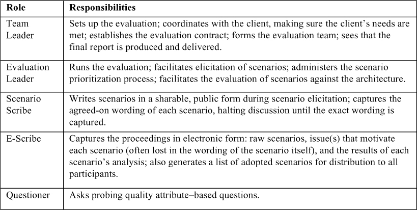
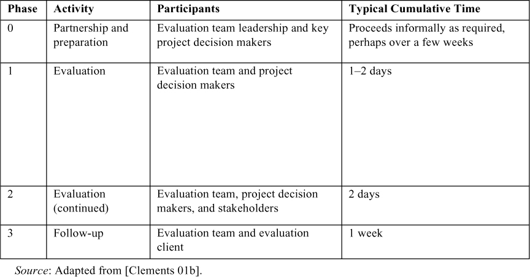
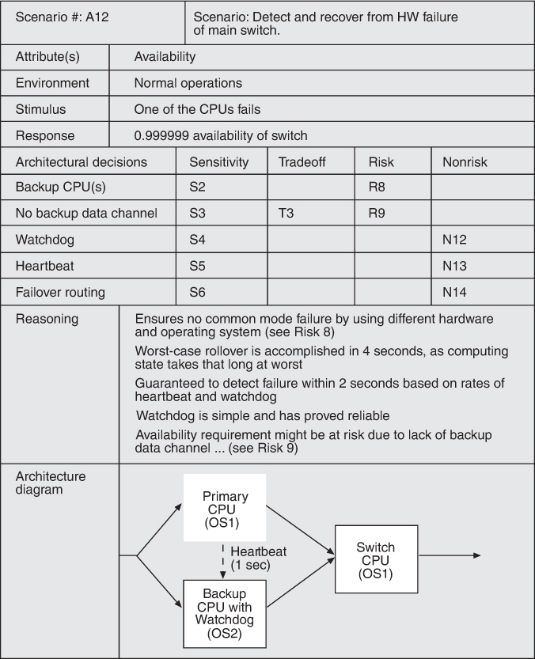
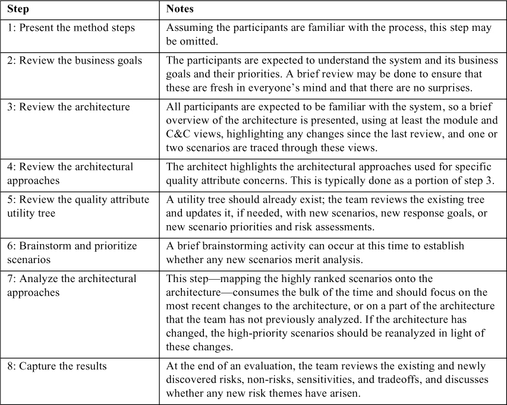

# 21. Đánh giá một architecture (Evaluating an Architecture)

> Một bác sĩ có thể chôn vùi những sai lầm của mình, nhưng một kiến trúc sư chỉ có thể khuyên khách hàng trồng dây leo. 
> —Frank Lloyd Wright

Trong [Chương 2](ch02_why_is_software_architecture_important.vi.md#ch02), chúng tôi đã nói rằng một lý do chính khiến architecture quan trọng là bạn có thể dự đoán các quality attribute của bất kỳ hệ thống nào được suy ra từ nó, *trước khi bạn xây dựng hệ thống,* bằng cách xem xét architecture của nó. Đó là một món hời khá tốt, nếu bạn nghĩ về nó. Và đây là chương mà khả năng đó phát huy tác dụng.

*Đánh giá architecture* (architecture evaluation) là quá trình xác định mức độ mà một architecture phù hợp với mục đích mà nó hướng tới. Architecture đóng góp quan trọng cho sự thành công của một dự án kỹ thuật hệ thống và phần mềm đến mức việc dừng lại và bảo đảm rằng architecture bạn đang thiết kế sẽ có thể cung cấp mọi thứ được kỳ vọng ở nó là điều hợp lý. Đó là vai trò của việc đánh giá, vốn dựa trên việc phân tích các phương án. May mắn thay, có những phương pháp trưởng thành để phân tích architecture sử dụng nhiều khái niệm và kỹ thuật mà bạn đã học trong cuốn sách này.

Để hữu ích, chi phí của việc đánh giá cần nhỏ hơn giá trị mà nó mang lại. Với mối quan hệ này, một câu hỏi quan trọng là “Việc đánh giá sẽ tốn bao nhiêu thời gian và tiền bạc?” Các kỹ thuật đánh giá khác nhau đi kèm các chi phí khác nhau, nhưng tất cả đều có thể được đo bằng thời gian mà những người tham gia bỏ ra cho việc chuẩn bị, thực hiện và follow-up các hoạt động đánh giá.

## 21.1 Đánh giá như một hoạt động giảm rủi ro (Evaluation as a Risk Reduction Activity)

Mọi architecture đều đi kèm rủi ro. Đầu ra của một đợt đánh giá architecture bao gồm việc xác định các phần có rủi ro của architecture. Một rủi ro là một sự kiện có cả tác động lẫn xác suất. Chi phí ước tính của một rủi ro là xác suất sự kiện đó xảy ra nhân với chi phí của tác động. Việc khắc phục các rủi ro đó không phải là một đầu ra của việc đánh giá. Một khi các rủi ro đã được xác định, việc khắc phục chúng, cũng giống như chính việc đánh giá, là một vấn đề chi phí/lợi ích.

Áp dụng khái niệm này vào việc đánh giá architecture, bạn có thể thấy rằng nếu hệ thống đang được xây dựng tốn hàng triệu hoặc hàng tỷ đô la hoặc có những hệ quả safety-critical lớn, thì tác động của một sự kiện rủi ro sẽ lớn. Ngược lại, nếu hệ thống là một trò chơi console-based tốn hàng chục hoặc hàng trăm nghìn đô la để tạo ra, thì tác động của một sự kiện rủi ro sẽ nhỏ hơn đáng kể.

Xác suất của một sự kiện rủi ro liên quan, cùng với những yếu tố khác, đến mức độ mà hệ thống đang được phát triển và architecture của nó đã có tiền lệ hay chưa có tiền lệ. Nếu bạn và tổ chức của bạn có kinh nghiệm lâu năm và sâu sắc trong lĩnh vực này, thì xác suất tạo ra một architecture tồi sẽ thấp hơn so với khi dự án này là lần đầu tiên bạn thử sức.

Do đó, việc đánh giá hoạt động giống như một hợp đồng bảo hiểm. Bạn cần bao nhiêu bảo hiểm phụ thuộc vào mức độ bạn phơi nhiễm với rủi ro của một architecture không phù hợp và mức chấp nhận rủi ro của bạn.

Việc đánh giá có thể được thực hiện xuyên suốt quá trình phát triển ở các giai đoạn khác nhau, với những người đánh giá khác nhau, và với những khác biệt trong cách thực hiện việc đánh giá—chúng tôi sẽ đề cập một số lựa chọn trong chương này. Bất kể các chi tiết chính xác của chúng, việc đánh giá xây dựng trên các khái niệm bạn đã học: Hệ thống được xây dựng để thỏa mãn các business goal, các business goal được minh họa bằng các quality attribute scenario, và các mục tiêu quality attribute đạt được thông qua việc áp dụng các tactic và pattern.

## 21.2 Các hoạt động đánh giá then chốt là gì? (What Are the Key Evaluation Activities?)

Bất kể ai thực hiện việc đánh giá và khi nào nó được thực hiện, một đợt đánh giá đều dựa trên các architectural driver—chủ yếu là các architecturally significant requirement (ASR) được biểu diễn dưới dạng quality attribute scenario. [Chương 19](ch19_architecturally_significant_requirements.vi.md#ch19) mô tả cách xác định ASR. Số lượng ASR đưa vào việc đánh giá là một hàm của các yếu tố bối cảnh và chi phí của việc đánh giá. Tiếp theo, chúng tôi mô tả các yếu tố bối cảnh có thể có cho việc đánh giá architecture.

Một đợt đánh giá có thể được tiến hành tại bất kỳ thời điểm nào trong quá trình thiết kế khi đã tồn tại một architecture ứng viên, hoặc ít nhất là một phần mạch lạc có thể review được của nó.

Mọi đợt đánh giá nên bao gồm (ít nhất) các bước sau:

1. *Từng người review tự bảo đảm rằng họ hiểu trạng thái hiện tại của architecture.* Điều này có thể được thực hiện thông qua tài liệu được chia sẻ, thông qua một bài trình bày của kiến trúc sư, hoặc thông qua một tổ hợp nào đó của các cách này.
2. *Những người review xác định một số driver để dẫn dắt việc review.* Các driver này có thể đã được tài liệu hóa, hoặc chúng có thể được phát triển bởi team review hoặc bởi các stakeholder bổ sung. Thông thường, các driver quan trọng nhất cần review là các quality attribute scenario high-priority (chứ không phải, chẳng hạn, các use case thuần chức năng).
3. *Với mỗi scenario, mỗi người review nên xác định liệu scenario đó có được thỏa mãn hay không.* Những người review đặt câu hỏi để xác định hai loại thông tin. Thứ nhất, họ muốn xác định rằng scenario thực sự được thỏa mãn. Điều này có thể được thực hiện bằng cách để kiến trúc sư đi qua architecture và giải thích scenario được thỏa mãn như thế nào. Nếu architecture đã được tài liệu hóa, thì những người review có thể dùng tài liệu đó để đưa ra đánh giá này. Thứ hai, họ muốn xác định liệu có scenario nào khác đang được xem xét sẽ không được thỏa mãn do các quyết định được đưa ra trong phần architecture đang được review hay không. Những người review có thể đề xuất các phương án thay thế cho bất kỳ khía cạnh rủi ro nào của thiết kế hiện tại mà có thể thỏa mãn scenario tốt hơn. Các phương án thay thế này nên được đưa vào cùng một loại phân tích. Ràng buộc thời gian đóng một vai trò trong việc xác định bước này được phép tiếp tục bao lâu.
4. *Những người review ghi nhận các vấn đề tiềm ẩn được phơi bày trong bước trước.* Danh sách các vấn đề tiềm ẩn này tạo thành cơ sở cho việc follow-up của buổi review. Nếu vấn đề tiềm ẩn là một vấn đề thật, thì hoặc nó phải được khắc phục hoặc các nhà thiết kế và quản lý dự án phải đưa ra một quyết định tường minh rằng họ sẵn sàng chấp nhận rủi ro.

Bạn nên phân tích đến mức nào? Các quyết định được đưa ra để đạt được một trong các yêu cầu architecture chủ chốt nên được phân tích nhiều hơn những quyết định khác, vì chúng sẽ định hình các phần then chốt của architecture. Một số cân nhắc cụ thể bao gồm:

- *Tầm quan trọng của quyết định*. Quyết định càng quan trọng, càng cần cẩn thận hơn khi đưa ra nó và bảo đảm rằng nó đúng.
- *Số lượng phương án tiềm năng.* Càng nhiều phương án, càng có thể tốn nhiều thời gian hơn để đánh giá chúng.
- *Đủ tốt thay vì hoàn hảo.* Nhiều khi, hai phương án khả dĩ không khác nhau đáng kể về hệ quả. Trong trường hợp như vậy, việc đưa ra một lựa chọn và tiếp tục quá trình thiết kế quan trọng hơn là chắc chắn tuyệt đối rằng lựa chọn tốt nhất đang được đưa ra.

## 21.3 Ai có thể thực hiện việc đánh giá? (Who Can Perform the Evaluation?)

Người đánh giá nên có kỹ năng cao trong lĩnh vực và các quality attribute khác nhau mà hệ thống cần được đánh giá. Kỹ năng tổ chức và điều phối xuất sắc cũng là điều bắt buộc đối với người đánh giá.

### Đánh giá bởi kiến trúc sư (Evaluation by the Architect)

Việc đánh giá được thực hiện—ngầm định hoặc tường minh—mỗi khi kiến trúc sư đưa ra một quyết định thiết kế then chốt để giải quyết một ASR hoặc hoàn thành một cột mốc thiết kế. Việc đánh giá này bao gồm việc quyết định giữa các phương án cạnh tranh. Đánh giá bởi kiến trúc sư là một phần không thể thiếu của quá trình thiết kế architecture, như chúng tôi đã thảo luận trong [Chương 20](ch20_designing_an_architecture.vi.md#ch20).

### Đánh giá bằng peer review (Evaluation by Peer Review)

Các thiết kế architecture để giải quyết ASR có thể được peer review, giống như code có thể được peer review. Nên có một lượng thời gian cố định được phân bổ cho peer review, thường là vài giờ đến nửa ngày.

Nếu các nhà thiết kế đang dùng quy trình Attribute-Driven Design (ADD) được mô tả trong [Chương 20](ch20_designing_an_architecture.vi.md#ch20), thì một buổi peer review có thể được thực hiện vào cuối bước 7 của mỗi ADD iteration. Những người review cũng nên dùng các questionnaire tactics-based mà chúng tôi đã trình bày trong [Chương 4](ch04_availability.vi.md#ch04)–[13](ch13_usability.vi.md#ch13).

### Đánh giá bởi người ngoài (Evaluation by Outsiders)

Người đánh giá bên ngoài có thể nhìn architecture một cách khách quan hơn. “Bên ngoài” là tương đối; điều này có thể có nghĩa là bên ngoài dự án phát triển, bên ngoài đơn vị kinh doanh nơi dự án nằm nhưng vẫn trong cùng công ty, hoặc hoàn toàn bên ngoài công ty. Người đánh giá càng ở “bên ngoài”, họ càng ít e ngại nêu ra các vấn đề nhạy cảm, hoặc các vấn đề không lộ rõ do văn hóa tổ chức hoặc do “chúng tôi luôn làm theo cách đó.”

Thường thì người ngoài được chọn để tham gia đánh giá vì họ có kiến thức hoặc kinh nghiệm chuyên biệt, như kiến thức về một quality attribute quan trọng đối với hệ thống đang được xem xét, kỹ năng với một công nghệ cụ thể đang được sử dụng, hoặc kinh nghiệm lâu năm trong việc đánh giá architecture thành công.

Ngoài ra, dù có chính đáng hay không, các nhà quản lý có xu hướng sẵn lòng lắng nghe các vấn đề được phát hiện bởi một team bên ngoài được thuê với chi phí đáng kể hơn là bởi các thành viên team trong tổ chức. Điều này có thể gây bực bội một cách dễ hiểu cho nhân sự dự án, những người có thể đã phàn nàn về chính những vấn đề đó, mà không có kết quả, trong nhiều tháng.

Về nguyên tắc, một team bên ngoài có thể đánh giá một architecture hoàn chỉnh, một architecture chưa hoàn chỉnh, hoặc một phần của một architecture. Trong thực tế, vì việc thuê họ phức tạp và thường tốn kém, họ có xu hướng được dùng để đánh giá các architecture hoàn chỉnh.

## 21.4 Các yếu tố bối cảnh (Contextual Factors)

Đối với peer review hoặc phân tích từ bên ngoài, một số yếu tố bối cảnh phải được xem xét khi thiết lập một đợt đánh giá:

- *Có những artifact nào sẵn có?* Để thực hiện một đợt đánh giá architecture, phải có một artifact vừa mô tả architecture vừa sẵn có. Một số đợt đánh giá có thể diễn ra sau khi hệ thống đã vận hành. Trong trường hợp này, một số công cụ khôi phục và phân tích architecture có thể được dùng để hỗ trợ khám phá architecture, tìm các lỗi thiết kế architecture, và kiểm tra rằng hệ thống as-built tuân thủ hệ thống as-designed.
- *Ai được xem kết quả?* Một số đợt đánh giá được thực hiện với sự hiểu biết đầy đủ và sự tham gia của tất cả các stakeholder. Những đợt khác được thực hiện kín đáo hơn.
- *Những stakeholder nào sẽ tham gia?* Quá trình đánh giá nên bao gồm một phương pháp để khơi gợi các mục tiêu và mối quan tâm của các stakeholder quan trọng liên quan đến hệ thống. Việc xác định những cá nhân cần thiết và bảo đảm sự tham gia của họ vào việc đánh giá là then chốt.
- *Các business goal là gì?* Việc đánh giá nên trả lời liệu hệ thống có thỏa mãn các business goal hay không. Nếu các business goal không được ghi nhận tường minh và sắp xếp mức ưu tiên trước khi đánh giá, thì một phần của việc đánh giá nên được dành cho nhiệm vụ này.

Việc đánh giá bởi đồng nghiệp và bởi người đánh giá bên ngoài đủ phổ biến đến mức chúng tôi đã hình thức hóa các quy trình để dẫn dắt việc đánh giá. Các quy trình này xác định ai nên tham gia và những hoạt động nào nên diễn ra trong quá trình đánh giá. Việc hình thức hóa một quy trình cho phép tổ chức làm cho quy trình có thể lặp lại tốt hơn, giúp các stakeholder hiểu những gì sẽ được yêu cầu và được bàn giao bởi việc đánh giá, đào tạo người đánh giá mới sử dụng quy trình, và hiểu khoản đầu tư cần thiết để thực hiện việc đánh giá.

Chúng tôi bắt đầu bằng việc mô tả một quy trình cho người đánh giá bên ngoài (Architecture Tradeoff Analysis Method); sau đó chúng tôi mô tả một quy trình cho peer review (Lightweight Architecture Evaluation).

## 21.5 Phương pháp phân tích tradeoff của architecture (The Architecture Tradeoff Analysis Method)

Architecture Tradeoff Analysis Method (ATAM) là quy trình chúng tôi đã hình thức hóa để thực hiện việc đánh giá architecture. ATAM đã được sử dụng trong hơn hai thập kỷ để đánh giá software architecture của các hệ thống lớn trong các lĩnh vực từ ô tô đến tài chính đến quốc phòng. ATAM được thiết kế sao cho người đánh giá không cần quen thuộc trước với architecture hay các business goal của nó, và hệ thống cũng chưa cần được xây dựng. Một đợt ATAM có thể được tổ chức trực tiếp hoặc từ xa.

### Những người tham gia ATAM (Participants in the ATAM)

ATAM đòi hỏi sự tham gia và hợp tác lẫn nhau của ba nhóm:

- *Team đánh giá (The evaluation team).* Nhóm này ở bên ngoài dự án có architecture đang được đánh giá. Nó thường gồm ba đến năm người. Mỗi thành viên của team được giao một số vai trò cụ thể để đảm nhận trong quá trình đánh giá; một người có thể đảm nhận nhiều vai trò trong một đợt ATAM. (Xem [Bảng 21.1](#ch21tab01) để biết mô tả về các vai trò này.) Team đánh giá có thể là một đơn vị thường trực nơi việc đánh giá architecture được thực hiện thường xuyên, hoặc các thành viên của nó có thể được chọn từ một nhóm các cá nhân am hiểu architecture cho dịp đó. Họ có thể làm việc cho cùng tổ chức với team phát triển có architecture đang được xem xét, hoặc họ có thể là các chuyên gia tư vấn bên ngoài. Trong mọi trường hợp, họ cần được công nhận là những người ngoài có năng lực, không thiên vị, không có mục đích ngầm hay hiềm khích riêng.
- *Những người ra quyết định của dự án (Project decision makers).* Những người này được trao quyền phát ngôn cho dự án phát triển hoặc có thẩm quyền yêu cầu thay đổi đối với nó. Họ thường bao gồm quản lý dự án và, nếu có một khách hàng xác định được đang chi trả cho việc phát triển, một đại diện của khách hàng đó cũng có thể có mặt. Kiến trúc sư luôn được bao gồm—một quy tắc cốt lõi của việc đánh giá architecture là kiến trúc sư phải sẵn lòng tham gia.
- *Các stakeholder của architecture (Architecture stakeholders).* Các stakeholder có lợi ích gắn liền với việc architecture hoạt động như đã quảng bá. Họ là những người mà khả năng làm công việc của mình phụ thuộc vào việc architecture thúc đẩy modifiability, security, độ tin cậy cao, hoặc những thứ tương tự. Stakeholder bao gồm developer, tester, integrator, maintainer, kỹ sư performance, người dùng, và người xây dựng các hệ thống tương tác với hệ thống đang được xem xét. Công việc của họ trong quá trình đánh giá là nêu rõ các mục tiêu quality attribute cụ thể mà architecture nên đáp ứng để hệ thống được coi là thành công. Một quy tắc kinh nghiệm—và nó chỉ là như vậy thôi—là bạn nên dự kiến huy động 10 đến 25 stakeholder cho việc đánh giá một architecture enterprise-critical lớn. Không giống như team đánh giá và những người ra quyết định của dự án, các stakeholder không tham gia toàn bộ đợt đánh giá.

**Bảng 21.1** *Các vai trò trong team đánh giá ATAM*

### Đầu ra của ATAM (Outputs of the ATAM)

1. *Một bài trình bày ngắn gọn về architecture.* Một yêu cầu của ATAM là architecture phải được trình bày trong một giờ hoặc ít hơn, điều này dẫn đến một bài trình bày architecture vừa ngắn gọn vừa, thường là, dễ hiểu.
2. *Việc nêu rõ các business goal.* Thường thì các business goal được trình bày trong đợt ATAM được một số người tham gia nhìn thấy lần đầu tiên và chúng được ghi nhận trong các đầu ra. Bản mô tả các business goal này tồn tại sau đợt đánh giá và trở thành một phần di sản của dự án.
3. *Các yêu cầu quality attribute đã được sắp xếp mức ưu tiên, được biểu diễn dưới dạng quality attribute scenario.* Các quality attribute scenario này có dạng được mô tả trong [Chương 3](ch03_understanding_quality_attributes.vi.md#ch03). ATAM dùng các quality attribute scenario đã được sắp xếp mức ưu tiên làm cơ sở để đánh giá architecture. Các scenario đó có thể đã tồn tại (có lẽ là kết quả của một đợt requirements-capture trước đó hoặc hoạt động ADD), nhưng nếu không, chúng được những người tham gia tạo ra như một phần của đợt ATAM.
4. *Một tập rủi ro và non-risks.* Một rủi ro architecture là một quyết định có thể dẫn đến hệ quả không mong muốn xét theo các yêu cầu quality attribute đã nêu. Tương tự, một non-risk architecture là một quyết định mà, sau khi phân tích, được coi là an toàn. Các rủi ro được xác định tạo thành cơ sở cho một kế hoạch giảm thiểu rủi ro architecture. Các rủi ro này là đầu ra chính của một đợt ATAM.
5. *Một tập risk theme.* Khi việc phân tích hoàn tất, team đánh giá xem xét toàn bộ tập rủi ro được phát hiện để tìm các chủ đề bao trùm xác định những điểm yếu mang tính hệ thống trong architecture hoặc thậm chí trong quy trình architecture và team. Nếu không được xử lý, các risk theme này sẽ đe dọa các business goal của dự án.
6. *Ánh xạ các quyết định architecture vào các yêu cầu chất lượng.* Các quyết định architecture có thể được diễn giải theo các driver mà chúng hỗ trợ hoặc cản trở. Với mỗi quality attribute scenario được xem xét trong một đợt ATAM, những quyết định architecture giúp đạt được nó được xác định và ghi nhận. Chúng có thể đóng vai trò như một tuyên bố về rationale cho các quyết định đó.
7. *Một tập sensitivity point và tradeoff point đã được xác định*. Sensitivity point là các quyết định architecture có ảnh hưởng rõ rệt đến một response của quality attribute. Tradeoff xảy ra khi hai hoặc nhiều response của quality attribute nhạy cảm với cùng một quyết định architecture, nhưng một cái được cải thiện trong khi cái kia bị suy giảm—do đó là tradeoff.

Các đầu ra của đợt ATAM có thể được dùng để xây dựng một báo cáo cuối cùng tóm lược phương pháp, tóm tắt diễn biến, ghi nhận các scenario và phân tích của chúng, và lập danh mục các phát hiện.

Một đợt đánh giá ATAM-based cũng tạo ra các kết quả vô hình không nên bị bỏ qua. Chúng bao gồm cảm giác cộng đồng về phía các stakeholder, các kênh giao tiếp cởi mở giữa kiến trúc sư và các stakeholder, và sự hiểu biết tổng thể tốt hơn giữa tất cả những người tham gia về architecture cũng như điểm mạnh và điểm yếu của nó. Dù các kết quả này khó đo lường, chúng không kém quan trọng so với các kết quả khác.

### Các giai đoạn của ATAM (Phases of the ATAM)

Các hoạt động trong một đợt đánh giá ATAM-based được trải ra qua bốn giai đoạn:

- Trong giai đoạn 0, “Partnership and Preparation” (Hợp tác và chuẩn bị), ban lãnh đạo team đánh giá và những người ra quyết định chủ chốt của dự án thống nhất các chi tiết của đợt đánh giá. Các đại diện dự án giới thiệu tóm tắt về dự án cho người đánh giá để team đánh giá có thể được bổ sung bởi những người có chuyên môn phù hợp. Cùng nhau, hai nhóm thống nhất về hậu cần, như thời điểm việc đánh giá sẽ diễn ra và công nghệ được dùng để hỗ trợ các cuộc họp. Họ cũng thống nhất một danh sách sơ bộ các stakeholder (theo tên, không chỉ theo vai trò), và thương lượng khi nào báo cáo cuối cùng sẽ được bàn giao và cho ai. Họ xử lý các thủ tục như statement of work hoặc thỏa thuận bảo mật. Team đánh giá xem xét tài liệu architecture để hiểu architecture và các cách tiếp cận thiết kế chính mà nó bao gồm. Cuối cùng, trưởng team đánh giá giải thích những thông tin mà quản lý và kiến trúc sư sẽ được kỳ vọng trình bày trong giai đoạn 1, và giúp họ xây dựng bài trình bày nếu cần.
- Trong giai đoạn 1 và 2, gọi chung là “Evaluation” (Đánh giá), mọi người bắt tay vào công việc phân tích. Đến lúc này, team đánh giá đã nghiên cứu tài liệu architecture và sẽ có một ý niệm tốt về hệ thống là gì, các cách tiếp cận architecture chính đã được dùng, và các quality attribute có tầm quan trọng hàng đầu. Trong giai đoạn 1, team đánh giá gặp những người ra quyết định của dự án để bắt đầu thu thập thông tin và phân tích. Trong giai đoạn 2, các stakeholder của architecture bổ sung đầu vào của họ cho diễn biến và việc phân tích tiếp tục.
- Trong giai đoạn 3, “Follow-up” (Theo dõi tiếp), team đánh giá soạn và bàn giao báo cáo cuối cùng. Báo cáo này—có thể là một tài liệu chính thức hoặc đơn giản là một bộ slide—trước tiên được chuyển cho các stakeholder chủ chốt để bảo đảm rằng nó không chứa lỗi hiểu sai nào. Sau khi buổi review này hoàn tất, nó được bàn giao cho khách hàng.

[Bảng 21.2](#ch21tab02) cho thấy bốn giai đoạn của ATAM, ai tham gia vào mỗi giai đoạn, và thời gian tích lũy điển hình dành cho hoạt động—có thể chia thành nhiều đoạn.

**Bảng 21.2** *Các giai đoạn ATAM và đặc điểm của chúng*

### Các bước của các giai đoạn đánh giá (Steps of the Evaluation Phases)

Các giai đoạn phân tích ATAM (giai đoạn 1 và 2) gồm chín bước. Các bước 1–6 được thực hiện trong giai đoạn 1 với team đánh giá và những người ra quyết định của dự án—thường là team architecture, quản lý dự án và khách hàng. Trong giai đoạn 2, với tất cả các stakeholder tham gia, các bước 1–6 được tóm tắt và các bước 7–9 được thực hiện.

#### Bước 1: Trình bày ATAM

Bước đầu tiên yêu cầu trưởng nhóm đánh giá trình bày ATAM cho các đại diện dự án đã tập hợp. Thời gian này được dùng để giải thích quy trình mà mọi người sẽ tuân theo, trả lời câu hỏi, và thiết lập bối cảnh và kỳ vọng cho phần còn lại của các hoạt động. Dùng một bài trình bày chuẩn, trưởng nhóm mô tả ngắn gọn các bước của ATAM và các đầu ra của việc đánh giá.

#### Bước 2: Trình bày các business goal

Mọi người tham gia việc đánh giá—các đại diện dự án cũng như các thành viên team đánh giá—cần hiểu bối cảnh của hệ thống và các business goal chính thúc đẩy việc phát triển nó. Trong bước này, một người ra quyết định của dự án (lý tưởng là quản lý dự án hoặc đại diện khách hàng) trình bày tổng quan hệ thống từ góc nhìn kinh doanh. Bài trình bày này nên mô tả các khía cạnh sau của dự án:

- Các chức năng quan trọng nhất của hệ thống
- Mọi ràng buộc liên quan về kỹ thuật, quản lý, kinh tế hoặc chính trị
- Các business goal và bối cảnh khi chúng liên quan đến dự án
- Các stakeholder chính
- Các architectural driver (nhấn mạnh các architecturally significant requirement)

#### Bước 3: Trình bày architecture

Kiến trúc sư trưởng (hoặc team architecture) thực hiện một bài trình bày mô tả architecture ở một mức độ chi tiết thích hợp. “Mức thích hợp” phụ thuộc vào nhiều yếu tố: bao nhiêu phần của architecture đã được thiết kế và tài liệu hóa; có bao nhiêu thời gian; và bản chất của các yêu cầu hành vi và chất lượng.

Trong bài trình bày này, kiến trúc sư đề cập các ràng buộc kỹ thuật như hệ điều hành, các nền tảng được quy định sử dụng, và các hệ thống khác mà hệ thống này phải tương tác. Quan trọng nhất, kiến trúc sư mô tả các cách tiếp cận architecture (hoặc pattern, hoặc tactic, nếu kiến trúc sư thông thạo bộ từ vựng đó) được dùng để đáp ứng các yêu cầu.

Chúng tôi kỳ vọng các architectural view, như đã giới thiệu trong [Chương 1](ch01_what_is_software_architecture.vi.md#ch01) và được mô tả chi tiết trong [Chương 22](ch22_documenting_an_architecture.vi.md#ch22), sẽ là phương tiện chính để kiến trúc sư truyền đạt architecture. Context diagram, các view component-and-connector, các view module decomposition hoặc layered, và deployment view hữu ích trong hầu hết mọi đợt đánh giá, và kiến trúc sư nên chuẩn bị sẵn sàng để trình bày chúng. Các view khác có thể được trình bày nếu chúng chứa thông tin liên quan đến architecture đang bàn, đặc biệt là thông tin liên quan đến việc thỏa mãn các yêu cầu quality attribute quan trọng.

#### Bước 4: Xác định các cách tiếp cận architecture

ATAM tập trung vào việc phân tích một architecture bằng cách hiểu các cách tiếp cận architecture của nó. Các architectural pattern và tactic hữu ích vì (cùng với những lý do khác) các cách đã biết mà mỗi cái ảnh hưởng đến các quality attribute cụ thể. Ví dụ, một layered pattern có xu hướng mang lại portability và maintainability cho một hệ thống, có thể phải đánh đổi bằng performance. Một publish-subscribe pattern có khả năng mở rộng theo số lượng producer và consumer của dữ liệu, trong khi active redundancy pattern thúc đẩy high availability.

#### Bước 5: Tạo một quality attribute utility tree

Các mục tiêu quality attribute được nêu chi tiết thông qua một quality attribute utility tree, mà chúng tôi đã giới thiệu trong [Mục 19.4](ch19_architecturally_significant_requirements.vi.md#sec19_4). Utility tree giúp làm cho các yêu cầu cụ thể hơn bằng cách định nghĩa chính xác các yêu cầu quality attribute liên quan mà các kiến trúc sư đang nỗ lực cung cấp.

Các mục tiêu quality attribute quan trọng cho architecture đang được xem xét đã được nêu tên hoặc ngụ ý ở bước 2, khi các business goal được trình bày, nhưng không với mức độ cụ thể cho phép phân tích. Các mục tiêu rộng như “modifiability” hay “throughput cao” hay “khả năng được port sang nhiều nền tảng” thiết lập bối cảnh và định hướng, và cung cấp một phông nền để trình bày các thông tin tiếp theo. Tuy nhiên, chúng không đủ cụ thể để cho chúng ta biết liệu architecture có đủ để đạt được những mục tiêu đó không. Modifiable theo cách nào? Throughput cao đến mức nào? Port sang những nền tảng nào và trong bao lâu? Câu trả lời cho các loại câu hỏi này được biểu diễn dưới dạng các quality attribute scenario đại diện cho các architecturally significant requirement.

Hãy nhớ rằng utility tree được xây dựng bởi kiến trúc sư và những người ra quyết định của dự án. Cùng nhau, họ xác định tầm quan trọng của mỗi scenario: Kiến trúc sư đánh giá độ khó kỹ thuật hoặc rủi ro của scenario (trên thang H, M, L), và những người ra quyết định của dự án đánh giá tầm quan trọng kinh doanh của nó.

#### Bước 6: Phân tích các cách tiếp cận architecture

Team đánh giá xem xét lần lượt từng scenario highest-ranked (như đã xác định trong utility tree); kiến trúc sư được yêu cầu giải thích architecture hỗ trợ từng scenario như thế nào. Các thành viên team đánh giá—đặc biệt là những người đặt câu hỏi—thăm dò các cách tiếp cận architecture mà kiến trúc sư đã dùng để thực hiện scenario. Trong quá trình đó, team đánh giá tài liệu hóa các quyết định architecture liên quan và xác định cũng như lập danh mục các rủi ro, non-risks và tradeoff của chúng. Với các cách tiếp cận well-known, team đánh giá hỏi kiến trúc sư đã khắc phục các điểm yếu đã biết trong cách tiếp cận như thế nào hoặc kiến trúc sư đã có được sự bảo đảm rằng cách tiếp cận là đủ bằng cách nào. Mục tiêu là để team đánh giá được thuyết phục rằng việc khởi tạo cách tiếp cận là thích hợp để đáp ứng các yêu cầu attribute-specific mà nó hướng tới.

Việc walkthrough scenario dẫn đến một cuộc thảo luận về các rủi ro và non-risks khả dĩ. Ví dụ:

- Tần suất heartbeat ảnh hưởng đến thời gian mà hệ thống có thể phát hiện một component bị hỏng. Một số cách gán giá trị sẽ dẫn đến các giá trị không chấp nhận được của response này; đây là các rủi ro.
- Tần suất heartbeat xác định thời gian để phát hiện một fault.
- Tần suất cao hơn dẫn đến availability được cải thiện nhưng cũng tiêu tốn nhiều thời gian xử lý và băng thông truyền thông hơn (có thể dẫn đến performance giảm). Đây là một tradeoff.

Đến lượt mình, những vấn đề này có thể thúc đẩy một phân tích sâu hơn, tùy thuộc vào cách kiến trúc sư phản hồi. Ví dụ, nếu kiến trúc sư không thể mô tả đặc điểm số lượng client và không thể nói load balancing sẽ đạt được như thế nào bằng cách phân bổ các process cho phần cứng, thì chẳng có mấy ý nghĩa để tiến hành bất kỳ phân tích performance nào. Nếu những câu hỏi như vậy có thể được trả lời, team đánh giá có thể thực hiện ít nhất một phân tích sơ bộ, hay back-of-the-envelope, để xác định liệu các quyết định architecture này có vấn đề vis-à-vis các yêu cầu quality attribute mà chúng được dự định giải quyết hay không.

Việc phân tích trong bước 6 không nhằm mục đích toàn diện. Điều then chốt là khơi gợi đủ thông tin architecture để thiết lập một mối liên kết nào đó giữa các quyết định architecture đã được đưa ra và các yêu cầu quality attribute cần được thỏa mãn.

[Hình 21.1](#ch21fig01) cho thấy một template để ghi nhận việc phân tích một cách tiếp cận architecture cho một scenario. Như trong hình, dựa trên kết quả của bước này, team đánh giá có thể xác định và ghi lại một tập rủi ro và non-risks, sensitivity point và tradeoff.

**Hình 21.1** *Ví dụ về phân tích cách tiếp cận architecture (phỏng theo [Clements 01b])*

Vào cuối bước 6, team đánh giá nên có một bức tranh rõ ràng về các khía cạnh quan trọng nhất của toàn bộ architecture, rationale cho các quyết định thiết kế then chốt, và một danh sách các rủi ro, non-risks, sensitivity point và tradeoff point.

Tại thời điểm này, giai đoạn 1 kết thúc.

#### Tạm nghỉ và bắt đầu giai đoạn 2

Team đánh giá tóm tắt những gì đã học được và tương tác không chính thức với kiến trúc sư trong một khoảng tạm nghỉ khoảng một tuần. Nhiều scenario hơn có thể được phân tích trong giai đoạn này, nếu muốn, hoặc câu trả lời cho các câu hỏi được đặt ra trong giai đoạn 1 có thể được làm rõ.

Người tham dự cuộc họp giai đoạn 2 gồm một danh sách người tham gia mở rộng, với các stakeholder bổ sung tham gia thảo luận. Dùng một phép so sánh từ lập trình: Giai đoạn 1 giống như khi bạn kiểm thử chương trình của chính mình, dùng tiêu chí của chính mình. Giai đoạn 2 là khi bạn đưa chương trình của mình cho một nhóm quality assurance độc lập, những người có lẽ sẽ đưa chương trình của bạn vào nhiều loại test và môi trường đa dạng hơn.

Trong giai đoạn 2, bước 1 được lặp lại để các stakeholder hiểu phương pháp và vai trò mà họ phải đảm nhận. Sau đó trưởng nhóm đánh giá tóm lược kết quả của các bước 2–6, và chia sẻ danh sách hiện tại của các rủi ro, non-risks, sensitivity point và tradeoff. Sau khi đã cập nhật cho các stakeholder về kết quả đánh giá cho đến lúc này, ba bước còn lại có thể được thực hiện.

#### Bước 7: Động não và sắp xếp mức ưu tiên các scenario

Team đánh giá yêu cầu các stakeholder động não các quality attribute scenario có ý nghĩa về mặt vận hành đối với vai trò cá nhân của các stakeholder. Một maintainer có lẽ sẽ đề xuất một modifiability scenario, trong khi một người dùng có lẽ sẽ đưa ra một scenario thể hiện sự dễ dàng vận hành, và một người làm quality assurance sẽ đề xuất một scenario về việc kiểm thử hệ thống hoặc khả năng tái tạo trạng thái của hệ thống dẫn đến một fault.

Trong khi việc tạo utility tree (bước 5) được dùng chủ yếu để hiểu cách kiến trúc sư nhìn nhận và xử lý các quality attribute architectural driver, mục đích của việc động não scenario là nắm bắt nhịp đập của cộng đồng stakeholder rộng lớn hơn: để hiểu thành công của hệ thống có nghĩa là gì đối với họ. Động não scenario hoạt động tốt trong các nhóm lớn hơn, tạo ra một bầu không khí trong đó ý tưởng và suy nghĩ của một người kích thích ý tưởng của người khác.

Một khi các scenario đã được thu thập, chúng phải được sắp xếp mức ưu tiên, vì cùng những lý do mà các scenario trong utility tree cần được sắp xếp mức ưu tiên: Team đánh giá cần biết nên dành thời gian phân tích có hạn của mình vào đâu. Trước tiên, các stakeholder được yêu cầu gộp các scenario mà họ cảm thấy đại diện cho cùng một hành vi hoặc mối quan tâm chất lượng. Tiếp theo, họ bỏ phiếu cho những scenario mà họ cảm thấy quan trọng nhất. Mỗi stakeholder được phân bổ một số phiếu bằng 30 phần trăm số scenario,[1](#ch21fn1) làm tròn lên. Như vậy, nếu 40 scenario được thu thập, mỗi stakeholder sẽ được cấp 12 phiếu. Các phiếu này có thể được phân bổ theo bất kỳ cách nào mà stakeholder thấy phù hợp: cả 12 phiếu cho 1 scenario, 1 phiếu cho mỗi scenario trong 12 scenario khác nhau, hoặc bất cứ cách nào ở giữa.

[1](#ch21fn1a)Đây là một kỹ thuật động não có điều phối phổ biến.

Danh sách các scenario đã được sắp xếp mức ưu tiên được so sánh với các scenario từ hoạt động utility tree. Nếu chúng khớp nhau, điều đó cho thấy sự thống nhất tốt giữa những gì kiến trúc sư đã nghĩ và những gì các stakeholder thực sự muốn. Nếu phát hiện thêm các driving scenario—và thường là có—bản thân điều này có thể là một rủi ro, nếu sự chênh lệch lớn. Những phát hiện như vậy cho thấy một mức độ bất đồng nào đó về các mục tiêu quan trọng của hệ thống giữa các stakeholder và kiến trúc sư.

#### Bước 8: Phân tích các cách tiếp cận architecture

Sau khi các scenario đã được thu thập và sắp xếp mức ưu tiên ở bước 7, team đánh giá hướng dẫn kiến trúc sư trong quá trình phân tích các scenario highest-ranked. Kiến trúc sư giải thích các quyết định architecture góp phần hiện thực hóa từng scenario như thế nào. Lý tưởng nhất, hoạt động này sẽ chủ yếu là việc kiến trúc sư giải thích các scenario theo các cách tiếp cận architecture đã được thảo luận trước đó.

Trong bước này, team đánh giá thực hiện các hoạt động giống như ở bước 6, dùng các scenario highest-ranked mới được tạo ra. Thông thường, bước này có thể bao quát năm đến mười scenario hàng đầu, tùy theo thời gian cho phép.

#### Bước 9: Trình bày kết quả

Ở bước 9, team đánh giá họp lại và nhóm các rủi ro thành các risk theme, dựa trên một mối quan tâm cơ bản chung hoặc một thiếu sót mang tính hệ thống. Ví dụ, một nhóm rủi ro về tài liệu không đầy đủ hoặc out-of-date có thể được nhóm thành một risk theme nêu rằng tài liệu không được quan tâm đúng mức. Một nhóm rủi ro về việc hệ thống không có khả năng hoạt động khi đối mặt với các lỗi phần cứng và/hoặc phần mềm khác nhau có thể dẫn đến một risk theme về việc thiếu chú ý đến khả năng backup hoặc việc cung cấp high availability.

Với mỗi risk theme, team đánh giá xác định những business goal nào được liệt kê ở bước 2 bị ảnh hưởng. Việc xác định các risk theme và sau đó liên hệ chúng với các driver cụ thể khép kín vòng đánh giá bằng cách liên hệ kết quả cuối cùng với bài trình bày ban đầu, qua đó mang lại một sự khép lại thỏa đáng cho đợt đánh giá. Cũng quan trọng không kém, nó đưa các rủi ro được phát hiện đến sự chú ý của ban quản lý. Những gì có thể đã trông như một vấn đề kỹ thuật bí hiểm đối với một nhà quản lý giờ được xác định rõ ràng là một mối đe dọa đối với điều mà nhà quản lý đã chính thức bày tỏ là quan tâm.

Thông tin thu thập được từ việc đánh giá được tóm tắt và trình bày cho các stakeholder. Các đầu ra sau được trình bày:

- Các cách tiếp cận architecture đã được tài liệu hóa
- Tập scenario và mức ưu tiên của chúng từ buổi động não
- Utility tree
- Các rủi ro và non-risks được phát hiện
- Các sensitivity point và tradeoff được tìm thấy
- Các risk theme và các business goal bị mỗi risk theme đe dọa

> **Đi chệch kịch bản (Going off Script)**
>
> Nhiều năm kinh nghiệm đã dạy chúng tôi rằng không có đợt đánh giá architecture nào diễn ra hoàn toàn đúng sách vở. Ấy vậy mà, với tất cả những cách mà một đợt đánh giá có thể đi sai nghiêm trọng, với tất cả những chi tiết có thể bị bỏ qua, với tất cả những cái tôi mong manh có thể bị tổn thương, và với tất cả những lợi ích lớn đang được đặt lên bàn, chúng tôi chưa bao giờ có một đợt đánh giá architecture nào vượt khỏi tầm kiểm soát. Mỗi đợt đều là một thành công, xét theo phản hồi mà chúng tôi thu thập từ khách hàng.
>
> Dù tất cả đều kết thúc thành công, đã có một vài tình huống gay cấn đáng nhớ.
>
> Hơn một lần, chúng tôi bắt đầu một đợt đánh giá architecture, chỉ để phát hiện ra rằng tổ chức phát triển không có architecture nào để đánh giá. Đôi khi có một chồng class diagram hoặc các mô tả văn bản mơ hồ giả dạng như một architecture. Có lần chúng tôi được hứa rằng architecture sẽ sẵn sàng vào lúc đợt đánh giá bắt đầu, nhưng bất chấp thiện chí, nó đã không sẵn sàng. (Không phải lúc nào chúng tôi cũng thận trọng như vậy với việc chuẩn bị và sàng lọc pre-exercise. Sự cẩn trọng hiện tại của chúng tôi là kết quả của những trải nghiệm như thế này.) Nhưng mọi chuyện vẫn ổn. Trong những trường hợp như vậy, các kết quả chính của đợt đánh giá bao gồm tập quality attribute đã được nêu rõ, một architecture “trên bảng trắng” được phác thảo trong đợt đánh giá, cộng với một tập nghĩa vụ tài liệu hóa cho kiến trúc sư. Trong mọi trường hợp, khách hàng cảm thấy rằng các scenario chi tiết, phân tích mà chúng tôi có thể thực hiện trên architecture được khơi gợi ra, và việc nhận ra những gì cần phải làm đã thừa sức biện minh cho đợt đánh giá.
>
> Một vài lần chúng tôi bắt đầu một đợt đánh giá, chỉ để mất kiến trúc sư giữa chừng. Trong một trường hợp, kiến trúc sư từ chức giữa giai đoạn chuẩn bị và giai đoạn thực hiện đánh giá. Tổ chức này đang hỗn loạn, và kiến trúc sư đơn giản là nhận được một lời mời tốt hơn ở một môi trường êm ả hơn ở nơi khác. Thông thường chúng tôi không tiến hành khi không có kiến trúc sư, nhưng mọi chuyện vẫn ổn, vì người học việc của kiến trúc sư đã thế chỗ. Một chút công việc chuẩn bị bổ sung để chuẩn bị cho anh ấy, và chúng tôi đã sẵn sàng. Đợt đánh giá diễn ra như kế hoạch, và sự chuẩn bị mà người học việc đã làm cho đợt đánh giá đã giúp rất nhiều trong việc chuẩn bị cho anh ấy bước vào vị trí của kiến trúc sư.
>
> Có lần chúng tôi phát hiện ra ở giữa một đợt ATAM rằng architecture mà chúng tôi đã chuẩn bị để đánh giá đang bị loại bỏ để thay bằng một architecture mới mà không ai buồn nhắc đến. Trong bước 6 của giai đoạn 1, kiến trúc sư đã phản hồi một vấn đề được nêu ra bởi một scenario bằng cách thản nhiên nhắc rằng “architecture mới” sẽ không gặp phải thiếu sót đó. Mọi người trong phòng, cả stakeholder lẫn người đánh giá, nhìn nhau trong sự im lặng bối rối sau đó. “Architecture mới nào?” tôi hỏi một cách ngơ ngác, và mọi chuyện lộ ra. Tổ chức phát triển (một nhà thầu cho quân đội Mỹ, bên đã đặt hàng việc đánh giá) đã chuẩn bị một architecture mới cho hệ thống để xử lý các yêu cầu khắt khe hơn mà họ biết sẽ đến trong tương lai. Chúng tôi gọi tạm dừng, trao đổi với kiến trúc sư và khách hàng, và quyết định tiếp tục đợt đánh giá với architecture mới làm đối tượng thay cho cái cũ. Chúng tôi lùi lại bước 3 (bài trình bày architecture), nhưng mọi thứ khác trên bàn—business goal, utility tree, scenario—vẫn hoàn toàn hợp lệ. Việc đánh giá tiếp tục như trước, và khi kết thúc đợt đánh giá, khách hàng quân đội của chúng tôi vô cùng hài lòng với những kiến thức thu được.
>
> Trong có lẽ đợt đánh giá kỳ quặc nhất trong kinh nghiệm của chúng tôi, chúng tôi mất kiến trúc sư giữa giai đoạn 2. Khách hàng của đợt đánh giá này là quản lý dự án trong một tổ chức đang trải qua một cuộc tái cấu trúc lớn. Người quản lý là một quý ông dễ chịu với khiếu hài hước nhanh nhạy, nhưng có một luồng ngầm cho thấy không ai nên làm trái ý ông ta. Kiến trúc sư sắp được điều chuyển sang một bộ phận khác của tổ chức trong tương lai gần; điều này chẳng khác gì bị sa thải khỏi dự án, và người quản lý nói rằng ông ta muốn xác lập chất lượng của architecture trước sự ra đi khó xử của kiến trúc sư. (Chúng tôi không biết chuyện này cho đến sau đợt đánh giá.) Khi chúng tôi thiết lập đợt ATAM, người quản lý đề nghị các nhà thiết kế cấp dưới tham dự. “Họ có thể học được điều gì đó,” ông ta nói. Chúng tôi đồng ý. Khi đợt đánh giá bắt đầu, lịch trình của chúng tôi (vốn đã rất sát ngay từ đầu) liên tục bị xáo trộn. Người quản lý muốn chúng tôi gặp các lãnh đạo của công ty ông ta. Rồi ông ta muốn chúng tôi ăn một bữa trưa dài với một người mà, theo lời ông ta, có thể cho chúng tôi thêm những hiểu biết sâu về architecture. Hóa ra các lãnh đạo lúc đó đang bận, vậy chúng tôi có thể quay lại và gặp họ muộn hơn một chút được không?
>
> Đến lúc này, giai đoạn 2 đã bị trễ lịch đến mức kiến trúc sư, trước sự kinh hoàng của chúng tôi, phải rời đi để bay về nhà ở một thành phố xa. Anh ta chẳng vui vẻ gì khi architecture của mình sẽ bị đánh giá mà không có mặt anh ta. Các nhà thiết kế cấp dưới, anh ta nói, sẽ không bao giờ có thể trả lời các câu hỏi của chúng tôi. Trước khi anh ta rời đi, team của chúng tôi chụm lại bàn bạc. Đợt đánh giá dường như đang chênh vênh bên bờ thảm họa. Chúng tôi có một kiến trúc sư sắp ra đi không vui, một lịch trình đổ vỡ, và chuyên môn sẵn có đáng ngờ. Chúng tôi quyết định chia đôi team đánh giá. Một nửa team sẽ tiếp tục giai đoạn 2 với các nhà thiết kế cấp dưới làm nguồn thông tin. Nửa thứ hai của team sẽ tiếp tục giai đoạn 2 qua điện thoại vào ngày hôm sau với kiến trúc sư. Bằng cách nào đó chúng tôi sẽ tận dụng tốt nhất một tình huống tồi tệ.
>
> Đáng ngạc nhiên là người quản lý dự án dường như hoàn toàn không bối rối trước diễn biến này. “Mọi chuyện sẽ ổn thôi, tôi chắc chắn,” ông ta nói một cách vui vẻ, rồi rút lui để bàn bạc với nhiều phó chủ tịch khác nhau về việc tái tổ chức.
>
> Tôi dẫn dắt nhóm phỏng vấn các nhà thiết kế cấp dưới. Chúng tôi chưa bao giờ nhận được một bài trình bày architecture hoàn toàn thỏa đáng từ kiến trúc sư. Những chỗ không nhất quán trong tài liệu đều được đáp lại bằng một câu thản nhiên “Ồ, thì, thực ra nó không hoạt động như thế.” Vì vậy tôi quyết định bắt đầu lại với ATAM bước 3. Chúng tôi hỏi khoảng nửa tá nhà thiết kế rằng góc nhìn của họ về architecture là gì. “Các bạn có thể vẽ nó ra không?” tôi hỏi họ. Họ nhìn nhau lo lắng, nhưng một người nói, “Tôi nghĩ tôi có thể vẽ một phần của nó.” Anh ta bước lên bảng trắng và vẽ một component-and-connector view rất hợp lý. Một người khác tình nguyện vẽ một process view. Người thứ ba vẽ architecture cho một phần offline quan trọng của hệ thống. Những người khác nhảy vào hỗ trợ.
>
> Khi chúng tôi nhìn quanh phòng, mọi người đều đang bận chép lại các hình vẽ trên bảng trắng. Không hình vẽ nào tương ứng với bất cứ thứ gì chúng tôi đã thấy trong tài liệu cho đến lúc đó. “Các sơ đồ này có được tài liệu hóa ở đâu không?” tôi hỏi. Một trong các nhà thiết kế ngẩng lên khỏi việc ghi chép bận rộn trong giây lát để cười toe. “Bây giờ thì có rồi,” anh ta nói.
>
> Khi chúng tôi chuyển sang bước 8, phân tích architecture bằng các scenario đã được ghi nhận trước đó, các nhà thiết kế đã làm việc cùng nhau tốt đến kinh ngạc để trả lời các câu hỏi của chúng tôi. Không ai biết mọi thứ, nhưng ai cũng biết một điều gì đó. Cùng nhau trong nửa ngày, họ đã tạo ra một bức tranh rõ ràng và nhất quán về toàn bộ architecture, mạch lạc và dễ hiểu hơn nhiều so với bất cứ thứ gì kiến trúc sư đã sẵn lòng đưa ra trong hai ngày trọn vẹn thảo luận pre-exercise. Và đến cuối giai đoạn 2, team thiết kế đã được chuyển hóa. Nhóm cá nhân information-starved trước đây với kiến thức hạn chế bị chia ngăn này đã trở thành một team architecture thực thụ. Các thành viên khơi gợi và công nhận chuyên môn của nhau. Chuyên môn này được bộc lộ và được xác nhận trước mặt mọi người—và quan trọng nhất, trước mặt quản lý dự án của họ, người đã lặng lẽ quay lại phòng để quan sát. Trên mặt ông ta có một vẻ hài lòng tột độ. Tôi bắt đầu nhận ra rằng—bạn đoán đúng rồi đấy—mọi chuyện vẫn ổn.
>
> Hóa ra người quản lý dự án này biết cách điều khiển sự kiện và con người theo những cách mà hẳn sẽ khiến Machiavelli phải ấn tượng. Sự ra đi của kiến trúc sư không phải do việc tái tổ chức, mà chỉ trùng hợp với nó. Người quản lý dự án đã dàn xếp nó. Theo cảm nhận của người quản lý, kiến trúc sư đã trở nên quá chuyên quyền và độc đoán, và người quản lý muốn đội ngũ thiết kế cấp dưới có cơ hội trưởng thành và đóng góp. Sự ra đi mid-exercise của kiến trúc sư chính xác là điều người quản lý dự án mong muốn. Và sự trỗi dậy của team thiết kế dưới áp lực đã là mục đích chính của đợt đánh giá ngay từ đầu. Dù chúng tôi tìm ra một số vấn đề quan trọng liên quan đến architecture, người quản lý dự án đã biết về từng vấn đề trong số đó trước khi chúng tôi đến. Thực tế, ông ta đã bảo đảm rằng chúng tôi phát hiện ra một số vấn đề bằng cách đưa ra vài nhận xét kín đáo trong giờ nghỉ hoặc sau một ngày làm việc.
>
> Đợt đánh giá này có thành công không? Khách hàng không thể hài lòng hơn. Trực giác của ông ta về điểm mạnh và điểm yếu của architecture đã được xác nhận. Chúng tôi đã đóng vai trò quan trọng trong việc giúp team thiết kế của ông ta, team sẽ dẫn dắt hệ thống vượt qua những vùng biển bão tố của cuộc tái tổ chức công ty, gắn kết lại thành một đơn vị hiệu quả và đoàn kết vào đúng thời điểm. Và khách hàng hài lòng với báo cáo cuối cùng của chúng tôi đến mức ông ta bảo đảm rằng hội đồng quản trị của công ty được xem nó.
>
> Những tình huống gay cấn này chắc chắn nổi bật trong ký ức của chúng tôi. Không có architecture nào được tài liệu hóa. Nhưng mọi chuyện vẫn ổn. Đó không phải là architecture đúng. Nhưng mọi chuyện vẫn ổn. Không có kiến trúc sư. Nhưng mọi chuyện vẫn ổn. Khách hàng thực sự muốn tiến hành một cuộc tái tổ chức team. Trong mọi trường hợp, chúng tôi phản ứng hợp lý nhất có thể, và lần nào mọi chuyện cũng ổn.
>
> Tại sao? Tại sao, hết lần này đến lần khác, mọi chuyện đều ổn? Tôi nghĩ có ba lý do.
>
> Thứ nhất, những người đặt hàng việc đánh giá architecture thực sự muốn nó thành công. Kiến trúc sư, các developer và các stakeholder được tập hợp theo yêu cầu của khách hàng cũng muốn nó thành công. Với tư cách một nhóm, họ giúp giữ cho đợt đánh giá tiến về mục tiêu thấu hiểu architecture.
>
> Thứ hai, chúng tôi luôn trung thực. Nếu chúng tôi cảm thấy đợt đánh giá đang trật hướng, chúng tôi gọi tạm dừng và bàn bạc với nhau, và thường là bàn bạc với khách hàng. Dù một chút dũng khí phô trương có thể hữu ích trong một đợt đánh giá, chúng tôi không bao giờ, không bao giờ cố lừa bịp để vượt qua một đợt đánh giá. Người tham gia có thể phát hiện nốt nhạc sai đó theo bản năng, và team đánh giá không bao giờ được đánh mất sự tôn trọng của những người tham gia khác.
>
> Thứ ba, các phương pháp được xây dựng để thiết lập và duy trì một sự đồng thuận ổn định xuyên suốt đợt đánh giá. Không có bất ngờ nào ở cuối. Những người tham gia đặt ra các quy tắc nền tảng về điều gì tạo nên một architecture phù hợp, và họ đóng góp vào các rủi ro được phát hiện ở mọi bước của quá trình.
>
> Vậy: Hãy làm tốt nhất có thể. Hãy trung thực. Hãy tin vào các phương pháp. Hãy tin vào thiện chí và ý định tốt của những người bạn đã tập hợp. Và mọi chuyện sẽ ổn.
>
> —PCC (Phỏng theo [Clements 01b])

## 21.6 Đánh giá architecture hạng nhẹ (Lightweight Architecture Evaluation)

Phương pháp Lightweight Architecture Evaluation (LAE) được dự định dùng trong bối cảnh project-internal, nơi việc review được thực hiện bởi đồng nghiệp một cách thường xuyên. Nó dùng các khái niệm giống như ATAM và được dự định thực hiện thường xuyên. Một buổi LAE có thể được triệu tập để tập trung vào những gì đã thay đổi kể từ lần review trước—trong architecture hoặc trong các architecture driver—hoặc để xem xét một phần của architecture chưa được xem xét trước đó. Vì phạm vi hạn chế này, nhiều bước của ATAM có thể được bỏ qua hoặc rút ngắn.

Thời lượng của một đợt LAE phụ thuộc vào số lượng quality attribute scenario được tạo ra và xem xét, điều này đến lượt nó lại dựa trên phạm vi của buổi review. Số lượng scenario được xem xét phụ thuộc vào tầm quan trọng của hệ thống đang được review. Do đó, một đợt LAE có thể ngắn chỉ vài giờ hoặc dài đến cả ngày. Nó được thực hiện hoàn toàn bởi các thành viên nội bộ của tổ chức.

Vì những người tham gia đều là người nội bộ của tổ chức và ít hơn về số lượng so với ATAM, việc để mọi người có tiếng nói và đạt được sự hiểu biết chung tốn ít thời gian hơn nhiều. Ngoài ra, một đợt LAE, vì là một quy trình nhẹ, có thể được thực hiện thường xuyên; đến lượt nó, nhiều bước của phương pháp có thể được bỏ qua hoặc chỉ được đề cập ngắn gọn. Các bước tiềm năng trong một đợt LAE, cùng với kinh nghiệm của chúng tôi về cách chúng diễn ra trong thực tế, được trình bày trong [Bảng 21.3](#ch21tab03). Đợt LAE thường được triệu tập và dẫn dắt bởi kiến trúc sư của dự án.

**Bảng 21.3** *Một agenda điển hình cho Lightweight Architecture Evaluation*

Không có báo cáo cuối cùng, nhưng (như trong ATAM) một người ghi chép chịu trách nhiệm ghi nhận kết quả, sau đó có thể được chia sẻ và làm cơ sở cho việc khắc phục rủi ro.

Toàn bộ một đợt LAE có thể được tiến hành trong chưa đầy một ngày—có lẽ là một buổi chiều. Kết quả sẽ phụ thuộc vào việc team được tập hợp hiểu tốt đến đâu các mục tiêu của phương pháp, các kỹ thuật của phương pháp, và chính hệ thống. Team đánh giá, vì là nội bộ, thường kém khách quan hơn một team đánh giá bên ngoài, và điều này có thể làm tổn hại giá trị kết quả của nó: Người ta có xu hướng nghe được ít ý tưởng mới hơn và ít ý kiến phản biện hơn. Tuy vậy, phiên bản đánh giá này rẻ, dễ triệu tập, và có tính nghi thức tương đối thấp, nên nó có thể được triển khai nhanh chóng bất cứ khi nào một dự án muốn một sanity check quality assurance cho architecture.

> **Questionnaire dựa trên tactic (Tactics-Based Questionnaires)**
>
> Một phương pháp đánh giá lightweight khác (thậm chí còn nhẹ hơn) mà chúng tôi đã thảo luận trong [Chương 3](ch03_understanding_quality_attributes.vi.md#ch03) là questionnaire tactics-based. Một questionnaire tactics-based tập trung vào một quality attribute duy nhất tại một thời điểm. Nó có thể được kiến trúc sư dùng để hỗ trợ việc suy ngẫm và tự xem xét, hoặc nó có thể được dùng để cấu trúc một buổi question-and-answer giữa một người đánh giá (hoặc team đánh giá) và một kiến trúc sư (hoặc nhóm nhà thiết kế). Loại buổi này thường ngắn—khoảng một giờ cho mỗi quality attribute—nhưng có thể tiết lộ rất nhiều về các quyết định thiết kế đã được đưa ra, và những quyết định không được đưa ra, nhằm kiểm soát một quality attribute và các rủi ro thường bị chôn vùi bên trong những quyết định đó. Chúng tôi đã cung cấp các questionnaire riêng cho từng quality attribute trong [Chương 4](ch04_availability.vi.md#ch04)–[13](ch13_usability.vi.md#ch13) để giúp hướng dẫn bạn trong quá trình này.
>
> Một phân tích tactics-based có thể dẫn đến những kết quả đáng ngạc nhiên trong một thời gian rất ngắn. Ví dụ, có lần tôi đang phân tích một hệ thống quản lý dữ liệu y tế. Chúng tôi đã thống nhất phân tích quality attribute security. Trong buổi đó, tôi cần mẫn đi qua questionnaire dựa trên security tactic, lần lượt đặt từng câu hỏi (như bạn có thể nhớ, trong các questionnaire này mỗi tactic được chuyển thành một câu hỏi). Ví dụ, tôi hỏi, “Hệ thống có hỗ trợ phát hiện xâm nhập không?”, “Hệ thống có hỗ trợ xác minh tính toàn vẹn của message không?”, và cứ thế. Khi tôi đến câu hỏi “Hệ thống có hỗ trợ mã hóa dữ liệu không?”, kiến trúc sư dừng lại và mỉm cười. Rồi anh ta (ngượng ngùng) thừa nhận rằng hệ thống có một yêu cầu là không dữ liệu nào được truyền qua mạng “in the clear”—tức là không được mã hóa. Vì vậy họ đã XOR’ed toàn bộ dữ liệu trước khi gửi nó qua mạng.
>
> Đây là một ví dụ tuyệt vời về loại rủi ro mà một questionnaire tactics-based có thể phát hiện, rất nhanh và rẻ. Đúng vậy, họ đã đáp ứng yêu cầu theo nghĩa chặt chẽ—họ không gửi bất kỳ dữ liệu nào ở dạng không mã hóa. Nhưng thuật toán mã hóa mà họ chọn có thể bị một học sinh trung học với khả năng khiêm tốn bẻ khóa!
>
> —RK

## 21.7 Tóm tắt (Summary)

Nếu một hệ thống đủ quan trọng để bạn thiết kế architecture của nó một cách tường minh, thì architecture đó nên được đánh giá.

Số lượng đợt đánh giá và phạm vi của mỗi đợt có thể khác nhau tùy dự án. Một nhà thiết kế nên thực hiện việc đánh giá trong quá trình đưa ra một quyết định quan trọng.

ATAM là một phương pháp toàn diện để đánh giá software architecture. Nó hoạt động bằng cách để những người ra quyết định của dự án và các stakeholder nêu rõ một danh sách chính xác các yêu cầu quality attribute (dưới dạng scenario) và bằng cách làm sáng tỏ các quyết định architecture liên quan đến việc phân tích từng scenario high-priority. Các quyết định sau đó có thể được hiểu theo rủi ro hoặc non-risks để tìm ra bất kỳ điểm có vấn đề nào trong architecture.

Việc đánh giá lightweight có thể được thực hiện thường xuyên như một phần của các hoạt động peer review nội bộ của dự án. Lightweight Architecture Evaluation, dựa trên ATAM, cung cấp một đợt đánh giá architecture rẻ, low-ceremony, có thể được thực hiện trong chưa đầy một ngày.

## 21.8 Đọc thêm (For Further Reading)

Để có một cách trình bày toàn diện hơn về ATAM, xem [Clements 01b].

Có sẵn nhiều case study về việc áp dụng ATAM. Chúng có thể được tìm thấy bằng cách truy cập [sei.cmu.edu/library](http://sei.cmu.edu/library) và tìm kiếm “ATAM case study.”

Một số phương pháp đánh giá architecture lighter-weight đã được phát triển. Chúng có thể được tìm thấy trong [Bouwers 10], [Kanwal 10] và [Bachmann 11].

Các phân tích về những loại hiểu biết sâu có được từ một đợt ATAM có thể được tìm thấy trong [Bass 07] và [Bellomo 15].

## 21.9 Câu hỏi thảo luận (Discussion Questions)

1. Hãy nghĩ về một hệ thống phần mềm mà bạn đang làm. Chuẩn bị một bài trình bày 30-minute về các business goal cho hệ thống này.
2. Nếu bạn định đánh giá architecture cho hệ thống này, bạn muốn ai tham gia? Các vai trò stakeholder sẽ là gì, và bạn có thể mời ai đại diện cho các vai trò đó?
3. Hãy tính chi phí của một đợt đánh giá ATAM-based cho architecture của một hệ thống enterprise-scale lớn. Giả sử mức chi phí lao động fully burdened là $250,000 mỗi năm cho những người tham gia. Giả sử một đợt đánh giá phát hiện một rủi ro architecture và việc giảm thiểu rủi ro này tiết kiệm được 10 phần trăm chi phí dự án, trong những hoàn cảnh nào thì đợt ATAM này sẽ là một lựa chọn hợp lý cho một dự án?
4. Hãy tìm hiểu một sự cố hệ thống tốn kém có thể quy cho một hoặc nhiều quyết định architecture tồi. Bạn có nghĩ rằng một đợt đánh giá architecture có thể đã phát hiện được các rủi ro không? Nếu có, hãy so sánh chi phí của sự cố với chi phí của việc đánh giá.
5. Không hiếm khi một tổ chức đánh giá hai architecture cạnh tranh. Bạn sẽ điều chỉnh ATAM như thế nào để tạo ra một đầu ra định lượng hỗ trợ việc so sánh này?
6. Giả sử bạn được yêu cầu đánh giá architecture của một hệ thống một cách bảo mật. Kiến trúc sư không có mặt. Bạn không được phép thảo luận việc đánh giá với bất kỳ stakeholder nào của hệ thống. Bạn sẽ tiến hành như thế nào?
7. Trong những hoàn cảnh nào bạn muốn dùng một ATAM full-strength và trong những hoàn cảnh nào bạn muốn dùng một LAE?
