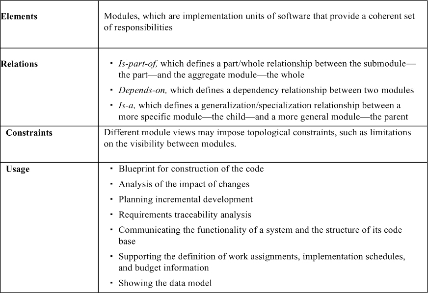
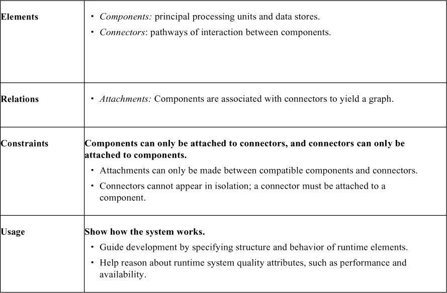
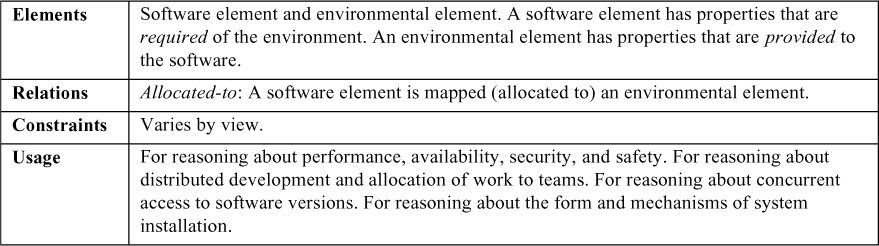
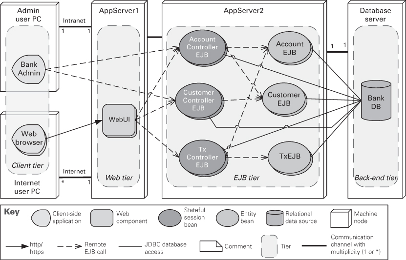
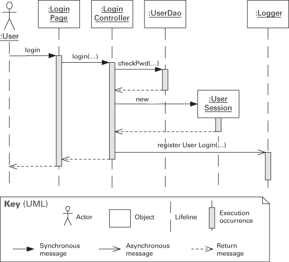
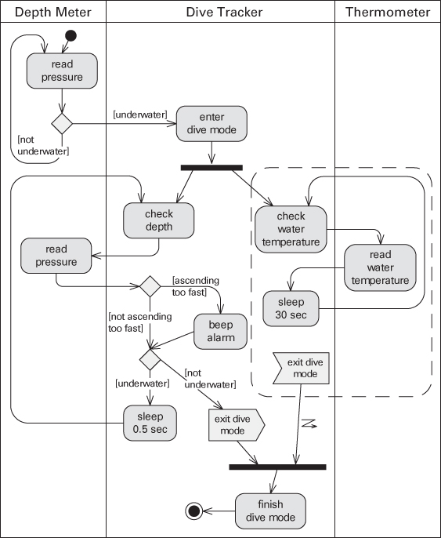
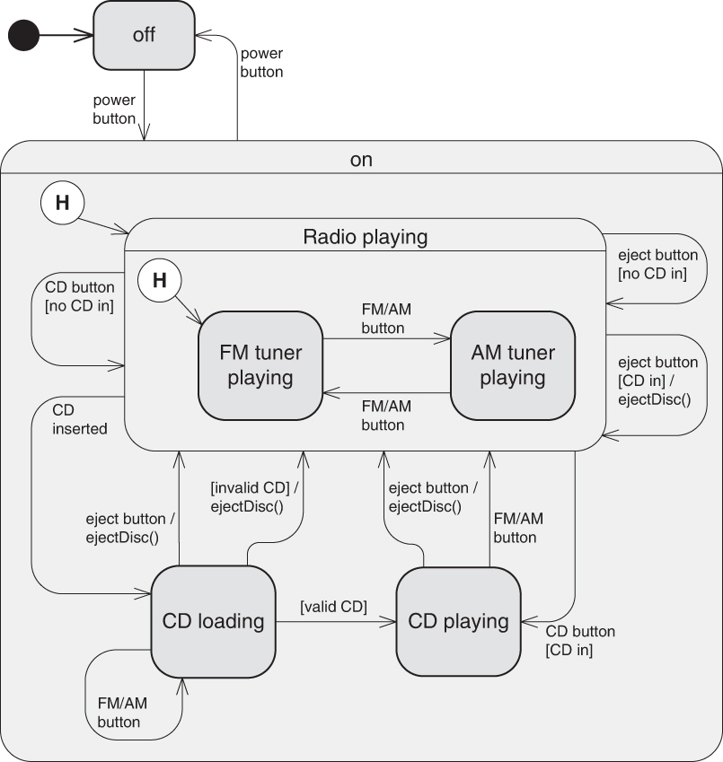
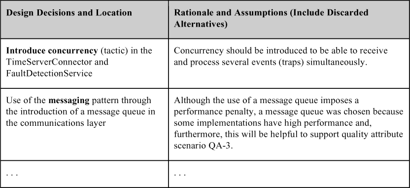

# 22. Tài liệu hóa một architecture (Documenting an Architecture)

> Tài liệu là một bức thư tình mà bạn viết cho chính mình trong tương lai. 
> —Damian Conway

Tạo ra một architecture là chưa đủ. Nó phải được truyền đạt theo cách cho phép các stakeholder của nó dùng nó đúng cách để làm công việc của họ. Nếu bạn đã chịu khó tạo ra một architecture vững chắc, một architecture mà bạn kỳ vọng sẽ đứng vững trước thử thách của thời gian, thì bạn *phải* chịu khó mô tả nó với đủ chi tiết, không mơ hồ, và được tổ chức sao cho người khác có thể nhanh chóng tìm và cập nhật thông tin cần thiết.

Tài liệu nói thay cho kiến trúc sư. Nó nói thay cho kiến trúc sư hôm nay, khi kiến trúc sư lẽ ra nên làm những việc khác thay vì trả lời hàng trăm câu hỏi về architecture. Và nó nói thay cho kiến trúc sư ngày mai, người đã quên các chi tiết về những gì architecture bao gồm, hoặc khi người đó đã rời dự án và một người khác giờ là kiến trúc sư.

Những kiến trúc sư giỏi nhất tạo ra tài liệu tốt không phải vì nó được “yêu cầu”, mà vì họ thấy rằng nó là thiết yếu cho công việc trước mắt—tạo ra một sản phẩm high-quality, một cách có thể dự đoán được và với ít việc làm lại nhất có thể. Họ xem các stakeholder trực tiếp của mình là những người gắn bó mật thiết nhất với công việc này: developer, người deploy, tester, nhà phân tích.

Nhưng các kiến trúc sư cũng xem tài liệu là thứ mang lại giá trị cho chính họ. Tài liệu đóng vai trò như vật chứa để lưu giữ kết quả của các quyết định thiết kế lớn *khi chúng được xác nhận*. Một phương án tài liệu hóa well-thought-out có thể làm cho quá trình thiết kế diễn ra suôn sẻ và có hệ thống hơn nhiều. Tài liệu giúp (các) kiến trúc sư suy luận về thiết kế architecture và truyền đạt nó trong khi việc kiến tạo architecture đang diễn ra, dù là trong một giai đoạn thiết kế six-month hay một Agile sprint six-day.

Lưu ý rằng “tài liệu” không nhất thiết có nghĩa là tạo ra một artifact vật lý, được in ra, book-like. Tài liệu trực tuyến như wiki, được host theo những cách có thể khơi gợi thảo luận, phản hồi của stakeholder và tìm kiếm, là một diễn đàn lý tưởng cho tài liệu architecture. Ngoài ra, đừng nghĩ về tài liệu như một bước tách biệt và đi sau thiết kế. Ngôn ngữ bạn dùng để giải thích architecture cho người khác có thể được chính bạn dùng khi bạn thực hiện công việc thiết kế. Thiết kế và tài liệu, lý tưởng nhất, là cùng một công việc.

## 22.1 Công dụng và người đọc của tài liệu architecture (Uses and Audiences for Architecture Documentation)

Tài liệu architecture phải phục vụ nhiều mục đích khác nhau. Nó nên đủ minh bạch và dễ tiếp cận để nhân viên mới có thể nhanh chóng hiểu. Nó nên đủ cụ thể để đóng vai trò như một bản thiết kế cho việc xây dựng hoặc điều tra pháp lý (forensics). Nó nên có đủ thông tin để làm cơ sở cho việc phân tích.

Tài liệu architecture có thể được xem vừa mang tính quy định (prescriptive) vừa mang tính mô tả (descriptive). Với một số người đọc, nó quy định điều gì *nên* đúng, đặt ra ràng buộc cho các quyết định chưa được đưa ra. Với những người đọc khác, nó mô tả điều gì *đang* đúng, thuật lại các quyết định đã được đưa ra về thiết kế của một hệ thống.

Nhiều loại người khác nhau sẽ quan tâm đến tài liệu architecture. Họ hy vọng và kỳ vọng rằng tài liệu này sẽ giúp họ làm công việc tương ứng của mình. Hiểu các công dụng của tài liệu architecture là thiết yếu, vì những công dụng đó xác định thông tin quan trọng cần ghi nhận.

Về cơ bản, tài liệu architecture có bốn công dụng.

1. *Tài liệu architecture đóng vai trò như một phương tiện giáo dục.* Công dụng giáo dục bao gồm việc giới thiệu hệ thống cho mọi người. Những người này có thể là thành viên mới của team, nhà phân tích bên ngoài, hoặc thậm chí là một kiến trúc sư mới. Trong nhiều trường hợp, người “mới” là khách hàng mà bạn đang trình bày giải pháp của mình lần đầu tiên—một bài trình bày mà bạn hy vọng sẽ dẫn đến việc cấp vốn hoặc phê duyệt go-ahead.
2. *Tài liệu architecture đóng vai trò như một phương tiện chính để giao tiếp giữa các stakeholder*. Cách dùng chính xác của nó như một phương tiện giao tiếp phụ thuộc vào việc stakeholder nào đang giao tiếp.

   Có lẽ một trong những người tiêu thụ tài liệu architecture nhiệt tình nhất không ai khác chính là kiến trúc sư tương lai của dự án. Đó có thể là cùng một người (như đã nêu trong câu trích dẫn mở đầu chương này) hoặc có thể là một người thay thế, nhưng trong cả hai trường hợp, kiến trúc sư tương lai chắc chắn có một mối quan tâm to lớn đối với tài liệu. Các kiến trúc sư mới quan tâm đến việc tìm hiểu những người tiền nhiệm đã giải quyết các vấn đề khó khăn của hệ thống như thế nào và vì sao các quyết định cụ thể được đưa ra. Ngay cả khi kiến trúc sư tương lai là cùng một người, người đó sẽ dùng tài liệu như một kho chứa suy nghĩ, một kho lưu trữ các quyết định thiết kế quá nhiều và đan xen vào nhau vô vọng đến mức không bao giờ có thể tái tạo chỉ từ trí nhớ.

   Chúng tôi liệt kê các stakeholder của architecture, và tài liệu của nó, trong [Mục 22.8](#sec22_8).

3. *Tài liệu architecture đóng vai trò như cơ sở cho việc phân tích và xây dựng hệ thống*. Architecture cho người hiện thực biết cần hiện thực những module nào và các module đó được kết nối với nhau như thế nào. Các phụ thuộc này xác định những team khác mà team phát triển của module phải giao tiếp cùng.

   Với những người quan tâm đến khả năng của thiết kế trong việc đáp ứng các mục tiêu chất lượng của hệ thống, tài liệu architecture đóng vai trò như nguyên liệu cho việc đánh giá. Nó phải chứa thông tin cần thiết để đánh giá nhiều attribute khác nhau, như security, performance, usability, availability và modifiability.

4. *Tài liệu architecture đóng vai trò như cơ sở cho việc điều tra (forensics) khi một sự cố xảy ra*. Khi một sự cố xảy ra, ai đó có trách nhiệm truy tìm cả nguyên nhân trực tiếp lẫn nguyên nhân sâu xa của sự cố. Thông tin về luồng điều khiển ngay trước sự cố sẽ cung cấp architecture “as executed”. Ví dụ, một cơ sở dữ liệu các đặc tả interface sẽ cung cấp bối cảnh cho luồng điều khiển, và các mô tả component sẽ chỉ ra điều gì lẽ ra phải xảy ra trong mỗi component trên vết của các sự kiện.

Để tài liệu tiếp tục mang lại giá trị theo thời gian, nó cần được cập nhật thường xuyên.

## 22.2 Ký hiệu (Notations)

Các ký hiệu để tài liệu hóa view khác nhau đáng kể về mức độ hình thức. Nói đại khái, có ba loại ký hiệu chính:

- *Ký hiệu không chính thức (Informal notations)*. View có thể được mô tả (thường bằng hình vẽ) bằng các công cụ vẽ sơ đồ và chỉnh sửa general-purpose và các quy ước trực quan được chọn cho hệ thống đang xét. Hầu hết các hình vẽ box-and-line mà bạn có lẽ đã thấy đều thuộc loại này—hãy nghĩ đến PowerPoint hoặc thứ gì đó tương tự, hoặc các bản phác thảo hand-drawn trên bảng trắng. Ngữ nghĩa của mô tả được thể hiện bằng ngôn ngữ tự nhiên, và không thể được phân tích một cách hình thức.
- *Ký hiệu bán hình thức (Semiformal notations)*. View có thể được biểu diễn bằng một ký hiệu chuẩn hóa quy định các element đồ họa và quy tắc xây dựng, nhưng không cung cấp một cách xử lý ngữ nghĩa đầy đủ về ý nghĩa của các element đó. Phân tích sơ bộ có thể được áp dụng để xác định liệu một mô tả có thỏa mãn các thuộc tính cú pháp hay không. UML và phần bổ trợ system-engineering của nó là SysML là các ký hiệu bán hình thức theo nghĩa này. Hầu hết các công cụ mô hình hóa thương mại được dùng rộng rãi đều sử dụng các ký hiệu thuộc loại này.
- *Ký hiệu hình thức (Formal notations)*. View có thể được mô tả bằng một ký hiệu có ngữ nghĩa chính xác (thường dựa trên toán học). Có thể phân tích hình thức cả cú pháp lẫn ngữ nghĩa. Có sẵn nhiều ký hiệu hình thức khác nhau cho software architecture. Thường được gọi là ngôn ngữ mô tả architecture (architecture description language, ADL), chúng thường cung cấp cả một bộ từ vựng đồ họa lẫn một ngữ nghĩa nền tảng cho việc biểu diễn architecture. Trong một số trường hợp, các ký hiệu này được chuyên biệt hóa cho các architectural view cụ thể. Trong các trường hợp khác, chúng cho phép nhiều view, hoặc thậm chí cung cấp khả năng định nghĩa hình thức các view mới. Sự hữu ích của ADL nằm ở khả năng hỗ trợ tự động hóa thông qua các công cụ đi kèm—tự động hóa để cung cấp phân tích hữu ích về architecture, hoặc hỗ trợ sinh code. Trong thực tế, việc dùng các ký hiệu hình thức là hiếm.

Thông thường, các ký hiệu càng hình thức càng tốn nhiều thời gian và công sức để tạo và hiểu, nhưng bù đắp công sức này bằng sự mơ hồ giảm đi và nhiều cơ hội phân tích hơn. Ngược lại, các ký hiệu càng không chính thức càng dễ tạo, nhưng cung cấp ít bảo đảm hơn.

Bất kể mức độ hình thức, hãy luôn nhớ rằng các ký hiệu khác nhau tốt hơn (hoặc tệ hơn) cho việc biểu diễn các loại thông tin khác nhau. Bỏ qua tính hình thức, không UML class diagram nào giúp bạn suy luận về khả năng lập lịch (schedulability), và một sequence diagram cũng không cho bạn biết nhiều về khả năng hệ thống được bàn giao đúng hạn. Bạn nên chọn ký hiệu và ngôn ngữ biểu diễn của mình trong khi ghi nhớ các vấn đề quan trọng mà bạn cần ghi nhận và suy luận.

## 22.3 View

Có lẽ khái niệm quan trọng nhất gắn với tài liệu software architecture là khái niệm *view*. Một software architecture là một thực thể phức tạp không thể được mô tả theo cách one-dimensional đơn giản. Một view là một biểu diễn của một tập các element của hệ thống và các relation giữa chúng—không phải mọi element của hệ thống, mà là những element thuộc một loại cụ thể. Ví dụ, một layered view của một hệ thống sẽ cho thấy các element loại “layer”; tức là, nó sẽ cho thấy việc phân rã hệ thống thành các layer, cùng với các relation giữa các layer đó. Tuy nhiên, một layered view thuần túy sẽ không cho thấy các service của hệ thống, hay client và server, hay data model, hay bất kỳ loại element nào khác.

Như vậy, view cho phép chúng ta chia thực thể đa chiều là một software architecture thành một số biểu diễn (chúng tôi hy vọng là) thú vị và dễ quản lý của hệ thống. Khái niệm *view* dẫn đến một nguyên lý cơ bản của tài liệu architecture:

> Tài liệu hóa một architecture là việc tài liệu hóa các view liên quan rồi bổ sung tài liệu áp dụng cho nhiều hơn một view.

Các view liên quan là gì? Điều này hoàn toàn phụ thuộc vào mục tiêu của bạn. Như chúng ta đã thấy trước đó, tài liệu architecture có thể phục vụ nhiều mục đích: một bản tuyên bố nhiệm vụ cho người hiện thực, một cơ sở cho phân tích, đặc tả cho việc sinh code tự động, điểm khởi đầu cho việc hiểu hệ thống và reverse engineering, hoặc bản thiết kế cho việc ước tính và lập kế hoạch dự án.

Các view khác nhau cũng phơi bày các quality attribute khác nhau ở các mức độ khác nhau. Đến lượt nó, các quality attribute được bạn và các stakeholder khác trong việc phát triển hệ thống quan tâm nhất sẽ ảnh hưởng đến việc bạn chọn tài liệu hóa view nào. Chẳng hạn, một *module view* sẽ cho phép bạn suy luận về maintainability của hệ thống, một *deployment view* sẽ cho phép bạn suy luận về performance và reliability của hệ thống, và cứ thế.

Vì các view khác nhau hỗ trợ các mục tiêu và công dụng khác nhau, chúng tôi không ủng hộ việc dùng bất kỳ view cụ thể hay tập view cụ thể nào. Các view bạn nên tài liệu hóa phụ thuộc vào các công dụng mà bạn dự kiến sẽ dùng tài liệu. Các view khác nhau sẽ làm nổi bật các element và relation khác nhau của hệ thống. Biểu diễn bao nhiêu view khác nhau là kết quả của một quyết định chi phí/lợi ích. Mỗi view có một chi phí và một lợi ích, và bạn nên bảo đảm rằng lợi ích kỳ vọng của việc tạo và duy trì một view cụ thể vượt trội chi phí của nó.

Việc lựa chọn view được dẫn dắt bởi nhu cầu tài liệu hóa một pattern cụ thể trong thiết kế của bạn. Một số pattern gồm các module, những pattern khác gồm các component và connector, và những pattern khác nữa có các cân nhắc về deployment. Module view, component-and-connector (C&C) view và allocation view lần lượt là cơ chế thích hợp để biểu diễn các cân nhắc này. Tất nhiên, các loại view này tương ứng với ba loại architectural structure được mô tả trong [Chương 1](ch01_what_is_software_architecture.vi.md#ch01). (Hãy nhớ lại từ [Chương 1](ch01_what_is_software_architecture.vi.md#ch01) rằng một structure là một tập các element, relation và property, trong khi một view là một biểu diễn của một hoặc nhiều architectural structure.)

Trong mục này, chúng tôi khám phá ba loại view structure-based này, rồi giới thiệu một loại mới: quality view.

### Module view

Một module là một đơn vị hiện thực cung cấp một tập trách nhiệm mạch lạc. Một module có thể có dạng một class, một tập class, một layer, một aspect, hoặc bất kỳ sự phân rã nào của đơn vị hiện thực. Ví dụ về các module view là decomposition, uses và layers. Mỗi module view có một tập property được gán cho nó. Các property này biểu diễn thông tin quan trọng gắn với mỗi module và các mối quan hệ giữa các module, cũng như các ràng buộc đối với module. Ví dụ về property bao gồm trách nhiệm, thông tin về khả năng nhìn thấy (những module nào khác có thể dùng nó), và lịch sử sửa đổi. Các relation mà các module có với nhau bao gồm *is-part-of*, *depends-on* và *is-a*.

Cách thức phần mềm của một hệ thống được phân rã thành các đơn vị dễ quản lý vẫn là một trong những dạng quan trọng của structure hệ thống. Ở mức tối thiểu, nó xác định cách source code của một hệ thống được phân rã thành các đơn vị, mỗi đơn vị có thể đưa ra những loại giả định nào về các service do các đơn vị khác cung cấp, và các đơn vị đó được gộp lại thành các tập hợp lớn hơn như thế nào. Nó cũng bao gồm các cấu trúc dữ liệu dùng chung tác động đến, và bị tác động bởi, nhiều đơn vị. Module structure thường xác định các thay đổi đối với một phần của hệ thống có thể ảnh hưởng đến các phần khác như thế nào và do đó là khả năng của hệ thống trong việc hỗ trợ modifiability, portability và tái sử dụng.

Tài liệu của bất kỳ software architecture nào khó có thể đầy đủ nếu không có ít nhất một module view. [Bảng 22.1](#ch22tab01) tóm tắt các đặc điểm của module view.

**Bảng 22.1** *Tóm tắt về module view*

Các property của module giúp dẫn dắt việc hiện thực hoặc là đầu vào cho việc phân tích nên được ghi lại như một phần của tài liệu hỗ trợ cho một module view. Danh sách property có thể thay đổi nhưng nhiều khả năng bao gồm:

- *Tên (Name).* Tên của một module, tất nhiên, là phương tiện chính để tham chiếu đến nó. Tên của một module thường gợi ý điều gì đó về vai trò của nó trong hệ thống. Ngoài ra, tên của một module có thể phản ánh vị trí của nó trong một hệ phân cấp phân rã; tên A.B.C, chẳng hạn, chỉ một module C là submodule của một module B, bản thân B là một submodule của A.
- *Trách nhiệm (Responsibilities).* Property trách nhiệm của một module là một cách để xác định vai trò của nó trong toàn bộ hệ thống và thiết lập cho nó một danh tính vượt ra ngoài cái tên. Trong khi tên của một module có thể gợi ý vai trò của nó, một tuyên bố về trách nhiệm thiết lập vai trò đó với sự chắc chắn cao hơn nhiều. Trách nhiệm nên được mô tả với đủ chi tiết để làm rõ cho người đọc mỗi module làm gì. Trách nhiệm của một module thường được ghi nhận bằng cách truy vết đến đặc tả yêu cầu của dự án, nếu có.
- *Thông tin hiện thực (Implementation information).* Module là các đơn vị hiện thực. Do đó, việc ghi lại thông tin liên quan đến việc hiện thực chúng từ góc nhìn quản lý việc phát triển chúng và xây dựng hệ thống chứa chúng là hữu ích. Điều này có thể bao gồm:
- *Ánh xạ tới các đơn vị source code.* Điều này xác định các file tạo nên phần hiện thực của một module. Ví dụ, một module `Account`, nếu được hiện thực bằng Java, có thể có nhiều file tạo nên phần hiện thực của nó: `IAccount.java` (một interface), `AccountImpl.java` (phần hiện thực chức năng Account), và có lẽ cả một unit test `AccountTest.java`.
- *Thông tin kiểm thử.* Test plan, test case, test harness và dữ liệu test của module là quan trọng cần tài liệu hóa. Thông tin này có thể đơn giản là một con trỏ tới vị trí của các artifact này.
- *Thông tin quản lý.* Một nhà quản lý có thể cần thông tin về lịch trình và ngân sách dự đoán của module. Thông tin này có thể đơn giản là một con trỏ tới vị trí của các artifact này.
- *Ràng buộc hiện thực.* Trong nhiều trường hợp, kiến trúc sư sẽ có sẵn trong đầu một chiến lược hiện thực cho một module hoặc có thể biết về các ràng buộc mà phần hiện thực phải tuân theo.
- *Lịch sử sửa đổi (Revision history).* Biết lịch sử của một module, bao gồm tác giả và các thay đổi cụ thể, có thể giúp bạn khi bạn thực hiện các hoạt động bảo trì.

Một module view có thể được dùng để giải thích chức năng của hệ thống cho một người không quen thuộc với nó. Các mức độ granularity khác nhau của việc phân rã module cung cấp một cách trình bày top-down về trách nhiệm của hệ thống và, do đó, có thể dẫn dắt quá trình học. Với một hệ thống mà phần hiện thực đã có sẵn, các module view, nếu được giữ up-to-date, là hữu ích vì chúng giải thích structure của code base cho một developer mới trong team.

Ngược lại, khó có thể dùng module view để suy luận về hành vi runtime, vì các view này chỉ là một sự phân chia tĩnh các chức năng của phần mềm. Do đó, một module view thường không được dùng để phân tích performance, reliability và nhiều chất lượng runtime khác. Cho những mục đích đó, chúng ta dựa vào các view component-and-connector và allocation.

### Component-and-Connector view

C&C view cho thấy các element có sự hiện diện nào đó tại runtime, như process, service, object, client, server và data store. Các element này được gọi là *component*. Ngoài ra, C&C view còn coi các con đường tương tác, như communication link và protocol, luồng thông tin, và truy cập vào storage dùng chung, là element. Các tương tác như vậy được biểu diễn như các *connector* trong C&C view. Ví dụ về các C&C view bao gồm client-server, microservice và communicating processes.

Một component trong một C&C view có thể biểu diễn một hệ thống con phức tạp, mà bản thân nó có thể được mô tả như một subarchitecture C&C. Subarchitecture của một component có thể dùng một pattern khác với pattern mà component xuất hiện trong đó.

Các ví dụ đơn giản về connector bao gồm service invocation, message queue bất đồng bộ, event multicast hỗ trợ các tương tác publish-subscribe, và pipe biểu diễn các luồng dữ liệu bất đồng bộ, order-preserving. Connector thường biểu diễn các dạng tương tác phức tạp hơn nhiều, như một kênh giao tiếp transaction-oriented giữa một database server và một client, hoặc một enterprise service bus làm trung gian cho các tương tác giữa các tập người dùng và nhà cung cấp service.

Connector không nhất thiết phải là nhị phân; tức là, chúng không nhất thiết phải có chính xác hai component mà chúng tương tác. Ví dụ, một connector publish-subscribe có thể có số lượng publisher và subscriber tùy ý. Ngay cả khi connector rốt cuộc được hiện thực bằng các connector nhị phân, như một procedure call, việc áp dụng các biểu diễn connector *n*-ary trong một C&C view có thể hữu ích. Connector hiện thân cho một protocol tương tác. Khi hai hoặc nhiều component tương tác, chúng phải tuân theo các quy ước về thứ tự tương tác, vị trí điều khiển, và việc xử lý các điều kiện lỗi và timeout. Protocol tương tác nên được tài liệu hóa.

Relation chính trong một C&C view là attachment. *Attachment* chỉ ra connector nào được gắn với component nào, qua đó định nghĩa một hệ thống như một đồ thị gồm các component và connector. Tính tương thích thường được định nghĩa theo loại thông tin và protocol. Ví dụ, nếu một web server kỳ vọng giao tiếp được mã hóa qua HTTPS, thì client phải thực hiện việc mã hóa.

Một element (component hoặc connector) của một C&C view sẽ có nhiều property gắn với nó. Cụ thể, mỗi element nên có một tên và loại, với các property bổ sung tùy thuộc vào loại component hoặc connector. Với tư cách kiến trúc sư, bạn nên định nghĩa giá trị cho các property hỗ trợ các phân tích dự định cho C&C view cụ thể. Dưới đây là ví dụ về một số property điển hình và công dụng của chúng:

- *Reliability.* Khả năng xảy ra failure đối với một component hoặc connector cho trước là bao nhiêu? Property này có thể được dùng để giúp xác định availability tổng thể của hệ thống.
- *Performance.* Component sẽ cung cấp những loại response time nào dưới những mức tải nào? Có thể kỳ vọng loại bandwidth, latency hoặc jitter nào cho một connector cho trước? Property này có thể được dùng cùng với các property khác để xác định các property system-wide như response time, throughput và nhu cầu buffering.
- *Yêu cầu tài nguyên (Resource requirements).* Nhu cầu xử lý và lưu trữ của một component hoặc một connector là gì? Nếu liên quan, nó tiêu thụ bao nhiêu năng lượng? Property này có thể được dùng để xác định liệu một cấu hình phần cứng được đề xuất có đủ hay không.
- *Chức năng (Functionality).* Một element thực hiện những chức năng nào? Property này có thể được dùng để suy luận về việc tính toán end-to-end được thực hiện bởi một hệ thống.
- *Security.* Một component hoặc một connector có thực thi hoặc cung cấp các tính năng security, như mã hóa, audit trail hoặc xác thực không? Property này có thể được dùng để xác định các lỗ hổng security tiềm ẩn của hệ thống.
- *Concurrency.* Component này có thực thi như một process hoặc thread riêng không? Property này có thể giúp phân tích hoặc mô phỏng performance của các component đồng thời và xác định các deadlock và điểm nghẽn có thể có.
- *Khả năng mở rộng tại runtime (Runtime extensibility).* Messaging structure có hỗ trợ các trao đổi dữ liệu tiến hóa không? Các connector có thể được điều chỉnh để xử lý các loại message mới đó không?

C&C view thường được dùng để cho developer và các stakeholder khác thấy hệ thống hoạt động như thế nào: Người ta có thể “hoạt hình hóa” hoặc truy vết qua một C&C view, cho thấy một luồng hoạt động end-to-end. C&C view cũng được dùng để suy luận về các quality attribute runtime của hệ thống, như performance và availability. Đặc biệt, một view well-documented cho phép kiến trúc sư dự đoán các property tổng thể của hệ thống như latency hoặc reliability, khi có các ước tính hoặc số đo về property của từng element và các tương tác của chúng.

[Bảng 22.2](#ch22tab02) tóm tắt các đặc điểm của C&C view.

**Bảng 22.2** *Tóm tắt về C&C view*

#### Ký hiệu cho C&C view (Notations for C&C Views)

Như mọi khi, các hình vẽ box-and-line luôn sẵn có để biểu diễn C&C view. Dù các ký hiệu không chính thức bị hạn chế về mặt ngữ nghĩa mà chúng có thể truyền tải, việc tuân theo một số hướng dẫn đơn giản có thể mang lại sự chặt chẽ và chiều sâu cho các mô tả. Hướng dẫn chính rất đơn giản: Gán cho mỗi loại component và mỗi loại connector một ký hiệu riêng, và liệt kê từng loại trong một chú giải (key).

Component của UML là một sự tương ứng ngữ nghĩa tốt với component C&C vì chúng cho phép tài liệu hóa trực quan các thông tin quan trọng như interface, property và mô tả hành vi. Component của UML cũng phân biệt giữa loại component và instance component, điều hữu ích khi định nghĩa các loại component view-specific.

### Allocation view

Allocation view mô tả việc ánh xạ các đơn vị phần mềm tới các element của một môi trường mà phần mềm được phát triển hoặc thực thi trong đó. Môi trường trong một view như vậy thay đổi; nó có thể là phần cứng, môi trường vận hành mà phần mềm được thực thi trong đó, các file system hỗ trợ việc phát triển hoặc deployment, hoặc (các) tổ chức phát triển.

[Bảng 22.3](#ch22tab03) tóm tắt các đặc điểm của allocation view. Các view này gồm software element và environmental element. Ví dụ về environmental element là một processor, một disk farm, một file hoặc folder, hoặc một nhóm developer. Các software element đến từ một module view hoặc C&C view.

**Bảng 22.3** *Tóm tắt về allocation view*

Relation trong một allocation view là *allocated-to*. Chúng ta thường nói về allocation view theo một ánh xạ từ software element tới environmental element, dù ánh xạ ngược lại cũng sẽ có liên quan và có thể thú vị. Một software element đơn lẻ có thể được phân bổ cho nhiều environmental element, và nhiều software element có thể được phân bổ cho một environmental element đơn lẻ. Nếu các phân bổ này thay đổi theo thời gian, trong quá trình thực thi hệ thống, thì architecture được gọi là động đối với phân bổ đó. Ví dụ, các process có thể di chuyển từ một processor hoặc virtual machine sang một cái khác.

Software element và environmental element có property trong allocation view. Một mục tiêu của allocation view là so sánh các property được software element yêu cầu với các property được environmental element cung cấp để xác định liệu việc phân bổ có thành công hay không. Ví dụ, để bảo đảm response time *được yêu cầu* của nó, một component phải thực thi trên (được phân bổ cho) một processor *cung cấp* năng lực xử lý đủ nhanh. Một ví dụ khác, một nền tảng tính toán có thể không cho phép một task dùng quá 10 kilobyte bộ nhớ ảo; một mô hình thực thi của software element đang xét có thể được dùng để xác định mức sử dụng bộ nhớ ảo được yêu cầu. Tương tự, nếu bạn đang chuyển một module từ team này sang team khác, bạn có thể muốn bảo đảm rằng team mới có kỹ năng và kiến thức nền phù hợp để làm việc với module đó.

Allocation view có thể mô tả các view tĩnh hoặc động. Một view tĩnh minh họa một phân bổ tài nguyên cố định trong một môi trường. Một view động cho thấy các điều kiện và các trigger mà theo đó việc phân bổ tài nguyên thay đổi. Ví dụ, một số hệ thống cấp phát và sử dụng tài nguyên mới khi tải của chúng tăng. Một ví dụ là một hệ thống load-balancing trong đó các process hoặc thread mới được tạo trên một máy khác. Trong view này, các điều kiện mà theo đó allocation view thay đổi, việc phân bổ phần mềm runtime, và cơ chế phân bổ động cần được tài liệu hóa.

Hãy nhớ lại từ [Chương 1](ch01_what_is_software_architecture.vi.md#ch01) rằng một trong các allocation structure là work assignment structure, phân bổ module cho các team để phát triển. Việc phân bổ đó cũng có thể được thay đổi, tùy thuộc vào “tải”—trong trường hợp này, là tải của các team phát triển đang làm việc.

### Quality view

Module view, C&C view và allocation view đều là các structural view: Chúng chủ yếu cho thấy các structure mà kiến trúc sư đã thiết kế vào architecture để thỏa mãn các yêu cầu chức năng và quality attribute.

Các view này là những lựa chọn tuyệt vời để dẫn dắt và ràng buộc các developer ở hạ nguồn, những người có công việc chính là hiện thực các structure đó. Tuy nhiên, trong các hệ thống mà một số quality attribute nhất định (hoặc, nói cho cùng, bất kỳ mối quan tâm nào của stakeholder) đặc biệt quan trọng và lan tỏa, structural view có thể không phải là cách tốt nhất để trình bày giải pháp architecture cho những nhu cầu đó. Lý do là giải pháp có thể trải rộng trên nhiều structure vốn cồng kềnh khi kết hợp (ví dụ, vì các loại element được thể hiện trong mỗi structure là khác nhau).

Một loại view khác, mà chúng tôi gọi là *quality view*, có thể được điều chỉnh cho các stakeholder cụ thể hoặc để giải quyết các mối quan tâm cụ thể. Quality view được hình thành bằng cách trích xuất các phần liên quan của các structural view và đóng gói chúng lại với nhau. Dưới đây là năm ví dụ:

- Một *security view* có thể cho thấy tất cả các biện pháp architecture được thực hiện để cung cấp security. Nó sẽ mô tả các component có vai trò hoặc trách nhiệm nào đó về security, các component đó giao tiếp như thế nào, mọi kho dữ liệu cho thông tin security, và các kho có liên quan về security. Các property của view sẽ bao gồm các biện pháp security khác (ví dụ, security vật lý) trong môi trường của hệ thống. Security view cũng sẽ cho thấy hoạt động của các security protocol và con người tương tác với các security element ở đâu và như thế nào. Cuối cùng, nó sẽ ghi nhận cách hệ thống phản ứng với các mối đe dọa và lỗ hổng cụ thể.
- Một *communications view* có thể đặc biệt hữu ích cho các hệ thống phân tán toàn cầu và không đồng nhất. View này sẽ cho thấy tất cả các kênh component-to-component, các kênh mạng khác nhau, các giá trị tham số quality-of-service, và các vùng concurrency. Một view như vậy có thể được dùng để phân tích một số loại performance và reliability, như phát hiện deadlock hoặc race condition. Ngoài ra, nó có thể cho thấy (ví dụ) băng thông mạng được phân bổ động như thế nào.
- Một *exception view* hoặc *error-handling view* có thể giúp làm sáng tỏ và thu hút sự chú ý vào các cơ chế báo cáo và giải quyết lỗi. Một view như vậy sẽ cho thấy các component phát hiện, báo cáo và giải quyết fault hoặc error như thế nào. Nó sẽ giúp kiến trúc sư xác định nguồn gốc của các lỗi và chỉ định các hành động khắc phục thích hợp cho từng lỗi. Cuối cùng, nó sẽ tạo điều kiện cho việc phân tích root-cause trong những trường hợp đó.
- Một *reliability* view sẽ mô hình hóa các cơ chế reliability như replication và switch-over. Nó cũng sẽ mô tả các vấn đề về thời gian và tính toàn vẹn transaction.
- Một *performance* view sẽ bao gồm các khía cạnh của architecture hữu ích để suy ra performance của hệ thống. Một view như vậy có thể cho thấy các mô hình lưu lượng mạng, latency tối đa cho các thao tác, và cứ thế.

Các quality view này và các quality view khác phản ánh triết lý tài liệu hóa của tiêu chuẩn ISO/IEC/IEEE 42010:2011, vốn quy định việc tạo ra các view được dẫn dắt bởi các mối quan tâm của các stakeholder của architecture.

## 22.4 Kết hợp các view (Combining Views)

Nguyên lý cơ bản của việc tài liệu hóa một architecture như một tập view riêng biệt mang lại lợi thế divide-and-conquer cho nhiệm vụ tài liệu hóa. Tất nhiên, nếu các view đó khác biệt không thể cứu vãn, không có liên kết nào với nhau, thì không ai có thể hiểu hệ thống như một tổng thể. Tuy nhiên, vì mọi structure trong một architecture đều là một phần của cùng một architecture và tồn tại để đạt được một mục đích chung, nhiều structure trong số đó có liên kết chặt chẽ với nhau. Quản lý cách các architectural structure liên kết với nhau là một phần quan trọng trong công việc của kiến trúc sư, bất kể có tồn tại tài liệu nào về các structure đó hay không.

Đôi khi cách thuận tiện nhất để thể hiện một liên kết chặt chẽ giữa hai view là gộp chúng thành một *combined view* duy nhất. Một combined view chứa các element và relation đến từ hai hoặc nhiều view khác. Các view như vậy có thể rất hữu ích miễn là bạn không cố làm quá tải chúng với quá nhiều ánh xạ.

Cách dễ nhất để gộp các view là tạo một *overlay* kết hợp thông tin mà nếu không thì đã xuất hiện trong hai view riêng biệt. Điều này hoạt động tốt nếu mối quan hệ giữa hai view là chặt chẽ—tức là, nếu có các liên kết mạnh giữa các element trong view này và các element trong view kia. Trong trường hợp như vậy, structure được mô tả bởi combined view sẽ dễ hiểu hơn so với hai view được xem riêng rẽ. Trong một overlay, các element và relation giữ nguyên loại như được định nghĩa trong các view thành phần của chúng.

Các tổ hợp view sau thường xuất hiện khá tự nhiên:

- *Các C&C view với nhau.* Vì mọi C&C view đều cho thấy các relation runtime giữa các component và connector thuộc nhiều loại khác nhau, chúng có xu hướng kết hợp tốt với nhau. Các C&C view khác nhau (riêng biệt) có xu hướng cho thấy các phần khác nhau của hệ thống, hoặc có xu hướng cho thấy các tinh chỉnh phân rã của các component trong các view khác. Kết quả thường là một tập view có thể được kết hợp dễ dàng.
- *Deployment view với bất kỳ C&C view nào cho thấy process.* Process là các component được deploy lên processor, virtual machine hoặc container. Do đó có một liên kết mạnh giữa các element trong các view này.
- *Decomposition view và bất kỳ view work assignment, implementation, uses hoặc layered nào.* Các module được phân rã tạo thành các đơn vị công việc, phát triển và uses. Ngoài ra, các module này lấp đầy các layer.

[Hình 22.1](#ch22fig01) cho thấy một ví dụ về combined view là một overlay của các view client-server, multi-tier và deployment.

**Hình 22.1** *Một combined view*

## 22.5 Tài liệu hóa hành vi (Documenting Behavior)

Tài liệu hóa một architecture đòi hỏi tài liệu về hành vi bổ sung cho các structural view bằng cách mô tả các element của architecture tương tác với nhau như thế nào. Việc suy luận về các đặc điểm như khả năng xảy ra deadlock của một hệ thống, khả năng của một hệ thống hoàn thành một task trong khoảng thời gian mong muốn, hoặc mức tiêu thụ bộ nhớ tối đa đòi hỏi mô tả architecture cung cấp thông tin về đặc điểm của từng element và mức tiêu thụ tài nguyên của chúng, cũng như các pattern tương tác giữa chúng—tức là, chúng hành xử như thế nào trong mối quan hệ với nhau. Trong mục này, chúng tôi đưa ra hướng dẫn về những loại thông tin bạn sẽ muốn tài liệu hóa để gặt hái những lợi ích này.

Có hai loại ký hiệu để tài liệu hóa hành vi: trace-oriented và toàn diện (comprehensive).

*Trace* là các chuỗi hoạt động hoặc tương tác mô tả response của hệ thống đối với một stimulus cụ thể khi hệ thống ở một trạng thái cụ thể. Một trace mô tả một chuỗi hoạt động hoặc tương tác giữa các structural element của hệ thống. Dù về lý thuyết người ta có thể mô tả mọi trace có thể có để tạo ra tương đương của một mô hình hành vi toàn diện, tài liệu trace-oriented thực ra không tìm cách làm như vậy. Ở đây chúng tôi mô tả bốn ký hiệu để tài liệu hóa trace: use case, sequence diagram, communication diagram và activity diagram. Dù có sẵn các ký hiệu khác (như message sequence chart, timing diagram và Business Process Execution Language), chúng tôi đã chọn bốn ký hiệu này như một mẫu đại diện cho các ký hiệu trace-oriented.

- *Use case* mô tả cách actor có thể dùng một hệ thống để đạt được mục tiêu của họ; chúng thường được dùng để ghi nhận các yêu cầu chức năng cho một hệ thống. UML cung cấp một ký hiệu đồ họa cho use case diagram nhưng không chỉ định văn bản của một use case nên được viết như thế nào. UML use case diagram là một cách tốt để cung cấp tổng quan về các actor và hành vi của một hệ thống. Phần mô tả của nó, ở dạng văn bản, nên bao gồm các mục sau: tên use case và một mô tả ngắn, actor hoặc các actor khởi tạo use case (primary actor), các actor khác tham gia vào use case (secondary actor), luồng sự kiện, các luồng thay thế, và các trường hợp non-success.
- Một UML *sequence diagram* cho thấy một chuỗi tương tác giữa các instance của các element được lấy từ tài liệu structural. Nó hữu ích, khi thiết kế một hệ thống, để xác định nơi cần định nghĩa interface. Sequence diagram chỉ cho thấy các instance tham gia vào scenario đang được tài liệu hóa. Nó có hai chiều: chiều dọc, biểu diễn thời gian, và chiều ngang, biểu diễn các instance khác nhau. Các tương tác được sắp xếp theo trình tự thời gian từ trên xuống dưới. [Hình 22.2](#ch22fig02) là một ví dụ về sequence diagram minh họa ký hiệu UML cơ bản. Sequence diagram không tường minh trong việc thể hiện concurrency. Nếu đó là mục tiêu của bạn, hãy dùng activity diagram thay thế.

**Hình 22.2** *Một ví dụ đơn giản về UML sequence diagram*

   Như trong [Hình 22.2](#ch22fig02), các object (tức là instance của element) có một lifeline, được vẽ bằng một đường nét đứt thẳng đứng dọc theo trục thời gian. Chuỗi thường được bắt đầu bởi một actor ở phía ngoài cùng bên trái. Các instance tương tác bằng cách gửi message, được thể hiện bằng các mũi tên nằm ngang. Một message có thể là một message được gửi qua mạng, một lời gọi hàm, hoặc một event được gửi qua một queue. Message thường ánh xạ tới một resource (operation) trong interface của instance nhận. Một đầu mũi tên tô kín trên một đường liền biểu diễn một message đồng bộ, trong khi một đầu mũi tên rỗng biểu diễn một message bất đồng bộ. Mũi tên nét đứt là một message trả về. Các thanh execution occurrence dọc theo lifeline chỉ ra rằng instance đang xử lý hoặc bị block chờ một giá trị trả về.

- Một UML *communication diagram* cho thấy một đồ thị các element tương tác và chú thích mỗi tương tác bằng một con số biểu thị thứ tự của nó. Tương tự sequence diagram, các instance được thể hiện trong một communication diagram là các element được mô tả trong tài liệu structural đi kèm. Communication diagram hữu ích khi nhiệm vụ là xác minh rằng một architecture có thể đáp ứng các yêu cầu chức năng. Các sơ đồ như vậy không hữu ích khi việc hiểu các hành động đồng thời là quan trọng, như khi tiến hành phân tích performance.
- UML *activity diagram* tương tự flowchart. Chúng cho thấy một quy trình nghiệp vụ như một chuỗi các bước (gọi là action) và bao gồm ký hiệu để biểu diễn rẽ nhánh có điều kiện và concurrency, cũng như để thể hiện việc gửi và nhận event. Các mũi tên giữa các action chỉ ra luồng điều khiển. Tùy chọn, activity diagram có thể chỉ ra element của architecture hoặc actor thực hiện các action. Đáng chú ý, activity diagram có thể biểu diễn concurrency. Một fork node (được vẽ như một thanh dày vuông góc với các mũi tên luồng) tách luồng thành hai hoặc nhiều luồng action đồng thời. Các luồng đồng thời này sau đó có thể được đồng bộ thành một luồng duy nhất thông qua một join node (cũng được vẽ như một thanh vuông góc). Join node chờ tất cả các luồng đến hoàn tất trước khi tiếp tục.

   Không giống sequence diagram và communication diagram, activity diagram không cho thấy các operation thực tế đang được thực hiện trên các object cụ thể. Do đó, các sơ đồ này hữu ích để mô tả khái quát các bước trong một workflow cụ thể. Rẽ nhánh có điều kiện (được thể hiện bằng ký hiệu hình thoi) cho phép một sơ đồ duy nhất biểu diễn nhiều trace, dù một activity diagram thường không cố gắng thể hiện mọi trace có thể có hoặc toàn bộ hành vi của hệ thống (hoặc một phần của nó). [Hình 22.3](#ch22fig03) cho thấy một activity diagram.

**Hình 22.3** *Activity diagram*

Ngược lại với ký hiệu trace, các ký hiệu *toàn diện* (comprehensive) cho thấy toàn bộ hành vi của các structural element. Với loại tài liệu này, có thể suy ra mọi đường đi có thể có từ trạng thái ban đầu đến trạng thái cuối cùng. State machine là một loại hình thức được nhiều ký hiệu toàn diện sử dụng. Hình thức này biểu diễn hành vi của các element của architecture vì mỗi trạng thái là một sự trừu tượng hóa của mọi lịch sử có thể dẫn đến trạng thái đó. Các ngôn ngữ state machine cho phép bạn bổ sung cho một mô tả structural về các element của hệ thống bằng các ràng buộc về tương tác và các phản ứng có định thời đối với cả stimulus bên trong lẫn stimulus từ môi trường.

UML state machine diagram cho phép bạn truy vết hành vi của hệ thống, khi có các đầu vào cụ thể. Một sơ đồ như vậy biểu diễn trạng thái bằng các hộp và các chuyển trạng thái giữa các trạng thái bằng các mũi tên. Do đó, nó mô hình hóa các element của architecture và giúp minh họa các tương tác runtime của chúng. [Hình 22.4](#ch22fig04) là một ví dụ về state machine diagram cho thấy các trạng thái của một dàn âm thanh xe hơi.

**Hình 22.4** *UML state machine diagram cho một hệ thống âm thanh xe hơi*

Mỗi chuyển trạng thái trong một state machine diagram được gắn nhãn bằng event gây ra chuyển trạng thái đó. Ví dụ, trong [Hình 22.4](#ch22fig04), các chuyển trạng thái tương ứng với các nút mà người lái có thể nhấn hoặc các hành động lái xe ảnh hưởng đến hệ thống cruise control. Tùy chọn, chuyển trạng thái có thể chỉ định một guard condition, được đặt trong dấu ngoặc vuông. Khi event tương ứng với chuyển trạng thái xảy ra, guard condition được đánh giá và chuyển trạng thái chỉ được kích hoạt nếu guard đúng tại thời điểm đó. Chuyển trạng thái cũng có thể có các hệ quả, gọi là action hoặc effect, được chỉ ra bằng một dấu gạch chéo. Khi có một action, nó chỉ ra rằng hành vi sau dấu gạch chéo sẽ được thực hiện khi chuyển trạng thái xảy ra. Các trạng thái cũng có thể chỉ định các entry action và exit action.

## 22.6 Vượt ra ngoài view (Beyond Views)

Ngoài view và hành vi, thông tin toàn diện về một architecture sẽ bao gồm các mục sau:

- *Ánh xạ giữa các view (Mapping between views)*. Vì mọi view của một architecture đều mô tả cùng một hệ thống, hợp lý là hai view bất kỳ sẽ có nhiều điểm chung. Việc kết hợp các view (như được mô tả trong [Mục 22.4](#sec22_4)) tạo ra một tập view. Làm sáng tỏ các liên kết giữa các view đó sau đó có thể giúp người đọc có được một hiểu biết sâu sắc mạnh mẽ về cách architecture hoạt động như một tổng thể khái niệm thống nhất.

   Các liên kết giữa các element xuyên qua các view trong một architecture, nói chung, là many-to-many. Chẳng hạn, mỗi module có thể ánh xạ tới nhiều runtime element, và mỗi runtime element có thể ánh xạ tới nhiều module.

   Các liên kết View-to-view có thể được ghi nhận thuận tiện dưới dạng bảng. Để tạo một bảng như vậy, hãy liệt kê các element của view thứ nhất theo một thứ tự tra cứu thuận tiện nào đó. Bản thân bảng nên được chú thích hoặc giới thiệu kèm một lời giải thích về liên kết mà nó mô tả—tức là, sự tương ứng giữa các element trên hai view. Ví dụ bao gồm “is implemented by” cho việc ánh xạ từ một view component-and-connector tới một module view, “implements” cho việc ánh xạ từ một module view tới một view component-and-connector, “included in” cho việc ánh xạ từ một decomposition view tới một layered view, và nhiều cái khác.

- *Tài liệu hóa pattern (Documenting patterns)*. Nếu bạn dùng pattern trong thiết kế của mình, như được khuyến nghị trong [Chương 20](ch20_designing_an_architecture.vi.md#ch20), các pattern này nên được xác định trong tài liệu. Trước tiên, ghi lại sự thật rằng pattern đó đang được dùng. Sau đó nói vì sao cách tiếp cận giải pháp này được chọn—vì sao pattern phù hợp với vấn đề trước mắt. Việc dùng một pattern bao gồm việc đưa ra các quyết định thiết kế liên tiếp mà cuối cùng dẫn đến việc khởi tạo pattern đó. Các quyết định thiết kế này có thể thể hiện ra dưới dạng các element mới được khởi tạo và các relation giữa chúng, những thứ này đến lượt chúng nên được tài liệu hóa trong các structural view.
- *Một hoặc nhiều context diagram*. Một *context diagram* cho thấy hệ thống hoặc một phần của hệ thống liên hệ với môi trường của nó như thế nào. Mục đích của sơ đồ này là mô tả phạm vi của một view. Ở đây “context” có nghĩa là một môi trường mà (một phần của) hệ thống tương tác. Các thực thể trong môi trường có thể là con người, các hệ thống máy tính khác, hoặc các đối tượng vật lý, như cảm biến hoặc thiết bị được điều khiển. Một context diagram có thể được tạo cho mỗi view, với mỗi sơ đồ cho thấy các loại element khác nhau tương tác với môi trường của hệ thống như thế nào. Context diagram hữu ích để trình bày một bức tranh ban đầu về cách một hệ thống hoặc hệ thống con tương tác với môi trường của nó.
- *Variability guide*. Một *variability guide* cho thấy cách thực thi bất kỳ variation point nào là một phần của architecture được thể hiện trong view này.
- *Rationale*. *Rationale* giải thích vì sao thiết kế được phản ánh trong view lại hình thành như vậy. Mục tiêu của phần này là giải thích vì sao thiết kế có hình thức hiện tại và đưa ra một lập luận thuyết phục rằng nó đúng đắn. Việc tài liệu hóa rationale được mô tả chi tiết hơn trong [Mục 22.7](#sec22_7).
- *Bảng thuật ngữ và danh sách từ viết tắt (Glossary and acronym list)*. Nhiều khả năng architecture của bạn sẽ chứa nhiều thuật ngữ chuyên ngành và từ viết tắt. Giải mã chúng cho người đọc sẽ bảo đảm rằng tất cả các stakeholder của bạn nói cùng một ngôn ngữ, có thể nói như vậy.
- *Thông tin kiểm soát tài liệu (Document control information).* Liệt kê tổ chức phát hành, số phiên bản hiện tại, ngày phát hành và trạng thái, lịch sử thay đổi, và thủ tục để gửi yêu cầu thay đổi đối với tài liệu. Thông thường thông tin này được ghi nhận trong phần đầu tài liệu (front matter). Các công cụ kiểm soát thay đổi có thể cung cấp phần lớn thông tin này.

## 22.7 Tài liệu hóa rationale (Documenting the Rationale)

Khi thiết kế, bạn đưa ra các quyết định thiết kế quan trọng để đạt được mục tiêu của mỗi iteration. Các quyết định thiết kế này bao gồm:

- Chọn một design concept từ nhiều phương án
- Tạo structure bằng cách khởi tạo design concept đã chọn
- Thiết lập mối quan hệ giữa các element và định nghĩa interface
- Phân bổ tài nguyên (ví dụ, con người, phần cứng, tính toán)

Khi bạn nghiên cứu một sơ đồ biểu diễn một architecture, bạn thấy sản phẩm cuối cùng của một quá trình tư duy nhưng không phải lúc nào cũng dễ dàng hiểu được các quyết định đã được đưa ra để đạt được kết quả này. Việc ghi lại các quyết định thiết kế *vượt ra ngoài* biểu diễn của các element, mối quan hệ và property đã chọn là nền tảng để giúp hiểu cách bạn đã đi đến kết quả; nói cách khác, nó trình bày design rationale.

Khi mục tiêu iteration của bạn bao gồm việc thỏa mãn một quality attribute scenario quan trọng, một số quyết định bạn đưa ra sẽ đóng vai trò đáng kể trong việc đạt được response measure của scenario. Do đó, bạn nên cẩn thận tối đa khi ghi lại các quyết định này: Chúng là thiết yếu để tạo điều kiện cho việc phân tích thiết kế bạn đã tạo, tạo điều kiện cho việc hiện thực, và, về sau nữa, hỗ trợ việc hiểu architecture (ví dụ, trong quá trình bảo trì). Vì hầu hết các quyết định thiết kế là “đủ tốt”, và hiếm khi tối ưu, bạn cũng cần biện minh cho các quyết định đã đưa ra, và ghi lại các rủi ro gắn với quyết định của mình để chúng có thể được review và có thể được xem xét lại.

Bạn có thể cảm thấy việc ghi lại các quyết định thiết kế là một nhiệm vụ tẻ nhạt. Tuy nhiên, tùy thuộc vào mức độ hệ trọng của hệ thống đang được phát triển, bạn có thể điều chỉnh lượng thông tin được ghi lại. Ví dụ, để ghi lại một lượng thông tin tối thiểu, bạn có thể dùng một bảng đơn giản như [Bảng 22.4](#ch22tab04). Nếu bạn quyết định ghi lại nhiều hơn mức tối thiểu này, các thông tin sau có thể hữu ích:

**Bảng 22.4** *Bảng ví dụ để tài liệu hóa các quyết định thiết kế*

- Bằng chứng nào đã được đưa ra để biện minh cho các quyết định?
- Ai đã làm gì?
- Vì sao lại đi đường tắt?
- Vì sao lại chấp nhận các tradeoff?
- Bạn đã đưa ra những giả định nào?

Cũng giống như cách chúng tôi đề nghị bạn ghi lại trách nhiệm khi bạn xác định các element, bạn nên ghi lại các quyết định thiết kế khi bạn đưa ra chúng. Nếu bạn để đến sau này, bạn sẽ không nhớ vì sao mình đã làm những việc đó.

## 22.8 Các stakeholder của architecture (Architecture Stakeholders)

Trong [Chương 2](ch02_why_is_software_architecture_important.vi.md#ch02), chúng tôi đã nói rằng một trong những mục đích then chốt của architecture là cho phép giao tiếp giữa các stakeholder. Trong chương này, chúng tôi đã nói rằng tài liệu architecture được tạo ra để phục vụ các stakeholder của architecture. Vậy họ là ai?

Tập stakeholder sẽ thay đổi, tùy thuộc vào tổ chức và dự án. Danh sách stakeholder trong mục này mang tính gợi ý, nhưng không nhằm mục đích đầy đủ. Với tư cách kiến trúc sư, một trong những nghĩa vụ chính của bạn là xác định các stakeholder thực sự cho dự án của mình. Tương tự, các nhu cầu tài liệu mà chúng tôi trình bày ở đây cho từng stakeholder là điển hình, nhưng không mang tính quyết định. Bạn sẽ cần xem thảo luận sau đây như một điểm khởi đầu và điều chỉnh nó theo nhu cầu của dự án.

Các stakeholder then chốt của một architecture bao gồm:

- *Quản lý dự án (Project managers)* quan tâm đến lịch trình, việc phân công nguồn lực, và có lẽ cả các kế hoạch dự phòng để phát hành một tập con của hệ thống vì lý do kinh doanh. Để tạo một lịch trình, quản lý dự án cần thông tin về các module cần được hiện thực và theo trình tự nào, với một số thông tin về độ phức tạp của chúng, như danh sách trách nhiệm, cũng như các phụ thuộc của chúng vào các module khác. Các phụ thuộc có thể gợi ý một trình tự nhất định trong việc hiện thực. Quản lý dự án không quan tâm đến các chi tiết thiết kế của bất kỳ element nào hay interface chính xác ngoài việc biết liệu các task đó đã hoàn thành chưa. Tuy nhiên, người này quan tâm đến mục đích và ràng buộc tổng thể của hệ thống; sự tương tác của nó với các hệ thống khác, điều có thể gợi ý một interface organization-to-organization mà người quản lý sẽ phải thiết lập; và môi trường phần cứng, thứ mà người quản lý có thể phải mua sắm. Quản lý dự án có thể tạo hoặc giúp tạo work assignment view, trong trường hợp đó người đó sẽ cần một decomposition view để làm việc này. Vậy, một quản lý dự án nhiều khả năng sẽ quan tâm đến các view sau:
- *Module view*. Decomposition và uses và/hoặc layered.
- *Allocation view*. Deployment và work assignment.
- *Khác*. Các context diagram top-level cho thấy các hệ thống tương tác, cùng tổng quan và mục đích của hệ thống.
- *Các thành viên của team phát triển*, những người mà architecture cung cấp mệnh lệnh hành động cho họ, được trao các ràng buộc về cách họ làm công việc của mình. Đôi khi developer được giao trách nhiệm về một element mà họ không hiện thực, như một sản phẩm thương mại off-the-shelf hoặc một legacy element. Ai đó vẫn phải chịu trách nhiệm về element đó, để bảo đảm rằng nó hoạt động như đã quảng bá và để điều chỉnh nó khi cần. Người này sẽ muốn biết các thông tin sau:
- Ý tưởng chung đằng sau hệ thống. Dù thông tin đó nằm trong lĩnh vực yêu cầu chứ không phải architecture, một context diagram top-level hoặc tổng quan hệ thống có thể góp phần lớn vào việc cung cấp thông tin cần thiết.
- Những element nào developer đã được giao để hiện thực—tức là, chức năng nên được hiện thực ở đâu.
- Các chi tiết của element được giao, bao gồm data model mà nó phải vận hành cùng.
- Các element mà phần được giao có interface với và những interface đó là gì.
- Các code asset mà developer có thể sử dụng.
- Các ràng buộc, như quality attribute, interface của legacy system và ngân sách (tài nguyên hoặc tài chính), phải được đáp ứng.

   Vậy, một developer nhiều khả năng sẽ muốn xem

- *Module view*. Decomposition, uses và/hoặc layered, và generalization.
- *Component-and-connector (C&C) view*. Nhiều loại, cho thấy (các) component mà developer được giao và các component mà chúng tương tác.
- *Allocation view*. Deployment, implementation và installation.
- *Khác*. Tổng quan hệ thống; một context diagram chứa (các) module mà developer được giao; tài liệu interface của (các) element của developer và tài liệu interface của những element mà chúng tương tác; một variability guide để hiện thực tính biến đổi được yêu cầu; và rationale cùng các ràng buộc.
- *Tester và integrator* là những stakeholder mà architecture đặc tả cho họ hành vi black-box đúng của các phần phải khớp với nhau. Một black-box tester sẽ cần truy cập tài liệu interface của element. Integrator và system tester cần xem các tập interface, các đặc tả hành vi, và một uses view để họ có thể làm việc với các tập con tăng dần. Vậy, tester và integrator nhiều khả năng sẽ muốn xem các view sau:
- *Module view*. Decomposition, uses và data model.
- *C&C view*. Tất cả.
- *Allocation view*. Deployment; install; và implementation, để tìm ra các asset để build module nằm ở đâu.
- *Khác*. Các context diagram cho thấy (các) module cần được test hoặc tích hợp; tài liệu interface và (các) đặc tả hành vi của (các) module và tài liệu interface của những element mà chúng tương tác.

   Tester và integrator xứng đáng được chú ý đặc biệt vì không có gì lạ khi một dự án dành khoảng một nửa tổng công sức cho việc kiểm thử. Bảo đảm một quy trình kiểm thử suôn sẻ, tự động và error-free sẽ có tác động tích cực lớn đến tổng chi phí của dự án.

- *Nhà thiết kế của các hệ thống khác* mà hệ thống này phải tương tác cũng là stakeholder. Với những người này, architecture định nghĩa tập các operation được cung cấp và được yêu cầu, cũng như các protocol cho hoạt động của chúng. Các stakeholder này nhiều khả năng sẽ muốn xem các artifact sau:
- Tài liệu interface của những element mà hệ thống của họ sẽ tương tác, như được tìm thấy trong module view và/hoặc C&C view
- Data model của hệ thống mà hệ thống của họ sẽ tương tác
- Các context diagram top-level từ nhiều view khác nhau cho thấy các tương tác
- *Maintainer* dùng architecture làm điểm khởi đầu cho các hoạt động bảo trì, làm lộ ra các vùng mà một thay đổi dự kiến sẽ ảnh hưởng. Maintainer sẽ muốn xem cùng thông tin như developer, vì cả hai đều phải thực hiện thay đổi trong cùng những ràng buộc. Nhưng maintainer cũng sẽ muốn xem một decomposition view cho phép họ xác định chính xác các vị trí cần thực hiện một thay đổi, và có lẽ một uses view để giúp họ xây dựng một phân tích tác động nhằm xác định đầy đủ phạm vi ảnh hưởng của thay đổi. Ngoài ra, họ sẽ muốn xem design rationale, điều cho phép họ hưởng lợi từ tư duy ban đầu của kiến trúc sư và tiết kiệm thời gian bằng cách xác định các phương án thiết kế đã bị loại bỏ. Vậy, một maintainer nhiều khả năng sẽ muốn xem cùng các view như các developer của hệ thống.
- *Người dùng cuối (End users)* không cần xem architecture, thứ mà, suy cho cùng, phần lớn là vô hình đối với họ. Tuy vậy, họ thường có thể có được những hiểu biết hữu ích về hệ thống, nó làm gì, và cách họ có thể dùng nó hiệu quả bằng cách xem xét architecture. Nếu người dùng cuối hoặc đại diện của họ review architecture của bạn, bạn có thể phát hiện ra những điểm không nhất quán trong thiết kế mà nếu không thì đã không được chú ý cho đến khi deploy. Để phục vụ mục đích này, một người dùng cuối nhiều khả năng sẽ quan tâm đến các view sau:
- *C&C view*. Các view nhấn mạnh luồng điều khiển và việc biến đổi dữ liệu, để thấy đầu vào được biến đổi thành đầu ra như thế nào; các kết quả phân tích liên quan đến các property quan tâm, như performance hoặc reliability.
- *Allocation view*. Một deployment view để hiểu chức năng được phân bổ cho các nền tảng mà người dùng tương tác như thế nào.
- *Khác*. Context diagram.
- *Nhà phân tích (Analysts)* quan tâm đến việc liệu thiết kế có đáp ứng các mục tiêu chất lượng của hệ thống hay không. Architecture đóng vai trò như nguyên liệu cho các phương pháp đánh giá architecture và phải cung cấp thông tin cần thiết để đánh giá các quality attribute. Ví dụ, architecture bao gồm mô hình dẫn dắt các công cụ phân tích như phân tích khả năng lập lịch real-time rate-monotonic, reliability block diagram, các bộ mô phỏng và bộ sinh mô phỏng, theorem prover và model checker. Các công cụ này đòi hỏi thông tin về mức tiêu thụ tài nguyên, chính sách lập lịch, các phụ thuộc, tỷ lệ failure của component, và cứ thế. Vì việc phân tích có thể bao trùm gần như mọi lĩnh vực chủ đề, nhà phân tích có thể cần truy cập thông tin được tài liệu hóa trong bất kỳ phần nào của tài liệu architecture.
- *Nhân sự hỗ trợ hạ tầng (Infrastructure support personnel)* thiết lập và duy trì hạ tầng hỗ trợ các môi trường development, integration, staging và production của hệ thống. Một variability guide đặc biệt hữu ích để giúp thiết lập môi trường quản lý cấu hình phần mềm. Những người hỗ trợ hạ tầng nhiều khả năng muốn xem các view sau:
- *Module view*. Decomposition và uses.
- *C&C view*. Nhiều loại, để thấy những gì sẽ chạy trên hạ tầng.
- *Allocation view*. Deployment và install, để thấy phần mềm (bao gồm cả hạ tầng) sẽ chạy ở đâu; implementation.
- *Khác*. Variability guide.
- *Kiến trúc sư tương lai (Future architects)* là những người đọc tài liệu architecture nhiệt tình nhất, với mối quan tâm gắn liền với mọi thứ. Bạn, sau một khoảng thời gian, hoặc người thay thế bạn (khi bạn được thăng chức và được giao một dự án phức tạp hơn) sẽ muốn biết tất cả các quyết định thiết kế then chốt và vì sao chúng được đưa ra. Các kiến trúc sư tương lai quan tâm đến tất cả, nhưng họ sẽ đặc biệt mong muốn được tiếp cận rationale và thông tin thiết kế toàn diện và thẳng thắn. Và, hãy nhớ, kiến trúc sư tương lai đó có thể là bạn! Đừng kỳ vọng sẽ nhớ được tất cả những quyết định thiết kế nhỏ nhặt mà bạn đang đưa ra bây giờ. Hãy nhớ, tài liệu architecture là một bức thư tình bạn viết cho chính mình trong tương lai.

## 22.9 Các cân nhắc thực tế (Practical Considerations)

Cho đến giờ, chương này đã quan tâm đến thông tin mà tài liệu architecture nên chứa. Tuy nhiên, bên cạnh nội dung của tài liệu architecture, còn có các vấn đề liên quan đến hình thức, việc phân phối và sự tiến hóa của nó. Trong mục này, chúng tôi thảo luận một số mối quan tâm này.

### Công cụ mô hình hóa (Modeling Tools)

Có sẵn nhiều công cụ mô hình hóa thương mại hỗ trợ việc đặc tả các cấu trúc architecture bằng một ký hiệu được định nghĩa; SysML là một lựa chọn được dùng rộng rãi. Nhiều công cụ trong số này cung cấp các tính năng nhắm đến việc sử dụng large-scale thực tế trong các môi trường công nghiệp: interface hỗ trợ nhiều người dùng, version control, kiểm tra tính nhất quán cú pháp và ngữ nghĩa của các mô hình, hỗ trợ trace link giữa mô hình và yêu cầu hoặc mô hình và test, và, trong một số trường hợp, tự động sinh source code thực thi được hiện thực các mô hình. Trong nhiều dự án, đây là các khả năng must-have, nên giá mua công cụ—vốn không nhỏ trong một số trường hợp— nên được đánh giá so với chi phí mà dự án phải bỏ ra để tự đạt được các khả năng này.

### Tài liệu trực tuyến, hypertext và wiki (Online Documentation, Hypertext, and Wikis)

Tài liệu cho một hệ thống có thể được cấu trúc như các trang web được liên kết. Các tài liệu web-oriented thường gồm các trang ngắn (được tạo để vừa một màn hình) với một cấu trúc sâu hơn. Một trang thường cung cấp một số thông tin tổng quan và có các liên kết đến thông tin chi tiết hơn.

Dùng các công cụ như wiki, có thể tạo một tài liệu *dùng chung* mà nhiều stakeholder có thể đóng góp. Tổ chức host cần quyết định những quyền nào nó muốn trao cho các stakeholder khác nhau; công cụ được dùng phải hỗ trợ chính sách phân quyền đã chọn. Trong trường hợp tài liệu architecture, chúng ta muốn các stakeholder được chọn bình luận và bổ sung thông tin làm rõ cho architecture, nhưng chúng ta chỉ muốn nhân sự được chọn của team mới có thể thực sự thay đổi nó.

### Tuân theo một chiến lược phát hành (Follow a Release Strategy)

Kế hoạch phát triển của dự án nên chỉ định quy trình để giữ cho tài liệu quan trọng, bao gồm tài liệu architecture, luôn cập nhật. Các artifact tài liệu nên được đặt dưới version control, giống như bất kỳ artifact quan trọng nào khác của dự án. Kiến trúc sư nên lên kế hoạch phát hành các bản tài liệu để hỗ trợ các cột mốc chính của dự án, điều này thường có nghĩa là đủ sớm trước cột mốc để cho developer thời gian đưa architecture vào sử dụng. Ví dụ, tài liệu đã sửa đổi có thể được cung cấp cho team phát triển vào cuối mỗi iteration hoặc sprint hoặc với mỗi bản phát hành tăng dần.

### Tài liệu hóa các architecture thay đổi động (Documenting Architectures That Change Dynamically)

Khi trình duyệt web của bạn gặp một loại file mà nó chưa từng thấy trước đây, nhiều khả năng nó sẽ lên Internet, tìm kiếm và tải về plug-in thích hợp để xử lý file, cài đặt nó, và tự cấu hình lại để dùng nó. Thậm chí không cần tắt đi, chứ đừng nói đến việc trải qua chu trình phát triển code–integrate–test, trình duyệt có thể thay đổi architecture của chính nó bằng cách thêm một component mới.

Các hệ thống service-oriented sử dụng dynamic service discovery và binding cũng thể hiện các thuộc tính này. Những hệ thống thách thức hơn, có tính động cao, self-organizing và phản tư (nghĩa là self-aware) đã tồn tại. Trong những trường hợp này, danh tính của các component tương tác với nhau không thể được xác định cố định, chứ đừng nói đến các tương tác của chúng, trong bất kỳ tài liệu architecture tĩnh nào.

Một loại tính động architecture khác, cũng thách thức không kém từ góc độ tài liệu hóa, được tìm thấy trong các hệ thống được rebuild và redeploy với tốc độ rất cao. Một số nơi phát triển, như những nơi chịu trách nhiệm cho các website thương mại, build và “go live” hệ thống của họ nhiều lần mỗi ngày.

Dù chúng thay đổi tại runtime hay là kết quả của các chu kỳ release-and-deploy high-frequency, mọi architecture động đều có điểm chung về mặt tài liệu: Chúng thay đổi nhanh hơn nhiều so với chu kỳ tài liệu. Trong cả hai trường hợp, không ai sẽ trì hoãn mọi thứ cho đến khi một tài liệu architecture mới được tạo ra, review và phát hành.

Dù vậy, việc biết architecture của các hệ thống ever-changing này cũng quan trọng không kém, và có thể nói là còn quan trọng hơn, so với các hệ thống tuân theo vòng đời truyền thống hơn. Dưới đây là những gì bạn có thể làm nếu bạn là kiến trúc sư trong một môi trường có tính động cao:

- *Tài liệu hóa những gì đúng với mọi phiên bản của hệ thống*. Trình duyệt web của bạn không đi ra ngoài và lấy bừa bất kỳ phần mềm nào khi nó cần một plug-in mới; một plug-in phải có các thuộc tính cụ thể và một interface cụ thể. Và phần mềm mới đó không được cắm vào bất cứ đâu, mà vào một vị trí được xác định trước trong architecture. Hãy ghi lại những bất biến đó. Quá trình này có thể làm cho architecture được tài liệu hóa của bạn trở thành một bản mô tả các ràng buộc hoặc hướng dẫn mà bất kỳ phiên bản tuân thủ nào của hệ thống cũng phải tuân theo. Điều đó không sao cả.
- *Tài liệu hóa những cách mà architecture được phép thay đổi*. Trong các ví dụ được đề cập trước đó, điều này thường có nghĩa là thêm các component mới và thay thế các component bằng các phần hiện thực mới. Nơi để làm điều này là variability guide được thảo luận trong [Mục 22.6](#sec22_6)
- *Sinh tài liệu interface tự động*. Nếu bạn dùng các cơ chế interface tường minh như protocol buffers (được mô tả trong [Chương 15](ch15_software_interfaces.vi.md#ch15)), thì luôn có các định nghĩa up-to-date của interface component; nếu không, hệ thống sẽ không hoạt động. Hãy đưa các định nghĩa interface đó vào một cơ sở dữ liệu để có sẵn lịch sử sửa đổi và các interface có thể được tìm kiếm nhằm xác định thông tin nào được dùng trong component nào.

### Khả năng truy vết (Traceability)

Architecture, tất nhiên, không sống trong một bong bóng, mà trong một môi trường thông tin về hệ thống đang phát triển bao gồm yêu cầu, code, test, ngân sách và lịch trình, và nhiều thứ khác. Những người cung cấp mỗi lĩnh vực này phải tự hỏi, “Phần của tôi có đúng không? Làm sao tôi biết?” Câu hỏi này có các dạng cụ thể khác nhau ở các lĩnh vực khác nhau; ví dụ, tester hỏi, “Tôi có đang kiểm thử đúng thứ không?” Như chúng ta đã thấy trong [Chương 19](ch19_architecturally_significant_requirements.vi.md#ch19), architecture là một response đối với yêu cầu và business goal, và phiên bản câu hỏi “Phần của tôi có đúng không?” của nó là bảo đảm rằng chúng đã được thỏa mãn. Traceability có nghĩa là liên kết các quyết định thiết kế cụ thể với các yêu cầu hoặc business goal cụ thể đã dẫn đến chúng, và những liên kết đó nên được ghi nhận trong tài liệu. Nếu, rốt cuộc, mọi ASR đều được tính đến (“covered”) trong các trace link của architecture, thì chúng ta có sự bảo đảm rằng phần architecture là đúng. Trace link có thể được biểu diễn không chính thức—chẳng hạn một bảng—hoặc có thể được hỗ trợ về mặt công nghệ trong môi trường công cụ của dự án. Trong cả hai trường hợp, trace link nên là một phần của tài liệu architecture.

## 22.10 Tóm tắt (Summary)

Viết tài liệu architecture rất giống các loại viết khác. Quy tắc vàng là: Hãy hiểu người đọc của bạn. Bạn phải hiểu các công dụng mà bài viết sẽ được dùng và người đọc của bài viết. Tài liệu architecture đóng vai trò như một phương tiện giao tiếp giữa các stakeholder khác nhau: lên chuỗi quản lý, xuống developer, và ngang sang đồng nghiệp.

Một architecture là một artifact phức tạp, được biểu diễn tốt nhất bằng cách tập trung vào các góc nhìn cụ thể, gọi là view, phụ thuộc vào thông điệp cần truyền đạt. Bạn phải chọn các view để tài liệu hóa và chọn ký hiệu để tài liệu hóa các view này. Điều này có thể bao gồm việc kết hợp các view khác nhau có phần chồng lấn lớn. Bạn không chỉ phải tài liệu hóa structure của architecture mà còn cả hành vi.

Ngoài ra, bạn nên tài liệu hóa các relation giữa các view trong tài liệu của mình, các pattern bạn dùng, bối cảnh của hệ thống, mọi cơ chế biến đổi được xây dựng vào architecture, và rationale cho các quyết định thiết kế chính của bạn.

Có những cân nhắc thực tế khác cho việc tạo, duy trì và phân phối tài liệu, như chọn một chiến lược phát hành, chọn một công cụ phổ biến như wiki, và tạo tài liệu cho các architecture thay đổi động.

## 22.11 Đọc thêm (For Further Reading)

*Documenting Software Architectures: Views and Beyond* [Clements 10a] là một cách trình bày toàn diện về cách tiếp cận tài liệu architecture được mô tả trong chương này. Nó trình bày chi tiết vô số view khác nhau và ký hiệu cho chúng. Nó cũng mô tả cách đóng gói tài liệu thành một tổng thể mạch lạc. Appendix A đề cập việc dùng Unified Modeling Language (UML) để tài liệu hóa architecture và thông tin architecture.

ISO/IEC/IEEE 42010:2011 (gọi tắt là “eye-so-forty-two-oh-ten”) là tiêu chuẩn ISO (và IEEE), *Systems and Software Engineering: Architecture Description*. Tiêu chuẩn này xoay quanh hai ý tưởng then chốt: một khung khái niệm cho mô tả architecture và một tuyên bố về những thông tin nào phải có trong bất kỳ mô tả architecture ISO/IEC/IEEE 42010-compliant nào, dùng nhiều viewpoint được dẫn dắt bởi các mối quan tâm của stakeholder.

AADL (addl.info) là một ngôn ngữ mô tả architecture đã trở thành một tiêu chuẩn SAE để tài liệu hóa architecture. SAE là một tổ chức dành cho các chuyên gia kỹ thuật trong các ngành hàng không vũ trụ, ô tô và xe thương mại.

SysML là một ngôn ngữ mô hình hóa hệ thống general-purpose nhằm hỗ trợ một loạt rộng các hoạt động phân tích và thiết kế cho các ứng dụng systems engineering. Nó được định nghĩa sao cho có thể đặc tả đủ chi tiết để hỗ trợ nhiều công cụ phân tích và thiết kế tự động khác nhau. Tiêu chuẩn SysML được duy trì bởi Object Management Group (OMG); ngôn ngữ này được OMG phát triển với sự hợp tác của International Council on Systems Engineering (INCOSE). SysML được phát triển như một profile của UML, nghĩa là nó tái sử dụng phần lớn UML, nhưng cũng cung cấp các phần mở rộng cần thiết để đáp ứng nhu cầu của các kỹ sư hệ thống. Có rất nhiều thông tin về SysML trực tuyến, nhưng Appendix C của [Clements 10a] thảo luận cách SysML có thể được dùng để tài liệu hóa architecture. Khi cuốn sách này được đưa đi in, SysML 2.0 đang được phát triển.

Một ví dụ mở rộng về việc tài liệu hóa các quyết định architecture trong khi thiết kế có thể được tìm thấy trong [Cervantes 16].

## 22.12 Câu hỏi thảo luận (Discussion Questions)

1. Hãy vào website của hệ thống open source yêu thích của bạn và tìm tài liệu architecture của nó. Có những gì ở đó? Thiếu những gì? Điều này sẽ ảnh hưởng thế nào đến khả năng đóng góp code cho dự án này của bạn?
2. Ngân hàng thận trọng về security là chính đáng. Hãy phác thảo tài liệu bạn sẽ cần cho một máy ATM để suy luận về security architecture của nó.
3. Nếu bạn đang thiết kế một architecture microservice-based, bạn sẽ cần tài liệu hóa những element, relation và property nào để có thể suy luận về latency hoặc throughput end-to-end?
4. Giả sử công ty của bạn vừa mua lại một công ty khác và bạn được giao nhiệm vụ hợp nhất một hệ thống trong công ty bạn với một hệ thống tương tự trong công ty kia. Bạn muốn xem những view nào của architecture hệ thống kia và vì sao? Bạn có yêu cầu cùng các view cho cả hai hệ thống không?
5. Khi nào bạn sẽ chọn tài liệu hóa hành vi bằng ký hiệu trace và khi nào bạn sẽ dùng một ký hiệu toàn diện? Bạn có được giá trị gì và cần bỏ ra công sức gì cho mỗi loại?
6. Bạn sẽ dành bao nhiêu ngân sách của một dự án cho tài liệu software architecture? Vì sao? Bạn sẽ đo lường chi phí và lợi ích như thế nào? Điều này sẽ thay đổi thế nào nếu dự án của bạn là một hệ thống safety-critical, hoặc một hệ thống high-security?
