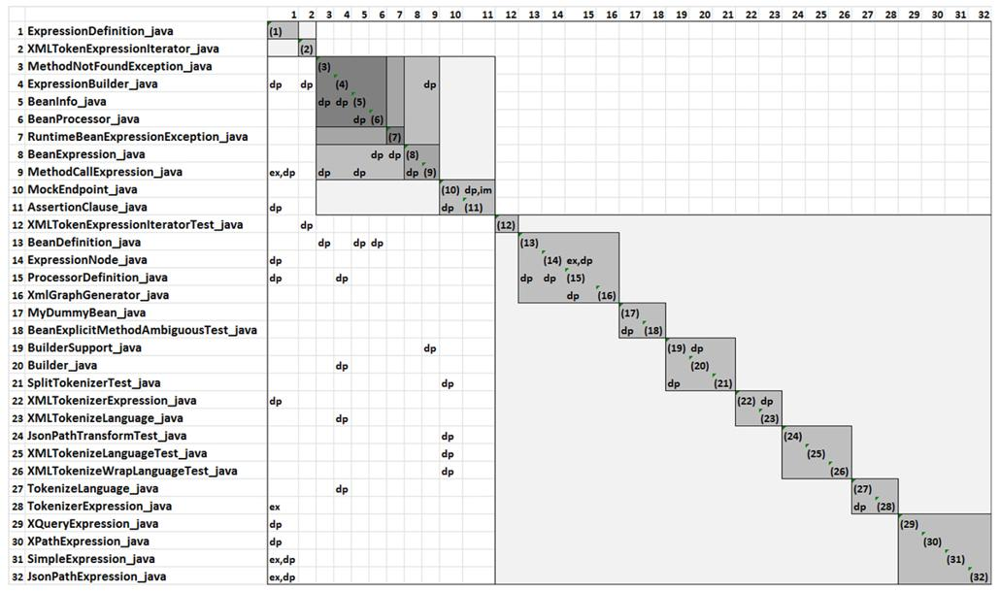
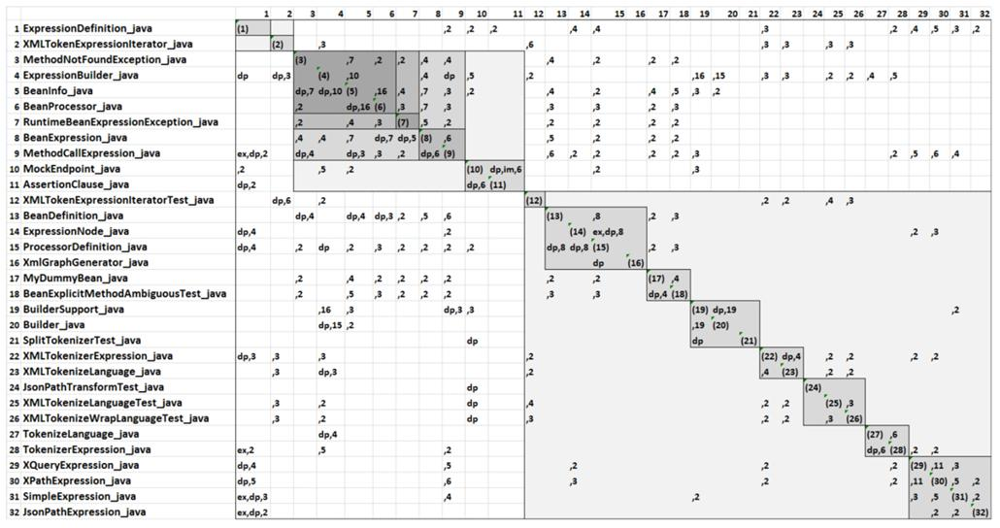
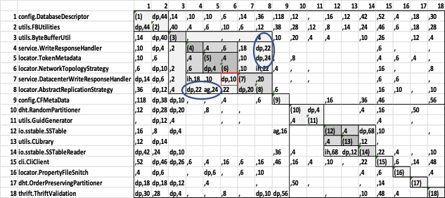
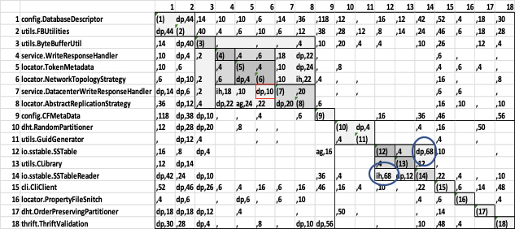

# 23. Quản lý architecture debt (Managing Architecture Debt)

Cùng với Yuanfang Cai

> Có những món nợ thật vui khi bạn vay chúng, nhưng chẳng món nào vui khi bạn bắt tay vào trả chúng. 
> —Ogden Nash

Nếu không có sự chú ý cẩn thận và công sức bỏ vào, các thiết kế sẽ ngày càng khó bảo trì và phát triển theo thời gian. Chúng tôi gọi dạng entropy này là “architecture debt” (nợ architecture), và nó là một dạng technical debt quan trọng và cực kỳ tốn kém. Lĩnh vực rộng lớn của technical debt đã được nghiên cứu sâu rộng trong hơn một thập kỷ—chủ yếu tập trung vào code debt. Architecture debt thường khó phát hiện hơn và khó loại bỏ hơn code debt vì nó liên quan đến các mối quan tâm không cục bộ. Các công cụ và phương pháp hoạt động tốt cho việc phát hiện code debt—code inspection, công cụ kiểm tra chất lượng code, và cứ thế—thường không hoạt động tốt cho việc phát hiện architecture debt.

Tất nhiên, không phải mọi khoản nợ đều nặng nề và không phải mọi khoản nợ đều là nợ xấu. Đôi khi một nguyên lý bị vi phạm khi có một tradeoff xứng đáng—ví dụ, hy sinh low coupling hoặc high cohesion để cải thiện performance runtime hoặc time to market.

Chương này giới thiệu một quy trình để phân tích các hệ thống hiện có nhằm tìm architecture debt. Quy trình này cung cấp cho kiến trúc sư cả kiến thức lẫn công cụ để xác định và quản lý loại nợ như vậy. Nó hoạt động bằng cách xác định các element được kết nối về mặt architecture—có các relation thiết kế có vấn đề—và phân tích một mô hình chi phí bảo trì của chúng. Nếu mô hình đó chỉ ra sự tồn tại của một vấn đề, thường được báo hiệu bằng một lượng thay đổi và bug cao bất thường, điều này biểu thị một vùng architecture debt.

Một khi architecture debt đã được xác định, nếu nó đủ tồi tệ, nó nên được loại bỏ thông qua refactoring. Nếu không có bằng chứng định lượng về lợi ích thu về, thường khó thuyết phục các stakeholder của dự án đồng ý với bước này. Business case (khi không có phân tích architecture debt) diễn ra như thế này: “Tôi sẽ mất ba tháng để refactor hệ thống này và không mang lại cho anh chức năng mới nào.” Nhà quản lý nào sẽ đồng ý với điều đó? Tuy nhiên, được trang bị các loại phân tích mà chúng tôi trình bày ở đây, bạn có thể đưa ra một lời đề xuất rất khác cho người quản lý của mình, được diễn đạt theo ROI và năng suất tăng lên, thứ sẽ hoàn lại công sức refactoring, và hơn thế nữa, trong một thời gian ngắn.

Quy trình mà chúng tôi đề xuất đòi hỏi ba loại thông tin:

- *Source code*. Thông tin này được dùng để xác định các phụ thuộc structural.
- *Lịch sử sửa đổi, được trích xuất từ version control system của dự án*. Thông tin này được dùng để xác định sự co-evolution của các đơn vị code.
- *Thông tin issue, được trích xuất từ một issue control system*. Thông tin này được dùng để xác định lý do của các thay đổi.

Mô hình phân tích nợ xác định các vùng của architecture đang có tỷ lệ bug và churn (số dòng code được commit) cao bất thường và cố gắng liên hệ các triệu chứng này với các lỗi thiết kế.

## 23.1 Xác định liệu bạn có vấn đề architecture debt hay không (Determining Whether You Have an Architecture Debt Problem)

Trong quy trình quản lý architecture debt của chúng tôi, chúng tôi sẽ tập trung vào biểu hiện vật lý của các element của architecture, tức là các file lưu source code của chúng. Làm sao chúng ta xác định liệu một nhóm file có được kết nối về mặt architecture hay không? Một cách là xác định các phụ thuộc tĩnh giữa các file trong dự án của bạn—chẳng hạn method này gọi method kia. Bạn có thể tìm ra chúng bằng cách dùng một công cụ phân tích code tĩnh. Cách tiếp cận thứ hai là ghi nhận các phụ thuộc tiến hóa giữa các file trong một dự án. Một *phụ thuộc tiến hóa* (evolutionary dependency) xảy ra khi hai file thay đổi cùng nhau, và bạn có thể trích xuất thông tin này từ revision control system của mình.

Chúng ta có thể biểu diễn các phụ thuộc file bằng một loại ma trận kề đặc biệt gọi là design structure matrix (DSM). Dù chắc chắn có thể có các cách biểu diễn khác, DSM đã được dùng trong thiết kế kỹ thuật hàng thập kỷ và hiện được hỗ trợ bởi một số công cụ công nghiệp. Trong một DSM, các thực thể quan tâm (trong trường hợp của chúng ta là file) được đặt cả trên các hàng của ma trận và, theo cùng thứ tự, trên các cột. Các ô của ma trận được chú thích để chỉ ra loại phụ thuộc.

Chúng ta có thể chú thích một ô DSM bằng thông tin cho thấy file trên hàng kế thừa từ file trên cột, hoặc nó gọi file trên cột, hoặc nó co-changes với file trên cột. Hai loại chú thích đầu là structural, trong khi loại thứ ba là một phụ thuộc tiến hóa (hay lịch sử).

Nhắc lại: Mỗi hàng trong DSM biểu diễn một file. Các mục trên một hàng cho thấy các phụ thuộc mà file này có với các file khác trong hệ thống. Nếu hệ thống có coupling thấp, bạn sẽ kỳ vọng DSM thưa; tức là, bất kỳ file nào cũng sẽ chỉ phụ thuộc vào một số ít file khác. Hơn nữa, bạn sẽ hy vọng DSM là tam giác dưới; tức là, mọi mục đều xuất hiện bên dưới đường chéo. Điều này có nghĩa là một file chỉ phụ thuộc vào các file lower-level, không phụ thuộc vào các file higher-level, và rằng bạn không có phụ thuộc vòng nào trong hệ thống.

[Hình 23.1](#ch23fig01) cho thấy 11 file từ dự án Apache Camel—một integration framework open source—và các phụ thuộc structural của chúng (được chỉ ra bằng các nhãn “dp,” “im,” và “ex” lần lượt cho dependency, implementation và extension) . Ví dụ, file ở hàng 9 của [Hình 23.1](#ch23fig01), `MethodCallExpression.java`, phụ thuộc vào và extend file ở cột 1, `ExpressionDefinition.java`, và file ở hàng 11, `AssertionClause.java`, phụ thuộc vào file ở cột 10, `MockEndpoint.java`. Các phụ thuộc tĩnh này được trích xuất bằng cách reverse-engineering source code.

**Hình 23.1** *Một DSM của Apache Camel cho thấy các phụ thuộc structural*

Ma trận trong [Hình 23.1](#ch23fig01) khá thưa. Điều đó có nghĩa là các file này không bị coupling structural nặng nề với nhau và, do đó, bạn có thể kỳ vọng rằng việc thay đổi các file này một cách độc lập sẽ tương đối dễ dàng. Nói cách khác, hệ thống này dường như có tương đối ít architecture debt.

Bây giờ hãy xem [Hình 23.2](#ch23fig02), hình này chồng thông tin co-change lịch sử lên [Hình 23.1](#ch23fig01). Thông tin co-change lịch sử được trích xuất từ version control system. Nó cho biết hai file thay đổi cùng nhau trong các commit thường xuyên đến mức nào.

**Hình 23.2** *Một DSM Apache Camel chồng các phụ thuộc tiến hóa*

[Hình 23.2](#ch23fig02) cho thấy một bức tranh rất khác về dự án Camel. Ví dụ, ô ở hàng 8, cột 3 được đánh dấu “4”: Điều này có nghĩa là không có relation structural nào giữa `BeanExpression.java` và `MethodNotFoundException.java`, nhưng người ta phát hiện chúng đã thay đổi cùng nhau bốn lần trong lịch sử sửa đổi. Một ô có cả số lẫn chữ chỉ ra rằng cặp file này có cả relation coupling structural lẫn tiến hóa. Ví dụ, ô ở hàng 22, cột 1 được đánh dấu “dp, 3”: Điều này có nghĩa là `XMLTokenizerExpression.java` phụ thuộc vào `ExpressionDefinition.java`, và chúng đã được thay đổi cùng nhau ba lần.

Ma trận trong [Hình 23.2](#ch23fig02) khá dày đặc. Dù các file này nhìn chung không bị coupling structural với nhau, chúng bị coupling tiến hóa mạnh. Hơn nữa, chúng ta thấy nhiều chú thích trong các ô phía trên đường chéo của ma trận. Do đó, coupling không chỉ đi từ các file higher-level tới các file lower-level, mà đi theo mọi hướng.

Thực tế, dự án này chịu architecture debt cao. Các kiến trúc sư xác nhận điều này. Họ báo cáo rằng gần như mọi thay đổi trong dự án đều tốn kém và phức tạp, và việc dự đoán khi nào các tính năng mới sẵn sàng hoặc khi nào bug được sửa là đầy thách thức.

Dù loại phân tích định tính này, tự bản thân nó, có thể có giá trị đối với một kiến trúc sư hoặc nhà phân tích, chúng ta có thể làm tốt hơn: Chúng ta thực sự có thể định lượng chi phí và tác động của khoản nợ mà code base của chúng ta đang mang, và chúng ta có thể làm điều này hoàn toàn tự động. Để làm vậy, chúng ta dùng khái niệm “hotspot”—các vùng của architecture có lỗi thiết kế, đôi khi được gọi là architecture anti-patterns hoặc architecture flaw.

## 23.2 Phát hiện hotspot (Discovering Hotspots)

Nếu bạn nghi ngờ code base của mình có architecture debt—có lẽ tỷ lệ bug đang tăng và tốc độ ra tính năng đang giảm—bạn cần xác định các file cụ thể và các mối quan hệ có lỗi của chúng đang tạo ra khoản nợ đó.

So với technical debt code-based, architecture debt thường khó xác định hơn vì nguyên nhân gốc rễ của nó phân tán giữa nhiều file và các mối quan hệ qua lại của chúng. Nếu bạn có một phụ thuộc vòng mà chu trình phụ thuộc đi qua sáu file, khó có ai trong tổ chức của bạn hiểu hoàn toàn chu trình này và nó không dễ quan sát được. Với những trường hợp phức tạp như vậy, chúng ta cần trợ giúp, dưới dạng tự động hóa, để xác định architecture debt.

Chúng tôi gọi các tập element có đóng góp quá lớn vào chi phí bảo trì của một hệ thống là *hotspot*. Architecture debt dẫn đến chi phí bảo trì cao do coupling cao và cohesion thấp. Vì vậy, để xác định hotspot, chúng ta tìm các anti-patterns góp phần vào coupling cao và cohesion thấp. Sáu anti-patterns phổ biến—xuất hiện trong hầu như mọi hệ thống—được nêu bật ở đây:

- *Unstable interface (interface không ổn định).* Một file có ảnh hưởng—file đại diện cho một service, resource hoặc abstraction quan trọng trong hệ thống—thay đổi thường xuyên cùng với các file phụ thuộc vào nó, như được ghi lại trong lịch sử sửa đổi. File “interface” là điểm vào để các element khác của hệ thống sử dụng service hoặc resource. Nó thường xuyên bị sửa đổi do các lý do nội bộ, thay đổi API của nó, hoặc cả hai. Để xác định anti-pattern này, hãy tìm một file có số lượng lớn file phụ thuộc mà bị sửa đổi thường xuyên cùng với các file khác.
- *Modularity violation (vi phạm tính module).* Các module tách rời về mặt structural thường xuyên thay đổi cùng nhau. Để xác định anti-pattern này, hãy tìm hai hoặc nhiều file độc lập về mặt structural—tức là, các file không có phụ thuộc structural nào với nhau—mà thay đổi cùng nhau thường xuyên.
- *Unhealthy inheritance (kế thừa không lành mạnh).* Một base class phụ thuộc vào các subclass của nó hoặc một client class phụ thuộc vào cả base class lẫn một hoặc nhiều subclass của nó. Để xác định các trường hợp unhealthy inheritance, hãy tìm một trong hai tập mối quan hệ sau trong một DSM:
- Trong một hệ phân cấp kế thừa, một class cha phụ thuộc vào class con của nó.
- Trong một hệ phân cấp kế thừa, một client của hệ phân cấp class phụ thuộc vào cả class cha lẫn một hoặc nhiều class con của nó.
- *Cyclic dependency hoặc clique.* Một nhóm file được kết nối chặt chẽ. Để xác định anti-pattern này, hãy tìm các tập file tạo thành một đồ thị liên thông mạnh, trong đó có một đường phụ thuộc structural giữa hai element bất kỳ của đồ thị.
- *Package cycle (chu trình package).* Hai hoặc nhiều package phụ thuộc vào nhau, thay vì tạo thành một structure phân cấp như lẽ ra phải vậy. Việc phát hiện anti-pattern này tương tự việc phát hiện một clique: Một package cycle được xác định bằng cách tìm ra các package tạo thành một đồ thị liên thông mạnh.
- *Crossing (giao cắt).* Một file vừa có số lượng lớn file phụ thuộc vào nó vừa có số lượng lớn file mà nó phụ thuộc vào, và nó thay đổi thường xuyên cùng với các file phụ thuộc vào nó và các file mà nó phụ thuộc vào. Để xác định file ở trung tâm của một crossing, hãy tìm một file có cả fan-in và fan-out cao với các file khác và có các relation co-change đáng kể với các file khác này.

Không phải mọi file trong một hotspot đều bị coupling chặt với mọi file khác. Thay vào đó, một tập file có thể bị coupling chặt với nhau và tách rời khỏi các file khác. Mỗi tập như vậy là một hotspot tiềm năng và là một ứng viên tiềm năng cho việc loại bỏ nợ, thông qua refactoring.

[Hình 23.3](#ch23fig03) là một DSM dựa trên các file trong Apache Cassandra—một cơ sở dữ liệu NoSQL được dùng rộng rãi. Nó cho thấy một ví dụ về clique (một chu trình phụ thuộc). Trong DSM này, bạn có thể thấy rằng file ở hàng 8 (`locator.AbstractReplicationStrategy`) phụ thuộc vào file 4 (`service.WriteResponseHandler`) và aggregate file 5 (`locator.TokenMetadata`). Đến lượt chúng, các file 4 và 5 phụ thuộc vào file 8, qua đó tạo thành một clique.

**Hình 23.3** *Một ví dụ về clique*

Một ví dụ thứ hai từ Cassandra minh họa anti-pattern unhealthy inheritance. DSM trong [Hình 23.4](#ch23fig04) cho thấy class `io.sstable.SSTableReader` (hàng 14) kế thừa từ `io.sstable.SSTable` (hàng 12). Mối quan hệ kế thừa được chỉ ra trong DSM bằng ký hiệu “ih”. Tuy nhiên, hãy lưu ý rằng `io.sstable.SSTable` phụ thuộc vào `io.sstable.SSTableReader`, như được chỉ ra bằng chú thích “dp” trong ô (12, 14). Phụ thuộc này là một relation gọi, nghĩa là class cha gọi class con. Lưu ý rằng các ô (12, 14) và (14, 12) đều được chú thích bằng số 68. Con số này biểu thị số lần `io.sstable.SSTable` và `io.sstable.SSTableReader` được co-committed trong các thay đổi, theo lịch sử sửa đổi của dự án. Số lượng co-changes cao quá mức này là một dạng nợ. Khoản nợ này có thể được loại bỏ bằng refactoring—tức là, bằng cách chuyển một số chức năng từ class con lên class cha.

**Hình 23.4** *Các architecture anti-patterns trong Apache Cassandra*

Phần lớn issue trong một issue tracking system có thể được chia thành hai loại lớn: sửa bug và cải tiến tính năng. Việc sửa bug và cả churn bug-related lẫn churn change-related đều có tương quan cao với anti-patterns và hotspot. Nói cách khác, những file tham gia vào anti-patterns và đòi hỏi sửa bug thường xuyên hoặc thay đổi thường xuyên nhiều khả năng là hotspot.

Với mỗi file, chúng ta xác định tổng số lần sửa bug và thay đổi, cũng như tổng lượng churn mà file đó đã trải qua. Tiếp theo, chúng ta cộng các lần sửa bug, thay đổi và churn mà các file trong mỗi anti-pattern đã trải qua. Điều này cho chúng ta một trọng số cho mỗi anti-pattern xét theo mức đóng góp của nó vào architecture debt. Bằng cách này, tất cả các file debt-laden, cùng với tất cả các mối quan hệ của chúng, có thể được xác định và khoản nợ của chúng được định lượng.

Dựa trên quy trình này, một chiến lược debt-reduction (thường đạt được thông qua refactoring) là đơn giản. Việc biết các file liên quan đến khoản nợ, cùng với các mối quan hệ có lỗi của chúng (như được xác định bởi các anti-patterns đã nhận diện), cho phép kiến trúc sư xây dựng và biện minh cho một kế hoạch refactoring. Ví dụ, nếu tồn tại một clique, một phụ thuộc cần được loại bỏ hoặc đảo ngược, để phá vỡ chu trình phụ thuộc. Nếu có unhealthy inheritance, một số chức năng cần được di chuyển, thường là từ một class con lên một class cha. Nếu một modularity violation được xác định, “bí mật” không được đóng gói được chia sẻ giữa các file cần được đóng gói thành abstraction riêng của nó. Và cứ thế.

## 23.3 Ví dụ (Example)

Chúng tôi minh họa quy trình này bằng một case study, mà chúng tôi gọi là SS1, được thực hiện với SoftServe, một công ty outsourcing phần mềm đa quốc gia. Vào thời điểm phân tích, hệ thống SS1 chứa 797 file nguồn và chúng tôi đã ghi nhận lịch sử sửa đổi và các issue của nó trong khoảng thời gian two-year. SS1 được bảo trì bởi sáu developer full-time và nhiều người đóng góp không thường xuyên hơn.

### Xác định hotspot (Identifying Hotspots)

Trong khoảng thời gian chúng tôi nghiên cứu SS1, 2,756 issue đã được ghi lại trong Jira issue-tracker của nó (1,079 trong số đó là bug) và 3,262 commit đã được ghi lại trong repository version control Git.

Chúng tôi đã xác định hotspot bằng quy trình vừa mô tả. Cuối cùng, ba cụm file liên quan về mặt architecture được xác định là chứa các anti-patterns có hại nhất và do đó là nhiều nợ nhất trong dự án. Khoản nợ từ ba cụm này đại diện cho tổng cộng 291 file, trong số 797 file của toàn bộ dự án, hay nhỉnh hơn one-third số file của dự án một chút. Số lỗi gắn với ba cụm này chiếm 89 phần trăm tổng số lỗi của dự án (265).

Kiến trúc sư trưởng của dự án đồng ý rằng các cụm này có vấn đề, nhưng gặp khó khăn trong việc giải thích vì sao. Khi được trình bày phân tích này, ông ấy thừa nhận rằng đây là những vấn đề thiết kế thực sự, vi phạm nhiều quy tắc thiết kế. Kiến trúc sư sau đó đã xây dựng một số refactoring, tập trung vào việc khắc phục các relation có lỗi giữa các file được xác định trong các hotspot. Các refactoring này dựa trên việc loại bỏ các anti-patterns trong hotspot, nên kiến trúc sư đã có rất nhiều hướng dẫn về cách làm điều này.

Nhưng liệu thực hiện các loại refactoring này có *đáng* không? Suy cho cùng, không phải mọi khoản nợ đều đáng trả. Đây là chủ đề của mục tiếp theo.

### Định lượng architecture debt (Quantifying Architecture Debt)

Vì các biện pháp khắc phục được phân tích gợi ý rất cụ thể, kiến trúc sư có thể dễ dàng ước tính số person-months cần thiết cho mỗi refactoring được xác định dựa trên các anti-patterns trong hotspot. Vế còn lại của phương trình chi phí/lợi ích là lợi ích từ các refactoring. Để ước tính khoản tiết kiệm, chúng tôi đưa ra một giả định: Các file được refactor sẽ có số lần sửa bug trong tương lai xấp xỉ bằng số lần sửa bug của file trung bình trong quá khứ. Đây thực ra là một giả định rất thận trọng vì số lần sửa bug trung bình trong quá khứ đã bị đẩy lên bởi những file trong các hotspot được xác định. Hơn nữa, phép tính này không xét đến các chi phí đáng kể khác của bug, như mất uy tín, mất doanh số, và công sức quality assurance và debug bổ sung.

Chúng tôi tính chi phí của các khoản nợ này theo số dòng code được commit cho việc sửa bug. Thông tin này có thể được lấy từ các hệ thống revision control và issue-tracking của dự án.

Với SS1, các phép tính nợ mà chúng tôi thực hiện như sau:

1. Kiến trúc sư ước tính công sức cần thiết để refactor ba hotspot là 14 person-months.
2. Chúng tôi tính số lần sửa bug trung bình mỗi file hằng năm cho toàn bộ dự án là 0.33.
3. Chúng tôi tính số lần sửa bug trung bình hằng năm cho các file trong hotspot là 237.8.
4. Dựa trên các kết quả này, chúng tôi ước tính rằng số lần sửa bug hằng năm cho các file trong hotspot, sau khi refactor, sẽ là 96.
5. Chênh lệch giữa churn thực tế gắn với các file hotspot và lượng churn kỳ vọng sau khi refactor là khoản tiết kiệm kỳ vọng.

Khoản tiết kiệm hằng năm ước tính cho các file được refactor (dùng các con số năng suất trung bình của công ty) là 41.35 person-months. Xét các phép tính ở các bước 1–5, chúng ta thấy rằng với chi phí 14 person-months, dự án có thể kỳ vọng tiết kiệm hơn 41 person-months mỗi năm.

Hết trường hợp này đến trường hợp khác, chúng tôi đã thấy những loại lợi tức đầu tư như vậy. Một khi các khoản architecture debt đã được xác định, chúng có thể được trả dần và cuộc sống của dự án trở nên tốt hơn một cách đo lường được, xét về tốc độ ra tính năng và thời gian bug-fixing, theo cách thừa sức bù đắp cho công sức bỏ ra.

## 23.5 Tự động hóa (Automation)

Dạng phân tích architecture này có thể được tự động hóa hoàn toàn. Mỗi trong số các anti-patterns được giới thiệu trong [Mục 23.2](#sec23_2) đều có thể được xác định một cách tự động và bộ công cụ có thể được tích hợp vào một bộ công cụ continuous integration để architecture debt được giám sát liên tục. Quy trình phân tích này đòi hỏi các công cụ sau:

- Một công cụ để trích xuất một tập issue từ một issue tracker
- Một công cụ để trích xuất log từ một revision control system
- Một công cụ để reverse-engineer code base, nhằm xác định các phụ thuộc cú pháp giữa các file
- Một công cụ để xây dựng DSM từ thông tin đã trích xuất và duyệt qua DSM để tìm các anti-patterns
- Một công cụ tính toán khoản nợ gắn với mỗi hotspot

Các công cụ chuyên biệt duy nhất cần thiết cho quy trình này là những công cụ để xây dựng DSM và phân tích DSM. Các dự án nhiều khả năng đã có các issue tracking system và lịch sử sửa đổi, và có rất nhiều công cụ reverse-engineering sẵn có, bao gồm cả các lựa chọn open source.

## 23.6 Tóm tắt (Summary)

Chương này đã trình bày một quy trình để xác định và định lượng architecture debt trong một dự án. Architecture debt là một dạng technical debt quan trọng và cực kỳ tốn kém. So với technical debt code-based, architecture debt thường khó xác định hơn vì nguyên nhân gốc rễ của nó phân tán giữa nhiều file và các mối quan hệ qua lại của chúng.

Quy trình được phác thảo trong chương này bao gồm việc thu thập thông tin từ issue tracker của dự án, revision control system của nó, và chính source code. Dùng thông tin này, các architecture anti-patterns có thể được xác định và nhóm thành hotspot, và tác động của các hotspot này có thể được định lượng.

Quy trình giám sát architecture debt này có thể được tự động hóa và tích hợp vào bộ công cụ continuous integration của hệ thống. Một khi architecture debt đã được xác định, nếu nó đủ tồi tệ, nó nên được loại bỏ thông qua refactoring. Đầu ra của quy trình này cung cấp dữ liệu định lượng cần thiết để trình bày business case cho việc refactoring với ban quản lý dự án.

## 23.7 Đọc thêm (For Further Reading)

Lĩnh vực technical debt, đến thời điểm này, đã có một kho tài liệu nghiên cứu phong phú. Thuật ngữ *technical debt* được Ward Cunningham đặt ra năm 1992 (dù, vào thời điểm đó, ông chỉ gọi nó là “debt”; [Cunningham 92]). Ý tưởng này đã được nhiều người khác tinh chỉnh và phát triển, nổi bật nhất trong số đó là Martin Fowler [Fowler 09] và Steve McConnell [McConnell 07]. George Fairbanks mô tả bản chất lặp của nợ trong bài báo *IEEE Software* của ông, “Ur-Technical Debt” [Fairbanks 20]. Một cái nhìn toàn diện về vấn đề quản lý technical debt có thể được tìm thấy trong [Kruchten 19].

Định nghĩa architecture debt được dùng trong chương này được mượn từ [Xiao 16]. Case study SoftServe đã được công bố trong [Kazman 15].

Một số công cụ được dùng để tạo và phân tích DSM được mô tả trong [Xiao 14]. Các công cụ để phát hiện architectural flaw được giới thiệu trong [Mo 15].

Tác động của các architecture flaw đã được thảo luận và nghiên cứu thực nghiệm trong một số bài báo, bao gồm [Feng 16] và [Mo 18].

## 23.8 Câu hỏi thảo luận (Discussion Questions)

1. Bạn sẽ phân biệt một dự án có architecture debt với một dự án “bận rộn” nơi nhiều tính năng đang được triển khai như thế nào?
2. Hãy tìm các ví dụ về những dự án đã trải qua các đợt refactoring lớn. Bằng chứng nào đã được dùng để thúc đẩy hoặc biện minh cho các đợt refactoring này?
3. Trong những hoàn cảnh nào việc tích lũy nợ là một chiến lược hợp lý? Làm sao bạn biết rằng mình đã đạt đến điểm có quá nhiều nợ?
4. Architecture debt có gây hại nhiều hơn hay ít hơn các loại nợ khác, như code debt, documentation debt hoặc testing debt không?
5. Hãy thảo luận điểm mạnh và điểm yếu của việc thực hiện loại phân tích architecture này so với các phương pháp được thảo luận trong [Chương 21](ch21_evaluating_an_architecture.vi.md#ch21).
