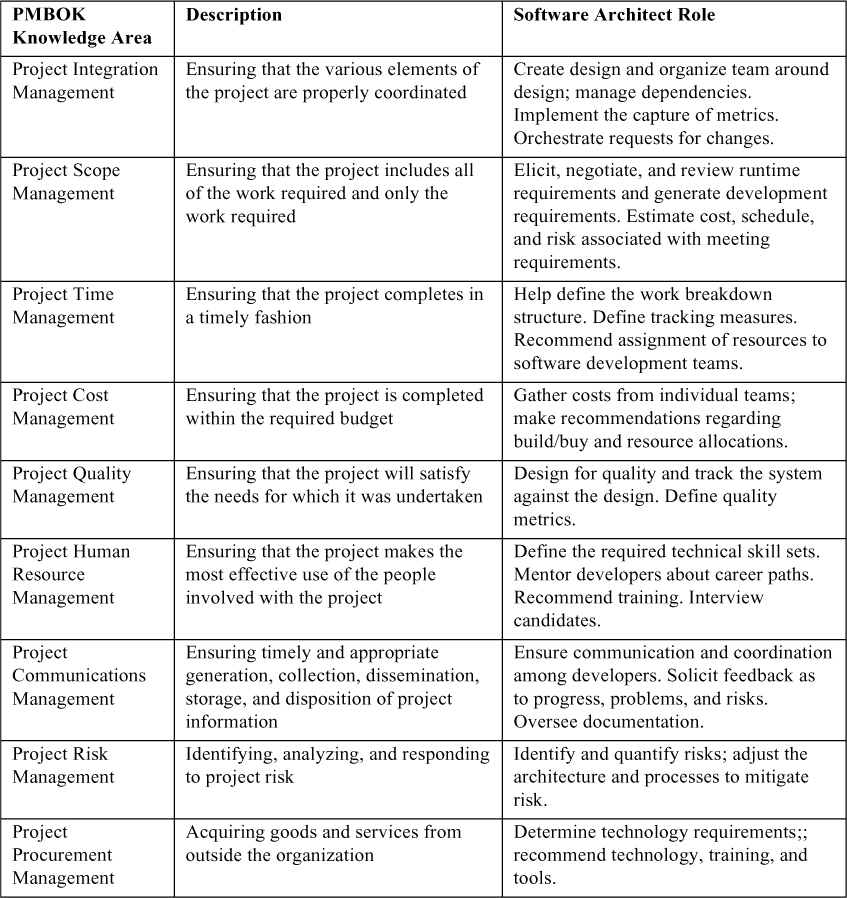
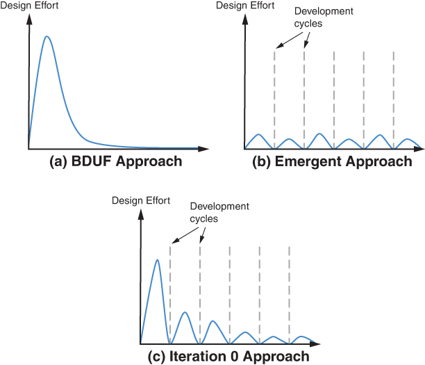
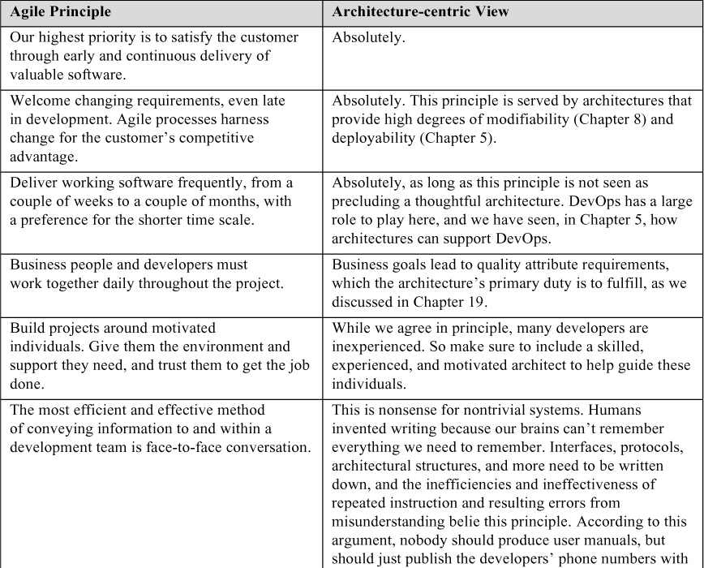
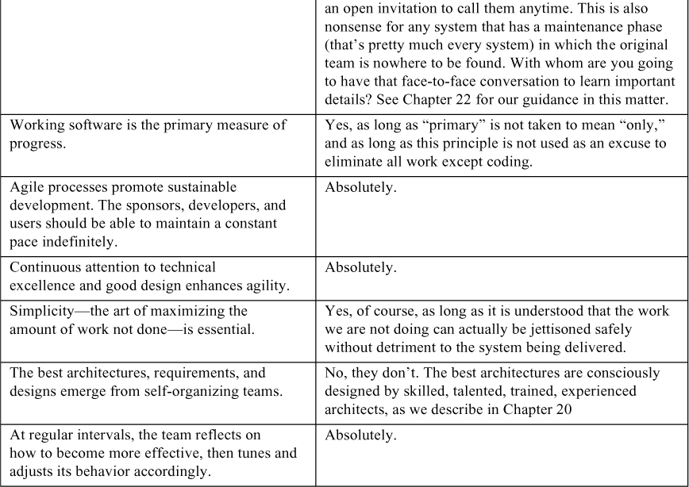
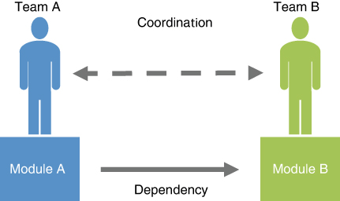

# 24. Vai trò của kiến trúc sư trong dự án (The Role of Architects in Projects)

> Tôi không hiểu vì sao người ta thuê kiến trúc sư rồi lại bảo họ phải làm gì. 
> —Frank Gehry

Bất kỳ hoạt động thực hành architecture nào được thực hiện bên ngoài lớp học đều diễn ra trong bối cảnh lớn hơn của một dự án phát triển, được lập kế hoạch và thực hiện bởi những người làm việc trong một hoặc nhiều tổ chức. Architecture, dù quan trọng đến đâu, cũng chỉ là phương tiện hướng tới một mục đích lớn hơn. Trong chương này, chúng tôi đề cập các khía cạnh của architecture và trách nhiệm của kiến trúc sư bắt nguồn từ thực tế của các dự án phát triển.

Chúng tôi bắt đầu bằng việc thảo luận một vai trò then chốt trong dự án mà bạn với tư cách kiến trúc sư nhiều khả năng sẽ có quan hệ làm việc chặt chẽ: quản lý dự án.

## 24.1 Kiến trúc sư và quản lý dự án (The Architect and the Project Manager)

Một trong những mối quan hệ quan trọng nhất trong một team là giữa kiến trúc sư phần mềm và quản lý dự án. Quản lý dự án chịu trách nhiệm về hiệu quả tổng thể của dự án—thường là giữ cho dự án đúng ngân sách, đúng tiến độ, và có đúng người làm đúng việc. Để thực hiện các trách nhiệm này, quản lý dự án thường sẽ tìm đến kiến trúc sư của dự án để được hỗ trợ.

Hãy nghĩ về quản lý dự án như người chủ yếu chịu trách nhiệm về các khía cạnh external-facing của dự án và kiến trúc sư phần mềm như người chịu trách nhiệm về các khía cạnh kỹ thuật nội bộ của dự án. Góc nhìn bên ngoài cần phản ánh chính xác tình hình nội bộ, và các hoạt động nội bộ cần phản ánh chính xác kỳ vọng của các stakeholder bên ngoài. Tức là, quản lý dự án nên biết, và phản ánh lên ban quản lý cấp trên, tiến độ và các rủi ro trong dự án, trong khi kiến trúc sư phần mềm nên biết, và phản ánh tới các developer, các mối quan tâm của stakeholder bên ngoài. Mối quan hệ giữa quản lý dự án và kiến trúc sư phần mềm có thể có tác động lớn đến sự thành công của một dự án. Họ nên có một mối quan hệ làm việc tốt và ý thức được các vai trò họ đang đảm nhận và ranh giới của những vai trò đó.

Project Management Body of Knowledge (PMBOK) liệt kê một số lĩnh vực kiến thức cho quản lý dự án. Đây là những lĩnh vực mà quản lý dự án nhiều khả năng sẽ tìm đến kiến trúc sư để có ý kiến đóng góp. [Bảng 24.1](#ch24tab01) xác định lĩnh vực kiến thức được PMBOK mô tả và vai trò của kiến trúc sư phần mềm trong lĩnh vực đó.

**Bảng 24.1** *Vai trò của kiến trúc sư trong việc hỗ trợ các lĩnh vực kiến thức quản lý dự án*

### Khuyến nghị cho kiến trúc sư (Recommendations to the Architect)

Duy trì một mối quan hệ làm việc tốt với quản lý dự án. Hãy nắm được các nhiệm vụ và mối quan tâm của quản lý dự án, và cách bạn với tư cách kiến trúc sư có thể được yêu cầu hỗ trợ các nhiệm vụ và mối quan tâm đó.

## 24.2 Architecture tăng dần và các stakeholder (Incremental Architecture and Stakeholders)

Các phương pháp luận Agile được xây dựng trên trụ cột phát triển tăng dần, với mỗi increment mang lại giá trị cho khách hàng hoặc người dùng. Chúng tôi sẽ thảo luận Agile và architecture trong một mục riêng, nhưng ngay cả khi dự án của bạn không phải là một dự án Agile, bạn vẫn nên dự kiến phát triển và phát hành architecture theo các increment, theo một nhịp độ hỗ trợ lịch kiểm thử và phát hành của chính dự án.

Vậy, architecture tăng dần là việc phát hành architecture theo các increment. Cụ thể, điều này có nghĩa là phát hành tài liệu architecture (như được mô tả trong [Chương 22](ch22_documenting_an_architecture.vi.md#ch22)) theo các increment. Điều này, đến lượt nó, đòi hỏi quyết định phát hành những view nào (trong tập đã lên kế hoạch của bạn) và ở độ sâu nào. Dùng các structure chúng tôi đã phác thảo trong [Chương 1](ch01_what_is_software_architecture.vi.md#ch01), hãy cân nhắc những thứ sau làm ứng viên cho increment đầu tiên của bạn:

- Một module decomposition structure. Structure này sẽ định hình cấu trúc team cho dự án phát triển, cho phép tổ chức dự án hình thành. Các team có thể được xác định, bố trí nhân sự, lập ngân sách và đào tạo. Cấu trúc team sẽ là cơ sở của việc lập kế hoạch và ngân sách dự án, vì vậy structure kỹ thuật này định nghĩa cấu trúc quản lý của dự án.
- Một module “uses” structure. Structure này sẽ cho phép lập kế hoạch các increment, điều then chốt trong bất kỳ dự án nào hy vọng phát hành phần mềm theo kiểu tăng dần. Như chúng tôi đã nói trong [Chương 1](ch01_what_is_software_architecture.vi.md#ch01), uses structure được dùng để thiết kế các hệ thống có thể được mở rộng để thêm chức năng, hoặc từ đó có thể trích xuất các tập con chức năng hữu ích. Cố gắng tạo ra một hệ thống chủ đích hỗ trợ phát triển tăng dần sẽ gặp vấn đề nếu bạn không lên kế hoạch chính xác các increment sẽ là gì.
- (Các) component-and-connector (C&C) structure nào truyền tải tốt nhất cách tiếp cận giải pháp tổng thể.
- Một deployment structure broad-brush ít nhất giải quyết các câu hỏi lớn như liệu hệ thống sẽ được deploy trên thiết bị di động, trên hạ tầng cloud, v.v.

Sau đó, hãy dùng nhu cầu của các stakeholder của architecture làm hướng dẫn khi soạn nội dung của các lần phát hành tiếp theo.

### Khuyến nghị cho kiến trúc sư (Recommendations to the Architect)

Trước hết và quan trọng nhất, hãy bảo đảm bạn biết stakeholder của mình là ai và nhu cầu của họ là gì, để bạn có thể thiết kế giải pháp và tài liệu thích hợp. Ngoài ra:

- Làm việc với các stakeholder của dự án để xác định nhịp độ phát hành và nội dung của mỗi increment dự án.
- Increment architecture đầu tiên của bạn nên bao gồm các view module decomposition và uses, cũng như một C&C view sơ bộ.
- Dùng ảnh hưởng của bạn để bảo đảm rằng các lần phát hành sớm giải quyết các yêu cầu quality attribute thách thức nhất của hệ thống, qua đó bảo đảm rằng không có bất ngờ khó chịu nào về architecture xuất hiện muộn trong chu kỳ phát triển.
- Sắp xếp các lần phát hành architecture theo giai đoạn để hỗ trợ các increment dự án đó và hỗ trợ nhu cầu của các stakeholder phát triển khi họ làm việc trên mỗi increment.

## 24.3 Architecture và phát triển Agile (Architecture and Agile Development)

Phát triển Agile bắt đầu như một cuộc nổi loạn chống lại—cùng với những thứ khác—các cách tiếp cận phát triển cứng nhắc và nặng nề về quy trình, áp đặt về tài liệu bắt buộc, tập trung vào việc lập kế hoạch và thiết kế up-front, và kết thúc bằng một lần bàn giao duy nhất mà mọi người hy vọng sẽ giống với những gì khách hàng muốn ngay từ đầu. Những người theo Agile (Agilista) ủng hộ việc phân bổ các nguồn lực mà nếu không thì đã được dùng cho quy trình và tài liệu vào việc tìm hiểu khách hàng thực sự muốn gì và cung cấp nó theo các increment bàn giao nhỏ, có thể kiểm thử, bắt đầu từ rất sớm.

Câu hỏi then chốt là: Một dự án nên thực hiện bao nhiêu công việc up-front, về mặt phân tích yêu cầu, giảm thiểu rủi ro và thiết kế architecture? Không có một câu trả lời đúng duy nhất cho câu hỏi này, nhưng bạn có thể tìm thấy một “điểm ngọt” cho bất kỳ dự án nào. Lượng công việc dự án “đúng” phụ thuộc vào nhiều yếu tố, trong đó yếu tố chi phối nhất là quy mô dự án, nhưng các yếu tố quan trọng khác bao gồm các yêu cầu chức năng phức tạp, các yêu cầu quality attribute đòi hỏi cao, các yêu cầu biến động (liên quan đến “tính có tiền lệ” hay tính mới của lĩnh vực), và mức độ phân tán của việc phát triển.

Vậy các kiến trúc sư đạt được mức độ agility đúng như thế nào? [Hình 24.1](#ch24fig01) cho thấy các lựa chọn của bạn. Bạn có thể chọn “Big Design Up Front” (BDUF) waterfall-style, được thể hiện trong [Hình 24.1](#ch24fig01)(a). Hoặc bạn có thể vứt bỏ sự thận trọng về architecture và tin vào cái mà các Agilista gọi là cách tiếp cận “emergent” (tự hình thành), trong đó architecture cuối cùng hình thành khi các lập trình viên bàn giao các increment của họ, được thể hiện trong [Hình 24.1](#ch24fig01)(b). Cách tiếp cận đó có thể hiệu quả với các dự án nhỏ, đơn giản có thể xoay chuyển nhanh chóng và chỉ cần refactor khi cần, nhưng chúng tôi chưa bao giờ thấy nó hiệu quả với các dự án lớn, phức tạp.

**Hình 24.1** *Ba cách tiếp cận thiết kế architecture*

Không có gì ngạc nhiên, cách tiếp cận mà chúng tôi khuyến nghị nằm giữa hai thái cực này: Đó là cách tiếp cận “Iteration 0”, được thể hiện trong [Hình 24.1](#ch24fig01)(c). Trong các dự án mà bạn có một mức hiểu biết nào đó về yêu cầu, bạn nên cân nhắc bắt đầu bằng việc thực hiện một vài iteration của attribute-driven design (ADD; được mô tả trong [Chương 20](ch20_designing_an_architecture.vi.md#ch20)). Các design iteration này có thể tập trung vào việc chọn các architectural pattern chính (bao gồm một reference architecture, nếu phù hợp), framework và component. Hãy nhắm đến việc hỗ trợ các increment của dự án theo cách giúp ích cho các stakeholder của architecture, như được khuyến nghị trong [Mục 24.2](#sec24_2). Ngay từ sớm, điều này sẽ giúp bạn cấu trúc dự án, xác định việc phân công công việc và việc hình thành team, và giải quyết các quality attribute then chốt nhất. Nếu và khi yêu cầu thay đổi—đặc biệt nếu đó là các yêu cầu quality attribute mang tính dẫn dắt—hãy áp dụng thực hành thử nghiệm Agile, trong đó các spike được dùng để giải quyết các yêu cầu mới. Một *spike* là một task time-boxed được tạo ra để trả lời một câu hỏi kỹ thuật hoặc thu thập thông tin; nó không nhằm dẫn đến một sản phẩm hoàn chỉnh. Spike được phát triển trong một nhánh code riêng và, nếu thành công, được merge vào nhánh chính của code. Bằng cách này, các yêu cầu mới phát sinh có thể được tiếp nhận nhẹ nhàng và được quản lý mà không gây xáo trộn quá nhiều cho quá trình phát triển tổng thể.

Lập trình Agile và architecture không phải lúc nào cũng hòa hợp. Agile Manifesto năm 2001, “Chỉ thị tối cao” (Prime Directive) của phong trào Agile, ngụ ý rằng architecture tự hình thành và không cần được lập kế hoạch hay thiết kế up-front.

Đã từng (và vẫn) dễ dàng tìm thấy các tài liệu đã xuất bản về Agile tuyên bố rằng nếu bạn không bàn giao phần mềm chạy được, thì bạn không làm gì có giá trị cả. Từ đó suy ra rằng nếu bạn đang làm architecture, thì bạn đang lấy đi nguồn lực từ việc lập trình và, do đó, bạn đang *chẳng làm gì có giá trị*: Architecture, schmarchitecture! Hãy viết code, và architecture sẽ hình thành một cách tự nhiên.

Với các hệ thống từ vừa đến lớn, quan điểm này chắc chắn đã sụp đổ dưới sức nặng khắc nghiệt của kinh nghiệm. Giải pháp cho các yêu cầu quality attribute không thể đơn giản được “gắn thêm” vào một hệ thống hiện có ở một giai đoạn phát triển muộn tùy ý. Giải pháp cho security, performance cao, safety và nhiều mối quan tâm khác phải được thiết kế vào architecture của hệ thống ngay từ đầu, ngay cả khi 20 lần bàn giao tăng dần đã lên kế hoạch đầu tiên không sử dụng các khả năng đó. Đúng vậy, bạn có thể bắt đầu viết code và đúng vậy, architecture sẽ hình thành—nhưng nó sẽ là architecture sai.

Tóm lại, Agile Manifesto là một bản thỏa thuận tiền hôn nhân khá tệ cho bất kỳ cuộc hôn nhân nào giữa Agile và architecture. Tuy nhiên, đi kèm với Manifesto là 12 nguyên tắc Agile mà, nếu đọc một cách rộng lượng, gợi ý một điểm trung dung giữa hai phe. [Bảng 24.2](#ch24tab02) liệt kê các nguyên tắc này và đưa ra bình luận architecture-centric cho từng nguyên tắc.

**Bảng 24.2** *Các nguyên tắc Agile và góc nhìn Architecture-centric*

Vậy đó là sáu điểm đồng ý “Tuyệt đối” (Absolutely), bốn điểm đồng ý chung, và hai điểm bất đồng mạnh.

Agile, như lúc mới được hệ thống hóa, dường như hoạt động tốt nhất trong các tổ chức nhỏ xây dựng sản phẩm nhỏ. Các tổ chức có quy mô từ vừa đến lớn muốn áp dụng Agile cho các dự án lớn nhanh chóng nhận ra rằng việc phối hợp số lượng lớn các team Agile nhỏ là một thách thức ghê gớm. Trong Agile, các team nhỏ làm các phần việc nhỏ trong các khoảng thời gian nhỏ. Một thách thức là bảo đảm rằng nhiều (hàng chục đến hàng trăm) team nhỏ này đã chia công việc một cách phù hợp để không có việc nào bị bỏ sót và không có việc nào bị làm hai lần. Một thách thức khác là sắp xếp trình tự nhiều task của các team để kết quả của chúng có thể được hợp nhất, thường xuyên và nhanh chóng, nhằm tạo ra increment nhỏ tiếp theo của một hệ thống hoạt động hợp lý.

Một ví dụ về cách tiếp cận áp dụng Agile ở quy mô doanh nghiệp là Scaled Agile Framework (SAFe), xuất hiện vào khoảng năm 2007 và được tinh chỉnh liên tục kể từ đó. SAFe cung cấp một mô hình tham chiếu về workflow, vai trò và quy trình mà theo đó các tổ chức lớn có thể phối hợp hoạt động của nhiều team, mỗi team vận hành theo kiểu Agile cổ điển, để tạo ra một hệ thống large-scale một cách có hệ thống và thành công.

SAFe thừa nhận vai trò của architecture. Nó công nhận “intentional architecture” (architecture có chủ đích), mà định nghĩa của nó sẽ gây đồng cảm với độc giả của cuốn sách này. Intentional architecture “định nghĩa một tập các chiến lược và sáng kiến architecture có mục đích, có kế hoạch, giúp nâng cao thiết kế giải pháp, performance và usability và cung cấp hướng dẫn cho việc đồng bộ thiết kế và hiện thực inter-team.” Nhưng SAFe cũng khuyến nghị mạnh mẽ một lực đối trọng gọi là “emergent design”, thứ “cung cấp cơ sở kỹ thuật cho một cách tiếp cận hiện thực hoàn toàn tiến hóa và tăng dần ” ([scaledagileframework.com/](http://scaledagileframework.com/)). Chúng tôi cho rằng những phẩm chất đó cũng sẽ hình thành từ một intentional architecture, vì khả năng tiến hóa nhanh và khả năng hỗ trợ hiện thực tăng dần không xảy ra nếu không có sự suy nghĩ up-front cẩn thận. Các cách để đạt được chúng, thực tế, được đề cập xuyên suốt cuốn sách này.

## 24.4 Architecture và phát triển phân tán (Architecture and Distributed Development)

Hầu hết các dự án đáng kể ngày nay được phát triển bởi các team phân tán, trong đó “phân tán” có thể có nghĩa là trải rộng qua các tầng trong một tòa nhà, qua các tòa nhà trong một khu công nghiệp, qua các khu ở một hoặc hai múi giờ khác nhau, hoặc giữa các bộ phận hay nhà thầu phụ khác nhau rải rác khắp thế giới.

Phát triển phân tán đi kèm cả lợi ích lẫn thách thức:

- *Chi phí*. Chi phí lao động thay đổi tùy theo địa điểm, và có một nhận thức rằng việc chuyển một phần việc phát triển sang một địa điểm low-cost chắc chắn sẽ giảm tổng chi phí của dự án. Thực vậy, kinh nghiệm đã cho thấy rằng, với phát triển phần mềm, có thể gặt hái được khoản tiết kiệm về lâu dài. Tuy nhiên, cho đến khi các developer ở địa điểm low-cost có đủ mức chuyên môn về lĩnh vực và cho đến khi các thực hành quản lý được điều chỉnh để bù đắp cho những khó khăn của phát triển phân tán, một lượng lớn việc làm lại phải được thực hiện, qua đó ăn mòn và có lẽ còn vượt quá mọi khoản tiết kiệm từ tiền lương.
- *Bộ kỹ năng và nguồn lao động sẵn có*. Các tổ chức có thể không thể tuyển developer tại một địa điểm duy nhất: Chi phí di dời có thể cao, quy mô nguồn developer có thể nhỏ, hoặc các bộ kỹ năng cần thiết có thể chuyên biệt và không có sẵn tại một địa điểm duy nhất. Phát triển một hệ thống theo kiểu phân tán cho phép công việc di chuyển đến nơi có người lao động thay vì buộc người lao động phải di chuyển đến nơi làm việc, dù phải trả giá bằng việc giao tiếp và phối hợp bổ sung.
- *Kiến thức địa phương về thị trường*. Các developer đang phát triển các biến thể của một hệ thống để bán tại thị trường của họ có nhiều kiến thức hơn về các loại tính năng phù hợp và các loại vấn đề văn hóa có thể phát sinh.

Phát triển phân tán diễn ra như thế nào trong một dự án? Giả sử Module A dùng một interface từ Module B. Theo thời gian, khi hoàn cảnh thay đổi, interface này có thể cần được sửa đổi. Do đó, team chịu trách nhiệm về Module B phải phối hợp với team chịu trách nhiệm về Module A, như được chỉ ra trong [Hình 24.2](#ch24fig02). Loại phối hợp này dễ dàng nếu nó chỉ là một cuộc trò chuyện ngắn ở máy bán hàng tự động dùng chung, nhưng không dễ như vậy nếu nó là một cuộc họp web được lên lịch trước vào thời điểm đang là nửa đêm đối với một trong các team.

**Hình 24.2** *Phối hợp giữa các team và các module*

Nói rộng hơn, các phương pháp phối hợp bao gồm các lựa chọn sau:

- *Liên hệ không chính thức*. Các liên hệ không chính thức, như gặp nhau ở phòng cà phê hoặc ở hành lang, chỉ khả thi nếu các team co-located.
- *Tài liệu*. Tài liệu, nếu được viết tốt, được tổ chức tốt và được phổ biến đúng cách, có thể được dùng như một phương tiện để phối hợp các team, dù chúng co-located hay ở xa.
- *Cuộc họp*. Các team có thể tổ chức các cuộc họp, theo lịch hoặc đột xuất, và trực tiếp hoặc từ xa, để giúp gắn kết team và nâng cao nhận thức về các vấn đề.
- *Giao tiếp điện tử bất đồng bộ*. Nhiều dạng giao tiếp điện tử bất đồng bộ có thể được dùng như một cơ chế phối hợp, như email, news group, blog và wiki.

Việc lựa chọn phương pháp phối hợp phụ thuộc vào nhiều yếu tố, bao gồm hạ tầng của tổ chức, văn hóa doanh nghiệp, kỹ năng ngôn ngữ, các múi giờ liên quan, và số lượng team phụ thuộc vào một module cụ thể. Cho đến khi một tổ chức thiết lập được một phương pháp hiệu quả để phối hợp giữa các team phân tán, sự hiểu lầm giữa các team nhiều khả năng sẽ gây ra chậm trễ và, trong một số trường hợp, các lỗi nghiêm trọng trong dự án.

Điều này có ý nghĩa gì đối với architecture và kiến trúc sư? Nó có nghĩa là việc phân bổ trách nhiệm cho các team quan trọng hơn trong phát triển phân tán so với phát triển co-located, nơi tất cả các developer ở trong một văn phòng, hoặc ít nhất là ở gần nhau. Nó cũng có nghĩa là sự chú ý đến các phụ thuộc module có thêm tầm quan trọng, vượt ra ngoài vai trò thông thường của chúng trong các quality attribute như modifiability và performance: Các phụ thuộc giữa các module thuộc sở hữu của các team phân tán toàn cầu nhiều khả năng sẽ có vấn đề hơn và nên được giảm thiểu trong phạm vi có thể.

Ngoài ra, tài liệu đặc biệt quan trọng trong phát triển phân tán. Các team co-located có nhiều khả năng phối hợp không chính thức như sang văn phòng bên cạnh hoặc gặp nhau ở phòng cà phê hay hành lang. Các team từ xa không có sẵn các cơ chế không chính thức này, nên họ phải dựa vào các cơ chế chính thức hơn như tài liệu, và các thành viên team phải chủ động trao đổi với nhau khi có nghi vấn.

Khi cuốn sách này đang được chuẩn bị xuất bản, các công ty trên khắp thế giới đang học cách đối phó với việc tham gia từ xa và các thực hành work-from-home do khủng hoảng COVID-19. Còn quá sớm để khẳng định dứt khoát các tác động long-term của đại dịch này đối với thế giới kinh doanh, nhưng có vẻ nó sẽ dẫn đến việc phát triển phân tán trở thành chuẩn mực. Những người làm việc cùng nhau giờ đều làm qua hội nghị từ xa; không còn những cuộc trò chuyện ở hành lang hay gặp gỡ ở máy bán hàng tự động. Để công việc có thể tiếp tục, mọi người đang học cách thích nghi với mô hình phát triển phân tán. Sẽ rất thú vị để xem liệu điều này có dẫn đến xu hướng architecture mới nào không.

## 24.5 Tóm tắt (Summary)

Các kiến trúc sư phần mềm làm công việc của mình trong bối cảnh của một dự án phát triển nào đó. Do đó, họ cần hiểu vai trò và trách nhiệm của mình từ góc nhìn đó.

Quản lý dự án và kiến trúc sư phần mềm có thể được xem như đảm nhận các vai trò bổ sung cho nhau: Quản lý điều hành dự án từ góc nhìn hành chính, và kiến trúc sư điều hành dự án từ góc nhìn giải pháp kỹ thuật. Hai vai trò này giao nhau theo nhiều cách, và kiến trúc sư có thể hỗ trợ quản lý để nâng cao cơ hội thành công của dự án.

Trong một dự án, architecture không bật ra hoàn chỉnh từ trán của thần Zeus, mà được phát hành theo các increment hữu ích cho stakeholder. Do đó, kiến trúc sư cần hiểu rõ các stakeholder của architecture và nhu cầu thông tin của họ.

Các phương pháp luận Agile tập trung vào phát triển tăng dần. Theo thời gian, architecture và Agile (dù chúng có một khởi đầu không suôn sẻ cùng nhau) đã trở thành những đối tác không thể thiếu.

Phát triển toàn cầu tạo ra nhu cầu về một chiến lược phối hợp tường minh dựa trên các chiến lược chính thức hơn so với mức cần thiết cho phát triển co-located.

## 24.6 Đọc thêm (For Further Reading)

Dan Paulish đã viết một cuốn sách xuất sắc về quản lý trong một môi trường lấy architecture làm trung tâm—*Architecture-centric Software Project Management: A Practical Guide*—và nội dung trong chương này về phát triển phân tán được phỏng theo cuốn sách của ông [Paulish 02].

Bạn có thể đọc về SAFe tại [scaledagileframework.com/](http://scaledagileframework.com/). Trước SAFe, một số thành viên của cộng đồng Agile đã độc lập đi đến một quy trình quản lý medium-weight ủng hộ architecture up-front. Xem [Coplein 10] để có mô tả về vai trò của architecture trong các dự án agile.

Các khái niệm cơ bản về quản lý dự án được đề cập trong IEEE Guide, *Adoption of the Project Management Institute (PMI) Standard: A Guide to the Project Management Body of Knowledge*, ấn bản thứ sáu [IEEE 17].

Các metric về software architecture thường nằm trong phạm vi trách nhiệm của kiến trúc sư trong một dự án. Một bài báo của Coulin và cộng sự cung cấp một tổng quan hữu ích về tài liệu nghiên cứu trong chủ đề này và, đồng thời, phân loại chính các metric đó [Coulin 19].

Kiến trúc sư chiếm một vị trí đặc biệt trong một tổ chức. Họ được kỳ vọng thông thạo mọi giai đoạn trong vòng đời của hệ thống, từ lúc sinh ra đến lúc mất đi. Trong tất cả các thành viên của một dự án, họ là những người nhạy bén nhất với nhu cầu của tất cả các stakeholder của dự án và của hệ thống. Họ thường được chọn làm kiến trúc sư một phần vì kỹ năng giao tiếp above-average của họ. *The Software Architect Elevator: Redefining the Architect’s Role in the Digital Enterprise* [Hohpe 20] mô tả khả năng đặc biệt này của kiến trúc sư trong việc tương tác với mọi người ở mọi cấp bên trong và bên ngoài một tổ chức.

## 24.7 Câu hỏi thảo luận (Discussion Questions)

1. Hãy xem “phù hợp với phát triển phân tán toàn cầu” như một quality attribute có thể được tăng lên hoặc giảm xuống bởi các quyết định thiết kế architecture, giống như các quality attribute khác mà chúng tôi đã phác thảo trong Part 2 của cuốn sách này. Hãy xây dựng một general scenario cho nó, và một danh sách các tactic để giúp đạt được nó. À, và hãy nghĩ ra một cái tên hay cho nó.
2. Các thực hành quản lý dự án chung thường ủng hộ việc tạo một work breakdown structure như artifact đầu tiên được tạo ra bởi một dự án. Thực hành này có gì sai từ góc nhìn architecture?
3. Nếu bạn đang quản lý một team phân tán toàn cầu, bạn sẽ muốn tạo những artifact tài liệu architecture nào trước tiên?
4. Nếu bạn đang quản lý một team phân tán toàn cầu, những khía cạnh nào của quản lý dự án sẽ phải thay đổi để tính đến khác biệt văn hóa?
5. Việc đánh giá architecture có thể được dùng như thế nào để giúp dẫn dắt và quản lý dự án?
6. Trong [Chương 1](ch01_what_is_software_architecture.vi.md#ch01), chúng tôi đã mô tả một work assignment structure cho software architecture, có thể được tài liệu hóa như một work assignment view. Hãy thảo luận việc tài liệu hóa một work assignment view cho architecture của bạn cung cấp một phương tiện như thế nào để kiến trúc sư phần mềm và người quản lý làm việc cùng nhau trong việc bố trí nhân sự cho một dự án. Đâu là ranh giới giữa phần của work assignment view mà kiến trúc sư nên cung cấp và phần mà người quản lý nên cung cấp?
