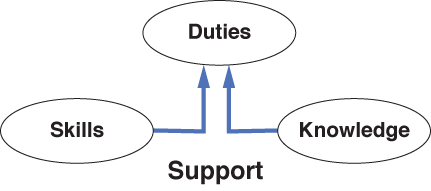
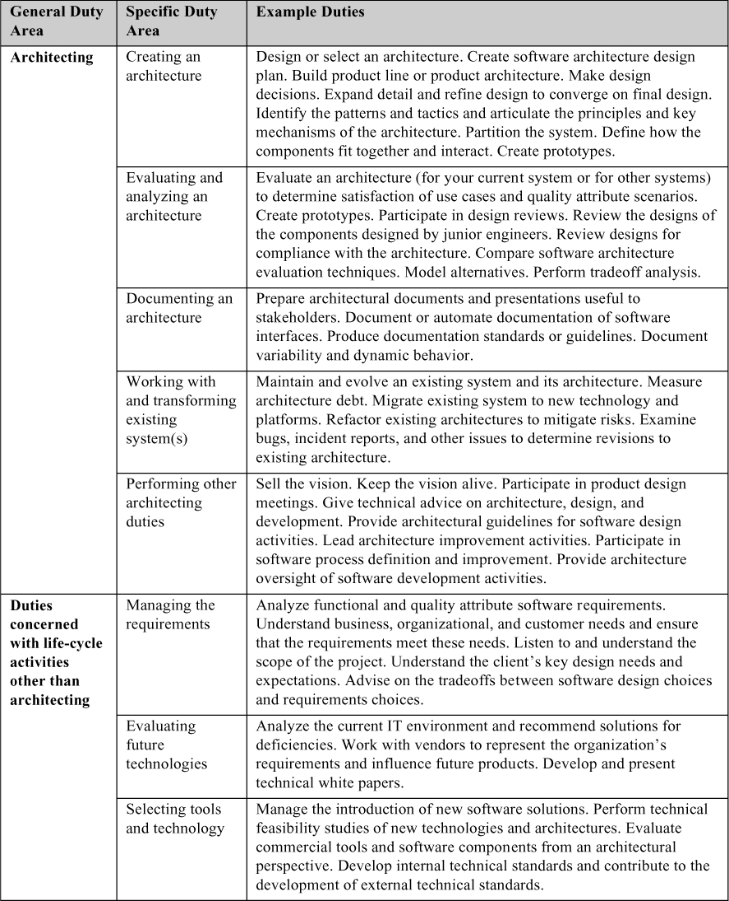
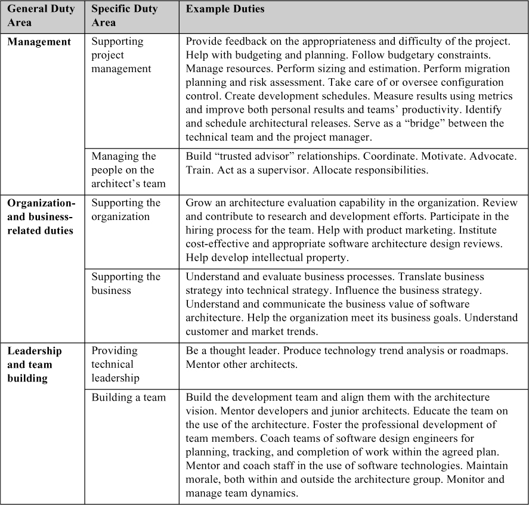
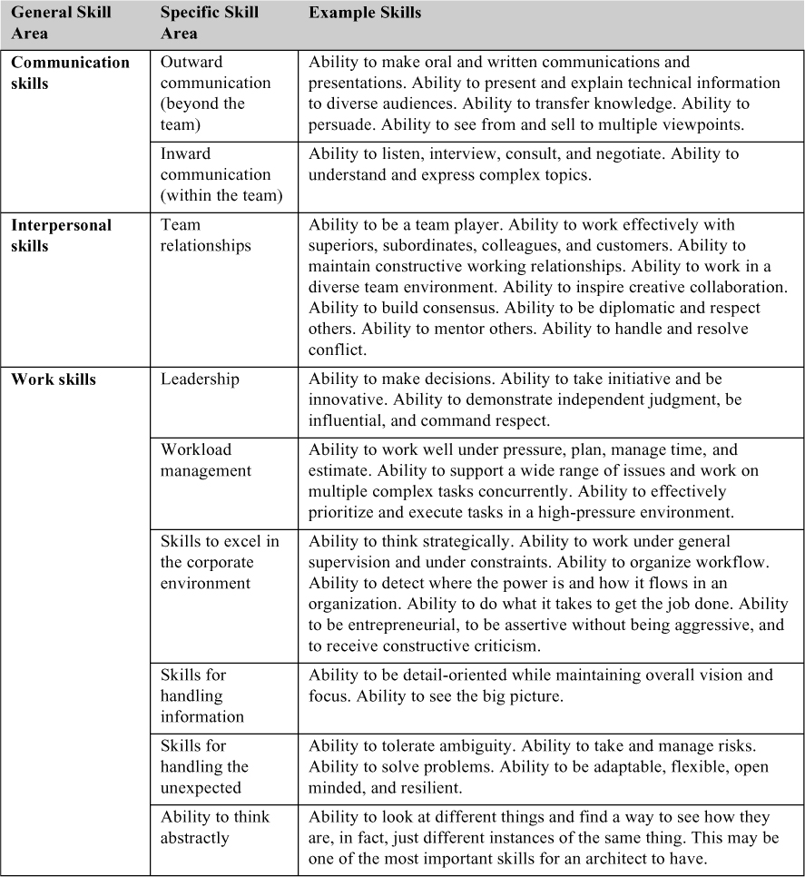
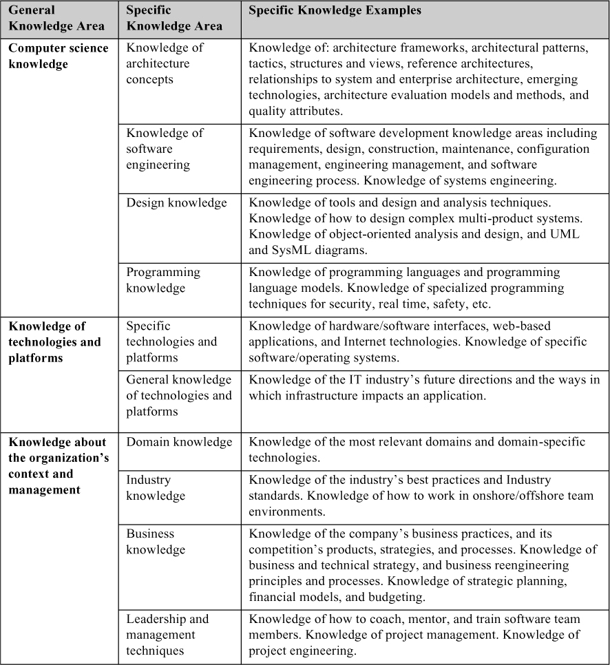

# 25. Năng lực architecture (Architecture Competence)

> Đời quá ngắn, mà nghề quá dài để học cho thành. 
> —Geoffrey Chaucer

Nếu software architecture đáng làm, thì chắc chắn nó đáng được làm tốt. Phần lớn tài liệu về architecture tập trung vào các khía cạnh kỹ thuật. Điều này không có gì đáng ngạc nhiên; đó là một ngành mang tính kỹ thuật sâu sắc. Nhưng architecture được tạo ra bởi các *kiến trúc sư* làm việc trong các *tổ chức* đầy những con người thực sự. Làm việc với những con người này là một công việc rõ ràng phi kỹ thuật. Có thể làm gì để giúp các kiến trúc sư, đặc biệt là các architects-in-training, làm tốt hơn ở khía cạnh quan trọng này trong công việc của họ? Và có thể làm gì để giúp các tổ chức làm tốt hơn trong việc khuyến khích các kiến trúc sư của mình làm ra những sản phẩm tốt nhất của họ?

Chương này nói về năng lực của từng kiến trúc sư, và của các tổ chức muốn tạo ra những architecture high-quality.

Vì năng lực architecture của một tổ chức phụ thuộc, một phần, vào năng lực của các kiến trúc sư, chúng tôi bắt đầu bằng việc hỏi các kiến trúc sư được kỳ vọng làm gì, biết gì và thành thạo điều gì. Sau đó chúng ta sẽ xem các tổ chức có thể và nên làm gì để giúp các kiến trúc sư của họ tạo ra architecture tốt hơn. Năng lực cá nhân và năng lực tổ chức đan xen vào nhau. Chỉ hiểu cái này hoặc cái kia là không đủ.

## 25.1 Năng lực của cá nhân: nhiệm vụ, kỹ năng và kiến thức của kiến trúc sư (Competence of Individuals: Duties, Skills, and Knowledge of Architects)

Kiến trúc sư thực hiện nhiều hoạt động ngoài việc trực tiếp tạo ra một architecture. Các hoạt động này, mà chúng tôi gọi là *nhiệm vụ* (duties), tạo thành xương sống cho năng lực architecture của một cá nhân. Những người viết về kiến trúc sư cũng nói đến *kỹ năng* (skills) và *kiến thức* (knowledge). Ví dụ, khả năng truyền đạt ý tưởng rõ ràng và đàm phán hiệu quả là những kỹ năng thường được gán cho các kiến trúc sư có năng lực. Ngoài ra, kiến trúc sư cần có kiến thức up-to-date về pattern, công nghệ, tiêu chuẩn, quality attribute và hàng loạt chủ đề khác.

Nhiệm vụ, kỹ năng và kiến thức tạo thành một bộ ba mà năng lực architecture của cá nhân dựa trên đó. Mối quan hệ giữa ba thứ này được thể hiện trong [Hình 25.1](#ch25fig01)—cụ thể là, kỹ năng và kiến thức hỗ trợ khả năng thực hiện các nhiệm vụ được yêu cầu. Những kiến trúc sư tài năng vô hạn cũng chẳng có ích gì nếu họ không thể (vì bất kỳ lý do gì) thực hiện các nhiệm vụ mà vị trí đòi hỏi; chúng tôi sẽ không nói rằng họ có năng lực.

**Hình 25.1** *Kỹ năng và kiến thức hỗ trợ việc thực hiện nhiệm vụ.*

Để đưa ra ví dụ về các khái niệm này:

- “Thiết kế architecture” là một nhiệm vụ.
- “Khả năng tư duy trừu tượng” là một kỹ năng.
- “Pattern và tactic” cấu thành kiến thức.

Các ví dụ này cố ý minh họa rằng kỹ năng và kiến thức là quan trọng (chỉ) để hỗ trợ khả năng thực hiện nhiệm vụ một cách hiệu quả. Một ví dụ khác, “tài liệu hóa architecture” là một nhiệm vụ, “khả năng viết rõ ràng” là một kỹ năng, và “ISO Standard 42010” là một phần của khối kiến thức liên quan. Tất nhiên, một kỹ năng hoặc lĩnh vực kiến thức có thể hỗ trợ nhiều hơn một nhiệm vụ.

Việc biết nhiệm vụ, kỹ năng và kiến thức của kiến trúc sư (hay, chính xác hơn, nhiệm vụ, kỹ năng và kiến thức cần có ở kiến trúc sư trong một môi trường tổ chức cụ thể) có thể giúp thiết lập các chiến lược đo lường và cải thiện cho từng kiến trúc sư. Nếu bạn muốn cải thiện năng lực architecture cá nhân của mình, bạn nên thực hiện các bước sau:

1. *Tích lũy kinh nghiệm thực hiện các nhiệm vụ*. Học việc là một con đường hiệu quả để có được kinh nghiệm. Chỉ học thôi là không đủ, vì học mà không có ứng dụng on-the-job chỉ đơn thuần nâng cao kiến thức.
2. *Cải thiện các kỹ năng phi kỹ thuật*. Khía cạnh cải thiện này bao gồm việc tham gia các khóa phát triển chuyên môn, ví dụ, về lãnh đạo hoặc quản lý thời gian. Một số người sẽ không bao giờ trở thành những nhà lãnh đạo hay người giao tiếp thực sự xuất sắc, nhưng tất cả chúng ta đều có thể cải thiện các kỹ năng này.
3. *Làm chủ khối kiến thức*. Một trong những điều quan trọng nhất mà một kiến trúc sư có năng lực phải làm là làm chủ khối kiến thức và luôn up-to-date về nó. Để nhấn mạnh tầm quan trọng của việc cập nhật với lĩnh vực, hãy xem xét những tiến bộ về kiến thức cần thiết cho kiến trúc sư đã xuất hiện chỉ trong vài năm gần đây. Ví dụ, các architecture hỗ trợ điện toán trên cloud ([Chương 17](ch17_the_cloud_and_distributed_computing.vi.md#ch17)) đã không quan trọng vài năm trước. Tham gia các khóa học, lấy chứng chỉ, đọc sách và tạp chí, truy cập các website, đọc blog, tham dự các hội nghị architecture-oriented, gia nhập các hội nghề nghiệp, và gặp gỡ các kiến trúc sư khác đều là những cách hữu ích để cải thiện kiến thức.

### Nhiệm vụ (Duties)

Mục này tóm tắt nhiều loại nhiệm vụ của kiến trúc sư. Không phải mọi kiến trúc sư trong mọi tổ chức đều thực hiện mọi nhiệm vụ này trong mọi dự án. Tuy nhiên, các kiến trúc sư có năng lực không nên ngạc nhiên khi thấy mình tham gia vào bất kỳ hoạt động nào được liệt kê ở đây. Chúng tôi chia các nhiệm vụ này thành nhiệm vụ kỹ thuật ([Bảng 25.1](#ch25tab01)) và nhiệm vụ phi kỹ thuật ([Bảng 25.2](#ch25tab02)). Một quan sát tức thì bạn nên rút ra là số lượng lớn các nhiệm vụ phi kỹ thuật. Một hệ quả hiển nhiên, đối với những ai trong các bạn muốn trở thành kiến trúc sư, là bạn phải chú ý thỏa đáng đến các khía cạnh phi kỹ thuật trong việc học tập và các hoạt động nghề nghiệp của mình.

**Bảng 25.1** *Các nhiệm vụ kỹ thuật của một kiến trúc sư phần mềm*

**Bảng 25.2** *Các nhiệm vụ phi kỹ thuật của một kiến trúc sư phần mềm*

Kiến trúc sư cũng thường xuyên thực hiện nhiều nhiệm vụ khác, như dẫn dắt code review hoặc tham gia lập kế hoạch kiểm thử. Trong nhiều dự án, kiến trúc sư xắn tay giúp đỡ việc hiện thực và kiểm thử thực tế, ở các vùng then chốt. Dù quan trọng, nói một cách chặt chẽ thì đây không phải là các nhiệm vụ architecture.

### Kỹ năng (Skills)

Với phạm vi rộng các nhiệm vụ được liệt kê trong mục trước, một kiến trúc sư cần có những kỹ năng nào? Đã có nhiều bài viết về vai trò lãnh đạo đặc biệt của kiến trúc sư trong một dự án; kiến trúc sư lý tưởng là một người giao tiếp, quản lý, xây dựng team, có tầm nhìn và cố vấn hiệu quả. Một số chương trình chứng chỉ hoặc chứng nhận nhấn mạnh các kỹ năng phi kỹ thuật. Điểm chung của các chương trình chứng nhận này là các lĩnh vực đánh giá về lãnh đạo, động lực tổ chức và giao tiếp.

[Bảng 25.3](#ch25tab03) liệt kê tập kỹ năng hữu ích nhất cho một kiến trúc sư.

**Bảng 25.3** *Các kỹ năng của một kiến trúc sư phần mềm*

### Kiến thức (Knowledge)

Một kiến trúc sư có năng lực có sự quen thuộc sâu sắc với một khối kiến thức architecture. [Bảng 25.4](#ch25tab04) đưa ra một tập các lĩnh vực kiến thức cho một kiến trúc sư.

**Bảng 25.4** *Các lĩnh vực kiến thức của một kiến trúc sư phần mềm*

### Còn kinh nghiệm thì sao? (What about Experience?)

Albert Einstein đã nói, “Nguồn kiến thức duy nhất là kinh nghiệm,” và hầu như ai cũng nói rằng kinh nghiệm là người thầy tốt nhất. Chúng tôi đồng ý. Tuy nhiên, kinh nghiệm không phải là người thầy *duy nhất*—bạn cũng có thể có được kiến thức từ những người thầy *thực sự*. Chúng ta thật may mắn biết bao khi không phải ai cũng cần tự làm mình bị bỏng mới biết được rằng chạm vào bếp nóng là một ý tưởng tồi.

Chúng tôi xem kinh nghiệm là thứ bổ sung vào kho kiến thức của một kiến trúc sư, đó là lý do chúng tôi không xử lý nó riêng. Khi sự nghiệp của bạn tiến triển, bạn sẽ tích lũy kho kinh nghiệm của riêng mình, thứ mà bạn sẽ lưu giữ như kiến thức.

Như câu chuyện cười cũ kể, một người đi bộ ở New York chặn một người qua đường và hỏi, “Xin lỗi. Anh có thể chỉ tôi cách đến Carnegie Hall không?” Người qua đường, tình cờ là một nhạc sĩ, đáp với một tiếng thở dài nặng nề, “Luyện tập, luyện tập, luyện tập.”

Chính xác.

## 25.2 Năng lực của một tổ chức software architecture (Competence of a Software Architecture Organization)

Các tổ chức, bằng các thực hành và cấu trúc của mình, có thể giúp đỡ hoặc cản trở kiến trúc sư trong việc thực hiện nhiệm vụ. Ví dụ, nếu một tổ chức có lộ trình nghề nghiệp cho kiến trúc sư, điều đó sẽ thúc đẩy nhân viên trở thành kiến trúc sư. Nếu một tổ chức có một hội đồng review architecture thường trực, thì kiến trúc sư của dự án sẽ biết cách lên lịch review và với ai. Việc thiếu các thực hành và cấu trúc này sẽ có nghĩa là kiến trúc sư phải đấu tranh với tổ chức hoặc tự xác định cách thực hiện một buổi review mà không có hướng dẫn nội bộ. Do đó, việc hỏi liệu một tổ chức cụ thể có năng lực về architecture hay không và phát triển các công cụ đo lường có mục tiêu đo năng lực architecture của một tổ chức là điều hợp lý. Năng lực architecture của các tổ chức là chủ đề của mục này. Đây là định nghĩa của chúng tôi:

> Năng lực architecture của một tổ chức là khả năng của tổ chức đó trong việc phát triển, sử dụng và duy trì các kỹ năng và kiến thức cần thiết để thực hiện hiệu quả các thực hành architecture-centric ở cấp cá nhân, team và tổ chức nhằm tạo ra các architecture với chi phí chấp nhận được, dẫn đến các hệ thống phù hợp với business goal của tổ chức.

Các tổ chức có nhiệm vụ, kỹ năng và kiến thức về architecture, giống như từng kiến trúc sư. Ví dụ, cấp vốn thỏa đáng cho nỗ lực architecture là một nhiệm vụ của tổ chức, cũng như việc sử dụng hiệu quả lực lượng lao động architecture sẵn có (bằng cách lập team phù hợp và các biện pháp khác). Đây là các nhiệm vụ của tổ chức vì chúng nằm ngoài tầm kiểm soát của từng kiến trúc sư. Một kỹ năng organization-level có thể là quản lý tri thức hiệu quả hoặc quản lý nguồn nhân lực khi áp dụng cho kiến trúc sư. Một ví dụ về kiến thức của tổ chức là việc xây dựng một mô hình life-cycle architecture-based mà các dự án phần mềm có thể áp dụng.

Dưới đây là một số việc—nhiệm vụ—mà một tổ chức có thể thực hiện để giúp cải thiện sự thành công của các nỗ lực architecture:

- *Personnel-related (Liên quan đến nhân sự)*:
- Tuyển các kiến trúc sư tài năng.
- Thiết lập một lộ trình nghề nghiệp cho kiến trúc sư.
- Làm cho vị trí kiến trúc sư được đánh giá cao thông qua sự hiện diện, phần thưởng và uy tín.
- Để kiến trúc sư tham gia các tổ chức nghề nghiệp.
- Thiết lập một chương trình chứng nhận kiến trúc sư.
- Thiết lập một chương trình mentoring cho kiến trúc sư.
- Thiết lập một chương trình đào tạo và giáo dục về architecture.
- Đo lường hiệu quả làm việc của kiến trúc sư.
- Để kiến trúc sư nhận các chứng nhận kiến trúc sư bên ngoài.
- Khen thưởng hoặc xử phạt kiến trúc sư dựa trên sự thành công hoặc thất bại của dự án.
- *Process-related (Liên quan đến quy trình)*:
- Thiết lập các thực hành architecture organization-wide.
- Thiết lập một tuyên bố rõ ràng về trách nhiệm và thẩm quyền của kiến trúc sư.
- Thiết lập một diễn đàn để kiến trúc sư giao tiếp và chia sẻ thông tin và kinh nghiệm.
- Thiết lập một hội đồng review architecture.
- Đưa các cột mốc architecture vào kế hoạch dự án.
- Để kiến trúc sư đóng góp ý kiến vào việc định nghĩa sản phẩm.
- Tổ chức một hội nghị architecture organization-wide.
- Đo lường và theo dõi chất lượng của các architecture được tạo ra.
- Mời các chuyên gia tư vấn bên ngoài về architecture.
- Để kiến trúc sư tư vấn về cấu trúc team phát triển.
- Trao cho kiến trúc sư ảnh hưởng xuyên suốt toàn bộ vòng đời dự án.
- *Technology-related (Liên quan đến công nghệ)*:
- Thiết lập và duy trì một kho các architecture tái sử dụng được và các artifact architecture-based.
- Tạo và duy trì một kho các design concept.
- Cung cấp một nguồn lực tập trung để phân tích và hỗ trợ về các công cụ architecture.

Nếu bạn đang phỏng vấn cho vị trí kiến trúc sư trong một tổ chức, có lẽ bạn sẽ có một danh sách câu hỏi để xác định xem bạn có muốn làm việc ở đó không. Vào danh sách đó, bạn có thể thêm các câu hỏi được rút ra từ danh sách trên để giúp bạn xác định mức năng lực architecture của tổ chức.

## 25.3 Trở thành một kiến trúc sư giỏi hơn (Become a Better Architect)

Làm thế nào để kiến trúc sư trở thành kiến trúc sư giỏi, và làm thế nào để kiến trúc sư giỏi trở thành kiến trúc sư xuất sắc? Chúng tôi khép lại chương này bằng một đề xuất, đó là: Hãy được mentor, và hãy mentor người khác.

### Hãy được mentor (Be Mentored)

Dù kinh nghiệm có thể là người thầy tốt nhất, hầu hết chúng ta sẽ không có điều kiện xa xỉ, trong một đời người, để tự mình tích lũy tất cả kinh nghiệm cần thiết để trở thành kiến trúc sư xuất sắc. Nhưng chúng ta có thể có được kinh nghiệm gián tiếp. Hãy tìm một kiến trúc sư giỏi mà bạn tôn trọng, và gắn bó với người đó. Hãy tìm hiểu xem tổ chức của bạn có chương trình mentoring nào mà bạn có thể tham gia không. Hoặc thiết lập một mối quan hệ mentoring không chính thức—tìm lý do để tương tác, đặt câu hỏi, hoặc đề nghị giúp đỡ (chẳng hạn, đề nghị làm người review).

Mentor của bạn không nhất thiết phải là đồng nghiệp. Bạn cũng có thể tham gia các hội nghề nghiệp nơi bạn có thể thiết lập quan hệ mentor với các thành viên khác. Có các buổi meetup. Có các mạng xã hội nghề nghiệp. Đừng giới hạn bản thân chỉ trong tổ chức của mình.

### Hãy mentor người khác (Mentor Others)

Bạn cũng nên sẵn lòng mentor người khác như một cách đền đáp hoặc tiếp nối những điều tử tế đã làm phong phú sự nghiệp của bạn. Nhưng cũng có một lý do ích kỷ để mentor: Chúng tôi nhận thấy rằng việc giảng dạy một khái niệm là phép thử quyết định xem chúng ta có hiểu sâu khái niệm đó hay không. Nếu chúng ta không thể dạy nó, nhiều khả năng chúng ta không thực sự hiểu nó—vì vậy đó có thể là một phần mục tiêu của bạn khi giảng dạy và mentor người khác trong nghề. Những giáo viên giỏi hầu như luôn kể về niềm vui khi họ học được nhiều đến thế từ học trò, và những câu hỏi thăm dò cùng những hiểu biết bất ngờ của học trò đã bổ sung nhiều đến thế nào cho sự hiểu biết sâu hơn của giáo viên về chủ đề.

## 25.4 Tóm tắt (Summary)

Khi nghĩ về kiến trúc sư phần mềm, chúng ta thường nghĩ đầu tiên về công việc kỹ thuật mà họ tạo ra. Nhưng, cũng giống như một architecture không chỉ là một “bản thiết kế” kỹ thuật cho một hệ thống, một kiến trúc sư không chỉ là người thiết kế một architecture. Điều này đã dẫn chúng tôi đến việc cố gắng hiểu, theo một cách tổng thể hơn, một kiến trúc sư và một tổ chức architecture-centric phải làm gì để thành công. Một kiến trúc sư phải thực hiện các nhiệm vụ, mài giũa các kỹ năng, và liên tục tiếp thu kiến thức cần thiết để thành công.

Chìa khóa để trở thành một kiến trúc sư giỏi, rồi giỏi hơn nữa, là học tập liên tục, mentor người khác, và được mentor.

## 25.5 Đọc thêm (For Further Reading)

Các câu hỏi để thăm dò năng lực của một tổ chức có thể được tìm thấy trong Technical Note “Models for Evaluating and Improving Architecture Competence,” [sei.cmu.edu/library/abstracts/reports/08tr006.cfm](http://sei.cmu.edu/library/abstracts/reports/08tr006.cfm).

The Open Group có một chương trình chứng nhận để đánh giá kỹ năng, kiến thức và kinh nghiệm của các kiến trúc sư IT, business và enterprise, điều liên quan đến việc đo lường và chứng nhận năng lực của từng kiến trúc sư.

Information Technology Architecture Body of Knowledge (ITABoK) là một “kho lưu trữ công khai miễn phí về các best practice, kỹ năng và kiến thức về IT architecture, được phát triển từ kinh nghiệm của các thành viên cá nhân và doanh nghiệp của Iasa, tổ chức nghề nghiệp về IT architecture lớn nhất thế giới” ([https://itabok.iasaglobal.org/itabok/](https://itabok.iasaglobal.org/itabok/)).

Bredemeyer Consulting ([bredemeyer.com](http://bredemeyer.com/)) cung cấp rất nhiều tài liệu về các kiến trúc sư IT, phần mềm và enterprise cùng vai trò của họ.

Joseph Ingeno, trong *Software Architect’s Handbook*, dành một chương cho “The Soft Skills of Software Architects” và một chương khác cho “Becoming a Better Software Architect” [Ingeno 18]

## 25.6 Câu hỏi thảo luận (Discussion Questions)

1. Trong các kỹ năng và kiến thức được thảo luận trong chương này, bạn nghĩ mình có thể thiếu sót nhất ở đâu? Bạn sẽ khắc phục những thiếu sót này như thế nào?
2. Bạn nghĩ nhiệm vụ, kỹ năng hoặc kiến thức nào là quan trọng nhất hoặc cost-effective nhất để cải thiện ở một kiến trúc sư? Hãy biện minh cho câu trả lời của bạn.
3. Hãy bổ sung ba nhiệm vụ, ba kỹ năng và ba lĩnh vực kiến thức không có trong các danh sách của chúng tôi.
4. Bạn sẽ đo lường giá trị của các nhiệm vụ architecture cụ thể trong một dự án như thế nào? Bạn sẽ phân biệt giá trị được tạo thêm bởi các nhiệm vụ này với giá trị được tạo thêm bởi các hoạt động khác như quality assurance hoặc configuration management như thế nào?
5. Bạn sẽ đo lường kỹ năng giao tiếp của một người như thế nào?
6. Chương này đã liệt kê một số thực hành của một tổ chức có năng lực về architecture. Hãy sắp xếp mức ưu tiên cho danh sách đó dựa trên lợi ích kỳ vọng so với chi phí kỳ vọng.
7. Giả sử bạn phụ trách tuyển một kiến trúc sư cho một hệ thống quan trọng trong công ty của bạn. Bạn sẽ tiến hành như thế nào? Bạn sẽ hỏi các ứng viên điều gì trong buổi phỏng vấn? Bạn có yêu cầu họ tạo ra thứ gì không? Nếu có, đó là gì? Bạn có cho họ làm một bài kiểm tra nào đó không? Nếu có, đó là gì? Bạn sẽ để ai trong công ty phỏng vấn họ? Vì sao?
8. Giả sử bạn là kiến trúc sư đang được tuyển. Bạn sẽ hỏi những câu hỏi nào về công ty mà bạn đang phỏng vấn, liên quan đến các lĩnh vực được liệt kê trong [Mục 25.2](#sec25_2)? Hãy thử trả lời câu hỏi này từ góc nhìn của một kiến trúc sư mới vào nghề, rồi từ góc nhìn của một kiến trúc sư có kỹ năng cao với nhiều năm kinh nghiệm.
9. Hãy tìm kiếm các chương trình chứng nhận cho kiến trúc sư. Với mỗi chương trình, hãy thử mô tả mức độ nó đề cập (lần lượt) đến nhiệm vụ, kỹ năng và kiến thức.
