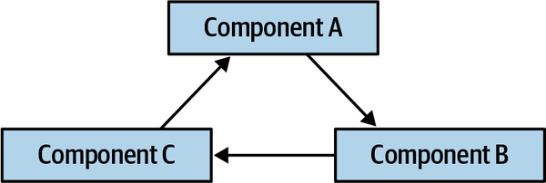
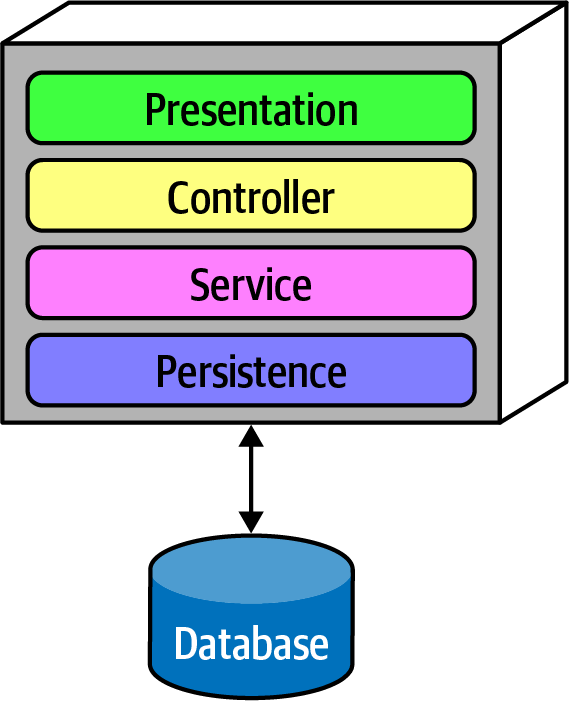
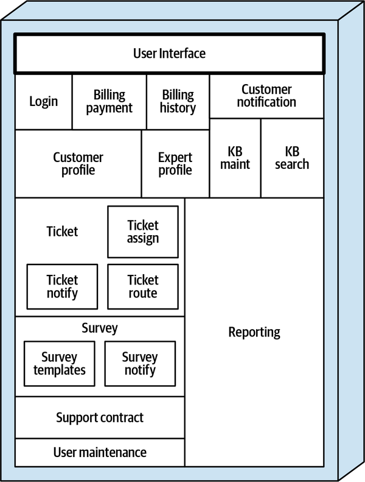
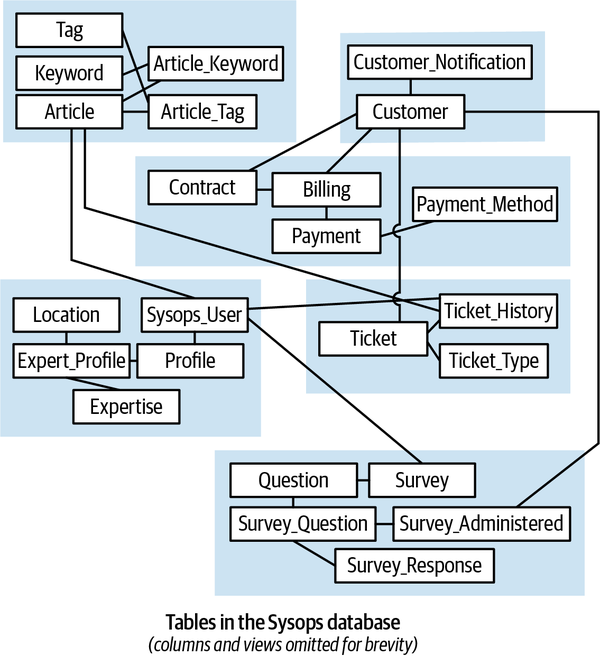

<a id="ch01-introduction"></a>

# Chương 1. Điều gì xảy ra khi không có “best practice”? (What Happens When There Are No “Best Practices”?)

Vì sao một người làm công nghệ như kiến trúc sư phần mềm lại thuyết trình ở hội nghị hay viết sách? Vì họ đã khám phá ra cái thường được gọi nôm na là một “best practice,” <a id="idm45798382831384"></a>một thuật ngữ bị lạm dụng đến mức những ai dùng nó ngày càng gặp phản ứng ngược. Bất kể thuật ngữ nào, những người làm công nghệ viết sách khi họ đã tìm ra một giải pháp mới cho một vấn đề chung và muốn phổ biến nó tới đông đảo người đọc hơn.

Nhưng còn tập vấn đề khổng lồ không có giải pháp tốt thì sao? Có cả những lớp vấn đề trong software architecture không có giải pháp tốt chung nào, mà chỉ đặt một tập trade-offs lộn xộn đối chọi với một tập (gần như) lộn xộn tương đương.

Các developer phần mềm xây dựng được kỹ năng xuất sắc trong việc tìm kiếm trực tuyến giải pháp cho một vấn đề hiện tại. Ví dụ, nếu họ cần tìm cách cấu hình một công cụ cụ thể trong môi trường của mình, việc dùng Google thành thạo sẽ tìm ra câu trả lời.

Nhưng điều đó không đúng với kiến trúc sư.

Với kiến trúc sư, nhiều vấn đề đặt ra những thách thức độc đáo vì chúng gắn chặt với môi trường và hoàn cảnh chính xác của tổ chức bạn—khả năng ai đó đã gặp chính xác kịch bản này *và* viết blog về nó hoặc đăng nó lên Stack Overflow là bao nhiêu?

Kiến trúc sư có lẽ đã tự hỏi vì sao có quá ít sách về architecture so với các chủ đề kỹ thuật như framework, API, v.v. Kiến trúc sư hiếm khi gặp những vấn đề phổ biến mà liên tục vật lộn với việc ra quyết định trong những tình huống mới. Với kiến trúc sư, mỗi vấn đề là một bông tuyết. Trong nhiều trường hợp, vấn đề là mới không chỉ trong một tổ chức cụ thể mà trên toàn thế giới. Không có sách hay phiên hội nghị nào dành cho những vấn đề đó!

Kiến trúc sư không nên liên tục tìm kiếm những giải pháp silver-bullet (viên đạn bạc) cho vấn đề của mình; chúng hiếm hoi bây giờ cũng như năm 1986, khi Fred Brooks đặt ra thuật ngữ này:<a id="idm45798383028216"></a><a id="idm45798383027512"></a>

> Không có một bước phát triển đơn lẻ nào, dù về công nghệ hay kỹ thuật quản lý, mà tự nó hứa hẹn cải thiện dù chỉ một bậc độ lớn [gấp mười lần] trong vòng một thập kỷ về năng suất, về độ tin cậy, về sự đơn giản.
>
> —Fred Brooks, trong “No Silver Bullet”

Vì hầu như mọi vấn đề đều đặt ra những thách thức mới, công việc thực sự của một kiến trúc sư nằm ở khả năng xác định và đánh giá một cách khách quan tập trade-offs ở hai phía của một quyết định quan trọng để giải quyết nó tốt nhất có thể. Các tác giả không nói về “giải pháp tốt nhất” (trong cuốn sách này hay trong thế giới thực) vì “tốt nhất” hàm ý rằng kiến trúc sư đã tối đa hóa được tất cả các yếu tố cạnh tranh khả dĩ trong thiết kế. Thay vào đó, lời khuyên tongue-in-cheek (nửa đùa nửa thật) của chúng tôi như sau:<a id="idm45798382940040"></a>

> **Mẹo**
>
> Đừng cố tìm thiết kế *tốt nhất* trong software architecture; thay vào đó, hãy phấn đấu cho tổ hợp trade-offs *ít tệ nhất*.

Thường thì thiết kế tốt nhất mà một kiến trúc sư có thể tạo ra là tập trade-offs ít tệ nhất—không architecture characteristic đơn lẻ nào đạt mức xuất sắc như khi nó đứng một mình, nhưng sự cân bằng của tất cả các architecture characteristic cạnh tranh nhau thúc đẩy sự thành công của dự án.

Điều này đặt ra câu hỏi: “Làm sao một kiến trúc sư *tìm ra* tổ hợp trade-offs ít tệ nhất (và ghi tài liệu chúng hiệu quả)?” Cuốn sách này chủ yếu là về việc ra quyết định, giúp kiến trúc sư đưa ra quyết định tốt hơn khi đối mặt với những tình huống mới.

<a id="idm45798382934216"></a>

## Vì sao gọi là “The Hard Parts”? (Why “The Hard Parts”?)

Vì sao chúng tôi đặt tên cuốn sách này là *Software Architecture: The Hard Parts?* Thực ra,<a id="idm45798382932328"></a> chữ “hard” trong tựa đề có hai nghĩa. Thứ nhất, *hard* gợi nghĩa *khó*, và kiến trúc sư liên tục đối mặt với những vấn đề khó mà theo nghĩa đen (và nghĩa bóng) chưa ai từng gặp, liên quan đến nhiều quyết định công nghệ có hệ quả long-term, chồng lên trên môi trường quan hệ con người và chính trị nơi quyết định phải được đưa ra.

Thứ hai, *hard* gợi nghĩa *vững chắc*—giống như trong sự phân tách giữa *hardware* và *software*, thứ *cứng* nên ít thay đổi hơn nhiều vì nó cung cấp nền móng cho thứ *mềm*. Tương tự, kiến trúc sư bàn về sự phân biệt giữa *architecture* và *thiết kế*, trong đó cái trước mang tính cấu trúc còn cái sau dễ thay đổi hơn. Do đó, trong cuốn sách này, chúng tôi nói về những phần nền tảng của architecture.

Bản thân định nghĩa của software architecture đã tạo ra nhiều giờ trò chuyện non-productive (không đi đến đâu) giữa những người hành nghề. <a id="idm45798383108872"></a>Một định nghĩa tongue-in-cheek (nửa đùa nửa thật) được ưa thích là “software architecture là những *thứ* khó thay đổi về sau.” Những *thứ* đó chính là nội dung cuốn sách của chúng tôi.

<a id="idm45798383106328"></a>

## Đưa ra lời khuyên vượt thời gian về software architecture (Giving Timeless Advice About Software Architecture)

Hệ sinh thái phát triển phần mềm liên tục và hỗn loạn dịch chuyển và phát triển.<a id="idm45798383104792"></a> Những chủ đề từng là cơn sốt vài năm trước hoặc đã bị hệ sinh thái hấp thụ và biến mất, hoặc bị thay thế bởi thứ gì đó khác/tốt hơn. <a id="idm45798383103528"></a><a id="idm45798382920232"></a>Ví dụ, 10 năm trước, architecture style thống trị cho các doanh nghiệp lớn là orchestration-driven, service-oriented architecture. Giờ đây, hầu như không ai còn xây dựng theo architecture style đó nữa (vì những lý do chúng tôi sẽ làm rõ trên đường đi); style được ưa chuộng hiện nay cho nhiều hệ thống phân tán là microservices. Sự chuyển đổi đó đã diễn ra như thế nào và tại sao?

Khi kiến trúc sư nhìn vào một style cụ thể (đặc biệt là một style mang tính lịch sử), họ phải xem xét những ràng buộc đã tồn tại dẫn đến việc architecture đó trở nên thống trị. Vào thời điểm đó, nhiều công ty đang sáp nhập để trở thành *doanh nghiệp lớn* (enterprise), với đủ mọi khó khăn tích hợp đi kèm quá trình chuyển đổi đó. Ngoài ra, open source không phải là một lựa chọn khả thi (thường vì lý do chính trị hơn là kỹ thuật) đối với các công ty lớn. Do đó, kiến trúc sư nhấn mạnh tài nguyên dùng chung và orchestration tập trung như một giải pháp.

Tuy nhiên, trong những năm sau đó, open source và Linux trở thành những lựa chọn thay thế khả thi, khiến hệ điều hành miễn phí về mặt *thương mại*. Tuy nhiên, điểm bùng phát thực sự xảy ra khi Linux trở nên miễn phí về mặt *vận hành* với sự ra đời của các công cụ như Puppet và Chef, cho phép các development team khởi tạo môi trường của mình theo chương trình như một phần của build tự động. Khi năng lực đó xuất hiện, nó thúc đẩy một cuộc cách mạng kiến trúc với microservices và hạ tầng đang nổi lên nhanh chóng gồm container và các công cụ orchestration như Kubernetes.

Điều này minh họa rằng hệ sinh thái phát triển phần mềm mở rộng và tiến hóa theo những cách hoàn toàn bất ngờ. Một năng lực mới dẫn đến một năng lực khác, rồi bất ngờ tạo ra những năng lực mới. Theo thời gian, hệ sinh thái hoàn toàn thay thế chính nó, từng mảnh một.

Điều này đặt ra một vấn đề age-old (lâu đời) cho tác giả của những cuốn sách về công nghệ nói chung và software architecture nói riêng—làm sao chúng ta viết được một thứ không lỗi thời ngay lập tức?

Chúng tôi không tập trung vào công nghệ hay các chi tiết triển khai khác trong cuốn sách này. Thay vào đó, chúng tôi tập trung vào *cách* kiến trúc sư đưa ra quyết định, và cách cân nhắc trade-offs một cách khách quan khi đối mặt với những tình huống mới. Chúng tôi dùng các kịch bản và ví dụ đương thời để cung cấp chi tiết và bối cảnh, nhưng các nguyên lý nền tảng tập trung vào phân tích trade-off và việc ra quyết định khi đối mặt với những vấn đề mới.

<a id="sec-data-in-arch"></a>

## Tầm quan trọng của dữ liệu trong architecture (The Importance of Data in Architecture)

> Dữ liệu là một thứ quý giá và sẽ tồn tại lâu hơn chính các hệ thống.
>
> —Tim Berners-Lee

Với nhiều người trong ngành architecture, dữ liệu là tất cả. Mọi doanh nghiệp <a id="idm45798382908696"></a><a id="idm45798382717928"></a><a id="idm45798382716712"></a><a id="idm45798382715768"></a><a id="idm45798382714808"></a>xây dựng bất kỳ hệ thống nào đều phải xử lý dữ liệu, vì nó có xu hướng tồn tại lâu hơn nhiều so với hệ thống hay architecture, đòi hỏi suy nghĩ và thiết kế cẩn trọng. Tuy nhiên, nhiều bản năng của kiến trúc sư dữ liệu là xây dựng các hệ thống coupling chặt lại tạo ra xung đột trong các architecture phân tán hiện đại. Ví dụ, kiến trúc sư và DBA phải bảo đảm dữ liệu nghiệp vụ tồn tại qua việc tách các hệ thống monolith và doanh nghiệp vẫn có thể khai thác giá trị từ dữ liệu của mình bất kể những biến động của architecture.

Người ta nói rằng *dữ liệu là tài sản quan trọng nhất của một công ty*. Các doanh nghiệp muốn khai thác giá trị từ dữ liệu họ có và đang tìm những cách mới để dùng dữ liệu trong việc ra quyết định. Mọi bộ phận của doanh nghiệp giờ đều dựa trên dữ liệu, từ phục vụ khách hàng hiện có, thu hút khách hàng mới, tăng tỉ lệ giữ chân khách hàng, cải thiện sản phẩm, dự đoán doanh số, và các xu hướng khác. Sự phụ thuộc vào dữ liệu này có nghĩa là mọi software architecture đều phục vụ dữ liệu, bảo đảm dữ liệu đúng có sẵn và dùng được cho mọi bộ phận của doanh nghiệp.

Các tác giả đã xây dựng nhiều hệ thống phân tán từ vài thập kỷ trước khi chúng mới trở nên phổ biến, nhưng việc ra quyết định trong microservices hiện đại có vẻ khó khăn hơn, và chúng tôi muốn tìm hiểu vì sao. Cuối cùng chúng tôi nhận ra rằng, vào thời kỳ đầu của architecture phân tán, chúng tôi phần lớn vẫn lưu dữ liệu trong một relational database duy nhất. <a id="idm45798382710632"></a><a id="idm45798382709656"></a><a id="idm45798382709016"></a>Tuy nhiên, trong microservices và sự tuân thủ triết lý về *bounded context* từ [Domain-Driven Design](https://oreil.ly/bW8CH), như một cách giới hạn phạm vi coupling chi tiết triển khai, dữ liệu đã chuyển thành một mối quan tâm kiến trúc, cùng với tính transaction. Nhiều phần khó của architecture hiện đại bắt nguồn từ căng thẳng giữa các mối quan tâm dữ liệu và kiến trúc, điều chúng tôi gỡ rối trong cả [Phần I](part1_pulling_things_apart.vi.md#part1-pulling-things-apart) lẫn [Phần II](part2_putting_things_back_together.vi.md#part2-putting-things-back-together).

Một sự phân biệt quan trọng mà chúng tôi đề cập trong nhiều chương là sự tách biệt giữa dữ liệu *vận hành* (operational) và dữ liệu *phân tích* (analytical):<a id="idm45798382703576"></a><a id="idm45798382702600"></a><a id="idm45798382697400"></a>

**Dữ liệu vận hành (Operational data)**

Dữ liệu dùng cho hoạt động của doanh nghiệp,<a id="idm45798382694920"></a> bao gồm doanh số, dữ liệu transaction, tồn kho, v.v. Đây là dữ liệu mà công ty vận hành dựa trên—nếu có gì đó làm gián đoạn dữ liệu này, tổ chức không thể hoạt động lâu. <a id="idm45798382693928"></a>Loại dữ liệu này được định nghĩa là *Online Transactional Processing* (OLTP), thường bao gồm việc chèn, cập nhật và xóa dữ liệu trong một database.

**Dữ liệu phân tích (Analytical data)**

Dữ liệu được các nhà khoa học dữ liệu và các nhà phân tích nghiệp vụ khác dùng <a id="idm45798382690520"></a><a id="idm45798382689544"></a>cho dự đoán, phân tích xu hướng, và business intelligence khác. Dữ liệu này thường không mang tính transaction và thường không quan hệ—nó có thể nằm trong graph database hoặc là các snapshot ở định dạng khác với dạng transaction ban đầu. Dữ liệu này không then chốt cho vận hành day-to-day mà cho định hướng và quyết định chiến lược long-term.

Chúng tôi đề cập tác động của cả dữ liệu vận hành lẫn dữ liệu phân tích xuyên suốt cuốn sách.

<a id="sec-adr"></a>

## Architectural Decision Record (Architectural Decision Records)

Một trong những cách hiệu quả nhất để ghi tài liệu các architecture decision<a id="idm45798382685192"></a><a id="idm45798382684520"></a><a id="idm45798382683848"></a> là thông qua *Architectural Decision Record* ([ADR](https://adr.github.io)). ADR lần đầu được Michael Nygard truyền bá trong một [bài blog](https://oreil.ly/yDcU2) và sau đó được đánh dấu là “adopt” trong [Thoughtworks Technology Radar](https://oreil.ly/0nwHw). Một ADR gồm một file văn bản ngắn (thường dài một đến hai trang) mô tả một architecture decision cụ thể. Dù ADR có thể được viết bằng văn bản thuần, chúng thường được viết bằng một loại định dạng tài liệu văn bản như [AsciiDoc](http://asciidoc.org) hoặc [Markdown](https://www.markdownguide.org). Ngoài ra, ADR cũng có thể được viết bằng một template trang wiki. Chúng tôi đã dành cả một chương cho ADR trong cuốn sách trước, [*Fundamentals of Software Architecture*](https://learning.oreilly.com/library/view/fundamentals-of-software/9781492043447) (O’Reilly).

Chúng tôi sẽ tận dụng ADR như một cách ghi tài liệu các architecture decision khác nhau được đưa ra xuyên suốt cuốn sách. Với mỗi architecture decision, chúng tôi sẽ dùng định dạng ADR sau với giả định rằng mỗi ADR đều đã được phê duyệt:

> <a id="adr_1"></a>
>
> *ADR: Một cụm danh từ ngắn chứa architecture decision*
>
> *Bối cảnh (Context)*<br>
> Trong phần này của ADR, chúng tôi sẽ thêm một mô tả ngắn một hoặc two-sentence (hai câu) về vấn đề, và liệt kê các giải pháp thay thế.<br>
>
>
> *Quyết định (Decision)*<br>
> Trong phần này, chúng tôi sẽ nêu architecture decision và đưa ra lý do biện minh chi tiết cho quyết định.<br>
>
>
> *Hệ quả (Consequences)*<br>
> Trong phần này của ADR, chúng tôi sẽ mô tả mọi hệ quả sau khi quyết định được áp dụng, và cũng thảo luận các trade-offs đã được cân nhắc.

Danh sách tất cả các Architectural Decision Record được tạo ra trong cuốn sách này có thể được tìm thấy trong [Phụ lục B](ch17_appendix_architecture_decision_record_references.vi.md#sec-adr-list).

Ghi tài liệu một quyết định là quan trọng đối với kiến trúc sư, nhưng quản trị việc dùng quyết định đó<a id="idm45798383014888"></a> đúng cách là một chủ đề riêng. May mắn là các thực hành kỹ thuật hiện đại cho phép tự động hóa nhiều mối quan tâm governance phổ biến bằng cách dùng architecture fitness function.

<a id="idm45798383012712"></a>

## Architecture fitness function (Architecture Fitness Functions)

Khi một kiến trúc sư đã xác định mối quan hệ giữa các component và hệ thống hóa điều đó thành một thiết kế, <a id="idm45798383011032"></a><a id="idm45798383010056"></a>làm sao họ có thể bảo đảm rằng những người triển khai sẽ tuân thủ thiết kế đó? Rộng hơn, làm sao kiến trúc sư có thể bảo đảm rằng các nguyên lý thiết kế họ định nghĩa trở thành hiện thực nếu họ không phải là người triển khai chúng?

Những câu hỏi này thuộc về chủ đề *architecture governance* (quản trị kiến trúc), áp dụng cho bất kỳ sự giám sát có tổ chức nào đối với một hoặc nhiều khía cạnh của phát triển phần mềm. Vì cuốn sách này chủ yếu đề cập cấu trúc architecture, chúng tôi đề cập cách tự động hóa các nguyên lý thiết kế và chất lượng thông qua fitness function ở nhiều nơi.

Phát triển phần mềm đã dần tiến hóa theo thời gian để thích ứng với những thực hành kỹ thuật độc đáo. <a id="idm45798383007448"></a>Trong những ngày đầu của phát triển phần mềm, một phép ẩn dụ sản xuất thường được áp dụng cho các thực hành phần mềm, cả ở quy mô lớn (như quy trình phát triển Waterfall) lẫn quy mô nhỏ (các thực hành tích hợp trong dự án). Vào đầu thập niên 1990s, một sự suy nghĩ lại về các thực hành kỹ thuật phát triển phần mềm, <a id="idm45798383006024"></a><a id="idm45798383005352"></a>do Kent Beck và các kỹ sư khác trong dự án C3 dẫn dắt, gọi là eXtreme Programming (XP), đã minh họa tầm quan trọng của phản hồi từng bước và tự động hóa như những động lực then chốt cho năng suất phát triển phần mềm. Vào đầu thập niên 2000s, cùng những bài học đó được áp dụng cho giao điểm giữa phát triển phần mềm và vận hành, sinh ra vai trò mới DevOps và tự động hóa nhiều công việc vận hành trước đây làm thủ công. Cũng như trước, tự động hóa cho phép các team đi nhanh hơn vì họ không phải lo lắng về việc mọi thứ bị hỏng mà không có phản hồi tốt. Do đó, *tự động hóa* và *phản hồi* đã trở thành những nguyên lý trung tâm cho phát triển phần mềm hiệu quả.

Hãy xét những môi trường và tình huống dẫn đến những đột phá trong tự động hóa. Trong thời kỳ trước continuous integration, hầu hết các dự án phần mềm đều có một giai đoạn tích hợp dài. Mỗi developer được kỳ vọng làm việc ở một mức cô lập nào đó với những người khác, rồi tích hợp toàn bộ code vào cuối trong một giai đoạn tích hợp. Dấu vết của thực hành này vẫn còn tồn tại trong các công cụ version control buộc phải phân nhánh và ngăn cản continuous integration. Không ngạc nhiên khi có một tương quan mạnh giữa kích thước dự án và nỗi đau của giai đoạn tích hợp. Bằng cách tiên phong continuous integration, team XP đã minh họa giá trị của phản hồi nhanh, liên tục.

Cuộc cách mạng DevOps theo một con đường tương tự. Khi Linux và phần mềm open source khác trở nên “đủ tốt” cho doanh nghiệp, kết hợp với sự ra đời của các công cụ cho phép định nghĩa theo chương trình (cuối cùng là) các máy ảo, nhân sự vận hành nhận ra họ có thể tự động hóa việc định nghĩa máy và nhiều tác vụ lặp lại khác.

Trong cả hai trường hợp, những tiến bộ về công nghệ và hiểu biết đã dẫn đến việc tự động hóa một công việc lặp lại vốn được xử lý bởi một vai trò tốn kém—điều mô tả trạng thái hiện tại của architecture governance ở hầu hết các tổ chức. Ví dụ, nếu một kiến trúc sư chọn một architecture style hoặc phương tiện giao tiếp cụ thể, làm sao họ có thể bảo đảm một developer triển khai nó đúng? Khi làm thủ công, kiến trúc sư thực hiện code review hoặc có lẽ tổ chức các architecture review board để đánh giá trạng thái governance. Tuy nhiên, giống như việc cấu hình máy tính thủ công trong vận hành, những chi tiết quan trọng có thể dễ dàng lọt qua các buổi review hời hợt.

<a id="idm45798383055080"></a>

### Dùng fitness function (Using Fitness Functions)

Trong cuốn sách năm 2017 *Building Evolutionary Architectures* (O’Reilly), các tác giả (Neal Ford, Rebecca Parsons và Patrick Kua) <a id="idm45798383052712"></a><a id="idm45798383051224"></a><a id="ch01ff"></a>đã định nghĩa khái niệm *architectural fitness function*: bất kỳ cơ chế nào thực hiện một đánh giá khách quan về tính toàn vẹn của một architecture characteristic hoặc tổ hợp các architecture characteristic nào đó. Đây là phân tích point-by-point (từng điểm) định nghĩa đó:

**Bất kỳ cơ chế nào (Any mechanism)**

Kiến trúc sư có thể dùng nhiều loại công cụ khác nhau để triển khai fitness function; chúng tôi sẽ đưa ra nhiều ví dụ xuyên suốt cuốn sách. Ví dụ, có những thư viện testing chuyên dụng để test cấu trúc architecture, kiến trúc sư có thể dùng monitor để test các architecture characteristic vận hành như performance hoặc scalability, và các framework chaos engineering test reliability và resiliency.

**Đánh giá khách quan về tính toàn vẹn (Objective integrity assessment)**

Một động lực then chốt cho governance tự động nằm ở các định nghĩa khách quan cho architecture characteristic. Ví dụ, kiến trúc sư không thể chỉ định rằng họ muốn một website “performance cao”; họ phải đưa ra một giá trị khách quan có thể được đo bởi một test, monitor, hoặc fitness function khác.

Kiến trúc sư phải cảnh giác với *các architecture characteristic tổng hợp* (composite architecture characteristics)—những characteristic<a id="idm45798383042296"></a><a id="idm45798383041528"></a> không đo lường được một cách khách quan mà thực ra là tổng hợp của những thứ đo lường được khác. Ví dụ, “agility” không đo lường được, nhưng nếu kiến trúc sư bắt đầu tách thuật ngữ rộng *agility* ra, mục tiêu là để các team có thể phản ứng nhanh và tự tin với thay đổi, dù trong hệ sinh thái hay domain. Do đó, kiến trúc sư có thể tìm ra các characteristic đo lường được đóng góp vào agility: deployability, testability, cycle time, v.v. Thường thì việc không đo được một architecture characteristic cho thấy định nghĩa quá mơ hồ. Nếu kiến trúc sư hướng tới các thuộc tính đo lường được, điều đó cho phép họ tự động hóa việc áp dụng fitness function.

**Một architecture characteristic hoặc tổ hợp các architecture characteristic nào đó (Some architecture characteristic or combination of architecture characteristics)**

Characteristic này mô tả hai phạm vi của fitness function:

**Nguyên tử (Atomic)**

Những fitness function này xử lý một architecture characteristic duy nhất một cách riêng biệt.<a id="idm45798383035336"></a><a id="idm45798383033976"></a> Ví dụ, một fitness function kiểm tra vòng phụ thuộc giữa các component trong một codebase có phạm vi nguyên tử.

**Tổng thể (Holistic)**

Fitness function *tổng thể* (holistic) kiểm chứng một tổ hợp <a id="idm45798397388328"></a>architecture characteristic. Một đặc điểm gây phức tạp của architecture characteristic là sự hiệp đồng mà chúng đôi khi thể hiện với các architecture characteristic khác. Ví dụ, nếu kiến trúc sư muốn cải thiện security, có khả năng cao là nó sẽ ảnh hưởng đến performance. Tương tự, scalability và elasticity đôi khi mâu thuẫn—hỗ trợ một số lượng lớn người dùng đồng thời có thể khiến việc xử lý những đợt bùng nổ đột ngột khó khăn hơn. Fitness function tổng thể thực thi một tổ hợp các architecture characteristic đan cài nhau để bảo đảm tác động kết hợp sẽ không ảnh hưởng tiêu cực đến architecture.

Kiến trúc sư triển khai fitness function để xây dựng sự bảo vệ trước những thay đổi bất ngờ trong architecture characteristic. Trong thế giới phát triển phần mềm Agile, developer triển khai unit test, functional test và user acceptance test để kiểm chứng các chiều khác nhau của thiết kế *domain*. Tuy nhiên, cho đến nay, chưa có cơ chế tương tự nào để kiểm chứng phần *architecture characteristic* của thiết kế. Thực tế, sự phân tách giữa fitness function và unit test cung cấp một hướng dẫn phạm vi tốt cho kiến trúc sư. Fitness function kiểm chứng architecture characteristic, không phải tiêu chí domain; unit test thì ngược lại. Do đó, kiến trúc sư có thể quyết định cần một fitness function hay unit test bằng cách đặt câu hỏi: “Có cần kiến thức domain nào để thực thi bài test này không?” Nếu câu trả lời là “có,” thì một unit/functional/user acceptance test là phù hợp; nếu “không,” thì cần một fitness function.

Ví dụ, khi kiến trúc sư nói về *elasticity*, đó là khả năng của ứng dụng chịu được một đợt bùng nổ người dùng đột ngột. Lưu ý rằng kiến trúc sư không cần biết bất kỳ chi tiết nào về domain—đây có thể là một trang thương mại điện tử, một trò chơi trực tuyến, hoặc thứ gì khác. Do đó, *elasticity* là một mối quan tâm kiến trúc và nằm trong phạm vi của một fitness function. Mặt khác, nếu kiến trúc sư muốn kiểm chứng các phần đúng đắn của một địa chỉ gửi thư, điều đó được bao quát bởi một bài test truyền thống. Tất nhiên, sự phân tách này không hoàn toàn nhị phân—một số fitness function sẽ chạm đến domain và ngược lại, nhưng các mục tiêu khác nhau cung cấp một cách tốt để tách chúng về mặt tư duy.

Dưới đây là một vài ví dụ để làm cho khái niệm bớt trừu tượng.

Một mục tiêu phổ biến của kiến trúc sư là duy trì tính toàn vẹn cấu trúc nội bộ tốt trong codebase.<a id="idm45798397380968"></a> Tuy nhiên, những lực tác động xấu chống lại ý định tốt của kiến trúc sư trên nhiều nền tảng. Ví dụ, khi viết code trong bất kỳ môi trường phát triển Java hay .NET phổ biến nào, ngay khi một developer tham chiếu tới một class chưa được import, IDE sẽ “hữu ích” hiện ra một hộp thoại hỏi developer có muốn auto-import tham chiếu đó không. Điều này xảy ra thường xuyên đến mức hầu hết lập trình viên hình thành thói quen gạt hộp thoại auto-import đi như một phản xạ. <a id="idm45798397379080"></a>

Tuy nhiên, việc import tùy tiện các class hoặc component lẫn nhau là thảm họa cho modularity. Ví dụ, [Hình 1-1](#fig-arch-vs-design-cycles) minh họa một anti-pattern đặc biệt có hại mà kiến trúc sư mong muốn tránh.

<a id="fig-arch-vs-design-cycles"></a>



*Hình 1-1. Phụ thuộc vòng giữa các component*

Trong anti-pattern này, mỗi component tham chiếu tới thứ gì đó trong các component khác. Có một mạng lưới component như thế này gây hại cho modularity vì developer không thể tái sử dụng một component đơn lẻ mà không kéo theo các component khác. Và, tất nhiên, nếu các component khác bị coupled với những component khác nữa, architecture ngày càng có xu hướng tiến tới anti-pattern [Big Ball of Mud](https://oreil.ly/usx7p). Làm sao kiến trúc sư có thể quản trị hành vi này mà không phải liên tục nhìn qua vai những developer trigger-happy? Code review có giúp ích nhưng diễn ra quá muộn trong chu kỳ phát triển để có hiệu quả. Nếu kiến trúc sư để một development team import tràn lan trên khắp codebase trong một tuần cho đến lúc code review, tổn hại nghiêm trọng đã xảy ra trong codebase.

Giải pháp cho vấn đề này là viết một fitness function để tránh vòng phụ thuộc giữa các component, như trong [Ví dụ 1-1](#src_cycle_ff).

<a id="src_cycle_ff"></a>

*Ví dụ 1-1. Fitness function phát hiện vòng giữa các component*

```java
public class CycleTest {
    private JDepend jdepend;

    @BeforeEach
    void init() {
	  jdepend = new JDepend();
	  jdepend.addDirectory("/path/to/project/persistence/classes");
	  jdepend.addDirectory("/path/to/project/web/classes");
	  jdepend.addDirectory("/path/to/project/thirdpartyjars");
    }

    @Test
    void testAllPackages() {
	  Collection packages = jdepend.analyze();
	  assertEquals("Cycles exist", false, jdepend.containsCycles());
    }
}
```

Trong đoạn code, kiến trúc sư dùng công cụ metric [JDepend](https://oreil.ly/ozzzk) để <a id="idm45798382876168"></a><a id="idm45798389502168"></a><a id="idm45798389501496"></a><a id="idm45798389500280"></a>kiểm tra các phụ thuộc giữa các package. Công cụ này hiểu cấu trúc của các package Java và làm test thất bại nếu có bất kỳ vòng nào. Kiến trúc sư có thể gắn test này vào continuous build của dự án và thôi lo lắng về việc vô tình đưa vào các vòng bởi những developer trigger-happy. Đây là một ví dụ tuyệt vời về một fitness function bảo vệ các thực hành quan trọng hơn là cấp bách của phát triển phần mềm: đó là một mối quan tâm quan trọng đối với kiến trúc sư, nhưng ít tác động đến việc viết code day-to-day.

[Ví dụ 1-1](#src_cycle_ff) thể hiện một fitness function rất low-level, code-centric. <a id="idm45798389496408"></a><a id="idm45798389495496"></a>Nhiều công cụ vệ sinh code phổ biến (như [SonarQube](https://www.sonarqube.org)) triển khai sẵn nhiều fitness function phổ biến theo kiểu dùng ngay. <a id="idm45798389494040"></a>Tuy nhiên, kiến trúc sư cũng có thể muốn kiểm chứng cấu trúc vĩ mô của architecture cũng như cấu trúc vi mô. Khi thiết kế một layered architecture như trong<a id="idm45798389492504"></a> [Hình 1-2](#fig-arch-vs-design-layer_ff), kiến trúc sư định nghĩa các layer để bảo đảm sự tách biệt các mối quan tâm.

<a id="fig-arch-vs-design-layer_ff"></a>



*Hình 1-2. Layered architecture truyền thống*

Tuy nhiên, làm sao kiến trúc sư có thể bảo đảm developer sẽ tôn trọng các layer này? Một số developer có thể không hiểu tầm quan trọng của các pattern, trong khi những người khác có thể theo thái độ “thà xin tha thứ còn hơn xin phép” vì một mối quan tâm cục bộ lấn át nào đó, như performance. Nhưng để những người triển khai làm xói mòn các lý do của architecture sẽ gây hại cho sức khỏe long-term của architecture.

[ArchUnit](https://www.archunit.org) cho phép kiến trúc sư giải quyết vấn đề này thông qua một fitness function, như trong [Ví dụ 1-2](#src_archunitff).

<a id="src_archunitff"></a>

*Ví dụ 1-2. Fitness function ArchUnit để quản trị các layer*

```java
layeredArchitecture()
    .layer("Controller").definedBy("..controller..")
    .layer("Service").definedBy("..service..")
    .layer("Persistence").definedBy("..persistence..")

    .whereLayer("Controller").mayNotBeAccessedByAnyLayer()
    .whereLayer("Service").mayOnlyBeAccessedByLayers("Controller")
    .whereLayer("Persistence").mayOnlyBeAccessedByLayers("Service")
```

Trong [Ví dụ 1-2](#src_archunitff), kiến trúc sư định nghĩa mối quan hệ mong muốn giữa các layer và viết một fitness function kiểm chứng để quản trị nó. Điều này cho phép kiến trúc sư thiết lập các nguyên lý kiến trúc bên ngoài sơ đồ và các artifact thông tin khác, và kiểm chứng chúng một cách liên tục.

Một công cụ tương tự trong thế giới .NET,<a id="idm45798389426152"></a><a id="idm45798389425000"></a><a id="idm45798389423784"></a><a id="idm45798389423112"></a> [NetArchTest](https://oreil.ly/EMXpv), cho phép các bài test tương tự cho nền tảng đó. Một phép kiểm chứng layer bằng C# xuất hiện trong [Ví dụ 1-3](#src_netarchtest).

<a id="src_netarchtest"></a>

*Ví dụ 1-3. NetArchTest cho các phụ thuộc giữa layer*

```csharp
// Classes in the presentation should not directly reference repositories
var result = Types.InCurrentDomain()
    .That()
    .ResideInNamespace("NetArchTest.SampleLibrary.Presentation")
    .ShouldNot()
    .HaveDependencyOn("NetArchTest.SampleLibrary.Data")
    .GetResult()
    .IsSuccessful;
```

Các công cụ tiếp tục xuất hiện trong lĩnh vực này với mức độ tinh vi ngày càng tăng. Chúng tôi sẽ tiếp tục làm nổi bật nhiều kỹ thuật này khi minh họa fitness function cùng với nhiều giải pháp của chúng tôi.

Tìm ra một kết quả khách quan cho fitness function là then chốt. <a id="idm45798388606792"></a>Tuy nhiên, *khách quan* không hàm ý *tĩnh*. Một số fitness function sẽ có giá trị trả về không phụ thuộc bối cảnh, như true/false hoặc một giá trị số như một ngưỡng performance. Tuy nhiên, các fitness function khác (được coi là *động*) trả về một giá trị dựa trên một bối cảnh nào đó. Ví dụ, khi đo *scalability*, kiến trúc sư đo số lượng người dùng đồng thời và cũng thường đo performance cho mỗi người dùng. Thường thì kiến trúc sư thiết kế hệ thống sao cho khi số lượng người dùng tăng lên, performance mỗi người dùng giảm nhẹ—nhưng không rơi tự do. Do đó, đối với những hệ thống này, kiến trúc sư thiết kế các fitness function performance có tính đến số lượng người dùng đồng thời. Miễn là thước đo của một architecture characteristic là khách quan, kiến trúc sư có thể test nó.

Dù hầu hết các fitness function nên được tự động hóa và chạy liên tục, một số tất yếu sẽ là thủ công.<a id="idm45798388602824"></a> Một fitness function thủ công đòi hỏi một người xử lý việc kiểm chứng. Ví dụ, đối với các hệ thống có thông tin pháp lý nhạy cảm, một luật sư có thể cần review các thay đổi đối với những phần then chốt để bảo đảm tính hợp pháp, điều không thể tự động hóa. Hầu hết các deployment pipeline hỗ trợ các giai đoạn thủ công, cho phép các team đáp ứng các fitness function thủ công. Lý tưởng là chúng được chạy thường xuyên nhất có thể một cách hợp lý—một phép kiểm chứng không chạy thì không thể kiểm chứng được gì. Các team thực thi fitness function hoặc theo yêu cầu (hiếm) hoặc như một phần của luồng công việc continuous integration (phổ biến nhất). Để đạt được đầy đủ lợi ích của những phép kiểm chứng như fitness function, chúng nên được chạy liên tục.

Tính liên tục là quan trọng, như minh họa trong ví dụ về governance enterprise-level dùng fitness function này. <a id="idm45798389223976"></a><a id="idm45798389223032"></a>Hãy xét kịch bản sau: một công ty làm gì khi một lỗ hổng zero-day được phát hiện trong một framework phát triển hoặc thư viện mà doanh nghiệp dùng? Nếu giống như hầu hết các công ty, các chuyên gia security lục soát các dự án để tìm phiên bản framework có vấn đề và bảo đảm nó được cập nhật, nhưng quy trình đó hiếm khi được tự động hóa, mà dựa vào nhiều bước thủ công. Đây không phải là một câu hỏi trừu tượng; chính kịch bản này đã ảnh hưởng đến một tổ chức tài chính lớn được mô tả trong [The Equifax Data Breach](#sidebar-equifax). Giống như architecture governance đã mô tả trước đó, các quy trình thủ công dễ mắc lỗi và để lọt chi tiết.<a id="idm45798389220952"></a><a id="idm45798389219976"></a><a id="idm45798389219304"></a>

> <a id="sidebar-equifax"></a>
>
> **Vụ rò rỉ dữ liệu Equifax (The Equifax Data Breach)**
>
> Ngày 7 tháng Chín năm 2017, Equifax, một cơ quan chấm điểm tín dụng lớn ở Mỹ, thông báo rằng một vụ rò rỉ dữ liệu đã xảy ra. Rốt cuộc, vấn đề được truy ra là do một lỗ hổng bị hack trong web framework phổ biến Struts trong hệ sinh thái Java (Apache Struts vCVE-2017-5638). Tổ chức phát triển đã ra thông báo về lỗ hổng và phát hành bản vá vào ngày 7 tháng Ba năm 2017. Bộ An ninh Nội địa đã liên hệ với Equifax và các công ty tương tự ngay ngày hôm sau, cảnh báo họ về vấn đề này, và họ đã chạy quét vào ngày 15 tháng Ba năm 2017, nhưng việc quét không phát hiện hết các hệ thống bị ảnh hưởng. Do đó, bản vá then chốt không được áp dụng cho nhiều hệ thống cũ cho đến ngày 29 tháng Bảy năm 2017, khi các chuyên gia security của Equifax phát hiện hành vi hack dẫn đến vụ rò rỉ dữ liệu.

Hãy tưởng tượng một thế giới thay thế trong đó mọi dự án đều chạy một deployment pipeline, và team security có một “khe” trong deployment pipeline của mỗi team nơi họ có thể deploy fitness function. Phần lớn thời gian, đây sẽ là những phép kiểm tra thường ngày cho các biện pháp bảo vệ như ngăn developer lưu mật khẩu trong database và những công việc governance định kỳ tương tự. Tuy nhiên, khi một lỗ hổng zero-day xuất hiện, việc có cùng một cơ chế ở mọi nơi cho phép team security chèn một bài test vào mọi dự án để kiểm tra một framework và số phiên bản nhất định; nếu tìm thấy phiên bản nguy hiểm, nó làm build thất bại và thông báo cho team security. Các team cấu hình deployment pipeline để kích hoạt với bất kỳ thay đổi nào đối với hệ sinh thái: code, database schema, cấu hình deployment, và fitness function. Điều này cho phép các doanh nghiệp tự động hóa toàn diện các tác vụ governance quan trọng.

Fitness function mang lại nhiều lợi ích cho kiến trúc sư, không kém phần quan trọng là cơ hội được viết code trở lại! Một trong những lời phàn nàn phổ biến của kiến trúc sư là họ không còn được viết code nhiều nữa—nhưng fitness function thường chính là code! Bằng cách xây dựng một đặc tả thực thi được của architecture, mà bất kỳ ai cũng có thể kiểm chứng bất cứ lúc nào bằng cách chạy build của dự án, kiến trúc sư phải hiểu rõ hệ thống và sự tiến hóa liên tục của nó, điều trùng với mục tiêu cốt lõi là theo kịp code của dự án khi nó phát triển.

Dù fitness function mạnh mẽ đến đâu, kiến trúc sư nên tránh lạm dụng chúng. <a id="idm45798389124552"></a>Kiến trúc sư không nên lập bè nhóm và rút vào tháp ngà để xây dựng một tập fitness function đan cài phức tạp không tưởng chỉ làm developer và các team bực bội. Thay vào đó, đây là cách để kiến trúc sư xây dựng một checklist thực thi được gồm những nguyên lý *quan trọng* nhưng không *cấp bách* trong các dự án phần mềm. Nhiều dự án chìm trong sự cấp bách, để một số nguyên lý quan trọng trượt qua bên lề. Đây là nguyên nhân thường gặp của technical debt: “Chúng ta biết cái này tệ, nhưng chúng ta sẽ quay lại sửa sau”—và cái “sau” đó không bao giờ đến. Bằng cách hệ thống hóa các quy tắc về chất lượng code, cấu trúc, và các biện pháp bảo vệ khác chống lại sự xuống cấp thành fitness function chạy liên tục, kiến trúc sư xây dựng một checklist chất lượng mà developer không thể bỏ qua.

Vài năm trước, cuốn sách xuất sắc *The Checklist Manifesto* của Atul Gawande (Picador) <a id="idm45798389120712"></a><a id="idm45798389120008"></a>đã làm nổi bật việc dùng checklist của những người chuyên nghiệp như bác sĩ phẫu thuật, phi công hàng không, và những lĩnh vực khác thường dùng (đôi khi do luật bắt buộc) checklist như một phần công việc của họ. Không phải vì họ không biết công việc của mình hay đặc biệt hay quên; khi những người chuyên nghiệp thực hiện cùng một tác vụ lặp đi lặp lại, rất dễ tự lừa mình khi vô tình bỏ qua một bước, và checklist ngăn chặn điều đó. Fitness function đại diện cho một checklist các nguyên lý quan trọng do kiến trúc sư định nghĩa và chạy như một phần của build để bảo đảm developer không vô tình (hoặc cố ý, do các lực bên ngoài như áp lực tiến độ) bỏ qua chúng.

Chúng tôi dùng fitness function xuyên suốt cuốn sách khi có cơ hội để minh họa việc quản trị một giải pháp kiến trúc cũng như thiết kế ban đầu.<a id="idm45798389117640"></a>

<a id="idm45798383054136"></a>

## Architecture so với thiết kế: giữ định nghĩa đơn giản (Architecture Versus Design: Keeping Definitions Simple)

Một vùng vật lộn thường trực của kiến trúc sư là giữ *architecture* và *thiết kế* là những hoạt động riêng biệt nhưng có liên quan.<a id="ch01-dva"></a><a id="ch01-dva2"></a> Dù chúng tôi không muốn lội vào cuộc tranh cãi never-ending (không hồi kết) về sự phân biệt này, trong cuốn sách này chúng tôi cố gắng đứng vững ở phía *architecture* của dải phổ đó vì một số lý do.

Thứ nhất, kiến trúc sư phải hiểu các nguyên lý kiến trúc nền tảng để đưa ra các quyết định hiệu quả. Ví dụ, quyết định giữa giao tiếp *đồng bộ* và *bất đồng bộ* có nhiều trade-offs trước khi kiến trúc sư thêm vào các chi tiết triển khai. <a id="idm45798388571176"></a><a id="idm45798388570232"></a>Trong cuốn sách *Fundamentals of Software Architecture*, các tác giả đã đặt ra định luật thứ hai của software architecture: *tại sao* quan trọng hơn *như thế nào*. Dù rốt cuộc kiến trúc sư phải hiểu cách triển khai giải pháp, trước hết họ phải hiểu vì sao một lựa chọn có trade-offs tốt hơn lựa chọn khác.

Thứ hai, bằng cách tập trung vào các khái niệm kiến trúc, chúng tôi có thể tránh vô số cách triển khai của những khái niệm đó. Kiến trúc sư có thể triển khai giao tiếp bất đồng bộ theo nhiều cách khác nhau; chúng tôi tập trung vào lý do vì sao một kiến trúc sư chọn giao tiếp bất đồng bộ và để các chi tiết triển khai cho chỗ khác.

Thứ ba, nếu chúng tôi đi theo con đường triển khai tất cả các biến thể của các lựa chọn chúng tôi trình bày, đây sẽ là cuốn sách dài nhất từng được viết. Tập trung vào các nguyên lý kiến trúc cho phép chúng tôi giữ mọi thứ chung nhất có thể.

Để giữ các chủ đề bám sát architecture nhất có thể, chúng tôi dùng các định nghĩa đơn giản nhất có thể cho các khái niệm then chốt. Ví dụ, *coupling* trong architecture có thể lấp đầy cả những cuốn sách (và đã từng như vậy). Vì vậy, chúng tôi dùng các định nghĩa đơn giản sau, gần như quá đơn giản:<a id="idm45798388565656"></a>

**Service**

Nói nôm na, một *service* là một tập hợp chức năng cohesive<a id="idm45798388562424"></a> được deploy như một đơn vị thực thi độc lập. Hầu hết các khái niệm chúng tôi thảo luận liên quan đến service áp dụng rộng rãi cho các architecture phân tán, và cụ thể là microservices architecture.

Theo các thuật ngữ chúng tôi định nghĩa trong [Chương 2](ch02_discerning_coupling_in_software_architecture.vi.md#ch02-discerning), một *service* là một phần của một architecture quantum, bao gồm các định nghĩa sâu hơn về cả static coupling lẫn dynamic coupling giữa các service và các quanta khác.

**Coupling**

Hai artifact (bao gồm service) bị coupled nếu một thay đổi ở artifact này có thể đòi hỏi một thay đổi ở artifact kia để duy trì chức năng đúng.<a id="idm45798388557864"></a><a id="idm45798388556888"></a>

**Component**

Một khối xây dựng kiến trúc của ứng dụng thực hiện một loại chức năng nghiệp vụ hoặc hạ tầng nào đó,<a id="idm45798388523816"></a> thường được thể hiện thông qua cấu trúc package (Java), namespace (C#), hoặc một nhóm vật lý các file source code trong một loại cấu trúc thư mục nào đó. Ví dụ, component Order History có thể được triển khai thông qua một tập file class nằm trong namespace `app.business.order.history`.

**Giao tiếp đồng bộ (Synchronous communication)**

Hai artifact giao tiếp đồng bộ nếu bên gọi phải chờ phản hồi trước khi tiếp tục.<a id="idm45798388520600"></a>

**Giao tiếp bất đồng bộ (Asynchronous communication)**

Hai artifact giao tiếp bất đồng bộ nếu bên gọi không chờ<a id="idm45798388518312"></a> phản hồi trước khi tiếp tục. Tùy chọn, bên gọi có thể được bên nhận thông báo qua một kênh riêng khi request đã hoàn tất.

**Phối hợp orchestrated (Orchestrated coordination)**

Một workflow là orchestrated nếu nó bao gồm một service có trách nhiệm chính là phối hợp workflow.<a id="idm45798388515608"></a><a id="idm45798388514568"></a><a id="idm45798388513608"></a><a id="idm45798388512360"></a>

**Phối hợp choreographed (Choreographed coordination)**

Một workflow là choreographed khi nó không có orchestrator; <a id="idm45798388509896"></a><a id="idm45798388508856"></a><a id="idm45798388507896"></a><a id="idm45798388506648"></a>thay vào đó, các service trong workflow cùng chia sẻ trách nhiệm phối hợp workflow.

**Tính nguyên tử (Atomicty)**

Một workflow là *nguyên tử* (atomic) nếu mọi phần của workflow luôn duy trì một <a id="idm45798388503176"></a><a id="idm45798388502200"></a><a id="idm45798388501256"></a><a id="idm45798388500344"></a>trạng thái nhất quán; điều ngược lại được đại diện bởi dải phổ của *eventual consistency*, được đề cập trong [Chương 6](ch06_pulling_apart_operational_data.vi.md#ch06-decomposing-operational-data).

**Contract**

Chúng tôi dùng thuật ngữ *contract* theo nghĩa rộng để định nghĩa interface giữa hai<a id="idm45798388496040"></a> phần phần mềm, có thể bao gồm các lời gọi method hoặc hàm, các lời gọi từ xa trong integration architecture, các phụ thuộc, v.v. Bất cứ nơi nào hai mảnh phần mềm nối với nhau, đều có một contract tham gia.

Software architecture về bản chất là trừu tượng: chúng tôi không thể biết tổ hợp độc đáo của các nền tảng, công nghệ, phần mềm thương mại, và vô số khả năng chóng mặt khác mà độc giả có thể có, ngoại trừ việc không có hai tổ hợp nào hoàn toàn giống nhau. Chúng tôi đề cập nhiều ý tưởng trừu tượng, nhưng phải gắn chúng với một số chi tiết triển khai để làm chúng cụ thể. Vì vậy, chúng tôi cần một vấn đề để minh họa các khái niệm kiến trúc—điều dẫn chúng tôi đến Sysops Squad.<a id="idm45798388493864"></a><a id="idm45798388493160"></a>

<a id="sec-sysops-squad"></a>

## Giới thiệu câu chuyện Sysops Squad (Introducing the Sysops Squad Saga)

> **saga**
>
> Một câu chuyện dài về những chiến công anh hùng.
>
> —Từ điển Oxford English Dictionary

Chúng tôi thảo luận một số saga trong cuốn sách này, cả theo nghĩa đen lẫn nghĩa bóng. <a id="idm45798388487464"></a><a id="idm45798388486488"></a>Kiến trúc sư đã co-opted (mượn) thuật ngữ *saga* để mô tả hành vi transaction trong các architecture phân tán (điều chúng tôi đề cập chi tiết trong [Chương 12](ch12_transactional_sagas.vi.md#ch12-transactional-sagas)). <a id="idm45798388483720"></a><a id="idm45798388482744"></a>Tuy nhiên, các cuộc thảo luận về architecture có xu hướng trở nên trừu tượng, đặc biệt khi xét những vấn đề trừu tượng như những phần khó của architecture. Để giúp giải quyết vấn đề này và cung cấp một số bối cảnh real-world cho các giải pháp chúng tôi thảo luận, chúng tôi khởi đầu một saga theo nghĩa đen về *Sysops Squad*.

Chúng tôi dùng saga Sysops Squad trong mỗi chương để minh họa các kỹ thuật và trade-offs được mô tả trong cuốn sách này. Dù nhiều cuốn sách về software architecture đề cập những nỗ lực phát triển mới, nhiều vấn đề real-world tồn tại trong các hệ thống hiện có. Do đó, câu chuyện của chúng tôi bắt đầu với architecture Sysops Squad hiện có được nêu ở đây.

Penultimate Electronics là một tập đoàn điện tử lớn có nhiều cửa hàng bán lẻ trên khắp đất nước. Khi khách hàng mua máy tính, TV, dàn âm thanh và các thiết bị điện tử khác, họ có thể chọn mua một gói hỗ trợ. Khi có vấn đề, các chuyên gia công nghệ customer-facing (Sysops Squad) đến nhà (hoặc văn phòng làm việc) của khách hàng để sửa các vấn đề với thiết bị điện tử.

Bốn người dùng chính của ứng dụng ticketing Sysops Squad như sau:

**Quản trị viên (Administrator)**

Quản trị viên duy trì người dùng nội bộ của hệ thống, bao gồm danh sách chuyên gia và bộ kỹ năng, địa điểm và lịch sẵn sàng tương ứng của họ. Quản trị viên cũng quản lý toàn bộ việc xử lý thanh toán cho khách hàng dùng hệ thống, và duy trì dữ liệu tham chiếu tĩnh (như các sản phẩm được hỗ trợ, các cặp name-value trong hệ thống, v.v.).

**Khách hàng (Customer)**

Khách hàng đăng ký dịch vụ Sysops Squad và duy trì hồ sơ khách hàng, các hợp đồng hỗ trợ và thông tin thanh toán của họ. Khách hàng nhập các ticket sự cố vào hệ thống, và cũng điền khảo sát sau khi công việc đã hoàn thành.

**Chuyên gia Sysops Squad (Sysops Squad expert)**

Chuyên gia được giao các ticket sự cố và sửa sự cố dựa trên ticket. Họ cũng tương tác với knowledge base để tìm giải pháp cho các vấn đề của khách hàng và nhập ghi chú về việc sửa chữa.

**Quản lý (Manager)**

Quản lý theo dõi hoạt động ticket sự cố và nhận các báo cáo vận hành và phân tích về toàn bộ hệ thống ticket sự cố của Sysops Squad.

<a id="idm45798388471848"></a>

### Workflow không liên quan đến ticket (Nonticketing Workflow)

Các workflow không liên quan đến ticket bao gồm những hành động mà quản trị viên,<a id="idm45798388470520"></a> quản lý và khách hàng thực hiện không liên quan đến một ticket sự cố. Các workflow này được phác thảo như sau:

1. Các chuyên gia Sysops Squad được thêm và duy trì trong hệ thống thông qua một quản trị viên, người nhập địa phương, lịch sẵn sàng và kỹ năng của họ.
2. Khách hàng đăng ký với hệ thống Sysops Squad và có nhiều gói hỗ trợ dựa trên các sản phẩm họ đã mua.
3. Khách hàng được tự động lập hóa đơn hằng tháng dựa trên thông tin thẻ tín dụng chứa trong hồ sơ của họ. Khách hàng có thể xem lịch sử thanh toán và sao kê qua hệ thống.
4. Quản lý yêu cầu và nhận nhiều báo cáo vận hành và phân tích khác nhau, bao gồm báo cáo tài chính, báo cáo hiệu suất chuyên gia và báo cáo ticket.

<a id="idm45798388464232"></a>

### Workflow ticket (Ticketing Workflow)

Workflow ticket bắt đầu khi một khách hàng nhập một ticket sự cố vào<a id="idm45798388462904"></a> hệ thống, và kết thúc khi khách hàng hoàn thành khảo sát sau khi việc sửa chữa đã xong. Workflow này được phác thảo như sau:

1. Khách hàng đã mua gói hỗ trợ nhập một ticket sự cố bằng website Sysops Squad.
2. Khi một ticket sự cố được nhập vào hệ thống, hệ thống xác định chuyên gia Sysops Squad nào phù hợp nhất cho công việc dựa trên kỹ năng, vị trí hiện tại, khu vực phục vụ và lịch sẵn sàng.
3. Khi đã được giao, ticket sự cố được tải lên một ứng dụng di động tùy biến chuyên dụng trên thiết bị di động của chuyên gia Sysops Squad. Chuyên gia cũng được thông báo qua tin nhắn văn bản rằng họ có một ticket sự cố mới.
4. Khách hàng được thông báo qua tin nhắn SMS hoặc email (dựa trên tùy chọn trong hồ sơ) rằng chuyên gia đang trên đường đến.
5. Chuyên gia dùng ứng dụng di động tùy biến trên điện thoại để truy xuất thông tin và địa điểm của ticket. Chuyên gia Sysops Squad cũng có thể truy cập một knowledge base thông qua ứng dụng di động để tìm hiểu những gì đã được làm trong quá khứ để sửa sự cố.
6. Khi chuyên gia sửa xong sự cố, họ đánh dấu ticket là “complete” (hoàn tất). Chuyên gia sysops squad sau đó có thể thêm thông tin về sự cố và cách sửa vào knowledge base.
7. Sau khi hệ thống nhận được thông báo rằng ticket đã hoàn tất, nó gửi một email cho khách hàng kèm liên kết tới một khảo sát, khách hàng sau đó điền khảo sát đó.
8. Hệ thống nhận khảo sát đã hoàn thành từ khách hàng và ghi lại thông tin khảo sát.

<a id="idm45798388452248"></a>

### Một kịch bản tồi tệ (A Bad Scenario)

Gần đây mọi thứ không ổn với ứng dụng ticket sự cố Sysops Squad.<a id="idm45798388450920"></a> Hệ thống trouble ticket hiện tại là một ứng dụng monolith lớn đã được phát triển từ nhiều năm trước. Khách hàng phàn nàn rằng các chuyên viên tư vấn không bao giờ xuất hiện vì ticket bị mất, và thường thì sai chuyên viên đến để sửa thứ mà họ chẳng biết gì. Khách hàng cũng phàn nàn rằng hệ thống không phải lúc nào cũng sẵn sàng để nhập ticket sự cố mới.

Thay đổi cũng khó khăn và rủi ro trong monolith lớn này. Bất cứ khi nào có thay đổi, nó thường mất quá nhiều thời gian và thứ gì đó khác thường bị hỏng. Do các vấn đề về độ tin cậy, hệ thống Sysops Squad thường xuyên “đóng băng” hoặc crash, dẫn đến toàn bộ chức năng ứng dụng không khả dụng trong khoảng từ năm phút đến hai giờ trong khi vấn đề được xác định và ứng dụng được khởi động lại.

Nếu không sớm làm gì đó, Penultimate Electronics sẽ buộc phải từ bỏ mảng kinh doanh hợp đồng hỗ trợ rất béo bở và sa thải toàn bộ quản trị viên, chuyên gia, quản lý và nhân viên phát triển IT của Sysops Squad—kể cả các kiến trúc sư.

<a id="idm45798388447384"></a>

### Các component kiến trúc của Sysops Squad (Sysops Squad Architectural Components)

Hệ thống monolith của ứng dụng Sysops Squad xử lý quản lý ticket,<a id="idm45798388445848"></a> báo cáo vận hành, đăng ký khách hàng và thanh toán, cũng như các chức năng quản trị chung như duy trì người dùng, đăng nhập, và duy trì kỹ năng và hồ sơ chuyên gia. [Hình 1-3](#fig-decomposition-patterns-ss-components) và [Bảng 1-1](#table-ss-initial-components) tương ứng minh họa và mô tả các component của ứng dụng monolith hiện có (phần `ss.` của namespace chỉ bối cảnh ứng dụng Sysops Squad).

<a id="fig-decomposition-patterns-ss-components"></a>



*Hình 1-3. Các component trong ứng dụng Sysops Squad hiện có*

<a id="table-ss-initial-components"></a>

<a id="table-ss-initial-components"></a>*Bảng 1-1. Các component Sysops Squad hiện có*

| Component | Namespace | Trách nhiệm |
|---|---|---|
| Login | `ss.login` | Logic đăng nhập và security cho người dùng nội bộ và khách hàng |
| Billing payment | `ss.billing.payment` | Lập hóa đơn hằng tháng cho khách hàng và thông tin thẻ tín dụng của khách hàng |
| Billing history | `ss.billing.history` | Lịch sử thanh toán và các sao kê hóa đơn trước đó |
| Customer notification | `ss.customer.notification` | Thông báo cho khách hàng về hóa đơn, thông tin chung |
| Customer profile | `ss.customer.profile` | Duy trì hồ sơ khách hàng, đăng ký khách hàng |
| Expert profile | `ss.expert.profile` | Duy trì hồ sơ chuyên gia (tên, địa điểm, kỹ năng, v.v.) |
| KB maint | `ss.kb.maintenance` | Duy trì và xem các mục trong knowledge base |
| KB search | `ss.kb.search` | Query engine để tìm kiếm trong knowledge base |
| Reporting | `ss.reporting` | Mọi báo cáo (chuyên gia, ticket, tài chính) |
| Ticket | `ss.ticket` | Tạo, duy trì, hoàn tất ticket, code dùng chung |
| Ticket assign | `ss.ticket.assign` | Tìm chuyên gia và giao ticket |
| Ticket notify | `ss.ticket.notify` | Thông báo cho khách hàng rằng chuyên gia đang trên đường đến |
| Ticket route | `ss.ticket.route` | Gửi ticket tới ứng dụng trên thiết bị di động của chuyên gia |
| Support contract | `ss.supportcontract` | Hợp đồng hỗ trợ cho khách hàng, các sản phẩm trong gói |
| Survey | `ss.survey` | Duy trì khảo sát, thu thập và ghi lại kết quả khảo sát |
| Survey notify | `ss.survey.notify` | Gửi email khảo sát cho khách hàng |
| Survey templates | `ss.survey.templates` | Duy trì các khảo sát khác nhau dựa trên loại dịch vụ |
| User maintenance | `ss.users` | Duy trì người dùng nội bộ và vai trò |

Các component này sẽ được dùng trong các chương tiếp theo để minh họa các kỹ thuật và trade-offs khác nhau khi tách ứng dụng thành các architecture phân tán.

<a id="idm45798388392264"></a>

### Data model của Sysops Squad (Sysops Squad Data Model)

Ứng dụng Sysops Squad với các component khác nhau được liệt kê trong [Bảng 1-1](#table-ss-initial-components) <a id="idm45798388389816"></a><a id="idm45798388388840"></a>dùng một schema duy nhất trong database để chứa tất cả các bảng và code database liên quan. Database được dùng để lưu khách hàng, người dùng, hợp đồng, hóa đơn, thanh toán, knowledge base và khảo sát khách hàng; các bảng được liệt kê trong [Bảng 1-2](#table-ss-initial-database-tables), và mô hình ER được minh họa trong [Hình 1-4](#fig-introduction-data-model).

<a id="fig-introduction-data-model"></a>



*Hình 1-4. Data model trong ứng dụng Sysops Squad hiện có*

<a id="table-ss-initial-database-tables"></a>

<a id="table-ss-initial-database-tables"></a>*Bảng 1-2. Các bảng database Sysops Squad hiện có*

| Bảng | Trách nhiệm |
|---|---|
| Customer | Các thực thể cần hỗ trợ Sysops |
| Customer_Notification | Tùy chọn thông báo cho khách hàng |
| Survey | Khảo sát mức độ hài lòng của khách hàng after-support |
| Question | Các câu hỏi trong một khảo sát |
| Survey_Question | Một câu hỏi được gán cho khảo sát |
| Survey_Administered | Câu hỏi khảo sát được gán cho khách hàng |
| Survey_Response | Phản hồi của một khách hàng đối với khảo sát |
| Billing | Thông tin hóa đơn cho hợp đồng hỗ trợ |
| Contract | Một hợp đồng hỗ trợ giữa một thực thể và Sysops |
| Payment_Method | Các phương thức thanh toán được hỗ trợ |
| Payment | Các khoản thanh toán đã được xử lý cho hóa đơn |
| SysOps_User | Các người dùng khác nhau trong Sysops |
| Profile | Thông tin hồ sơ cho người dùng Sysops |
| Expert_Profile | Hồ sơ của chuyên gia |
| Expertise | Các chuyên môn khác nhau trong Sysops |
| Location | Các địa điểm mà chuyên gia phục vụ |
| Article | Các bài viết cho knowledge base |
| Tag | Các tag trên bài viết |
| Keyword | Từ khóa cho một bài viết |
| Article_Tag | Các tag gắn với bài viết |
| Article_Keyword | Bảng nối cho từ khóa và bài viết |
| Ticket | Các ticket hỗ trợ do khách hàng tạo |
| Ticket_Type | Các loại ticket khác nhau |
| Ticket_History | Lịch sử của các ticket hỗ trợ |

Data model của Sysops là một data model dạng chuẩn thứ ba (third normal form) tiêu chuẩn với chỉ một vài stored procedure hoặc trigger. Tuy nhiên, có khá nhiều view chủ yếu được component Reporting sử dụng. Khi team kiến trúc cố gắng tách ứng dụng và chuyển sang architecture phân tán, họ sẽ phải làm việc với team database để hoàn thành các tác vụ ở mức database. Thiết lập các bảng và view database này sẽ được dùng xuyên suốt cuốn sách để thảo luận các kỹ thuật và trade-offs khác nhau nhằm hoàn thành nhiệm vụ tách database.
