

# Chương 2. Nhận diện coupling trong software architecture (Discerning Coupling in Software Architecture)

`Wednesday, November 3, 13:00`

Logan, kiến trúc sư trưởng của Penultimate Electronics, chen ngang một nhóm nhỏ kiến trúc sư trong căng tin đang thảo luận về các architecture phân tán. “Austen, cậu lại bó bột *nữa* à?”

“Không, chỉ là nẹp thôi,” Austen đáp. “Tôi bị bong gân cổ tay khi chơi extreme disc golf cuối tuần—gần khỏi rồi.”

“Đó là cái…thôi bỏ đi. Cuộc trò chuyện sôi nổi mà tôi vừa xông vào là gì vậy?”

“Tại sao người ta lại không luôn chọn *saga pattern* trong microservices để nối các transaction với nhau?” Austen hỏi. “Như vậy, kiến trúc sư có thể làm các service nhỏ tùy ý.”

“Nhưng chẳng phải cậu phải dùng *orchestration* với saga sao?” Addison hỏi. “Còn những lúc chúng ta cần giao tiếp bất đồng bộ thì sao? Và các transaction sẽ phức tạp đến mức nào? Nếu chúng ta chia nhỏ mọi thứ quá mức, liệu chúng ta có thực sự bảo đảm được độ trung thực của dữ liệu không?”

“Cậu biết đấy,” Austen nói, “nếu chúng ta dùng một *enterprise service bus*, chúng ta có thể để nó quản lý phần lớn những thứ đó cho mình.”

“Tôi tưởng không còn ai dùng ESB nữa—chẳng phải chúng ta nên dùng Kafka cho những thứ như thế sao?”

“Chúng thậm chí còn chẳng phải cùng một thứ!” Austen nói.

Logan ngắt lời cuộc trò chuyện ngày càng gay gắt. “Đây là kiểu so sánh apples-to-oranges (khập khiễng), nhưng không công cụ hay cách tiếp cận nào trong số này là viên đạn bạc. Các architecture phân tán như microservices rất khó, đặc biệt nếu kiến trúc sư không thể gỡ rối tất cả các lực đang tác động. Thứ chúng ta cần là một cách tiếp cận hoặc framework giúp chúng ta tìm ra lời giải cho những vấn đề khó trong architecture của mình.”

“Chà,” Addison nói, “dù chúng ta làm gì, nó cũng phải được decouple nhiều nhất có thể—mọi thứ tôi đọc được đều nói rằng kiến trúc sư nên theo đuổi decoupling nhiều nhất có thể.”

“Nếu cậu làm theo lời khuyên đó,” Logan nói, “Mọi thứ sẽ decouple đến mức chẳng có gì giao tiếp được với thứ gì khác—xây dựng phần mềm kiểu đó khó lắm! Giống như nhiều thứ khác, coupling vốn không xấu; kiến trúc sư chỉ cần biết cách áp dụng nó một cách phù hợp. Thực ra, tôi nhớ có một câu nói nổi tiếng về điều đó của một triết gia Hy Lạp….”

> Mọi thứ đều là chất độc, và không có gì là không có độc; chỉ có liều lượng mới khiến một thứ không phải là chất độc.
>
> —Paracelsus

Một trong những nhiệm vụ khó nhất mà kiến trúc sư phải đối mặt là gỡ rối các lực và trade-offs khác nhau đang tác động trong các architecture phân tán. Những người đưa ra lời khuyên liên tục ca ngợi lợi ích của các hệ thống “loosely coupled” (coupling lỏng), nhưng làm sao kiến trúc sư có thể thiết kế các hệ thống trong đó không có gì kết nối với thứ gì khác? Kiến trúc sư thiết kế các microservice fine-grained (mịn) để đạt được decoupling, nhưng rồi orchestration, tính transaction và tính bất đồng bộ trở thành những vấn đề lớn. Lời khuyên chung chung bảo “hãy decouple,” nhưng không đưa ra hướng dẫn nào về *cách* đạt được mục tiêu đó trong khi vẫn xây dựng được những hệ thống hữu ích.

Kiến trúc sư vật lộn với các quyết định về granularity và giao tiếp vì không có hướng dẫn phổ quát rõ ràng nào cho việc ra quyết định—không có best practice nào có thể áp dụng cho các hệ thống phức tạp real-world. Cho đến nay, kiến trúc sư vẫn thiếu góc nhìn và thuật ngữ đúng đắn để cho phép một phân tích cẩn thận có thể xác định tập trade-offs tốt nhất (hoặc ít tệ nhất) theo kiểu case-by-case (từng trường hợp một).

Vì sao kiến trúc sư phải vật lộn với các quyết định trong architecture phân tán? Suy cho cùng, chúng ta đã xây dựng hệ thống phân tán từ thế kỷ trước, dùng nhiều cơ chế giống nhau (message queue, sự kiện, v.v.). Vì sao độ phức tạp lại tăng vọt đến thế với microservices?

Câu trả lời nằm ở triết lý nền tảng của microservices, được truyền cảm hứng từ ý tưởng về *bounded context*. Xây dựng các service mô hình hóa bounded context đòi hỏi một thay đổi tinh tế nhưng quan trọng trong cách kiến trúc sư thiết kế hệ thống phân tán, vì giờ đây tính transaction là một mối quan tâm kiến trúc first-class (hạng nhất). Trong nhiều hệ thống phân tán mà kiến trúc sư thiết kế trước microservices, các event handler thường kết nối tới một relational database duy nhất, để nó xử lý các chi tiết như tính toàn vẹn và transaction. Việc đưa database vào bên trong ranh giới service biến các mối quan tâm dữ liệu thành các mối quan tâm kiến trúc.

Như chúng tôi đã nói trước đây, *“Software architecture” là thứ bạn không thể Google ra câu trả lời*. Một kỹ năng mà kiến trúc sư hiện đại phải xây dựng là khả năng phân tích trade-off. Dù một số framework đã tồn tại hàng thập kỷ (như Architecture Trade-off Analysis Method, hay [ATAM](https://oreil.ly/okbuO)), chúng thiếu sự tập trung vào những vấn đề thực tế mà kiến trúc sư đối mặt hằng ngày.

Cuốn sách này tập trung vào cách kiến trúc sư có thể thực hiện phân tích trade-off cho bất kỳ kịch bản nào đặc thù với tình huống của họ. Như nhiều thứ trong architecture, lời khuyên thì đơn giản; phần khó nằm ở các chi tiết, đặc biệt là cách các phần khó bị rối vào nhau, khiến việc nhìn thấy và hiểu từng phần riêng lẻ trở nên khó khăn, như minh họa trong [Hình 2-1](#fig-discerning-complect).

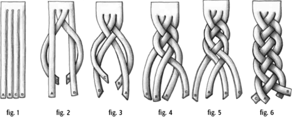

*Hình 2-1. Một bím tóc làm rối các sợi tóc, khiến từng sợi riêng lẻ khó xác định*

Khi kiến trúc sư nhìn vào các vấn đề bị rối, họ vật lộn với việc phân tích trade-off vì khó tách các mối quan tâm ra để có thể xem xét chúng một cách độc lập. Do đó, bước đầu tiên trong phân tích trade-off là gỡ rối các chiều của vấn đề, phân tích những phần nào coupled với nhau và coupling đó có tác động gì đến thay đổi. Vì mục đích này, chúng tôi dùng định nghĩa đơn giản nhất của từ *coupling*:

**Coupling**

Hai phần của một hệ thống phần mềm là coupled nếu một thay đổi ở phần này có thể gây ra một thay đổi ở phần kia.

Thường thì software architecture tạo ra những vấn đề đa chiều, trong đó nhiều lực cùng tương tác theo những cách phụ thuộc lẫn nhau. Để phân tích trade-offs, trước hết kiến trúc sư phải xác định những lực nào cần đánh đổi với nhau.

Do đó, đây là lời khuyên của chúng tôi cho việc phân tích trade-off hiện đại trong software architecture:

1. Tìm những phần nào bị rối vào nhau.
2. Phân tích cách chúng coupled với nhau.
3. Đánh giá trade-offs bằng cách xác định tác động của thay đổi lên các hệ thống phụ thuộc lẫn nhau.

Dù các bước rất đơn giản, những phần khó ẩn nấp trong chi tiết. Do đó, để minh họa framework này trong thực tế, chúng tôi lấy một trong những vấn đề khó nhất (và có lẽ gần với vấn đề chung nhất) trong các architecture phân tán, liên quan đến microservices:

**Làm sao kiến trúc sư xác định kích thước và các kiểu giao tiếp cho microservices?**

Xác định kích thước phù hợp cho microservices có vẻ là một vấn đề phổ biến—các service too-small (quá nhỏ) tạo ra vấn đề về transaction và orchestration, còn các service too-large (quá lớn) tạo ra vấn đề về scale và phân tán.

Để đạt mục tiêu đó, phần còn lại của cuốn sách này gỡ rối nhiều khía cạnh cần xem xét khi trả lời câu hỏi trên. Chúng tôi cung cấp thuật ngữ mới để phân biệt các pattern tương tự nhưng khác biệt và đưa ra các ví dụ thực tế về việc áp dụng những pattern này và các pattern khác.

Tuy nhiên, mục tiêu bao trùm của cuốn sách này là cung cấp cho bạn các kỹ thuật example-driven (dẫn dắt bằng ví dụ) để học cách xây dựng phân tích trade-off của riêng bạn cho những vấn đề đặc thù trong lĩnh vực của bạn. Chúng tôi bắt đầu với lần gỡ rối lớn đầu tiên các lực trong architecture phân tán: định nghĩa architecture quantum cùng với hai loại coupling, static và dynamic.

## Architecture (Quantum | Quanta)

Thuật ngữ *quantum* tất nhiên được dùng nhiều trong lĩnh vực vật lý gọi là *quantum mechanics* (cơ học lượng tử). Tuy nhiên, các tác giả chọn từ này vì cùng những lý do như các nhà vật lý. *Quantum* bắt nguồn từ từ Latin *quantus*, nghĩa là “lớn bao nhiêu” hay “bao nhiêu.” Trước khi vật lý co-opted (mượn) nó, giới luật đã dùng nó để biểu thị “số lượng bắt buộc hoặc được phép” (ví dụ, trong tiền bồi thường thiệt hại). Thuật ngữ này cũng xuất hiện trong lĩnh vực topology của toán học, liên quan đến các tính chất của các họ hình dạng. Vì gốc Latin, dạng số ít là *quantum*, và dạng số nhiều là *quanta*, tương tự sự đối xứng datum/data.

Một architecture quantum đo lường một số khía cạnh của cả topology lẫn hành vi trong software architecture liên quan đến cách các phần kết nối và giao tiếp với nhau:

**Architecture quantum**

Một architecture quantum là một artifact deploy được độc lập với functional cohesion cao, static coupling cao, và dynamic coupling đồng bộ. Một ví dụ phổ biến của architecture quantum là một microservice well-formed (được hình thành tốt) bên trong một workflow.

**Static coupling**

Biểu thị cách các phụ thuộc tĩnh được phân giải bên trong architecture thông qua contract. Các phụ thuộc này bao gồm hệ điều hành, framework, và/hoặc thư viện được cung cấp qua quản lý phụ thuộc bắc cầu, và bất kỳ yêu cầu vận hành nào khác để quantum có thể hoạt động.

**Dynamic coupling**

Biểu thị cách các quanta giao tiếp tại runtime, hoặc đồng bộ hoặc bất đồng bộ. Do đó, fitness function cho những characteristic này phải *liên tục*, thường dùng monitor.

Dù static coupling và dynamic coupling có vẻ tương tự, kiến trúc sư phải phân biệt hai khác biệt quan trọng. Một cách dễ để nghĩ về sự khác biệt là *static coupling* mô tả cách các service được *nối* với nhau, trong khi *dynamic coupling* mô tả cách các service *gọi* nhau tại runtime. Ví dụ, trong một microservices architecture, một service phải chứa các component phụ thuộc như database, biểu thị static coupling—service không vận hành được nếu thiếu dữ liệu cần thiết. Service đó có thể gọi các service khác trong quá trình một workflow, điều này biểu thị dynamic coupling. Không service nào cần service kia hiện diện để hoạt động, ngoại trừ workflow runtime này. Do đó, static coupling phân tích các phụ thuộc vận hành, còn dynamic coupling phân tích các phụ thuộc giao tiếp.

Những định nghĩa này bao gồm các characteristic quan trọng; hãy đề cập chi tiết từng cái vì chúng định hình hầu hết các ví dụ trong cuốn sách.

### Deploy được độc lập (Independently Deployable)

*Independently deployable* (deploy được độc lập) hàm ý một số khía cạnh của một architecture quantum—mỗi quantum biểu thị một đơn vị deploy riêng biệt trong một architecture cụ thể. Do đó, một monolithic architecture—architecture được deploy như một đơn vị duy nhất—theo định nghĩa là một architecture quantum duy nhất. Trong một architecture phân tán như microservices, developer có xu hướng hướng tới khả năng deploy các service một cách độc lập, thường theo cách được tự động hóa cao. Do đó, từ góc độ deploy độc lập, một service trong microservices architecture biểu thị một architecture quantum (tùy thuộc vào coupling—như thảo luận tiếp theo).

Việc làm cho mỗi architecture quantum biểu thị một tài sản deploy được trong architecture phục vụ một số mục đích hữu ích. Thứ nhất, ranh giới được biểu thị bởi một architecture quantum đóng vai trò như một ngôn ngữ chung hữu ích giữa kiến trúc sư, developer và vận hành. Mỗi bên hiểu phạm vi chung đang được bàn: kiến trúc sư hiểu các đặc điểm coupling, developer hiểu phạm vi hành vi, và team vận hành hiểu các đặc điểm deploy.

Thứ hai, architecture quantum biểu thị một trong những lực (static coupling) mà kiến trúc sư phải xem xét khi cố gắng đạt granularity phù hợp cho các service trong một architecture phân tán. Thường thì, trong microservices architecture, developer đối mặt với câu hỏi khó là service granularity nào mang lại tập trade-offs tối ưu. Một số trade-offs đó xoay quanh deployability: service này cần nhịp release như thế nào, những service nào khác có thể bị ảnh hưởng, những thực hành kỹ thuật nào liên quan, v.v. Kiến trúc sư được lợi từ việc hiểu chắc chắn chính xác ranh giới deployment nằm ở đâu trong các architecture phân tán. Chúng tôi thảo luận service granularity và các trade-offs đi kèm trong [Chương 7](ch07_service_granularity.vi.md#ch07-service-granularity).

Thứ ba, *khả năng deploy độc lập* (independent deployability) buộc architecture quantum phải bao gồm các điểm coupling chung như database. Hầu hết các thảo luận về architecture tiện thể bỏ qua những vấn đề như database và giao diện người dùng, nhưng các hệ thống real-world thường phải xử lý những vấn đề đó. Do đó, bất kỳ hệ thống nào dùng một database chung đều không đạt tiêu chí architecture quantum về deploy độc lập trừ khi việc deploy database diễn ra đồng bộ nhịp nhàng với ứng dụng. Nhiều hệ thống phân tán lẽ ra đủ điều kiện cho nhiều quanta lại không đạt phần deploy độc lập nếu chúng dùng chung một database có nhịp deployment riêng. Do đó, chỉ xem xét ranh giới deployment thôi không cung cấp một thước đo hữu ích. Kiến trúc sư cũng nên xem xét tiêu chí thứ hai cho một architecture quantum, functional cohesion cao, để giới hạn architecture quantum trong một phạm vi hữu ích.

### Functional cohesion cao (High Functional Cohesion)

*Functional cohesion cao* (high functional cohesion) về mặt cấu trúc đề cập đến sự gần gũi của các phần tử liên quan: class, component, service, v.v. Xuyên suốt lịch sử, các nhà khoa học máy tính đã định nghĩa nhiều loại cohesion, ở đây được giới hạn trong *module* chung, có thể được biểu thị dưới dạng *class* hoặc *component*, tùy nền tảng. Từ góc độ domain, định nghĩa kỹ thuật của *functional cohesion cao* trùng với các mục tiêu của *bounded context* trong domain-driven design: hành vi và dữ liệu hiện thực một domain workflow cụ thể.

Thuần túy từ góc độ deploy độc lập, một monolithic architecture khổng lồ đủ điều kiện là một architecture quantum. Tuy nhiên, gần như chắc chắn nó không có functional cohesion cao, mà thay vào đó bao gồm chức năng của toàn bộ hệ thống. Monolith càng lớn, càng ít khả năng nó có functional cohesion đơn nhất.

Lý tưởng là, trong một microservices architecture, mỗi service mô hình hóa một domain hoặc workflow duy nhất, và do đó thể hiện functional cohesion cao. Cohesion trong bối cảnh này không phải là về cách các service tương tác để thực hiện công việc, mà là về mức độ độc lập và coupled của một service đối với service khác.

### Static coupling cao (High Static Coupling)

*Static coupling cao* (high static coupling) hàm ý rằng các phần tử bên trong architecture quantum được nối chặt chẽ với nhau, điều thực chất là một khía cạnh của contract. Kiến trúc sư nhận ra những thứ như REST hoặc SOAP là định dạng contract, nhưng chữ ký method và các phụ thuộc vận hành (thông qua các điểm coupling như địa chỉ IP hoặc URL) cũng biểu thị contract. Do đó, contract là một *phần khó của architecture*; chúng tôi đề cập các vấn đề coupling liên quan đến mọi loại contract, bao gồm cách chọn contract phù hợp, trong [Chương 13](ch13_contracts.vi.md#ch13-contracts).

Một architecture quantum, một phần, là một thước đo static coupling, và thước đo này khá đơn giản đối với hầu hết các topology architecture. Ví dụ, các sơ đồ sau thể hiện các architecture style được giới thiệu trong *Fundamentals of Software Architecture*, với static coupling của architecture quantum được minh họa.

Bất kỳ monolithic architecture style nào cũng tất yếu có quantum bằng một, như minh họa trong [Hình 2-2](#fig-arch-vs-design-single-quantum-1).

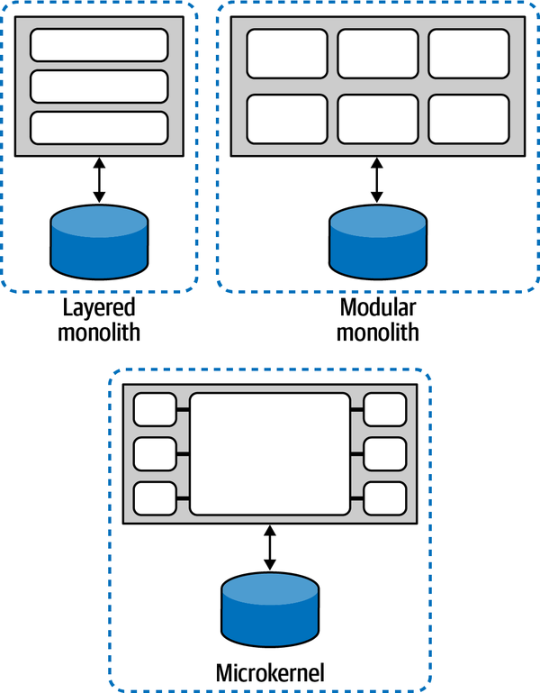

*Hình 2-2. Monolithic architecture luôn có quantum bằng một*

Như bạn thấy, bất kỳ architecture nào được deploy như một đơn vị duy nhất và dùng một database duy nhất sẽ luôn có một quantum duy nhất. Thước đo static coupling của architecture quantum bao gồm database, và một hệ thống dựa vào một database duy nhất không thể có nhiều hơn một quantum. Do đó, thước đo static coupling của một architecture quantum giúp xác định các điểm coupling trong architecture, không chỉ trong các component phần mềm đang được phát triển. Hầu hết monolithic architecture chứa một điểm coupling duy nhất (thường là database) khiến thước đo quantum của nó bằng một.

Các architecture phân tán thường có decoupling ở mức component; hãy xem xét tập architecture style tiếp theo, bắt đầu với service-based architecture thể hiện trong [Hình 2-3](#fig-arch-vs-design-single-quantum-SB-arch).

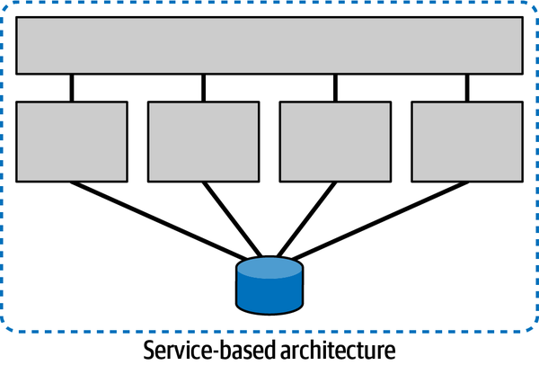

*Hình 2-3. Architecture quantum cho một service-based architecture*

Dù mô hình các service riêng lẻ này thể hiện sự cô lập phổ biến trong microservices, architecture vẫn dùng một relational database duy nhất, khiến điểm architecture quantum của nó bằng một.

> **Kiến trúc dựa trên service (Service-Based Architecture)**
>
> Khi chúng tôi nói đến *service-based architecture*, chúng tôi không có ý nói một architecture chung chung dựa trên service, mà là một architecture style lai cụ thể theo một cấu trúc macro-layered (phân lớp vĩ mô) phân tán, gồm một giao diện người dùng được deploy riêng, các service coarse-grained (thô) từ xa được deploy riêng, và một database monolith. Architecture này giải quyết một trong những độ phức tạp của microservices—việc tách ở mức database. Các service trong service-based architecture tuân theo cùng các nguyên lý như microservices (dựa trên bounded context của domain-driven design) nhưng dựa vào một relational database duy nhất vì kiến trúc sư không thấy giá trị trong việc tách (hoặc thấy quá nhiều trade-offs tiêu cực).
>
> Service-based architecture là mục tiêu phổ biến khi tái cấu trúc monolithic architecture, cho phép phân rã mà không làm gián đoạn các database schema và điểm tích hợp hiện có. Chúng tôi đề cập các decomposition pattern trong [Chương 5](ch05_component_based_decomposition_patterns.vi.md#ch05-decomposition-patterns).

Cho đến giờ, thước đo static coupling của architecture quantum đã đánh giá tất cả các topology bằng *một*. Tuy nhiên, các architecture phân tán tạo ra khả năng có nhiều quanta nhưng không nhất thiết bảo đảm điều đó. Ví dụ, mediator style của event-driven architecture sẽ luôn được đánh giá là một architecture quantum duy nhất, như minh họa trong [Hình 2-4](#fig-arch-vs-design-mediator-quantum).

Dù style này biểu thị một architecture phân tán, hai điểm coupling đẩy nó về phía một architecture quantum duy nhất: database, như thường thấy với các monolithic architecture trước đó, và cả bản thân `Request Orchestrator`—bất kỳ điểm coupling tổng thể nào cần thiết để architecture hoạt động đều hình thành một architecture quantum xung quanh nó.

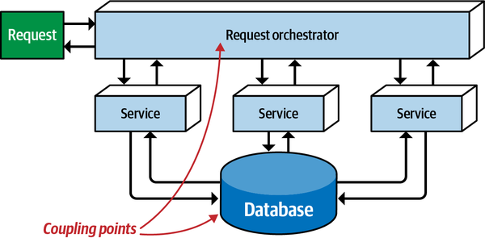

*Hình 2-4. Một EDA dùng mediator có một architecture quantum duy nhất*

Các event-driven architecture kiểu broker (không có mediator trung tâm) ít coupled hơn, nhưng điều đó không bảo đảm decoupling hoàn toàn. Hãy xem xét event-driven architecture minh họa trong [Hình 2-5](#fig-arch-vs-design-single-quantum-EDA).

Event driven architecture broker-style (không có mediator trung tâm) này dù vậy vẫn là một architecture quantum duy nhất vì tất cả các service đều dùng một relational database duy nhất, đóng vai trò một điểm coupling chung. Câu hỏi mà phân tích tĩnh cho một architecture quantum trả lời là: “Phần phụ thuộc này của architecture có cần thiết để khởi động service này không?” Ngay cả trong trường hợp một event-driven architecture nơi một số service không truy cập database, nếu chúng dựa vào các service *có* truy cập database, thì chúng trở thành một phần của static coupling của architecture quantum.

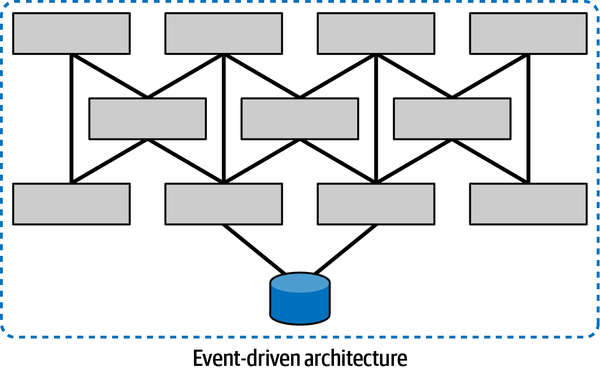

*Hình 2-5. Ngay cả một architecture phân tán như event-driven architecture broker-style cũng có thể là một quantum duy nhất*

Tuy nhiên, còn những tình huống trong architecture phân tán nơi không tồn tại điểm coupling chung thì sao? Hãy xem xét event-driven architecture minh họa trong [Hình 2-6](#fig-discerning-multi-quanta-EDA).

Các kiến trúc sư đã thiết kế hệ thống event-driven này với hai data store, và không có phụ thuộc tĩnh nào giữa các tập service. Lưu ý rằng mỗi architecture quantum đều có thể chạy trong một hệ sinh thái production-like (giống production). Nó có thể không tham gia được vào mọi workflow mà hệ thống yêu cầu, nhưng nó chạy thành công và vận hành—gửi request và nhận request bên trong architecture.

Thước đo static coupling của một architecture quantum đánh giá các phụ thuộc coupling giữa các component kiến trúc và vận hành. Do đó, hệ điều hành, data store, message broker, container orchestration, và mọi phụ thuộc vận hành khác hình thành các điểm static coupling của một architecture quantum, dùng các contract chặt chẽ nhất có thể, các phụ thuộc vận hành (thêm về vai trò của contract trong architecture quanta ở [Chương 13](ch13_contracts.vi.md#ch13-contracts)).

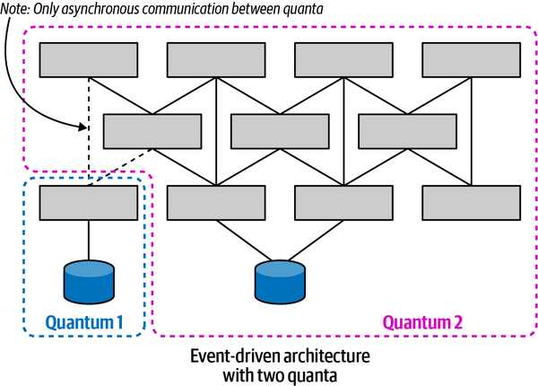

*Hình 2-6. Một event-driven architecture có nhiều quanta*

Microservices architecture style có các service được decouple cao, kể cả các phụ thuộc dữ liệu. Kiến trúc sư trong các architecture này ưu tiên mức decoupling cao và cẩn thận không tạo ra các điểm coupling giữa các service, cho phép mỗi service riêng lẻ hình thành quanta của riêng nó, như thể hiện trong [Hình 2-7](#fig-discerning-microservice-api-quanta).

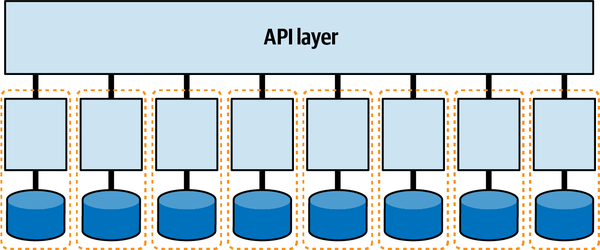

*Hình 2-7. Microservices có thể hình thành quanta của riêng chúng*

Mỗi service (đóng vai trò một bounded context) có thể có tập architecture characteristic riêng—một service có thể có mức scalability hoặc security cao hơn service khác. Mức phân hạt chi tiết này của việc xác định phạm vi architecture characteristic là một trong những ưu điểm của microservices architecture style. Mức decoupling cao cho phép các team làm việc trên một service đi nhanh nhất có thể, mà không lo làm hỏng các phụ thuộc khác.

Tuy nhiên, nếu hệ thống coupled chặt với một giao diện người dùng, architecture hình thành một architecture quantum duy nhất, như minh họa trong [Hình 2-8](#fig-discerning-mono-ui-quantum).

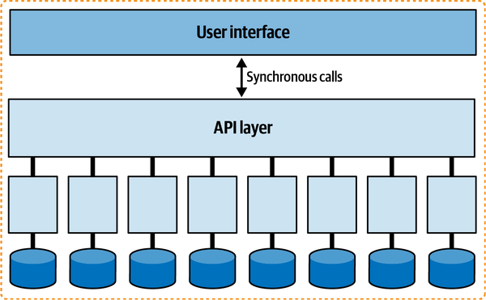

*Hình 2-8. Một giao diện người dùng coupled chặt có thể giảm architecture quantum của microservices về một*

Giao diện người dùng tạo ra các điểm coupling giữa front end và back end, và hầu hết giao diện người dùng sẽ không vận hành được nếu một phần backend không khả dụng.

Ngoài ra, kiến trúc sư sẽ khó thiết kế các mức architecture characteristic vận hành khác nhau (performance, scale, elasticity, reliability, v.v.) cho từng service nếu tất cả chúng phải phối hợp cùng nhau trong một giao diện người dùng duy nhất (đặc biệt trong trường hợp lời gọi đồng bộ, được đề cập trong [“Dynamic Quantum Coupling”](#sec-dynamic-coupling)).

Kiến trúc sư thiết kế giao diện người dùng dùng tính bất đồng bộ để không tạo coupling giữa front và back. Một xu hướng trong nhiều dự án microservices là dùng một framework *micro frontend* cho các phần tử giao diện người dùng trong một microservices architecture. Trong một architecture như vậy, các phần tử giao diện người dùng tương tác thay mặt cho các service được phát ra từ chính các service đó. Bề mặt giao diện người dùng đóng vai trò như một khung vẽ nơi các phần tử giao diện người dùng có thể xuất hiện, và cũng hỗ trợ giao tiếp loosely coupled giữa các component, thường dùng sự kiện. Một architecture như vậy được minh họa trong [Hình 2-9](#fig-discerning-microFE-quanta).

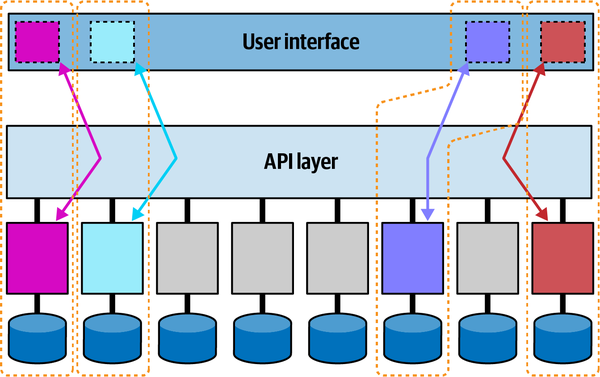

*Hình 2-9. Trong một micro-frontend architecture, mỗi service + component giao diện người dùng hình thành một architecture quantum*

Trong ví dụ này, bốn service được tô màu cùng với các micro-frontends tương ứng hình thành các architecture quanta: mỗi service này có thể có các architecture characteristic khác nhau.

Bất kỳ điểm coupling nào trong một architecture cũng có thể tạo ra các điểm static coupling từ góc độ quantum. Hãy xem xét tác động của một database dùng chung giữa hai hệ thống, như minh họa trong [Hình 2-10](#fig-discerning-aq-shared-db).

Static coupling của một hệ thống mang lại hiểu biết giá trị, ngay cả trong các hệ thống phức tạp liên quan đến integration architecture. Ngày càng nhiều, một kỹ thuật phổ biến của kiến trúc sư để hiểu architecture legacy là tạo một sơ đồ quantum tĩnh về cách mọi thứ được “nối” với nhau, giúp xác định những hệ thống nào sẽ bị ảnh hưởng bởi thay đổi và đưa ra một cách để hiểu (và có thể decouple) architecture.

Static coupling chỉ là one-half (một nửa) các lực đang tác động trong architecture phân tán. Nửa còn lại là dynamic coupling.

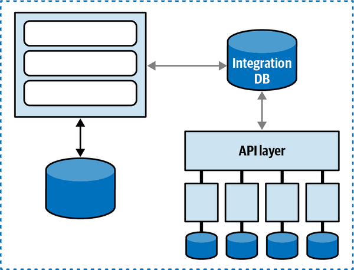

*Hình 2-10. Một database dùng chung hình thành một điểm coupling giữa hai hệ thống, tạo ra một quantum duy nhất*

### Dynamic quantum coupling (Dynamic Quantum Coupling)

Phần cuối cùng của định nghĩa architecture quantum liên quan đến coupling đồng bộ tại runtime—nói cách khác, hành vi của các architecture quanta khi chúng tương tác với nhau để hình thành các workflow bên trong một architecture phân tán.

Bản chất của *cách* các service gọi nhau tạo ra những quyết định trade-off khó khăn vì nó biểu thị một không gian quyết định đa chiều, chịu ảnh hưởng của ba lực đan cài nhau:

**Giao tiếp (Communication)**

Chỉ loại tính đồng bộ của kết nối được dùng: đồng bộ hay bất đồng bộ.

**Tính nhất quán (Consistency)**

Mô tả việc giao tiếp của workflow đòi hỏi tính nguyên tử hay có thể dùng eventual consistency.

**Phối hợp (Coordination)**

Mô tả việc workflow dùng một orchestrator hay các service giao tiếp thông qua choreography.

#### Giao tiếp (Communication)

Khi hai service giao tiếp với nhau, một trong những câu hỏi nền tảng đối với kiến trúc sư là giao tiếp đó nên đồng bộ hay bất đồng bộ.

Giao tiếp *đồng bộ* (synchronous) yêu cầu bên gửi request chờ phản hồi từ bên nhận, như thể hiện trong [Hình 2-11](#fig-discern-sync-base).

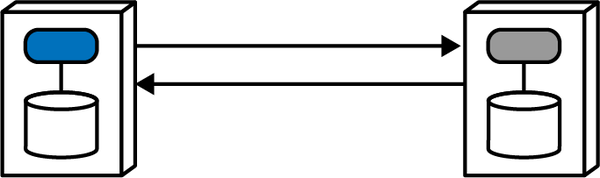

*Hình 2-11. Một lời gọi đồng bộ chờ kết quả từ bên nhận*

Service gọi thực hiện một lời gọi (dùng một trong số các giao thức hỗ trợ lời gọi đồng bộ, như gRPC) và *block* (không xử lý gì thêm) cho đến khi bên nhận trả về một giá trị (hoặc trạng thái chỉ ra một thay đổi trạng thái hoặc điều kiện lỗi).

Giao tiếp *bất đồng bộ* (asynchronous) xảy ra giữa hai service khi bên gọi gửi một message tới bên nhận (thường qua một cơ chế như message queue) và, một khi bên gọi nhận được xác nhận rằng message sẽ được xử lý, nó quay lại làm việc. Nếu request cần một giá trị phản hồi, bên nhận có thể dùng một reply queue để (bất đồng bộ) thông báo kết quả cho bên gọi, như minh họa trong [Hình 2-12](#fig-discern-async-base).

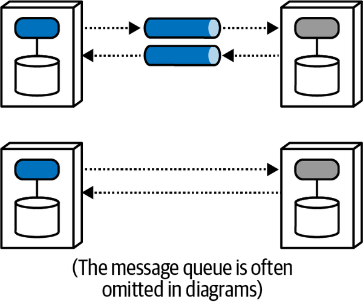

*Hình 2-12. Giao tiếp bất đồng bộ cho phép xử lý song song*

Bên gọi gửi một message vào message queue và tiếp tục xử lý cho đến khi được bên nhận thông báo rằng thông tin được yêu cầu đã có sẵn qua lời gọi trả về. Nhìn chung, kiến trúc sư dùng message queue (minh họa bằng ống hình trụ màu xám trong sơ đồ phía trên ở [Hình 2-12](#fig-discern-async-base)) để hiện thực giao tiếp bất đồng bộ, nhưng queue rất phổ biến và gây nhiễu trên sơ đồ, nên nhiều kiến trúc sư lược bỏ chúng, như thể hiện trong sơ đồ phía dưới. Và tất nhiên, kiến trúc sư có thể hiện thực giao tiếp bất đồng bộ mà không cần message queue bằng cách dùng nhiều thư viện hoặc framework khác nhau. Mỗi kiểu sơ đồ đều hàm ý messaging bất đồng bộ; kiểu thứ hai cung cấp cách viết tắt trực quan và ít chi tiết hiện thực hơn.

Kiến trúc sư phải xem xét những trade-offs đáng kể khi chọn cách các service sẽ giao tiếp. Các quyết định xoay quanh giao tiếp ảnh hưởng đến đồng bộ hóa, xử lý lỗi, tính transaction, scalability và performance. Phần còn lại của cuốn sách này đi sâu vào nhiều vấn đề trong số đó.

#### Tính nhất quán (Consistency)

*Consistency* (tính nhất quán) chỉ mức độ chặt chẽ của tính toàn vẹn transaction mà các lời gọi giao tiếp phải tuân thủ. Atomic transaction (các transaction all-or-nothing—tất cả hoặc không gì cả—đòi hỏi tính nhất quán *trong khi* xử lý một request) nằm ở một phía của dải phổ, trong khi các mức eventual consistency khác nhau nằm ở phía bên kia.

Tính transaction—việc để nhiều service tham gia vào một transaction all-or-nothing—là một trong những vấn đề khó mô hình hóa nhất trong architecture phân tán, dẫn đến lời khuyên chung là cố gắng tránh các transaction cross-service (xuyên service). Chúng tôi thảo luận tính nhất quán và giao điểm giữa dữ liệu và architecture trong các Chương [6](ch06_pulling_apart_operational_data.vi.md#ch06-decomposing-operational-data), [9](ch09_data_ownership_and_distributed_transactions.vi.md#ch09-data-update), [10](ch10_distributed_data_access.vi.md#ch10-data-access), và [12](ch12_transactional_sagas.vi.md#ch12-transactional-sagas).

#### Phối hợp (Coordination)

*Coordination* (phối hợp) chỉ mức độ phối hợp mà workflow được mô hình hóa bởi giao tiếp đòi hỏi. Hai pattern chung phổ biến cho microservices là orchestration và choreography, mà chúng tôi mô tả trong [Chương 11](ch11_managing_distributed_workflows.vi.md#ch11-managing-workflows). Các workflow đơn giản—một service duy nhất trả lời một request—không cần xem xét đặc biệt từ chiều này. Tuy nhiên, khi độ phức tạp của workflow tăng lên, nhu cầu phối hợp càng lớn.

Ba yếu tố này—giao tiếp, tính nhất quán và phối hợp—đều định hình quyết định quan trọng mà kiến trúc sư phải đưa ra. Tuy nhiên, điều then chốt là kiến trúc sư không thể đưa ra những lựa chọn này một cách tách biệt; mỗi lựa chọn có một hiệu ứng hấp dẫn lên các lựa chọn khác. Ví dụ, tính transaction dễ dàng hơn trong các architecture đồng bộ có mediation, trong khi mức scale cao hơn khả thi với các hệ thống choreographed bất đồng bộ eventually consistent.

Việc nghĩ về các lực này trong quan hệ với nhau hình thành một không gian three-dimensional (ba chiều), minh họa trong [Hình 2-13](#fig-discern-aq-dyn-dimensions).

Mỗi lực tác động trong quá trình giao tiếp giữa các service xuất hiện như một chiều. Với một quyết định cụ thể, kiến trúc sư có thể vẽ vị trí trong không gian biểu thị cường độ của các lực này.

*Hình 2-13. Các chiều của dynamic quantum coupling*

Khi kiến trúc sư có thể xây dựng một hiểu biết rõ ràng về các lực đang tác động trong một tình huống nhất định, điều đó tạo ra tiêu chí cho phân tích trade-off. Trong trường hợp dynamic coupling, [Bảng 2-1](#tbl-aq-coupling-matrix) thể hiện một framework để xác định tên các pattern nền tảng dựa trên tám tổ hợp khả dĩ.

*Bảng 2-1. Ma trận các giao điểm chiều cho architecture phân tán*

| Tên pattern | Giao tiếp | Tính nhất quán | Phối hợp | Coupling |
|---|---|---|---|---|
| Epic Saga(sao) | đồng bộ | nguyên tử | orchestrated | rất cao |
| Phone Tag Saga(sac) | đồng bộ | nguyên tử | choreographed | cao |
| Fairy Tale Saga(seo) | đồng bộ | eventual | orchestrated | cao |
| Time Travel Saga(sec) | đồng bộ | eventual | choreographed | trung bình |
| Fantasy Fiction Saga(aao) | bất đồng bộ | nguyên tử | orchestrated | cao |
| Horror Story(aac) | bất đồng bộ | nguyên tử | choreographed | trung bình |
| Parallel Saga(aeo) | bất đồng bộ | eventual | orchestrated | thấp |
| Anthology Saga(aec) | bất đồng bộ | eventual | choreographed | rất thấp |

Để hiểu đầy đủ ma trận này, trước hết chúng ta phải tìm hiểu từng chiều riêng lẻ. Do đó, các chương tiếp theo giúp bạn xây dựng bối cảnh để hiểu các trade-offs riêng lẻ của giao tiếp, tính nhất quán và phối hợp, rồi đan chúng lại với nhau trong [Chương 12](ch12_transactional_sagas.vi.md#ch12-transactional-sagas).

Trong các chương còn lại của [Phần I](part1_pulling_things_apart.vi.md#part1-pulling-things-apart), chúng tôi tập trung vào static coupling và hiểu các chiều khác nhau đang tác động trong architecture phân tán, bao gồm quyền sở hữu dữ liệu, tính transaction và service granularity. Trong [Phần II, *Putting Things Back Together*](part2_putting_things_back_together.vi.md#part2-putting-things-back-together), chúng tôi tập trung vào dynamic coupling và hiểu các communication pattern trong microservices.

## Sysops Squad Saga: Hiểu về quanta (Sysops Squad Saga: Understanding Quanta)

`Tuesday, November 23, 14:32`

Austen đến văn phòng của Addison với vẻ mặt cau có khác thường. “Này, Addison, tôi làm phiền cậu một phút được không?”

“Được chứ, có chuyện gì vậy?”

“Tôi đang đọc về cái vụ architecture quantum này, và tôi cứ…không…hiểu…nổi!”

Addison cười, “Tôi hiểu ý cậu. Tôi cũng vật lộn với nó khi nó còn thuần trừu tượng, nhưng khi cậu gắn nó với những thứ thực tế, hóa ra nó là một tập góc nhìn hữu ích.”

“Ý cậu là sao?”

“Chà,” Addison nói, “architecture quantum về cơ bản định nghĩa một DDD bounded context theo thuật ngữ kiến trúc.”

“Vậy sao không dùng luôn bounded context?” Austen hỏi.

“Bounded context có một định nghĩa cụ thể trong DDD, và nhồi thêm những thứ về architecture vào nó chỉ khiến mọi người liên tục phải phân biệt. Chúng tương tự nhau, nhưng không phải cùng một thứ. Phần đầu về *functional cohesion* và *deploy độc lập* chắc chắn khớp với một service dựa trên bounded context. Nhưng định nghĩa architecture quantum đi xa hơn bằng cách xác định các loại coupling—đó là chỗ những thứ *static* và *dynamic* xuất hiện.”

“Mấy thứ đó là sao? Chẳng phải *coupling* thì chỉ là *coupling* thôi sao? Sao phải phân biệt?”

“Hóa ra có cả đống mối quan tâm khác nhau xoay quanh các loại khác nhau,” Addison nói. “Hãy lấy loại *static* trước, thứ mà tôi thích nghĩ là cách mọi thứ được nối với nhau. Một cách khác để nghĩ về nó: hãy xem xét một trong các service chúng ta đang xây dựng trong architecture mục tiêu. Toàn bộ phần nối dây cần thiết để khởi động service đó là gì?”

“Chà, nó được viết bằng Java, dùng database Postgres, và chạy trong Docker—vậy thôi, đúng không?”

“Cậu thiếu nhiều lắm.” Addison nói. “Nếu cậu phải xây dựng service đó từ đầu, giả sử chúng ta chưa có gì cả thì sao? Nó là Java, nhưng còn dùng SpringBoot và, chắc khoảng 15 hay 20 framework và thư viện khác nhau?”

“Đúng vậy, chúng ta có thể xem file Maven POM để tìm ra tất cả những phụ thuộc đó. Còn gì nữa?”

“Ý tưởng đằng sau *static quantum coupling* là phần nối dây cần thiết để hoạt động. Chúng ta đang dùng sự kiện để giao tiếp giữa các service—còn event broker thì sao?”

“Nhưng chẳng phải đó là phần dynamic sao?”

“Không phải *sự hiện diện* của broker. Nếu service (hoặc, rộng hơn, architecture quantum) mà tôi muốn khởi động dùng một message broker để hoạt động, broker phải hiện diện. Khi service *gọi* một service khác thông qua broker, chúng ta mới đi vào phía dynamic.”

“OK, hợp lý đấy,” Austen nói. “Nếu tôi nghĩ về những gì cần để khởi động nó từ đầu, đó là static quantum coupling.”

“Đúng vậy. Và chỉ riêng thông tin đó đã cực kỳ hữu ích. Gần đây chúng tôi đã xây dựng một sơ đồ static quantum coupling cho từng service của mình theo kiểu phòng thủ.”

Austen cười. “Phòng thủ? Ý cậu là…”

“Chúng tôi đang thực hiện một phân tích độ tin cậy để xác định nếu tôi thay đổi *thứ* này, cái gì có thể hỏng, trong đó *thứ* có thể là bất cứ gì trong architecture hay vận hành của chúng ta. Họ đang cố giảm thiểu rủi ro—nếu chúng ta thay đổi một service, họ muốn biết cái gì phải được test.”

“Tôi hiểu rồi—đó là static quantum coupling. Tôi thấy được đó là một góc nhìn hữu ích. Nó cũng cho thấy các team có thể ảnh hưởng lẫn nhau thế nào. Có vẻ thực sự hữu ích. Có công cụ nào chúng ta tải về được để tìm ra điều đó cho mình không?”

“Thế thì hay quá nhỉ!” Addison cười. “Tiếc là chưa ai có tổ hợp architecture độc đáo như chúng ta mà đã xây dựng và open source chính xác công cụ chúng ta muốn. Tuy nhiên, một số người trong platform team đang làm một công cụ để tự động hóa việc đó, tất yếu được tùy biến cho architecture của chúng ta. Họ đang dùng container manifest, file POM, các phụ thuộc NPM, và các công cụ phụ thuộc khác để xây dựng và duy trì danh sách các phụ thuộc build. Chúng ta cũng đã thiết lập observability cho tất cả các service, nên giờ chúng ta có các file log nhất quán về việc hệ thống nào gọi nhau, khi nào, và thường xuyên thế nào. Họ đang dùng thông tin đó để xây dựng một call graph để thấy mọi thứ được kết nối thế nào.”

“OK, vậy static coupling là cách mọi thứ được nối với nhau. Còn coupling *dynamic* thì sao?”

“Dynamic coupling liên quan đến cách các quanta *giao tiếp* với nhau, đặc biệt là lời gọi đồng bộ so với bất đồng bộ và tác động của chúng lên các architecture characteristic vận hành—những thứ như performance, scale, elasticity, reliability, v.v. Hãy xét *elasticity* một chút—cậu còn nhớ sự khác biệt giữa scalability và elasticity chứ?”

Austen nhếch mép cười. “Tôi đâu biết là sẽ có bài kiểm tra. Để xem nào…*scalability* là khả năng hỗ trợ một số lượng lớn người dùng đồng thời; *elasticity* là khả năng hỗ trợ một đợt bùng nổ request của người dùng trong một khung thời gian ngắn.”

“Chính xác! Một ngôi sao vàng cho cậu. OK, hãy nghĩ về *elasticity*. Giả sử trong architecture trạng thái tương lai của chúng ta có hai service như Ticketing và Assignment, và hai loại lời gọi. Chúng ta đã thiết kế cẩn thận các service để chúng được decouple tĩnh cao với nhau, sao cho chúng có thể elastic một cách độc lập. Nhân tiện, đó là tác dụng phụ còn lại của static coupling—nó xác định phạm vi của những thứ như các architecture characteristic vận hành. Giả sử Ticketing đang vận hành ở elastic scale gấp 10 lần Assignment, và chúng ta cần thực hiện một lời gọi giữa chúng. Nếu chúng ta thực hiện một lời gọi đồng bộ, toàn bộ workflow sẽ bị sa lầy, vì bên gọi phải chờ service chậm hơn xử lý và trả về. Ngược lại, nếu chúng ta thực hiện một lời gọi bất đồng bộ, dùng message queue làm bộ đệm, chúng ta có thể cho phép hai service thực thi độc lập về mặt vận hành, cho phép bên gọi thêm message vào queue và tiếp tục làm việc, nhận thông báo khi workflow hoàn tất.”

“À, tôi hiểu rồi, tôi hiểu rồi! Architecture quantum xác định phạm vi của các architecture characteristic—rõ ràng static coupling có thể ảnh hưởng đến điều đó. Nhưng giờ tôi thấy rằng, tùy thuộc vào loại lời gọi cậu thực hiện, cậu có thể tạm thời couple hai service với nhau.”

“Đúng vậy,” Addison nói. “Các architecture quanta có thể tạm thời rối vào nhau, trong quá trình một lời gọi, nếu bản chất của lời gọi ràng buộc những thứ như performance, khả năng phản hồi, scale, và cả đống thứ khác.”

“OK, tôi nghĩ tôi hiểu architecture quantum là gì, và các định nghĩa coupling hoạt động thế nào. Nhưng tôi sẽ chẳng bao giờ phân biệt rạch ròi được cái vụ quantum/quanta đó!”

“Datum/data cũng vậy thôi, nhưng có ai dùng datum bao giờ đâu!” Addison cười. “Cậu sẽ thấy nhiều hơn nữa tác động của dynamic coupling lên các workflow và transactional saga khi cậu tiếp tục đào sâu vào architecture của chúng ta.”

“Tôi nóng lòng lắm rồi!”
