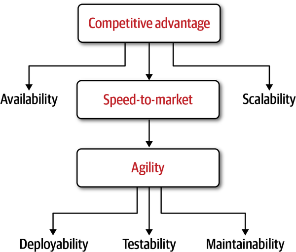
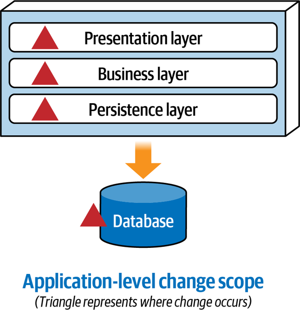
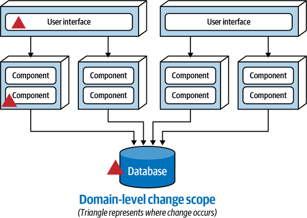
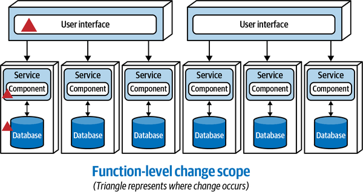
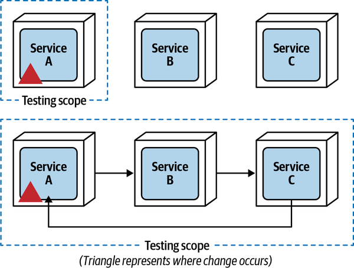
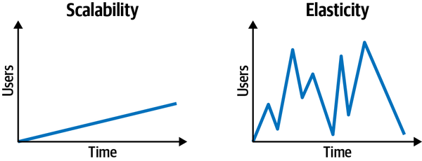
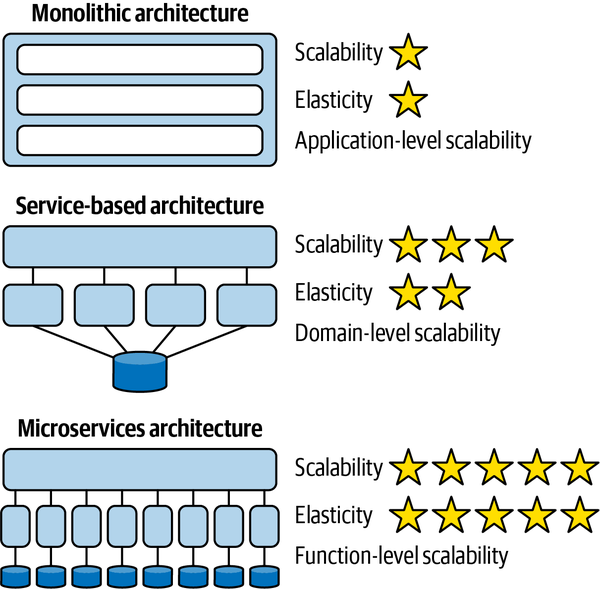

# Chương 3. Modularity kiến trúc (Architectural Modularity)

`Tuesday, September 21 09:33`

Vẫn là phòng họp mà họ đã ngồi cả trăm lần trước đây, nhưng hôm nay bầu không khí khác hẳn. Rất khác. Khi mọi người tụ tập lại, không ai nói chuyện phiếm. Chỉ có im lặng. Thứ im lặng chết chóc đặc quánh đến mức có thể cắt bằng dao. Phải, đó đúng là một câu sáo rỗng hợp với chủ đề cuộc họp.

Các lãnh đạo nghiệp vụ và nhà tài trợ của ứng dụng ticket Sysops Squad đang thất bại đã gặp các kiến trúc sư ứng dụng, Addison và Austen, nhằm bày tỏ mối lo ngại và sự bực bội về việc bộ phận IT không thể sửa những vấn đề never-ending (không dứt) gắn với ứng dụng trouble ticket. “Không có một ứng dụng hoạt động được,” họ nói, “chúng tôi không thể nào tiếp tục hỗ trợ mảng kinh doanh này.”

Khi cuộc họp căng thẳng kết thúc, các nhà tài trợ nghiệp vụ lặng lẽ lần lượt rời đi, để lại Addison và Austen một mình trong phòng họp.

“Cuộc họp tệ thật,” Addison nói. “Tôi không thể tin là họ thực sự đổ lỗi cho *chúng ta* về mọi vấn đề chúng ta đang gặp với ứng dụng trouble ticket. Tình huống này thực sự tệ.”

“Ừ, tôi biết,” Austen nói. “Đặc biệt là phần về khả năng đóng cửa mảng kinh doanh hỗ trợ sản phẩm. Chúng ta sẽ bị điều sang dự án khác, hoặc tệ hơn, có khi còn bị cho nghỉ việc. Dù tôi thích dành toàn bộ thời gian trên sân bóng đá hay trượt tuyết trên dốc vào mùa đông hơn, tôi thực sự không thể để mất công việc này.”

“Tôi cũng vậy,” Addison nói. “Hơn nữa, tôi rất thích development team hiện tại của chúng ta, và tôi ghét phải thấy nó bị giải tán.”

“Tôi cũng thế,” Austen nói. “Tôi vẫn nghĩ tách ứng dụng ra sẽ giải quyết phần lớn những vấn đề này.”

“Tôi đồng ý với cậu,” Addison nói, “nhưng làm sao chúng ta thuyết phục phía nghiệp vụ bỏ thêm tiền và thời gian để refactor architecture? Cậu đã thấy họ phàn nàn trong cuộc họp về số tiền chúng ta đã tiêu cho việc vá chỗ này chỗ kia, chỉ để tạo thêm vấn đề trong quá trình đó.”

“Cậu nói đúng,” Austen nói. “Ở thời điểm này họ sẽ không bao giờ đồng ý với một nỗ lực chuyển đổi architecture tốn kém và time-consuming (tốn thời gian).”

“Nhưng nếu cả hai chúng ta đều đồng ý rằng cần tách ứng dụng ra để giữ nó sống sót, thì làm thế quái nào chúng ta thuyết phục được phía nghiệp vụ và có được kinh phí cùng thời gian cần thiết để tái cấu trúc hoàn toàn ứng dụng Sysops Squad?” Addison hỏi.

“Chịu,” Austen nói. “Xem Logan có rảnh để thảo luận vấn đề này với chúng ta không.”

Addison kiểm tra trực tuyến và thấy Logan, kiến trúc sư trưởng của Penultimate Electronics, đang rảnh. Addison gửi một tin nhắn giải thích rằng họ muốn tách ứng dụng monolith hiện có ra, nhưng không chắc làm sao thuyết phục phía nghiệp vụ rằng cách tiếp cận này sẽ hiệu quả. Addison giải thích trong tin nhắn rằng họ đang thực sự bế tắc và cần lời khuyên. Logan đồng ý gặp họ và đến phòng họp.

“Điều gì khiến các cậu chắc chắn đến thế rằng tách ứng dụng Sysops Squad ra sẽ giải quyết mọi vấn đề?” Logan hỏi.

“Bởi vì,” Austen nói, “chúng tôi đã thử vá code hết lần này đến lần khác, và có vẻ không hiệu quả. Chúng tôi vẫn còn quá nhiều vấn đề.”

“Cậu hoàn toàn không hiểu ý tôi,” Logan nói. “Để tôi hỏi theo cách khác. Các cậu có gì bảo đảm rằng tách hệ thống ra sẽ đạt được điều gì đó hơn là chỉ tốn thêm tiền và lãng phí thêm thời gian quý báu?”

“Chà,” Austen nói, “thực ra, chúng tôi không có.”

“Vậy làm sao các cậu biết tách ứng dụng ra là cách tiếp cận đúng?” Logan hỏi.

“Chúng tôi đã nói với anh rồi,” Austen nói, “vì mọi thứ khác chúng tôi thử đều có vẻ không hiệu quả!”

“Xin lỗi,” Logan nói, “nhưng cậu cũng biết rõ như tôi rằng đó không phải là lý do biện minh hợp lý đối với phía nghiệp vụ. Với kiểu lý do đó, các cậu sẽ không bao giờ có được kinh phí cần thiết.”

“Vậy, một lý do biện minh nghiệp vụ tốt sẽ là gì?” Addison hỏi. “Làm sao chúng tôi ‘bán’ cách tiếp cận này cho phía nghiệp vụ và được duyệt thêm kinh phí?”

“Chà,” Logan nói, “để xây dựng một business case tốt cho một việc tầm cỡ như thế này, trước hết các cậu cần hiểu lợi ích của modularity kiến trúc, đối chiếu những lợi ích đó với các vấn đề các cậu đang gặp với hệ thống hiện tại, và cuối cùng phân tích và ghi tài liệu các trade-offs liên quan đến việc tách ứng dụng.”

Các doanh nghiệp ngày nay đối mặt với một dòng thác thay đổi; sự tiến hóa của thị trường dường như liên tục tăng tốc với nhịp độ chóng mặt. Các động lực nghiệp vụ (như sáp nhập và mua lại), cạnh tranh gia tăng trên thị trường, nhu cầu người tiêu dùng tăng, và đổi mới gia tăng (như tự động hóa thông qua machine learning và trí tuệ nhân tạo) tất yếu đòi hỏi thay đổi đối với các hệ thống máy tính bên dưới. Trong nhiều trường hợp, những thay đổi trong hệ thống máy tính đó kéo theo đòi hỏi thay đổi đối với các architecture bên dưới hỗ trợ chúng.

Tuy nhiên, không chỉ nghiệp vụ đang trải qua thay đổi liên tục và nhanh chóng—mà còn cả môi trường kỹ thuật nơi các hệ thống máy tính đó tồn tại. Containerization, việc chuyển sang hạ tầng cloud-based (dựa trên cloud), việc áp dụng DevOps, và thậm chí những tiến bộ mới trong continuous delivery pipeline đều tác động đến architecture bên dưới của các hệ thống máy tính đó.

Trong thế giới ngày nay, thật khó quản lý toàn bộ sự thay đổi liên tục và nhanh chóng này đối với software architecture. Software architecture là cấu trúc nền tảng của một hệ thống, và do đó thường được coi là thứ nên giữ ổn định và không thay đổi thường xuyên, tương tự như các khía cạnh cấu trúc bên dưới của một tòa nhà lớn hay tòa nhà chọc trời. Tuy nhiên, khác với kiến trúc kết cấu của một tòa nhà, software architecture phải liên tục thay đổi và thích ứng để đáp ứng những đòi hỏi mới của môi trường nghiệp vụ và công nghệ ngày nay.

Hãy xét số lượng ngày càng tăng các vụ sáp nhập và mua lại đang diễn ra trên thị trường ngày nay. Khi một công ty mua lại một công ty khác, nó không chỉ có được các khía cạnh vật chất của công ty (như con người, tòa nhà, hàng tồn kho, v.v.) mà còn có thêm khách hàng. Các hệ thống hiện có ở mỗi công ty có thể scale để đáp ứng lượng người dùng gia tăng do kết quả của vụ sáp nhập hay mua lại không? Scalability là một phần lớn của sáp nhập và mua lại, cũng như agility và extensibility, tất cả đều là *các mối quan tâm kiến trúc*.

Các hệ thống monolith lớn (một deployment duy nhất) nhìn chung không cung cấp mức scalability, agility và extensibility cần thiết để hỗ trợ hầu hết các vụ sáp nhập và mua lại. Dung lượng cho tài nguyên máy bổ sung (thread, bộ nhớ, và CPU) đầy lên rất nhanh. Để minh họa điểm này, hãy xét cốc nước thể hiện trong [Hình 3-1](#fig-modularity-vs-granularity-fullglass). Cốc nước đại diện cho server (hoặc máy ảo), còn nước đại diện cho ứng dụng. Khi các ứng dụng monolith lớn lên để xử lý nhu cầu người tiêu dùng và tải người dùng gia tăng (dù từ sáp nhập, mua lại, hay tăng trưởng của công ty), chúng bắt đầu tiêu thụ ngày càng nhiều tài nguyên. Khi càng nhiều nước được thêm vào cốc (đại diện cho ứng dụng monolith đang lớn lên), cốc bắt đầu đầy. Thêm một cốc khác (đại diện như một server hay máy ảo khác) không giúp được gì, vì cốc mới sẽ chứa cùng lượng nước như cốc đầu tiên.

*Hình 3-1. Một cốc đầy đại diện cho một ứng dụng monolith lớn gần chạm dung lượng*

Một khía cạnh của modularity kiến trúc là tách các ứng dụng monolith lớn thành các phần riêng biệt và nhỏ hơn để cung cấp thêm dung lượng cho scalability và tăng trưởng tiếp theo, đồng thời tạo điều kiện cho thay đổi liên tục và nhanh chóng. Đến lượt mình, những năng lực này có thể giúp đạt được các mục tiêu chiến lược của công ty.

Bằng cách thêm một cốc rỗng khác vào ví dụ cốc nước và chia nước (ứng dụng) thành hai phần riêng biệt, một nửa lượng nước giờ có thể được rót vào cốc rỗng mới, cung cấp thêm 50% dung lượng, như thể hiện trong [Hình 3-2](#fig-modularity-vs-granularity-halfglass). Phép so sánh cốc nước là một cách tuyệt vời để giải thích modularity kiến trúc (việc chia nhỏ các ứng dụng monolith) cho các stakeholder nghiệp vụ và các lãnh đạo C-level, những người tất yếu sẽ chi trả cho nỗ lực architecture-refactoring (refactor architecture).

*Hình 3-2. Hai cốc half-full (đầy một nửa) đại diện cho một ứng dụng đã được tách ra với nhiều dung lượng cho tăng trưởng*

Scalability gia tăng chỉ là một lợi ích của modularity kiến trúc. Một lợi ích quan trọng khác là *agility*, khả năng phản ứng nhanh với thay đổi. Một [bài báo trên *Forbes*](https://oreil.ly/2im3v) vào tháng Một năm 2020 của David Benjamin và David Komlos đã viết như sau:

> Có một điều sẽ chia cả đám thành kẻ thắng và người thua: năng lực on-demand (theo yêu cầu) để thực hiện những course-corrections (điều chỉnh hướng đi) táo bạo và quyết đoán được thực thi hiệu quả và khẩn trương.

Các doanh nghiệp phải agile để tồn tại trong thế giới ngày nay. Tuy nhiên, dù các stakeholder nghiệp vụ có thể ra quyết định nhanh và đổi hướng nhanh, đội ngũ công nghệ của công ty có thể không hiện thực được các chỉ đạo mới đó đủ nhanh để tạo ra khác biệt. Việc cho phép công nghệ đi nhanh như nghiệp vụ (hoặc, ngược lại, ngăn công nghệ làm chậm nghiệp vụ) đòi hỏi một mức agility kiến trúc nhất định.

## Các động lực của modularity (Modularity Drivers)

Kiến trúc sư không nên chia một hệ thống thành các phần nhỏ hơn trừ khi tồn tại những động lực nghiệp vụ rõ ràng. Các động lực nghiệp vụ chính cho việc chia ứng dụng thành các phần nhỏ hơn bao gồm *speed-to-market* (tốc độ ra thị trường; đôi khi gọi là time-to-market) và đạt được một mức *lợi thế cạnh tranh* trên thị trường.

Speed-to-market đạt được thông qua agility kiến trúc—khả năng phản ứng nhanh với thay đổi. Agility là một architectural characteristic phức hợp được tạo thành từ nhiều architecture characteristic khác, bao gồm maintainability, testability và deployability.

Lợi thế cạnh tranh đạt được thông qua speed-to-market kết hợp với scalability cùng availability và fault tolerance tổng thể của ứng dụng. Công ty làm càng tốt, càng tăng trưởng, do đó càng cần nhiều scalability hơn để hỗ trợ hoạt động người dùng gia tăng. *Fault tolerance*, khả năng của một ứng dụng gặp lỗi mà vẫn tiếp tục vận hành, là cần thiết để bảo đảm rằng khi các phần của ứng dụng gặp lỗi, các phần khác vẫn có thể hoạt động bình thường, giảm thiểu tác động tổng thể đến người dùng cuối. [Hình 3-3](#fig-modularity-vs-granularity-drivers) minh họa mối quan hệ giữa các động lực kỹ thuật và các động lực nghiệp vụ kết quả cho modularity (được đóng khung trong các hộp).

Các doanh nghiệp phải agile để tồn tại trong thị trường fast-paced (nhịp độ nhanh) và ever-changing (luôn thay đổi) đầy biến động ngày nay, nghĩa là các architecture bên dưới cũng phải agile. Như minh họa trong [Hình 3-3](#fig-modularity-vs-granularity-drivers), năm architectural characteristic then chốt để hỗ trợ agility, speed-to-market, và rốt cuộc là lợi thế cạnh tranh trên thị trường ngày nay là availability (fault tolerance), scalability, deployability, testability, maintainability.

*Hình 3-3. Các động lực cho modularity và mối quan hệ giữa chúng*

Lưu ý rằng *modularity kiến trúc* không phải lúc nào cũng phải chuyển thành một architecture phân tán. Maintainability, testability và deployability (được định nghĩa trong các phần sau) cũng có thể đạt được thông qua monolithic architecture như modular monolith hoặc thậm chí microkernel architecture (xem [Phụ lục B](ch17_appendix_architecture_decision_record_references.vi.md#sec-adr-list) để có danh sách tài liệu tham khảo cung cấp thêm thông tin về các architecture style này). Cả hai architecture style này đều cung cấp một mức modularity kiến trúc dựa trên cách các component được *cấu trúc*. Ví dụ, với modular monolith, các component được nhóm thành các domain well-formed (được hình thành tốt), tạo ra cái được gọi là *domain partitioned architecture* (xem [*Fundamentals of Software Architecture*](https://learning.oreilly.com/library/view/fundamentals-of-software/9781492043447), Chương 8, trang 103). Với microkernel architecture, chức năng được phân vùng thành các component plug-in riêng biệt, cho phép phạm vi testing và deployment nhỏ hơn nhiều.

### Maintainability

*Maintainability* là về mức độ dễ dàng của việc thêm, thay đổi hoặc gỡ bỏ tính năng, cũng như áp dụng các thay đổi nội bộ như bản vá bảo trì, nâng cấp framework, nâng cấp third-party (bên thứ ba), v.v. Như hầu hết các architecture characteristic tổng hợp, maintainability khó định nghĩa một cách khách quan. Alexander von Zitzewitz, kiến trúc sư phần mềm và nhà sáng lập [hello2morrow](http://www.hello2morrow.com), đã viết một [bài báo](https://oreil.ly/TbFjN) về một metric mới để định nghĩa khách quan mức maintainability của một ứng dụng. Dù metric maintainability của von Zitzewitz khá phức tạp và liên quan đến nhiều yếu tố, dạng ban đầu của nó như sau:

$$M L = 100 * {\sum}_{i = 1}^{k} {c}_{i}$$

trong đó *ML* là mức maintainability của toàn bộ hệ thống (phần trăm từ 0% đến 100%), *k* là tổng số logical component trong hệ thống, và *ci* là mức coupling của một component bất kỳ, với trọng tâm đặc biệt vào mức coupling đi vào. Phương trình này về cơ bản chứng minh rằng mức coupling đi vào giữa các component càng cao, mức maintainability tổng thể của codebase càng thấp.

Gác lại toán học phức tạp, một số metric điển hình được dùng để xác định maintainability tương đối của một ứng dụng dựa trên các component (khối xây dựng kiến trúc của một ứng dụng) bao gồm:

**Coupling của component (Component coupling)**

Mức độ và cách thức mà các component biết về nhau

**Cohesion của component (Component cohesion)**

Mức độ và cách thức mà các thao tác của một component liên hệ với nhau

**Độ phức tạp cyclomatic (Cyclomatic complexity)**

Mức độ gián tiếp và lồng nhau tổng thể bên trong một component

**Kích thước component (Component size)**

Số lượng câu lệnh code tổng hợp bên trong một component

**Phân vùng theo kỹ thuật so với theo domain (Technical versus domain partitioning)**

Các component được sắp theo cách dùng kỹ thuật hoặc theo mục đích domain—xem [Phụ lục A](ch16_appendix_concept_and_term_references.vi.md#sec-references)

Trong bối cảnh architecture, chúng tôi định nghĩa một *component* là một khối xây dựng kiến trúc của ứng dụng thực hiện một loại chức năng nghiệp vụ hoặc hạ tầng nào đó, thường được thể hiện thông qua cấu trúc package (Java), namespace (C#), hoặc nhóm vật lý các file (class) trong một loại cấu trúc thư mục nào đó. Ví dụ, component Order History có thể được hiện thực thông qua một tập file class nằm trong namespace `app.business.order.history`.

Các monolithic architecture lớn nhìn chung có mức maintainability thấp do việc phân vùng chức năng theo kỹ thuật thành các layer, coupling chặt giữa các component, và cohesion component yếu xét từ góc độ domain. Ví dụ, hãy xét một yêu cầu mới trong một monolithic layered architecture truyền thống là thêm ngày hết hạn cho các mục trong wish list của khách hàng (các mục trong một danh sách có thể mua sau). Lưu ý trong [Hình 3-4](#fig-modularity-vs-granularity-maintain-app) rằng phạm vi thay đổi của yêu cầu mới nằm ở *mức ứng dụng* vì thay đổi lan tới tất cả các layer trong ứng dụng.

*Hình 3-4. Với monolithic layered architecture, thay đổi nằm ở mức ứng dụng*

Tùy thuộc vào cấu trúc team, việc hiện thực thay đổi đơn giản này để thêm ngày hết hạn cho các mục wish list trong một monolithic layered architecture có thể đòi hỏi sự phối hợp của ít nhất ba team:

- Cần một thành viên từ team giao diện người dùng để thêm trường hết hạn mới lên màn hình.
- Cần một thành viên từ team backend để thêm các business rule gắn với ngày hết hạn và thay đổi contract để thêm trường hết hạn mới.
- Cần một thành viên từ team database để thay đổi schema bảng để thêm cột hết hạn mới vào bảng Wishlist.

Vì domain Wishlist trải khắp toàn bộ architecture, việc duy trì một domain hay subdomain cụ thể (như Wishlist) trở nên khó hơn. Ngược lại, các architecture modular phân vùng domain và subdomain thành các đơn vị phần mềm nhỏ hơn, được deploy riêng, nhờ đó dễ sửa đổi một domain hay subdomain hơn. Lưu ý rằng với một service-based architecture phân tán, như thể hiện trong [Hình 3-5](#fig-modularity-vs-granularity-maintain-domain), phạm vi thay đổi của yêu cầu mới nằm ở *mức domain* bên trong một domain service cụ thể, giúp dễ cô lập đơn vị deployment cụ thể cần thay đổi hơn.

Tiến tới modularity kiến trúc cao hơn nữa như microservices architecture, như minh họa trong [Hình 3-6](#fig-modularity-vs-granularity-maintain-function), đặt yêu cầu mới vào phạm vi thay đổi *function-level* (mức chức năng), cô lập thay đổi vào một service cụ thể chịu trách nhiệm cho chức năng wish list.

*Hình 3-5. Với service-based architecture, thay đổi nằm ở mức domain*

*Hình 3-6. Với microservices architecture, thay đổi nằm ở mức chức năng*

Ba bước tiến tới modularity này chứng minh rằng khi mức modularity kiến trúc tăng, maintainability cũng tăng, giúp dễ thêm, thay đổi hoặc gỡ bỏ chức năng hơn.

### Testability

*Testability* được định nghĩa là mức độ dễ dàng của việc testing (thường được hiện thực thông qua test tự động) cũng như *độ đầy đủ* của testing. Testability là một thành phần thiết yếu cho agility kiến trúc. Các monolithic architecture style lớn như layered architecture hỗ trợ mức testability (và do đó agility) tương đối thấp do khó đạt được regression testing đầy đủ và hoàn chỉnh cho mọi tính năng bên trong đơn vị deployment lớn. Ngay cả khi một ứng dụng monolith có một bộ regression test đầy đủ, hãy tưởng tượng sự bực bội khi phải chạy hàng trăm hay thậm chí hàng nghìn unit test cho một thay đổi code đơn giản. Không chỉ mất nhiều thời gian để chạy mọi test, mà developer tội nghiệp sẽ bị mắc kẹt nghiên cứu vì sao hàng chục test thất bại trong khi thực tế các test thất bại chẳng liên quan gì đến thay đổi.

Modularity kiến trúc—việc tách ứng dụng thành các đơn vị deployment nhỏ hơn—giảm đáng kể phạm vi testing tổng thể cho các thay đổi đối với một service, cho phép testing đầy đủ hơn cũng như dễ dàng hơn. Modularity không chỉ tạo ra các test suite nhỏ hơn, nhắm đích hơn, mà việc duy trì unit test cũng trở nên dễ hơn.

Dù modularity kiến trúc nhìn chung cải thiện testability, đôi khi nó có thể dẫn đến chính những vấn đề tồn tại với các ứng dụng monolith single-deployment (một deployment duy nhất). Ví dụ, hãy xét một ứng dụng đã được chia thành ba đơn vị deployment self-contained (tự chứa) nhỏ hơn (service), như mô tả trong [Hình 3-7](#fig-modularity-vs-granularity-modularity-testability).

Thực hiện một thay đổi với Service A giới hạn phạm vi testing chỉ trong service đó, vì Service B và Service C không coupled với Service A. Tuy nhiên, khi giao tiếp giữa các service này tăng lên, như thể hiện ở phần dưới của [Hình 3-7](#fig-modularity-vs-granularity-modularity-testability), testability suy giảm nhanh chóng vì phạm vi testing cho một thay đổi với Service A giờ bao gồm cả Service B và Service C, do đó ảnh hưởng đến cả mức độ dễ dàng lẫn độ đầy đủ của testing.

*Hình 3-7. Phạm vi testing tăng lên khi các service giao tiếp với nhau*

### Deployability

*Deployability* không chỉ là về mức độ dễ dàng của deployment—nó còn là về tần suất deployment và rủi ro tổng thể của deployment. Để hỗ trợ agility và phản ứng nhanh với thay đổi, ứng dụng phải hỗ trợ cả ba yếu tố này. Deploy phần mềm mỗi hai tuần (hoặc lâu hơn) không chỉ làm tăng rủi ro tổng thể của deployment (do gộp nhiều thay đổi lại với nhau), mà trong hầu hết trường hợp còn trì hoãn không cần thiết các tính năng mới hoặc bản sửa lỗi đã sẵn sàng để đẩy tới khách hàng. Tất nhiên, tần suất deployment phải được cân bằng với khả năng tiếp nhận thay đổi nhanh của khách hàng (hoặc người dùng cuối).

Monolithic architecture nhìn chung hỗ trợ mức deployability thấp do lượng thủ tục rườm rà liên quan đến việc deploy ứng dụng (như code freeze, mock deployment, v.v.), rủi ro gia tăng rằng thứ gì đó khác có thể hỏng khi tính năng mới hoặc bản sửa lỗi được deploy, và khung thời gian dài giữa các lần deployment (vài tuần đến vài tháng). Các ứng dụng có một mức modularity kiến trúc nhất định dưới dạng các đơn vị phần mềm được deploy riêng có ít thủ tục deployment hơn, ít rủi ro deployment hơn, và có thể được deploy thường xuyên hơn một ứng dụng monolith lớn duy nhất.

Giống như testability, deployability cũng bị tác động tiêu cực khi các service trở nên nhỏ hơn và giao tiếp với nhau nhiều hơn để hoàn thành một business transaction. Rủi ro deployment tăng lên, và việc deploy một thay đổi đơn giản trở nên khó hơn vì sợ làm hỏng các service khác.  Trích lời kiến trúc sư phần mềm [Matt Stine](https://www.mattstine.com) trong [bài báo về orchestrating microservices](https://oreil.ly/e9EGN) của ông:

> Nếu các microservice của bạn phải được deploy như một bộ hoàn chỉnh theo một thứ tự cụ thể, xin hãy gộp chúng lại vào một monolith và tự cứu mình khỏi chút đau khổ.

Kịch bản này dẫn đến cái thường được gọi là “big ball of distributed mud” (quả bóng bùn phân tán khổng lồ), nơi rất ít (nếu có) lợi ích của modularity kiến trúc được hiện thực hóa.

### Scalability

*Scalability* được định nghĩa là khả năng của một hệ thống duy trì khả năng phản hồi khi tải người dùng tăng dần theo thời gian. Liên quan đến scalability là *elasticity*, được định nghĩa là khả năng của một hệ thống duy trì khả năng phản hồi trong những đợt tăng vọt tức thời và thất thường đáng kể của tải người dùng. [Hình 3-8](#fig-modularity-vs-granularity-modularity-elasticity) minh họa sự khác biệt giữa scalability và elasticity.

*Hình 3-8. Scalability khác với elasticity*

Dù cả hai architectural characteristic này đều bao gồm khả năng phản hồi như một hàm của số lượng request đồng thời (hoặc người dùng trong hệ thống), chúng được xử lý khác nhau xét từ góc độ kiến trúc và hiện thực. Scalability thường diễn ra trong một khoảng thời gian dài hơn như một hàm của tăng trưởng bình thường của công ty, trong khi elasticity là phản ứng tức thời với một đợt tăng vọt tải người dùng.

Một ví dụ tuyệt vời để minh họa thêm sự khác biệt là một hệ thống concert-ticketing (bán vé hòa nhạc). Giữa các sự kiện hòa nhạc lớn, tải người dùng đồng thời thường khá nhẹ. Tuy nhiên, ngay khi vé của một buổi hòa nhạc nổi tiếng được mở bán, tải người dùng đồng thời tăng vọt đáng kể. Hệ thống có thể đi từ 20 người dùng đồng thời lên 3,000 người dùng đồng thời chỉ trong vài giây. Để duy trì khả năng phản hồi, hệ thống phải có dung lượng xử lý các đỉnh tải người dùng cao, và cũng phải có khả năng khởi động tức thời thêm các service để xử lý đợt tăng vọt traffic. Elasticity dựa vào việc các service có *mean time to startup* (MTTS — thời gian khởi động trung bình) rất nhỏ, điều đạt được *về mặt kiến trúc* bằng cách có các service rất nhỏ, fine-grained (mịn). Với một giải pháp kiến trúc phù hợp, MTTS (và do đó elasticity) có thể được quản lý thêm thông qua các kỹ thuật design-time (lúc thiết kế) như các nền tảng nhẹ nhỏ gọn và môi trường runtime.

Dù cả scalability và elasticity đều cải thiện với các service finer-grained (mịn hơn), elasticity là một hàm của granularity (kích thước của một đơn vị deployment) nhiều hơn, trong khi scalability là một hàm của modularity (việc tách ứng dụng thành các đơn vị deployment riêng biệt) nhiều hơn. Hãy xét các architecture style layered architecture truyền thống, service-based architecture, và microservices architecture cùng xếp hạng sao tương ứng của chúng cho scalability và elasticity, như minh họa trong [Hình 3-9](#fig-modularity-vs-granularity-modularity-scalability) (chi tiết về các architecture style này và xếp hạng sao tương ứng có thể được tìm thấy trong cuốn sách trước của chúng tôi, [*Fundamentals of Software Architecture*](https://learning.oreilly.com/library/view/fundamentals-of-software/9781492043447). Lưu ý rằng một sao nghĩa là năng lực đó không được architecture style hỗ trợ tốt, trong khi năm sao nghĩa là năng lực đó là một tính năng chính của architecture style và được hỗ trợ tốt.

Lưu ý rằng scalability và elasticity được xếp hạng tương đối thấp với monolithic layered architecture. Các monolithic layered architecture lớn vừa khó vừa tốn kém để scale vì toàn bộ chức năng ứng dụng phải scale ở cùng một mức độ (scalability application-level và MTTS kém). Điều này có thể trở nên đặc biệt tốn kém trong các hạ tầng cloud-based. Tuy nhiên, với service-based architecture, lưu ý rằng scalability cải thiện, nhưng elasticity thì không nhiều bằng. Đó là vì các domain service trong service-based architecture là coarse grained và thường chứa toàn bộ domain trong một đơn vị deployment (như xử lý đơn hàng hoặc quản lý kho), và nhìn chung có mean time to startup (MTTS) quá dài để phản ứng đủ nhanh với nhu cầu tức thời về elasticity do kích thước lớn của chúng (scalability domain-level và MTTS khá). Lưu ý rằng với microservices, cả scalability và elasticity đều được tối đa hóa nhờ bản chất nhỏ, single-purpose (đơn mục đích), fine-grained của từng service được deploy riêng (scalability function-level và MTTS xuất sắc).

Giống như testability và deployability, các service càng giao tiếp với nhau nhiều để hoàn thành một business transaction duy nhất, tác động tiêu cực lên scalability và elasticity càng lớn. Vì lý do này, điều quan trọng là giữ giao tiếp đồng bộ giữa các service ở mức tối thiểu khi đòi hỏi mức scalability và elasticity cao.

*Hình 3-9. Scalability và elasticity cải thiện cùng modularity*

### Availability/Fault Tolerance

Như nhiều architecture characteristic khác, *fault tolerance* có nhiều định nghĩa khác nhau. Trong bối cảnh modularity kiến trúc, chúng tôi định nghĩa fault tolerance là khả năng một số phần của hệ thống vẫn phản hồi và sẵn sàng khi các phần khác của hệ thống gặp lỗi. Ví dụ, nếu một lỗi nghiêm trọng (như tình trạng out-of-memory — hết bộ nhớ) xảy ra trong phần payment-processing (xử lý thanh toán) của một ứng dụng bán lẻ, người dùng hệ thống vẫn nên có thể tìm kiếm mặt hàng và đặt hàng, dù việc xử lý thanh toán không khả dụng.

Mọi hệ thống monolith đều chịu mức fault tolerance thấp. Dù fault tolerance có thể được giảm nhẹ phần nào trong một hệ thống monolith bằng cách có nhiều instance của toàn bộ ứng dụng được load balance, kỹ thuật này vừa tốn kém vừa không hiệu quả. Nếu lỗi là do một bug lập trình, bug đó sẽ tồn tại trong cả hai instance, do đó có khả năng làm sập cả hai instance.

Modularity kiến trúc là thiết yếu để đạt được fault tolerance domain-level và function-level trong một hệ thống. Bằng cách tách hệ thống thành nhiều đơn vị deployment, sự cố thảm khốc được cô lập chỉ trong đơn vị deployment đó, nhờ đó cho phép phần còn lại của hệ thống hoạt động bình thường. Tuy nhiên, có một lưu ý: nếu các service khác phụ thuộc đồng bộ vào một service đang gặp lỗi, fault tolerance không đạt được. Đây là một trong những lý do giao tiếp bất đồng bộ giữa các service là thiết yếu để duy trì một mức fault tolerance tốt trong một hệ thống phân tán.

## Sysops Squad Saga: Xây dựng business case (Sysops Squad Saga: Creating a Business Case)

`Thursday, September 30, 12:01`

Được trang bị hiểu biết tốt hơn về ý nghĩa của *modularity kiến trúc* và các động lực tương ứng cho việc tách một hệ thống, Addison và Austen gặp nhau để thảo luận các vấn đề của Sysops Squad và cố gắng đối chiếu chúng với các động lực modularity nhằm xây dựng một lý do biện minh nghiệp vụ vững chắc để trình bày với các nhà tài trợ nghiệp vụ.

“Hãy lấy từng vấn đề chúng ta đang gặp và xem có đối chiếu được với một số động lực modularity không,” Addison nói. “Bằng cách đó, chúng ta có thể chứng minh cho phía nghiệp vụ thấy rằng tách ứng dụng ra thực sự sẽ giải quyết các vấn đề chúng ta đang gặp.”

“Ý hay đấy,” Austen nói. “Hãy bắt đầu với vấn đề đầu tiên họ nói trong cuộc họp—thay đổi. Có vẻ chúng ta không thể áp dụng thay đổi một cách hiệu quả cho hệ thống monolith hiện có mà không làm hỏng thứ gì đó khác. Ngoài ra, thay đổi mất quá nhiều thời gian, và test các thay đổi thực sự là cực hình.”

“Và developer liên tục phàn nàn rằng codebase quá lớn, và khó tìm đúng chỗ để áp dụng thay đổi cho tính năng mới hoặc sửa lỗi,” Addison nói.

“OK,” Austen nói, “vậy rõ ràng maintainability tổng thể là một vấn đề then chốt ở đây.”

“Đúng,” Addison nói. “Vậy, bằng cách tách ứng dụng ra, nó không chỉ decouple code, mà còn cô lập và phân vùng chức năng thành các service được deploy riêng, giúp developer áp dụng thay đổi dễ hơn.”

“Testability là một characteristic then chốt khác liên quan đến vấn đề này, nhưng chúng ta đã lo phần đó rồi nhờ tất cả các unit test tự động,” Austen nói.

“Thực ra là chưa,” Addison đáp. “Nhìn cái này đi.”

Addison cho Austen thấy rằng hơn 30% test case bị comment lại hoặc đã lỗi thời, và thiếu test case cho một số phần workflow then chốt của hệ thống. Addison cũng giải thích rằng developer liên tục phàn nàn rằng toàn bộ unit test suite phải được chạy cho bất kỳ thay đổi nào (lớn hay nhỏ), điều không chỉ mất nhiều thời gian, mà developer còn phải sửa những vấn đề không liên quan đến thay đổi của họ. Đây là một trong những lý do khiến việc áp dụng ngay cả những thay đổi đơn giản nhất cũng mất quá lâu.

“Testability là về mức độ dễ dàng của testing, nhưng còn là về độ đầy đủ của testing,” Addison nói. “Chúng ta chẳng có cái nào. Bằng cách tách ứng dụng ra, chúng ta có thể giảm đáng kể phạm vi testing cho các thay đổi đối với ứng dụng, nhóm các unit test tự động liên quan lại với nhau, và có testing đầy đủ hơn—do đó ít bug hơn.”

“Deployability cũng vậy,” Addison tiếp tục. “Vì chúng ta có một ứng dụng monolith, chúng ta phải deploy toàn bộ hệ thống, ngay cả cho một bản sửa lỗi nhỏ. Vì rủi ro deployment của chúng ta quá cao, Parker khăng khăng thực hiện production release hằng tháng. Điều Parker không hiểu là làm như vậy, chúng ta dồn nhiều thay đổi vào mỗi release, một số trong đó thậm chí chưa được test cùng với nhau.”

“Tôi đồng ý,” Austen nói, “và hơn nữa, các mock deployment và code freeze chúng ta làm cho mỗi release chiếm thời gian quý báu—thời gian chúng ta không có. Tuy nhiên, điều chúng ta đang nói ở đây không phải là vấn đề architecture, mà thuần túy là vấn đề deployment pipeline.”

“Tôi không đồng ý,” Addison nói. “Nó chắc chắn cũng liên quan đến architecture. Nghĩ một chút đi, Austen. Nếu chúng ta chia hệ thống thành các service được deploy riêng, thì một thay đổi cho bất kỳ service nào cũng chỉ giới hạn trong service đó. Ví dụ, giả sử chúng ta lại thực hiện một thay đổi nữa với quy trình giao ticket. Nếu quy trình đó là một service riêng, không chỉ phạm vi testing giảm, mà chúng ta còn giảm đáng kể rủi ro deployment. Điều đó có nghĩa là chúng ta có thể deploy thường xuyên hơn với ít thủ tục hơn nhiều, cũng như giảm đáng kể số lượng bug.”

“Tôi hiểu ý cậu,” Austen nói, “và dù tôi đồng ý với cậu, tôi vẫn giữ quan điểm rằng đến một lúc nào đó chúng ta cũng sẽ phải sửa đổi deployment pipeline hiện tại.”

Hài lòng rằng việc tách ứng dụng Sysops Squad ra và chuyển sang một architecture phân tán sẽ giải quyết các vấn đề về thay đổi, Addison và Austen chuyển sang các mối quan ngại khác của nhà tài trợ nghiệp vụ.

“OK,” Addison nói, “điều lớn khác mà các nhà tài trợ nghiệp vụ phàn nàn trong cuộc họp là sự hài lòng tổng thể của khách hàng. Đôi khi hệ thống không khả dụng, hệ thống có vẻ crash vào một số thời điểm nhất định trong ngày, và chúng ta đã gặp quá nhiều ticket bị mất và vấn đề định tuyến ticket. Chẳng trách khách hàng bắt đầu hủy gói hỗ trợ.”

“Khoan đã,” Austen nói. “Tôi có vài metric mới nhất ở đây cho thấy không phải chức năng ticket cốt lõi liên tục làm sập hệ thống, mà là chức năng khảo sát khách hàng và báo cáo.”

“Tin này tuyệt vời,” Addison nói. “Vậy bằng cách tách chức năng đó của hệ thống thành các service riêng, chúng ta có thể cô lập những lỗi đó, giữ cho chức năng ticket cốt lõi vận hành được. Bản thân điều đó đã là một lý do biện minh tốt rồi!”

“Chính xác,” Austen nói. “Vậy chúng ta đồng ý rằng availability tổng thể thông qua fault tolerance sẽ giải quyết việc ứng dụng không phải lúc nào cũng khả dụng cho khách hàng vì họ chỉ tương tác với phần ticket của hệ thống.”

“Nhưng còn việc hệ thống bị treo thì sao?” Addison hỏi. “Làm sao chúng ta biện minh phần đó bằng việc chia nhỏ ứng dụng?”

“Thật tình cờ là tôi đã nhờ Sydney trong development team của Sysops Squad chạy một số phân tích cho tôi về đúng vấn đề đó,” Austen nói. “Hóa ra đó là sự kết hợp của hai thứ. Thứ nhất, bất cứ khi nào có hơn 25 khách hàng cùng tạo ticket một lúc, hệ thống bị treo. Nhưng, xem này—bất cứ khi nào họ chạy các báo cáo vận hành trong ngày khi khách hàng đang nhập ticket sự cố, hệ thống cũng bị treo.”

“Vậy,” Addison nói, “có vẻ chúng ta có cả vấn đề scalability lẫn vấn đề tải database ở đây.”

“Chính xác!” Austen nói. “Và nghe này—bằng cách chia nhỏ ứng dụng *và* database monolith, chúng ta có thể tách riêng phần báo cáo thành hệ thống của riêng nó và cũng cung cấp thêm scalability cho chức năng ticket customer-facing.”

Hài lòng rằng họ đã có một business case tốt để trình bày với các nhà tài trợ nghiệp vụ và tự tin rằng đây là cách tiếp cận đúng để cứu mảng kinh doanh này, Addison tạo một Architecture Decision Record (ADR) cho quyết định tách hệ thống và tạo một bài trình bày business case tương ứng cho các nhà tài trợ nghiệp vụ.

> 
>
> *ADR: Chuyển ứng dụng Sysops Squad sang một architecture phân tán*
>
> *Bối cảnh (Context)* 
> Sysops Squad hiện là một ứng dụng problem ticket monolith hỗ trợ nhiều chức năng nghiệp vụ khác nhau liên quan đến problem ticket, bao gồm đăng ký khách hàng, nhập và xử lý problem ticket, báo cáo vận hành và phân tích, lập hóa đơn và xử lý thanh toán, và nhiều chức năng bảo trì quản trị khác nhau. Ứng dụng hiện tại có nhiều vấn đề liên quan đến scalability, availability và maintainability.
>
> *Quyết định (Decision)* 
> Chúng tôi sẽ chuyển ứng dụng Sysops Squad monolith hiện có sang một architecture phân tán. Việc chuyển sang một architecture phân tán sẽ đạt được những điều sau:
>
> - Làm cho chức năng ticket cốt lõi khả dụng hơn cho khách hàng bên ngoài, do đó cung cấp fault tolerance tốt hơn
> - Cung cấp scalability tốt hơn cho tăng trưởng khách hàng và việc tạo ticket, giải quyết các freeze-ups (treo) ứng dụng thường xuyên mà chúng tôi đang gặp
> - Tách chức năng báo cáo và tải báo cáo trên database, giải quyết các freeze-ups ứng dụng thường xuyên mà chúng tôi đang gặp
> - Cho phép các team hiện thực tính năng mới và sửa bug nhanh hơn nhiều so với ứng dụng monolith hiện tại, do đó cung cấp agility tổng thể tốt hơn
> - Giảm lượng bug được đưa vào hệ thống khi có thay đổi, do đó cung cấp testability tốt hơn
> - Cho phép chúng tôi deploy tính năng mới và bản sửa lỗi với tốc độ nhanh hơn nhiều (hằng tuần hoặc thậm chí hằng ngày), do đó cung cấp deployability tốt hơn
>
> *Hệ quả (Consequences)* 
> Nỗ lực chuyển đổi sẽ gây chậm trễ cho các tính năng mới được đưa vào vì hầu hết developer sẽ cần cho việc chuyển đổi architecture.
>
> Nỗ lực chuyển đổi sẽ phát sinh chi phí bổ sung (ước tính chi phí sẽ được xác định sau).
>
> Cho đến khi deployment pipeline hiện có được sửa đổi, các release engineer sẽ phải quản lý việc release và giám sát nhiều đơn vị deployment.
>
> Nỗ lực chuyển đổi sẽ đòi hỏi chúng tôi tách database monolith.

Addison và Austen gặp các nhà tài trợ nghiệp vụ của hệ thống problem ticket Sysops Squad và trình bày trường hợp của mình một cách rõ ràng và súc tích. Các nhà tài trợ nghiệp vụ hài lòng với bài trình bày và đồng ý với cách tiếp cận, thông báo cho Addison và Austen tiến hành việc chuyển đổi.
