

# Chương 4. Phân rã kiến trúc (Architectural Decomposition)

`Monday, October 4, 10:04`

Giờ đây khi Addison và Austen đã được go-ahead (bật đèn xanh) để chuyển sang một architecture phân tán và tách ứng dụng Sysops Squad monolith, họ cần xác định cách tiếp cận tốt nhất để bắt đầu.

“Ứng dụng lớn đến mức tôi còn không biết bắt đầu từ đâu. Nó to như một con voi!” Addison thốt lên.

“Chà,” Austen nói. “Làm sao để ăn một con voi?”

“Ha, tôi nghe câu đùa đó rồi, Austen. Tất nhiên là ăn từng miếng một!” Addison cười.

“Chính xác. Vậy hãy áp dụng cùng nguyên tắc đó với ứng dụng Sysops Squad,” Austen nói. “Sao chúng ta không bắt đầu tách nó ra, từng miếng một? Cậu nhớ tôi đã nói phần báo cáo là một trong những thứ khiến ứng dụng bị treo chứ? Có lẽ chúng ta nên bắt đầu từ đó.”

“Đó có thể là một khởi đầu tốt,” Addison nói, “nhưng còn dữ liệu thì sao? Chỉ biến phần báo cáo thành một service riêng không giải quyết được vấn đề. Chúng ta cũng cần tách dữ liệu ra, hoặc thậm chí tạo một database báo cáo riêng với các data pump để nạp dữ liệu cho nó. Tôi nghĩ đó là một miếng quá lớn để bắt đầu.”

“Cậu nói đúng,” Austen nói. “Này, còn chức năng knowledge base thì sao? Nó khá độc lập và có thể dễ tách ra hơn.”

“Đúng vậy. Còn chức năng khảo sát thì sao? Nó cũng nên dễ tách ra,” Addison nói. “Vấn đề là, tôi không thể không cảm thấy rằng chúng ta nên giải quyết việc này bằng một cách tiếp cận có phương pháp hơn thay vì chỉ ăn con voi từng miếng một.”

“Có lẽ Logan có thể cho chúng ta lời khuyên,” Austen nói.

Addison và Austen gặp Logan để thảo luận một số cách tiếp cận họ đang cân nhắc để tách ứng dụng. Họ giải thích với Logan rằng họ muốn bắt đầu với chức năng knowledge base và khảo sát nhưng không chắc phải làm gì sau đó.

“Cách tiếp cận các cậu đang đề xuất,” Logan nói, “là cái được gọi là Elephant Migration Anti-Pattern. Ăn con voi từng miếng một có vẻ là cách tiếp cận tốt lúc đầu, nhưng trong hầu hết trường hợp nó dẫn đến một cách tiếp cận thiếu cấu trúc, kết quả là một big ball of distributed mud (quả bóng bùn phân tán khổng lồ), thứ mà một số người còn gọi là distributed monolith. Tôi không khuyến nghị cách tiếp cận đó.”

“Vậy, có những cách tiếp cận nào khác? Có pattern nào chúng tôi có thể dùng để tách ứng dụng không?” Addison hỏi.

“Các cậu cần có cái nhìn tổng thể về ứng dụng và áp dụng hoặc tactical forking hoặc phân rã component-based (dựa trên component),” Logan nói. “Đó là hai cách tiếp cận hiệu quả nhất mà tôi biết.”

Addison và Austen nhìn Logan. “Nhưng làm sao chúng tôi biết nên dùng cái nào?”

Trong khi modularity kiến trúc mô tả *lý do* để tách một ứng dụng monolith, phân rã kiến trúc mô tả *cách thức*. Tách các ứng dụng monolith lớn, phức tạp có thể là một công việc phức tạp và time-consuming (tốn thời gian), và điều quan trọng là phải biết liệu việc bắt đầu một nỗ lực như vậy có khả thi không và tiếp cận nó như thế nào.

Component-based decomposition và tactical forking là hai cách tiếp cận phổ biến để tách các ứng dụng monolith. *Component-based decomposition* (phân rã dựa trên component) là một cách tiếp cận trích xuất, áp dụng nhiều refactoring pattern khác nhau để tinh chỉnh và trích xuất các component (các khối xây dựng logic của một ứng dụng) nhằm hình thành một architecture phân tán theo cách tăng dần và có kiểm soát. Cách tiếp cận *tactical forking* bao gồm việc tạo các bản sao của một ứng dụng và đục bỏ dần các phần không mong muốn để hình thành service, tương tự cách một nhà điêu khắc tạo ra một tác phẩm nghệ thuật đẹp từ một khối đá granite hay cẩm thạch.

Cách tiếp cận nào hiệu quả nhất? Câu trả lời cho câu hỏi này, tất nhiên, là *tùy*. Một trong những yếu tố chính trong việc chọn cách tiếp cận phân rã là code của ứng dụng monolith hiện có được cấu trúc tốt đến mức nào. Có tồn tại các component và ranh giới component rõ ràng trong codebase không, hay codebase phần lớn là một big ball of mud thiếu cấu trúc?

Như lưu đồ trong [Hình 4-1](#fig-architectural-decomposition-flowchart) minh họa, bước đầu tiên trong một nỗ lực phân rã architecture là trước hết xác định liệu codebase có phân rã được hay không. Chúng tôi đề cập chi tiết chủ đề này trong phần tiếp theo. Nếu codebase phân rã được, bước tiếp theo là xác định liệu source code có phần lớn là một mớ hỗn độn thiếu cấu trúc, không có component nào định nghĩa rõ ràng được hay không. Nếu đúng như vậy, thì tactical forking (xem [“Tactical Forking”](#sec-tactical-forking)) có lẽ là cách tiếp cận đúng. Tuy nhiên, nếu các file source code được cấu trúc theo cách gộp các chức năng tương tự vào trong các component well-defined (được định nghĩa rõ) (hoặc thậm chí được định nghĩa lỏng lẻo), thì cách tiếp cận phân rã component-based (xem [“Component-Based Decomposition”](#sec-component-decomposition)) là con đường nên đi.

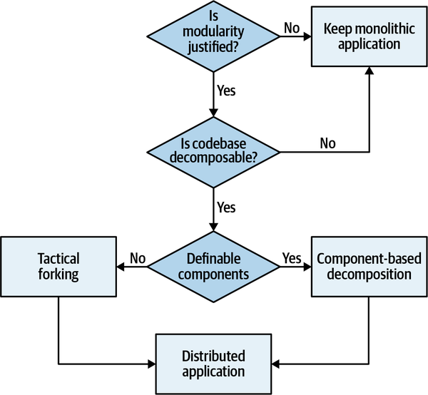

*Hình 4-1. Cây quyết định để chọn cách tiếp cận phân rã*

Chúng tôi mô tả cả hai cách tiếp cận này trong chương này, rồi dành cả một chương ([Chương 5](ch05_component_based_decomposition_patterns.vi.md#ch05-decomposition-patterns)) để mô tả chi tiết từng pattern phân rã component-based.

## Codebase có phân rã được không? (Is the Codebase Decomposable?)

Điều gì xảy ra khi một codebase thiếu cấu trúc nội bộ? Liệu nó có phân rã được không? Phần mềm như vậy có một cái tên thông tục—[Big Ball of Mud Anti-Pattern](https://oreil.ly/7WkHf), do Brian Foote đặt ra trong một [bài tiểu luận same-named (cùng tên)](http://www.laputan.org/mud) năm 1999. Ví dụ, một ứng dụng web phức tạp với các event handler nối thẳng tới các lời gọi database và không có modularity có thể được coi là một architecture Big Ball of Mud. Nhìn chung, kiến trúc sư không dành nhiều thời gian tạo pattern cho những loại hệ thống này; software architecture quan tâm đến cấu trúc nội bộ, và những hệ thống này thiếu chính đặc điểm định nghĩa đó.

Đáng tiếc là, nếu không có governance cẩn thận, nhiều hệ thống phần mềm xuống cấp thành những big ball of mud, để lại cho các kiến trúc sư kế nhiệm (hoặc có lẽ là chính bản thân đáng ghét của mình trước đây) sửa chữa. Bước một trong bất kỳ bài tập tái cấu trúc architecture nào đòi hỏi kiến trúc sư xác định một *kế hoạch* cho việc tái cấu trúc, điều này đến lượt nó đòi hỏi kiến trúc sư hiểu cấu trúc nội bộ. Câu hỏi then chốt mà kiến trúc sư phải trả lời trở thành: codebase này có cứu vãn được không? Nói cách khác, nó có phải là ứng viên cho các decomposition pattern không, hay một cách tiếp cận khác phù hợp hơn?

Không có thước đo đơn lẻ nào xác định được liệu một codebase có cấu trúc nội bộ hợp lý hay không—việc đánh giá đó thuộc về một hoặc nhiều kiến trúc sư. Tuy nhiên, kiến trúc sư có công cụ giúp xác định các đặc điểm vĩ mô của một codebase, đặc biệt là các metric coupling, để giúp đánh giá cấu trúc nội bộ.

### Coupling afferent và efferent (Afferent and Efferent Coupling)

Năm 1979, Edward Yourdon và Larry Constantine xuất bản *Structured Design: Fundamentals of a Discipline of Computer Program and Systems Design* (Yourdon), định nghĩa nhiều khái niệm cốt lõi, bao gồm các metric afferent coupling và efferent coupling. Coupling *afferent* đo số lượng kết nối *đi vào* một code artifact (component, class, hàm, v.v.). Coupling *efferent* đo các kết nối *đi ra* tới các code artifact khác.

Hãy lưu ý giá trị của chỉ hai thước đo này khi thay đổi cấu trúc của một hệ thống. Ví dụ, khi phân rã một monolith thành một architecture phân tán, kiến trúc sư sẽ tìm thấy các class dùng chung như `Address`. Khi xây dựng một monolith, việc developer tái sử dụng các khái niệm cốt lõi như `Address` là phổ biến và được khuyến khích, nhưng khi tách monolith ra, giờ kiến trúc sư phải xác định bao nhiêu phần khác của hệ thống dùng tài sản chung này.

Hầu như mọi nền tảng đều có công cụ cho phép kiến trúc sư phân tích các đặc điểm coupling của code nhằm hỗ trợ việc tái cấu trúc, chuyển đổi, hoặc hiểu một codebase. Có nhiều công cụ cho các nền tảng khác nhau cung cấp một góc nhìn ma trận về quan hệ giữa các class và/hoặc component, như minh họa trong [Hình 4-2](#fig-decomposition-patterns-tf-matrix).

Trong ví dụ này, plug-in Eclipse cung cấp một hình ảnh trực quan về đầu ra của JDepend, bao gồm phân tích coupling theo từng package, cùng với một số metric tổng hợp được nêu bật trong phần tiếp theo.

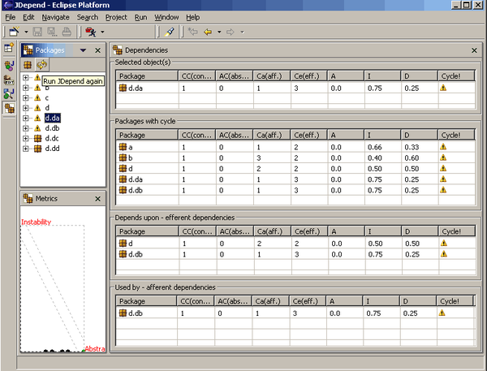

*Hình 4-2. Góc nhìn phân tích các quan hệ coupling của JDepend trong Eclipse*

### Abstractness và instability (Abstractness and Instability)

Robert Martin, một nhân vật well-known (nổi tiếng) trong giới software architecture, đã tạo ra một số metric dẫn xuất cho một cuốn sách về C++ vào cuối thập niên 1990s, áp dụng được cho bất kỳ ngôn ngữ object-oriented (hướng đối tượng) nào. Các metric này—abstractness và instability—đo sự cân bằng của các đặc điểm nội bộ của một codebase.

*Abstractness* (độ trừu tượng) là tỉ lệ giữa các artifact trừu tượng (abstract class, interface, v.v.) và các artifact cụ thể (class triển khai). Nó biểu thị một thước đo giữa *trừu tượng* và *triển khai*. Các phần tử trừu tượng là những đặc điểm của một codebase cho phép developer hiểu chức năng tổng thể tốt hơn. Ví dụ, một codebase gồm một method `main()` duy nhất và 10,000 dòng code sẽ có điểm gần bằng không trên metric này và khá khó hiểu.

Công thức cho abstractness xuất hiện trong [Phương trình 4-1](#eq_abstractness).

*Phương trình 4-1. Abstractness*

$$A = \frac{\sum {m}^{a}}{\sum {m}^{c} + \sum {m}^{a}}$$

Trong phương trình, ${m}^{a}$ biểu thị các phần tử *trừu tượng* (interface hoặc abstract class) trong codebase, và ${m}^{c}$ biểu thị các phần tử *cụ thể*. Kiến trúc sư tính abstractness bằng cách tính tỉ lệ giữa tổng các artifact trừu tượng và tổng các artifact cụ thể.

Một metric dẫn xuất khác, *instability* (độ bất ổn định), là tỉ lệ giữa efferent coupling và tổng của cả efferent coupling lẫn afferent coupling, thể hiện trong [Phương trình 4-2](#eq_instability).

*Phương trình 4-2. Instability*

$$I = \frac{{C}^{e}}{{C}^{e} + {C}^{a}}$$

Trong phương trình, ${C}^{e}$ biểu thị coupling *efferent* (hay đi ra) , và ${C}^{a}$ biểu thị coupling *afferent* (hay đi vào).

Metric instability xác định tính dễ biến động của một codebase. Một codebase thể hiện mức instability cao dễ hỏng hơn khi bị thay đổi vì coupling cao. Hãy xét hai kịch bản, mỗi kịch bản có ${C}^{a}$ bằng 2. Với kịch bản thứ nhất, ${C}^{e}$ = 0, cho điểm instability bằng không. Trong kịch bản kia, ${C}^{e}$ = 3, cho điểm instability bằng 3/5. Do đó, thước đo instability của một component phản ánh có bao nhiêu thay đổi tiềm năng có thể bị ép buộc bởi các thay đổi ở các component liên quan. Một component có giá trị instability gần một thì rất bất ổn định, một giá trị gần không có thể là ổn định hoặc cứng nhắc: nó ổn định nếu module hoặc component chứa chủ yếu các phần tử trừu tượng, và cứng nhắc nếu nó gồm chủ yếu các phần tử cụ thể. Tuy nhiên, trade-off cho tính ổn định cao là thiếu khả năng tái sử dụng—nếu mọi component đều tự chứa, khả năng trùng lặp là cao.

Một component có giá trị *I* gần 1, chúng ta có thể đồng ý, là rất bất ổn định. Tuy nhiên, một component có giá trị I gần 0 có thể là ổn định hoặc cứng nhắc. Tuy nhiên, nếu nó chứa chủ yếu các phần tử cụ thể, thì nó cứng nhắc.

Do đó, nhìn chung, điều quan trọng là xem xét giá trị của *I* và *A* cùng nhau thay vì tách biệt. Đó là lý do để xem xét main sequence được trình bày ở trang tiếp theo.

### Khoảng cách tới main sequence (Distance from the Main Sequence)

Một trong số ít metric tổng thể mà kiến trúc sư có cho cấu trúc kiến trúc là *khoảng cách tới main sequence* (distance from the main sequence), một metric dẫn xuất dựa trên instability và abstractness, thể hiện trong [Phương trình 4-3](#eq_distance).

*Phương trình 4-3. Khoảng cách tới main sequence*

$$D = | A + I - 1 |$$

Trong phương trình, *A* = *abstractness* và *I* = *instability*.

Metric distance-from-the-main-sequence hình dung một quan hệ lý tưởng giữa abstractness và instability; các component nằm gần đường lý tưởng hóa này thể hiện một sự pha trộn lành mạnh giữa hai mối quan tâm cạnh tranh này. Ví dụ, vẽ đồ thị một component cụ thể cho phép developer tính metric distance-from-the-main-sequence, như minh họa trong [Hình 4-3](#ch-measuring-normalized).

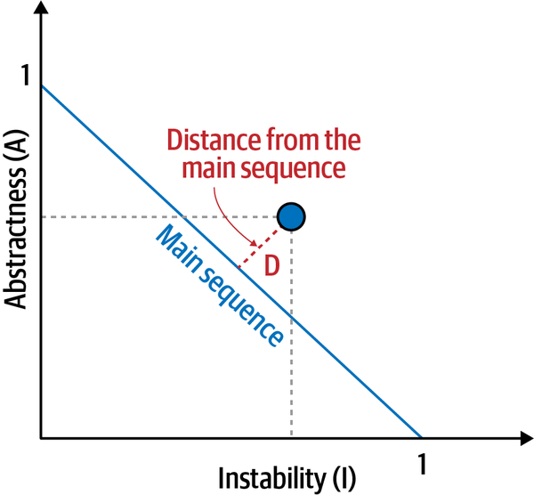

*Hình 4-3. Khoảng cách chuẩn hóa tới main sequence của một component cụ thể*

Developer vẽ đồ thị component ứng viên, rồi đo khoảng cách tới đường lý tưởng hóa. Càng gần đường, component càng cân bằng tốt. Các component rơi quá xa vào góc upper-right (trên bên phải) đi vào vùng mà kiến trúc sư gọi là *zone of uselessness* (vùng vô dụng): code quá trừu tượng trở nên khó dùng. Ngược lại, code rơi vào góc lower-left (dưới bên trái) đi vào *zone of pain* (vùng đau đớn): code có quá nhiều bản triển khai và không đủ trừu tượng trở nên dễ vỡ và khó bảo trì, như minh họa trong [Hình 4-4](#ch-measuring-zones).

Trên nhiều nền tảng có công cụ cung cấp các thước đo này, hỗ trợ kiến trúc sư khi phân tích codebase vì lý do chưa quen thuộc, chuyển đổi, hoặc đánh giá technical debt.

Metric distance-from-the-main-sequence cho kiến trúc sư đang muốn tái cấu trúc ứng dụng biết điều gì? Cũng như trong các dự án xây dựng, việc di chuyển một công trình lớn có nền móng kém tiềm ẩn rủi ro. Tương tự, nếu kiến trúc sư muốn tái cấu trúc một ứng dụng, việc cải thiện cấu trúc nội bộ sẽ giúp di chuyển thực thể đó dễ dàng hơn.

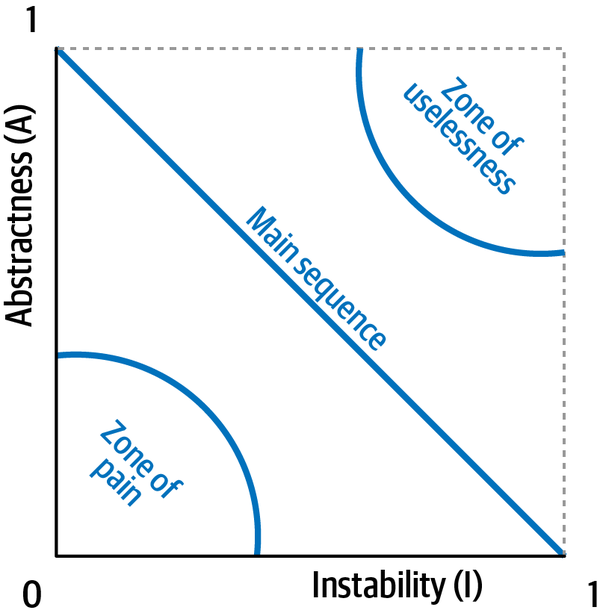

*Hình 4-4. Vùng vô dụng và vùng đau đớn*

Metric này cũng cung cấp một manh mối tốt về sự cân bằng của cấu trúc nội bộ. Nếu kiến trúc sư đánh giá một codebase mà nhiều component rơi vào vùng vô dụng hoặc vùng đau đớn, có lẽ việc cố gắng gia cố cấu trúc nội bộ đến mức có thể sửa chữa được không phải là cách dùng thời gian tốt.

Theo lưu đồ trong [Hình 4-1](#fig-architectural-decomposition-flowchart), một khi kiến trúc sư quyết định rằng codebase phân rã được, bước tiếp theo là xác định cách tiếp cận nào để phân rã ứng dụng. Các phần sau mô tả hai cách tiếp cận để phân rã một ứng dụng: *phân rã component-based* và *tactical forking*.

## Phân rã dựa trên component (Component-Based Decomposition)

Theo kinh nghiệm của chúng tôi, phần lớn khó khăn và độ phức tạp liên quan đến việc chuyển các ứng dụng monolith sang architecture phân tán cao như microservices đến từ các component kiến trúc được định nghĩa kém. Ở đây chúng tôi định nghĩa một *component* là một khối xây dựng của ứng dụng có vai trò và trách nhiệm well-defined (được định nghĩa rõ) trong hệ thống và một tập thao tác well-defined. Component trong hầu hết các ứng dụng được thể hiện thông qua namespace hoặc cấu trúc thư mục và được triển khai thông qua các file component (hay file source). Ví dụ, trong [Hình 4-5](#fig-decomposition-patterns-namespace), cấu trúc thư mục *penultimate/ss/ticket/assign* sẽ biểu thị một component tên Ticket Assign với namespace `penultimate.ss.ticket.assign`.

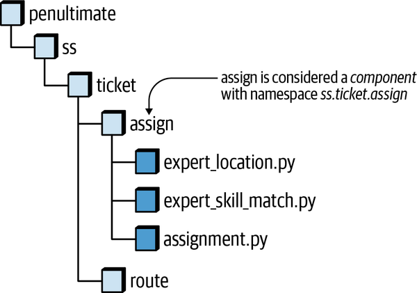

*Hình 4-5. Cấu trúc thư mục của một codebase trở thành namespace của component*

> **Mẹo**
>
> Khi tách các ứng dụng monolith thành các architecture phân tán, hãy xây dựng service từ các *component*, không phải từ các class riêng lẻ.

Qua nhiều năm cộng dồn chuyển đổi các ứng dụng monolith sang architecture phân tán (như microservices), chúng tôi đã phát triển một tập các pattern phân rã component-based được mô tả trong [Chương 5](ch05_component_based_decomposition_patterns.vi.md#ch05-decomposition-patterns), giúp chuẩn bị một ứng dụng monolith cho việc chuyển đổi. Các pattern này bao gồm việc refactor source code để đạt được một tập component well-defined mà cuối cùng có thể trở thành service, giảm bớt công sức cần thiết để chuyển ứng dụng sang architecture phân tán.

Các pattern phân rã component-based này về cơ bản cho phép chuyển một monolithic architecture sang một service-based architecture, được định nghĩa trong [Chương 2](ch02_discerning_coupling_in_software_architecture.vi.md#ch02-discerning) và được mô tả chi tiết hơn trong [*Fundamentals of Software Architecture*](https://learning.oreilly.com/library/view/fundamentals-of-software/9781492043447). Service-based architecture là một dạng lai của microservices architecture style, trong đó một ứng dụng được chia thành các *domain service*, là những service coarse-grained (thô), được deploy riêng, chứa toàn bộ business logic cho một domain cụ thể.

Chuyển sang service-based architecture phù hợp như một đích đến cuối cùng hoặc như một stepping-stone (bước đệm) tiến tới microservices:

- Với vai trò stepping-stone, nó cho phép kiến trúc sư xác định domain nào cần thêm các mức granularity để thành microservices và domain nào có thể giữ nguyên là domain service coarse-grained (quyết định này được thảo luận chi tiết trong [Chương 7](ch07_service_granularity.vi.md#ch07-service-granularity)).
- Service-based architecture không đòi hỏi tách database, do đó cho phép kiến trúc sư tập trung vào phân vùng theo domain và chức năng trước khi giải quyết việc phân rã database (được thảo luận chi tiết trong [Chương 6](ch06_pulling_apart_operational_data.vi.md#ch06-decomposing-operational-data)).
- Service-based architecture không đòi hỏi bất kỳ tự động hóa vận hành hay containerization nào. Mỗi domain service có thể được deploy bằng cùng deployment artifact như ứng dụng gốc (như file EAR, file WAR, Assembly, v.v.).
- Việc chuyển sang service-based architecture là một *việc mang tính kỹ thuật*, nghĩa là nhìn chung nó không liên quan đến các stakeholder nghiệp vụ và không đòi hỏi bất kỳ thay đổi nào đối với cấu trúc tổ chức của bộ phận IT cũng như môi trường testing và deployment.

> **Mẹo**
>
> Khi chuyển các ứng dụng monolith sang microservices, hãy cân nhắc chuyển sang service-based architecture trước như một stepping-stone tiến tới microservices.

Nhưng nếu codebase là một big ball of mud thiếu cấu trúc và không chứa nhiều component quan sát được thì sao? Đó là lúc tactical forking phát huy tác dụng.

## Tactical Forking

Pattern *tactical forking* được [Fausto De La Torre](https://faustodelatog.wordpress.com) đặt tên như một cách tiếp cận thực dụng để tái cấu trúc những architecture về cơ bản là big ball of mud.

Nhìn chung, khi kiến trúc sư nghĩ về việc tái cấu trúc một codebase, họ nghĩ đến việc trích xuất các mảnh, như minh họa trong [Hình 4-6](#fig-decomposition-patterns-tact-fork-extract).

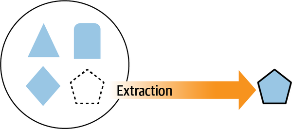

*Hình 4-6. Trích xuất một phần của hệ thống*

Tuy nhiên, một cách khác để nghĩ về việc cô lập một phần của hệ thống là *xóa* các phần không còn cần, như minh họa trong [Hình 4-7](#fig-decomposition-patterns-tact-fork-delete).

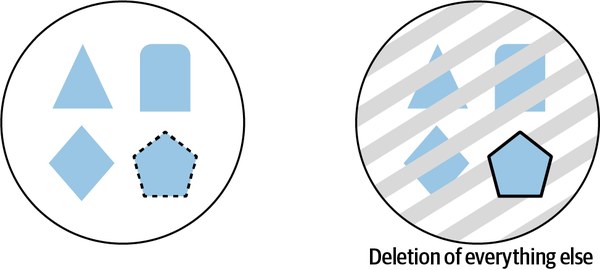

*Hình 4-7. Xóa những gì không mong muốn là một cách khác để cô lập các phần của hệ thống*

Trong [Hình 4-6](#fig-decomposition-patterns-tact-fork-extract), developer phải liên tục đối phó với những sợi coupling chằng chịt định hình architecture này; khi họ trích xuất các mảnh, họ phát hiện ra ngày càng nhiều phần của monolith phải kéo theo vì các phụ thuộc. Trong [Hình 4-7](#fig-decomposition-patterns-tact-fork-delete), developer xóa những code không cần, nhưng các phụ thuộc vẫn còn, tránh được hiệu ứng gỡ rối liên tục của việc trích xuất.

Sự khác biệt giữa *trích xuất* và *xóa* đã truyền cảm hứng cho pattern tactical forking. Với cách tiếp cận phân rã này, hệ thống bắt đầu là một ứng dụng monolith duy nhất, như thể hiện trong [Hình 4-8](#fig-decomposition-patterns-tact-fork-step0-init).

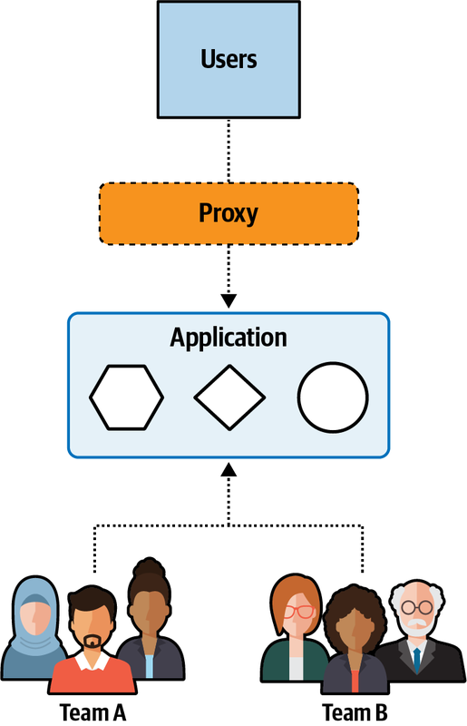

*Hình 4-8. Trước khi tái cấu trúc, một monolith bao gồm nhiều phần*

Hệ thống này gồm nhiều hành vi domain (được thể hiện trong hình bằng các hình học đơn giản) mà không có nhiều tổ chức nội bộ. Ngoài ra, trong kịch bản này, mục tiêu mong muốn là hai team tạo ra hai service từ monolith hiện có, một service với domain *lục giác* và *hình vuông*, và một service khác với domain *hình tròn*.

Bước đầu tiên trong tactical forking là clone toàn bộ monolith, và đưa cho mỗi team một bản sao của toàn bộ codebase, như minh họa trong [Hình 4-9](#fig-decomposition-patterns-tact-fork-step1-split).

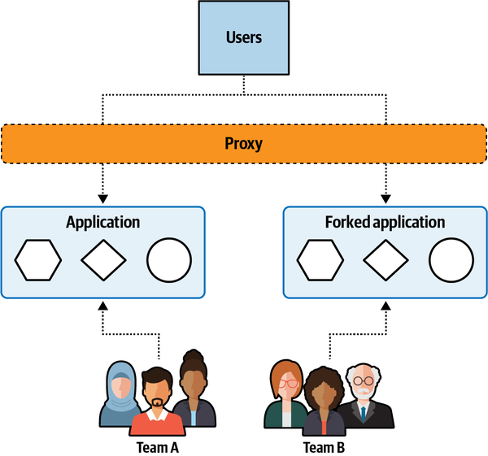

*Hình 4-9. Bước một clone monolith*

Mỗi team nhận một bản sao của toàn bộ codebase, và họ bắt đầu *xóa* (như minh họa trước đó trong [Hình 4-7](#fig-decomposition-patterns-tact-fork-delete)) phần code họ không cần thay vì trích xuất phần code mong muốn. Developer thường thấy cách này dễ hơn trong một codebase coupled chặt vì họ không phải lo trích xuất số lượng lớn phụ thuộc mà coupling cao tạo ra. Thay vào đó, trong chiến lược *xóa*, một khi chức năng đã được cô lập, hãy xóa bất kỳ code nào mà việc xóa không làm hỏng gì.

Khi pattern tiếp tục tiến triển, các team bắt đầu cô lập các phần mục tiêu, như thể hiện trong [Hình 4-10](#fig-decomposition-patterns-tact-fork-step2-constant-refactor). Rồi mỗi team tiếp tục loại bỏ dần code không mong muốn.

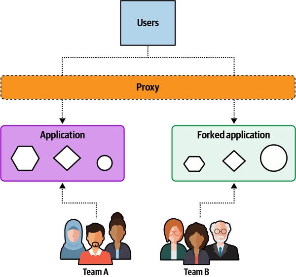

*Hình 4-10. Các team liên tục refactor để loại bỏ code không mong muốn*

Khi hoàn tất pattern tactical forking, các team đã chia ứng dụng monolith ban đầu thành hai phần, giữ nguyên cấu trúc coarse-grained của hành vi trong mỗi phần, như minh họa trong [Hình 4-11](#fig-decomposition-patterns-tact-fork-step3-end-state).

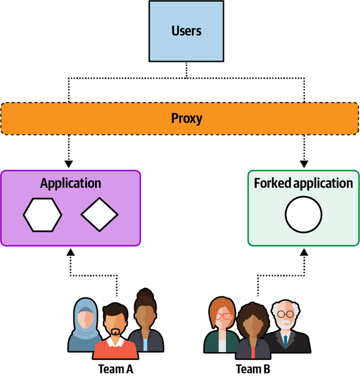

*Hình 4-11. Trạng thái cuối của tactical forking gồm hai service*

Giờ việc tái cấu trúc đã hoàn tất, để lại kết quả là hai service coarse-grained.

### Trade-Offs

Tactical forking là một lựa chọn thay thế khả thi cho một cách tiếp cận phân rã chính quy hơn, phù hợp nhất với các codebase có ít hoặc không có cấu trúc nội bộ. Như mọi thực hành trong architecture, nó có phần trade-offs của riêng mình:

**Lợi ích (Benefits)**

- Các team có thể bắt đầu làm việc ngay với hầu như không cần phân tích up-front (từ trước).
- Developer thấy xóa code dễ hơn trích xuất nó. Trích xuất code từ một codebase hỗn loạn gặp khó khăn vì coupling cao, trong khi code không cần có thể được kiểm chứng bằng biên dịch hoặc testing đơn giản.

**Nhược điểm (Shortcomings)**

- Các service kết quả nhiều khả năng vẫn chứa một lượng lớn code phần lớn tiềm ẩn còn sót lại từ monolith.
- Trừ khi developer bỏ thêm công sức, code bên trong các service mới được tạo ra sẽ không tốt hơn code hỗn loạn của monolith—chỉ là ít hơn mà thôi.
- Có thể xảy ra sự thiếu nhất quán giữa cách đặt tên code dùng chung và các file component dùng chung, dẫn đến khó xác định code chung và giữ nó nhất quán.

Tên của pattern này rất xác đáng (như mọi tên pattern tốt nên vậy)—nó cung cấp một cách tiếp cận *chiến thuật* thay vì *chiến lược* để tái cấu trúc architecture, cho phép các team nhanh chóng chuyển các hệ thống quan trọng hoặc then chốt sang thế hệ tiếp theo (dù theo cách thiếu cấu trúc).

## Sysops Squad Saga: Chọn cách tiếp cận phân rã (Sysops Squad Saga: Choosing a Decomposition Approach)

`Friday, October 29, 10:01`

Giờ đây khi Addison và Austen đã hiểu cả hai cách tiếp cận, họ gặp nhau ở phòng họp chính để phân tích ứng dụng Sysops Squad bằng các metric abstractness và instability nhằm xác định cách tiếp cận nào phù hợp nhất với tình huống của họ.

“Nhìn này,” Addison nói. “Phần lớn code nằm dọc theo main sequence. Tất nhiên có vài điểm ngoại lai, nhưng tôi nghĩ chúng ta có thể kết luận rằng tách ứng dụng này là khả thi. Vậy bước tiếp theo là xác định nên dùng cách tiếp cận nào.”

“Tôi thực sự thích cách tiếp cận tactical forking,” Austen nói. “Nó làm tôi nhớ đến các nhà điêu khắc nổi tiếng, khi được hỏi làm thế nào họ tạc được những tác phẩm đẹp như vậy từ khối cẩm thạch nguyên khối, đã trả lời rằng họ chỉ đơn thuần loại bỏ phần cẩm thạch không nên có ở đó. Tôi cảm thấy ứng dụng Sysops Squad có thể là tác phẩm điêu khắc của tôi!”

“Khoan đã, Michelangelo,” Addison nói. “Đầu tiên là thể thao, giờ lại đến điêu khắc? Cậu cần quyết định xem mình thích dành thời gian ngoài giờ làm vào việc gì. Điều tôi không thích ở cách tiếp cận tactical forking là toàn bộ code trùng lặp và chức năng dùng chung bên trong mỗi service. Phần lớn vấn đề của chúng ta liên quan đến maintainability, testability và reliability tổng thể. Cậu có tưởng tượng được việc phải áp dụng cùng một thay đổi cho nhiều service khác nhau cùng lúc không? Đó sẽ là một cơn ác mộng!”

“Nhưng thực sự có bao nhiêu chức năng dùng chung?” Austen hỏi.

“Tôi không chắc,” Addison nói, “nhưng tôi biết chắc có khá nhiều code dùng chung cho những thứ hạ tầng như logging và security, và tôi biết rất nhiều lời gọi database được dùng chung từ persistence layer của ứng dụng.”

Austen ngừng lại và suy nghĩ về lập luận của Addison một lúc. “Có lẽ cậu đúng. Vì chúng ta đã có các ranh giới component được định nghĩa tốt, tôi đồng ý làm theo cách tiếp cận phân rã component-based chậm hơn và từ bỏ sự nghiệp điêu khắc. Nhưng tôi không từ bỏ thể thao đâu!”

Addison và Austen đi đến thống nhất rằng cách tiếp cận phân rã component sẽ là cách phù hợp cho ứng dụng Sysops Squad. Addison viết một ADR cho quyết định này, nêu các trade-offs và lý do biện minh cho cách tiếp cận phân rã component-based.

> 
>
> *ADR: Chuyển đổi bằng cách tiếp cận phân rã Component-Based (dựa trên component)*
>
> *Bối cảnh (Context)* 
> Chúng tôi sẽ tách ứng dụng Sysops Squad monolith thành các service được deploy riêng. Hai cách tiếp cận chúng tôi đã cân nhắc cho việc chuyển sang architecture phân tán là tactical forking và phân rã component-based.
>
> *Quyết định (Decision)* 
> Chúng tôi sẽ dùng cách tiếp cận phân rã component-based để chuyển ứng dụng Sysops Squad monolith hiện có sang một architecture phân tán.
>
> Ứng dụng có các ranh giới component well-defined, phù hợp với cách tiếp cận phân rã component-based.
>
> Cách tiếp cận này giảm khả năng phải duy trì code trùng lặp trong mỗi service.
>
> Với cách tiếp cận tactical forking, chúng tôi sẽ phải định nghĩa ranh giới service ngay từ đầu để biết cần tạo bao nhiêu ứng dụng được fork. Với cách tiếp cận phân rã component-based, các định nghĩa service sẽ tự nhiên xuất hiện thông qua việc nhóm component.
>
> Xét bản chất của các vấn đề chúng tôi đang gặp với ứng dụng hiện tại về reliability, availability, scalability và workflow, việc dùng cách tiếp cận phân rã component-based mang lại một cuộc chuyển đổi tăng dần an toàn hơn và có kiểm soát hơn so với cách tiếp cận tactical forking.
>
> *Hệ quả (Consequences)* 
> Nỗ lực chuyển đổi nhiều khả năng sẽ mất nhiều thời gian hơn với cách tiếp cận phân rã component-based so với tactical forking. Tuy nhiên, chúng tôi cho rằng các lý do biện minh ở phần trước có trọng lượng hơn trade-off này.
>
> Cách tiếp cận này cho phép các developer trong team cộng tác để xác định chức năng dùng chung, ranh giới component và ranh giới domain. Tactical forking sẽ đòi hỏi chúng tôi chia team thành các team nhỏ hơn, riêng biệt cho mỗi ứng dụng được fork và làm tăng lượng phối hợp cần thiết giữa các team nhỏ hơn.
