<a id="ch05-decomposition-patterns"></a>

# Chương 5. Các pattern phân rã dựa trên component (Component-Based Decomposition Patterns)

`Monday, November 1, 11:53`

Addison và Austen đã chọn dùng cách tiếp cận phân rã component-based, <a id="idm45798387387496"></a><a id="idm45798387386456"></a>nhưng chưa chắc chắn về chi tiết của từng decomposition pattern. Họ đã thử tìm hiểu về cách tiếp cận này, nhưng không tìm được nhiều thông tin trên internet. Một lần nữa, họ gặp Logan trong phòng họp để xin lời khuyên về bản chất của các pattern này và cách dùng chúng.

“Nghe này, Logan,” Addison nói, “trước tiên tôi muốn nói rằng cả hai chúng tôi thực sự cảm kích vì anh đã dành nhiều thời gian với chúng tôi để khởi động quá trình chuyển đổi này. Tôi biết anh đang cực kỳ bận với những vụ chữa cháy của riêng mình.”

“Không vấn đề gì,” Logan nói. “Dân chữa cháy chúng ta phải sát cánh bên nhau. Tôi từng ở vị trí của các cậu, nên tôi biết cảm giác mò mẫm trong bóng tối với những việc kiểu này là thế nào. Hơn nữa, đây là một nỗ lực chuyển đổi được chú ý nhiều, và điều quan trọng là cả hai cậu làm đúng ngay lần đầu. Vì sẽ không có lần thứ hai đâu.”

“Cảm ơn anh, Logan,” Austen nói. “Khoảng hai tiếng nữa tôi có một trận đấu, nên chúng ta sẽ cố gắng nói ngắn gọn. Trước đó anh đã nói về phân rã component-based, và chúng tôi đã chọn cách tiếp cận đó, nhưng chúng tôi không tìm được nhiều thông tin về nó trên internet.”

“Tôi không ngạc nhiên,” Logan nói. “Chưa có nhiều bài viết về chúng, nhưng tôi biết sắp có một cuốn sách mô tả chi tiết các pattern này ra mắt vào khoảng cuối năm nay. Lần đầu tôi biết đến các decomposition pattern này là tại một hội nghị khoảng bốn năm trước, trong một phiên trình bày của một kiến trúc sư phần mềm giàu kinh nghiệm. Tôi thực sự ấn tượng với cách tiếp cận lặp và có phương pháp để chuyển đổi an toàn từ một monolithic architecture sang một architecture phân tán như service-based architecture và microservices. Từ đó tôi đã dùng các pattern này khá thành công.”

“Anh có thể cho chúng tôi thấy các pattern này hoạt động thế nào không?” Addison hỏi.

“Được chứ,” Logan nói. “Hãy đi từng pattern một.”

Component-based decomposition (phân rã dựa trên component, được giới thiệu trong [Chương 4](ch04_architectural_decomposition.vi.md#ch04-architectural-decomposition)) là một <a id="idm45798387379176"></a><a id="idm45798387378184"></a><a id="idm45798387376952"></a><a id="idm45798387375720"></a><a id="idm45798387374488"></a><a id="idm45798387373240"></a>kỹ thuật rất hiệu quả để tách một ứng dụng monolith khi codebase có phần nào cấu trúc và được nhóm theo namespace (hoặc thư mục). Chương này giới thiệu một tập pattern, gọi là *component-based decomposition patterns* (các pattern phân rã dựa trên component), mô tả việc refactor source code monolith để đạt được một tập component well-defined (được định nghĩa rõ) mà cuối cùng có thể trở thành service. Các decomposition pattern này giảm đáng kể công sức chuyển các ứng dụng monolith sang architecture phân tán.

[Hình 5-1](#fig-decomposition-patterns-roadmap-alt) thể hiện lộ trình cho các pattern phân rã component-based được mô tả trong chương này và cách chúng được dùng cùng nhau để tách một ứng dụng monolith. Ban đầu, các pattern này được dùng cùng nhau theo trình tự khi chuyển một ứng dụng monolith sang một ứng dụng phân tán, và sau đó được dùng riêng lẻ khi bảo trì được áp dụng cho ứng dụng monolith trong quá trình chuyển đổi. Các decomposition pattern này được tóm tắt như sau:

**[“Identify and Size Components Pattern”](#sec-pattern-identify-size)**

Thường là pattern đầu tiên được áp dụng khi tách một ứng dụng monolith. Pattern này được dùng để xác định, quản lý và định cỡ phù hợp các component.

**[“Gather Common Domain Components Pattern”](#sec-pattern-gather-common)**

Được dùng để hợp nhất business domain logic chung có thể bị trùng lặp khắp ứng dụng, giảm số lượng service có khả năng trùng lặp trong architecture phân tán kết quả.

**[“Flatten Components Pattern”](#sec-pattern-flatten)**

Được dùng để thu gọn hoặc mở rộng domain, subdomain và component, nhờ đó bảo đảm rằng các file source code chỉ nằm trong các component well-defined.

**[“Determine Component Dependencies Pattern”](#sec-pattern-dependencies)**

Được dùng để xác định các phụ thuộc giữa component, tinh chỉnh các phụ thuộc đó, và xác định tính khả thi cũng như mức công sức tổng thể cho một cuộc chuyển đổi từ monolithic architecture sang architecture phân tán.

**[“Create Component Domains Pattern”](#sec-pattern-create-domains)**

Được dùng để nhóm các component thành các domain logic trong ứng dụng và refactor namespace và/hoặc thư mục của component cho khớp với một domain cụ thể.

**[“Create Domain Services Pattern”](#sec-pattern-domain-services)**

Được dùng để tách vật lý một monolithic architecture bằng cách chuyển các domain logic trong ứng dụng monolith thành các domain service được deploy riêng.

<a id="fig-decomposition-patterns-roadmap-alt"></a>

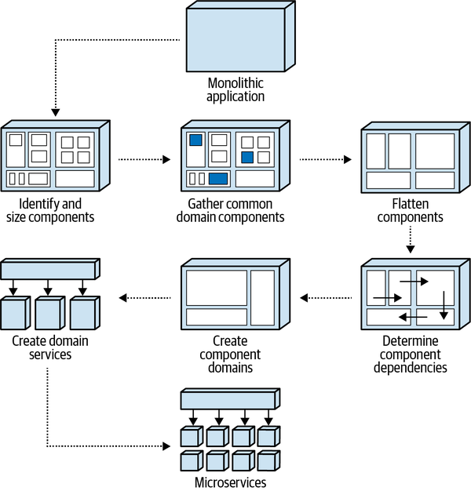

*Hình 5-1. Luồng và cách dùng các pattern component-based decomposition*

Mỗi pattern được mô tả trong chương này được chia thành ba phần. Phần thứ nhất, “Mô tả pattern” (Pattern Description), mô tả cách pattern hoạt động, vì sao pattern quan trọng, và kết quả của việc áp dụng pattern là gì. Biết rằng hầu hết các hệ thống đều là mục tiêu di động trong quá trình chuyển đổi, phần thứ hai, “Fitness function cho governance” (Fitness Functions for Governance), mô tả governance tự động có thể được dùng sau khi áp dụng pattern để liên tục phân tích và kiểm chứng tính đúng đắn của codebase trong quá trình bảo trì đang diễn ra. Phần thứ ba dùng ứng dụng Sysops Squad real-world (xem [“Introducing the Sysops Squad Saga”](ch01_what_happens_when_there_are_no_best_practices.vi.md#sec-sysops-squad)) để minh họa việc dùng pattern và minh họa các biến đổi của ứng dụng sau khi pattern đã được áp dụng.

> <a id="sidebar-architecture-stories"></a>
>
> **Architecture story (Architecture Stories)**
>
> Xuyên suốt chương này, chúng tôi sẽ dùng architecture story như một <a id="idm45798387350136"></a><a id="idm45798387348840"></a><a id="idm45798387347608"></a><a id="idm45798387346360"></a><a id="idm45798387345128"></a>cách ghi lại và mô tả việc refactor code tác động đến khía cạnh cấu trúc của ứng dụng trong mỗi saga Sysops Squad. Khác với *user story*, vốn mô tả một tính năng cần được hiện thực hoặc thay đổi, một *architecture story* mô tả việc refactor code cụ thể tác động đến cấu trúc tổng thể của một ứng dụng và đáp ứng một loại động lực nghiệp vụ nào đó (như scalability gia tăng, time-to-market tốt hơn, v.v.). Ví dụ, nếu một kiến trúc sư thấy cần tách một payment service để hỗ trợ extensibility tổng thể tốt hơn cho việc thêm các loại thanh toán bổ sung, một architecture story mới sẽ được tạo ra và có nội dung như sau:
>
> *Với vai trò kiến trúc sư, tôi cần decouple payment service để hỗ trợ extensibility và agility tốt hơn khi thêm các loại thanh toán bổ sung*.
>
> Chúng tôi xem architecture story là tách biệt với các story *technical debt*. Các story technical debt thường ghi lại những việc developer cần làm trong một iteration sau để “dọn dẹp code,” trong khi một architecture story ghi lại thứ gì đó cần thay đổi nhanh để hỗ trợ một architectural characteristic hoặc nhu cầu nghiệp vụ cụ thể.

<a id="sec-pattern-identify-size"></a>

## Pattern xác định và định cỡ component (Identify and Size Components Pattern)

Bước đầu tiên trong bất kỳ cuộc chuyển đổi monolith nào là áp dụng pattern *Identify and Size Components* (xác định và định cỡ component).<a id="ch05-idsz7"></a><a id="ch05-idsz"></a><a id="ch05-idsz2"></a><a id="ch05-idsz3"></a><a id="ch05-idsz5"></a><a id="ch05-idsz6"></a> Mục đích của pattern này là xác định và lập danh mục các component kiến trúc (khối xây dựng logic) của ứng dụng rồi định cỡ phù hợp cho các component.

<a id="idm45798387329720"></a>

### Mô tả pattern (Pattern Description)

Vì service được xây dựng từ component, điều then chốt không chỉ là xác định các component trong một ứng dụng, mà còn phải định cỡ chúng phù hợp. Pattern này được dùng để xác định các component hoặc quá lớn (làm quá nhiều) hoặc quá nhỏ (làm không đủ). Các component quá lớn so với các component khác nhìn chung coupled nhiều hơn với các component khác, khó tách thành các service riêng hơn, và dẫn đến một architecture kém modular hơn.

Đáng tiếc là khó xác định kích thước của một component. Số lượng file source, class, và tổng số dòng code không phải là metric tốt vì mỗi lập trình viên thiết kế class, method và hàm khác nhau. <a id="idm45798387327048"></a><a id="idm45798387326344"></a>Một metric chúng tôi thấy hữu ích cho việc định cỡ component là tính tổng số statement trong một component nhất định (tổng các statement trong mọi file source chứa trong một namespace hoặc thư mục). Một *statement* là một hành động hoàn chỉnh duy nhất được thực hiện trong source code, thường được kết thúc bằng một ký tự đặc biệt (như dấu chấm phẩy trong các ngôn ngữ như Java, C, C++, C#, Go và JavaScript; hoặc ký tự xuống dòng trong các ngôn ngữ như F#, Python và Ruby). Dù không phải là metric hoàn hảo, ít nhất nó là một chỉ báo tốt cho biết component đang làm bao nhiêu việc và component phức tạp đến mức nào.

Việc có kích thước component tương đối nhất quán trong một ứng dụng là quan trọng. Nói chung, kích thước các component trong một ứng dụng nên nằm trong khoảng một đến hai độ lệch chuẩn so với kích thước component trung bình. Ngoài ra, tỉ lệ phần trăm code mà mỗi component đại diện nên được phân bố tương đối đều giữa các component của ứng dụng và không chênh lệch đáng kể.

Dù nhiều [công cụ phân tích code tĩnh](https://oreil.ly/XyIgr) <a id="idm45798387322296"></a><a id="idm45798387321256"></a><a id="idm45798387320568"></a> có thể hiển thị số statement trong một file source, nhiều công cụ trong số đó không cộng dồn tổng statement theo *component*. Vì vậy, kiến trúc sư thường phải thực hiện post-processing (hậu xử lý) thủ công hoặc tự động để cộng dồn tổng statement theo component rồi tính tỉ lệ phần trăm code mà component đó đại diện.

Bất kể dùng công cụ hay thuật toán nào, các thông tin và metric quan trọng cần thu thập và tính toán cho pattern này được thể hiện trong [Bảng 5-1](#table-ss-defs) và được định nghĩa trong danh sách sau.

<a id="table-ss-defs"></a>

<a id="table-ss-defs"></a>*Bảng 5-1. Ví dụ về danh mục component và phân tích kích thước component*

| Tên component | Namespace của component | Phần trăm | Số statement | Số file |
|---|---|---|---|---|
| Billing Payment | `ss.billing.payment` | 5 | 4,312 | 23 |
| Billing History | `ss.billing.history` | 4 | 3,209 | 17 |
| Customer Notification | `ss.customer.notification` | 2 | 1,433 | 7 |

**Tên component (Component name)**

Một tên mô tả và định danh của component<a id="idm45798387299512"></a> nhất quán xuyên suốt các sơ đồ và tài liệu của ứng dụng. Tên component nên đủ rõ ràng để self-describing (tự mô tả) nhiều nhất có thể. Ví dụ, component Billing History thể hiện trong [Bảng 5-1](#table-ss-defs) rõ ràng là một component chứa các file source code dùng để quản lý lịch sử thanh toán của khách hàng. Nếu vai trò và trách nhiệm riêng biệt của component không xác định được ngay, hãy cân nhắc đổi tên component (và có thể cả namespace tương ứng) thành một tên mô tả rõ hơn. Ví dụ, một component tên Ticket Manager để lại quá nhiều câu hỏi chưa được trả lời về vai trò và trách nhiệm của nó trong hệ thống, và nên được đổi tên để mô tả vai trò của nó tốt hơn.

**Namespace của component (Component namespace)**

Định danh vật lý (hoặc logic) của component, biểu thị nơi <a id="idm45798387295320"></a><a id="idm45798387294344"></a>các file source code hiện thực component đó được nhóm và lưu trữ. Định danh này thường được ký hiệu qua một namespace, cấu trúc package (Java), hoặc cấu trúc thư mục. Khi một cấu trúc thư mục được dùng để ký hiệu component, chúng tôi thường chuyển ký tự phân cách file thành dấu chấm (.) và tạo một namespace logic tương ứng. Ví dụ, namespace của component cho các file source code trong cấu trúc thư mục *ss/customer/notification* sẽ có giá trị namespace `ss.customer.notification`. Một số ngôn ngữ đòi hỏi namespace khớp với cấu trúc thư mục (như Java với *package*), trong khi các ngôn ngữ khác (như C# với *namespace*) không áp đặt ràng buộc này. Dù dùng định danh namespace nào, hãy bảo đảm loại định danh nhất quán trên tất cả các component trong ứng dụng.

**Phần trăm (Percent)**

Kích thước tương đối của component dựa trên tỉ lệ phần trăm của nó trong tổng source code chứa component đó. Metric phần trăm hữu ích trong việc xác định các component có vẻ quá lớn hoặc quá nhỏ trong toàn bộ ứng dụng. Metric này được tính bằng cách lấy tổng số statement trong các file source code biểu thị component đó chia cho tổng số statement trong toàn bộ codebase của ứng dụng. Ví dụ, giá trị phần trăm bằng 5 của component `ss.billing.payment` trong [Bảng 5-1](#table-ss-defs) có nghĩa là component này chiếm 5% toàn bộ codebase.

**Số statement (Statements)**

Tổng số statement source code trong tất cả các file source chứa trong component đó. Metric này hữu ích không chỉ để xác định kích thước tương đối của các component trong một ứng dụng, mà còn để xác định độ phức tạp tổng thể của component. Ví dụ, một component single-purpose (đơn mục đích) có vẻ đơn giản tên Customer Wishlist có thể có tổng cộng 12,000 statement, cho thấy việc xử lý các mục wish list có lẽ phức tạp hơn vẻ ngoài. Metric này cũng cần thiết để tính metric phần trăm đã mô tả ở trên.

**Số file (Files)**

Tổng số file source code (như class, interface, type, v.v.) chứa trong component. Dù metric này ít liên quan đến kích thước của một component, nó cung cấp thêm thông tin về component từ góc độ cấu trúc class. Ví dụ, một component với 18,409 statement và chỉ 2 file là một ứng viên tốt để refactor thành các class nhỏ hơn, theo ngữ cảnh hơn.

Khi định cỡ lại một component lớn, chúng tôi khuyến nghị dùng cách tiếp cận phân rã theo chức năng hoặc cách tiếp cận domain-driven để xác định các subdomain có thể tồn tại bên trong component lớn đó. Ví dụ, giả sử ứng dụng Sysops Squad có một component Trouble Ticket chứa 22% codebase, chịu trách nhiệm tạo, giao, định tuyến và hoàn tất ticket. Trong trường hợp này, có thể hợp lý khi tách component Trouble Ticket duy nhất thành bốn component riêng biệt (Ticket Creation, Ticket Assignment, Ticket Routing và Ticket Completion), giảm tỉ lệ phần trăm code mà mỗi component đại diện, nhờ đó tạo ra một ứng dụng modular hơn. Nếu không có subdomain rõ ràng nào tồn tại bên trong một component lớn, hãy để component nguyên như vậy.

<a id="idm45798387282344"></a>

### Fitness function cho governance (Fitness Functions for Governance)

Một khi decomposition pattern này đã được áp dụng và các component<a id="ch05-pff14"></a><a id="ch05-pff13"></a><a id="ch05-pff12"></a> đã được xác định và định cỡ đúng, điều quan trọng là áp dụng một loại governance tự động nào đó để xác định các component mới và bảo đảm các component không trở nên quá lớn trong quá trình bảo trì ứng dụng thông thường và không tạo ra các phụ thuộc không mong muốn hoặc ngoài ý định. Các fitness function tổng thể tự động có thể được kích hoạt trong quá trình deployment để cảnh báo kiến trúc sư nếu vượt quá các ràng buộc đã chỉ định (như metric phần trăm đã thảo luận trước đó hoặc việc dùng độ lệch chuẩn để xác định các điểm ngoại lai).

Fitness function có thể được hiện thực thông qua code custom-written (tự viết) hoặc thông qua việc dùng các công cụ open source hoặc COTS như một phần của CI/CD pipeline. Một số fitness function tự động có thể được dùng để giúp quản trị decomposition pattern này như sau.

#### Fitness function: Duy trì danh mục component (Maintain component inventory)

Fitness function tổng thể tự động này, thường được kích hoạt khi deployment thông qua một CI/CD pipeline, giúp giữ cho danh mục component luôn cập nhật. Nó được dùng để cảnh báo kiến trúc sư về các component có thể đã được development team thêm vào hoặc gỡ bỏ. Việc xác định các component mới hoặc bị gỡ bỏ không chỉ then chốt cho pattern này, mà còn cho các decomposition pattern khác. [Ví dụ 5-1](#source-ff-inventory) thể hiện pseudocode và thuật toán cho một cách hiện thực khả dĩ của fitness function này.

<a id="source-ff-inventory"></a>

*Ví dụ 5-1. Pseudocode để duy trì danh mục component*

```perl
# Get prior component namespaces that are stored in a datastore
LIST prior_list = read_from_datastore()

# Walk the directory structure, creating namespaces for each complete path
LIST current_list = identify_components(root_directory)

# Send an alert if new or removed components are identified
LIST added_list = find_added(current_list, prior_list)
LIST removed_list = find_removed(current_list, prior_list)
IF added_list NOT EMPTY {
  add_to_datastore(added_list)
  send_alert(added_list)
}
IF removed_list NOT EMPTY {
  remove_from_datastore(removed_list)
  send_alert(removed_list)
}
```

#### Fitness function: Không component nào được vượt quá một tỉ lệ phần trăm nhất định của toàn bộ codebase (No component shall exceed \<some percent> of the overall codebase)

Fitness function tổng thể tự động này, thường được kích hoạt khi deployment thông qua một CI/CD pipeline, xác định các component vượt quá một ngưỡng nhất định về tỉ lệ phần trăm tổng source code mà component đó đại diện, và cảnh báo kiến trúc sư nếu có component nào vượt quá ngưỡng đó. Như đã đề cập trước đó trong chương này, giá trị ngưỡng phần trăm sẽ thay đổi tùy theo kích thước của ứng dụng, nhưng nên được đặt sao cho xác định được các điểm ngoại lai đáng kể. Ví dụ, với một ứng dụng tương đối nhỏ chỉ có 10 component, đặt ngưỡng phần trăm ở mức khoảng 30% sẽ đủ để xác định một component quá lớn, trong khi với một ứng dụng lớn có 50 component, ngưỡng 10% sẽ phù hợp hơn. [Ví dụ 5-2](#source-ff-percent) thể hiện pseudocode và thuật toán cho một cách hiện thực khả dĩ của fitness function này.

<a id="source-ff-percent"></a>

*Ví dụ 5-2. Pseudocode để duy trì kích thước component dựa trên phần trăm code*

```perl
# Walk the directory structure, creating namespaces for each complete path
LIST component_list = identify_components(root_directory)

# Walk through all of the source code to accumulate total statements
total_statements = accumulate_statements(root_directory)

# Walk through the source code for each component, accumulating statements
# and calculating the percentage of code each component represents. Send
# an alert if greater than 10%
FOREACH component IN component_list {
  component_statements = accumulate_statements(component)
  percent = component_statements / total_statements
  IF percent > .10 {
    send_alert(component, percent)
  }
}
```

#### Fitness function: Không component nào được vượt quá một số độ lệch chuẩn nhất định so với kích thước component trung bình (No component shall exceed \<some number of standard deviations> from the mean component size)

Fitness function tổng thể tự động này, thường được kích hoạt khi deployment thông qua một CI/CD pipeline, xác định các component vượt quá một ngưỡng nhất định về số độ lệch chuẩn so với giá trị trung bình của kích thước mọi component (dựa trên tổng số statement trong component), và cảnh báo kiến trúc sư nếu có component nào vượt quá ngưỡng đó.

Độ lệch chuẩn là một phương tiện hữu ích để xác định các điểm ngoại lai về kích thước component.<a id="idm45798383728856"></a> Độ lệch chuẩn được tính như sau:

$$s = \sqrt{\frac{1}{N - 1} {\sum}_{i = 1}^{N} {( {x}_{i} - {x}^{¯} )}^{2}}$$

trong đó *N* là số giá trị quan sát được, ${x}_{i}$ là các giá trị quan sát được, và ${x}^{¯}$ là giá trị trung bình của các giá trị quan sát được. Giá trị trung bình của các giá trị quan sát được (${x}^{¯}$) được tính như sau:

$${x}^{¯} = \frac{1}{N} {\sum}_{i = 1}^{N} {x}_{i}$$

Độ lệch chuẩn sau đó có thể được dùng cùng với độ chênh lệch so với giá trị trung bình để xác định kích thước component cách giá trị trung bình bao nhiêu độ lệch chuẩn. [Ví dụ 5-3](#source-ff-stddev) thể hiện pseudocode cho fitness function này, dùng ba độ lệch chuẩn so với giá trị trung bình làm ngưỡng.<a id="idm45798383698536"></a><a id="idm45798383697864"></a><a id="idm45798383697192"></a>

<a id="source-ff-stddev"></a>

*Ví dụ 5-3. Pseudocode để duy trì kích thước component dựa trên số độ lệch chuẩn*

```perl
# Walk the directory structure, creating namespaces for each complete path
LIST component_list = identify_components(root_directory)

# Walk through all of the source code to accumulate total statements and number
# of statements per component
SET total_statements TO 0
MAP component_size_map
FOREACH component IN component_list {
  num_statements = accumulate_statements(component)
  ADD num_statements TO total_statements
  ADD component,num_statements TO component_size_map
}

# Calculate the standard deviation
SET square_diff_sum TO 0
num_components = get_num_entries(component_list)
mean = total_statements / num_components
FOREACH component,size IN component_size_map {
  diff = size - mean
  ADD square(diff) TO square_diff_sum
}
std_dev = square_root(square_diff_sum / (num_components - 1))

# For each component calculate the number of standard deviations from the
# mean. Send an alert if greater than 3
FOREACH component,size IN component_size_map {
  diff_from_mean = absolute_value(size - mean);
  num_std_devs = diff_from_mean / std_dev
  IF num_std_devs > 3 {
    send_alert(component, num_std_devs)
  }
}
```

<a id="idm45798383693672"></a>

### Sysops Squad Saga: Định cỡ component (Sysops Squad Saga: Sizing Components)

`Tuesday, November 2, 09:12`

Sau cuộc thảo luận với Logan (kiến trúc sư trưởng) về <a id="ch05-sss1"></a>các pattern phân rã component-based, Addison quyết định áp dụng pattern Identify and Size Components để xác định tất cả các component trong ứng dụng ticket Sysops Squad và tính kích thước của từng component dựa trên tổng số statement trong mỗi component.

Addison thu thập mọi thông tin cần thiết về component và đưa thông tin này vào [Bảng 5-2](#table-ss-before-size), tính tỉ lệ phần trăm code cho mỗi component dựa trên tổng số statement trong toàn bộ ứng dụng (trong trường hợp này là 82,931 statement).

<a id="table-ss-before-size"></a>

<a id="table-ss-before-size"></a>*Bảng 5-2. Phân tích kích thước component cho ứng dụng Sysops Squad*

| Tên component | Namespace của component | Phần trăm | Số statement | Số file |
|---|---|---|---|---|
| Login | `ss.login` | 2 | 1865 | 3 |
| Billing Payment | `ss.billing.payment` | 5 | 4,312 | 23 |
| Billing History | `ss.billing.history` | 4 | 3,209 | 17 |
| Customer Notification | `ss.customer.notification` | 2 | 1,433 | 7 |
| Customer Profile | `ss.customer.profile` | 5 | 4,012 | 16 |
| Expert Profile | `ss.expert.profile` | 6 | 5,099 | 32 |
| KB Maint | `ss.kb.maintenance` | 2 | 1,701 | 14 |
| KB Search | `ss.kb.search` | 3 | 2,871 | 4 |
| **Reporting** | `ss.reporting` | **33** | **27,765** | **162** |
| Ticket | `ss.ticket` | 8 | 7,009 | 45 |
| Ticket Assign | `ss.ticket.assign` | 9 | 7,845 | 14 |
| Ticket Notify | `ss.ticket.notify` | 2 | 1,765 | 3 |
| Ticket Route | `ss.ticket.route` | 2 | 1,468 | 4 |
| Support Contract | `ss.supportcontract` | 5 | 4,104 | 24 |
| Survey | `ss.survey` | 3 | 2,204 | 5 |
| Survey Notify | `ss.survey.notify` | 2 | 1,299 | 3 |
| Survey Templates | `ss.survey.templates` | 2 | 1,672 | 7 |
| User Maintenance | `ss.users` | 4 | 3,298 | 12 |

Addison nhận thấy rằng hầu hết các component được liệt kê trong [Bảng 5-2](#table-ss-before-size) có kích thước gần bằng nhau, ngoại trừ component Reporting (`ss.reporting`) chiếm 33% codebase. Vì component Reporting lớn hơn đáng kể so với các component khác (minh họa trong [Hình 5-2](#fig-decomposition-patterns-ss-components-size-before)), Addison chọn tách component này ra để giảm kích thước tổng thể của nó.

<a id="fig-decomposition-patterns-ss-components-size-before"></a>

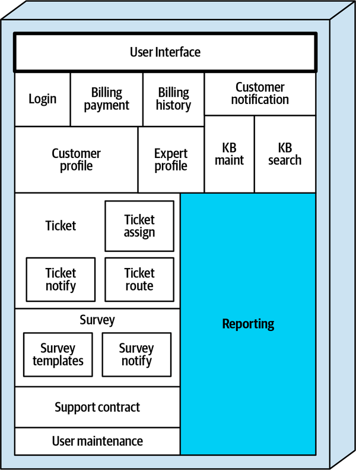

*Hình 5-2. Component Reporting quá lớn và nên được tách ra*

Sau khi phân tích, Addison phát hiện rằng component báo cáo chứa source code hiện thực ba loại báo cáo:

- Báo cáo ticket (báo cáo nhân khẩu học ticket, báo cáo ticket theo ngày/tuần/tháng, báo cáo thời gian giải quyết ticket, v.v.)
- Báo cáo chuyên gia (báo cáo mức sử dụng chuyên gia, báo cáo phân bố chuyên gia, v.v.)
- Báo cáo tài chính (báo cáo chi phí sửa chữa, báo cáo chi phí chuyên gia, báo cáo lợi nhuận, v.v.)

Addison cũng xác định code chung (dùng chung) mà mọi loại báo cáo đều dùng, như các tiện ích chung, bộ tính toán, các truy vấn dữ liệu dùng chung, phân phối báo cáo, và các bộ định dạng dữ liệu dùng chung. Addison tạo một architecture story (xem [“Architecture Stories”](#sidebar-architecture-stories)) cho việc refactor này và giải thích nó cho development team. Sydney, một trong các developer của Sysops Squad được giao architecture story này, đã refactor code để tách component Reporting duy nhất thành bốn component riêng biệt—một component Reporting Shared chứa code chung và ba component khác (Ticket Reports, Expert Reports và Financial Reports), mỗi component đại diện cho một mảng báo cáo chức năng, như minh họa trong [Hình 5-3](#fig-decomposition-patterns-ss-components-size-after).

<a id="fig-decomposition-patterns-ss-components-size-after"></a>

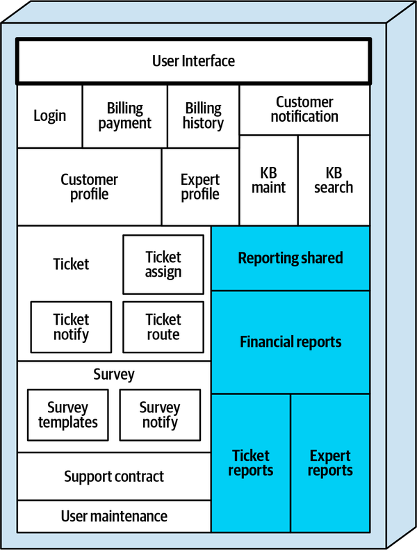

*Hình 5-3. Component Reporting lớn được tách thành các component báo cáo nhỏ hơn*

Sau khi Sydney commit các thay đổi, Addison phân tích lại code và xác nhận rằng giờ tất cả các component đã được phân bố khá đều về kích thước. Addison ghi lại kết quả của việc áp dụng decomposition pattern này trong [Bảng 5-3](#table-ss-after-size).

<a id="table-ss-after-size"></a>

<a id="table-ss-after-size"></a>*Bảng 5-3. Kích thước component sau khi áp dụng pattern Identify and Size Components*

| Tên component | Namespace của component | Phần trăm | Số statement | Số file |
|---|---|---|---|---|
| Login | `ss.login` | 2 | 1865 | 3 |
| Billing Payment | `ss.billing.payment` | 5 | 4,312 | 23 |
| Billing History | `ss.billing.history` | 4 | 3,209 | 17 |
| Customer Notification | `ss.customer.notification` | 2 | 1,433 | 7 |
| Customer Profile | `ss.customer.profile` | 5 | 4,012 | 16 |
| Expert Profile | `ss.expert.profile` | 6 | 5,099 | 32 |
| KB Maint | `ss.kb.maintenance` | 2 | 1,701 | 14 |
| KB Search | `ss.kb.search` | 3 | 2,871 | 4 |
| **Reporting Shared** | `ss.reporting.shared` | **7** | **5,309** | **20** |
| **Ticket Reports** | `ss.reporting.tickets` | **8** | **6,955** | **58** |
| **Expert Reports** | `ss.reporting.experts` | **9** | **7,734** | **48** |
| **Financial Reports** | `ss.reporting.financial` | **9** | **7,767** | **36** |
| Ticket | `ss.ticket` | 8 | 7,009 | 45 |
| Ticket Assign | `ss.ticket.assign` | 9 | 7,845 | 14 |
| Ticket Notify | `ss.ticket.notify` | 2 | 1,765 | 3 |
| Ticket Route | `ss.ticket.route` | 2 | 1,468 | 4 |
| Support Contract | `ss.supportcontract` | 5 | 4,104 | 24 |
| Survey | `ss.survey` | 3 | 2,204 | 5 |
| Survey Notify | `ss.survey.notify` | 2 | 1,299 | 3 |
| Survey Templates | `ss.survey.templates` | 2 | 1,672 | 7 |
| User Maintenance | `ss.users` | 4 | 3,298 | 12 |

Lưu ý trong Sysops Squad Saga ở trên rằng Reporting không còn tồn tại như một component trong [Bảng 5-3](#table-ss-after-size) hay [Hình 5-3](#fig-decomposition-patterns-ss-components-size-after). Dù *namespace* vẫn còn tồn tại (`ss.reporting`), nó không còn được coi là một component, mà là một subdomain. <a id="idm45798383320472"></a>Các component đã được refactor liệt kê trong [Bảng 5-3](#table-ss-after-size) sẽ được dùng khi áp dụng decomposition pattern tiếp theo, Gather Common Domain Components.<a id="idm45798383318728"></a><a id="idm45798383318056"></a><a id="idm45798383317384"></a><a id="idm45798383316712"></a><a id="idm45798383316040"></a><a id="idm45798383315368"></a>

<a id="sec-pattern-gather-common"></a>

## Pattern gom các domain component chung (Gather Common Domain Components Pattern)

Khi chuyển từ monolithic architecture sang architecture phân tán, <a id="ch05-ddp26"></a><a id="ch05-ddp2"></a><a id="ch05-ddp22"></a><a id="ch05-ddp24"></a><a id="ch05-ddp25"></a>việc xác định và hợp nhất chức năng domain chung thường có lợi để các service chung dễ xác định và tạo ra hơn. Pattern *Gather Common Domain Components* (gom các domain component chung) được dùng để xác định và thu thập domain logic chung và tập trung nó vào một component duy nhất.

<a id="idm45798383304968"></a>

### Mô tả pattern (Pattern Description)

Chức năng *domain* dùng chung được phân biệt với chức năng *hạ tầng* dùng chung<a id="idm45798383302568"></a><a id="idm45798383301528"></a><a id="idm45798383300824"></a> ở chỗ chức năng domain là một phần của logic xử lý nghiệp vụ của ứng dụng (như thông báo, định dạng dữ liệu và kiểm tra hợp lệ dữ liệu) và chỉ chung cho một số quy trình, trong khi chức năng hạ tầng mang tính vận hành (như logging, thu thập metric và security) và chung cho mọi quy trình.

Hợp nhất chức năng domain chung giúp loại bỏ các service trùng lặp khi tách một hệ thống monolith. Thường thì chỉ có những khác biệt rất nhỏ giữa các chức năng domain chung bị trùng lặp khắp ứng dụng, và những khác biệt này có thể dễ dàng được giải quyết trong một service chung (hoặc thư viện dùng chung) duy nhất.

Việc tìm chức năng domain chung phần lớn là một quá trình thủ công, nhưng có thể dùng một số tự động hóa để hỗ trợ nỗ lực này (xem [“Fitness Functions for Governance”](#sec-ff-gather)). Một gợi ý cho thấy có xử lý domain chung trong ứng dụng là việc dùng các class dùng chung giữa các component hoặc một cấu trúc kế thừa chung được nhiều component sử dụng. Lấy ví dụ, một file class tên *SMTPConnection* trong một codebase lớn được năm class dùng, tất cả nằm trong các namespace (component) khác nhau. Kịch bản này là một dấu hiệu tốt cho thấy chức năng thông báo email chung đang rải rác khắp ứng dụng và có thể là một ứng viên tốt để hợp nhất.

Một cách khác để xác định chức năng domain chung là thông qua tên của một logical component hoặc namespace tương ứng của nó. Hãy xét các component sau (được biểu thị dưới dạng namespace) trong một codebase lớn:

- Ticket Auditing (`penultimate.ss.ticket.audit`)
- Billing Auditing (`penultimate.ss.billing.audit`)
- Survey Auditing (`penultimate.ss.survey.audit`)

Hãy để ý rằng mỗi component này (Ticket Auditing, Billing Auditing và Survey Auditing) đều có cùng một điểm chung—ghi hành động được thực hiện và người dùng yêu cầu hành động đó vào một bảng audit. Dù bối cảnh có thể khác nhau, kết quả cuối cùng là như nhau—chèn một hàng vào bảng audit. Chức năng domain chung này có thể được hợp nhất vào một component mới tên `penultimate.ss.shared.audit`, giúp giảm trùng lặp code và cũng giảm số service trong architecture phân tán kết quả.

Không phải mọi chức năng domain chung đều nhất thiết trở thành một service dùng chung. Thay vào đó, code chung có thể được gom vào một *thư viện dùng chung* (shared library) được gắn với code tại thời điểm biên dịch. Ưu và nhược điểm của việc dùng service dùng chung thay vì thư viện dùng chung được thảo luận chi tiết trong [Chương 8](ch08_reuse_patterns.vi.md#ch08-reuse-patterns).

<a id="sec-ff-gather"></a>

### Fitness function cho governance (Fitness Functions for Governance)

Tự động hóa governance cho chức năng domain dùng chung<a id="idm45798383285976"></a><a id="idm45798383284936"></a> khá khó vì tính chủ quan trong việc xác định chức năng dùng chung và phân loại nó là chức năng domain hay chức năng hạ tầng. Phần lớn, các fitness function dùng để quản trị pattern này do đó phần nào mang tính thủ công. Dù vậy, có một số cách tự động hóa governance để hỗ trợ việc diễn giải thủ công chức năng domain chung. Các fitness function sau có thể hỗ trợ tìm chức năng domain chung.

#### Fitness function: Tìm các tên chung ở leaf node của namespace component (Find common names in leaf nodes of component namespace)

Fitness function tổng thể tự động này có thể được kích hoạt khi deployment thông qua một CI/CD pipeline để tìm các tên chung trong namespace của một component. Khi tìm thấy một tên node cuối namespace chung giữa hai hoặc nhiều component, kiến trúc sư được cảnh báo và có thể phân tích chức năng để xác định xem đó có phải domain logic chung hay không. Để cùng một cảnh báo không bị gửi liên tục như một “false positive” (dương tính giả), có thể dùng một file loại trừ để lưu các namespace có tên node cuối chung nhưng không được coi là domain logic chung (như nhiều namespace kết thúc bằng `.calculate` hoặc `.validate`). [Ví dụ 5-4](#source-ff-common-namespace) thể hiện pseudocode cho fitness function này.

<a id="source-ff-common-namespace"></a>

*Ví dụ 5-4. Pseudocode để tìm các tên leaf node chung của namespace*

```perl
# Walk the directory structure, creating namespaces for each complete path
LIST component_list = identify_components(root_directory)

# Locate possible duplicate component node names that are not in the exclusion
# list stored in a datastore
LIST excluded_leaf_node_list = read_datastore()
LIST leaf_node_list
LIST common_component_list
FOREACH component IN component_list {
  leaf_name = get_last_node(component)
  IF leaf_name IN leaf_node_list AND
     leaf_name NOT IN excluded_leaf_node_list {
    ADD component TO common_component_list
  } ELSE {
    ADD leaf_name TO leaf_node_list
  }
}

# Send an alert if any possible common components were found
IF common_component_list NOT EMPTY {
  send_alert(common_component_list)
}
```

#### Fitness function: Tìm code chung giữa các component (Find common code across components)

Fitness function tổng thể tự động này có thể được kích hoạt khi deployment thông qua một CI/CD pipeline để tìm các class chung được dùng giữa các namespace. Dù không phải lúc nào cũng chính xác, nó giúp cảnh báo kiến trúc sư về chức năng domain có thể bị trùng lặp. Giống như fitness function trước, một file loại trừ được dùng để giảm số “false positive” đối với code chung đã biết không được coi là domain logic trùng lặp. [Ví dụ 5-5](#source-ff-common-code) thể hiện pseudocode cho fitness function này.<a id="idm45798382643784"></a><a id="idm45798382643112"></a><a id="idm45798382642440"></a><a id="idm45798382641768"></a><a id="idm45798382641096"></a>

<a id="source-ff-common-code"></a>

*Ví dụ 5-5. Pseudocode để tìm các file source chung giữa các component*

```perl
# Walk the directory structure, creating namespaces for each complete path and a list
# of source file names for each component
LIST component_list = identify_components(root_directory)
LIST source_file_list = get_source_files(root_directory)
MAP component_source_file_map
FOREACH component IN component_list {
  LIST component_source_file_list = get_source_files(component)
  ADD component, component_source_file_list TO component_source_file_map
}

# Locate possible common source file usage across components that are not in
# the exclusion list stored in a datastore
LIST excluded_source_file_list = read_datastore()
LIST common_source_file_list
FOREACH source_file IN source_file_list {
  SET count TO 0
  FOREACH component,component_source_file_list IN component_source_file_map {
    IF source_file IN component_source_file_list {
      ADD 1 TO count
    }
  }
  IF count > 1 AND source_file NOT IN excluded_source_file_list {
    ADD source_file TO common_source_file_list
  }
}

# Send an alert if any source files are used in multiple components
IF common_source_file_list NOT EMPTY {
	send_alert(common_source_file_list)
}
```

<a id="idm45798383239672"></a>

### Sysops Squad Saga: Gom các component chung (Sysops Squad Saga: Gathering Common Components)

`Friday, November 5, 10:34`

Sau khi đã xác định và định cỡ các component trong ứng dụng Sysops Squad, <a id="ch05-ssgc2"></a><a id="ch05-ssgc22"></a>Addison áp dụng pattern Gather Common Domain Components để xem có chức năng chung nào tồn tại giữa các component hay không. Từ danh sách component trong [Bảng 5-3](#table-ss-after-size), Addison nhận thấy có ba component đều liên quan đến việc thông báo cho một khách hàng Sysops Squad, và liệt kê chúng trong [Bảng 5-4](#table-ss-gather-before).

<a id="table-ss-gather-before"></a>

<a id="table-ss-gather-before"></a>*Bảng 5-4. Các component Sysops Squad có chức năng domain chung*

| Component | Namespace | Trách nhiệm |
|---|---|---|
| Customer Notification | `ss.customer.notification` | Thông báo chung |
| Ticket Notify | `ss.ticket.notify` | Thông báo rằng chuyên gia đang trên đường đến |
| Survey Notify | `ss.survey.notify` | Gửi email khảo sát |

Dù mỗi component thông báo này có một bối cảnh khác nhau để thông báo cho khách hàng, Addison nhận ra chúng đều có một điểm chung—tất cả đều gửi thông tin tới khách hàng. [Hình 5-4](#fig-decomposition-patterns-ss-components-common-before) minh họa các component thông báo chung này trong ứng dụng Sysops Squad.

Nhận thấy source code chứa trong các component này cũng rất giống nhau, Addison hỏi ý kiến Austen (kiến trúc sư còn lại của Sysops Squad). Austen thích ý tưởng về một component thông báo duy nhất, nhưng lo ngại về tác động lên mức coupling tổng thể giữa các component. Addison đồng ý rằng đây có thể là một vấn đề và điều tra thêm về trade-off này.

<a id="fig-decomposition-patterns-ss-components-common-before"></a>

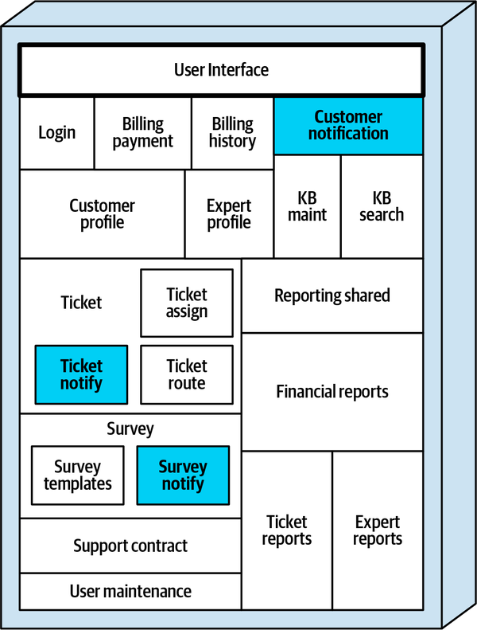

*Hình 5-4. Chức năng thông báo bị trùng lặp khắp ứng dụng*

Addison phân tích mức coupling đi vào (afferent) của các component thông báo Sysops Squad hiện có và đưa ra các metric coupling kết quả được liệt kê trong [Bảng 5-5](#table-ss-coupling-before), với “CA” biểu thị số component khác cần đến component đó (afferent coupling).

<a id="table-ss-coupling-before"></a>

<a id="table-ss-coupling-before"></a>*Bảng 5-5. Phân tích coupling của Sysops Squad trước khi hợp nhất component*

| Component | CA | Được dùng bởi |
|---|---|---|
| Customer Notification | 2 | Billing Payment, Support Contract |
| Ticket Notify | 2 | Ticket, Ticket Route |
| Survey Notify | 1 | Survey |

Addison sau đó phát hiện rằng nếu chức năng thông báo khách hàng được hợp nhất vào một component duy nhất, mức coupling của component duy nhất kết quả tăng lên thành mức coupling đi vào bằng 5, như thể hiện trong [Bảng 5-6](#table-ss-coupling-after).

<a id="table-ss-coupling-after"></a>

<a id="table-ss-coupling-after"></a>*Bảng 5-6. Phân tích coupling của Sysops Squad sau khi hợp nhất component*

| Component | CA | Được dùng bởi |
|---|---|---|
| Notification | 5 | Billing Payment, Support Contract, Ticket, Ticket Route, Survey |

Addison mang những phát hiện này đến Austen, và họ thảo luận kết quả. Điều họ nhận thấy là, dù component hợp nhất mới có mức coupling đi vào khá cao, nó không ảnh hưởng đến mức coupling afferent (đi vào) tổng thể cho việc thông báo khách hàng. Nói cách khác, ba component riêng biệt có tổng mức coupling đi vào bằng 5, và component hợp nhất duy nhất cũng vậy.

Cả Addison và Austen đều nhận ra tầm quan trọng của việc <a id="idm45798382535576"></a>phân tích mức coupling sau khi hợp nhất chức năng domain chung. Trong một số trường hợp, việc gộp chức năng domain chung vào một component hợp nhất duy nhất làm tăng mức coupling đi vào của component đó, dẫn đến quá nhiều phụ thuộc vào một component dùng chung duy nhất trong ứng dụng. Tuy nhiên, trong trường hợp này cả Addison và Austen đều thấy ổn với kết quả phân tích coupling, và đồng ý hợp nhất chức năng thông báo để giảm trùng lặp cả code lẫn chức năng.

Addison viết một architecture story để gộp toàn bộ chức năng thông báo vào một namespace duy nhất biểu thị một component Notification chung. Sydney, người được giao architecture story, đã refactor source code, tạo ra một component duy nhất cho việc thông báo khách hàng, như minh họa trong<a id="idm45798382532824"></a><a id="idm45798382532120"></a> [Hình 5-5](#fig-decomposition-patterns-ss-components-common-after).

<a id="fig-decomposition-patterns-ss-components-common-after"></a>

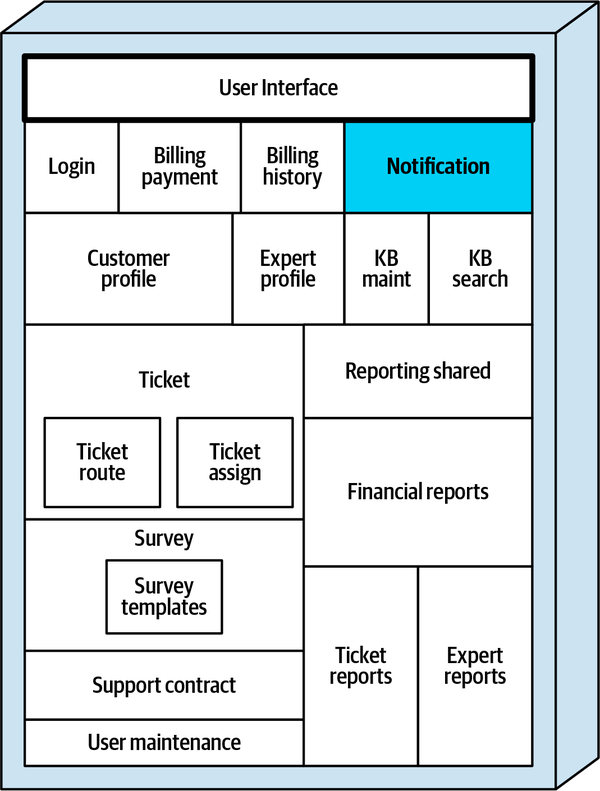

*Hình 5-5. Chức năng thông báo được hợp nhất vào một component duy nhất mới tên Notification*

[Bảng 5-7](#table-ss-result-common) thể hiện các component kết quả sau khi Sydney hiện thực architecture story mà Addison đã tạo. Lưu ý rằng component Customer Notification (`ss.customer.notification`), component Ticket Notify (`ss.ticket.notify`), và component Survey Notify (`ss.survey.notify`) đã bị gỡ bỏ, và source code được chuyển sang component Notification hợp nhất mới ( `ss.notification`).

<a id="table-ss-result-common"></a>

<a id="table-ss-result-common"></a>*Bảng 5-7. Các component Sysops Squad sau khi áp dụng pattern Gather Common Domain Components*

| Component | Namespace | Trách nhiệm |
|---|---|---|
| Login | `ss.login` | Đăng nhập của người dùng và khách hàng |
| Billing Payment | `ss.billing.payment` | Lập hóa đơn hằng tháng cho khách hàng |
| Billing History | `ss.billing.history` | Lịch sử thanh toán |
| Customer Profile | `ss.customer.profile` | Duy trì hồ sơ khách hàng |
| Expert Profile | `ss.expert.profile` | Duy trì hồ sơ chuyên gia |
| KB Maint | `ss.kb.maintenance` | Duy trì & xem knowledge base |
| KB Search | `ss.kb.search` | Tìm kiếm knowledge base |
| **Notification** | `ss.notification` | **Mọi thông báo cho khách hàng** |
| Reporting Shared | `ss.reporting.shared` | Chức năng dùng chung |
| Ticket Reports | `ss.reporting.tickets` | Tạo báo cáo ticket |
| Expert Reports | `ss.reporting.experts` | Tạo báo cáo chuyên gia |
| Financial Reports | `ss.reporting.financial` | Tạo báo cáo tài chính |
| Ticket | `ss.ticket` | Tạo & duy trì ticket |
| Ticket Assign | `ss.ticket.assign` | Giao chuyên gia cho ticket |
| Ticket Route | `ss.ticket.route` | Gửi ticket tới chuyên gia |
| Support Contract | `ss.supportcontract` | Duy trì hợp đồng hỗ trợ |
| Survey | `ss.survey` | Gửi và nhận khảo sát |
| Survey Templates | `ss.survey.templates` | Duy trì các template khảo sát |
| User Maintenance | `ss.users` | Duy trì người dùng nội bộ |

<a id="sec-pattern-flatten"></a>

## Pattern làm phẳng component (Flatten Components Pattern)

Như đã đề cập trước đó, component—các khối xây dựng <a id="ch05-flat"></a><a id="ch05-flat2"></a><a id="ch05-flat4"></a><a id="ch05-flat5"></a><a id="ch05-flat6"></a>của một ứng dụng—thường được xác định thông qua namespace, cấu trúc package, hoặc cấu trúc thư mục và được hiện thực thông qua các file class (hay file source code) chứa trong các cấu trúc này. Tuy nhiên, khi component được xây dựng chồng lên các component khác, mà những component đó lại được xây dựng chồng lên các component khác nữa, chúng bắt đầu mất bản sắc và không còn là component theo định nghĩa của chúng tôi. Pattern *Flatten Components* (làm phẳng component) được dùng để bảo đảm rằng các component không được xây dựng chồng lên nhau, mà được làm phẳng và biểu thị dưới dạng leaf node trong một cấu trúc thư mục hoặc namespace.

<a id="idm45798382396264"></a>

### Mô tả pattern (Pattern Description)

Khi namespace biểu thị một component cụ thể được mở rộng<a id="idm45798382394120"></a> (nói cách khác, một node khác được thêm vào namespace hoặc cấu trúc thư mục), namespace hoặc thư mục trước đó không còn biểu thị một component, mà là một subdomain. Để minh họa điểm này, hãy xét chức năng khảo sát khách hàng trong ứng dụng Sysops Squad được biểu thị bởi hai component: Survey (`ss.survey`) và Survey Templates (`ss.survey.templates`). Lưu ý trong [Bảng 5-8](#table-flatten-survey) cách namespace `ss.survey`, chứa năm file class dùng để quản lý và thu thập khảo sát, được mở rộng bằng namespace `ss.survey.templates` để bao gồm bảy class biểu thị từng loại khảo sát gửi tới khách hàng.

<a id="table-flatten-survey"></a>

<a id="table-flatten-survey"></a>*Bảng 5-8. Component Survey chứa các orphaned class và nên được làm phẳng*

| Tên component | Namespace của component | Số file |
|---|---|---|
| → Survey | `ss.survey` | 5 |
| Survey Templates | `ss.survey.templates` | 7 |

Dù cấu trúc này có vẻ hợp lý từ góc độ developer nhằm giữ code template tách biệt khỏi việc xử lý khảo sát, nó lại tạo ra một số vấn đề vì Survey Templates, với tư cách một component, sẽ được coi là một phần của component Survey. Người ta có thể bị cám dỗ coi Survey Templates là một *subcomponent* của Survey, nhưng rồi vấn đề phát sinh khi cố hình thành service từ các component này—cả hai component nên nằm trong một service duy nhất tên Survey, hay Survey Templates nên là một service riêng tách khỏi service Survey?

Chúng tôi giải quyết thế lưỡng nan này bằng cách định nghĩa component là node cuối cùng (hay leaf node) của namespace hoặc cấu trúc thư mục. Với định nghĩa này, `ss.survey.templates` là một component, trong khi `ss.survey` sẽ được coi là một *subdomain*, không phải component. Chúng tôi định nghĩa thêm các namespace như `ss.survey` là *root namespace* vì chúng được mở rộng bằng các node namespace khác (trong trường hợp này là `.templates`).

Lưu ý cách root namespace `ss.survey` trong [Bảng 5-8](#table-flatten-survey) chứa năm file class. Chúng tôi gọi các file class này là *orphaned class* (class mồ côi) vì chúng không thuộc về bất kỳ component nào xác định được. Hãy nhớ rằng một component được xác định bởi một leaf node namespace chứa source code. Vì namespace `ss.survey` đã được mở rộng để bao gồm `.templates`, `ss.survey` không còn được coi là một component và do đó không nên chứa bất kỳ file class nào.

Các thuật ngữ và định nghĩa tương ứng sau đây quan trọng để hiểu và áp dụng decomposition pattern Flatten Components:

**Component**

Một tập hợp class được nhóm <a id="idm45798382370056"></a>trong một *leaf node namespace* thực hiện một loại chức năng cụ thể nào đó trong ứng dụng (như xử lý thanh toán hoặc chức năng khảo sát khách hàng).

**Root namespace**

Một node namespace đã được mở rộng bởi một node namespace<a id="idm45798382366856"></a><a id="idm45798382366136"></a> khác. Ví dụ, với các namespace `ss.survey` và `ss.survey.templates`, `ss.survey` sẽ được coi là một root namespace vì nó được mở rộng bởi `.templates`. Root namespace đôi khi cũng được gọi là *subdomain*.

**Orphaned classes**

Các class chứa trong một root namespace, và do đó không có component xác định được nào gắn với chúng.<a id="idm45798382361400"></a>

Các định nghĩa này được minh họa trong [Hình 5-6](#fig-decomposition-patterns-definitions), trong đó hộp có chữ C biểu thị source code chứa trong namespace đó. Sơ đồ này (và mọi sơ đồ tương tự) được cố ý vẽ từ dưới lên để nhấn mạnh khái niệm *ngọn đồi* trong ứng dụng, cũng như nhấn mạnh khái niệm các namespace *xây chồng lên* nhau.

<a id="fig-decomposition-patterns-definitions"></a>

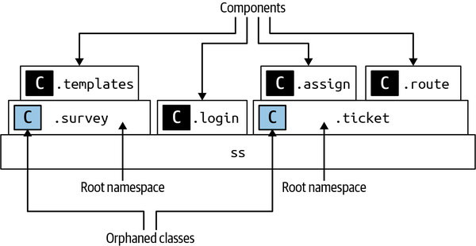

*Hình 5-6. Component, root namespace, và orphaned class (hộp C biểu thị source code)*

Lưu ý rằng vì cả `ss.survey` và `ss.ticket` đều được mở rộng thông qua các node namespace khác, các namespace đó được coi là root namespace, và các class chứa trong các root namespace đó do đó là orphaned class (không thuộc component xác định nào). Vì vậy, các component duy nhất được ký hiệu trong [Hình 5-6](#fig-decomposition-patterns-definitions) là `ss.survey.templates`, `ss.login`, `ss.ticket.assign` và `ss.ticket.route`.

Decomposition pattern Flatten Components được dùng để di chuyển các orphaned class nhằm tạo ra các component well-defined chỉ tồn tại dưới dạng leaf node của một thư mục hoặc namespace, đồng thời tạo ra các subdomain (root namespace) well-defined trong quá trình đó. Chúng tôi gọi việc *làm phẳng* component là việc phân rã (hoặc xây dựng lên) các namespace trong một ứng dụng để loại bỏ orphaned class. Ví dụ, một cách làm phẳng root namespace `ss.survey` trong [Hình 5-6](#fig-decomposition-patterns-definitions) và loại bỏ orphaned class là chuyển source code chứa trong namespace `ss.survey.templates` xuống namespace `ss.survey`, nhờ đó biến `ss.survey` thành một component duy nhất (`.survey` giờ là leaf node của namespace đó). Phương án làm phẳng này được minh họa trong [Hình 5-7](#fig-decomposition-patterns-flatten-down).

<a id="fig-decomposition-patterns-flatten-down"></a>

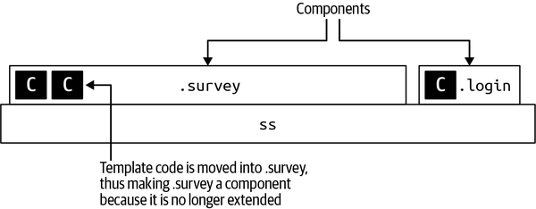

*Hình 5-7. Survey được làm phẳng bằng cách chuyển code template khảo sát vào namespace .survey*

Ngoài ra, việc làm phẳng cũng có thể được áp dụng bằng cách lấy source code trong `ss.survey` và áp dụng phân rã theo chức năng hoặc domain-driven design để xác định các vùng chức năng riêng biệt trong root namespace, từ đó hình thành component từ các vùng chức năng đó. Ví dụ, giả sử chức năng trong namespace `ss.survey` tạo và gửi khảo sát cho khách hàng, rồi xử lý khảo sát đã hoàn thành nhận được từ khách hàng. Hai component có thể được tạo ra từ namespace `ss.survey`: `ss.survey.create`, tạo và gửi khảo sát, và `ss.survey.process`, xử lý khảo sát nhận được từ khách hàng. Hình thức làm phẳng này được minh họa trong [Hình 5-8](#fig-decomposition-patterns-flatten-up).

<a id="fig-decomposition-patterns-flatten-up"></a>

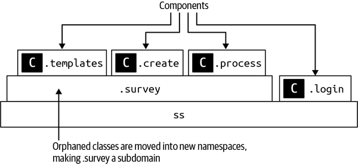

*Hình 5-8. Survey được làm phẳng bằng cách chuyển các orphaned class sang các leaf node mới ( component)*

> **Mẹo**
>
> Bất kể làm phẳng theo hướng nào, hãy bảo đảm các file source code chỉ nằm trong các leaf node namespace hoặc thư mục để source code luôn có thể được xác định thuộc một component cụ thể.

Một kịch bản phổ biến khác mà orphaned source code có thể nằm trong một root namespace là khi code được dùng chung bởi các component khác trong namespace đó. Hãy xét ví dụ trong [Hình 5-9](#fig-decomposition-patterns-flatten-shared), nơi chức năng khảo sát khách hàng nằm trong ba component (`ss.survey.templates`, `ss.survey.create` và `ss.survey.process`), nhưng code chung (như interface, abstract class, tiện ích chung) nằm trong root namespace `ss.survey`.

<a id="fig-decomposition-patterns-flatten-shared"></a>

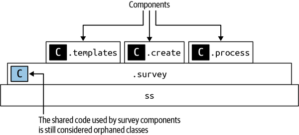

*Hình 5-9. Code dùng chung trong .survey được coi là orphaned class và nên được di chuyển*

Các class dùng chung trong `ss.survey` vẫn sẽ được coi là orphaned class, dù chúng biểu thị code dùng chung. Áp dụng pattern Flatten Components sẽ chuyển các orphaned class dùng chung đó sang một component mới tên `ss.survey.shared`, nhờ đó loại bỏ mọi orphaned class khỏi subdomain `ss.survey`, như minh họa trong [Hình 5-10](#fig-decomposition-patterns-flatten-shared-component).

<a id="fig-decomposition-patterns-flatten-shared-component"></a>

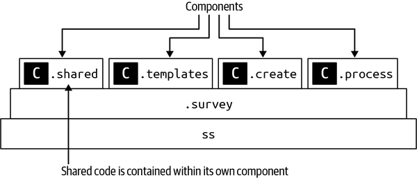

*Hình 5-10. Code khảo sát dùng chung được chuyển vào component riêng của nó*

Lời khuyên của chúng tôi khi chuyển code dùng chung sang một component riêng (leaf node namespace)<a id="idm45798382325656"></a> là chọn một từ chưa được dùng trong bất kỳ codebase hiện có nào trong domain, như `.sharedcode`, `.commoncode`, hoặc một cái tên độc nhất tương tự. Điều này cho phép kiến trúc sư tạo các metric dựa trên số component dùng chung trong codebase, cũng như *tỉ lệ phần trăm* source code được dùng chung trong ứng dụng. Đây là một chỉ báo tốt về tính khả thi của việc chia nhỏ ứng dụng monolith. Ví dụ, nếu tổng số statement trong mọi namespace kết thúc bằng `.sharedcode` chiếm 45% toàn bộ source code, nhiều khả năng việc chuyển sang architecture phân tán sẽ tạo ra quá nhiều thư viện dùng chung và cuối cùng trở thành cơn ác mộng bảo trì vì các phụ thuộc thư viện dùng chung.

Một metric tốt khác liên quan đến phân tích code dùng chung là *số lượng* component kết thúc bằng `.sharedcode` (hoặc bất kỳ node namespace dùng chung chung nào được dùng). Metric này cho kiến trúc sư hiểu biết về việc sẽ có bao nhiêu thư viện dùng chung (JAR, DLL, v.v.) hoặc service dùng chung được tạo ra từ việc chia nhỏ ứng dụng monolith.

<a id="idm45798382395320"></a>

### Fitness function cho governance (Fitness Functions for Governance)

Áp dụng decomposition pattern Flatten Components bao hàm<a id="idm45798382319496"></a><a id="idm45798382318376"></a> khá nhiều tính chủ quan. Ví dụ, nên hợp nhất code từ các leaf node vào root namespace, hay nên chuyển code trong một root namespace vào các leaf node? Dù vậy, fitness function sau có thể hỗ trợ tự động hóa governance để giữ các component phẳng (chỉ ở leaf node).

#### Fitness function: Không có source code nào được nằm trong root namespace (No source code should reside in a root namespace)

Fitness function tổng thể tự động này có thể được kích hoạt khi deployment thông qua một CI/CD pipeline để tìm các orphaned class—các class nằm trong một root namespace. Việc dùng fitness function này giúp giữ các component phẳng khi trải qua quá trình chuyển đổi monolith, đặc biệt khi thực hiện bảo trì liên tục cho ứng dụng monolith trong nỗ lực chuyển đổi. [Ví dụ 5-6](#source-ff-orphans) thể hiện pseudocode cảnh báo kiến trúc sư khi orphaned class xuất hiện ở bất kỳ đâu trong codebase.<a id="idm45798382313528"></a><a id="idm45798382312856"></a><a id="idm45798382312184"></a><a id="idm45798382311512"></a><a id="idm45798382310840"></a>

<a id="source-ff-orphans"></a>

*Ví dụ 5-6. Pseudocode để tìm code trong root namespace*

```perl
# Walk the directory structure, creating namespaces for each complete path
LIST component_list = identify_components(root_directory)

# Send an alert if a non-leaf node in any component contains source files
FOREACH component IN component_list {
  LIST component_node_list = get_nodes(component)
  FOREACH node IN component_node_list {
    IF contains_code(node) AND NOT last_node(component_node_list) {
      send_alert(component)
    }
  }
}
```

<a id="idm45798382307128"></a>

### Sysops Squad Saga: Làm phẳng component (Sysops Squad Saga: Flattening Components)

`Wednesday, November 10, 11:10`

Sau khi áp dụng [“Gather Common Domain Components Pattern”](#sec-pattern-gather-common), Addison<a id="ch05-ssfla"></a><a id="ch05-ssfla3"></a> phân tích kết quả trong [Bảng 5-7](#table-ss-result-common) và nhận thấy rằng các component Survey và Ticket chứa orphaned class. Addison đánh dấu các component này trong [Bảng 5-9](#table-ss-flatten-analysis) và trong [Hình 5-11](#fig-decomposition-patterns-ss-components-flatten-before).

<a id="fig-decomposition-patterns-ss-components-flatten-before"></a>

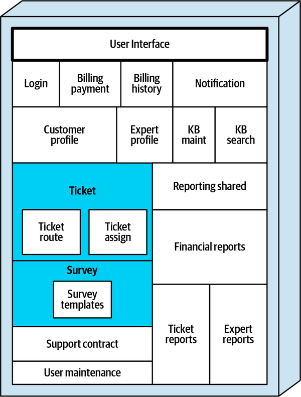

*Hình 5-11. Các component Survey và Ticket chứa orphaned class và nên được làm phẳng*

<a id="table-ss-flatten-analysis"></a>

<a id="table-ss-flatten-analysis"></a>*Bảng 5-9. Các component Ticket và Survey của Sysops Squad nên được làm phẳng*

| Tên component | Namespace của component | Số statement | Số file |
|---|---|---|---|
| **Ticket** | `ss.ticket` | **7,009** | **45** |
| Ticket Assign | `ss.ticket.assign` | 7,845 | 14 |
| Ticket Route | `ss.ticket.route` | 1,468 | 4 |
| **Survey** | `ss.survey` | **2,204** | **5** |
| Survey Templates | `ss.survey.templates` | 1,672 | 7 |

Addison quyết định xử lý các component ticket trước. Biết rằng làm phẳng component nghĩa là loại bỏ source code ở các node không phải leaf, Addison có hai lựa chọn: hợp nhất code chứa trong các component giao ticket và định tuyến ticket vào component `ss.ticket`, hoặc chia 45 class trong component `ss.ticket` thành các component riêng biệt, nhờ đó biến `ss.ticket` thành một subdomain. Addison thảo luận các phương án này với Sydney (một trong các developer của Sysops Squad), và dựa trên độ phức tạp và các thay đổi thường xuyên trong chức năng giao ticket, quyết định giữ các component đó riêng biệt và chuyển orphaned code từ root namespace `ss.ticket` sang các namespace khác, từ đó hình thành các component mới.

Với sự giúp đỡ của Sydney, Addison phát hiện rằng 45 orphaned class chứa trong namespace `ss.ticket` hiện thực các chức năng ticket sau:

- Tạo và duy trì ticket (tạo ticket, cập nhật ticket, hủy ticket, v.v.)
- Logic hoàn tất ticket
- Code dùng chung cho hầu hết chức năng ticket

Vì chức năng giao ticket và định tuyến ticket đã nằm trong các component riêng của chúng (lần lượt là `ss.ticket.assign` và `ss.ticket.route`), Addison tạo một architecture story để chuyển source code chứa trong namespace `ss.ticket` sang ba component mới, như thể hiện trong [Bảng 5-10](#table-ss-flatten-ticket).

<a id="table-ss-flatten-ticket"></a>

<a id="table-ss-flatten-ticket"></a>*Bảng 5-10. Component Ticket trước đây của Sysops Squad được tách thành ba component mới*

| Component | Namespace | Trách nhiệm |
|---|---|---|
| **Ticket Shared** | `ss.ticket.shared` | Code và tiện ích chung |
| **Ticket Maintenance** | `ss.ticket.maintenance` | Thêm và duy trì ticket |
| **Ticket Completion** | `ss.ticket.completion` | Hoàn tất ticket và khởi tạo khảo sát |
| Ticket Assign | `ss.ticket.assign` | Giao chuyên gia cho ticket |
| Ticket Route | `ss.ticket.route` | Gửi ticket tới chuyên gia |

Addison sau đó xem xét chức năng khảo sát. Làm việc cùng Sydney, Addison phát hiện rằng chức năng khảo sát hiếm khi thay đổi và không quá phức tạp. Sydney nói chuyện với Skyler, developer Sysops Squad đã tạo ra namespace `ss.survey.templates` ban đầu, và biết rằng không có lý do thuyết phục nào để tách các template khảo sát vào namespace riêng (“Lúc đó trông có vẻ là một ý hay thôi,” Skyler nói). Với thông tin này, Addison tạo một architecture story để chuyển bảy file class từ `ss.survey.templates` vào namespace `ss.survey` và gỡ bỏ component `ss.survey.template`, như thể hiện trong [Bảng 5-11](#table-ss-flatten-survey-templates).

<a id="table-ss-flatten-survey-templates"></a>

<a id="table-ss-flatten-survey-templates"></a>*Bảng 5-11. Các component Survey trước đây của Sysops Squad được làm phẳng thành một component duy nhất*

| Component | Namespace | Trách nhiệm |
|---|---|---|
| **Survey** | `ss.survey` | Gửi và nhận khảo sát |

Sau khi áp dụng pattern Flatten Components (minh họa trong [Hình 5-12](#fig-decomposition-patterns-ss-components-flatten-after)), Addison nhận thấy không còn “ngọn đồi” nào (component chồng lên component) hay orphaned class nào và tất cả các component chỉ nằm trong các leaf node của namespace tương ứng.

<a id="fig-decomposition-patterns-ss-components-flatten-after"></a>

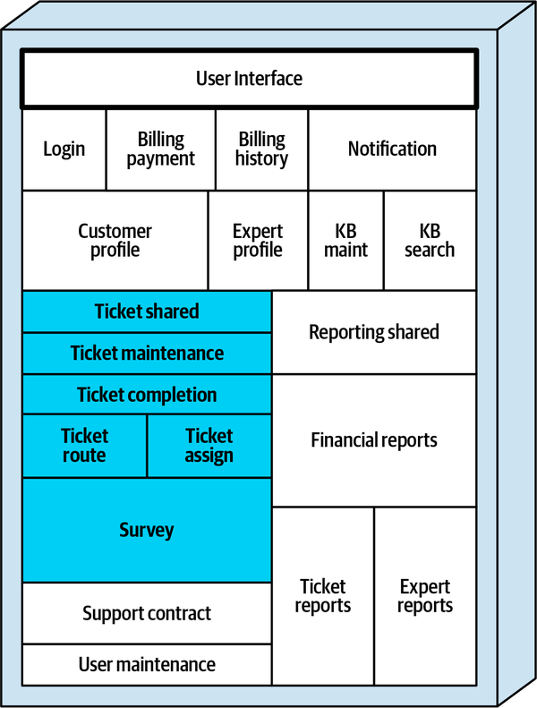

*Hình 5-12. Component Survey được làm phẳng thành một component duy nhất, trong khi component Ticket được nâng lên và làm phẳng, tạo ra một subdomain Ticket*

Addison ghi lại kết quả của các nỗ lực refactor cho đến thời điểm này trong việc áp dụng các decomposition pattern này và liệt kê chúng trong [Bảng 5-12](#table-ss-result-flattening).<a id="idm45798382156040"></a><a id="idm45798382155336"></a>

<a id="table-ss-result-flattening"></a>

<a id="table-ss-result-flattening"></a>*Bảng 5-12. Các component Sysops Squad sau khi áp dụng pattern Flatten Components*

| Component | Namespace |
|---|---|
| Login | `ss.login` |
| Billing Payment | `ss.billing.payment` |
| Billing History | `ss.billing.history` |
| Customer Profile | `ss.customer.profile` |
| Expert Profile | `ss.expert.profile` |
| KB Maint | `ss.kb.maintenance` |
| KB Search | `ss.kb.search` |
| Notification | `ss.notification` |
| Reporting Shared | `ss.reporting.shared` |
| Ticket Reports | `ss.reporting.tickets` |
| Expert Reports | `ss.reporting.experts` |
| Financial Reports | `ss.reporting.financial` |
| **Ticket Shared** | `ss.ticket.shared` |
| **Ticket Maintenance** | `ss.ticket.maintenance` |
| **Ticket Completion** | `ss.ticket.completion` |
| **Ticket Assign** | `ss.ticket.assign` |
| **Ticket Route** | `ss.ticket.route` |
| Support Contract | `ss.supportcontract` |
| **Survey** | `ss.survey` |
| User Maintenance | `ss.users` |

<a id="sec-pattern-dependencies"></a>

## Pattern xác định phụ thuộc giữa component (Determine Component Dependencies Pattern)

Ba trong số những câu hỏi phổ biến nhất được đặt ra khi cân nhắc chuyển đổi từ một ứng dụng monolith sang một architecture phân tán như sau:<a id="ch05-dcdp47"></a><a id="ch05-dcdp4"></a><a id="ch05-dcdp42"></a><a id="ch05-dcdp44"></a><a id="ch05-dcdp45"></a><a id="ch05-dcdp46"></a>

1. Việc tách ứng dụng monolith hiện có có khả thi không?
2. Mức công sức tổng thể ước chừng cho cuộc chuyển đổi này là bao nhiêu?
3. Việc này sẽ đòi hỏi viết lại code hay refactor code?

Một trong các tác giả của cuốn sách đã tham gia một nỗ lực chuyển đổi lớn cách đây vài năm để chuyển một ứng dụng monolith phức tạp sang microservices. Vào ngày đầu tiên của dự án, CIO chỉ muốn biết một điều—nỗ lực chuyển đổi này là một quả bóng golf, một quả bóng rổ, hay một chiếc máy bay chở khách? Tác giả tò mò về các phép so sánh kích cỡ này, nhưng CIO khăng khăng rằng câu trả lời cho câu hỏi đơn giản này không nên khó đến thế với kiểu ước lượng kích cỡ coarse-grained (thô) như vậy. Hóa ra, việc áp dụng pattern *Determine Component Dependencies* (xác định phụ thuộc giữa component) đã trả lời câu hỏi này cho CIO một cách nhanh chóng và dễ dàng—đáng tiếc là nỗ lực đó là một chiếc máy bay chở khách, nhưng chỉ là một cuộc chuyển đổi cỡ Embraer 190 nhỏ thay vì một cuộc chuyển đổi cỡ Boeing 787 Dreamliner lớn.

<a id="idm45798382099896"></a>

### Mô tả pattern (Pattern Description)

Mục đích của pattern *Determine Component Dependencies* là phân tích các phụ thuộc đi vào và đi ra<a id="idm45798382097384"></a><a id="idm45798382096008"></a> (coupling) giữa các *component* để xác định đồ thị phụ thuộc service kết quả có thể trông như thế nào sau khi chia nhỏ ứng dụng monolith. Dù có nhiều yếu tố trong việc xác định mức granularity phù hợp cho một service (xem [Chương 7](ch07_service_granularity.vi.md#ch07-service-granularity)), mỗi component trong ứng dụng monolith đều có khả năng là một ứng viên service (tùy thuộc vào architecture style phân tán mục tiêu). Vì lý do này, điều then chốt là phải hiểu các tương tác và phụ thuộc giữa các component.

Điều quan trọng cần lưu ý là pattern này nói về phụ thuộc giữa các component, không phải phụ thuộc giữa các class riêng lẻ bên trong một component. Một *phụ thuộc component* (component dependency) được hình thành khi một class từ một component (namespace) tương tác với một class từ một component (namespace) khác. Ví dụ, giả sử class `CustomerSurvey` trong component `ss.survey` gọi một method trong class `CustomerNotification` thuộc component `ss.notification` để gửi khảo sát khách hàng, như minh họa trong pseudocode ở [Ví dụ 5-7](#source-dependency).

<a id="source-dependency"></a>

*Ví dụ 5-7. Pseudocode thể hiện một phụ thuộc giữa các component Survey và Notification*

```java
namespace ss.survey
class CustomerSurvey {
   function createSurvey {
      ...
   }

   function sendSurvey {
      ...
      ss.notification.CustomerNotification.send(customer_id, survey)
   }
}
```

Hãy để ý phụ thuộc giữa các component Survey và Notification, vì class `CustomerNotification` được class `CustomerSurvey` dùng nằm bên ngoài namespace `ss.survey`. Cụ thể, component Survey sẽ có một phụ thuộc efferent (hay đi ra) tới component Notification, và component Notification sẽ có một phụ thuộc afferent (hay đi vào) từ component Survey.

Lưu ý rằng các class *bên trong* một component cụ thể có thể là một mớ coupling chặt với vô số phụ thuộc, nhưng điều đó không quan trọng khi áp dụng pattern này—điều quan trọng chỉ là những phụ thuộc *giữa* các component.

Có [một số công cụ](https://oreil.ly/XyIgr) <a id="idm45798382058552"></a><a id="idm45798382056328"></a><a id="idm45798382055112"></a><a id="idm45798382053896"></a><a id="idm45798382052952"></a>có thể hỗ trợ áp dụng pattern này và trực quan hóa các phụ thuộc component. Ngoài ra, nhiều IDE hiện đại có các plug-ins tạo ra sơ đồ phụ thuộc của các component, hay namespace, trong một codebase cụ thể. Những hình ảnh trực quan này có thể hữu ích trong việc trả lời ba câu hỏi then chốt được đặt ra ở đầu phần này.

Ví dụ, hãy xét sơ đồ phụ thuộc thể hiện trong [Hình 5-13](#fig-decomposition-patterns-dependencies-golfball), trong đó các hộp biểu thị component (không phải class), và các đường biểu thị các điểm coupling giữa các component. Lưu ý rằng chỉ có một phụ thuộc duy nhất giữa các component trong sơ đồ này, khiến ứng dụng này là một ứng viên tốt để tách ra vì các component độc lập về chức năng với nhau.

<a id="fig-decomposition-patterns-dependencies-golfball"></a>

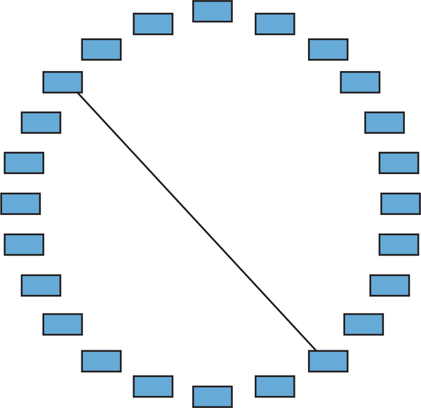

*Hình 5-13. Một ứng dụng monolith có ít phụ thuộc component tốn ít công sức để tách ra hơn (cỡ bóng golf)*

Với một sơ đồ phụ thuộc như [Hình 5-13](#fig-decomposition-patterns-dependencies-golfball), câu trả lời cho ba câu hỏi then chốt như sau:

1. Việc tách ứng dụng monolith hiện có có khả thi không? *Có*
2. Mức công sức tổng thể ước chừng cho cuộc chuyển đổi này là bao nhiêu? *Một quả bóng golf (tương đối đơn giản)*
3. Việc này sẽ là viết lại code hay refactor code? *Refactor (chuyển code hiện có vào các service được deploy riêng)*

Giờ hãy nhìn sơ đồ phụ thuộc thể hiện trong [Hình 5-14](#fig-decomposition-patterns-dependencies-basketball). Đáng tiếc là sơ đồ này điển hình cho các phụ thuộc giữa component trong hầu hết các ứng dụng nghiệp vụ. Đặc biệt lưu ý cách phía bên trái của sơ đồ này có mức coupling cao nhất, trong khi phía bên phải trông khả thi hơn nhiều để tách ra.

<a id="fig-decomposition-patterns-dependencies-basketball"></a>

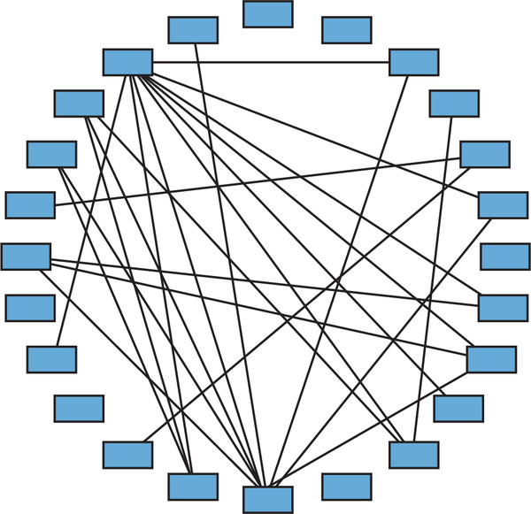

*Hình 5-14. Một ứng dụng monolith có nhiều phụ thuộc component tốn nhiều công sức hơn để tách ra (cỡ bóng rổ)*

Với mức coupling chặt giữa các component như thế này, câu trả lời cho ba câu hỏi then chốt không mấy khích lệ:

1. Việc tách ứng dụng monolith hiện có có khả thi không? *Có thể…*
2. Mức công sức tổng thể ước chừng cho cuộc chuyển đổi này là bao nhiêu? *Một quả bóng rổ (khó hơn nhiều)*
3. Việc này sẽ là viết lại code hay refactor code? *Nhiều khả năng là kết hợp giữa refactor một phần và viết lại một phần code hiện có*

Cuối cùng, hãy xét sơ đồ phụ thuộc minh họa trong [Hình 5-15](#fig-decomposition-patterns-dependencies-airliner). Trong trường hợp này, kiến trúc sư nên quay đầu và chạy theo hướng ngược lại nhanh nhất có thể!

<a id="fig-decomposition-patterns-dependencies-airliner"></a>

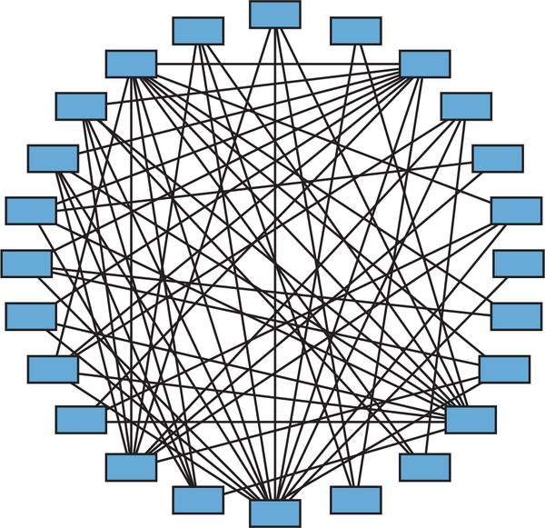

*Hình 5-15. Một ứng dụng monolith có quá nhiều phụ thuộc component thì không khả thi để tách ra (cỡ máy bay chở khách)*

Câu trả lời cho ba câu hỏi then chốt đối với các ứng dụng có loại ma trận phụ thuộc component này không có gì đáng ngạc nhiên:

1. Việc tách ứng dụng monolith hiện có có khả thi không? *Không*
2. Mức công sức tổng thể ước chừng cho cuộc chuyển đổi này là bao nhiêu? *Một chiếc máy bay chở khách*
3. Việc này sẽ là viết lại code hay refactor code? *Viết lại toàn bộ ứng dụng*

Chúng tôi không thể nhấn mạnh đủ tầm quan trọng của những loại<a id="idm45798381991832"></a><a id="idm45798381990504"></a><a id="idm45798381989288"></a><a id="idm45798381988008"></a><a id="idm45798381986776"></a> sơ đồ trực quan này khi tách một ứng dụng monolith. Về bản chất, những sơ đồ này tạo thành một *radar* để xác định kẻ địch (coupling component cao) nằm ở đâu, và cũng vẽ nên bức tranh ma trận phụ thuộc service kết quả có thể trông như thế nào nếu ứng dụng monolith được chia thành một architecture phân tán cao.

Theo kinh nghiệm của chúng tôi, coupling giữa các component là một trong những yếu tố quan trọng nhất trong việc quyết định thành công tổng thể (và tính khả thi) của một nỗ lực chuyển đổi monolith. Việc xác định và hiểu mức coupling giữa các component không chỉ cho phép kiến trúc sư xác định tính khả thi của nỗ lực chuyển đổi, mà còn biết điều gì sẽ xảy ra về mức công sức tổng thể. Đáng tiếc là chúng tôi quá thường xuyên thấy các team lao thẳng vào việc chia một ứng dụng monolith thành microservices mà không có bất kỳ phân tích hay hình ảnh trực quan nào về việc ứng dụng monolith thậm chí trông ra sao. Và không ngạc nhiên, những team đó vật lộn để tách các ứng dụng monolith của mình.

Pattern này hữu ích không chỉ để xác định mức coupling component tổng thể trong một ứng dụng, mà còn để xác định các cơ hội refactor phụ thuộc trước khi tách ứng dụng. Khi phân tích mức coupling giữa các component, điều quan trọng là phân tích cả coupling afferent (đi vào) (được ký hiệu trong hầu hết các công cụ là *CA*), và coupling efferent (đi ra) (được ký hiệu trong hầu hết các công cụ là *CE*). *CT*, hay tổng coupling, là tổng của cả coupling afferent lẫn efferent.

Nhiều khi, việc tách một component có thể giảm mức coupling của component đó. Ví dụ, giả sử component A có mức coupling afferent bằng 20 (nghĩa là có 20 component khác phụ thuộc vào chức năng của component này). Điều này không nhất thiết có nghĩa là cả 20 component khác đều cần *toàn bộ* chức năng của component A. Có thể 14 trong số các component khác chỉ cần một phần nhỏ chức năng chứa trong component A. Tách component A thành hai component khác nhau (component A1 chứa phần chức năng nhỏ hơn bị coupled, và component A2 chứa phần lớn chức năng) giảm coupling afferent của component A2 xuống còn 6, với component A1 có mức coupling afferent bằng 14.

<a id="idm45798382098984"></a>

### Fitness function cho governance (Fitness Functions for Governance)

Hai cách tự động hóa governance cho phụ thuộc component<a id="idm45798381978712"></a><a id="idm45798381977272"></a> là bảo đảm không component nào có “quá nhiều” phụ thuộc, và hạn chế một số component nhất định không được coupled với các component khác. Các fitness function được mô tả tiếp theo là một số cách quản trị những loại phụ thuộc này.

#### Fitness function: Không component nào được có nhiều hơn một số lượng nhất định tổng phụ thuộc (No component shall have more than \<some number> of total dependencies)

Fitness function tổng thể tự động này có thể được kích hoạt khi deployment thông qua một CI/CD pipeline để bảo đảm rằng mức coupling của bất kỳ component nào không vượt quá một ngưỡng nhất định. Việc xác định ngưỡng tối đa này nên dựa trên mức coupling tổng thể trong ứng dụng và số lượng component là tùy thuộc vào kiến trúc sư. Một cảnh báo được tạo ra từ fitness function này cho phép kiến trúc sư thảo luận bất kỳ sự gia tăng coupling nào với development team, có thể thúc đẩy hành động tách các component để giảm coupling. Fitness function này cũng có thể được sửa đổi để tạo cảnh báo cho giới hạn ngưỡng chỉ của đi vào, chỉ của đi ra, hoặc cả hai (dưới dạng các fitness function riêng biệt). [Ví dụ 5-8](#source-ff-dependency-limit) thể hiện pseudocode để gửi cảnh báo nếu tổng coupling (đi vào và đi ra) vượt quá mức tổng hợp là 15, mức mà với hầu hết ứng dụng sẽ được coi là tương đối cao.

<a id="source-ff-dependency-limit"></a>

*Ví dụ 5-8. Pseudocode để giới hạn tổng số phụ thuộc của bất kỳ component nào*

```perl
# Walk the directory structure, gathering components and the source code files
# contained within those components
LIST component_list = identify_components(root_directory)
MAP component_source_file_map
FOREACH component IN component_list {
  LIST component_source_file_list = get_source_files(component)
  ADD component, component_source_file_list TO component_source_file_map
}

# Determine how many references exist for each source file and send an alert if
# the total dependency count is greater than 15
FOREACH component,component_source_file_list IN component_source_file_map {
  FOREACH source_file IN component_source_file_list {
    incoming count = used_by_other_components(source_file, component_source_file_map) {
    outgoing_count = uses_other_components(source_file) {
    total_count = incoming count + outgoing count
  }
  IF total_count > 15 {
    send_alert(component, total_count)
  }
}
```

#### Fitness function: Một component nhất định không được phụ thuộc vào một component khác (\<some component> should not have a dependency on \<another component>)

Fitness function tổng thể tự động này có thể được kích hoạt khi deployment thông qua một CI/CD pipeline để hạn chế một số component nhất định không được phụ thuộc vào các component khác. Trong hầu hết trường hợp, sẽ có một fitness function cho mỗi hạn chế phụ thuộc, nên nếu có 10 hạn chế component khác nhau, sẽ có 10 fitness function khác nhau, mỗi cái cho một component liên quan. [Ví dụ 5-9](#source-ff-dependency-restriction) thể hiện một ví dụ dùng [ArchUnit](https://www.archunit.org) để bảo đảm rằng component Ticket Maintenance (`ss.ticket.maintenance`) không phụ thuộc vào component Expert Profile (`ss.expert.profile`).<a id="idm45798381881128"></a><a id="idm45798381880392"></a><a id="idm45798381879720"></a><a id="idm45798381879048"></a><a id="idm45798381878376"></a><a id="idm45798381877704"></a>

<a id="source-ff-dependency-restriction"></a>

*Ví dụ 5-9. Code ArchUnit để quản trị các hạn chế phụ thuộc giữa các component*

```java
public void ticket_maintenance_cannot_access_expert_profile() {
   noClasses().that()
   .resideInAPackage("..ss.ticket.maintenance..")
   .should().accessClassesThat()
   .resideInAPackage("..ss.expert.profile..")
   .check(myClasses);
}
```

<a id="idm45798381747992"></a>

### Sysops Squad Saga: Xác định phụ thuộc component (Sysops Squad Saga: Identifying Component Dependencies)

`Monday, November 15, 09:45`

Sau khi đọc về pattern Determine Component Dependencies,<a id="ch05-sosd"></a><a id="ch05-sosd3"></a> Addison tự hỏi ma trận phụ thuộc của ứng dụng Sysops Squad trông như thế nào và liệu việc tách ứng dụng có khả thi không. Addison dùng một plug-in IDE để tạo sơ đồ phụ thuộc component của ứng dụng Sysops Squad hiện tại. Ban đầu, Addison cảm thấy hơi nản lòng vì [Hình 5-16](#fig-decomposition-patterns-dependencies-ss) cho thấy rất nhiều phụ thuộc giữa các component của ứng dụng Sysops Squad.

<a id="fig-decomposition-patterns-dependencies-ss"></a>

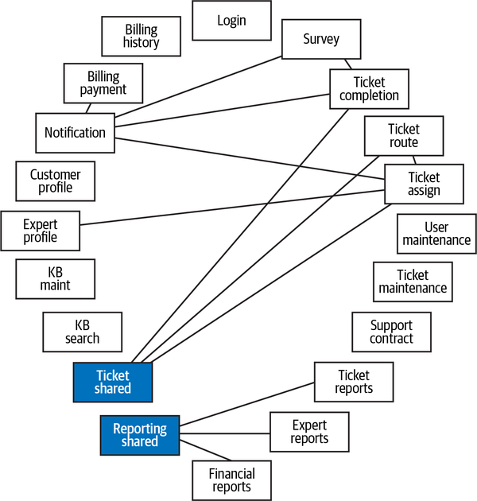

*Hình 5-16. Phụ thuộc component trong ứng dụng Sysops Squad*

Tuy nhiên, sau khi phân tích thêm, Addison thấy rằng component Notification có nhiều phụ thuộc nhất, điều không đáng ngạc nhiên vì nó là một component dùng chung. Tuy nhiên, Addison cũng thấy rất nhiều phụ thuộc bên trong các component Ticketing và Reporting. Cả hai vùng domain này đều có một component riêng cho code dùng chung (interface, helper class, entity class, v.v.). Nhận ra rằng code dùng chung của cả ticket và báo cáo chủ yếu chứa các tham chiếu class compile-based (dựa trên biên dịch) và nhiều khả năng sẽ được hiện thực dưới dạng thư viện dùng chung thay vì service, Addison lọc bỏ các component này để có cái nhìn tốt hơn về các phụ thuộc giữa chức năng cốt lõi của ứng dụng, như minh họa trong [Hình 5-17](#fig-decomposition-patterns-dependencies-ss-filtered).

<a id="fig-decomposition-patterns-dependencies-ss-filtered"></a>

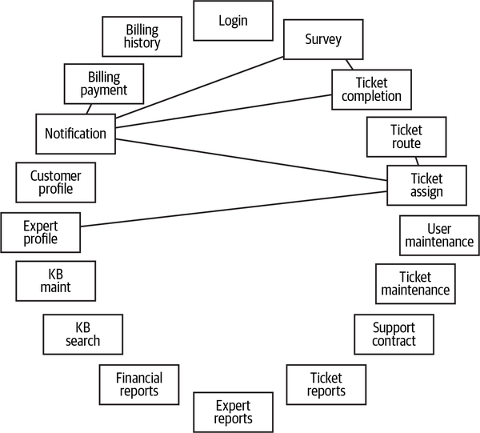

*Hình 5-17. Phụ thuộc component trong ứng dụng Sysops Squad không tính các phụ thuộc thư viện dùng chung*

Với các component dùng chung đã được lọc bỏ, Addison thấy rằng các phụ thuộc khá ít. Addison cho Austen xem các kết quả này, và cả hai đồng ý rằng hầu hết các component tương đối self-contained (tự chứa) và có vẻ ứng dụng Sysops Squad là một ứng viên tốt để tách thành một architecture phân tán.<a id="idm45798381847864"></a><a id="idm45798381847160"></a>

<a id="sec-pattern-create-domains"></a>

## Pattern tạo domain cho component (Create Component Domains Pattern)

Dù mỗi component được xác định trong một ứng dụng monolith<a id="ch05-ccdp5"></a><a id="ch05-ccdp52"></a><a id="ch05-ccdp54"></a><a id="ch05-ccdp55"></a><a id="ch05-ccdp56"></a><a id="ch05-ccdp57"></a><a id="idm45798381835704"></a> có thể được coi là một ứng viên khả dĩ cho một service riêng, trong hầu hết trường hợp quan hệ giữa một service và các component là quan hệ one-to-many (một đối nhiều)—tức là một service duy nhất có thể chứa một hoặc nhiều component. Mục đích của pattern *Create Component Domains* (tạo domain cho component) là nhóm các component lại với nhau một cách logic để có thể tạo ra các domain service coarse-grained hơn khi chia nhỏ một ứng dụng.

<a id="idm45798381833528"></a>

### Mô tả pattern (Pattern Description)

Xác định các component domain—việc nhóm các component thực hiện một loại chức năng liên quan nào đó—là một phần then chốt của việc tách bất kỳ ứng dụng monolith nào. <a id="idm45798381831640"></a><a id="idm45798381830696"></a>Hãy nhớ lại lời khuyên từ [Chương 4](ch04_architectural_decomposition.vi.md#ch04-architectural-decomposition):

> *Khi tách các ứng dụng monolith, hãy cân nhắc chuyển sang service-based architecture trước như một stepping-stone (bước đệm) tiến tới các architecture phân tán khác*.

Tạo các component domain là một cách hiệu quả để xác định những gì cuối cùng sẽ trở thành các domain service trong một service-based architecture.<a id="idm45798381827016"></a><a id="idm45798381826008"></a>

Các component domain được thể hiện vật lý trong một ứng dụng thông qua <a id="idm45798381824456"></a>các namespace của component (hoặc thư mục). Vì các node namespace có bản chất phân cấp, chúng trở thành một cách tuyệt vời để biểu thị các domain và subdomain của chức năng. Kỹ thuật này được minh họa trong [Hình 5-18](#fig-decomposition-patterns-domain-namespace), trong đó node thứ hai trong namespace (`.customer`) chỉ *domain*, node thứ ba biểu thị một *subdomain* dưới domain customer (`.billing`), và leaf node (`.payment`) chỉ *component*. `.MonthlyBilling` ở cuối namespace này chỉ một file class chứa trong component Payment.

<a id="fig-decomposition-patterns-domain-namespace"></a>

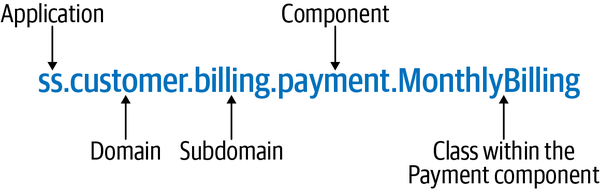

*Hình 5-18. Các component domain được xác định thông qua các node namespace*

Vì nhiều ứng dụng monolith cũ được hiện thực trước khi [domain-driven design](https://oreil.ly/AaKR2) được dùng<a id="idm45798381727240"></a><a id="idm45798381726248"></a><a id="idm45798381725272"></a><a id="idm45798381724024"></a> rộng rãi, trong nhiều trường hợp cần refactor các namespace để xác định domain về mặt cấu trúc trong ứng dụng. Ví dụ, hãy xét các component được liệt kê trong [Bảng 5-13](#table-customer-before) tạo nên domain Customer trong ứng dụng Sysops Squad.

<a id="table-customer-before"></a>

<a id="table-customer-before"></a>*Bảng 5-13. Các component liên quan đến domain Customer trước khi refactor*

| Component | Namespace |
|---|---|
| Billing Payment | `ss.billing.payment` |
| Billing History | `ss.billing.history` |
| Customer Profile | `ss.customer.profile` |
| Support Contract | `ss.supportcontract` |

Hãy để ý rằng mỗi component đều liên quan đến chức năng khách hàng, nhưng các namespace tương ứng không phản ánh mối liên hệ đó. Để xác định đúng domain Customer (được thể hiện qua namespace `ss.customer`), namespace của các component Billing Payment, Billing History và Support Contract sẽ phải được sửa đổi để thêm node `.customer` vào đầu namespace, như thể hiện trong [Bảng 5-14](#table-customer-after).

<a id="table-customer-after"></a>

<a id="table-customer-after"></a>*Bảng 5-14. Các component liên quan đến domain Customer sau khi refactor*

| Component | Namespace |
|---|---|
| Billing Payment | `ss.customer.billing.payment` |
| Billing History | `ss.customer.billing.history` |
| Customer Profile | `ss.customer.profile` |
| Support Contract | `ss.customer.supportcontract` |

Lưu ý trong bảng trên rằng toàn bộ chức năng customer-related (liên quan đến khách hàng) (lập hóa đơn, duy trì hồ sơ, và duy trì hợp đồng hỗ trợ) giờ được nhóm dưới `.customer`, sắp mỗi component khớp với domain cụ thể đó.

<a id="idm45798381832936"></a>

### Fitness function cho governance (Fitness Functions for Governance)

Một khi đã được refactor, điều quan trọng là quản trị các component domain để bảo đảm<a id="idm45798381694552"></a><a id="idm45798381693240"></a><a id="idm45798381692280"></a><a id="idm45798381690936"></a> các quy tắc namespace được thực thi và không có code nào tồn tại bên ngoài bối cảnh của một component domain hoặc subdomain. Fitness function tự động sau có thể được dùng để giúp quản trị các component domain một khi chúng đã được thiết lập trong ứng dụng monolith.

#### Fitness function: Mọi namespace dưới một root namespace node phải bị giới hạn trong một danh sách domain (All namespaces under \<root namespace node> should be restricted to \<list of domains>)

Fitness function tổng thể tự động này có thể được kích hoạt khi deployment thông qua một CI/CD pipeline để giới hạn các domain chứa trong một ứng dụng. Fitness function này giúp ngăn các development team vô tình tạo thêm domain và cảnh báo kiến trúc sư nếu có namespace (hoặc thư mục) mới nào được tạo bên ngoài danh sách domain đã được phê duyệt. [Ví dụ 5-10](#source-ff-domain-restriction) thể hiện một ví dụ dùng [ArchUnit](https://www.archunit.org) để bảo đảm rằng chỉ có các domain ticket, customer và admin tồn tại trong một ứng dụng.<a id="idm45798381685272"></a><a id="idm45798381684568"></a><a id="idm45798381683224"></a><a id="idm45798381682552"></a><a id="idm45798381681880"></a><a id="idm45798381681208"></a>

<a id="source-ff-domain-restriction"></a>

*Ví dụ 5-10. Code ArchUnit để quản trị các domain trong một ứng dụng*

```java
public void restrict_domains() {
   classes()
     .should().resideInAPackage("..ss.ticket..")
     .orShould().resideInAPackage("..ss.customer..")
     .orShould().resideInAPackage("..ss.admin..")
     .check(myClasses);
}
```

<a id="idm45798381602920"></a>

### Sysops Squad Saga: Tạo các component domain (Sysops Squad Saga: Creating Component Domains)

`Thursday, November 18, 13:15`

Addison và Austen hỏi ý kiến Parker, product owner của Sysops Squad, <a id="ch05-sssc52"></a><a id="ch05-sssc53"></a>và cùng nhau họ xác định năm domain chính trong ứng dụng: một domain Ticketing (`ss.ticket`) chứa mọi chức năng ticket-related (liên quan đến ticket), bao gồm xử lý ticket, khảo sát khách hàng, và chức năng knowledge base (KB); một domain Reporting (`ss.reporting`) chứa mọi chức năng báo cáo; một domain Customer (`ss.customer`) chứa hồ sơ khách hàng, lập hóa đơn và hợp đồng hỗ trợ; một domain Admin (`ss.admin`) chứa việc duy trì người dùng và chuyên gia Sysops Squad; và cuối cùng, một domain Shared (`ss.shared`) chứa chức năng đăng nhập và thông báo được các domain khác dùng.

Addison tạo một sơ đồ domain (xem [Hình 5-19](#fig-decomposition-patterns-ss-components-domain)) thể hiện các domain khác nhau và các nhóm component tương ứng trong mỗi domain, và hài lòng với cách nhóm này vì không component nào bị bỏ sót, và có cohesion tốt giữa các component trong mỗi domain.

Bài tập mà Addison làm trong việc vẽ sơ đồ và nhóm các <a id="idm45798381636120"></a><a id="idm45798381634856"></a>component là một bài tập quan trọng vì nó xác nhận các ứng viên domain đã xác định và cũng chứng minh sự cần thiết của việc cộng tác với các stakeholder nghiệp vụ (như product owner hoặc nhà tài trợ ứng dụng nghiệp vụ). Nếu các component không khớp đúng hoặc Addison còn lại những component không thuộc về đâu cả, thì sẽ cần cộng tác nhiều hơn với Parker (product owner).

Hài lòng rằng tất cả các component đều khớp gọn vào các domain này, Addison sau đó xem xét các namespace của component khác nhau trong [Bảng 5-12](#table-ss-result-flattening) sau khi áp dụng [“Flatten Components Pattern”](#sec-pattern-flatten) và xác định việc refactor component domain cần thực hiện.

<a id="fig-decomposition-patterns-ss-components-domain"></a>

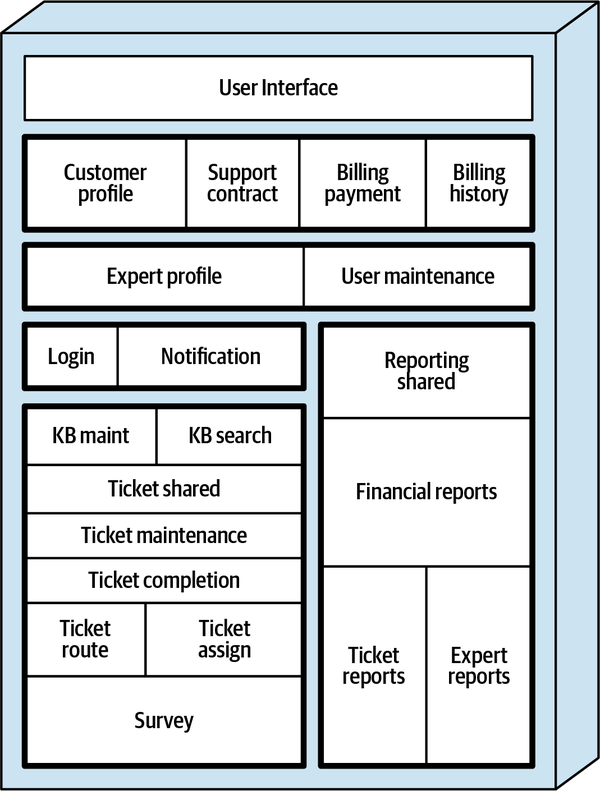

*Hình 5-19. Năm domain được xác định (với viền sẫm màu) trong ứng dụng Sysops Squad*

Addison bắt đầu với domain Ticket và thấy rằng trong khi chức năng ticket cốt lõi bắt đầu bằng namespace `ss.ticket`, các component khảo sát và knowledge base thì không. Do đó, Addison viết một architecture story để refactor các component được liệt kê trong [Bảng 5-15](#table-ss-ticket) cho khớp với domain ticket.

<a id="table-ss-ticket"></a>

<a id="table-ss-ticket"></a>*Bảng 5-15. Refactor component Sysops Squad cho domain Ticket*

| Component | Domain | Namespace hiện tại | Namespace mục tiêu |
|---|---|---|---|
| KB Maint | Ticket | `ss.kb.maintenance` | `ss.ticket.kb.maintenance` |
| KB Search | Ticket | `ss.kb.search` | `ss.ticket.kb.search` |
| Ticket Shared | Ticket | `ss.ticket.shared` | Giữ nguyên (không đổi) |
| Ticket Maintenance | Ticket | `ss.ticket.maintenance` | Giữ nguyên (không đổi) |
| Ticket Completion | Ticket | `ss.ticket.completion` | Giữ nguyên (không đổi) |
| Ticket Assign | Ticket | `ss.ticket.assign` | Giữ nguyên (không đổi) |
| Ticket Route | Ticket | `ss.ticket.route` | Giữ nguyên (không đổi) |
| Survey | Ticket | `ss.survey` | `ss.ticket.survey` |

Tiếp theo Addison xem xét các component customer-related, và thấy rằng các component lập hóa đơn và khảo sát cần được refactor để đưa chúng vào domain Customer, đồng thời tạo ra một subdomain Billing trong quá trình đó. Addison viết một architecture story cho việc refactor chức năng domain Customer, thể hiện trong [Bảng 5-16](#table-ss-customer).

<a id="table-ss-customer"></a>

<a id="table-ss-customer"></a>*Bảng 5-16. Refactor component Sysops Squad cho domain Customer*

| Component | Domain | Namespace hiện tại | Namespace mục tiêu |
|---|---|---|---|
| Billing Payment | Customer | `ss.billing.payment` | `ss.customer.billing.payment` |
| Billing History | Customer | `ss.billing.history` | `ss.customer.billing.history` |
| Customer Profile | Customer | `ss.customer.profile` | Giữ nguyên (không đổi) |
| Support Contract | Customer | `ss.supportcontract` | `ss.customer.supportcontract` |

Bằng cách áp dụng [“Identify and Size Components Pattern”](#sec-pattern-identify-size), Addison thấy rằng domain báo cáo đã khớp sẵn, và không cần hành động gì thêm với các component báo cáo được liệt kê trong [Bảng 5-17](#table-ss-reporting).

<a id="table-ss-reporting"></a>

<a id="table-ss-reporting"></a>*Bảng 5-17. Các component Reporting của Sysops Squad đã khớp sẵn với domain Reporting*

| Component | Domain | Namespace hiện tại | Namespace mục tiêu |
|---|---|---|---|
| Reporting Shared | Reporting | `ss.reporting.shared` | Giữ nguyên (không đổi) |
| Ticket Reports | Reporting | `ss.reporting.tickets` | Giữ nguyên (không đổi) |
| Expert Reports | Reporting | `ss.reporting.experts` | Giữ nguyên (không đổi) |
| Financial Reports | Reporting | `ss.reporting.financial` | Giữ nguyên (không đổi) |

Addison thấy rằng cả domain Admin và Shared cũng cần được sắp cho khớp, và quyết định tạo một architecture story duy nhất cho nỗ lực refactor này và liệt kê các component này trong [Bảng 5-18](#table-ss-admin). Addison cũng quyết định đổi tên namespace `ss.expert.profile` thành `ss.experts` để tránh một subdomain Expert không cần thiết dưới domain Admin.

<a id="table-ss-admin"></a>

<a id="table-ss-admin"></a>*Bảng 5-18. Refactor component Sysops Squad cho các domain Admin và Shared*

| Component | Domain | Namespace hiện tại | Namespace mục tiêu |
|---|---|---|---|
| Login | Shared | `ss.login` | `aa.shared.login` |
| Notification | Shared | `ss.notification` | `ss.shared.notification` |
| Expert Profile | Admin | `ss.expert.profile` | `ss.admin.experts` |
| User Maintenance | Admin | `ss.users` | `ss.admin.users` |

Với pattern này đã hoàn tất, Addison nhận ra họ giờ đã sẵn sàng để tách ứng dụng monolith về mặt cấu trúc và chuyển sang giai đoạn đầu tiên của một architecture phân tán bằng cách áp dụng pattern Create Domain Services (được mô tả trong phần tiếp theo).<a id="idm45798381513256"></a><a id="idm45798381512552"></a>

<a id="sec-pattern-domain-services"></a>

## Pattern tạo domain service (Create Domain Services Pattern)

Một khi các component đã được định cỡ phù hợp, làm phẳng, và nhóm vào các domain, <a id="ch05-cdsp6"></a><a id="ch05-cdsp62"></a><a id="ch05-cdsp63"></a><a id="ch05-cdsp64"></a><a id="ch05-cdsp65"></a><a id="ch05-cdsp66"></a><a id="ch05-cdsp67"></a><a id="idm45798381499560"></a>các domain đó có thể được chuyển sang các *domain service* được deploy riêng, tạo ra cái được gọi là service-based architecture (xem [Phụ lục A](ch16_appendix_concept_and_term_references.vi.md#sec-references)). <a id="idm45798381497176"></a>Domain service là những đơn vị phần mềm coarse-grained, được deploy riêng, chứa toàn bộ chức năng cho một domain cụ thể (như Ticketing, Customer, Reporting, v.v.).

<a id="idm45798381495864"></a>

### Mô tả pattern (Pattern Description)

[“Create Component Domains Pattern”](#sec-pattern-create-domains) ở trên hình thành các component domain well-defined trong một ứng dụng monolith và thể hiện các domain đó thông qua các namespace của component (hoặc cấu trúc thư mục). Pattern này lấy các component domain well-defined đó và trích xuất các nhóm component đó thành các service được deploy riêng, gọi là *domain service*, nhờ đó tạo ra một service-based architecture.

Ở dạng đơn giản nhất, service-based architecture gồm một <a id="idm45798381492376"></a>giao diện người dùng truy cập từ xa các domain service coarse-grained, tất cả cùng dùng chung một database monolith duy nhất. Dù có nhiều topology trong service-based architecture (như chia nhỏ giao diện người dùng, chia nhỏ database, thêm một API gateway, v.v.), topology cơ bản thể hiện trong [Hình 5-20](#fig-decomposition-patterns-sba) là một điểm khởi đầu tốt cho việc chuyển đổi một ứng dụng monolith.

<a id="fig-decomposition-patterns-sba"></a>

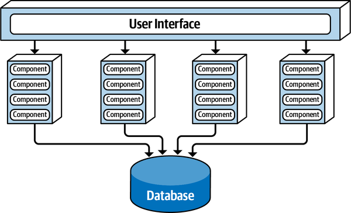

*Hình 5-20. Topology cơ bản cho một service-based architecture*

Ngoài các lợi ích được đề cập trong [“Component-Based Decomposition”](ch04_architectural_decomposition.vi.md#sec-component-decomposition), việc chuyển sang service-based architecture<a id="idm45798381486664"></a><a id="idm45798381485640"></a><a id="idm45798381484600"></a> trước tiên cho phép kiến trúc sư và development team tìm hiểu thêm về từng domain service để xác định xem nó nên được chia thành các service nhỏ hơn trong một microservices architecture hay giữ nguyên là một domain service lớn hơn. Quá nhiều team mắc sai lầm khi bắt đầu quá fine-grained (mịn), và kết quả là phải gánh toàn bộ những thứ đi kèm của microservices (như phân rã dữ liệu, workflow phân tán, transaction phân tán, tự động hóa vận hành, containerization, v.v.) mà không cần đến tất cả những microservice fine-grained đó.

[Hình 5-21](#fig-decomposition-patterns-domain-service) minh họa cách pattern *Create Domain Services* (tạo domain service) hoạt động. Lưu ý trong sơ đồ cách component domain Reporting được định nghĩa trong [“Create Component Domains Pattern”](#sec-pattern-create-domains) được trích xuất khỏi ứng dụng monolith, hình thành service Reporting được deploy riêng của chính nó.

<a id="fig-decomposition-patterns-domain-service"></a>

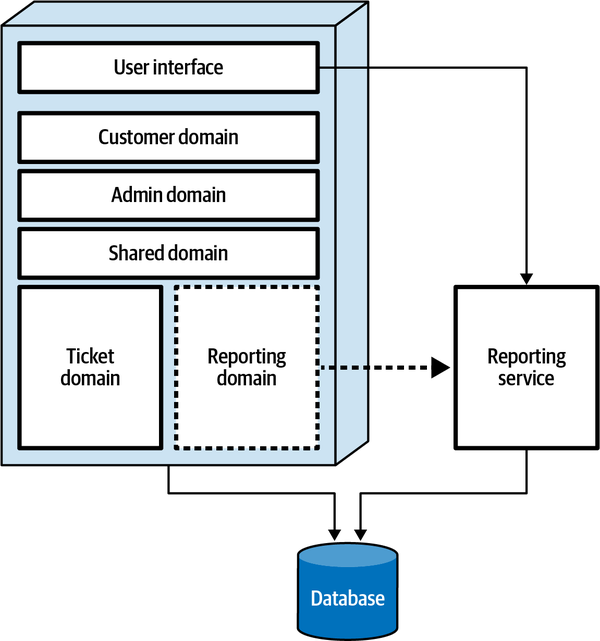

*Hình 5-21. Các component domain được chuyển sang các domain service bên ngoài*

Tuy nhiên, có một lời khuyên: đừng áp dụng pattern này cho đến khi *tất cả* các component domain đã được xác định và refactor. Điều này giúp giảm lượng sửa đổi cần thiết cho mỗi domain service khi di chuyển các component (và do đó là source code). Ví dụ, giả sử toàn bộ chức năng ticket và knowledge base trong ứng dụng Sysops Squad đã được nhóm và refactor thành một domain Ticket, và một service Ticket mới được tạo từ domain đó. Giờ giả sử component khảo sát khách hàng (được xác định qua namespace `ss.customer.survey`) được coi là một phần của domain Ticket. Vì domain Ticket đã được chuyển đổi rồi, service Ticket giờ sẽ phải được sửa đổi để bao gồm component Survey. Tốt hơn là sắp khớp và refactor tất cả các component vào các component domain trước, *rồi mới* bắt đầu chuyển các component domain đó thành domain service.

<a id="idm45798381475416"></a>

### Fitness function cho governance (Fitness Functions for Governance)

Điều quan trọng là giữ các component trong mỗi domain service khớp với domain, <a id="idm45798381473688"></a><a id="idm45798381472648"></a>đặc biệt nếu domain service sẽ được chia thành các microservice nhỏ hơn. Loại governance này giúp ngăn các domain service trở thành một service monolith thiếu cấu trúc của riêng chúng. Fitness function sau bảo đảm rằng namespace (và do đó các component) được giữ nhất quán trong một domain service.

#### Fitness function: Mọi component trong một domain service nhất định phải bắt đầu bằng cùng một namespace (All components in \<some domain service> should start with the same namespace)

Fitness function tổng thể tự động này có thể <a id="idm45798381468872"></a><a id="idm45798381467896"></a><a id="idm45798381466712"></a><a id="idm45798381466040"></a><a id="idm45798381465096"></a>được kích hoạt khi deployment thông qua một CI/CD pipeline để bảo đảm rằng namespace của các component trong một domain service luôn nhất quán. Ví dụ, mọi component trong domain service Ticket nên bắt đầu bằng `ss.ticket`. [Ví dụ 5-11](#source-ff-domain-services) dùng ArchUnit để bảo đảm ràng buộc này. Mỗi domain service sẽ có fitness function tương ứng của riêng nó dựa trên domain cụ thể của nó.<a id="idm45798381462360"></a><a id="idm45798381461688"></a><a id="idm45798381461016"></a><a id="idm45798381460344"></a><a id="idm45798381459672"></a><a id="idm45798381459000"></a><a id="idm45798381458328"></a>

<a id="source-ff-domain-services"></a>

*Ví dụ 5-11. Code ArchUnit để quản trị các component trong domain service Ticket*

```java
public void restrict_domain_within_ticket_service() {
   classes().should().resideInAPackage("..ss.ticket..")
   .check(myClasses);
}
```

<a id="idm45798381441512"></a>

### Sysops Squad Saga: Tạo domain service (Sysops Squad Saga: Creating Domain Services)

`Tuesday, November 23, 09:04`

Addison và Austen làm việc chặt chẽ với development team của Sysops Squad<a id="idm45798381439304"></a><a id="idm45798381438360"></a><a id="idm45798381437448"></a> để xây dựng một kế hoạch chuyển đổi nhằm phân giai đoạn việc chuyển từ component domain sang domain service. Họ nhận ra nỗ lực này không chỉ đòi hỏi code trong mỗi component domain được trích xuất khỏi monolith và chuyển sang một project workspace mới, mà còn đòi hỏi giao diện người dùng giờ phải truy cập từ xa chức năng trong domain đó.

Dựa trên các component domain đã xác định trước đó trong [Hình 5-19](#fig-decomposition-patterns-ss-components-domain), team chuyển đổi từng component, lần lượt từng cái một, cuối cùng đạt được một service-based architecture, như thể hiện trong [Hình 5-22](#fig-decomposition-patterns-ss-components-domain-services). Lưu ý cách mỗi vùng domain được xác định trong pattern trước giờ trở thành một service được deploy riêng.

<a id="fig-decomposition-patterns-ss-components-domain-services"></a>

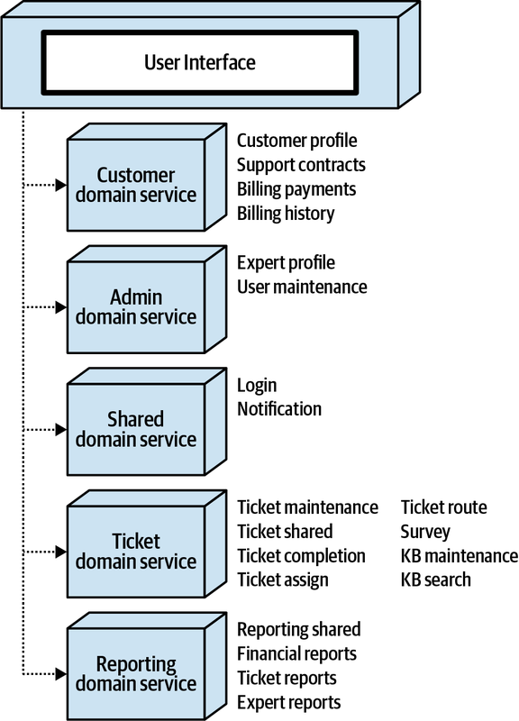

*Hình 5-22. Các domain service được deploy riêng tạo ra một ứng dụng Sysops Squad phân tán*

<a id="idm45798381431096"></a>

## Tóm tắt (Summary)

Theo kinh nghiệm của chúng tôi, các nỗ lực chuyển đổi kiểu “seat-of-the-pants” (làm theo cảm tính) hiếm khi tạo ra kết quả tích cực. Áp dụng các pattern phân rã component-based này cung cấp một cách tiếp cận có cấu trúc, có kiểm soát và tăng dần để tách các monolithic architecture. Một khi các pattern này được áp dụng, các team giờ có thể làm việc để phân rã dữ liệu monolith (xem [Chương 6](ch06_pulling_apart_operational_data.vi.md#ch06-decomposing-operational-data)) và bắt đầu chia các domain service thành các microservice fine-grained hơn (xem [Chương 7](ch07_service_granularity.vi.md#ch07-service-granularity)) khi cần.
