<a id="ch06-decomposing-operational-data"></a>

# Chương 6. Tách rời dữ liệu vận hành (Pulling Apart Operational Data)

`Thursday, October 7, 08:55`

Giờ đây khi ứng dụng Sysops Squad đã được tách thành công thành các domain service được deploy riêng, <a id="idm45798381424040"></a><a id="idm45798381422728"></a>cả Addison và Austen đều nhận ra đã đến lúc bắt đầu nghĩ đến việc tách database monolith của Sysops Squad. Addison đồng ý khởi động nỗ lực này, trong khi Austen bắt đầu làm việc để cải tiến CI/CD deployment pipeline. Addison gặp Dana, kiến trúc sư dữ liệu của Sysops Squad, và cả Devon, một trong các DBA hỗ trợ các database của Penultimate Electronics.

“Tôi muốn nghe ý kiến của hai người về cách chúng ta có thể tiến hành chia nhỏ database Sysops Squad,” Addison nói.

“Khoan đã,” Dana nói. “Ai nói gì về chuyện tách database chứ?”

“Addison và tôi đã thống nhất tuần trước rằng chúng ta cần chia nhỏ database Sysops Squad,” Devon nói. “Như chị biết, ứng dụng Sysops Squad đang trải qua một cuộc đại tu lớn, và tách dữ liệu là một phần của cuộc đại tu đó.”

“Tôi nghĩ database monolith hoàn toàn ổn,” Dana nói. “Tôi không thấy lý do gì phải tách nó ra. Trừ khi các cậu thuyết phục được tôi điều ngược lại, tôi sẽ không nhượng bộ về vấn đề này. Hơn nữa, các cậu có biết tách database đó khó đến mức nào không?”

“Tất nhiên là sẽ khó,” Devon nói, “nhưng tôi biết một quy trình five-step (năm bước) tận dụng cái gọi là data domain sẽ hoạt động rất tốt với database này. Bằng cách đó, chúng ta thậm chí có thể bắt đầu tìm hiểu việc dùng các loại database khác nhau cho một số phần của ứng dụng, như knowledge base và thậm chí cả chức năng khảo sát khách hàng.”

“Đừng vội vàng quá,” Dana nói. “Và cũng đừng quên rằng tôi là người chịu trách nhiệm cho tất cả các database này.”

Addison nhanh chóng nhận ra mọi thứ đang vượt khỏi tầm kiểm soát, và lập tức vận dụng một số kỹ năng đàm phán và điều phối then chốt. “OK,” Addison nói, “lẽ ra chúng tôi nên mời chị tham gia các cuộc thảo luận ban đầu, và về điều đó tôi xin lỗi. Lẽ ra tôi phải biết điều hơn. Chúng tôi có thể làm gì để chị cùng tham gia và giúp chúng tôi phân rã database Sysops Squad?”

“Dễ thôi,” Dana nói. “Thuyết phục tôi rằng database Sysops Squad thực sự cần được tách ra. Đưa cho tôi một lý do biện minh vững chắc. Nếu các cậu làm được điều đó, thì chúng ta sẽ bàn về quy trình five-step của Devon. Còn không thì nó cứ giữ nguyên như vậy.”

Tách một database là việc khó—thực tế khó hơn nhiều so với việc tách<a id="idm45798381415176"></a><a id="idm45798381385320"></a> chức năng ứng dụng. Vì dữ liệu nhìn chung là tài sản quan trọng nhất của công ty, rủi ro gián đoạn nghiệp vụ và ứng dụng cao hơn khi tách hoặc tái cấu trúc dữ liệu. Ngoài ra, dữ liệu có xu hướng coupled rất chặt với chức năng ứng dụng, khiến việc xác định các đường nối well-defined (rõ ràng) trong một data model lớn khó khăn hơn.

Giống như cách một ứng dụng monolith được chia thành các đơn vị deployment riêng, có những lúc việc chia nhỏ một database monolith cũng là điều mong muốn (hoặc thậm chí cần thiết). Một số architecture style, <a id="idm45798381382760"></a><a id="idm45798381381512"></a>như microservices, *đòi hỏi* dữ liệu phải được tách ra để hình thành các bounded context well-defined (nơi mỗi service sở hữu dữ liệu của riêng mình), <a id="idm45798381378712"></a><a id="idm45798381377736"></a><a id="idm45798381376776"></a>trong khi các architecture phân tán khác, như service-based architecture, cho phép các service dùng chung một database duy nhất.

Điều thú vị là một số kỹ thuật dùng để tách chức năng ứng dụng cũng có thể được áp dụng cho việc tách dữ liệu. Ví dụ, component tương ứng với data domain, file class tương ứng với bảng database, và các điểm coupling giữa các class tương ứng với các artifact database như foreign key, view, trigger, hoặc thậm chí stored procedure.

Trong chương này, chúng tôi khám phá một số động lực cho việc phân rã dữ liệu và trình bày các kỹ thuật để tách hiệu quả dữ liệu monolith thành các data domain, schema riêng biệt, và thậm chí các database riêng biệt theo cách lặp và có kiểm soát. Biết rằng thế giới database không phải toàn là relational, chúng tôi cũng thảo luận nhiều loại database khác nhau (relational, graph, document, key-value, columnar, NewSQL, và cloud native) và phác thảo các trade-offs khác nhau gắn với từng loại database này.

<a id="sec-data-decomposition-drivers"></a>

## Các động lực phân rã dữ liệu (Data Decomposition Drivers)

Tách một database monolith có thể là một nhiệm vụ đáng ngại, <a id="ch06-ddcd"></a><a id="ch06-ddcd2"></a>và vì vậy điều quan trọng là phải hiểu liệu (và khi nào) một database nên được phân rã, như minh họa trong [Hình 6-1](#fig-data-decomposition-monolith). Kiến trúc sư có thể biện minh cho một nỗ lực phân rã dữ liệu bằng cách hiểu và phân tích các *data disintegrator* (các động lực biện minh cho việc tách dữ liệu) và các *data integrator* (các động lực biện minh cho việc giữ dữ liệu cùng nhau). Phấn đấu cân bằng giữa hai lực thúc đẩy này và phân tích trade-offs của từng lực là chìa khóa để có granularity dữ liệu đúng.

<a id="fig-data-decomposition-monolith"></a>

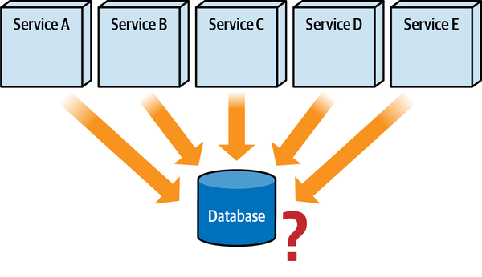

*Hình 6-1. Trong những hoàn cảnh nào một database monolith nên được phân rã?*

Trong phần này, chúng tôi sẽ khám phá các data disintegrator và data integrator được dùng để giúp đưa ra lựa chọn đúng khi cân nhắc tách dữ liệu monolith.

<a id="idm45798381364056"></a>

### Data disintegrator (Data Disintegrators)

Các động lực data disintegration cung cấp câu trả lời và lý do biện minh<a id="idm45798381362328"></a> cho câu hỏi “khi nào tôi nên cân nhắc tách dữ liệu của mình?” Sáu động lực disintegration chính cho việc tách dữ liệu bao gồm:

**Kiểm soát thay đổi (Change control)**

Có bao nhiêu service bị ảnh hưởng bởi một thay đổi bảng database?

**Quản lý connection (Connection management)**

Database của tôi có xử lý được số connection cần thiết từ nhiều service phân tán không?

**Scalability**

Database có thể scale để đáp ứng nhu cầu của các service truy cập nó không?

**Fault tolerance**

Có bao nhiêu service bị ảnh hưởng bởi một sự cố crash database hoặc thời gian ngừng hoạt động để bảo trì?

**Architectural quanta (Architectural quanta)**

Một database dùng chung duy nhất có đang ép tôi vào một architecture quantum duy nhất không mong muốn không?

**Tối ưu hóa loại database (Database type optimization)**

Tôi có thể tối ưu hóa dữ liệu của mình bằng cách dùng nhiều loại database không?

Mỗi động lực disintegration này được thảo luận chi tiết trong các phần sau.

#### Kiểm soát thay đổi (Change control)

Một trong những động lực data disintegration chính là <a id="ch06-chang"></a><a id="idm45798381348072"></a><a id="idm45798381347128"></a>kiểm soát các thay đổi trong schema bảng database. Xóa bảng hoặc cột, đổi tên bảng hoặc cột, và thậm chí thay đổi kiểu cột trong một bảng đều làm hỏng SQL tương ứng truy cập các bảng đó, và kéo theo làm hỏng các service tương ứng dùng các bảng đó. Chúng tôi gọi những loại thay đổi này là *breaking change* (thay đổi phá vỡ), trái ngược với việc thêm bảng hoặc cột vào database, vốn nhìn chung không ảnh hưởng đến các truy vấn hay thao tác ghi hiện có. Không ngạc nhiên, kiểm soát thay đổi bị ảnh hưởng nhiều nhất khi dùng relational database, nhưng các loại database khác cũng có thể tạo ra vấn đề kiểm soát thay đổi (xem [“Selecting a Database Type”](#sec-polyglot-databases)).

Như minh họa trong [Hình 6-2](#fig-data-decomposition-change-coordinate), khi breaking change xảy ra với một database, nhiều service phải được cập nhật, test và deploy cùng với các thay đổi database. Sự phối hợp này có thể nhanh chóng trở nên vừa khó khăn vừa dễ mắc lỗi khi số lượng service được deploy riêng dùng chung cùng database tăng lên. Hãy tưởng tượng phải phối hợp 42 service được deploy riêng cho một breaking change database duy nhất!

<a id="fig-data-decomposition-change-coordinate"></a>

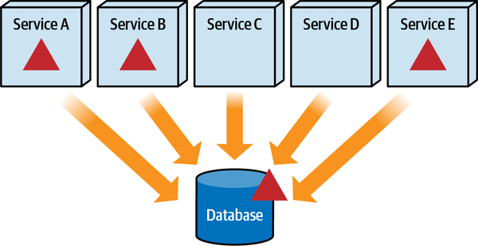

*Hình 6-2. Các service bị ảnh hưởng bởi thay đổi database phải được deploy cùng với database*

Phối hợp thay đổi cho nhiều service phân tán vì một thay đổi database dùng chung mới chỉ là một nửa câu chuyện. <a id="idm45798381340328"></a><a id="idm45798381339080"></a><a id="idm45798381337864"></a><a id="idm45798381336632"></a>Mối nguy thực sự của việc thay đổi một database dùng chung trong bất kỳ architecture phân tán nào là quên mất các service truy cập bảng vừa bị thay đổi. Như minh họa trong [Hình 6-3](#fig-data-decomposition-change-break), những service đó trở nên không vận hành được *trong production* cho đến khi chúng được thay đổi, test và deploy lại.

<a id="fig-data-decomposition-change-break"></a>

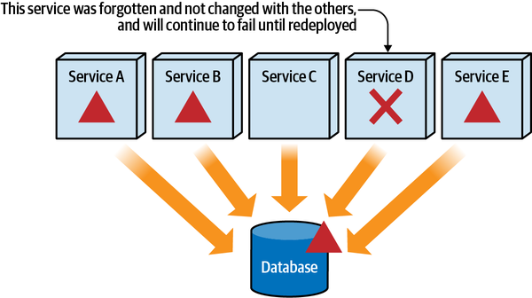

*Hình 6-3. Các service bị ảnh hưởng bởi thay đổi database nhưng bị bỏ quên sẽ tiếp tục thất bại cho đến khi được deploy lại*

Trong hầu hết các ứng dụng, mối nguy của các service bị bỏ quên được giảm thiểu nhờ phân tích tác động cẩn thận và regression testing quyết liệt. Tuy nhiên, hãy xét một hệ sinh thái microservices với 400 service, tất cả dùng chung cùng một relational database monolith dạng cluster có availability cao. Hãy tưởng tượng chạy khắp nơi tới tất cả các development team ở nhiều vùng domain, cố tìm ra những service nào dùng bảng đang bị thay đổi. Cũng hãy tưởng tượng sau đó phải phối hợp, test và deploy tất cả các service này *cùng nhau* như một đơn vị duy nhất, cùng với database. Nghĩ về kịch bản này bắt đầu trở thành một bài tập mind-numbing (gây tê liệt đầu óc), thường dẫn đến một mức độ điên rồ nào đó.

Tách một database thành các [bounded context](https://oreil.ly/Q8mI7) well-defined giúp đáng kể <a id="ch06-boud4"></a><a id="ch06-boud"></a><a id="ch06-boud2"></a><a id="ch06-boud3"></a>trong việc kiểm soát các breaking change database. Khái niệm bounded context đến từ cuốn sách kinh điển *Domain-Driven Design* của Eric Evans (Addison-Wesley) và mô tả source code, business logic, cấu trúc dữ liệu, và dữ liệu, tất cả được gắn kết với nhau—đóng gói—trong một bối cảnh cụ thể. Như minh họa trong [Hình 6-4](#fig-data-decomposition-bounded-context), các bounded context well-formed (được hình thành tốt) bao quanh các service và dữ liệu tương ứng của chúng giúp kiểm soát thay đổi, vì thay đổi được cô lập chỉ trong những service nằm trong bounded context đó.

Điển hình nhất, các bounded context được hình thành quanh các service và dữ liệu<a id="idm45798381321576"></a> mà service sở hữu. Khi nói “sở hữu,” chúng tôi muốn nói service ghi vào database (trái ngược với việc chỉ có quyền truy cập read-only vào dữ liệu). Chúng tôi thảo luận chi tiết hơn về quyền sở hữu dữ liệu phân tán trong [Chương 9](ch09_data_ownership_and_distributed_transactions.vi.md#ch09-data-update).

<a id="fig-data-decomposition-bounded-context"></a>

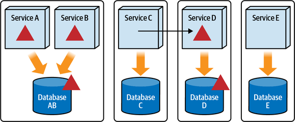

*Hình 6-4. Các thay đổi database được cô lập chỉ trong những service nằm trong bounded context liên quan*

Lưu ý trong [Hình 6-4](#fig-data-decomposition-bounded-context) rằng Service C cần truy cập một số dữ liệu trong Database D vốn nằm trong một bounded context cùng với Service D. Vì Database D nằm trong một bounded context khác, Service C không thể truy cập dữ liệu trực tiếp. Điều này không chỉ vi phạm quy tắc bounded context, mà còn tạo ra một mớ hỗn độn về mặt kiểm soát thay đổi. Do đó, Service C phải *yêu cầu* Service D cung cấp dữ liệu. Có nhiều cách truy cập dữ liệu mà một service không sở hữu trong khi vẫn duy trì bounded context. Các kỹ thuật này được thảo luận chi tiết trong [Chương 10](ch10_distributed_data_access.vi.md#ch10-data-access).

Một khía cạnh quan trọng của bounded context liên quan đến kịch bản giữa Service C cần dữ liệu và Service D <a id="ch06-owabb"></a><a id="ch06-owab3"></a><a id="ch06-owab4"></a><a id="ch06-owabz"></a><a id="ch06-owab5"></a>sở hữu dữ liệu đó trong bounded context của nó là *trừu tượng hóa database* (database abstraction). Lưu ý trong [Hình 6-5](#fig-data-decomposition-contracts) rằng Service D đang gửi dữ liệu được Service C yêu cầu thông qua một loại *contract* nào đó (như JSON, XML, hoặc có thể thậm chí là một object).

Lợi thế của bounded context là dữ liệu gửi tới Service C có thể là một contract khác với schema của Database D. Điều này có nghĩa là một breaking change đối với một bảng nào đó trong Database D chỉ ảnh hưởng đến Service D và không nhất thiết ảnh hưởng đến contract của dữ liệu gửi tới Service C. Nói cách khác, Service C được trừu tượng hóa khỏi cấu trúc schema thực tế của Database D.

<a id="fig-data-decomposition-contracts"></a>

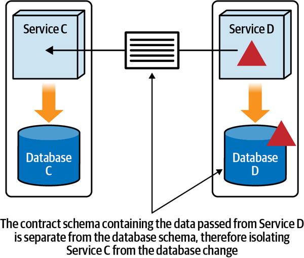

*Hình 6-5. Contract từ một lời gọi service trừu tượng hóa bên gọi khỏi database schema bên dưới*

Để minh họa sức mạnh của sự trừu tượng hóa bounded context này trong một architecture phân tán, giả sử Database D có một bảng Wishlist với cấu trúc sau:

```perl
CREATE TABLE Wishlist
(
CUSTOMER_ID VARCHAR(10),
ITEM_ID VARCHAR(20),
QUANTITY INT,
EXPIRATION_DT DATE
);
```

JSON contract tương ứng mà Service D gửi tới Service C khi yêu cầu các mục wish list như sau:

```perl
{
  "$schema": "http://json-schema.org/draft-04/schema#",
  "properties": {
    "cust_id": {"type": "string"},
    "item_id": {"type": "string"},
    "qty": {"type": "number"},
    "exp_dt": {"type": "number"}
  },
}
```

Hãy để ý cách trường dữ liệu hết hạn (`exp_dt`) trong JSON schema được đặt tên khác với tên cột database và được chỉ định là một số (một giá trị long biểu thị epoch time—số mili giây kể từ nửa đêm ngày 1 tháng Một năm 1970), trong khi trong database nó được biểu thị là một trường `DATE`. Bất kỳ thay đổi tên cột hay kiểu cột nào trong database không còn ảnh hưởng đến Service C nhờ JSON contract riêng biệt.

Để minh họa điểm này, giả sử phía nghiệp vụ quyết định không cho các mục wish list hết hạn nữa. Điều này sẽ đòi hỏi một thay đổi trong cấu trúc bảng của database:

```perl
ALTER TABLE Wishlist
DROP COLUMN EXPIRATION_DT;
```

Service D sẽ phải được sửa đổi để thích ứng với thay đổi này vì nó nằm trong cùng bounded context với database, nhưng contract tương ứng sẽ không phải thay đổi cùng lúc. Cho đến khi contract cuối cùng được thay đổi, Service D có thể hoặc chỉ định một ngày rất xa trong tương lai hoặc đặt giá trị bằng không để biểu thị mục đó không hết hạn. Điểm mấu chốt là Service C được trừu tượng hóa khỏi các breaking change đối với Database D nhờ bounded context.<a id="idm45798381206968"></a><a id="idm45798381206360"></a><a id="idm45798381205752"></a><a id="idm45798381205080"></a><a id="idm45798381204408"></a><a id="idm45798381203736"></a><a id="idm45798381203064"></a><a id="idm45798381202392"></a><a id="idm45798381201720"></a><a id="idm45798381178584"></a>

#### Quản lý connection (Connection management)

Thiết lập một connection tới database là một thao tác tốn kém. <a id="ch06-conmg"></a><a id="ch06-conmg2"></a>Một database connection pool thường được dùng không chỉ để tăng performance, mà còn để giới hạn số lượng connection đồng thời mà một ứng dụng được phép dùng. <a id="idm45798381173448"></a><a id="idm45798381172568"></a><a id="idm45798381171688"></a><a id="idm45798381196568"></a>Trong các ứng dụng monolith, database connection pool thường thuộc sở hữu của ứng dụng (hoặc application server). Tuy nhiên, trong các architecture phân tán, mỗi service—hay cụ thể hơn, mỗi instance của service—thường có connection pool riêng. <a id="ch06-conmg5"></a><a id="ch06-conmg4"></a><a id="ch06-conmg3"></a>Như minh họa trong [Hình 6-6](#fig-data-decomposition-connections), khi nhiều service dùng chung cùng database, số lượng connection có thể nhanh chóng bị bão hòa, đặc biệt khi số lượng service hoặc instance service tăng lên.

<a id="fig-data-decomposition-connections"></a>

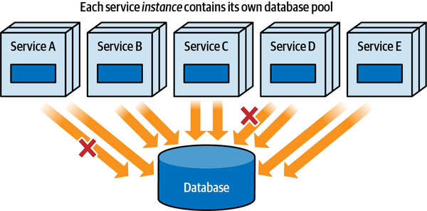

*Hình 6-6. Database connection có thể nhanh chóng bị bão hòa với nhiều instance service*

Chạm tới (hoặc vượt quá) số lượng database connection tối đa khả dụng là thêm một động lực nữa cần xem xét khi quyết định có nên tách một database hay không. Việc thường xuyên phải chờ connection (khoảng thời gian chờ để một connection trở nên khả dụng) thường là dấu hiệu đầu tiên cho thấy số lượng database connection tối đa đã bị chạm tới. Vì việc chờ connection cũng có thể biểu hiện dưới dạng request time-outs hoặc circuit breaker bị ngắt, việc tìm kiếm các lần chờ connection thường là điều đầu tiên chúng tôi khuyến nghị nếu những tình trạng này thường xuyên xảy ra khi dùng một database dùng chung.

Để minh họa các vấn đề gắn với database connection và architecture phân tán, hãy xét ví dụ sau: một ứng dụng monolith với 200 database connection được chia thành một architecture phân tán gồm 50 service, mỗi service có 10 database connection trong connection pool của nó.

|  |  |
|---|---|
| Ứng dụng monolith ban đầu | 200 connection |
| Số service phân tán | 50 |
| Số connection mỗi service | 10 |
| Số instance service tối thiểu | 2 |
| Tổng số connection của các service | 1,000 |

Hãy để ý cách số lượng database connection trong cùng bối cảnh ứng dụng tăng từ 200 lên 1,000, và các service thậm chí còn chưa bắt đầu scale! Giả sử một nửa số service scale lên trung bình 5 instance mỗi service, số lượng database connection nhanh chóng tăng lên 1,700.

Nếu không có một loại chiến lược connection hay kế hoạch governance nào đó, các service<a id="idm45798381119896"></a><a id="idm45798381118616"></a> sẽ cố dùng nhiều connection nhất có thể, thường xuyên khiến các service khác thiếu những connection rất cần thiết. Vì lý do này, điều quan trọng là quản trị cách dùng database connection trong một architecture phân tán. Một cách tiếp cận hiệu quả là giao cho mỗi service một *connection quota* (hạn ngạch connection) để quản trị việc phân bổ các database connection khả dụng giữa các service. Một connection quota chỉ định số lượng database connection tối đa mà một service được phép dùng hoặc đặt sẵn trong connection pool của nó.

Bằng cách chỉ định một connection quota, các service không được phép tạo nhiều database connection hơn số được phân bổ cho nó. Nếu một service chạm tới số lượng database connection tối đa trong quota của nó, nó phải chờ một trong các connection nó đang dùng trở nên khả dụng. Phương pháp này có thể được hiện thực bằng hai cách tiếp cận: phân bổ đều cùng một connection quota cho mọi service, hoặc giao một connection quota khác nhau cho mỗi service dựa trên nhu cầu của nó.

Cách tiếp cận phân bổ đều thường được dùng khi mới deploy các service, và chưa biết mỗi service sẽ cần bao nhiêu connection trong các hoạt động bình thường và cao điểm. Dù đơn giản, cách tiếp cận này không quá hiệu quả vì một số service có thể cần nhiều connection hơn các service khác, trong khi một số connection do các service khác giữ có thể không được dùng đến.

Dù phức tạp hơn, cách tiếp cận phân bổ biến thiên hiệu quả hơn nhiều cho việc quản lý database connection tới một database dùng chung. Với cách tiếp cận này, mỗi service được giao một connection quota khác nhau dựa trên chức năng và các yêu cầu scalability của nó. Lợi thế của cách tiếp cận này là nó tối ưu hóa việc dùng các database connection khả dụng giữa các service phân tán, bảo đảm những service cần nhiều database connection hơn luôn có sẵn connection để dùng. Tuy nhiên, nhược điểm là nó đòi hỏi hiểu biết về bản chất chức năng và các yêu cầu scalability của từng service.

Chúng tôi thường khuyến nghị bắt đầu với cách tiếp cận phân bổ đều và tạo các fitness function để đo mức dùng connection đồng thời của từng service. Chúng tôi cũng khuyến nghị giữ các giá trị connection quota trong một configuration server (hoặc service) bên ngoài để các giá trị có thể dễ dàng được điều chỉnh thủ công hoặc theo chương trình thông qua các thuật toán machine learning đơn giản. Kỹ thuật này không chỉ giúp giảm thiểu rủi ro bão hòa connection, mà còn cân bằng hợp lý các database connection khả dụng giữa các service phân tán để bảo đảm không có connection nhàn rỗi nào bị lãng phí.

[Bảng 6-1](#table-data-decomposition-allocations-even) thể hiện một ví dụ bắt đầu bằng cách tiếp cận phân bổ đều cho một database có thể hỗ trợ tối đa 100 connection đồng thời. Lưu ý rằng Service A chỉ từng cần tối đa 5 connection, Service C chỉ 15 connection, và Service E chỉ 14 connection, trong khi Service B và Service D đã chạm tới connection quota tối đa và đã gặp tình trạng phải chờ connection.

<a id="table-data-decomposition-allocations-even"></a>

<a id="table-data-decomposition-allocations-even"></a>*Bảng 6-1. Phân bổ connection quota đều nhau*

|  | Service | Quota | Mức dùng tối đa | Phải chờ |
|---|---|---|---|---|
|  | A | 20 | 5 | Không |
| → | B | 20 | 20 | Có |
|  | C | 20 | 15 | Không |
| → | D | 20 | 20 | Có |
|  | E | 20 | 14 | Không |

Vì Service A dùng thấp hơn nhiều so với connection quota của nó, đây là chỗ tốt để bắt đầu phân bổ lại connection cho các service khác. Chuyển năm database connection cho Service B và năm database connection cho Service D cho ra kết quả thể hiện trong [Bảng 6-2](#table-data-decomposition-allocations-variable-1).

<a id="table-data-decomposition-allocations-variable-1"></a>

<a id="table-data-decomposition-allocations-variable-1"></a>*Bảng 6-2. Phân bổ connection quota với các mức phân bổ khác nhau*

|  | Service | Quota | Mức dùng tối đa | Phải chờ |
|---|---|---|---|---|
|  | A | 10 | 5 | Không |
| → | B | 25 | 25 | Có |
|  | C | 20 | 15 | Không |
|  | D | 25 | 25 | Không |
|  | E | 20 | 14 | Không |

Như vậy tốt hơn, nhưng Service B vẫn đang gặp tình trạng phải chờ connection, cho thấy nó cần nhiều connection hơn số nó có trong connection quota. Điều chỉnh lại quota thêm nữa bằng cách lấy hai connection từ mỗi service, Service A và Service E, cho ra kết quả tốt hơn nhiều, như thể hiện trong [Bảng 6-3](#table-data-decomposition-allocations-variable-2).

<a id="table-data-decomposition-allocations-variable-2"></a>

<a id="table-data-decomposition-allocations-variable-2"></a>*Bảng 6-3. Tinh chỉnh connection quota thêm nữa dẫn đến không còn phải chờ connection*

| Service | Quota | Mức dùng tối đa | Phải chờ |
|---|---|---|---|
| A | 8 | 5 | Không |
| B | 29 | 27 | Không |
| C | 20 | 15 | Không |
| D | 25 | 25 | Không |
| E | 18 | 14 | Không |

Phân tích này, có thể được rút ra từ các fitness function liên tục thu thập dữ liệu metric dạng stream từ mỗi service, cũng có thể được dùng để xác định số connection tối đa đã dùng gần với số connection tối đa khả dụng đến mức nào, và cả việc mỗi service còn bao nhiêu khoảng đệm xét theo quota và số connection tối đa đã dùng.<a id="idm45798381046392"></a><a id="idm45798381045688"></a><a id="idm45798381045016"></a><a id="idm45798381044344"></a><a id="idm45798381043672"></a>

#### Scalability

Một trong nhiều lợi thế của một architecture phân tán<a id="idm45798381041304"></a><a id="idm45798381040056"></a> là scalability—khả năng của các service xử lý lượng request tăng lên trong khi duy trì thời gian phản hồi nhất quán. Hầu hết các sản phẩm infrastructure-related (liên quan đến hạ tầng) cloud-based và on-prem đều làm tốt việc bảo đảm rằng service, container, HTTP server và máy ảo scale để đáp ứng nhu cầu gia tăng. Nhưng còn database thì sao?

Như minh họa trong [Hình 6-7](#fig-data-decomposition-scalability), <a id="idm45798381037352"></a><a id="idm45798381036360"></a>scalability của service có thể đặt một áp lực khổng lồ lên database, không chỉ về database connection (như đã thảo luận ở phần trước), mà còn về throughput và dung lượng database. Để một hệ thống phân tán scale được, *mọi* phần của hệ thống đều cần scale—kể cả database.

<a id="fig-data-decomposition-scalability"></a>

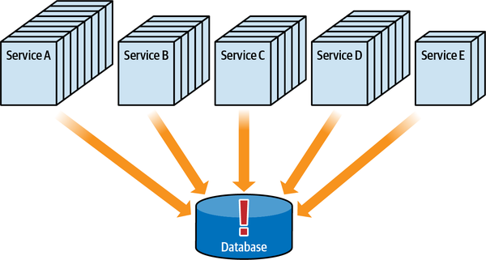

*Hình 6-7. Database cũng phải scale khi các service scale*

Scalability là một động lực data disintegration khác cần xem xét khi nghĩ đến việc tách một database. Database connection, dung lượng, throughput và performance đều là những yếu tố quyết định liệu một database dùng chung có đáp ứng được nhu cầu của nhiều service trong một architecture phân tán hay không.

Hãy xét các database connection quota biến thiên đã tinh chỉnh trong [Bảng 6-3](#table-data-decomposition-allocations-variable-2) ở phần trước. Khi các service scale bằng cách thêm nhiều instance, bức tranh thay đổi đáng kể, như thể hiện trong [Bảng 6-4](#table-data-decomposition-scalability), trong đó tổng số database connection là 100.

<a id="table-data-decomposition-scalability"></a>

<a id="table-data-decomposition-scalability"></a>*Bảng 6-4. Khi các service scale, số connection được dùng nhiều hơn số khả dụng*

| Service | Quota | Mức dùng tối đa | Số instance | Tổng đã dùng |
|---|---|---|---|---|
| A | 8 | 5 | 2 | 10 |
| B | 29 | 27 | 3 | 81 |
| C | 20 | 15 | 3 | 45 |
| D | 25 | 25 | 2 | 50 |
| E | 18 | 14 | 4 | 56 |
| TỔNG | 100 | 86 | 14 | 242 |

Lưu ý rằng dù connection quota được phân bổ cho khớp với 100 database connection khả dụng, một khi các service bắt đầu scale, quota không còn hợp lệ vì tổng số connection được dùng tăng lên 242, tức là nhiều hơn 142 connection so với số khả dụng trong database. Điều này nhiều khả năng sẽ dẫn đến tình trạng phải chờ connection, và đến lượt nó sẽ dẫn đến suy giảm performance tổng thể và request time-outs.

Tách dữ liệu thành các data domain riêng biệt hoặc thậm chí<a id="idm45798381001416"></a><a id="idm45798381000440"></a><a id="idm45798380999768"></a><a id="idm45798380998824"></a><a id="idm45798380997592"></a> database-per-service (mỗi service một database), như minh họa trong [Hình 6-8](#fig-data-decomposition-scalability-separate), đòi hỏi ít connection hơn tới mỗi database, do đó mang lại scalability và performance database tốt hơn khi các service scale.

<a id="fig-data-decomposition-scalability-separate"></a>

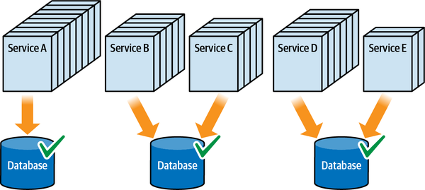

*Hình 6-8. Tách database mang lại scalability database tốt hơn*

Ngoài database connection, một yếu tố khác cần xem xét về scalability là tải đặt lên database. Bằng cách tách một database, mỗi database chịu ít tải hơn, nhờ đó cũng cải thiện performance và scalability tổng thể.

#### Fault tolerance

Khi nhiều service dùng chung cùng database, toàn bộ<a id="idm45798380990648"></a><a id="idm45798380989320"></a><a id="idm45798380988408"></a><a id="idm45798380987496"></a><a id="idm45798380986808"></a> hệ thống trở nên kém fault tolerant hơn vì database trở thành một single point of failure (SPOF — điểm lỗi duy nhất). <a id="idm45798380985624"></a><a id="idm45798380984680"></a><a id="idm45798380983464"></a><a id="idm45798380982232"></a>Ở đây, chúng tôi định nghĩa fault tolerance là khả năng một số phần của hệ thống tiếp tục hoạt động không gián đoạn khi một service hoặc database gặp lỗi. Lưu ý trong [Hình 6-9](#fig-data-decomposition-fault-tolerance) rằng khi dùng chung một database duy nhất, fault tolerance tổng thể thấp vì nếu database sập, *mọi* service đều không vận hành được.

<a id="fig-data-decomposition-fault-tolerance"></a>

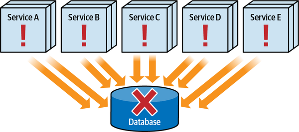

*Hình 6-9. Nếu database sập, mọi service đều không vận hành được*

Fault tolerance là một động lực khác để cân nhắc tách dữ liệu. Nếu một số phần của hệ thống đòi hỏi fault tolerance, việc tách dữ liệu có thể loại bỏ single point of failure trong hệ thống, như thể hiện trong Hình 6-10. Điều này bảo đảm rằng một số phần của hệ thống vẫn vận hành được trong trường hợp database bị crash.

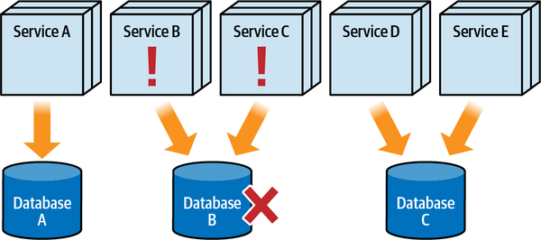

*Hình 6-10. Tách database đạt được fault tolerance tốt hơn*

Lưu ý rằng vì dữ liệu giờ đã được tách ra, nếu Database B sập, chỉ Service B và Service C bị ảnh hưởng và không vận hành được, trong khi các service khác tiếp tục vận hành không gián đoạn.

#### Architectural quantum

Hãy nhớ lại từ [Chương 2](ch02_discerning_coupling_in_software_architecture.vi.md#ch02-discerning) rằng một architectural quantum<a id="idm45798380971240"></a><a id="idm45798380970232"></a><a id="idm45798380969016"></a> được định nghĩa là một artifact deploy được độc lập với functional cohesion cao, static coupling cao, và dynamic coupling đồng bộ. Architecture quantum giúp đưa ra định hướng về thời điểm nên tách một database, khiến nó trở thành một động lực data disintegration khác.

Hãy xét các service trong [Hình 6-11](#fig-data-decomposition-quantum), trong đó Service A và Service B đòi hỏi các architectural characteristic khác với các service còn lại. Lưu ý trong sơ đồ rằng dù Service A và Service B được nhóm cùng nhau, chúng không hình thành một quantum tách biệt khỏi các service khác vì một database dùng chung duy nhất. Do đó, cả năm service, cùng với database, hình thành một architectural quantum duy nhất.

<a id="fig-data-decomposition-quantum"></a>

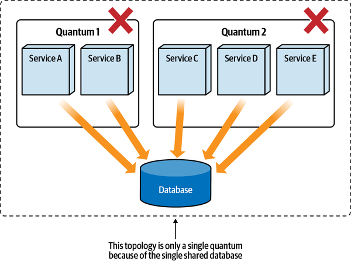

*Hình 6-11. Database là một phần của architectural quantum*

Vì database được bao gồm trong phần *functional cohesion* của định nghĩa architecture quantum,<a id="idm45798380962856"></a><a id="idm45798380961576"></a><a id="idm45798380960344"></a> cần phải tách dữ liệu để mỗi phần kết quả có thể nằm trong quantum riêng của nó. Lưu ý trong [Hình 6-12](#fig-data-decomposition-quanta) rằng vì database đã được tách ra, Service A và Service B, cùng với dữ liệu tương ứng, giờ là một quantum tách biệt khỏi quantum được hình thành bởi các service C, D và E.

<a id="fig-data-decomposition-quanta"></a>

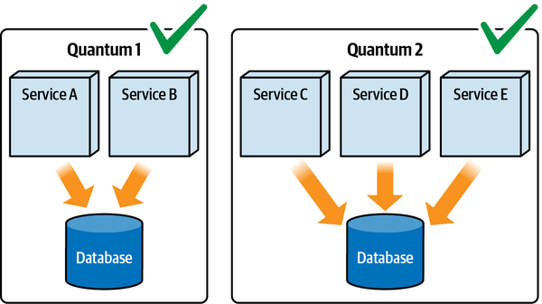

*Hình 6-12. Chia nhỏ database hình thành hai architectural quanta*

#### Tối ưu hóa loại database (Database type optimization)

Thường thì không phải mọi dữ liệu đều được xử lý như nhau. <a id="idm45798380954664"></a><a id="idm45798380953592"></a><a id="idm45798380952360"></a>Khi dùng một database monolith, *mọi* dữ liệu phải tuân theo loại database đó, do đó có khả năng tạo ra các giải pháp sub-optimal (chưa tối ưu) cho một số loại dữ liệu nhất định.

Tách dữ liệu monolith cho phép kiến trúc sư chuyển một số dữ liệu sang một loại database tối ưu hơn. Ví dụ, giả sử một relational database monolith lưu dữ liệu transaction application-related (liên quan đến ứng dụng), bao gồm dữ liệu tham chiếu dưới dạng các cặp key-value (như mã quốc gia, mã sản phẩm, mã kho, v.v.). Loại dữ liệu này khó quản lý trong một relational database vì bản chất dữ liệu không mang tính quan hệ, mà là key-value. Do đó, một database *key-value* (xem [“Key-Value Databases”](#sec-kv-database)) sẽ tạo ra giải pháp tối ưu hơn so với một relational database.

<a id="idm45798381363432"></a>

### Data integrator (Data Integrators)

Data integrator làm điều hoàn toàn ngược lại với các data disintegrator đã thảo luận ở phần trước. <a id="idm45798380946760"></a>Những động lực này cung cấp câu trả lời và lý do biện minh cho câu hỏi “khi nào tôi nên cân nhắc gộp dữ liệu trở lại với nhau?” Cùng với data disintegrator, data integrator mang lại sự cân bằng và các trade-offs để phân tích khi nào nên tách dữ liệu và khi nào không.

Hai động lực integration chính cho việc gộp dữ liệu trở lại với nhau như sau:

**Quan hệ dữ liệu (Data relationships)**

Có foreign key, trigger hoặc view nào hình thành quan hệ chặt chẽ giữa các bảng không?

**Database transaction (Database transactions)**

Có cần một đơn vị công việc transaction duy nhất để bảo đảm tính toàn vẹn và nhất quán của dữ liệu không?

Mỗi động lực integration này được thảo luận chi tiết trong các phần sau.

#### Quan hệ dữ liệu (Data relationships)

Giống như các component trong một architecture, các bảng database cũng có thể bị coupled<a id="idm45798380938712"></a><a id="idm45798380937384"></a><a id="idm45798380936440"></a><a id="idm45798380935208"></a><a id="idm45798380933976"></a><a id="idm45798380933016"></a>, đặc biệt đối với relational database. Các artifact như foreign key, trigger, view và stored procedure gắn các bảng lại với nhau, khiến việc tách dữ liệu ra trở nên khó khăn; xem Hình 6-13.

Hãy tưởng tượng bước tới chỗ DBA hoặc kiến trúc sư dữ liệu của bạn và nói với họ rằng vì database phải được tách ra để hỗ trợ các bounded context được hình thành chặt chẽ trong một hệ sinh thái microservices, mọi foreign key và view trong database cần phải bị gỡ bỏ! Đó không phải là một kịch bản có khả năng xảy ra (hay thậm chí khả thi), nhưng đó chính xác là điều cần xảy ra để hỗ trợ pattern database-per-service trong microservices.

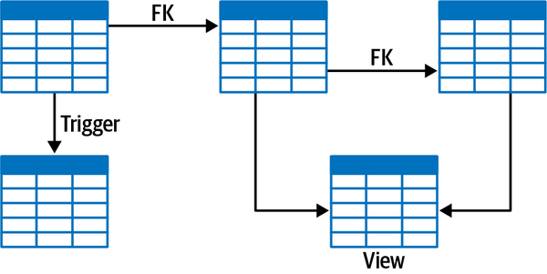

*Hình 6-13. Foreign key (FK), trigger và view tạo ra các quan hệ coupling chặt giữa dữ liệu*

Những artifact này là cần thiết trong hầu hết các relational database để hỗ trợ tính nhất quán và tính toàn vẹn của dữ liệu. Ngoài các artifact vật lý này, dữ liệu cũng có thể có quan hệ logic, như một bảng problem ticket và bảng trạng thái problem ticket tương ứng của nó. Tuy nhiên, như minh họa trong [Hình 6-14](#fig-data-decomposition-artifacts-split), những artifact này phải được gỡ bỏ khi chuyển dữ liệu sang một schema hoặc database khác để hình thành các bounded context.

<a id="fig-data-decomposition-artifacts-split"></a>

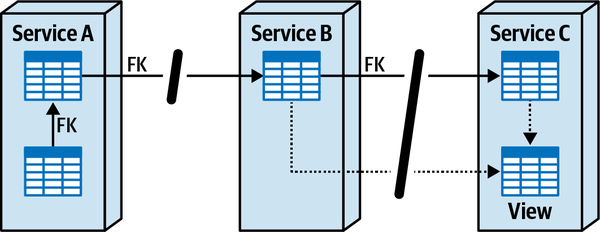

*Hình 6-14. Các artifact dữ liệu phải được gỡ bỏ khi tách dữ liệu*

Lưu ý rằng quan hệ foreign key (FK) giữa các bảng trong Service A có thể được giữ lại vì dữ liệu nằm trong cùng bounded context, schema hoặc database. Tuy nhiên, các foreign key (FK) giữa các bảng trong Service B và Service C phải bị gỡ bỏ (cũng như view được dùng trong Service C) vì các bảng đó gắn với các database hoặc schema khác nhau.

Quan hệ giữa dữ liệu, dù logic hay vật lý, là một động lực data integration, do đó tạo ra một trade-off giữa data disintegrator và data integrator. Ví dụ, kiểm soát thay đổi (một data disintegrator) có quan trọng hơn việc giữ các quan hệ foreign key giữa các bảng (một data integrator) không? Fault tolerance (một data disintegrator) có quan trọng hơn việc giữ các materialized view giữa các bảng (một data integrator) không? Xác định điều gì quan trọng hơn giúp đưa ra quyết định về việc dữ liệu có nên được tách ra hay không và granularity schema kết quả nên là gì.

#### Database transaction (Database transactions)

Một data integrator khác là database transaction,<a id="idm45798380920904"></a><a id="idm45798380919576"></a> điều chúng tôi thảo luận chi tiết trong [“Distributed Transactions”](ch09_data_ownership_and_distributed_transactions.vi.md#sec-acid-vs-base). Như thể hiện trong [Hình 6-15](#fig-data-decomposition-transactions), khi một service duy nhất thực hiện nhiều thao tác ghi database vào các bảng riêng biệt trong cùng database hoặc schema, các cập nhật đó có thể được thực hiện trong một transaction Atomicity, Consistency, Isolation, Durability (ACID) và được commit hoặc rollback như một đơn vị công việc duy nhất.

<a id="fig-data-decomposition-transactions"></a>

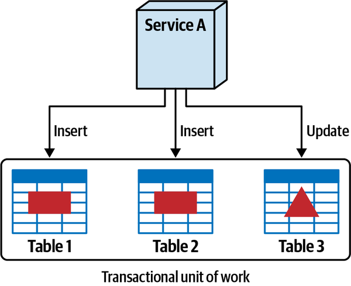

*Hình 6-15. Một đơn vị công việc transaction duy nhất tồn tại khi dữ liệu ở cùng nhau*

Tuy nhiên, khi dữ liệu được tách thành các schema hoặc database riêng biệt, như minh họa trong [Hình 6-16](#fig-data-decomposition-no-transactions), một đơn vị công việc transaction duy nhất không còn tồn tại vì các lời gọi từ xa giữa các service. Điều này có nghĩa là một thao tác insert hoặc update có thể được commit ở một bảng, nhưng không được commit ở các bảng khác do các điều kiện lỗi, dẫn đến các vấn đề về tính nhất quán và toàn vẹn dữ liệu.

<a id="fig-data-decomposition-no-transactions"></a>

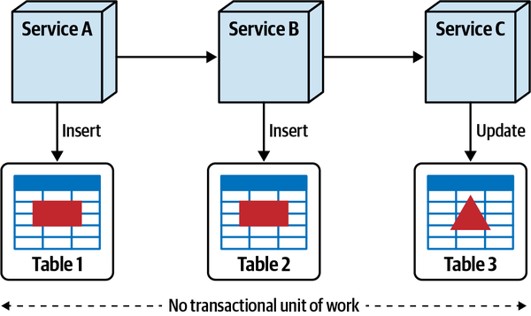

*Hình 6-16. Transaction dạng đơn vị công việc duy nhất không tồn tại khi dữ liệu bị tách ra*

Dù chúng tôi đi sâu vào chi tiết về quản lý transaction phân tán và transactional saga trong [Chương 12](ch12_transactional_sagas.vi.md#ch12-transactional-sagas), điểm muốn nhấn mạnh ở đây là database transaction là thêm một động lực data integration nữa, và nên được tính đến khi cân nhắc tách một database.<a id="idm45798380909304"></a><a id="idm45798380908632"></a>

<a id="idm45798380907832"></a>

### Sysops Squad Saga: Biện minh cho việc phân rã database (Sysops Squad Saga: Justifying Database Decomposition)

`Monday, November 15, 15:55`

Được trang bị các lý do biện minh, Addison và Devon gặp nhau để<a id="idm45798380904968"></a><a id="idm45798380903672"></a><a id="idm45798380902440"></a> thuyết phục Dana rằng cần phải tách database monolith của Sysops Squad.

“Chào Dana,” Addison nói. “Chúng tôi nghĩ mình đã có đủ bằng chứng để thuyết phục chị rằng cần phải tách database Sysops Squad.”

“Tôi đang lắng nghe đây,” Dana nói, khoanh tay và sẵn sàng tranh luận rằng database nên giữ nguyên.

“Tôi sẽ bắt đầu,” Addison nói. “Chị có thấy cách các log này liên tục cho thấy rằng bất cứ khi nào các báo cáo vận hành chạy, chức năng ticket trong ứng dụng bị treo không?”

“Ừ,” Dana nói, “tôi thừa nhận ngay cả tôi cũng đã nghi ngờ điều đó. Rõ ràng có gì đó sai trong cách chức năng ticket truy cập database, chứ không phải phần báo cáo.”

“Thực ra,” Addison nói, “đó là sự kết hợp của cả ticket *và* báo cáo. Nhìn đây.”

Addison cho Dana xem các metric và log chứng minh rằng một số truy vấn tất yếu được bọc trong thread, và các truy vấn từ chức năng ticket bị time out vì trạng thái chờ khi các truy vấn báo cáo chạy. Addison cũng cho thấy phần báo cáo của hệ thống dùng các thread song song để truy vấn đồng thời các phần của những báo cáo phức tạp hơn, về cơ bản chiếm hết mọi database connection.

“OK, tôi thấy được việc có một database báo cáo riêng sẽ giúp tình hình thế nào từ góc độ database connection. Nhưng điều đó vẫn chưa thuyết phục tôi rằng dữ liệu không phải báo cáo nên được tách ra,” Dana nói.

“Nói đến database connection,” Devon nói, “hãy nhìn ước tính connection pool này khi chúng ta bắt đầu tách các domain service.”

Devon cho Dana xem số lượng service ước tính trong ứng dụng phân tán Sysops Squad được lên kế hoạch cuối cùng, <a id="idm45798380895208"></a><a id="idm45798380893896"></a><a id="idm45798380892680"></a><a id="idm45798380891448"></a><a id="idm45798380890216"></a>bao gồm số instance dự kiến cho từng service khi ứng dụng scale. Dana giải thích với Devon rằng connection pool nằm bên trong mỗi instance service riêng biệt, không giống như trong giai đoạn hiện tại của cuộc chuyển đổi nơi application server sở hữu connection pool.

“Vậy chị thấy đấy, Dana,” Devon nói, “với những ước tính dự kiến này, chúng ta sẽ cần thêm 2,000 connection tới database để có được scalability cần thiết nhằm xử lý tải ticket, và chúng ta đơn giản là không có đủ với một database duy nhất.”

Dana dành một lúc để xem qua các con số. “Cậu có đồng ý với những con số này không, Addison?”

“Có,” Addison nói. “Devon và tôi tự đưa ra chúng sau rất nhiều phân tích dựa trên lượng HTTP traffic cũng như tốc độ tăng trưởng dự kiến do Parker cung cấp.”

“Tôi phải thừa nhận,” Dana nói, “những gì hai cậu chuẩn bị rất tốt. Tôi đặc biệt thích việc các cậu đã nghĩ đến chuyện không để service kết nối tới nhiều database hoặc schema. Như các cậu biết, với tôi đó là điều no-go (không thể chấp nhận).”

“Chúng tôi cũng vậy. Tuy nhiên, chúng tôi còn một lý do biện minh nữa muốn nói với chị,” Addison nói. “Như chị có thể biết hoặc không, chúng ta đã gặp rất nhiều vấn đề liên quan đến việc hệ thống không khả dụng cho khách hàng. <a id="idm45798380885384"></a><a id="idm45798380884136"></a><a id="idm45798380883176"></a>Dù việc tách các service mang lại cho chúng ta một mức fault tolerance nhất định, nếu một database monolith sập vì bảo trì hoặc server crash, mọi service sẽ không vận hành được.”

“Điều Addison đang nói,” Devon bổ sung, “là bằng cách tách database, chúng ta có thể mang lại fault tolerance tốt hơn bằng cách tạo các domain silo cho dữ liệu. Nói cách khác, nếu database khảo sát có sập, chức năng ticket vẫn sẽ khả dụng.”

“Chúng tôi gọi đó là một architectural quantum,” Addison nói.<a id="idm45798380880504"></a> “Nói cách khác, vì database là một phần của static coupling của một hệ thống, việc tách nó sẽ làm cho chức năng ticket cốt lõi độc lập và không phụ thuộc đồng bộ vào các phần khác của hệ thống.”

“Nghe này,” Dana nói, “các cậu đã thuyết phục tôi rằng có những lý do tốt để tách database Sysops Squad, nhưng hãy giải thích cho tôi các cậu thậm chí định làm điều đó thế nào. Các cậu có nhận ra có bao nhiêu foreign key và view trong database đó không? Không đời nào các cậu gỡ bỏ được hết những thứ đó.”

“Chúng ta không nhất thiết phải gỡ bỏ tất cả những artifact đó. Đó là lúc data domain và quy trình five-step phát huy tác dụng,” Devon nói. “Đây, để tôi giải thích…”

<a id="idm45798381373544"></a>

## Phân rã dữ liệu monolith (Decomposing Monolithic Data)

Phân rã một database monolith là việc khó, và đòi hỏi kiến trúc sư<a id="idm45798380875512"></a><a id="idm45798380874152"></a><a id="idm45798380872904"></a><a id="idm45798380871672"></a> cộng tác chặt chẽ với team database để tách dữ liệu một cách an toàn và hiệu quả. Một kỹ thuật đặc biệt hiệu quả để tách dữ liệu là tận dụng cái được gọi là *quy trình five-step* (năm bước). Như minh họa trong [Hình 6-17](#fig-data-decomposition-five-step-process), quy trình tiến hóa và lặp này tận dụng khái niệm data domain làm phương tiện để chuyển dữ liệu một cách có phương pháp sang các schema riêng biệt, và kéo theo là sang các database vật lý khác nhau.

<a id="fig-data-decomposition-five-step-process"></a>

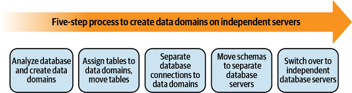

*Hình 6-17. Quy trình five-step để phân rã một database monolith*

Một *data domain* là một tập hợp các artifact database<a id="idm45798380865768"></a><a id="idm45798380863576"></a> coupled với nhau—bảng, view, foreign key và trigger—tất cả đều liên quan đến một domain cụ thể và thường được dùng cùng nhau trong một phạm vi chức năng giới hạn. <a id="idm45798380862312"></a><a id="idm45798380861096"></a><a id="idm45798380859880"></a>Để minh họa khái niệm data domain, hãy xét các bảng Sysops Squad được giới thiệu trong [Bảng 1-2](ch01_what_happens_when_there_are_no_best_practices.vi.md#table-ss-initial-database-tables) và việc gán data domain tương ứng được đề xuất thể hiện trong [Bảng 6-5](#table-to-data-domain-assignment).

<a id="table-to-data-domain-assignment"></a>

<a id="table-to-data-domain-assignment"></a>*Bảng 6-5. Các bảng database Sysops Squad hiện có được gán vào các data domain*

| Bảng | Data domain đề xuất |
|---|---|
| customer | Customer |
| customer_notification | Customer |
| survey | Survey |
| question | Survey |
| survey_administered | Survey |
| survey_question | Survey |
| survey_response | Survey |
| billing | Payment |
| contract | Payment |
| payment_method | Payment |
| payment | Payment |
| sysops_user | Profile |
| profile | Profile |
| expert_profile | Profile |
| expertise | Profile |
| location | Profile |
| article | Knowledge Base |
| tag | Knowledge Base |
| keyword | Knowledge Base |
| article_tag | Knowledge Base |
| article_keyword | Knowledge Base |
| ticket | Ticketing |
| ticket_type | Ticketing |
| ticket_history | Ticketing |

[Bảng 6-5](#table-to-data-domain-assignment) liệt kê sáu data domain trong ứng dụng Sysops Squad: Customer, Survey, Payment, Profile, Knowledge base và Ticketing. Bảng `billing` thuộc data domain Payment, các bảng `ticket` và `ticket_type` thuộc data domain Ticketing, v.v.

Một cách hình dung khái niệm về data domain là nghĩ<a id="idm45798380811656"></a><a id="idm45798380810312"></a><a id="idm45798380809352"></a> về database như một quả bóng đá, trong đó mỗi hình lục giác trắng biểu thị một data domain riêng biệt. Như minh họa trong [Hình 6-18](#fig-data-decomposition-data-domains-sysops-soccer-ball), mỗi hình lục giác trắng của quả bóng chứa một tập hợp các bảng domain-related (liên quan đến domain) cùng với mọi artifact coupling (như foreign key, view, stored procedure, v.v.).

<a id="fig-data-decomposition-data-domains-sysops-soccer-ball"></a>

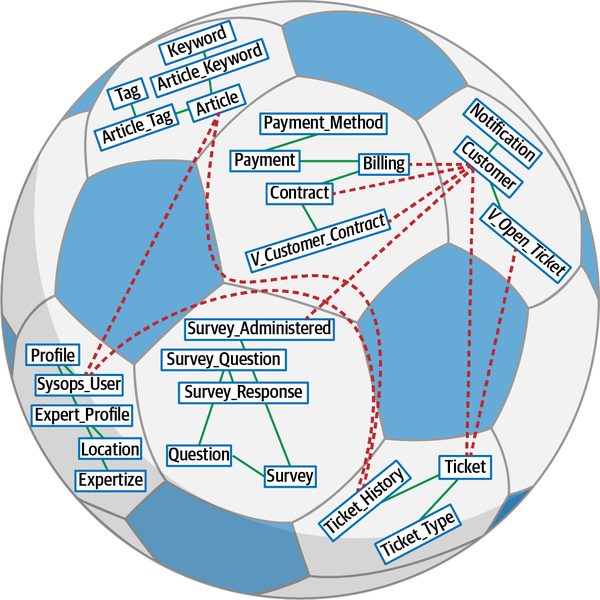

*Hình 6-18. Các đối tượng database trong một hình lục giác thuộc về một data domain*

Hình dung database theo cách này cho phép kiến trúc sư và team database thấy rõ <a id="ch06-modd"></a><a id="ch06-modd2"></a>ranh giới data domain và cả các phụ thuộc cross-domain (xuyên domain) (như foreign key, view, stored procedure, v.v.) cần được phá bỏ. Lưu ý trong [Hình 6-18](#fig-data-decomposition-data-domains-sysops-soccer-ball) rằng *bên trong* mỗi hình lục giác trắng, mọi phụ thuộc và quan hệ giữa các bảng dữ liệu có thể được giữ nguyên, nhưng *giữa* các hình lục giác trắng thì không. Ví dụ, trong sơ đồ hãy để ý rằng các đường liền biểu thị các phụ thuộc self-contained (tự chứa) bên trong data domain, trong khi các đường chấm cắt ngang các data domain và phải được gỡ bỏ khi các data domain được trích xuất thành các schema riêng biệt.

Khi trích xuất một data domain, các phụ thuộc cross-domain này phải được gỡ bỏ. Điều này có nghĩa là gỡ bỏ các ràng buộc foreign-key, view, trigger, function và stored procedure giữa các data domain. <a id="idm45798380798328"></a><a id="idm45798380797624"></a><a id="idm45798380796952"></a><a id="idm45798380796312"></a><a id="idm45798380795064"></a><a id="idm45798380793800"></a><a id="idm45798380792536"></a><a id="idm45798380791272"></a><a id="idm45798380790296"></a>Các team database có thể tận dụng các refactoring pattern có trong cuốn sách *Refactoring Databases: Evolutionary Database Design* của Scott Ambler và Pramod Sadalage (Addison-Wesley) để gỡ bỏ các phụ thuộc dữ liệu này một cách an toàn và lặp dần.

<a id="fig-data-decomposition-data-domains-sysops-soccer-ball-data-domain-projection"></a>

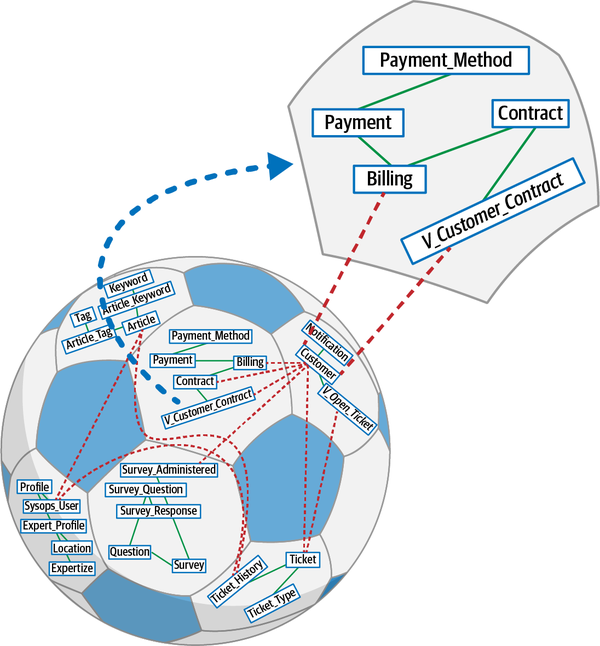

*Hình 6-19. Các bảng thuộc về các data domain, được trích xuất ra, và các kết nối cần được phá bỏ*

Để minh họa quá trình định nghĩa một data domain và gỡ bỏ các tham chiếu cross-domain, hãy xét sơ đồ trong [Hình 6-19](#fig-data-decomposition-data-domains-sysops-soccer-ball-data-domain-projection), nơi một data domain biểu thị Payment được tạo ra. Vì bảng `customer` thuộc một data domain khác với `v_customer_contract`, bảng `customer` phải được gỡ khỏi view trong domain Payment. View ban đầu `v_customer_contract` trước khi định nghĩa data domain được định nghĩa trong [Ví dụ 6-1](#view-customer-contract).

<a id="view-customer-contract"></a>

*Ví dụ 6-1. Database view để lấy các ticket đang mở của khách hàng với các join cross-domain*

```sql
CREATE VIEW [payment].[v_customer_contract]
  AS
SELECT
    customer.customer_id, customer.customer_name,
    contract.contract_start_date, contract.contract_duration,
    billing.billing_date, billing.billing_amount
FROM payment.contract AS contract
INNER JOIN customer.customer AS customer
    ON ( contract.customer_id = customer.customer_id )
INNER JOIN payment.billing AS billing
    ON ( contract.contract_id = billing.contract_id )
WHERE contract.auto_renewal = 0
```

Lưu ý trong view đã cập nhật thể hiện ở [Ví dụ 6-2](#contract-billing-view) rằng join giữa các bảng `customer` và `payment` đã bị gỡ bỏ, cũng như cột tên khách hàng (`customer.customer_name`).

<a id="contract-billing-view"></a>

*Ví dụ 6-2. Database view để lấy các ticket đang mở trong domain ticket cho một khách hàng nhất định*

```sql
CREATE VIEW [payment].[v_customer_contract]
  AS
SELECT
    billing.customer_id, contract.contract_start_date,
    contract.contract_duration, billing.billing_date,
    billing.billing_amount
FROM payment.contract AS contract
INNER JOIN payment.billing AS billing
    ON ( contract.contract_id = billing.contract_id )
WHERE contract.auto_renewal = 0
```

Các quy tắc bounded context cho data domain áp dụng giống hệt như cho các <a id="idm45798380614104"></a><a id="idm45798380613256"></a><a id="idm45798380550824"></a>bảng riêng lẻ—một service không thể giao tiếp với nhiều data domain. Do đó, bằng cách gỡ bảng này khỏi view, service Payment giờ phải gọi service Customer để lấy tên khách hàng mà trước đây nó có được từ view.<a id="idm45798380549272"></a><a id="idm45798380548600"></a>

Một khi kiến trúc sư và các team database hiểu khái niệm data domain, họ có thể áp dụng quy trình five-step để phân rã một database monolith. Năm bước đó được phác thảo trong các phần sau.

<a id="step-1-data-domain"></a>

### Bước 1: Phân tích database và tạo data domain (Step 1: Analyze Database and Create Data Domains)

Như minh họa trong [Hình 6-20](#fig-data-decomposition-original-state), mọi service đều có quyền truy cập mọi dữ liệu trong database.<a id="idm45798380544152"></a><a id="idm45798380542920"></a><a id="idm45798380541688"></a><a id="idm45798380540456"></a><a id="idm45798380539224"></a><a id="idm45798380538552"></a><a id="idm45798380537880"></a> Thực hành này, được biết đến như integration style [shared database](https://oreil.ly/EFqtc) được Gregor Hohpe và Bobby Woolf mô tả trong cuốn sách *Enterprise Integration Patterns: Designing, Building, and Deploying Messaging Solutions* (Addison-Wesley), tạo ra coupling chặt giữa dữ liệu và các service truy cập dữ liệu đó. Như đã thảo luận trong [“Data Decomposition Drivers”](#sec-data-decomposition-drivers), coupling chặt này trong database khiến việc quản lý thay đổi trở nên rất khó khăn.

<a id="fig-data-decomposition-original-state"></a>

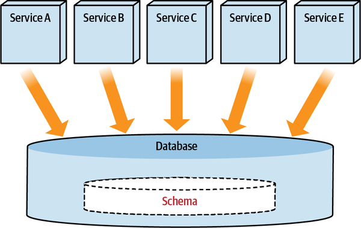

*Hình 6-20. Nhiều service dùng cùng một database, truy cập mọi bảng cần thiết cho mục đích đọc hoặc ghi*

Bước đầu tiên trong việc tách một database là xác định các nhóm domain cụ thể trong database. Ví dụ, như thể hiện trong [Bảng 6-5](#table-to-data-domain-assignment), các bảng liên quan được nhóm lại với nhau để giúp xác định các data domain khả dĩ.

<a id="step-2-data-domain"></a>

### Bước 2: Gán bảng vào data domain (Step 2: Assign Tables to Data Domains)

Bước tiếp theo là nhóm các bảng theo một bounded context cụ thể, gán<a id="ch06-st2"></a><a id="ch06-st22"></a><a id="ch06-st23"></a><a id="ch06-st24"></a><a id="idm45798380522744"></a> các bảng thuộc về một data domain cụ thể vào schema riêng của chúng. Một *schema* là một cấu trúc logic trong database server. Một schema chứa các đối tượng như bảng, view, function, v.v. Trong một số database server, như Oracle, schema giống với user, trong khi ở các database khác, như SQL Server, schema là một không gian logic cho các đối tượng database nơi người dùng có quyền truy cập vào các schema này.

Như minh họa trong [Hình 6-21](#fig-data-decomposition-no-cross-schema-sql), chúng tôi đã tạo schema cho mỗi data domain và chuyển các bảng vào schema mà chúng thuộc về.

<a id="fig-data-decomposition-no-cross-schema-sql"></a>

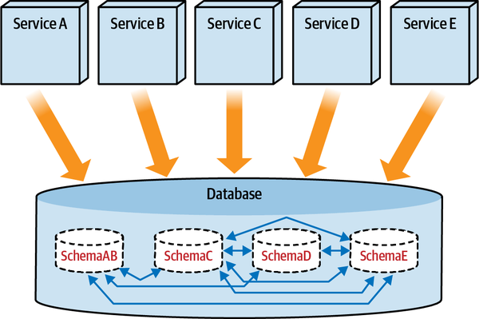

*Hình 6-21. Các service dùng schema chính theo nhu cầu data domain của chúng*

Khi các bảng thuộc các data domain khác nhau coupled chặt<a id="idm45798380517448"></a><a id="idm45798380516120"></a><a id="idm45798380514888"></a> và liên quan đến nhau, các data domain tất yếu phải được gộp lại, tạo ra một bounded context rộng hơn nơi nhiều service sở hữu một data domain cụ thể. Việc gộp các data domain được thảo luận chi tiết hơn trong [Chương 9](ch09_data_ownership_and_distributed_transactions.vi.md#ch09-data-update).

> **Data domain so với database schema (Data Domain Versus Database Schema)**
>
> Một *data domain* là một khái niệm kiến trúc, trong khi một<a id="idm45798380510328"></a><a id="idm45798380509272"></a> *schema* là một cấu trúc database chứa các đối tượng database thuộc về một data domain cụ thể. Dù quan hệ giữa một data domain và một schema thường là một đối một, data domain có thể được ánh xạ tới một hoặc nhiều schema, đặc biệt khi gộp các data domain vì các quan hệ dữ liệu coupled chặt. Chúng tôi sẽ dùng data domain và schema để chỉ cùng một thứ, và sẽ dùng hai thuật ngữ này thay thế cho nhau.

Để minh họa việc gán bảng vào schema, hãy xét ví dụ Sysops Squad trong đó bảng `billing` phải được chuyển từ schema ban đầu của nó sang một schema data domain khác tên `payment`:

```sql
ALTER SCHEMA payment TRANSFER sysops.billing;
```

Ngoài ra, team database có thể tạo synonym cho các bảng<a id="idm45798380442248"></a><a id="idm45798380472024"></a><a id="idm45798380471528"></a><a id="idm45798380470312"></a> không thuộc schema của họ. *Synonym* là các cấu trúc database, tương tự *symlink*, cung cấp một tên thay thế cho một đối tượng database khác có thể tồn tại trong cùng hoặc khác schema hay server. Dù ý tưởng của synonym là loại bỏ các truy vấn cross-schema, vẫn cần quyền đọc hoặc ghi để truy cập chúng.

Để minh họa thực hành này, hãy xét truy vấn cross-domain sau:

```sql
SELECT
    history.ticket_id, history.notes, agent.name
FROM ticket.ticket_history AS history
INNER JOIN profile.sysops_user AS agent
    ON ( history.assigned_to_sysops_user_id = agent.sysops_user_id )
```

Tiếp theo, tạo một synonym cho bảng `profile.sysops_user` trong schema ticketing:

```sql
CREATE SYNONYM ticketing.sysops_user
FOR profile.sysops_user;
GO
```

Kết quả là truy vấn có thể tận dụng synonym `sysops_user` thay vì bảng cross-domain:

```sql
SELECT
    history.ticket_id, history.notes, agent.name
FROM ticket.ticket_history AS history
INNER JOIN ticket.sysops_user AS agent
    ON ( history.assigned_to_sysops_user_id = agent.sysops_user_id )
```

Đáng tiếc là việc tạo synonym theo cách này cho các bảng được truy cập xuyên schema lại cung cấp cho developer ứng dụng các điểm coupling. Để hình thành các data domain đúng đắn, các điểm coupling này cần được phá bỏ vào một thời điểm sau đó, nhờ đó chuyển các điểm tích hợp từ database layer lên application layer.

Dù synonym không thực sự loại bỏ được các truy vấn cross-schema, chúng cho phép kiểm tra phụ thuộc và phân tích code dễ dàng hơn, giúp việc tách chúng sau này dễ hơn.<a id="idm45798380302520"></a><a id="idm45798380301912"></a><a id="idm45798380301272"></a><a id="idm45798380300600"></a>

<a id="step-3-data-domain"></a>

### Bước 3: Tách database connection theo data domain (Step 3: Separate Database Connections to Data Domains)

Ở bước này, logic database connection bên trong mỗi service được refactor<a id="idm45798380298152"></a><a id="idm45798380296968"></a><a id="idm45798380295816"></a><a id="idm45798380294568"></a><a id="idm45798380293320"></a> để bảo đảm các service kết nối tới một schema cụ thể và có quyền đọc và ghi vào các bảng chỉ thuộc data domain của chúng. Quá trình chuyển đổi này, minh họa trong Hình 6-22, là khó nhất vì mọi truy cập cross-schema phải được giải quyết ở mức service.

Lưu ý rằng cấu hình database đã được thay đổi để mọi <a id="idm45798380291544"></a><a id="idm45798380290536"></a><a id="idm45798380289288"></a><a id="idm45798380288328"></a>truy cập dữ liệu được thực hiện nghiêm ngặt thông qua các service và các schema được kết nối của chúng. Trong ví dụ này, Service C giao tiếp với Service D chứ không giao tiếp với SchemaD. Không có truy cập cross-schema nào; mọi synonym được tạo trong [“Step 2: Assign Tables to Data Domains”](#step-2-data-domain) đều bị gỡ bỏ.

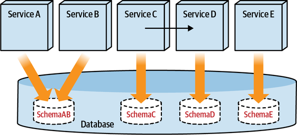

*Hình 6-22. Chuyển việc truy cập đối tượng cross-schema sang các service, thay vì truy cập cross-schema trực tiếp*

> **Mẹo**
>
> Khi cần dữ liệu từ các domain khác, đừng thò tay vào database của chúng. Thay vào đó, hãy truy cập dữ liệu thông qua service sở hữu data domain đó.

Khi hoàn tất bước này, database ở <a id="idm45798380282376"></a><a id="idm45798380281112"></a><a id="idm45798380279880"></a><a id="idm45798380278920"></a><a id="idm45798380277944"></a>trạng thái *data sovereignty per service* (chủ quyền dữ liệu theo từng service), xảy ra khi mỗi service sở hữu dữ liệu của riêng nó. Data sovereignty per service là trạng thái niết bàn đối với một architecture phân tán. Như mọi thực hành trong architecture, nó có cả lợi ích lẫn nhược điểm:

**Lợi ích (Benefits)**

- Các team có thể thay đổi database schema mà không lo ảnh hưởng đến thay đổi ở các domain khác.
- Mỗi service có thể dùng công nghệ database và loại database phù hợp nhất cho use case của mình.

**Nhược điểm (Shortcomings)**

- Vấn đề performance xảy ra khi các service cần truy cập khối lượng dữ liệu lớn.
- Không thể duy trì toàn vẹn tham chiếu trong database, dẫn đến khả năng chất lượng dữ liệu kém.
- Mọi code database (stored procedure, function) truy cập các bảng thuộc các domain khác phải được chuyển lên service layer.

<a id="idm45798380268152"></a>

### Bước 4: Chuyển schema sang các database server riêng biệt (Step 4: Move Schemas to Separate Database Servers)

Một khi các team database đã tạo và tách các data domain,<a id="idm45798380266392"></a><a id="idm45798380265160"></a><a id="idm45798380263912"></a><a id="idm45798380234104"></a><a id="idm45798380232888"></a><a id="idm45798380231656"></a><a id="idm45798380230968"></a> và đã cô lập các service để chúng truy cập dữ liệu của riêng mình, họ giờ có thể chuyển các data domain sang các database vật lý riêng biệt. Đây thường là một bước cần thiết vì dù các service truy cập schema riêng của mình, việc truy cập một database duy nhất tạo ra một *architecture quantum* duy nhất, như đã thảo luận trong [Chương 2](ch02_discerning_coupling_in_software_architecture.vi.md#ch02-discerning), điều có thể có tác động bất lợi cho các đặc điểm vận hành, như scalability, fault tolerance và performance.

Khi chuyển schema sang các database vật lý riêng biệt, các team database có hai lựa chọn: backup và restore, hoặc replication. Các lựa chọn này được phác thảo như sau:

**Backup và restore (Backup and restore)**

Với lựa chọn này, trước tiên các team backup từng schema cùng với các data<a id="idm45798380225656"></a> domain, rồi thiết lập database server cho mỗi data domain. Sau đó họ restore các schema, kết nối các service tới các schema trong các database server mới, và cuối cùng gỡ bỏ các schema khỏi database server ban đầu. Cách tiếp cận này thường đòi hỏi thời gian ngừng hoạt động cho việc chuyển đổi.

**Replicate (Replicate)**

Dùng lựa chọn replicate, trước tiên các team thiết lập database server cho<a id="idm45798380223288"></a> mỗi data domain. Tiếp theo họ replicate các schema, chuyển các connection sang các database server mới, rồi gỡ bỏ các schema khỏi database server ban đầu. Dù cách tiếp cận này tránh được thời gian ngừng hoạt động, nó đòi hỏi nhiều công sức hơn để thiết lập replication và quản lý sự phối hợp gia tăng.

[Hình 6-23](#fig-data-decomposition-replicate-move) thể hiện một ví dụ về lựa chọn replication, trong đó team database thiết lập nhiều database server sao cho mỗi data domain có một database server.

<a id="fig-data-decomposition-replicate-move"></a>

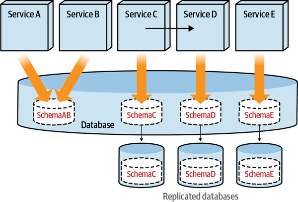

*Hình 6-23. Replicate các schema (data domain) sang các database server riêng của chúng*

<a id="idm45798380218536"></a>

### Bước 5: Chuyển sang các database server độc lập (Step 5: Switch Over to Independent Database Servers)

Một khi các schema đã được replicate hoàn toàn, các connection của service có thể được chuyển đổi.<a id="idm45798380217096"></a><a id="idm45798380215864"></a><a id="idm45798380214616"></a><a id="idm45798380213368"></a> Bước cuối cùng để các data domain và service hoạt động như các đơn vị deploy được độc lập của riêng chúng là gỡ bỏ connection tới các database server cũ và cũng gỡ bỏ các schema khỏi các database server cũ. Trạng thái cuối cùng được thấy trong [Hình 6-24](#fig-data-decomposition-final-state).

<a id="fig-data-decomposition-final-state"></a>

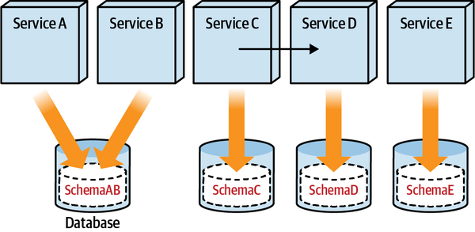

*Hình 6-24. Các database server độc lập cho mỗi data domain*

Một khi team database đã tách các data domain, cô lập các database connection, và cuối cùng chuyển các data domain sang database server riêng của chúng, họ có thể tối ưu hóa từng database server cho availability và scalability. Các team cũng có thể phân tích dữ liệu để xác định loại database phù hợp nhất để dùng, đưa việc dùng polyglot database vào hệ sinh thái.

<a id="sec-polyglot-databases"></a>

## Chọn loại database (Selecting a Database Type)

Bắt đầu từ khoảng năm 2005, một cuộc cách mạng đã diễn ra trong các công nghệ<a id="idm45798380206296"></a> database. Đáng tiếc là số lượng sản phẩm xuất hiện trong thời gian này đã tạo ra một vấn đề được gọi là [The Paradox of Choice](https://oreil.ly/pBjGZ) (nghịch lý của sự lựa chọn). Có số lượng sản phẩm và lựa chọn lớn như vậy nghĩa là có nhiều quyết định trade-off hơn phải đưa ra. Vì mỗi sản phẩm được tối ưu hóa cho những trade-offs nhất định, việc chọn sản phẩm phù hợp với những trade-offs này trong đầu, liên quan đến không gian vấn đề của mình, thuộc về cả kiến trúc sư phần mềm lẫn kiến trúc sư dữ liệu.

Trong phần này, chúng tôi giới thiệu xếp hạng sao cho các loại database khác nhau, dùng các đặc điểm sau trong phân tích của mình:

**Độ dễ của đường cong học tập (Ease-of-learning curve)**

Đặc điểm này chỉ mức độ dễ dàng mà các developer mới, kiến trúc sư dữ liệu, người mô hình hóa dữ liệu, DBA vận hành, và những người dùng database khác có thể học và áp dụng. Ví dụ, giả định rằng hầu hết developer phần mềm hiểu SQL, trong khi thứ gì đó như Gremlin (một ngôn ngữ truy vấn graph) có thể là một kỹ năng ngách. Xếp hạng sao càng cao, đường cong học tập càng dễ. Xếp hạng sao càng thấp, đường cong học tập càng khó.

**Độ dễ mô hình hóa dữ liệu (Ease of data modeling)**

Đặc điểm này chỉ mức độ dễ dàng mà người mô hình hóa dữ liệu có thể biểu diễn domain dưới dạng một data model. Xếp hạng sao cao hơn nghĩa là việc mô hình hóa dữ liệu khớp với nhiều use case, và một khi đã mô hình hóa, dễ thay đổi và áp dụng.

**Scalability/throughput**

Đặc điểm này chỉ mức độ và độ dễ dàng mà một database có thể scale để xử lý throughput gia tăng. Có dễ scale database không? Database có thể scale theo chiều ngang, chiều dọc, hay cả hai? Xếp hạng sao cao hơn nghĩa là dễ scale hơn và có throughput cao hơn.

**Availability/partition tolerance**

Đặc điểm này chỉ việc <a id="idm45798380196584"></a>database có hỗ trợ các cấu hình high availability hay không (như *replica-sets* trong MongoDB hoặc *tunable consistency* trong [Apache Cassandra](https://cassandra.apache.org)). Nó có cung cấp tính năng để xử lý network partition không? Xếp hạng sao càng cao, database càng hỗ trợ tốt availability cao hơn và/hoặc partition tolerance tốt hơn.

**Tính nhất quán (Consistency)**

Đặc điểm này chỉ việc database có hỗ trợ mô hình “luôn nhất quán” hay không. <a id="idm45798380191896"></a>Database có hỗ trợ transaction ACID không, hay nghiêng về transaction BASE với mô hình eventual consistency? Nó có cung cấp tính năng để có các mô hình tunable consistency cho các loại thao tác ghi khác nhau không? Xếp hạng sao càng cao, database càng hỗ trợ tính nhất quán nhiều hơn.

**Hỗ trợ ngôn ngữ lập trình, độ trưởng thành sản phẩm, hỗ trợ SQL và cộng đồng (Programming language support, product maturity, SQL support, and community)**

Đặc điểm này chỉ việc database hỗ trợ những (và bao nhiêu) ngôn ngữ lập trình, database trưởng thành đến mức nào, và quy mô cộng đồng của database. Một tổ chức có thể dễ dàng tuyển người biết cách làm việc với database đó không? Xếp hạng sao cao hơn nghĩa là có hỗ trợ tốt hơn, sản phẩm trưởng thành, và dễ tuyển nhân tài.

**Ưu tiên đọc/ghi (Read/write priority)**

Đặc điểm này chỉ việc database ưu tiên đọc hơn ghi, hay ghi hơn đọc, hay cân bằng trong cách tiếp cận. Đây không phải là lựa chọn nhị phân—mà giống một thang đo về hướng mà database tối ưu hóa hơn.

<a id="idm45798380202616"></a>

### Relational database (Relational Databases)

Relational database (còn gọi là RDBMS) đã là<a id="ch06-rdbms"></a><a id="ch06-rdbms2"></a> database được ưa chuộng trong hơn ba thập kỷ. Có giá trị đáng kể trong việc dùng chúng và sự ổn định mà chúng mang lại, đặc biệt trong hầu hết các ứng dụng business-related (liên quan đến nghiệp vụ). <a id="idm45798380182600"></a>Những database này nổi tiếng với Structured Query Language (SQL) phổ biến khắp nơi và các thuộc tính ACID mà chúng cung cấp. Giao diện SQL mà chúng cung cấp khiến chúng trở thành lựa chọn ưa thích để hiện thực các mô hình `read` khác nhau trên cùng một mô hình `write`. Xếp hạng sao cho relational database xuất hiện trong [Hình 6-25](#fig-data-decomposition-star-rating-rdbms).

<a id="fig-data-decomposition-star-rating-rdbms"></a>

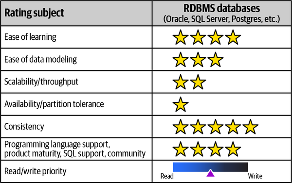

*Hình 6-25. Relational database được xếp hạng theo các đặc điểm áp dụng khác nhau*

**Độ dễ của đường cong học tập (Ease-of-learning curve)**

Relational database đã tồn tại nhiều năm. Chúng thường được dạy trong trường học, và có sẵn tài liệu và hướng dẫn trưởng thành. Do đó, chúng dễ học hơn nhiều so với các loại database khác.

**Độ dễ mô hình hóa dữ liệu (Ease of data modeling)**

Relational database cho phép mô hình hóa dữ liệu linh hoạt. Chúng cho phép mô hình hóa các cấu trúc key-value, document, graph-like (dạng graph), và cho phép thay đổi các pattern đọc bằng cách thêm index mới. Một số mô hình thực sự khó đạt được, như các cấu trúc graph với độ sâu tùy ý. Relational database tổ chức dữ liệu thành bảng và hàng (tương tự bảng tính), điều tự nhiên đối với hầu hết người mô hình hóa database.

**Scalability/throughput**

Relational database nhìn chung được scale theo chiều dọc bằng các máy lớn.<a id="idm45798380172088"></a> Tuy nhiên, việc thiết lập với replication và chuyển đổi tự động rất phức tạp, đòi hỏi phối hợp và thiết lập nhiều hơn.

**Availability/partition tolerance**

Relational database ưu tiên tính nhất quán hơn availability và partition tolerance, được thảo luận trong [“Table Split Technique”](ch09_data_ownership_and_distributed_transactions.vi.md#sec-cap-theorem).<a id="idm45798380168392"></a>

**Tính nhất quán (Consistency)**

Relational database đã thống trị nhiều năm nhờ hỗ trợ các thuộc tính ACID.<a id="idm45798380165752"></a><a id="idm45798380164504"></a> Các tính năng ACID xử lý nhiều mối quan tâm trong các hệ thống đồng thời và cho phép phát triển ứng dụng mà không phải bận tâm đến các chi tiết lower-level (cấp thấp hơn) về concurrency và cách database xử lý chúng.

**Hỗ trợ ngôn ngữ lập trình, độ trưởng thành sản phẩm, hỗ trợ SQL và cộng đồng (Programming language support, product maturity, SQL support, and community)**

Vì relational database đã tồn tại nhiều năm, các pattern thiết kế, hiện thực và vận hành well-known (nổi tiếng) có thể được áp dụng cho chúng, nhờ đó khiến chúng dễ áp dụng, phát triển và tích hợp trong một architecture. Nhiều relational database thiếu hỗ trợ cho các reactive stream API và các khái niệm mới tương tự; các khái niệm kiến trúc mới hơn mất nhiều thời gian hơn để hiện thực trong các relational database well-established (đã vững vàng). Nhiều giao diện ngôn ngữ lập trình hoạt động với relational database, và cộng đồng người dùng rất lớn (dù bị chia nhỏ giữa tất cả các nhà cung cấp).

**Ưu tiên đọc/ghi (Read/write priority)**

Trong relational database, data model có thể được thiết kế sao cho hoặc thao tác đọc trở nên hiệu quả hơn hoặc thao tác ghi trở nên hiệu quả hơn. Cùng một database có thể xử lý các loại workload khác nhau, cho phép ưu tiên read-write cân bằng. Ví dụ, không phải mọi use case đều cần các thuộc tính ACID, đặc biệt trong các kịch bản dữ liệu và traffic lớn, hoặc khi mong muốn schema thực sự linh hoạt như trong quản lý khảo sát. Trong những trường hợp này, các loại database khác có thể là lựa chọn tốt hơn.

[MySQL](https://www.mysql.com), [Oracle](https://www.oracle.com), [Microsoft SQL Server](https://oreil.ly/LP7jK), và [PostgreSQL](https://www.postgresql.org) là những relational database <a id="idm45798380155976"></a><a id="idm45798380155224"></a><a id="idm45798380154536"></a><a id="idm45798380153768"></a><a id="idm45798380153080"></a><a id="idm45798380152120"></a><a id="idm45798380150904"></a>phổ biến nhất và có thể chạy dưới dạng cài đặt độc lập hoặc có sẵn dưới dạng *Database as a Service* trên các nền tảng cloud provider lớn.<a id="idm45798380149592"></a><a id="idm45798380148888"></a>

> <a id="aggregate_orientation"></a>
>
> **Aggregate orientation (Aggregate Orientation)**
>
> *Aggregate orientation* (hướng aggregate) là sự ưu tiên thao tác trên dữ liệu<a id="idm45798380145848"></a><a id="idm45798380145144"></a><a id="idm45798380144200"></a> có liên quan và có cấu trúc dữ liệu phức tạp. Aggregate là một thuật ngữ bắt nguồn từ *Domain-Driven Design: Tackling Complexity in the Heart of Software* của Erik Evans. Hãy nghĩ đến `ticket` hoặc `customer` cùng mọi bảng phụ thuộc của nó trong Sysops Squad—chúng là các aggregate. Như mọi thực hành trong architecture, aggregate orientation có cả lợi ích lẫn nhược điểm:
>
> **Lợi ích (Benefits)**
>
> - Cho phép phân phối dữ liệu dễ dàng trong các cluster server, vì toàn bộ aggregate có thể được sao chép sang các server khác nhau.
> - Cải thiện performance đọc và ghi, vì nó giảm các join trong database.
> - Giảm impedance mismatch giữa model của ứng dụng và model lưu trữ.
>
> **Nhược điểm (Shortcomings)**
>
> - Khó đạt được các aggregate phù hợp, và việc thay đổi ranh giới aggregate rất khó.
> - Phân tích dữ liệu xuyên các aggregate rất khó.

<a id="sec-kv-database"></a>

### Database khóa/giá trị (Key-Value Databases)

Key-value database tương tự cấu trúc dữ liệu [hash table](https://oreil.ly/2FOQy), <a id="idm45798380131336"></a><a id="ch06-kvd"></a><a id="ch06-kvd2"></a>giống như các bảng trong RDBMS với một cột `ID` làm key và một cột `blob` làm value, do đó có thể lưu bất kỳ loại dữ liệu nào. <a id="idm45798380127544"></a><a id="idm45798380126488"></a><a id="idm45798380125544"></a><a id="idm45798380124872"></a><a id="idm45798380124200"></a><a id="idm45798380123192"></a>Key-value database là một phần của một họ được gọi là NoSQL database. Trong cuốn sách *NoSQL Distilled: A Brief Guide to the Emerging World of Polyglot Persistence* (Addison-Wesley), Pramod Sadalage (một trong các tác giả của cuốn sách này) và Martin Fowler mô tả sự trỗi dậy của NoSQL database cùng động lực, cách dùng, và trade-offs của việc dùng các loại database này, và đó là một tài liệu tham khảo tốt để tìm hiểu thêm về loại database này.

Key-value database dễ hiểu nhất trong số các NoSQL database. Một client ứng dụng có thể chèn một key và một value, lấy value cho một key đã biết, hoặc xóa một key đã biết cùng value của nó. Một key-value database không biết bên trong phần value có gì, cũng chẳng quan tâm bên trong có gì, nghĩa là database chỉ có thể truy vấn bằng key chứ không gì khác.

Khác với relational database, key-value database nên được chọn dựa trên nhu cầu. <a id="idm45798380119928"></a><a id="idm45798380119256"></a><a id="idm45798380118616"></a><a id="idm45798380117928"></a>Có những key-value database bền vững như Amazon DynamoDB hay Riak KV, những database không bền vững như MemcacheDB, và những database khác như Redis có thể được cấu hình để bền vững hoặc không. Các cấu trúc relational database khác như `joins`, `where` và `order by` không được hỗ trợ, mà thay vào đó là các thao tác `get`, `put` và `delete`. Xếp hạng cho key-value database xuất hiện trong [Hình 6-26](#fig-data-decomposition-star-rating-key-value).

<a id="fig-data-decomposition-star-rating-key-value"></a>

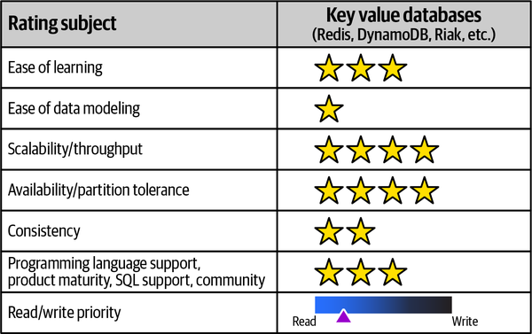

*Hình 6-26. Key-value database được xếp hạng theo các đặc điểm áp dụng khác nhau*

**Độ dễ của đường cong học tập (Ease-of-learning curve)**

Key-value database dễ hiểu. Vì chúng <a id="idm45798380109400"></a>dùng [“Aggregate Orientation”](#aggregate_orientation), điều quan trọng là thiết kế aggregate đúng cách vì bất kỳ thay đổi nào trong aggregate cũng có nghĩa là phải viết lại toàn bộ dữ liệu. Chuyển từ relational database sang bất kỳ NoSQL database nào cần luyện tập và gạt bỏ các thói quen quen thuộc. Ví dụ, developer không thể đơn giản truy vấn “Lấy cho tôi tất cả các key.”

**Độ dễ mô hình hóa dữ liệu (Ease of data modeling)**

Vì key-value database hướng aggregate, chúng có thể dùng các cấu trúc bộ nhớ như array, map, hoặc bất kỳ loại dữ liệu nào khác, kể cả blob lớn. Dữ liệu chỉ có thể được truy vấn bằng key hoặc ID, nghĩa là client cần có quyền truy cập key bên ngoài database. Các ví dụ tốt về key bao gồm `session_id`, `user_id` và `order_id`.

**Scalability/throughput**

Vì key-value database được đánh index theo key hoặc ID, việc tra cứu<a id="idm45798380102824"></a> key rất nhanh vì không có thao tác `joins` hay `order by`. Value được lấy ra và trả về cho client, điều này cho phép scale dễ dàng hơn và throughput cao hơn.

**Availability/partition tolerance**

Vì có nhiều loại key-value database và<a id="idm45798380099144"></a> mỗi loại có các thuộc tính khác nhau, ngay cả cùng một database cũng có thể được cấu hình để hoạt động theo những cách khác nhau cho một lần cài đặt hoặc cho mỗi lần đọc. Ví dụ, trong Riak người dùng có thể dùng các thuộc tính *quorum* như `all`, `one`, `quorum` và `default`. Khi chúng ta dùng quorum *one*, truy vấn có thể trả về `success` khi bất kỳ một node nào phản hồi. Khi dùng quorum `all`, mọi node phải phản hồi thì truy vấn mới trả về `success`. Mỗi truy vấn có thể điều chỉnh partition tolerance và availability. Do đó, giả định rằng mọi key-value store đều như nhau là một sai lầm.

**Tính nhất quán (Consistency)**

Trong mỗi thao tác ghi, chúng ta có thể áp dụng các cấu hình tương tự<a id="idm45798380091784"></a><a id="idm45798380090536"></a><a id="idm45798380089592"></a><a id="idm45798380088920"></a><a id="idm45798380087976"></a><a id="idm45798380087304"></a> như việc áp dụng quorum trong các thao tác đọc; các cấu hình này cung cấp cái được gọi là *tunable consistency* (tính nhất quán điều chỉnh được). Có thể đạt được tính nhất quán cao hơn bằng cách đánh đổi latency. Để một thao tác ghi có tính nhất quán cao, mọi node phải phản hồi, điều này làm giảm partition tolerance. Dùng một *majority quorum* được coi là một trade-off tốt.

**Hỗ trợ ngôn ngữ lập trình, độ trưởng thành sản phẩm, hỗ trợ SQL và cộng đồng (Programming language support, product maturity, SQL support, and community)**

Key-value database có hỗ trợ ngôn ngữ lập trình tốt, và nhiều database open source có cộng đồng năng động giúp học và hiểu chúng. Vì hầu hết database có *HTTP REST API*, chúng dễ giao tiếp hơn nhiều.

**Ưu tiên đọc/ghi (Read/write priority)**

Vì key-value database hướng aggregate, việc truy cập dữ liệu qua key hoặc ID thiên về ưu tiên *đọc*. Key-value database có thể được dùng để lưu session, và cũng có thể được dùng để cache các thuộc tính và tùy chọn của người dùng.<a id="idm45798380080904"></a><a id="idm45798380080200"></a>

> **Sharding trong database (Sharding in Databases)**
>
> Khái niệm partitioning là well-known trong relational database: dữ liệu bảng được phân vùng thành các tập dựa trên một *schema* trên cùng một database <a id="idm45798380077064"></a>server. *Sharding* tương tự partitioning, nhưng dữ liệu nằm trên các server hoặc node khác nhau. Các node cộng tác để tìm ra dữ liệu nằm ở đâu hoặc dữ liệu nên được lưu ở đâu dựa trên một sharding key. Từ *shard* nghĩa là [horizontal partition](https://oreil.ly/34AOj) (phân vùng ngang) của dữ liệu trong một database.

<a id="idm45798380073592"></a>

### Document database (Document Databases)

Các document như JSON hoặc XML là nền tảng của document database.<a id="idm45798380071992"></a><a id="idm45798380071016"></a><a id="idm45798380070344"></a> Document là các cấu trúc cây phân cấp human-readable (con người đọc được), self-describing (tự mô tả). Document database là một loại NoSQL database khác, có xếp hạng xuất hiện trong [Hình 6-27](#fig-data-decomposition-star-rating-document-db). Những database này hiểu cấu trúc của dữ liệu và có thể đánh index nhiều thuộc tính của document, cho phép truy vấn linh hoạt hơn.

<a id="fig-data-decomposition-star-rating-document-db"></a>

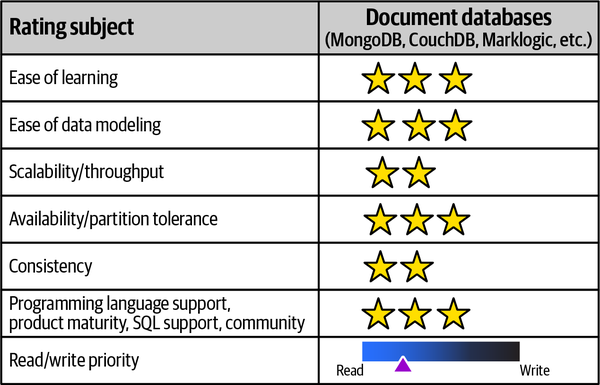

*Hình 6-27. Document database được xếp hạng theo các đặc điểm áp dụng khác nhau*

**Độ dễ của đường cong học tập (Ease-of-learning curve)**

Document database giống key-value database trong đó value là con người đọc được. Điều này khiến việc học database dễ dàng hơn nhiều. Các doanh nghiệp đã quen xử lý document, như XML và JSON trong các bối cảnh khác nhau, như API payload và JavaScript frontend.

**Độ dễ mô hình hóa dữ liệu (Ease of data modeling)**

Giống như key-value database, mô hình hóa dữ liệu bao gồm việc mô hình hóa các aggregate như đơn hàng, ticket và các domain object khác. Document database dễ dãi khi nói đến thiết kế aggregate, vì các phần của aggregate có thể truy vấn được và có thể được đánh index.

**Scalability/throughput**

Document database hướng aggregate và dễ<a id="idm45798380061048"></a><a id="idm45798380059800"></a> scale. Việc đánh index phức tạp làm giảm scalability, và kích thước dữ liệu tăng dẫn đến nhu cầu partitioning hoặc sharding. Một khi sharding được đưa vào, nó làm tăng độ phức tạp và cũng buộc phải chọn một sharding key.

**Availability/partition tolerance**

Giống như key-value database, document database có thể được cấu hình<a id="idm45798380057240"></a> cho availability cao hơn. Việc thiết lập trở nên phức tạp khi có các cluster được replicate cho các collection được shard. Các cloud provider đang cố làm cho những thiết lập này dễ dùng hơn.

**Tính nhất quán (Consistency)**

Một số document database đã bắt đầu hỗ trợ transaction ACID<a id="idm45798380054248"></a><a id="idm45798380052952"></a><a id="idm45798380051736"></a><a id="idm45798380051064"></a><a id="idm45798380050392"></a> trong một collection, nhưng điều này có thể không hoạt động trong một số edge case. Giống như key-value database, document database cung cấp khả năng điều chỉnh các thao tác đọc và ghi bằng cơ chế quorum.

**Hỗ trợ ngôn ngữ lập trình, độ trưởng thành sản phẩm, hỗ trợ SQL và cộng đồng (Programming language support, product maturity, SQL support, and community)**

Document database là phổ biến nhất trong số các NoSQL database, với cộng đồng người dùng năng động, nhiều hướng dẫn học trực tuyến, và nhiều driver ngôn ngữ lập trình giúp việc áp dụng dễ dàng hơn.

**Ưu tiên đọc/ghi (Read/write priority)**

Document database hướng aggregate và có secondary index để truy vấn, nên những database này ưu tiên đọc.

> **Database không schema (Schema-less Databases)**
>
> Một chủ đề phổ biến trong NoSQL database là sự trùng lặp dữ liệu<a id="idm45798380044472"></a><a id="idm45798380043352"></a><a id="idm45798380042408"></a> và tên thuộc tính schema. Không có hai mục nào phải giống nhau về schema hay tên thuộc tính. Điều này tạo ra những động lực kiểm soát thay đổi thú vị và mang lại sự linh hoạt. Bản chất schema-less (không schema) của database rất mạnh mẽ, nhưng điều quan trọng là phải hiểu rằng dữ liệu luôn có một schema ngay cả khi nó ngầm định hoặc được định nghĩa ở nơi khác. Ứng dụng cần xử lý nhiều phiên bản schema được database trả về. Tuyên bố rằng NoSQL database hoàn toàn schema-less là gây hiểu lầm.

<a id="idm45798380040552"></a>

### Column family database (Column Family Databases)

*Column family database*, còn gọi là *wide column database*<a id="idm45798380038024"></a><a id="idm45798380037048"></a><a id="idm45798380036376"></a><a id="idm45798380035704"></a> hoặc *big table database*, có các hàng với số lượng cột khác nhau, trong đó mỗi cột là một cặp *name-value*. Với columnar database, `name` được gọi là *column-key*, `value` được gọi là *column-value*, và primary key của một `row` được gọi là *row key*. Column family database là một loại NoSQL database khác nhóm các dữ liệu liên quan được truy cập cùng lúc, và có xếp hạng xuất hiện trong [Hình 6-28](#fig-data-decomposition-star-rating-column-family).

<a id="fig-data-decomposition-star-rating-column-family"></a>

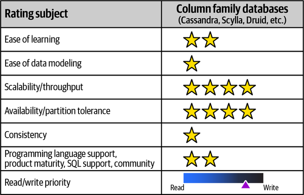

*Hình 6-28. Column family database được xếp hạng theo các đặc điểm áp dụng khác nhau*

**Độ dễ của đường cong học tập (Ease-of-learning curve)**

Column family database khó hiểu. Vì một tập hợp các cặp name-value thuộc về một hàng, mỗi hàng có thể có các cặp name-value khác nhau. Một số cặp name-value có thể có một map các cột và được gọi là *super column*. Hiểu cách dùng những thứ này cần luyện tập và thời gian.

**Độ dễ mô hình hóa dữ liệu (Ease of data modeling)**

Mô hình hóa dữ liệu với column family database cần một thời gian để làm quen. Dữ liệu cần được sắp xếp thành các nhóm cặp name-value có một định danh hàng duy nhất, và việc thiết kế row key này cần nhiều lần lặp. <a id="idm45798380024072"></a>Một số column family database như Apache Cassandra đã đưa vào một ngôn ngữ truy vấn SQL-like (giống SQL) gọi là Cassandra Query Language (CQL) giúp việc mô hình hóa dữ liệu dễ tiếp cận hơn.

**Scalability/throughput**

Mọi column family database đều có khả năng scale cao và phù hợp với các use<a id="idm45798380021048"></a> case cần throughput ghi hoặc đọc cao. Column family database scale theo chiều ngang cho các thao tác đọc và ghi.

**Availability/partition tolerance**

Column family database tự nhiên vận hành theo cluster, và khi<a id="idm45798380018200"></a> một số node của cluster bị sập, điều đó trong suốt với client. Replication factor mặc định là ba, nghĩa là ít nhất ba bản sao dữ liệu được tạo ra, cải thiện availability và partition tolerance. Tương tự key-value database và document database, column family database có thể điều chỉnh thao tác ghi và đọc dựa trên nhu cầu quorum.

**Tính nhất quán (Consistency)**

Column family database, giống các NoSQL database khác, tuân theo<a id="idm45798380014888"></a><a id="idm45798380013560"></a><a id="idm45798380012616"></a> khái niệm tunable consistency. Điều này có nghĩa là, dựa trên nhu cầu, mỗi thao tác có thể quyết định mức tính nhất quán mong muốn. Ví dụ, trong các kịch bản `high write` nơi có thể chấp nhận mất một số dữ liệu, có thể dùng mức tính nhất quán ghi `ANY`, nghĩa là ít nhất một node đã chấp nhận thao tác ghi, trong khi mức tính nhất quán `ALL` nghĩa là mọi node phải chấp nhận thao tác ghi và phản hồi thành công. Các mức tính nhất quán tương tự có thể được áp dụng cho các thao tác đọc. Đó là một trade-off—mức tính nhất quán cao hơn làm giảm availability và partition tolerance.

**Hỗ trợ ngôn ngữ lập trình, độ trưởng thành sản phẩm, hỗ trợ SQL và cộng đồng (Programming language support, product maturity, SQL support, and community)**

Các column family database như Cassandra và Scylla <a id="idm45798380008936"></a>có cộng đồng năng động, và việc phát triển các giao diện SQL-like đã giúp việc áp dụng những database này dễ dàng hơn.

**Ưu tiên đọc/ghi (Read/write priority)**

Column family database dùng các khái niệm *SSTable*, *commit log* và *memtable*, và vì các cặp name-value chỉ được điền khi có dữ liệu, chúng có thể xử lý dữ liệu thưa tốt hơn nhiều so với relational database. Chúng lý tưởng cho các kịch bản write-volume (khối lượng ghi) cao.

Mọi NoSQL database đều được thiết kế để hiểu <a id="idm45798380004616"></a><a id="idm45798380003672"></a>aggregate orientation. Có aggregate giúp cải thiện performance đọc và ghi, và cũng cho phép availability và partition tolerance cao hơn khi database chạy dưới dạng cluster. Khái niệm CAP theorem được đề cập chi tiết hơn trong [“Table Split Technique”](ch09_data_ownership_and_distributed_transactions.vi.md#sec-cap-theorem).

<a id="idm45798380001416"></a>

### Graph database (Graph Databases)

Khác với relational database, nơi các quan hệ được ngầm định dựa trên<a id="ch06-grphz"></a><a id="ch06-grph"></a><a id="ch06-grph2"></a><a id="ch06-grph3"></a> các tham chiếu, graph database dùng node để lưu các thực thể và thuộc tính của chúng. Các node này được kết nối bằng *edge*, còn gọi là *relationship*, là những đối tượng tường minh. Các node được tổ chức theo relationship và cho phép phân tích dữ liệu được kết nối bằng cách duyệt dọc theo các edge cụ thể.

<a id="fig-data-decomposition-graph-direction"></a>

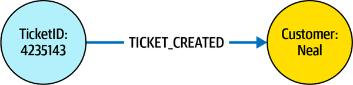

*Hình 6-29. Trong graph database, hướng của edge có ý nghĩa khi truy vấn*

Các edge trong graph database có ý nghĩa về hướng. Trong Hình 6-29, một edge loại `TICKET_CREATED` kết nối một node *ticket* có ID `4235143` với một node *customer* có ID `Neal`. Chúng ta có thể duyệt từ node ticket qua edge *đi ra* `TICKET_CREATED` hoặc từ node customer qua edge *đi vào* `TICKET_CREATED`. Khi các hướng bị lẫn lộn, việc truy vấn graph trở nên thực sự khó khăn. Xếp hạng cho graph database được minh họa trong [Hình 6-29](#fig-data-decomposition-graph-direction).

<a id="fig-data-decomposition-star-rating-graph"></a>

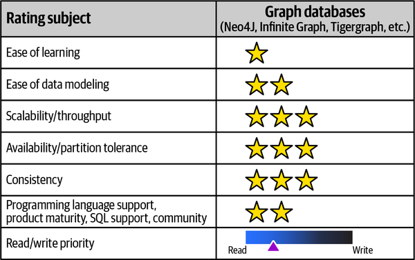

*Hình 6-30. Graph database được xếp hạng theo các đặc điểm áp dụng khác nhau*

**Độ dễ của đường cong học tập (Ease-of-learning curve)**

Graph database có đường cong học tập dốc. Hiểu cách dùng node, relation, loại relation và thuộc tính cần thời gian.

**Độ dễ mô hình hóa dữ liệu (Ease of data modeling)**

Hiểu cách mô hình hóa các domain và chuyển chúng thành node và relation là việc khó. Lúc đầu, người ta có xu hướng thêm thuộc tính vào relation. Khi kiến thức mô hình hóa cải thiện, việc dùng node và relation tăng lên, và việc chuyển một số thuộc tính relation thành node với loại relation bổ sung diễn ra, điều này cải thiện việc duyệt graph.

**Scalability/throughput**

Các node được replicate cải thiện khả năng scale cho thao tác đọc, và throughput có thể được điều chỉnh cho tải đọc.<a id="idm45798379978712"></a> Vì khó chia nhỏ hoặc shard graph, throughput ghi bị giới hạn bởi loại graph database được chọn. Việc duyệt các relationship rất nhanh, vì index và dữ liệu lưu trữ được lưu bền vững chứ không phải tính toán lúc truy vấn.

**Availability/partition tolerance**

Một số graph database có partition tolerance cao<a id="idm45798379975832"></a> và availability cao là các database phân tán. Các cluster graph database có thể dùng các node có thể được thăng cấp làm leader khi leader hiện tại không khả dụng.

**Tính nhất quán (Consistency)**

Nhiều graph database hỗ trợ transaction ACID. Một số graph<a id="idm45798379972936"></a><a id="idm45798379971560"></a><a id="idm45798379970344"></a> database, như [Neo4j](https://neo4j.com), hỗ trợ transaction, nhờ đó dữ liệu luôn nhất quán.

**Hỗ trợ ngôn ngữ lập trình, độ trưởng thành sản phẩm, hỗ trợ SQL và cộng đồng (Programming language support, product maturity, SQL support, and community)**

Graph database có nhiều hỗ trợ trong cộng đồng. Nhiều thuật toán, như [Dijkstra’s algorithm](https://oreil.ly/TFr1D) hoặc *node similarity*, được hiện thực sẵn trong database, giảm nhu cầu phải viết chúng từ đầu. <a id="idm45798379966136"></a>Framework ngôn ngữ gọi là Gremlin hoạt động trên nhiều database khác nhau, giúp dễ dùng hơn. [Neo4J](https://neo4j.com) hỗ trợ một ngôn ngữ truy vấn gọi là Cypher, cho phép developer dễ dàng truy vấn database.

**Ưu tiên đọc/ghi (Read/write priority)**

Trong graph database, việc lưu trữ dữ liệu được tối ưu hóa cho việc duyệt relationship, trái ngược với relational database, nơi chúng ta phải truy vấn các relationship và suy ra chúng lúc truy vấn. Graph database tốt hơn cho các kịch bản read-heavy (nặng về đọc).

Graph database cho phép cùng một node có nhiều loại relationship khác nhau. Trong ví dụ Sysops Squad, một graph mẫu có thể trông như sau: một `knowledge_base` được `created_by` user `sysops_user` và `knowledge_base` được `used_by` `sysops_user`. Do đó, các relationship `created_by` và `used_by` nối cùng các node cho các loại relationship khác nhau.<a id="idm45798379957848"></a><a id="idm45798379957144"></a><a id="idm45798379956472"></a><a id="idm45798379955800"></a>

> **Thay đổi loại relationship (Changing Relationship Types)**
>
> Thay đổi loại relationship là một thao tác tốn kém, vì mỗi loại relationship phải được re-created (tạo lại). Khi điều này xảy ra, cả hai node được nối bởi edge phải được duyệt qua, edge mới được tạo ra, và edge cũ bị gỡ bỏ. Do đó, loại edge hay loại relationship phải được suy nghĩ cẩn thận.

<a id="idm45798379953288"></a>

### NewSQL database (NewSQL Databases)

Matthew Aslett là người đầu tiên dùng thuật ngữ *NewSQL* để định nghĩa các<a id="idm45798379951304"></a><a id="idm45798379950568"></a><a id="idm45798379949304"></a><a id="idm45798379948360"></a> database mới nhằm cung cấp scalability của NoSQL database trong khi vẫn hỗ trợ các tính năng của relational database như ACID. NewSQL database dùng các loại cơ chế lưu trữ khác nhau, và tất cả đều hỗ trợ SQL.

NewSQL database, có xếp hạng xuất hiện trong [Hình 6-31](#fig-data-decomposition-star-rating-new-sql), cải tiến relational database bằng cách cung cấp partitioning hoặc sharding dữ liệu tự động, cho phép scale theo chiều ngang và cải thiện availability, đồng thời cho phép developer chuyển đổi dễ dàng để dùng mô hình quen thuộc của SQL và ACID.

<a id="fig-data-decomposition-star-rating-new-sql"></a>

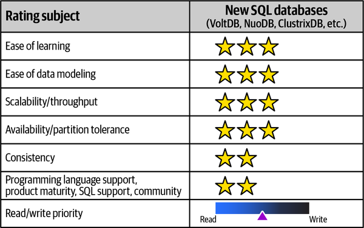

*Hình 6-31. New SQL database được xếp hạng theo các đặc điểm áp dụng khác nhau*

**Độ dễ của đường cong học tập (Ease-of-learning curve)**

Vì NewSQL database giống hệt relational database (với giao diện SQL, thêm tính năng scale theo chiều ngang, tuân thủ ACID), đường cong học tập dễ hơn nhiều. <a id="idm45798379940840"></a>Một số chỉ có sẵn dưới dạng Database as a Service (DBaaS), điều có thể khiến việc học chúng khó hơn.

**Độ dễ mô hình hóa dữ liệu (Ease of data modeling)**

Vì NewSQL database giống relational database, mô hình hóa dữ liệu quen thuộc với nhiều người và dễ nắm bắt hơn. <a id="idm45798379938232"></a>Điểm phức tạp thêm là thiết kế sharding, cho phép đặt dữ liệu được shard ở các vị trí địa lý khác nhau.

**Scalability/throughput**

NewSQL database được thiết kế để hỗ trợ scale theo chiều ngang<a id="idm45798379935720"></a> cho các hệ thống phân tán, cho phép nhiều node active, khác với relational database chỉ có một leader active, và các node còn lại là follower. Nhiều node active cho phép NewSQL database có khả năng scale cao và có throughput tốt hơn.

**Availability/partition tolerance**

Nhờ thiết kế nhiều node active, lợi ích về<a id="idm45798379931928"></a><a id="idm45798379930600"></a> availability có thể thực sự cao với partition tolerance lớn hơn. CockroachDB là một NewSQL database phổ biến chịu được sự cố ổ đĩa, máy và trung tâm dữ liệu.

**Tính nhất quán (Consistency)**

NewSQL database hỗ trợ transaction ACID<a id="idm45798379928280"></a> nhất quán mạnh. Dữ liệu luôn nhất quán, và điều này cho phép người dùng relational database dễ dàng chuyển sang NewSQL database.

**Hỗ trợ ngôn ngữ lập trình, độ trưởng thành sản phẩm, hỗ trợ SQL và cộng đồng (Programming language support, product maturity, SQL support, and community)**

Có nhiều NewSQL database open source, nên việc học chúng dễ tiếp cận. Một số database cũng hỗ trợ các giao thức wire-compatible (tương thích ở mức giao thức) với các relational database hiện có, cho phép chúng thay thế relational database mà không gặp vấn đề tương thích nào.

**Ưu tiên đọc/ghi (Read/write priority)**

NewSQL database được dùng giống hệt relational database, với lợi ích bổ sung của việc đánh index và phân tán theo địa lý để cải thiện performance đọc hoặc performance ghi.

<a id="idm45798379942248"></a>

### Cloud native database (Cloud Native Databases)

Với việc dùng cloud gia tăng, các cloud database như<a id="idm45798379922024"></a><a id="idm45798379921048"></a><a id="idm45798379920376"></a><a id="idm45798379919160"></a><a id="idm45798379918520"></a><a id="idm45798379917880"></a><a id="idm45798379917240"></a> [Snowflake](https://snowflake.com), [Amazon Redshift](https://aws.amazon.com/redshift), [Datomic](https://datomic.com), và [Azure CosmosDB](https://oreil.ly/Tvkx3) đã trở nên phổ biến hơn. Những database này giảm gánh nặng vận hành, minh bạch chi phí, và là một cách dễ dàng để thử nghiệm vì không cần đầu tư up-front (trả trước). Xếp hạng cho cloud native database xuất hiện trong [Hình 6-32](#fig-data-decomposition-star-rating-cloud).

<a id="fig-data-decomposition-star-rating-cloud"></a>

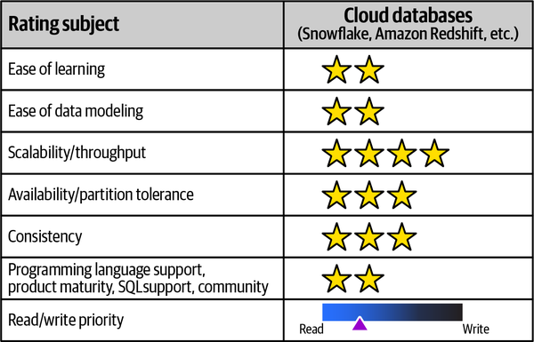

*Hình 6-32. Cloud native database được xếp hạng theo các đặc điểm áp dụng khác nhau*

**Độ dễ của đường cong học tập (Ease-of-learning curve)**

Một số cloud database như AWS Redshift giống relational database và do đó dễ hiểu hơn. Các database như Snowflake, có giao diện SQL nhưng có cơ chế lưu trữ và tính toán khác, đòi hỏi một chút luyện tập. Datomic hoàn toàn khác về mặt model và dùng các fact nguyên tử `immutable`. Do đó, đường cong học tập thay đổi theo từng database.

**Độ dễ mô hình hóa dữ liệu (Ease of data modeling)**

Datomic không có khái niệm bảng hay nhu cầu định nghĩa thuộc tính trước. Cần định nghĩa các đặc tính của từng thuộc tính riêng lẻ, và thực thể có thể có bất kỳ thuộc tính nào. Snowflake và Redshift được dùng nhiều hơn cho các workload kiểu data warehousing. Hiểu loại mô hình hóa mà database cung cấp là then chốt trong việc chọn database để dùng.

**Scalability/throughput**

Vì tất cả những database này chỉ chạy trên cloud, việc scale chúng<a id="idm45798379904600"></a> tương đối đơn giản vì tài nguyên có thể được cấp phát tự động với một mức giá. Trong những quyết định này, trade-off thường liên quan đến giá.

**Availability/partition tolerance**

Các database thuộc loại này (như Datomic) có availability<a id="idm45798379901752"></a><a id="idm45798379900504"></a> cao khi được deploy bằng *Production Topology*. Chúng không có single point of failure và được hỗ trợ bởi caching rộng rãi. Snowflake, chẳng hạn, replicate database của nó giữa các region và account. Các database khác thuộc loại này hỗ trợ availability cao hơn với nhiều tùy chọn cấu hình. Ví dụ, Redshift chạy trong một availability zone duy nhất và sẽ cần chạy trong nhiều cluster để hỗ trợ availability cao hơn.

**Tính nhất quán (Consistency)**

Datomic hỗ trợ transaction ACID bằng cách dùng các storage engine để<a id="idm45798379897272"></a><a id="idm45798379895944"></a> lưu các block trong block storage. Các database khác, như Snowflake và Redshift, hỗ trợ transaction ACID.

**Hỗ trợ ngôn ngữ lập trình, độ trưởng thành sản phẩm, hỗ trợ SQL và cộng đồng (Programming language support, product maturity, SQL support, and community)**

Nhiều database trong số này còn mới, và việc tìm người giàu kinh nghiệm hỗ trợ có thể khó khăn. Thử nghiệm những database này đòi hỏi một tài khoản cloud, điều có thể tạo thêm rào cản. Dù cloud native database giảm khối lượng công việc vận hành cho các DBA vận hành, chúng có đường cong học tập cao hơn đối với developer. Datomic dùng [Clojure](https://clojure.org) trong mọi ví dụ của mình, và stored procedure được viết bằng Clojure, nên việc không biết Clojure có thể là một rào cản khi sử dụng.

**Ưu tiên đọc/ghi (Read/write priority)**

Những database này có thể được dùng cho cả tải read-heavy hoặc write-heavy (nặng về ghi). Snowflake và Redshift thiên về các workload kiểu data warehouse, khiến chúng nghiêng về ưu tiên đọc, trong khi Datomic có thể hỗ trợ cả hai loại tải với các index khác nhau như EAVT (Entity, Attribute, Value, rồi Transaction) trước.

<a id="idm45798379889320"></a>

### Database chuỗi thời gian (Time-Series Databases)

Theo các xu hướng, chúng ta thấy việc dùng IoT, microservices, xe self-driving (tự lái), và observability gia tăng,<a id="ch06-time"></a><a id="ch06-time2"></a> tất cả những điều đó đã thúc đẩy sự gia tăng phi thường trong phân tích time-series. Xu hướng này đã làm nảy sinh các database được tối ưu hóa để lưu các chuỗi điểm dữ liệu thu thập trong một cửa sổ thời gian, cho phép người dùng theo dõi thay đổi trong bất kỳ khoảng thời gian nào. Xếp hạng cho loại database này xuất hiện trong [Hình 6-33](#fig-data-decomposition-star-rating-time-series).

<a id="fig-data-decomposition-star-rating-time-series"></a>

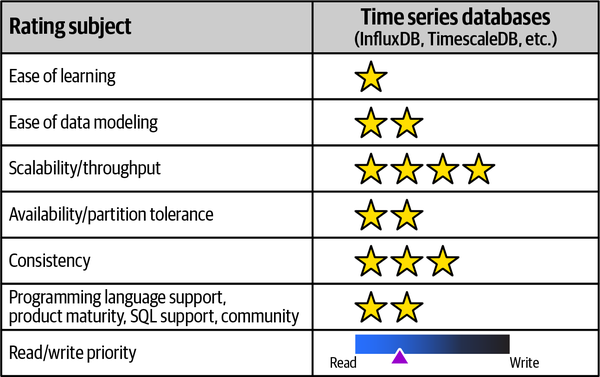

*Hình 6-33. Time-series database được xếp hạng theo các đặc điểm áp dụng khác nhau*

**Độ dễ của đường cong học tập (Ease-of-learning curve)**

Hiểu dữ liệu time-series thường dễ—mỗi điểm dữ liệu được gắn với một timestamp, và dữ liệu gần như luôn được chèn vào và không bao giờ được cập nhật hay xóa. Hiểu các thao tác append-only (chỉ nối thêm) đòi hỏi gạt bỏ một số thói quen từ việc dùng các database khác, nơi lỗi trong dữ liệu có thể được sửa bằng một thao tác update. <a id="idm45798379879992"></a><a id="idm45798379879320"></a><a id="idm45798379878648"></a>InfluxDB, Kx và TimeScale là một số time-series database phổ biến.

**Độ dễ mô hình hóa dữ liệu (Ease of data modeling)**

Khái niệm nền tảng của time-series database là phân tích các thay đổi trong dữ liệu theo thời gian. Ví dụ, với ví dụ Sysops Squad, các thay đổi được thực hiện trên một đối tượng ticket có thể được lưu trong một time-series database, trong đó `timestamp` của thay đổi và `ticket_id` được gắn tag. Thêm nhiều hơn một mẩu thông tin vào một tag được coi là thực hành tồi. Ví dụ, `ticket_status=Open, ticket_id=374737` tốt hơn `ticket_info=Open.374737`.

**Scalability/throughput**

*Timescale* dựa trên PostgreSQL và cho phép các pattern scale và cải thiện throughput tiêu chuẩn.<a id="idm45798379872648"></a> Chạy InfluxDB ở chế độ cluster bằng cách dùng các node *meta* quản lý metadata và các node *data* lưu dữ liệu thực tế mang lại cải thiện về scale và throughput.

**Availability/partition tolerance**

Một số database như InfluxDB có các tùy chọn availability và partition<a id="idm45798379869096"></a> tolerance tốt hơn với cấu hình cho node meta và node data, cùng với các *replication* factor.

**Tính nhất quán (Consistency)**

Time-series database dùng relational database làm<a id="idm45798379864776"></a><a id="idm45798379863432"></a> storage engine có được các thuộc tính ACID cho tính nhất quán, trong khi các database khác có thể điều chỉnh tính nhất quán bằng `consistency-level` là `any`, `one` hoặc `quorum`. <a id="idm45798379860200"></a>Cấu hình consistency-level cao hơn nhìn chung dẫn đến *tính nhất quán* cao hơn và *availability* thấp hơn, nên đó là một trade-off cần được cân nhắc.

**Hỗ trợ ngôn ngữ lập trình, độ trưởng thành sản phẩm, hỗ trợ SQL và cộng đồng (Programming language support, product maturity, SQL support, and community)**

Time-series database gần đây đã trở nên phổ biến, và có nhiều tài nguyên để học. Một số database này, như InfluxDB, cung cấp một ngôn ngữ truy vấn SQL-like gọi là InfluxQL.

**Ưu tiên đọc/ghi (Read/write priority)**

Time-series database chỉ nối thêm (append only) và có xu hướng phù hợp hơn cho các workload read-heavy.

Khi dùng time-series database, database tự động gắn một timestamp cho mỗi lần tạo dữ liệu, và dữ liệu chứa các tag hoặc thuộc tính thông tin. Dữ liệu được truy vấn dựa trên một fact nào đó giữa các cửa sổ thời gian cụ thể. Do đó, time-series database không phải là database general-purpose (đa dụng).<a id="idm45798379854584"></a><a id="idm45798379853880"></a>

Tóm tắt tất cả các loại database được thảo luận trong phần này, [Bảng 6-6](#table-database-type-product) thể hiện một số sản phẩm database phổ biến cho từng loại database.<a id="idm45798379851944"></a>

<a id="table-database-type-product"></a>

<a id="table-database-type-product"></a>*Bảng 6-6. Tóm tắt các loại database và sản phẩm trong từng loại database*

| Loại database | Sản phẩm |
|---|---|
| Relational | PostgreSQL, Oracle, Microsoft SQL |
| Key-value | Riak KV, Amazon DynamoDB, Redis |
| Document | MongoDB, Couchbase, AWS DocumentDB |
| Column family | Cassandra, Scylla, Amazon SimpleDB |
| Graph | Neo4j, Infinite Graph, Tiger Graph |
| NewSQL | VoltDB, ClustrixDB, SimpleStore (aka MemSQL) |
| Cloud native | Snowflake, Datomic, Redshift |
| Time-series | InfluxDB, kdb+, Amazon Timestream |

<a id="idm45798380207640"></a>

## Sysops Squad Saga: Polyglot database (Sysops Squad Saga: Polyglot Databases)

`Thursday, December 16, 16:05`

Giờ đây khi team đã hình thành các data domain từ database monolith<a id="idm45798379831688"></a><a id="idm45798379829416"></a> của Sysops Squad, Devon nhận thấy data domain Survey sẽ là một ứng viên tuyệt vời để chuyển từ một relational database truyền thống sang một document database dùng JSON. Tuy nhiên, Dana, người đứng đầu kiến trúc dữ liệu, không đồng ý và muốn giữ các bảng ở dạng relational.

“Tôi đơn giản là không đồng ý,” Dana nói. “Các bảng khảo sát từ trước đến nay luôn hoạt động tốt dưới dạng bảng relational, nên tôi không thấy lý do gì phải thay đổi. "

“Thực ra,” Skyler nói, “nếu ban đầu chị đã nói chuyện với chúng tôi về điều này khi hệ thống mới được phát triển, chị sẽ hiểu rằng từ góc độ giao diện người dùng, xử lý dữ liệu relational cho thứ như khảo sát khách hàng thực sự rất khó. Vì vậy tôi không đồng ý. Có thể nó ổn với chị, nhưng từ góc độ phát triển giao diện người dùng, việc xử lý dữ liệu relational cho phần khảo sát là một điểm đau lớn.”

“Thấy chưa, đó,” Devon nói. “Đây là lý do chúng ta cần chuyển nó sang document database.”

“Có vẻ các cậu quên rằng với vai trò kiến trúc sư dữ liệu của công ty này, tôi là người chịu trách nhiệm cuối cùng cho tất cả các database khác nhau này. Các cậu không thể cứ thế bắt đầu thêm các loại database khác nhau vào hệ thống,” Dana nói.

“Nhưng đó sẽ là một giải pháp tốt hơn nhiều,” Devon nói.

“Xin lỗi, nhưng tôi sẽ không gây xáo trộn cho các team database chỉ để Skyler có công việc bảo trì giao diện người dùng dễ dàng hơn. Mọi thứ không vận hành như vậy.”

“Khoan đã,” Skyler nói, “chẳng phải tất cả chúng ta đã đồng ý rằng một phần vấn đề của ứng dụng Sysops Squad monolith hiện tại là các development team không làm việc đủ gần gũi với các team database sao?”

“Đúng vậy,” Dana nói.

“Vậy thì,” Skyler nói, “hãy làm điều đó. Hãy cùng nhau tìm ra cách giải quyết.”

“OK,” Dana nói, “nhưng điều tôi cần từ cậu và Devon là một lý do biện minh vững chắc cho việc đưa thêm một loại database khác vào.”

“Được thôi,” Devon nói. “Chúng tôi sẽ bắt tay vào làm ngay.”

Devon và Skyler biết rằng document database sẽ là một giải pháp tốt hơn nhiều cho dữ liệu khảo sát khách hàng, nhưng họ không chắc làm sao xây dựng lý do biện minh đúng để Dana đồng ý chuyển dữ liệu. Skyler đề xuất họ gặp Addison để nhờ giúp đỡ, vì cả hai đều đồng ý rằng đây phần nào là một mối quan tâm kiến trúc. Addison đồng ý giúp, và sắp xếp một cuộc họp với Parker (product owner của Sysops Squad) để xác nhận liệu có lý do biện minh nghiệp vụ nào cho việc chuyển các bảng khảo sát khách hàng sang document database hay không.

“Cảm ơn anh đã gặp chúng tôi, Parker,” Addison nói. “Như tôi đã đề cập với anh trước đó, chúng tôi đang nghĩ đến việc thay đổi cách lưu dữ liệu khảo sát khách hàng, và có vài câu hỏi cho anh.”

“Chà,” Parker nói, “đó là một trong những lý do tôi đồng ý cuộc họp này. Các cậu thấy đấy, phần khảo sát khách hàng của hệ thống là một điểm đau lớn đối với bộ phận marketing, cũng như đối với tôi.”

“Hả?” Skyler hỏi. “Ý anh là sao?”

“Các cậu mất bao lâu để áp dụng ngay cả yêu cầu thay đổi nhỏ nhất cho các khảo sát khách hàng?” Parker hỏi.

“Chà,” Devon nói, “từ phía database thì không quá tệ. Ý tôi là, chỉ là việc thêm một cột mới cho một câu hỏi mới hoặc thay đổi kiểu câu trả lời.”

“Khoan đã,” Skyler nói. “Xin lỗi, nhưng với tôi đó là một thay đổi lớn, ngay cả khi anh chỉ thêm một câu hỏi. Anh không biết việc truy vấn toàn bộ dữ liệu relational đó và hiển thị một khảo sát khách hàng trên giao diện người dùng khó đến mức nào đâu. Vì vậy, câu trả lời của tôi là, *rất lâu*.”

“Nghe này,” Parker nói. “Chúng tôi ở phía nghiệp vụ cũng rất bực bội khi ngay cả những thay đổi đơn giản nhất cũng khiến các cậu mất đúng nghĩa đen là nhiều ngày. Điều đó đơn giản là không thể chấp nhận được.”

“Tôi nghĩ tôi có thể giúp ở đây,” Addison nói. “Vậy Parker, điều anh đang nói là khảo sát khách hàng thay đổi thường xuyên, và việc thực hiện các thay đổi đang mất quá nhiều thời gian?”

“Đúng vậy,” Parker nói. “Bộ phận marketing không chỉ muốn khảo sát khách hàng linh hoạt hơn, mà còn muốn bộ phận IT phản hồi tốt hơn. Nhiều lúc họ không đưa ra yêu cầu thay đổi vì biết nó sẽ chỉ kết thúc trong bực bội và chi phí phát sinh mà họ không lường trước.”

“Nếu tôi nói với anh rằng việc thiếu linh hoạt và thiếu khả năng phản hồi với các yêu cầu thay đổi hoàn toàn liên quan đến công nghệ được dùng để lưu khảo sát khách hàng, và rằng bằng cách thay đổi cách chúng ta lưu dữ liệu, chúng ta có thể cải thiện đáng kể sự linh hoạt cũng như thời gian phản hồi cho các yêu cầu thay đổi thì sao?” Addison hỏi.

“Thì tôi sẽ là người hạnh phúc nhất trên Trái Đất, và bộ phận marketing cũng vậy,” Parker nói.

“Devon và Skyler, tôi nghĩ chúng ta đã có lý do biện minh nghiệp vụ,” Addison nói.

Với lý do biện minh nghiệp vụ đã được thiết lập, Devon, Skyler và Addison thuyết phục Dana dùng một document database. <a id="ch06-struc"></a><a id="ch06-struc2"></a><a id="ch06-struc3"></a>Giờ team phải tìm ra cấu trúc tối ưu cho dữ liệu khảo sát khách hàng. Các bảng relational database hiện có được minh họa trong [Hình 6-34](#survey-rdbms-model). Mỗi khảo sát khách hàng gồm hai bảng chính—bảng Survey và bảng Question, với quan hệ one-to-many (một đối nhiều) giữa hai bảng.

<a id="survey-rdbms-model"></a>

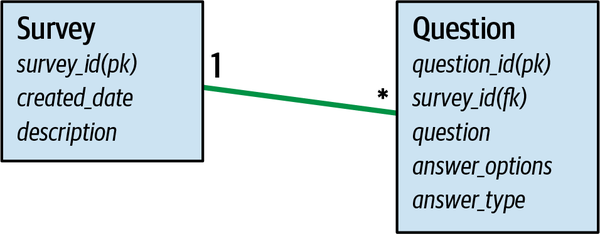

*Hình 6-34. Các bảng và quan hệ trong data domain khảo sát của sysops*

Một ví dụ về dữ liệu chứa trong mỗi bảng được thể hiện [Hình 6-35](#survey-rdbms-data), trong đó bảng Question chứa câu hỏi, các phương án trả lời, và kiểu dữ liệu cho câu trả lời.

<a id="survey-rdbms-data"></a>

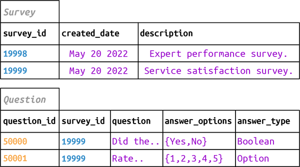

*Hình 6-35. Dữ liệu relational trong các bảng survey và question thuộc data domain khảo sát*

“Vậy, về cơ bản chúng ta có hai lựa chọn để mô hình hóa các câu hỏi khảo sát trong một document database,” Devon nói. “Một document aggregate duy nhất hoặc một document được tách ra.”

“Làm sao chúng ta biết nên dùng cái nào?” Skyler hỏi, vui mừng vì các development team giờ cuối cùng đã làm việc cùng các team database để đi đến một giải pháp thống nhất.

“Tôi biết rồi,” Addison nói, “hãy mô hình hóa cả hai để chúng ta có thể thấy trực quan các trade-offs của từng cách tiếp cận.”

Devon cho team thấy rằng với lựa chọn aggregate duy nhất, như thể hiện trong [Hình 6-36](#survey-aggregate-model), cùng với source code tương ứng trong [Ví dụ 6-3](#json_single_aggregate), cả dữ liệu khảo sát và toàn bộ dữ liệu câu hỏi liên quan đều được lưu dưới dạng một document. Do đó, toàn bộ khảo sát khách hàng có thể được lấy từ database bằng một thao tác `get` duy nhất, giúp Skyler và những người khác trong development team dễ làm việc với dữ liệu.

<a id="survey-aggregate-model"></a>

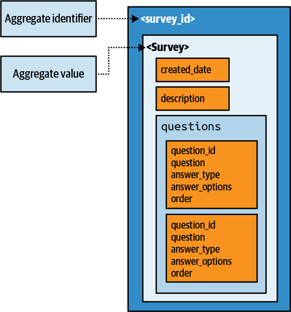

*Hình 6-36. Model khảo sát với aggregate duy nhất*

<a id="json_single_aggregate"></a>

*Ví dụ 6-3. JSON document cho thiết kế aggregate duy nhất với các phần tử con được nhúng*

```json
# Survey aggregate with embedded questions
{
    "survey_id": "19999",
    "created_date": "Dec 28 2021",
    "description": "Survey to gauge customer...",
    "questions": [
        {
            "question_id": "50001",
            "question": "Rate the expert",
            "answer_type": "Option",
            "answer_options": "1,2,3,4,5",
            "order": "2"
        },
        {
            "question_id": "50000",
            "question": "Did the expert fix the problem?",
            "answer_type": "Boolean",
            "answer_options": "Yes,No",
            "order": "1"
        }
    ]
}
```

“Tôi rất thích cách tiếp cận đó,” Skyler nói. “Về cơ bản, tôi sẽ không phải lo nhiều về việc tự mình tổng hợp mọi thứ trên giao diện người dùng, nghĩa là tôi có thể đơn giản hiển thị document lấy về lên trang web.”

“Ừ,” Devon nói, “nhưng nó sẽ đòi hỏi thêm công việc ở phía database vì các câu hỏi sẽ bị nhân bản trong mỗi document khảo sát. Cậu biết đấy, toàn bộ lập luận về tái sử dụng. Đây, để tôi cho cậu xem cách tiếp cận kia.”

Skyler giải thích rằng một cách khác để nghĩ về aggregate là tách model *survey* và *question* để các câu hỏi có thể được thao tác một cách độc lập, như thể hiện trong [Hình 6-37](#survey-aggregate-reference-model), cùng với source code tương ứng trong [Ví dụ 6-4](#aggregate_reference_data). Điều này sẽ cho phép cùng một câu hỏi được dùng trong nhiều khảo sát, nhưng sẽ khó hiển thị và truy xuất hơn so với aggregate duy nhất.

<a id="survey-aggregate-reference-model"></a>

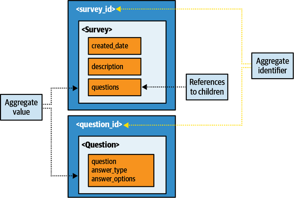

*Hình 6-37. Model khảo sát với nhiều aggregate có tham chiếu*

<a id="aggregate_reference_data"></a>

*Ví dụ 6-4. JSON document với các aggregate được tách và document cha thể hiện các tham chiếu tới các document con*

```json
# Survey aggregate with references to Questions
{
    "survey_id": "19999",
    "created_date": "Dec 28",
    "description": "Survey to gauge customer...",
    "questions": [
        {"question_id": "50001", "order": "2"},
        {"question_id": "50000", "order": "1"}
    ]
}
# Question aggregate
{
    "question_id": "50001",
    "question": "Rate the expert",
    "answer_type": "Option",
    "answer_options": "1,2,3,4,5"
}
{
    "question_id": "50000",
    "question": "Did the expert fix the problem?",
    "answer_type": "Boolean",
    "answer_options": "Yes,No"
}
```

Vì phần lớn độ phức tạp và các vấn đề thay đổi nằm ở giao diện người dùng, Skyler thích model aggregate duy nhất hơn. Devon thích nhiều aggregate để tránh trùng lặp dữ liệu câu hỏi trong mỗi khảo sát. Tuy nhiên, Addison chỉ ra rằng chỉ có năm loại khảo sát (mỗi loại cho một danh mục sản phẩm), và hầu hết các thay đổi liên quan đến việc thêm hoặc gỡ bỏ câu hỏi. Team thảo luận các trade-offs, và tất cả đều đồng ý rằng họ sẵn sàng đánh đổi một chút trùng lặp dữ liệu câu hỏi để có được sự dễ dàng trong thay đổi và hiển thị ở phía giao diện người dùng. Vì độ khó của quyết định này và bản chất cấu trúc của việc thay đổi dữ liệu, Addison tạo một ADR để ghi lại các lý do biện minh của quyết định này: <a id="idm45798379676584"></a><a id="idm45798379570600"></a><a id="idm45798379569992"></a>

> <a id="adr_4"></a>
>
> *ADR: Dùng document database cho khảo sát khách hàng*<br>
>
>
> *Bối cảnh (Context)*<br>
> Khách hàng nhận một khảo sát sau khi công việc đã được khách hàng hoàn thành, khảo sát này được hiển thị trên một trang web để khách hàng điền và gửi. Khách hàng nhận một trong năm loại khảo sát dựa trên loại sản phẩm điện tử được sửa chữa hoặc lắp đặt. Khảo sát hiện được lưu trong một relational database, nhưng team muốn chuyển khảo sát sang một document database dùng JSON.
>
> *Quyết định (Decision)*<br>
> Chúng tôi sẽ dùng một document database cho khảo sát khách hàng.
>
> Bộ phận Marketing đòi hỏi sự linh hoạt và kịp thời hơn cho các thay đổi đối với khảo sát khách hàng. Chuyển sang document database không chỉ mang lại sự linh hoạt tốt hơn, mà còn kịp thời hơn cho các thay đổi cần thiết đối với khảo sát khách hàng.<br>
>
>
> Dùng document database sẽ đơn giản hóa giao diện người dùng khảo sát khách hàng và tạo điều kiện tốt hơn cho các thay đổi đối với khảo sát.<br>
>
>
> *Hệ quả (Consequences)*<br>
> Vì chúng tôi sẽ dùng một aggregate duy nhất, nhiều document sẽ cần được thay đổi khi một câu hỏi khảo sát chung được cập nhật, thêm hoặc gỡ bỏ.<br>
>
>
> Chức năng khảo sát sẽ cần tạm ngừng trong quá trình chuyển dữ liệu từ relational database sang document database.<br>
>
