

# Chương 7. Granularity của service (Service Granularity)

`Thursday, October 14, 13:33`

Khi nỗ lực chuyển đổi bắt đầu được triển khai, cả Addison và Austen bắt đầu bị choáng ngợp bởi tất cả các quyết định liên quan đến việc tách các domain service đã xác định trước đó. Development team cũng có ý kiến riêng của mình, khiến việc ra quyết định về service granularity càng khó khăn hơn.

“Tôi vẫn chưa chắc phải làm gì với chức năng ticket cốt lõi,” Addison nói. “Tôi không thể quyết định việc tạo ticket, hoàn tất ticket, giao chuyên gia và định tuyến chuyên gia nên là một, hai, ba hay thậm chí bốn service. Taylen khăng khăng muốn làm mọi thứ fine-grained (mịn), nhưng tôi không chắc đó là cách tiếp cận đúng.”

“Tôi cũng vậy,” Austen nói. “Và tôi cũng có vấn đề riêng khi cố tìm ra liệu chức năng đăng ký khách hàng, quản lý hồ sơ và lập hóa đơn có nên tách ra không. Và trên hết, tối nay tôi lại có một trận đấu nữa.”

“Cậu lúc nào cũng có trận đấu,” Addison nói. “Nói đến chức năng khách hàng, cậu đã tìm ra liệu chức năng đăng nhập khách hàng có thành một service riêng không?”

“Chưa,” Austen nói, “tôi vẫn đang làm việc đó. Skyler nói nó nên tách riêng, nhưng không đưa ra lý do nào ngoài việc nói rằng đó là chức năng riêng biệt.”

“Chuyện này khó thật,” Addison nói. “Cậu có nghĩ Logan có thể làm sáng tỏ vấn đề này không?”

“Ý hay đấy,” Austen nói, “Kiểu phân tích seat-of-the-pants (theo cảm tính) này thực sự đang làm chậm mọi thứ.”

Addison và Austen mời Taylen, tech lead của Sysops Squad, tham gia cuộc họp với Logan để tất cả mọi người có cùng hiểu biết về các vấn đề service granularity mà họ đang đối mặt.

“Tôi nói thật đấy,” Taylen nói, “chúng ta cần chia các domain service thành các service nhỏ hơn. Chúng đơn giản là quá coarse-grained (thô) cho microservices. Theo tôi nhớ, *micro* nghĩa là nhỏ. Suy cho cùng, chúng ta đang chuyển sang microservices. Những gì Addison và Austen đề xuất đơn giản là không khớp với mô hình microservices.”

“Không phải mọi phần của một ứng dụng đều phải là microservices,” Logan nói. “Đó là một trong những cạm bẫy lớn nhất của microservices architecture style.”

“Nếu vậy, thì làm sao anh xác định service nào nên và không nên tách ra?” Taylen hỏi.

“Để tôi hỏi cậu một điều, Taylen,” Logan nói. “Lý do cậu muốn làm tất cả các service nhỏ như vậy là gì?”

“Single-responsibility principle (nguyên lý đơn trách nhiệm),” Taylen trả lời. “Anh tra mà xem. Đó là nền tảng của microservices.”

“Tôi biết single-responsibility principle là gì,” Logan nói. “Và tôi cũng biết nó có thể chủ quan đến mức nào. Hãy lấy service thông báo khách hàng của chúng ta làm ví dụ. Chúng ta có thể thông báo cho khách hàng qua SMS, email, và chúng ta thậm chí còn gửi thư bưu điện. Vậy mọi người nói tôi nghe, một service hay ba service?”

“Ba,” Taylen trả lời ngay lập tức. “Mỗi phương thức thông báo là một thứ riêng. Đó chính là bản chất của microservices.”

“Một,” Addison trả lời. “Bản thân việc thông báo rõ ràng là một trách nhiệm duy nhất.”

“Tôi không chắc,” Austen trả lời. “Tôi thấy cả hai cách đều được. Hay chúng ta tung đồng xu nhỉ?”

“Đây chính xác là lý do chúng ta cần giúp đỡ,” Addison thở dài.

“Chìa khóa để có service granularity đúng,” Logan nói, “là loại bỏ ý kiến chủ quan và cảm tính, và dùng các granularity disintegrator và integrator để phân tích khách quan các trade-offs và hình thành lý do biện minh vững chắc cho việc có nên tách một service hay không.”

“Granularity disintegrator và integrator là gì?” Austen hỏi.

“Để tôi chỉ cho các cậu,” Logan nói.

Kiến trúc sư và developer thường nhầm lẫn các thuật ngữ *modularity* và *granularity*, và trong một số trường hợp thậm chí coi chúng có cùng nghĩa. Hãy xét các định nghĩa từ điển sau của từng thuật ngữ:

**Modularity**

Được xây dựng với các đơn vị hoặc kích thước tiêu chuẩn hóa để linh hoạt và đa dạng trong sử dụng.

**Granularity**

Gồm hoặc có vẻ gồm một trong vô số hạt hình thành một đơn vị lớn hơn.

Chẳng trách có quá nhiều nhầm lẫn giữa các thuật ngữ này! Dù các thuật ngữ có định nghĩa từ điển tương tự nhau, chúng tôi muốn phân biệt chúng vì chúng có nghĩa khác nhau trong bối cảnh software architecture. Theo cách dùng của chúng tôi, *modularity* liên quan đến việc chia hệ thống thành các phần riêng biệt (xem [Chương 3](ch03_architectural_modularity.vi.md#ch03-architectural-modularity)), trong khi *granularity* xử lý *kích thước* của các phần riêng biệt đó. Điều thú vị là hầu hết các vấn đề và thách thức trong hệ thống phân tán thường không liên quan đến modularity, mà là granularity.

Xác định mức granularity đúng—kích thước của một service—là một trong nhiều phần khó của software architecture mà kiến trúc sư và development team liên tục vật lộn. Granularity không được định nghĩa bởi số lượng class hay dòng code trong một service, mà bởi những gì service làm—đó là lý do vì sao rất khó có service granularity đúng.

Kiến trúc sư có thể tận dụng các metric để giám sát và đo lường các khía cạnh khác nhau của một service nhằm xác định mức service granularity phù hợp. Một metric như vậy dùng để đo khách quan kích thước của một service là tính số statement trong service. Mỗi developer có phong cách và kỹ thuật viết code khác nhau, đó là lý do số lượng class và số dòng code là những metric kém để đo granularity. Ngược lại, số statement ít nhất cho phép kiến trúc sư hoặc development team đo một cách khách quan *những gì* service đang làm. Hãy nhớ lại từ [Chương 4](ch04_architectural_decomposition.vi.md#ch04-architectural-decomposition) rằng một *statement* là một hành động hoàn chỉnh duy nhất được thực hiện trong source code, thường được kết thúc bằng một ký tự đặc biệt (như dấu chấm phẩy trong các ngôn ngữ như Java, C, C++, C#, Go, JavaScript; hoặc ký tự xuống dòng trong các ngôn ngữ như F#, Python và Ruby).

Một metric khác để xác định service granularity là đo và theo dõi số lượng interface hoặc thao tác *public* mà một service đưa ra. Phải thừa nhận rằng, dù vẫn còn một chút chủ quan và biến thiên với hai metric này, đó là thứ gần nhất mà chúng tôi nghĩ ra cho đến nay để đo và đánh giá khách quan service granularity.

Hai lực đối lập đối với service granularity là granularity disintegrator và granularity integrator. Các lực đối lập này được minh họa trong [Hình 7-1](#fig-modularity-vs-granularity-balance). *Granularity disintegrator* trả lời câu hỏi “Khi nào tôi nên cân nhắc tách một service thành các phần nhỏ hơn?”, trong khi *granularity integrator* trả lời câu hỏi “Khi nào tôi nên cân nhắc gộp các service trở lại với nhau?” Một sai lầm phổ biến mà nhiều development team mắc phải là tập trung quá nhiều vào granularity disintegrator trong khi bỏ qua granularity integrator. Bí quyết để đạt được mức granularity phù hợp cho một service là đạt được trạng thái cân bằng giữa hai lực đối lập này.

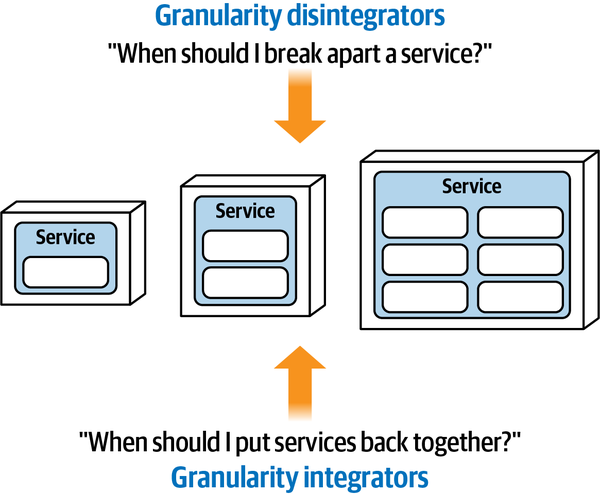

*Hình 7-1. Service granularity phụ thuộc vào sự cân bằng giữa disintegrator và integrator*

## Granularity disintegrator (Granularity Disintegrators)

Granularity disintegrator cung cấp định hướng và lý do biện minh cho việc khi nào nên chia một service thành các mảnh nhỏ hơn. Dù lý do biện minh cho việc chia nhỏ một service có thể chỉ liên quan đến một động lực duy nhất, trong hầu hết trường hợp lý do biện minh sẽ dựa trên nhiều động lực. Sáu động lực chính cho granularity disintegration như sau:

**Phạm vi và chức năng của service (Service scope and function)**

Service có đang làm quá nhiều việc không liên quan không?

**Độ biến động của code (Code volatility)**

Các thay đổi có được cô lập chỉ trong một phần của service không?

**Scalability và throughput (Scalability and throughput)**

Các phần của service có cần scale khác nhau không?

**Fault tolerance**

Có lỗi nào khiến các chức năng then chốt bị hỏng bên trong service không?

**Security**

Một số phần của service có cần mức security cao hơn các phần khác không?

**Extensibility**

Service có liên tục mở rộng để thêm các bối cảnh mới không?

Các phần sau trình bày chi tiết từng động lực granularity disintegration này.

### Phạm vi và chức năng của service (Service Scope and Function)

Phạm vi và chức năng của service là động lực đầu tiên và phổ biến nhất cho việc chia một service duy nhất thành các service nhỏ hơn, đặc biệt đối với microservices. Có hai chiều cần xem xét khi phân tích phạm vi và chức năng của service. Chiều thứ nhất là *cohesion*: mức độ và cách thức mà các thao tác của một service cụ thể liên hệ với nhau. Chiều thứ hai là *kích thước* tổng thể của một component, thường được đo bằng tổng số statement cộng từ các class tạo nên service đó, số lượng entrypoint public vào service, hoặc cả hai.

Hãy xét một Notification Service điển hình làm ba việc: thông báo cho khách hàng qua SMS ([Short Message Service](https://oreil.ly/caVCG)), email, hoặc thư bưu điện in ra được gửi qua bưu điện cho khách hàng. Dù rất hấp dẫn để chia service này thành ba service single-purpose (đơn mục đích) riêng biệt (một cho SMS, một cho email, và một cho thư bưu điện) như minh họa trong [Hình 7-2](#fig-modularity-vs-granularity-scope-notification), chỉ riêng điều này không đủ để biện minh cho việc tách service vì nó đã có cohesion tương đối mạnh—tất cả các chức năng này đều liên quan đến một việc, thông báo cho khách hàng. Vì “đơn mục đích” được để cho ý kiến và cách diễn giải cá nhân, rất khó biết có nên tách service này hay không.

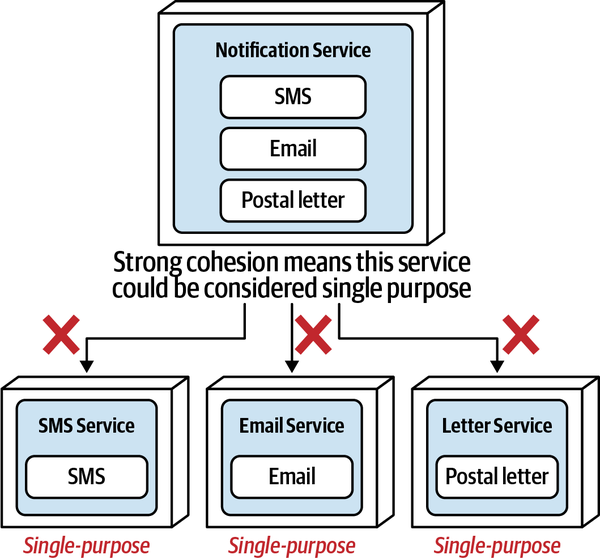

*Hình 7-2. Một service có cohesion tương đối mạnh không phải là ứng viên tốt để tách chỉ dựa trên chức năng*

Giờ hãy xét một service duy nhất quản lý thông tin hồ sơ khách hàng, tùy chọn của khách hàng, và cả các bình luận của khách hàng trên website. Khác với ví dụ Notification Service trước đó, service này có cohesion tương đối yếu vì ba chức năng này liên quan đến một phạm vi rộng hơn—khách hàng. Service này có lẽ đang làm quá nhiều, và do đó có lẽ nên được chia thành ba service riêng biệt, như minh họa trong [Hình 7-3](#fig-modularity-vs-granularity-scope-customer).

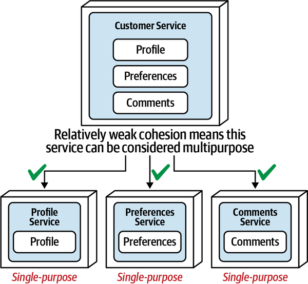

*Hình 7-3. Một service có cohesion tương đối yếu là ứng viên tốt để tách*

Granularity disintegrator này liên quan đến [single-responsibility principle](https://oreil.ly/JZpcT) do Robert C. Martin đặt ra như một phần của [các nguyên lý SOLID](https://oreil.ly/r64Yw), phát biểu rằng: “mỗi class nên có trách nhiệm đối với một phần duy nhất trong chức năng của chương trình, mà nó nên đóng gói. Mọi service của module, class hay function đó nên được sắp khớp chặt chẽ với trách nhiệm đó.” Dù single-responsibility principle ban đầu được giới hạn trong bối cảnh class, những năm sau đó nó đã mở rộng để bao gồm component và service.

Trong microservices architecture style, một *microservice* được định nghĩa là một đơn vị phần mềm single-purpose, được deploy riêng, làm *một việc* thực sự tốt. Chẳng trách developer bị cám dỗ làm service nhỏ nhất có thể mà không cân nhắc vì sao họ làm vậy! Tính chủ quan liên quan đến cái gì là và không là một trách nhiệm duy nhất là chỗ mà hầu hết developer gặp rắc rối về service granularity. Dù có một số metric (như [LCOM](https://oreil.ly/qOtdg)) để đo cohesion, nó vẫn rất chủ quan khi nói đến service—thông báo cho khách hàng là một việc duy nhất, hay thông báo qua email là một việc duy nhất? Vì lý do này, điều thiết yếu là phải hiểu các granularity disintegrator khác để xác định mức granularity phù hợp.

### Độ biến động của code (Code Volatility)

*Code volatility* (độ biến động của code)--tốc độ thay đổi của source code—là một động lực tốt khác để chia một service thành các service nhỏ hơn. Điều này còn được gọi là *volatility-based decomposition* (phân rã dựa trên độ biến động). Đo khách quan tần suất thay đổi code trong một service (dễ dàng thực hiện thông qua các tiện ích tiêu chuẩn trong bất kỳ hệ thống version-control source code nào) đôi khi có thể dẫn đến lý do biện minh tốt cho việc tách một service. Hãy xét lại ví dụ notification service từ phần trước. Chỉ riêng phạm vi service (cohesion) không đủ để biện minh cho việc tách service. Tuy nhiên, bằng cách áp dụng các metric thay đổi, thông tin liên quan về service được hé lộ:

- Tốc độ thay đổi của chức năng thông báo SMS: mỗi sáu tháng (trung bình)
- Tốc độ thay đổi của chức năng thông báo email: mỗi sáu tháng (trung bình)
- Tốc độ thay đổi của chức năng thông báo bằng thư bưu điện: hằng tuần (trung bình)

Hãy để ý rằng chức năng thư bưu điện thay đổi hằng tuần (trung bình), trong khi chức năng SMS và email hiếm khi thay đổi. Là một service duy nhất, bất kỳ thay đổi nào với code thư bưu điện cũng đòi hỏi developer test và deploy lại toàn bộ service, kể cả chức năng SMS và email. Tùy thuộc vào môi trường deployment, điều này cũng có thể có nghĩa là chức năng SMS và email sẽ không khả dụng khi các thay đổi thư bưu điện được deploy. Do đó, là một service duy nhất, phạm vi testing tăng và rủi ro deployment cao. Tuy nhiên, bằng cách chia service này thành hai service riêng biệt (Electronic Notification và Postal Letter Notification), như minh họa trong [Hình 7-4](#fig-modularity-vs-granularity-volatility), các thay đổi thường xuyên giờ được cô lập trong một service duy nhất, nhỏ hơn. Điều này đến lượt nó có nghĩa là phạm vi testing giảm đáng kể, rủi ro deployment thấp hơn, và chức năng SMS và email không bị gián đoạn trong quá trình deploy các thay đổi thư bưu điện.

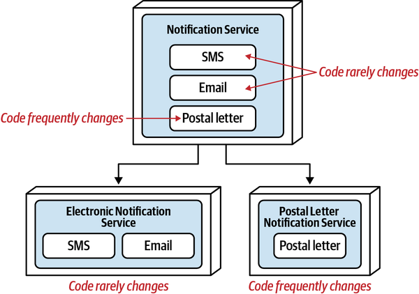

*Hình 7-4. Một vùng có mức thay đổi code cao trong service là ứng viên tốt để tách*

### Scalability và throughput (Scalability and Throughput)

Một động lực khác cho việc chia một service thành các service nhỏ hơn riêng biệt là *scalability* và *throughput*. Nhu cầu scalability của các chức năng khác nhau của một service có thể được đo khách quan để đánh giá liệu một service có nên được tách ra hay không. Hãy xét lại một lần nữa ví dụ Notification Service, nơi một service duy nhất thông báo cho khách hàng qua SMS, email và thư bưu điện in ra. Đo nhu cầu scalability của service duy nhất này cho thấy thông tin sau:

- Thông báo SMS: 220,000/phút
- Thông báo email: 500/phút
- Thông báo bằng thư bưu điện: 1/phút

Hãy để ý sự chênh lệch cực lớn giữa việc gửi thông báo SMS và thông báo bằng thư bưu điện. Là một service duy nhất, chức năng email và thư bưu điện phải scale một cách không cần thiết để đáp ứng nhu cầu của thông báo SMS, ảnh hưởng đến chi phí và cả elasticity xét theo mean time to startup (MTTS). Chia Notification Service thành ba service riêng biệt (SMS, Email và Letter), như minh họa trong [Hình 7-5](#fig-modularity-vs-granularity-scalability), cho phép mỗi service này scale độc lập để đáp ứng nhu cầu throughput khác nhau của chúng.

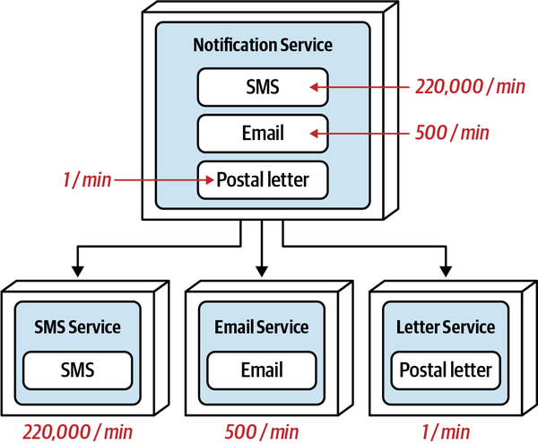

*Hình 7-5. Nhu cầu scalability và throughput khác nhau là một động lực tách tốt*

### Fault Tolerance

*Fault tolerance* mô tả khả năng của một ứng dụng hoặc chức năng trong một domain cụ thể tiếp tục vận hành, dù xảy ra một sự cố crash nghiêm trọng (như tình trạng out-of-memory). Fault Tolerance là một động lực tốt khác cho granularity disintegration.

Hãy xét cùng ví dụ Notification Service hợp nhất thông báo cho khách hàng qua SMS, email và thư bưu điện ([Hình 7-6](#fig-modularity-vs-granularity-ft)). Nếu chức năng email liên tục gặp vấn đề với tình trạng out-of-memory và bị crash nghiêm trọng, toàn bộ service sập, kể cả việc xử lý SMS và thư bưu điện.

Tách Notification Service hợp nhất duy nhất này thành ba service riêng biệt mang lại một mức fault tolerance cho domain thông báo khách hàng. Giờ đây, một lỗi nghiêm trọng trong chức năng của email service không ảnh hưởng đến SMS hay thư bưu điện.

Hãy lưu ý trong ví dụ này rằng Notification Service được chia thành ba service riêng biệt (SMS, Email và Postal Letter), dù chức năng email là vấn đề duy nhất liên quan đến việc crash thường xuyên (hai chức năng còn lại rất ổn định). Vì chức năng email là vấn đề duy nhất, tại sao không gộp chức năng SMS và thư bưu điện vào một service duy nhất?

Hãy xét ví dụ code volatility từ phần trước. Trong trường hợp đó Postal Letter thay đổi liên tục, trong khi hai chức năng còn lại (SMS và Email) thì không. Chia service này thành chỉ hai service là hợp lý vì Postal Letter là chức năng gây vấn đề, nhưng Email và SMS lại *có liên quan*—cả hai đều liên quan đến việc thông báo cho khách hàng *bằng điện tử*. Giờ hãy xét ví dụ fault-tolerance. SMS notification và Postal Letter notification có điểm chung gì ngoài việc là phương tiện thông báo cho khách hàng? Tên self-descriptive (tự mô tả) phù hợp cho service kết hợp đó sẽ là gì?

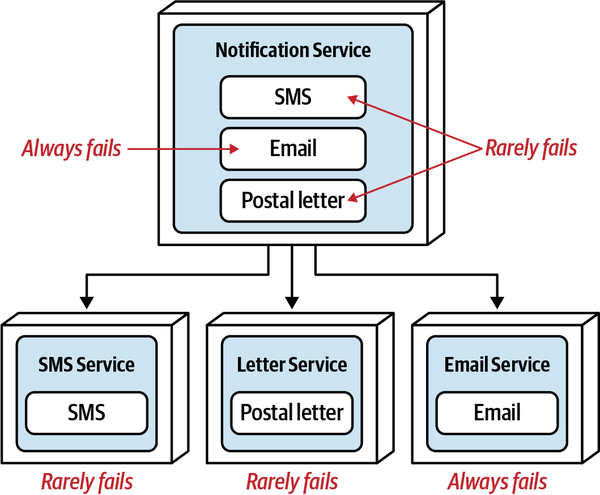

*Hình 7-6. Fault tolerance và service availability là những động lực tách tốt*

Chuyển chức năng email sang một service riêng làm xáo trộn *domain cohesion* tổng thể vì cohesion kết quả giữa chức năng SMS và thư bưu điện là yếu. Hãy xét những cái tên service có khả năng sẽ là gì: Email Service và…Other Notification Service? Email Service và…SMS-Letter Notification Service? Email Service và…Non-Email Service? Vấn đề đặt tên này liên quan trở lại đến granularity disintegrator về phạm vi và chức năng của service—nếu một service quá khó đặt tên vì nó đang làm nhiều việc, hãy cân nhắc tách service ra. Các phép tách sau giúp hình dung điểm quan trọng này:

- Notification Service → Email Service, Other Notification Service (tên kém)
- Notification Service → Email Service, Non-Email Service (tên kém)
- Notification Service → Email Service, SMS-Letter Service (tên kém)
- Notification Service → Email Service, SMS Service, Letter Service (tên tốt)

Trong ví dụ này, chỉ phép tách cuối cùng là hợp lý, đặc biệt khi xét đến việc thêm một loại thông báo qua mạng xã hội khác—nó sẽ đi vào đâu? Bất cứ khi nào tách một service, bất kể động lực tách là gì, hãy luôn kiểm tra xem có thể hình thành cohesion mạnh với phần chức năng “còn sót lại” hay không.

### Security

Một cạm bẫy phổ biến khi bảo mật dữ liệu nhạy cảm là chỉ nghĩ về việc lưu trữ dữ liệu đó. Ví dụ, việc bảo vệ dữ liệu PCI ([Payment Card Industry](https://oreil.ly/Z5QRV)) khỏi dữ liệu non-PCI (không phải PCI) có thể được giải quyết thông qua các schema hoặc database riêng biệt nằm trong các vùng bảo mật khác nhau. Tuy nhiên, điều đôi khi bị thiếu trong thực hành này là cũng phải bảo mật *cách* dữ liệu đó được truy cập.

Hãy xét ví dụ minh họa trong [Hình 7-7](#fig-modularity-vs-granularity-sec) mô tả một Customer Profile Service chứa hai chức năng chính: duy trì hồ sơ khách hàng để thêm, thay đổi hoặc xóa thông tin hồ sơ cơ bản (tên, địa chỉ, v.v.); và duy trì thẻ tín dụng của khách hàng để thêm, gỡ bỏ và cập nhật thông tin thẻ tín dụng.

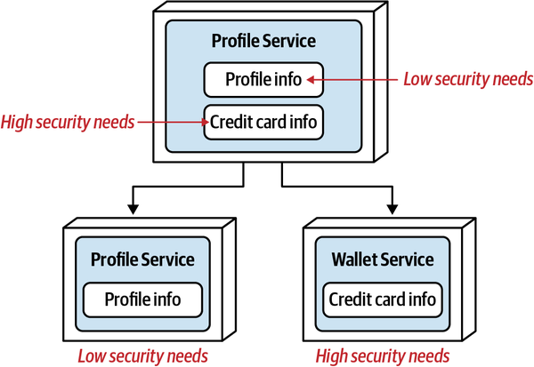

*Hình 7-7. Security và truy cập dữ liệu là những động lực tách tốt*

Dù *dữ liệu* thẻ tín dụng có thể được bảo vệ, việc *truy cập* dữ liệu đó lại gặp rủi ro vì chức năng thẻ tín dụng được gộp chung với chức năng hồ sơ khách hàng cơ bản. Dù các API entry point vào customer profile service hợp nhất có thể khác nhau, vẫn có rủi ro rằng ai đó vào service để lấy tên khách hàng cũng có thể truy cập được chức năng thẻ tín dụng. Bằng cách chia service này thành hai service riêng biệt, việc truy cập vào *chức năng* dùng để duy trì thông tin thẻ tín dụng có thể được bảo mật hơn vì tập thao tác thẻ tín dụng chỉ nằm trong một service single-purpose duy nhất.

### Extensibility

Một động lực chính khác cho granularity disintegration là_ extensibility_—khả năng thêm chức năng bổ sung khi bối cảnh service mở rộng. Hãy xét một payment service quản lý thanh toán và hoàn tiền qua nhiều phương thức thanh toán, bao gồm thẻ tín dụng, thẻ quà tặng và giao dịch PayPal. Giả sử công ty muốn bắt đầu hỗ trợ các phương thức thanh toán được quản lý khác, như điểm thưởng, tín dụng cửa hàng từ hàng trả lại; và các dịch vụ thanh toán third-party (bên thứ ba) khác, như ApplePay, SamsungPay, v.v. Mở rộng payment service để thêm các phương thức thanh toán bổ sung này dễ đến mức nào?

Các phương thức thanh toán bổ sung này chắc chắn có thể được thêm vào một payment service hợp nhất duy nhất. Tuy nhiên, mỗi khi một phương thức thanh toán mới được thêm vào, toàn bộ payment service sẽ cần được test (kể cả các loại thanh toán khác), và chức năng của mọi phương thức thanh toán khác bị deploy lại vào production một cách không cần thiết. Do đó, với payment service hợp nhất duy nhất, phạm vi testing tăng và rủi ro deployment cao hơn, khiến việc thêm các loại thanh toán bổ sung khó khăn hơn.

Giờ hãy xét việc chia service hợp nhất hiện có thành ba service riêng biệt (Credit Card Processing, Gift Card Processing và PayPal Transaction Processing), như minh họa trong [Hình 7-8](#fig-modularity-vs-granularity-extensibility).

Giờ đây khi payment service duy nhất đã được chia thành các service riêng biệt theo phương thức thanh toán, việc thêm một phương thức thanh toán khác (như điểm thưởng) chỉ còn là việc phát triển, test và deploy một service duy nhất tách biệt với các service khác. Kết quả là phát triển nhanh hơn, phạm vi testing giảm, và rủi ro deployment thấp hơn.

Lời khuyên của chúng tôi là chỉ áp dụng động lực này nếu biết trước rằng chức năng theo ngữ cảnh hợp nhất bổ sung đã được lên kế hoạch, được mong muốn, hoặc là một phần của domain bình thường. Ví dụ, với thông báo, khó có khả năng các phương tiện thông báo sẽ liên tục mở rộng vượt ra ngoài các phương tiện thông báo cơ bản (SMS, email hoặc thư). Tuy nhiên, với xử lý thanh toán, rất có khả năng các loại thanh toán bổ sung sẽ được thêm vào trong tương lai, và do đó các service riêng biệt cho từng loại thanh toán là có cơ sở. Vì thường khó đôi khi “đoán” liệu (và khi nào) chức năng theo ngữ cảnh có thể mở rộng (như các phương thức thanh toán bổ sung), lời khuyên của chúng tôi là hãy chờ đợi với động lực này như một phương tiện chính để biện minh cho một granularly disintegration cho đến khi một pattern có thể được thiết lập hoặc việc tiếp tục mở rộng có thể được xác nhận.

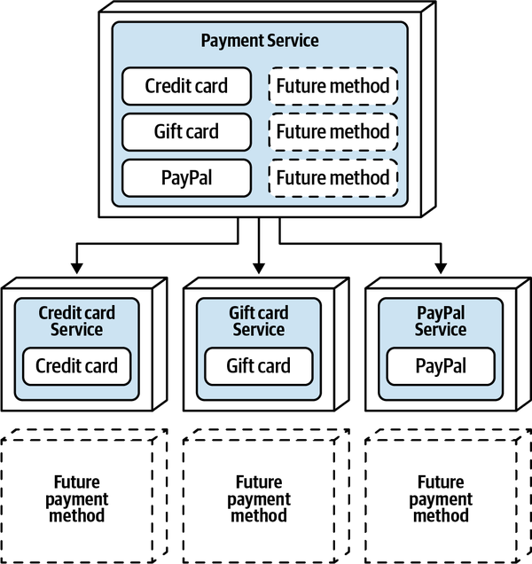

*Hình 7-8. Khả năng mở rộng đã được lên kế hoạch là một động lực tách tốt*

## Granularity integrator (Granularity Integrators)

Trong khi granularity disintegrator cung cấp định hướng và lý do biện minh cho việc khi nào nên chia một service thành các mảnh nhỏ hơn, granularity integrator hoạt động theo cách ngược lại—chúng cung cấp định hướng và lý do biện minh cho việc gộp các service trở lại với nhau (hoặc không tách một service ngay từ đầu). Phân tích các trade-offs giữa các động lực disintegration và các động lực integration là bí quyết để có service granularity đúng. Bốn động lực chính cho granularity integration như sau:

**Database transaction (Database transactions)**

Có cần một transaction ACID giữa các service riêng biệt không?

**Workflow và choreography (Workflow and choreography)**

Các service có cần giao tiếp với nhau không? Shared code: Các service có cần dùng chung code giữa chúng không? Database relationships: Dù một service có thể được tách ra, dữ liệu mà nó dùng có thể được tách ra theo không?

Các phần sau trình bày chi tiết từng động lực granularity integration này.

### Database transaction (Database Transactions)

Hầu hết các hệ thống monolith và các domain service course-grained dùng relational database đều dựa vào các database transaction single-unit-of-work (một đơn vị công việc) để duy trì tính toàn vẹn và nhất quán của dữ liệu; xem [“Distributed Transactions”](ch09_data_ownership_and_distributed_transactions.vi.md#sec-acid-vs-base) để biết chi tiết về transaction ACID (database) và cách chúng khác với transaction BASE (phân tán). Để hiểu database transaction tác động đến service granularity thế nào, hãy xét tình huống minh họa trong [Hình 7-9](#fig-modularity-vs-granularity-transactions-atomic), nơi chức năng khách hàng đã được chia thành một Customer Profile Service duy trì thông tin hồ sơ khách hàng và một Password Service duy trì mật khẩu cùng các thông tin và chức năng security-related (liên quan đến security) khác.

Hãy để ý rằng việc có hai service riêng biệt mang lại một mức kiểm soát truy cập security tốt cho thông tin mật khẩu vì việc truy cập ở mức service chứ không phải ở mức request. Truy cập vào các thao tác như đổi mật khẩu, đặt lại mật khẩu, và truy cập mật khẩu của khách hàng để sign-in (đăng nhập) đều có thể được giới hạn trong một service duy nhất (và do đó việc truy cập có thể được giới hạn trong service duy nhất đó). Tuy nhiên, dù đây có thể là một động lực disintegration tốt, hãy xét thao tác đăng ký một khách hàng mới, như minh họa trong [Hình 7-10](#fig-modularity-vs-granularity-transactions-no-acid).

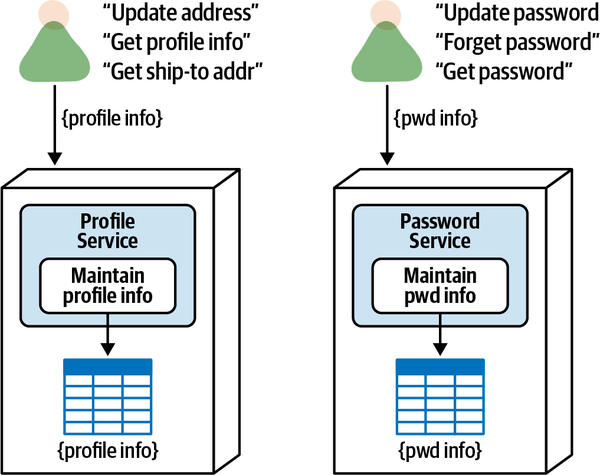

*Hình 7-9. Các service riêng biệt với thao tác nguyên tử có kiểm soát truy cập security tốt hơn*

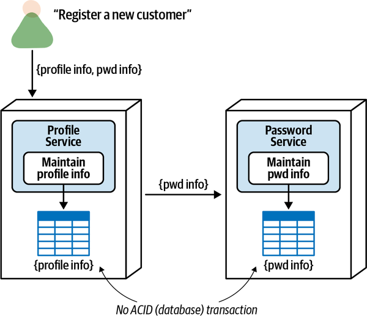

*Hình 7-10. Các service riêng biệt với thao tác kết hợp không hỗ trợ database transaction (ACID)*

Khi đăng ký một khách hàng mới, cả thông tin hồ sơ và mật khẩu đã mã hóa được truyền vào Profile Service từ một màn hình giao diện người dùng. Profile Service chèn thông tin hồ sơ vào bảng database tương ứng của nó, commit công việc đó, rồi truyền thông tin mật khẩu đã mã hóa tới Password Service, service này đến lượt mình chèn thông tin mật khẩu vào bảng database tương ứng và commit công việc của riêng nó.

Dù tách các service mang lại kiểm soát truy cập security tốt hơn cho thông tin mật khẩu, trade-off là không có transaction ACID cho các hành động như đăng ký khách hàng mới hoặc hủy đăng ký (xóa) một khách hàng khỏi hệ thống. Nếu password service thất bại trong bất kỳ thao tác nào trong số này, dữ liệu bị để lại ở trạng thái không nhất quán, dẫn đến việc xử lý lỗi phức tạp (cũng dễ mắc lỗi) để đảo ngược thao tác chèn hồ sơ ban đầu hoặc thực hiện hành động khắc phục khác (xem [“Transactional Saga Patterns”](ch12_transactional_sagas.vi.md#sec-transactional-sagas) để biết chi tiết về eventual consistency và xử lý lỗi trong transaction phân tán). Do đó, nếu việc có một transaction ACID single-unit-of-work là bắt buộc từ góc độ nghiệp vụ, các service này nên được hợp nhất thành một service duy nhất, như minh họa trong [Hình 7-11](#fig-modularity-vs-granularity-transactions-acid).

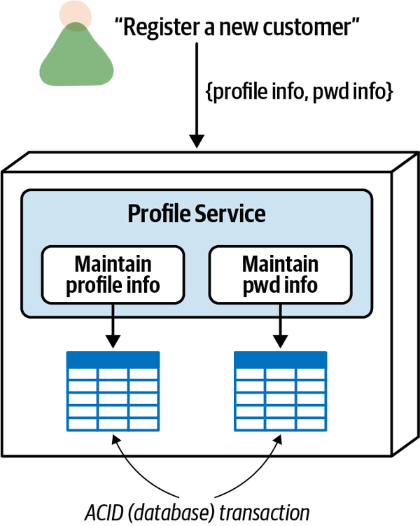

*Hình 7-11. Một service duy nhất hỗ trợ database transaction (ACID)*

### Workflow và choreography (Workflow and Choreography)

Một granularity integrator phổ biến khác là *workflow* và *choreography*--các service giao tiếp với nhau (đôi khi còn được gọi là giao tiếp *interservice* hoặc giao tiếp *east-west*). Giao tiếp giữa các service khá phổ biến và trong nhiều trường hợp là cần thiết trong các architecture phân tán cao như microservices. Tuy nhiên, khi các service tiến tới mức granularity mịn hơn dựa trên các yếu tố disintegration được nêu trong phần trước, giao tiếp giữa các service có thể tăng đến mức bắt đầu xảy ra các tác động tiêu cực.

Các vấn đề về fault tolerance tổng thể là tác động đầu tiên của việc có quá nhiều giao tiếp inter-service (giữa các service) đồng bộ. Hãy xét sơ đồ trong [Hình 7-12](#fig-modularity-vs-granularity-workflow-ft): Service A giao tiếp với các service B và C, Service B giao tiếp với Service C, Service D giao tiếp với Service E, và cuối cùng Service E giao tiếp với Service C. Trong trường hợp này, nếu Service C sập, mọi service khác đều không vận hành được vì phụ thuộc bắc cầu vào Service C, tạo ra vấn đề về fault tolerance, availability và reliability tổng thể.

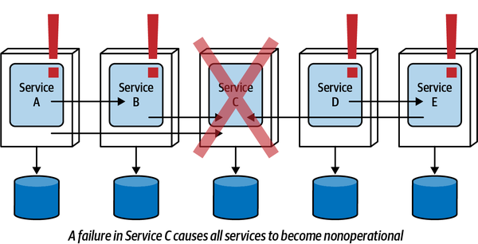

*Hình 7-12. Quá nhiều workflow ảnh hưởng đến fault tolerance*

Điều thú vị là fault tolerance là một trong các động lực granularity disintegration từ phần trước—nhưng khi các service đó cần giao tiếp với nhau, thực sự chẳng đạt được gì từ góc độ fault-tolerance. Khi tách các service, hãy luôn kiểm tra xem các chức năng có coupled chặt và phụ thuộc lẫn nhau không. Nếu có, thì fault tolerance tổng thể xét từ góc độ một request nghiệp vụ sẽ không đạt được, và có lẽ tốt nhất nên cân nhắc giữ các service cùng nhau.

Performance và khả năng phản hồi tổng thể là một động lực khác cho granularity integration (gộp các service trở lại với nhau). Hãy xét kịch bản trong [Hình 7-13](#fig-modularity-vs-granularity-workflow-perf): một customer service lớn được chia thành năm service riêng biệt (các service A đến E). Dù mỗi service này có tập request nguyên tử cohesive riêng, việc lấy toàn bộ thông tin khách hàng một cách tổng hợp từ một API request duy nhất vào một màn hình giao diện người dùng duy nhất bao gồm năm hop riêng biệt khi dùng choreography (xem [Chương 11](ch11_managing_distributed_workflows.vi.md#ch11-managing-workflows) để biết một giải pháp thay thế cho vấn đề này dùng orchestration). Giả sử latency mạng và security là 300 ms cho mỗi request, request duy nhất này sẽ chịu thêm 1500 ms chỉ riêng cho latency! Hợp nhất tất cả các service này thành một service duy nhất sẽ loại bỏ latency đó, nhờ đó tăng performance và khả năng phản hồi tổng thể.

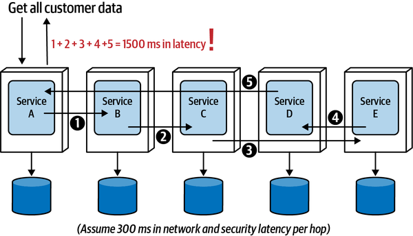

*Hình 7-13. Quá nhiều workflow ảnh hưởng đến performance và khả năng phản hồi tổng thể*

Xét về performance tổng thể, trade-off cho động lực integration này là cân bằng giữa nhu cầu tách một service với mức suy giảm performance tương ứng nếu các service đó cần giao tiếp với nhau. Một quy tắc kinh nghiệm tốt là cân nhắc số lượng request đòi hỏi nhiều service giao tiếp với nhau, đồng thời tính đến mức độ then chốt của những request đòi hỏi giao tiếp interservice đó. Ví dụ, nếu 30% số request đòi hỏi một workflow giữa các service để hoàn thành request và 70% hoàn toàn nguyên tử (chỉ dành cho một service mà không cần bất kỳ giao tiếp bổ sung nào), thì có thể giữ các service tách riêng là ổn. Tuy nhiên, nếu tỉ lệ phần trăm bị đảo ngược, hãy cân nhắc gộp chúng trở lại với nhau. Tất nhiên, điều này giả định rằng performance tổng thể là quan trọng. Có nhiều dư địa hơn trong trường hợp chức năng backend nơi người dùng cuối không phải chờ request hoàn tất.

Cân nhắc performance khác liên quan đến mức độ then chốt của request đòi hỏi workflow. Hãy xét ví dụ trước, nơi 30% số request đòi hỏi một workflow giữa các service để hoàn thành request, và 70% hoàn toàn nguyên tử. Nếu một request then chốt đòi hỏi thời gian phản hồi cực nhanh nằm trong 30% đó, thì có lẽ khôn ngoan khi gộp các service trở lại với nhau, dù 70% số request hoàn toàn nguyên tử.

Reliability và tính toàn vẹn dữ liệu tổng thể cũng bị ảnh hưởng khi giao tiếp giữa các service tăng lên. Hãy xét ví dụ trong [Hình 7-14](#fig-modularity-vs-granularity-workflow-reliability): thông tin khách hàng được tách thành năm customer service riêng biệt. Trong trường hợp này, việc thêm một khách hàng mới vào hệ thống bao gồm sự phối hợp của cả năm customer service. Tuy nhiên, như đã giải thích ở phần trước, mỗi service này có database transaction riêng. Lưu ý trong [Hình 7-14](#fig-modularity-vs-granularity-workflow-reliability) rằng các service `A`, `B` và `C` đều đã commit một phần dữ liệu khách hàng, nhưng Service D thất bại.

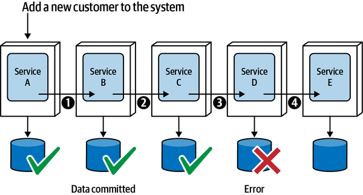

*Hình 7-14. Quá nhiều workflow ảnh hưởng đến reliability và tính toàn vẹn dữ liệu*

Điều này tạo ra vấn đề về tính nhất quán và toàn vẹn dữ liệu vì một phần dữ liệu khách hàng đã được commit, và có thể đã được xử lý thông qua việc truy xuất thông tin đó từ một tiến trình khác hoặc thậm chí một message được gửi đi từ một trong các service đó để phát đi một hành động dựa trên dữ liệu đó. Trong cả hai trường hợp, dữ liệu đó sẽ phải được rollback thông qua các compensating transaction hoặc được đánh dấu bằng một trạng thái cụ thể để biết transaction đã dừng ở đâu nhằm khởi động lại nó. Đây là một tình huống rất rắc rối, tình huống mà chúng tôi mô tả chi tiết trong [“Transactional Saga Patterns”](ch12_transactional_sagas.vi.md#sec-transactional-sagas). Nếu tính toàn vẹn và nhất quán dữ liệu là quan trọng hoặc then chốt đối với một thao tác, có lẽ khôn ngoan khi cân nhắc gộp các service đó trở lại với nhau.

### Code dùng chung (Shared Code)

Source code dùng chung là một thực hành phổ biến (và cần thiết) trong phát triển phần mềm. Các chức năng như logging, security, tiện ích, formatter, converter, extractor, v.v. đều là những ví dụ tốt về code dùng chung. Tuy nhiên, mọi thứ có thể trở nên phức tạp khi xử lý code dùng chung trong một architecture phân tán và đôi khi có thể ảnh hưởng đến service granularity.

Code dùng chung thường được chứa trong một thư viện dùng chung, như một file JAR trong hệ sinh thái Java, một GEM trong môi trường Ruby, hoặc một DLL trong môi trường .NET, và thường được gắn với một service tại thời điểm biên dịch. Dù chúng tôi đi sâu vào các pattern tái sử dụng code trong [Chương 8](ch08_reuse_patterns.vi.md#ch08-reuse-patterns), ở đây chúng tôi chỉ minh họa cách code dùng chung đôi khi có thể ảnh hưởng đến service granularity và có thể trở thành một granularity integrator (gộp các service trở lại với nhau).

Hãy xét tập năm service thể hiện trong [Hình 7-15](#fig-modularity-vs-granularity-commoncode). Dù có thể đã có một động lực disintegrator tốt cho việc tách các service này, tất cả chúng đều dùng chung một codebase chung về chức năng domain (trái ngược với các tiện ích chung hoặc chức năng hạ tầng). Nếu có thay đổi xảy ra trong thư viện dùng chung, điều này cuối cùng sẽ đòi hỏi thay đổi trong các service tương ứng dùng thư viện dùng chung đó. Chúng tôi nói *cuối cùng* vì versioning đôi khi có thể được dùng với thư viện dùng chung để mang lại agility và khả năng tương thích ngược (xem [Chương 8](ch08_reuse_patterns.vi.md#ch08-reuse-patterns)). Như vậy, tất cả các service được deploy riêng này sẽ phải được thay đổi, test và deploy cùng nhau. Trong những trường hợp này, có lẽ khôn ngoan khi hợp nhất năm service này thành một service duy nhất để tránh nhiều lần deploy, cũng như tránh việc chức năng service bị mất đồng bộ do dùng các phiên bản thư viện khác nhau.

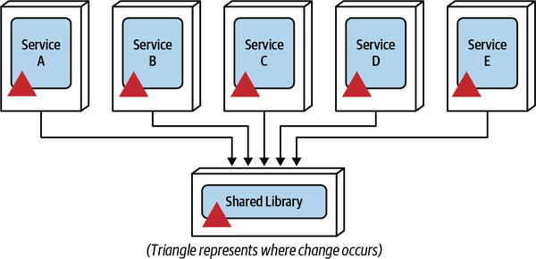

*Hình 7-15. Một thay đổi trong code dùng chung đòi hỏi thay đổi phối hợp ở mọi service*

Không phải mọi việc dùng code dùng chung đều thúc đẩy granularity integration. Ví dụ, chức năng cross-cutting (xuyên suốt) infrastructure-related như logging, auditing, authentication, authorization và monitoring mà mọi service đều dùng *không* phải là một động lực tốt để gộp các service trở lại với nhau hoặc thậm chí quay về một monolithic architecture. Một số hướng dẫn để xem xét code dùng chung như một granularity integrator như sau:

**Chức năng domain dùng chung cụ thể (Specific shared domain functionality)**

Chức năng domain dùng chung là code dùng chung chứa business logic (trái ngược với chức năng cross-cutting infrastructure-related). Khuyến nghị của chúng tôi là xem xét yếu tố này như một granularity integrator khả dĩ nếu tỉ lệ phần trăm code domain dùng chung tương đối cao. Ví dụ, giả sử code chung (dùng chung) cho một nhóm chức năng customer-related (liên quan đến khách hàng) (duy trì hồ sơ, duy trì tùy chọn, và thêm hoặc gỡ bình luận) chiếm hơn 40% codebase chung. Chia chức năng chung đó thành các service riêng biệt sẽ có nghĩa là gần một nửa source code nằm trong một thư viện dùng chung chỉ được ba service đó dùng. Trong ví dụ này có lẽ khôn ngoan khi cân nhắc giữ chức năng customer-related chung trong một service hợp nhất duy nhất cùng với code dùng chung (đặc biệt nếu code dùng chung thay đổi thường xuyên, như thảo luận tiếp theo).

**Thay đổi code dùng chung thường xuyên (Frequent shared code changes)**

Bất kể kích thước của thư viện dùng chung, các thay đổi thường xuyên đối với chức năng dùng chung đòi hỏi các thay đổi phối hợp thường xuyên đối với các service dùng chức năng domain dùng chung đó. Dù versioning đôi khi có thể được dùng để giúp giảm thiểu các thay đổi phối hợp, cuối cùng các service dùng chức năng dùng chung đó sẽ cần áp dụng phiên bản mới nhất. Nếu code dùng chung thay đổi thường xuyên, có lẽ khôn ngoan khi cân nhắc hợp nhất các service dùng code dùng chung đó để giúp giảm thiểu sự phối hợp thay đổi phức tạp của nhiều đơn vị deployment.

**Lỗi không thể versioning (Defects that cannot be versioned)**

Dù versioning có thể giúp giảm thiểu các thay đổi phối hợp và cho phép tương thích ngược và agility (khả năng phản ứng nhanh với thay đổi), đôi khi một số chức năng nghiệp vụ nhất định phải được áp dụng cho mọi service cùng lúc (như một lỗi hoặc một thay đổi trong business rule). Nếu điều này xảy ra thường xuyên, có lẽ đã đến lúc cân nhắc gộp các service trở lại với nhau để đơn giản hóa các thay đổi.

### Quan hệ dữ liệu (Data Relationships)

Một trade-off khác trong sự cân bằng giữa granularity disintegrator và integrator là quan hệ giữa dữ liệu mà một service hợp nhất duy nhất dùng so với dữ liệu mà các service riêng biệt sẽ dùng. Động lực integrator này giả định rằng dữ liệu kết quả từ việc tách một service không được dùng chung, mà được hình thành thành các bounded context chặt chẽ trong mỗi service để tạo điều kiện kiểm soát thay đổi và hỗ trợ availability và reliability tổng thể.

Hãy xét ví dụ trong [Hình 7-16](#fig-modularity-vs-granularity-db-consolidated): một service hợp nhất duy nhất có ba chức năng (A, B và C) và các quan hệ bảng dữ liệu tương ứng. Các đường liền chỉ tới các bảng biểu thị thao tác ghi vào bảng (do đó là quyền sở hữu dữ liệu), và các đường chấm chỉ ra khỏi các bảng biểu thị quyền truy cập read-only vào bảng. Thực hiện một thao tác ánh xạ giữa các chức năng và các bảng cho thấy kết quả thể hiện trong [Bảng 7-1](#table-data-associations), trong đó *owner* hàm ý ghi (và đọc tương ứng) còn *access* hàm ý quyền truy cập read-only vào một bảng không thuộc sở hữu của chức năng đó.

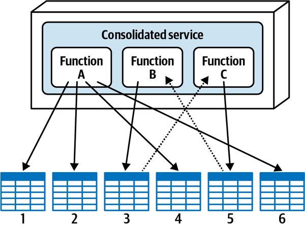

*Hình 7-16. Các quan hệ bảng database của một service hợp nhất*

*Bảng 7-1. Ánh xạ function-to-table (chức năng tới bảng)*

| Chức năng | Bảng 1 | Bảng 2 | Bảng 3 | Bảng 4 | Bảng 5 | Bảng 6 |
|---|---|---|---|---|---|---|
| A | owner | owner |  | owner |  | owner |
| B |  |  | owner |  | access |  |
| C |  |  | access |  | owner |  |

Giả sử dựa trên một số động lực disintegration được nêu ở phần trước, service này đã được chia thành ba service riêng biệt (mỗi service cho một chức năng trong service hợp nhất); xem [Hình 7-17](#fig-modularity-vs-granularity-db-separated). Tuy nhiên, việc tách service hợp nhất duy nhất thành ba service riêng biệt giờ đòi hỏi các bảng dữ liệu tương ứng phải được gắn với mỗi service trong một bounded context.

Lưu ý ở phần trên của [Hình 7-17](#fig-modularity-vs-granularity-db-separated) rằng Service A sở hữu các bảng 1, 2, 4 và 6 như một phần của bounded context của nó; Service B sở hữu bảng 3; và Service C sở hữu bảng 5. Tuy nhiên, hãy để ý trong sơ đồ rằng mọi thao tác trong Service B đều đòi hỏi truy cập dữ liệu trong bảng 5 (thuộc sở hữu của Service C), và mọi thao tác trong Service C đều đòi hỏi truy cập dữ liệu trong bảng 3 (thuộc sở hữu của Service B). Vì bounded context, Service B không thể đơn giản với tay ra và truy vấn trực tiếp bảng 5, và Service C cũng không thể truy vấn trực tiếp bảng 3.

Để hiểu rõ hơn về bounded context và vì sao Service C không thể đơn giản truy cập bảng 3, giả sử Service B (sở hữu bảng 3) quyết định thay đổi business rule của mình, đòi hỏi gỡ một cột khỏi bảng 3. Làm như vậy sẽ làm hỏng Service C và bất kỳ service nào khác dùng bảng 3. Đây là lý do khái niệm bounded context rất quan trọng trong các architecture phân tán cao như microservices. Để giải quyết vấn đề này, Service B sẽ phải *yêu cầu* Service C cung cấp dữ liệu của nó, và Service C sẽ phải yêu cầu Service B cung cấp dữ liệu của nó, dẫn đến giao tiếp interservice back-and-forth (qua lại) giữa các service này, như minh họa ở phần dưới của [Hình 7-17](#fig-modularity-vs-granularity-db-separated).

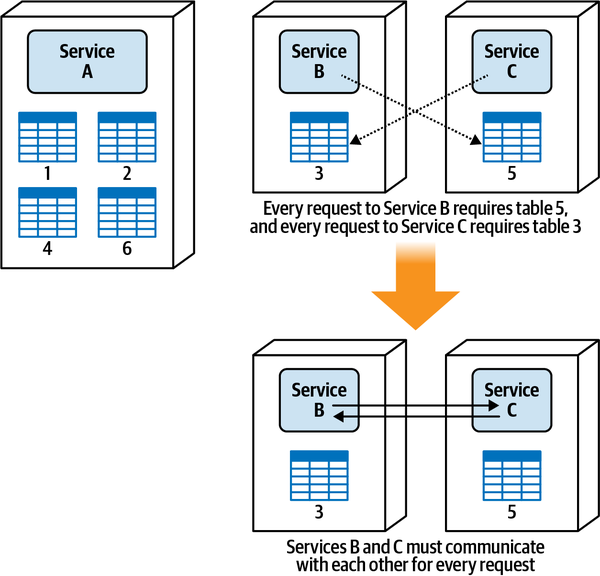

*Hình 7-17. Các quan hệ bảng database ảnh hưởng đến service granularity*

Dựa trên sự phụ thuộc dữ liệu giữa các service B và C, sẽ là khôn ngoan khi hợp nhất các service đó thành một service duy nhất để tránh các vấn đề về latency, fault tolerance và scalability gắn với giao tiếp interservice giữa các service này, điều này chứng minh rằng các quan hệ giữa các bảng có thể ảnh hưởng đến service granularity. Chúng tôi để động lực granularity integration này đến cuối cùng vì đây là động lực granularity integration có ít trade-offs nhất. Dù thỉnh thoảng một cuộc chuyển đổi từ hệ thống monolith đòi hỏi refactor cách tổ chức dữ liệu, trong hầu hết trường hợp việc tổ chức lại các quan hệ thực thể của bảng database chỉ để tách một service là không khả thi. Chúng tôi đi sâu vào chi tiết về việc tách dữ liệu trong [Chương 6](ch06_pulling_apart_operational_data.vi.md#ch06-decomposing-operational-data).

## Tìm sự cân bằng đúng (Finding the Right Balance)

Tìm mức service granularity đúng là việc khó. Bí quyết để có granularity đúng là hiểu cả granularity disintegrator (khi nào tách một service) lẫn granularity integrator (khi nào gộp chúng trở lại với nhau), và phân tích các trade-offs tương ứng giữa hai loại này. Như minh họa trong các kịch bản trước, điều này đòi hỏi kiến trúc sư không chỉ xác định các trade-offs, mà còn cộng tác chặt chẽ với các stakeholder nghiệp vụ để phân tích các trade-offs đó và đi đến giải pháp phù hợp cho service granularity.

Bảng [7-2](#table-disintegrators) và [7-3](#table-integrators) tóm tắt các động lực cho disintegrator và integrator.

*Bảng 7-2. Các động lực disintegrator (tách một service)*

| Động lực disintegrator | Lý do áp dụng động lực |
|---|---|
| Phạm vi service | Các service single-purpose với cohesion chặt |
| Độ biến động của code | Agility (giảm phạm vi testing và rủi ro deployment) |
| Scalability | Chi phí thấp hơn và phản hồi nhanh hơn |
| Fault tolerance | Uptime tổng thể tốt hơn |
| Truy cập security | Kiểm soát truy cập security tốt hơn cho một số chức năng nhất định |
| Extensibility | Agility (dễ thêm chức năng mới) |

*Bảng 7-3. Các động lực integrator (gộp các service trở lại với nhau)*

| Động lực integrator | Lý do áp dụng động lực |
|---|---|
| Database transaction | Tính toàn vẹn và nhất quán của dữ liệu |
| Workflow | Fault tolerance, performance và reliability |
| Code dùng chung | Maintainability |
| Quan hệ dữ liệu | Tính toàn vẹn và đúng đắn của dữ liệu |

Kiến trúc sư có thể dùng các động lực trong những bảng này để hình thành các phát biểu trade-off mà sau đó có thể được thảo luận và giải quyết bằng cách cộng tác với product owner hoặc nhà tài trợ nghiệp vụ.

Ví dụ 1:

> **Kiến trúc sư**: “Chúng tôi muốn tách service của mình để cô lập các thay đổi code thường xuyên, nhưng làm vậy chúng tôi sẽ không thể duy trì một database transaction. Điều nào quan trọng hơn dựa trên nhu cầu nghiệp vụ của chúng ta—*agility tổng thể* tốt hơn (maintainability, testability và deployability), đồng nghĩa với time-to-market nhanh hơn, hay *tính toàn vẹn và nhất quán của dữ liệu* mạnh hơn?” 
>
>
> **Nhà tài trợ dự án**: “Dựa trên nhu cầu nghiệp vụ của chúng ta, tôi thà hy sinh một chút để time-to-market chậm hơn nhằm có tính toàn vẹn và nhất quán dữ liệu tốt hơn, vậy hãy để nó là một service duy nhất vào lúc này.”

Ví dụ 2:

> **Kiến trúc sư**: “Chúng tôi cần giữ service cùng nhau để hỗ trợ một database transaction giữa hai thao tác nhằm bảo đảm tính nhất quán dữ liệu, nhưng điều đó có nghĩa là chức năng nhạy cảm trong service kết hợp duy nhất sẽ kém bảo mật hơn. Điều nào quan trọng hơn dựa trên nhu cầu nghiệp vụ của chúng ta—*tính nhất quán dữ liệu* tốt hơn hay *security* tốt hơn?” 
>
>
> **Nhà tài trợ dự án**: “CIO của chúng ta đã trải qua một số tình huống khó khăn liên quan đến security và bảo vệ dữ liệu nhạy cảm, và điều đó luôn nằm hàng đầu trong tâm trí họ và là một phần của gần như mọi cuộc thảo luận. Trong trường hợp này, bảo mật dữ liệu nhạy cảm quan trọng hơn, vậy hãy giữ các service riêng biệt và tìm cách giảm thiểu một số vấn đề về tính nhất quán dữ liệu.”

Ví dụ 3:

> **Kiến trúc sư**: “Chúng tôi cần tách payment service để mang lại extensibility tốt hơn cho việc thêm các phương thức thanh toán mới, nhưng điều đó có nghĩa là workflow sẽ tăng lên, ảnh hưởng đến khả năng phản hồi khi nhiều loại thanh toán được dùng cho một đơn hàng (điều xảy ra thường xuyên). Điều nào quan trọng hơn dựa trên nhu cầu nghiệp vụ của chúng ta—extensibility tốt hơn trong xử lý thanh toán, do đó *agility và time-to-market tổng thể* tốt hơn, hay *khả năng phản hồi* tốt hơn khi thực hiện thanh toán?” 
>
>
> **Nhà tài trợ dự án**: “Vì tôi thấy chúng ta chỉ thêm hai, có thể ba loại thanh toán nữa trong vài năm tới, tôi muốn chúng ta tập trung vào khả năng phản hồi tổng thể vì khách hàng phải chờ xử lý thanh toán hoàn tất trước khi mã đơn hàng được cấp.”

## Sysops Squad Saga: Granularity của việc giao ticket (Sysops Squad Saga: Ticket Assignment Granularity)

`Monday, October 25 11:08`

Một khi trouble ticket đã được khách hàng tạo và được hệ thống chấp nhận, nó phải được giao cho một chuyên gia Sysops Squad dựa trên bộ kỹ năng, vị trí và lịch sẵn sàng của họ. Việc giao ticket bao gồm hai component chính—một component Ticket Assignment xác định chuyên viên tư vấn nào nên được giao công việc, và component Ticket Routing định vị chuyên gia Sysops Squad, chuyển ticket tới thiết bị di động của chuyên gia (qua một ứng dụng di động Sysops Squad tùy biến), và thông báo cho chuyên gia qua tin nhắn SMS rằng một ticket mới đã được giao.

Development team của Sysops Squad đang gặp khó khăn trong việc quyết định liệu hai component này (giao và định tuyến) nên được triển khai thành một service hợp nhất duy nhất hay hai service riêng biệt, như minh họa trong [Hình 7-18](#fig-modularity-vs-granularity-ticket-assign-options). Development team hỏi ý kiến Addison (một trong các kiến trúc sư của Sysops Squad) để giúp quyết định nên chọn phương án nào.

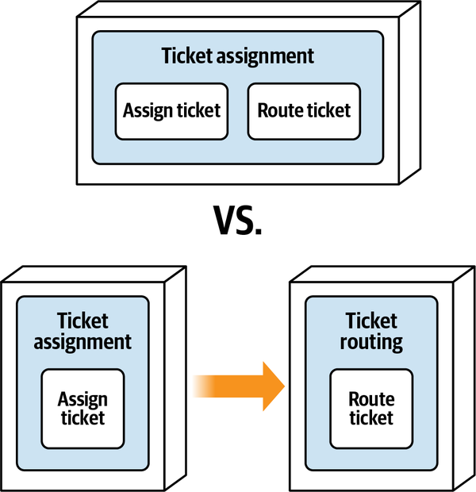

*Hình 7-18. Các phương án cho việc giao và định tuyến ticket*

“Vậy cậu thấy đấy,” Taylen nói, “các thuật toán giao ticket rất phức tạp, và do đó nên được cô lập khỏi chức năng định tuyến ticket. Bằng cách đó, khi các thuật toán đó thay đổi, tôi không phải lo về toàn bộ chức năng định tuyến.”

“Ừ, nhưng các thuật toán giao đó thay đổi nhiều đến mức nào?” Addison hỏi. “Và chúng ta dự kiến sẽ thay đổi bao nhiêu trong tương lai?”

“Tôi áp dụng thay đổi cho các thuật toán đó ít nhất hai đến ba lần một tháng. Tôi đã đọc về volatility-based decomposition, và tình huống này khớp hoàn hảo,” Taylen nói.

“Nhưng nếu chúng ta tách chức năng giao và định tuyến thành hai service, sẽ cần giao tiếp liên tục giữa chúng,” Skyler nói. “Hơn nữa, giao và định tuyến thực ra là một chức năng, không phải hai.”

“Không,” Taylen nói, “chúng là hai chức năng riêng biệt.”

“Khoan đã,” Addison nói. “Tôi hiểu ý Skyler. Nghĩ một chút đi. Một khi tìm được một chuyên gia sẵn sàng trong một khoảng thời gian nhất định, ticket ngay lập tức được định tuyến tới chuyên gia đó. Nếu không có chuyên gia nào sẵn sàng, ticket quay lại hàng đợi và chờ cho đến khi tìm được chuyên gia.”

“Đúng vậy,” Taylen nói.

“Thấy chưa,” Skyler nói, “cậu không thể giao ticket mà không định tuyến nó tới chuyên gia. Vậy hai chức năng là một.”

“Không, không, không,” Taylen nói. “Cậu không hiểu. Nếu một chuyên gia được thấy là sẵn sàng trong một khoảng thời gian nhất định, thì chuyên gia đó được giao. Hết. Định tuyến chỉ là chuyện vận chuyển.”

“Điều gì xảy ra trong chức năng hiện tại nếu một ticket không thể được định tuyến tới chuyên gia?” Addison hỏi.

“Thì một chuyên gia khác được chọn,” Taylen nói.

“OK, vậy nghĩ một chút đi, Taylen,” Addison nói. “Nếu giao và định tuyến là hai service riêng biệt, thì routing service sẽ phải giao tiếp ngược lại với assignment service, cho nó biết rằng không định vị được chuyên gia và hãy chọn người khác. Đó là rất nhiều phối hợp giữa hai service.”

“Ừ, nhưng chúng vẫn là *hai* chức năng riêng biệt, không phải một như Skyler đang đề xuất,” Taylen nói.

“Tôi có một ý,” Addison nói. “Tất cả chúng ta có thể đồng ý rằng giao và định tuyến là hai hoạt động riêng biệt, nhưng gắn chặt đồng bộ với nhau không? Nghĩa là, một chức năng không thể tồn tại nếu thiếu chức năng kia?”

“Đồng ý,” cả Taylen và Skyler đáp.

“Trong trường hợp đó,” Addison nói, “hãy phân tích các trade-offs. Điều nào quan trọng hơn—cô lập chức năng giao cho mục đích kiểm soát thay đổi, hay gộp giao và định tuyến vào một service duy nhất để có performance, xử lý lỗi và kiểm soát workflow tốt hơn?”

“Chà,” Taylen nói, “khi cậu đặt vấn đề như vậy, rõ ràng là service duy nhất. Nhưng tôi vẫn muốn cô lập code giao ticket.”

“OK,” Addison nói, “trong trường hợp đó, sao chúng ta không tạo ba component kiến trúc riêng biệt trong service duy nhất. Chúng ta có thể phân định giao, định tuyến và code dùng chung bằng các namespace riêng biệt trong code. Điều đó có giúp được không?”

“Có,” Taylen nói, “cách đó sẽ ổn. OK, hai cậu thắng. Vậy hãy chọn một service duy nhất.”

“Taylen,” Addison nói, “vấn đề không phải là thắng, mà là phân tích các trade-offs để đi đến giải pháp phù hợp nhất; chỉ vậy thôi.”

Với việc mọi người đồng ý một service duy nhất cho việc giao và định tuyến, Addison viết architecture decision record (ADR) sau cho quyết định này:

> 
>
> *ADR: Service hợp nhất cho việc giao và định tuyến ticket* 
>
>
> *Bối cảnh (Context)* 
> Một khi ticket được tạo và được hệ thống chấp nhận, nó phải được giao cho một chuyên gia rồi được định tuyến tới thiết bị di động của chuyên gia đó. Việc này có thể được thực hiện thông qua một ticket assignment service hợp nhất duy nhất hoặc các service riêng biệt cho việc giao ticket và định tuyến ticket. 
>
>
> *Quyết định (Decision)* 
> Chúng tôi sẽ tạo một ticket assignment service hợp nhất duy nhất cho các chức năng giao và định tuyến ticket. 
>
>
> Ticket được định tuyến ngay lập tức tới chuyên gia Sysops Squad một khi được giao, nên hai thao tác này gắn chặt và phụ thuộc lẫn nhau. 
>
>
> Cả hai chức năng phải scale như nhau, nên không có khác biệt throughput giữa các service này, cũng không cần [back-pressure](https://oreil.ly/Vhjmv) giữa các chức năng này. 
>
>
> Vì cả hai chức năng phụ thuộc hoàn toàn vào nhau, fault tolerance không phải là động lực để tách các chức năng này. 
>
>
> Biến các chức năng này thành các service riêng biệt sẽ đòi hỏi workflow giữa chúng, dẫn đến các vấn đề về performance, fault tolerance và có thể cả reliability. 
>
>
> *Hệ quả (Consequences)* 
> Các thay đổi đối với thuật toán giao (xảy ra thường xuyên) và các thay đổi đối với cơ chế định tuyến (ít thay đổi) sẽ đòi hỏi test và deploy cả hai chức năng, dẫn đến phạm vi testing tăng và rủi ro deployment tăng.

## Sysops Squad Saga: Granularity của việc đăng ký khách hàng (Sysops Squad Saga: Customer Registration Granularity)

`Friday January 14, 13:15`

Khách hàng phải đăng ký với hệ thống để được truy cập gói hỗ trợ Sysops Squad. Trong quá trình đăng ký, khách hàng phải cung cấp thông tin hồ sơ (tên, địa chỉ, tên doanh nghiệp nếu có, v.v.), thông tin thẻ tín dụng (được lập hóa đơn hằng tháng), thông tin mật khẩu và câu hỏi bảo mật, và danh sách các sản phẩm đã mua mà họ muốn được gói hỗ trợ Sysops Squad bao phủ.

Một số thành viên của development team khăng khăng rằng đây nên là một Customer Service hợp nhất duy nhất chứa toàn bộ thông tin khách hàng, nhưng các thành viên khác trong team không đồng ý và cho rằng nên có một service riêng cho mỗi chức năng này (một Profile service, Credit Card service, Password service, và một Supported Product service). Skyler, người có kinh nghiệm trước đó với dữ liệu PCI và PII, cho rằng thông tin thẻ tín dụng và mật khẩu nên là một service tách khỏi phần còn lại, và do đó chỉ có hai service (một Profile service chứa thông tin hồ sơ và sản phẩm và một Customer Secure service riêng chứa thông tin thẻ tín dụng và mật khẩu). Ba phương án này được minh họa trong [Hình 7-19](#fig-modularity-vs-granularity-registration-options).

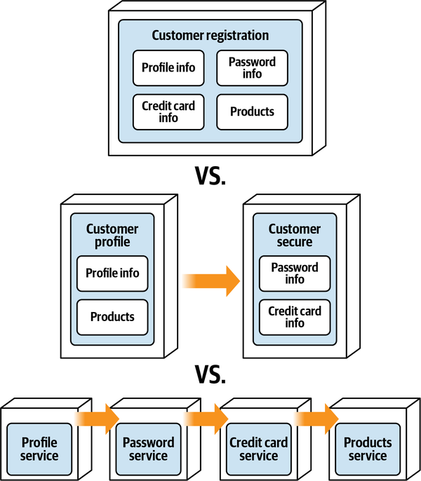

*Hình 7-19. Các phương án cho việc đăng ký khách hàng*

Vì Addison bận với chức năng ticket cốt lõi, development team nhờ Austen giúp giải quyết vấn đề granularity này. Lường trước rằng đây sẽ không phải là một quyết định dễ dàng, đặc biệt vì nó liên quan đến security, Austen sắp xếp một cuộc họp với Parker, (product owner), và Sam, chuyên gia security của Penultimate Electronics để thảo luận các phương án này.

“OK, vậy chúng tôi có thể giúp gì cho cậu?” Parker hỏi.

“Chà,” Austen nói, “chúng tôi đang vật lộn với việc nên tạo bao nhiêu service cho việc đăng ký khách hàng và duy trì thông tin customer-related, Anh thấy đấy, có bốn phần dữ liệu chính chúng tôi đang xử lý ở đây: thông tin hồ sơ, thông tin thẻ tín dụng, thông tin mật khẩu, và thông tin sản phẩm đã mua.”

“Ồ, khoan đã,” Sam ngắt lời. “Cậu biết rằng thông tin thẻ tín dụng và mật khẩu *phải* được bảo mật, đúng không?”

“Tất nhiên chúng tôi biết nó phải được bảo mật,” Austen nói. “Điều chúng tôi đang vật lộn là thực tế có một API đăng ký khách hàng duy nhất tới backend, nên nếu chúng ta có các service riêng biệt thì tất cả chúng phải được phối hợp cùng nhau khi đăng ký khách hàng, điều này sẽ đòi hỏi một transaction phân tán.”

“Ý cậu là sao?” Parker hỏi.

“Chà,” Austen nói, “chúng ta sẽ không thể đồng bộ toàn bộ dữ liệu cùng nhau như một đơn vị công việc nguyên tử.”

“Đó không phải là một lựa chọn,” Parker nói. “Toàn bộ thông tin khách hàng hoặc được lưu trong database, hoặc không. Để tôi nói theo cách khác. Chúng ta tuyệt đối *không thể* có tình huống có bản ghi khách hàng mà không có bản ghi thẻ tín dụng hoặc mật khẩu tương ứng. *Không bao giờ*.”

“OK, nhưng còn việc bảo mật thông tin thẻ tín dụng và mật khẩu thì sao?” Sam hỏi. “Theo tôi thấy, có các service riêng biệt sẽ cho phép kiểm soát truy cập security tốt hơn nhiều đối với loại thông tin nhạy cảm đó.”

“Tôi nghĩ tôi có một ý.” Austen nói. “Thông tin thẻ tín dụng được tokenize trong database, đúng không?”

“Được tokenize *và* mã hóa,” Sam nói.

“Tuyệt. Còn thông tin mật khẩu?” Austen hỏi.

“Cũng vậy,” Sam nói.

“OK,” Austen nói, “vậy theo tôi thấy điều chúng ta thực sự cần tập trung ở đây là kiểm soát truy cập vào thông tin mật khẩu và thẻ tín dụng tách biệt với các request customer-related khác—anh biết đấy, như lấy và cập nhật thông tin hồ sơ, v.v.”

“Tôi nghĩ tôi hiểu vấn đề của cậu xuất phát từ đâu,” Parker nói. “Cậu đang nói với tôi rằng nếu cậu tách toàn bộ chức năng này thành các service riêng biệt, cậu có thể bảo mật truy cập vào dữ liệu nhạy cảm tốt hơn, nhưng cậu không thể bảo đảm yêu cầu all-or-nothing (tất cả hoặc không gì cả) của tôi. Tôi nói đúng không?”

“Chính xác. Đó là trade-off,” Austen nói.

“Khoan đã,” Sam nói. “Các cậu có đang dùng các thư viện security Tortoise để bảo mật các lời gọi API không?”

“Có. Chúng tôi dùng các thư viện đó không chỉ ở API layer, mà còn bên trong mỗi service để kiểm soát truy cập thông qua service mesh. Vậy về cơ bản đó là một double-check (kiểm tra kép),” Austen nói.

“Hmmm,” Sam nói. “OK, tôi đồng ý với một service duy nhất với điều kiện các cậu dùng security framework Tortoise.”

“Tôi cũng vậy, với điều kiện chúng ta vẫn có quy trình đăng ký khách hàng all-or-nothing,” Parker nói.

“Vậy tôi nghĩ tất cả chúng ta đều thống nhất rằng việc đăng ký khách hàng all-or-nothing là một yêu cầu tuyệt đối và chúng ta sẽ duy trì truy cập security nhiều cấp bằng Tortoise,” Austen nói.

“Đồng ý,” Parker nói.

“Đồng ý,” Sam nói.

Parker để ý cách Austen điều hành cuộc họp bằng cách tạo điều kiện cho cuộc trò chuyện thay vì kiểm soát nó. Đây là một bài học quan trọng đối với một kiến trúc sư trong việc xác định, hiểu và đàm phán các trade-offs. Parker cũng hiểu rõ hơn sự khác biệt giữa thiết kế và architecture ở chỗ security có thể được kiểm soát thông qua *thiết kế* (dùng một thư viện tùy biến với mã hóa đặc biệt) thay vì *architecture* (chia chức năng thành các đơn vị deployment riêng biệt).

Dựa trên cuộc trò chuyện với Parker và Sam, Austen quyết định rằng chức năng customer-related sẽ được quản lý thông qua một domain service hợp nhất duy nhất (thay vì các service được deploy riêng) và viết ADR sau cho quyết định này:

> 
>
> *ADR: Service hợp nhất cho chức năng Customer-Related (liên quan đến khách hàng)*
>
> *Bối cảnh (Context)* 
> Khách hàng phải đăng ký với hệ thống để được truy cập gói hỗ trợ Sysops Squad. Trong quá trình đăng ký, khách hàng phải cung cấp thông tin hồ sơ, thông tin thẻ tín dụng, thông tin mật khẩu và các sản phẩm đã mua. Việc này có thể được thực hiện thông qua một customer service hợp nhất duy nhất, một service riêng cho mỗi chức năng này, hoặc một service riêng cho dữ liệu nhạy cảm và không nhạy cảm.
>
> *Quyết định (Decision)* 
> Chúng tôi sẽ tạo một customer service hợp nhất duy nhất cho hồ sơ, thẻ tín dụng, mật khẩu và các sản phẩm được hỗ trợ.
>
> Chức năng đăng ký và hủy đăng ký khách hàng *đòi hỏi* một đơn vị công việc nguyên tử duy nhất. Một service duy nhất sẽ hỗ trợ transaction ACID để đáp ứng yêu cầu này, trong khi các service riêng biệt thì không.
>
> Việc dùng các thư viện security Tortoise ở API layer và service mesh sẽ giảm thiểu rủi ro truy cập security vào thông tin nhạy cảm.
>
> *Hệ quả (Consequences)* 
> Chúng tôi sẽ cần thư viện security Tortoise để bảo đảm truy cập security ở cả API gateway và service mesh.
>
> Vì đây là một service duy nhất, các thay đổi đối với source code cho thông tin hồ sơ, thẻ tín dụng, mật khẩu hoặc sản phẩm đã mua sẽ làm tăng phạm vi testing và tăng rủi ro deployment.
>
> Chức năng kết hợp (hồ sơ, thẻ tín dụng, mật khẩu và sản phẩm đã mua) sẽ phải scale như một đơn vị.
>
> Các trade-off được thảo luận trong cuộc họp với product owner và chuyên gia security là *tính transaction* so với *security*. Chia chức năng khách hàng thành các service riêng biệt mang lại truy cập security tốt hơn, nhưng không hỗ trợ database transaction “all-or-nothing” cần cho việc đăng ký hoặc hủy đăng ký khách hàng. Tuy nhiên, các mối quan ngại về security được giảm thiểu thông qua việc dùng thư viện security Tortoise tùy biến.
