<a id="ch08-reuse-patterns"></a>

# Chương 8. Các pattern tái sử dụng (Reuse Patterns)

`Wednesday, February 2, 15:15`

Khi các thành viên development team làm việc để tách các domain service, <a id="idm45798379082392"></a><a id="idm45798379081448"></a>họ bắt đầu gặp những bất đồng về việc phải làm gì với toàn bộ code dùng chung và chức năng dùng chung. Taylen, bực bội với những gì Skyler đang làm với code dùng chung, đi tới bàn của Skyler.

“Cậu đang làm cái quái gì vậy?” Taylen hỏi.

“Tôi đang chuyển toàn bộ code dùng chung sang một workspace mới để chúng ta có thể tạo một DLL dùng chung từ nó,” Skyler đáp.

“Một DLL dùng chung *duy nhất*?”

“Đó là điều tôi đang định làm,” Skyler nói. “Dù sao thì hầu hết các service cũng sẽ cần những thứ này, nên tôi sẽ tạo một DLL duy nhất mà mọi service đều có thể dùng.”

“Đó là ý tưởng tệ nhất tôi từng nghe,” Taylen nói. “Ai cũng biết cậu nên có nhiều thư viện dùng chung trong một architecture phân tán!”

“Theo tôi thì không,” Sydney nói. “Tôi thấy quản lý một DLL thư viện dùng chung duy nhất dễ hơn nhiều so với hàng chục cái.”

“Vì tôi là tech lead của ứng dụng này, tôi muốn cậu tách chức năng đó thành các thư viện dùng chung riêng biệt.”

“OK, OK, tôi nghĩ tôi có thể chuyển toàn bộ phần authorization vào DLL riêng của nó nếu điều đó làm anh vui,” Skyler nói.

“Cái gì?” Taylen nói. “Code authorization phải là một service dùng chung, cậu biết mà——*không phải* trong một thư viện dùng chung."”

“Không,” Skyler nói. “Code đó nên nằm trong một DLL dùng chung.”

“Ở đằng đó có chuyện gì mà la hét vậy?” Addison hỏi.

“Taylen muốn chức năng authorization nằm trong một service dùng chung. Thật điên rồ. Tôi nghĩ nó nên nằm trong DLL dùng chung chung,” Skyler nói.

“Không đời nào,” Taylen nói. “Nó phải nằm trong service dùng chung riêng của nó.”

“Và,” Skyler nói, “Taylen khăng khăng muốn có nhiều thư viện dùng chung cho chức năng dùng chung thay vì một thư viện dùng chung duy nhất.”

“Thế này nhé,” Addison nói. “Hãy cùng xem xét các trade-offs của granularity thư viện dùng chung, và cũng xem xét các trade-offs giữa thư viện dùng chung và service dùng chung để xem chúng ta có thể giải quyết những vấn đề này theo cách hợp lý và chín chắn hơn không.”

Tái sử dụng code là một phần bình thường của phát triển phần mềm. Các chức năng business domain chung,<a id="idm45798379070424"></a><a id="idm45798379069448"></a> như formatter, calculator, validator và auditing, thường được dùng chung giữa nhiều component, cũng như chức năng hạ tầng chung, như security, logging và thu thập metric. Trong hầu hết các monolithic architecture, việc tái sử dụng code hiếm khi được nghĩ đến lần thứ hai—chỉ đơn giản là import hoặc auto-injecting (tự động inject) các file class dùng chung. Tuy nhiên, trong các architecture phân tán, như thể hiện trong [Hình 8-1](#fig-reuse-patterns-code-reuse), mọi thứ trở nên phức tạp hơn một chút, khi các câu hỏi nảy sinh về cách xử lý chức năng dùng chung.

<a id="fig-reuse-patterns-code-reuse"></a>

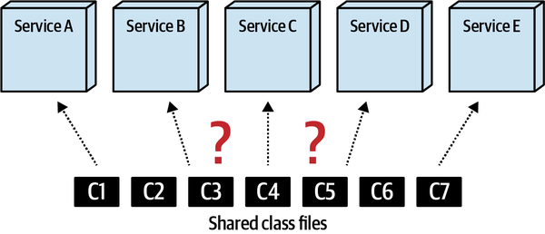

*Hình 8-1. Tái sử dụng code là một phần khó của architecture phân tán*

Thường thì trong các architecture phân tán cao như microservices và môi trường serverless, những câu như “reuse is abuse!” (tái sử dụng là lạm dụng!) và “share nothing!” (không chia sẻ gì cả!) được kiến trúc sư rao giảng nhằm giảm lượng code dùng chung trong những loại architecture này. Kiến trúc sư trong những môi trường này thậm chí còn đưa ra lời khuyên ngược lại với [nguyên lý DRY](https://oreil.ly/dTVrX) (Don’t repeat yourself — đừng lặp lại chính mình) nổi tiếng bằng cách dùng một từ viết tắt đối lập gọi là WET (Write every time hoặc Write everything twice).

Dù developer nên cố gắng hạn chế lượng tái sử dụng code trong các architecture phân tán, nó vẫn là một thực tế của phát triển phần mềm và phải được giải quyết, đặc biệt trong các architecture phân tán. Trong chương này, chúng tôi giới thiệu một số kỹ thuật quản lý tái sử dụng code trong một architecture phân tán, bao gồm nhân bản code, thư viện dùng chung, service dùng chung, và sidecar trong service mesh. Với mỗi lựa chọn này, chúng tôi cũng thảo luận ưu điểm, nhược điểm và trade-offs của từng cách tiếp cận.

<a id="idm45798379061992"></a>

## Nhân bản code (Code Replication)

Trong *nhân bản code* (code replication), code dùng chung được sao chép vào mỗi service<a id="ch08-rep"></a><a id="ch08-rep2"></a> (hay cụ thể hơn, mỗi source code repository của service), như thể hiện trong [Hình 8-2](#fig-reuse-patterns-replication), nhờ đó tránh hoàn toàn việc dùng chung code. Dù nghe có vẻ điên rồ, kỹ thuật này đã trở nên phổ biến trong những ngày đầu của microservices khi có nhiều nhầm lẫn và hiểu sai về khái niệm *bounded context*, do đó dẫn đến xu hướng tạo ra một “share nothing architecture.” Về lý thuyết, nhân bản code vào thời điểm đó có vẻ là một cách tiếp cận tốt để giảm việc dùng chung code, nhưng trong thực tế nó nhanh chóng sụp đổ.

<a id="fig-reuse-patterns-replication"></a>

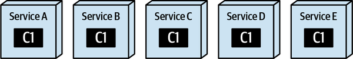

*Hình 8-2. Với nhân bản, chức năng dùng chung được sao chép vào mỗi service*

Dù ngày nay nhân bản code không được dùng nhiều, nó vẫn là một kỹ thuật hợp lệ để xử lý việc tái sử dụng code giữa nhiều service phân tán. Kỹ thuật này nên được tiếp cận hết sức thận trọng vì lý do hiển nhiên là nếu phát hiện bug trong code hoặc cần một thay đổi quan trọng đối với code, sẽ rất khó khăn và time-consuming (tốn thời gian) để cập nhật mọi service chứa code được nhân bản.

Tuy nhiên, đôi khi kỹ thuật này có thể tỏ ra hữu ích, đặc biệt với code one-off (dùng một lần) rất tĩnh mà hầu hết (hoặc mọi) service đều cần. Ví dụ, hãy xét code Java trong [Ví dụ 8-1](#source-java-entrypoint) và code C# tương ứng trong [Ví dụ 8-2](#source-csharp-entrypoint) xác định class trong service biểu thị entry point của service (thường là class restful API trong một service).

<a id="source-java-entrypoint"></a>

*Ví dụ 8-1. Source code định nghĩa một annotation entry point của service (Java)*

```java
@Retention(RetentionPolicy.RUNTIME)
@Target(ElementType.TYPE)
public @interface ServiceEntrypoint {}

/* Usage:
@ServiceEntrypoint
public class PaymentServiceAPI {
   ...
}
*/
```

<a id="source-csharp-entrypoint"></a>

*Ví dụ 8-2. Source code định nghĩa một attribute entry point của service (C#)*

```c#
[AttributeUsage(AttributeTargets.Class)]
class ServiceEntrypoint : Attribute {}

/* Usage:
[ServiceEntrypoint]
class PaymentServiceAPI {
   ...
}
*/
```

Lưu ý rằng source code trong [Ví dụ 8-1](#source-java-entrypoint) thực ra không chứa chức năng nào cả.<a id="idm45798378961960"></a><a id="idm45798378961352"></a><a id="idm45798378748088"></a><a id="idm45798378747144"></a><a id="idm45798378746472"></a><a id="idm45798378745800"></a> Annotation chỉ đơn giản là một marker (hay tag) dùng để xác định một class cụ thể là biểu thị entry point của service. Tuy nhiên, annotation đơn giản này rất hữu ích để đặt các metadata annotation khác về một service cụ thể, bao gồm loại service, domain, bounded context, v.v.; xem Chương 89 trong [*97 Things Every Java Programmer Should Know*](https://learning.oreilly.com/library/view/97-things-every/9781491952689/ch89.html#use_custom_identity_annotations_liberall) của Kevlin Henney và Trisha Gee (O’Reilly) để có mô tả về các metadata annotation tùy biến này.

Loại source code này là một ứng viên tốt cho việc nhân bản vì nó tĩnh và không chứa bug nào (và nhiều khả năng sẽ không có trong tương lai). Nếu đây là một class one-off độc nhất, có lẽ đáng để sao chép nó vào mỗi code repository của service thay vì tạo một thư viện dùng chung cho nó. Dù vậy, nhìn chung chúng tôi khuyến khích tìm hiểu các kỹ thuật code-sharing (dùng chung code) khác được trình bày trong chương này trước khi chọn kỹ thuật nhân bản code.

Dù kỹ thuật nhân bản giữ được bounded context, nó lại khiến việc áp dụng thay đổi trở nên khó khăn nếu code thực sự cần được sửa đổi. [Bảng 8-1](#table-replication-trade-offs) liệt kê các trade-offs khác nhau gắn với kỹ thuật này.

> **Các đánh đổi (Trade-Offs)**
>
> <a id="table-replication-trade-offs"></a>
>
> <a id="table-replication-trade-offs"></a>*Bảng 8-1. Trade-offs của kỹ thuật nhân bản code*
>
> | Ưu điểm | Nhược điểm |
> |---|---|
> | Giữ được bounded context | Khó áp dụng thay đổi code |
> | Không dùng chung code | Code không nhất quán giữa các service |
> |  | Không có khả năng versioning giữa các service |

<a id="idm45798379008824"></a>

### Khi nào nên dùng (When to Use)

Kỹ thuật nhân bản là một cách tiếp cận tốt khi developer có code tĩnh đơn giản (như annotation, attribute, tiện ích chung đơn giản, v.v.) là một class one-off hoặc là code khó có khả năng thay đổi vì lỗi hay thay đổi chức năng. Tuy nhiên, như đã đề cập trước đó, chúng tôi khuyến khích tìm hiểu các lựa chọn code-reuse (tái sử dụng code) khác trước khi áp dụng kỹ thuật nhân bản code.

Khi chuyển đổi từ monolithic architecture sang architecture phân tán, chúng tôi cũng nhận thấy rằng kỹ thuật nhân bản đôi khi có thể hiệu quả với các class tiện ích tĩnh chung. Ví dụ, bằng cách nhân bản một class C# `Utility.cs` sang mọi service, mỗi service giờ có thể gỡ bỏ (hoặc cải tiến) class `Utility.cs` cho phù hợp với nhu cầu cụ thể của mình, nhờ đó loại bỏ code không cần thiết và cho phép class tiện ích tiến hóa theo từng bối cảnh cụ thể (tương tự kỹ thuật tactical forking được mô tả trong [Chương 3](ch03_architectural_modularity.vi.md#ch03-architectural-modularity)). Một lần nữa, rủi ro của kỹ thuật này là rất khó lan truyền một lỗi hoặc thay đổi tới mọi service vì code bị trùng lặp cho mỗi service.<a id="idm45798378904792"></a><a id="idm45798378904120"></a>

<a id="idm45798379061368"></a>

## Thư viện dùng chung (Shared Library)

Một trong những kỹ thuật phổ biến nhất để dùng chung code là dùng thư viện dùng chung. <a id="idm45798378902136"></a><a id="idm45798378900888"></a>Thư viện dùng chung là một artifact bên ngoài (như file JAR, DLL, v.v.) chứa source code được nhiều service dùng, thường được gắn với service tại thời điểm biên dịch (xem [Hình 8-3](#fig-reuse-patterns-lib-single)). Dù kỹ thuật thư viện dùng chung có vẻ đơn giản và dễ hiểu, nó có phần độ phức tạp và trade-offs của riêng mình, không kém phần quan trọng là granularity và versioning của thư viện dùng chung.

<a id="fig-reuse-patterns-lib-single"></a>

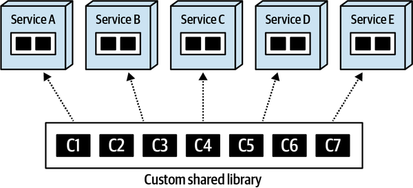

*Hình 8-3. Với kỹ thuật thư viện dùng chung, code chung được hợp nhất và dùng chung tại thời điểm biên dịch*

<a id="idm45798378896440"></a>

### Quản lý phụ thuộc và kiểm soát thay đổi (Dependency Management and Change Control)

Tương tự service granularity (được thảo luận trong [Chương 7](ch07_service_granularity.vi.md#ch07-service-granularity)), có những trade-offs gắn với granularity của một thư viện dùng chung.<a id="idm45798378894056"></a><a id="idm45798378779144"></a><a id="idm45798378778184"></a><a id="idm45798378777240"></a><a id="idm45798378776024"></a> Hai lực đối lập tạo thành trade-offs với thư viện dùng chung là quản lý phụ thuộc và kiểm soát thay đổi.

Hãy xét thư viện dùng chung coarse-grained (thô) minh họa trong [Hình 8-4](#fig-reuse-patterns-lib-single-change). <a id="idm45798378773576"></a>Lưu ý rằng trong khi quản lý phụ thuộc tương đối đơn giản (mỗi service dùng một thư viện dùng chung duy nhất), kiểm soát thay đổi thì không. Nếu có thay đổi xảy ra với bất kỳ file class nào trong thư viện dùng chung coarse-grained, *mọi* service, dù có quan tâm đến thay đổi hay không, cuối cùng đều phải áp dụng thay đổi vì phiên bản cũ của thư viện dùng chung bị deprecate. Điều này buộc phải test lại và deploy lại không cần thiết mọi service dùng thư viện đó, do đó làm tăng đáng kể phạm vi testing tổng thể của một thay đổi thư viện dùng chung.

<a id="fig-reuse-patterns-lib-single-change"></a>

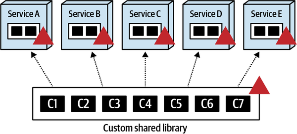

*Hình 8-4. Thay đổi đối với thư viện dùng chung coarse-grained ảnh hưởng đến nhiều service nhưng giữ phụ thuộc ở mức thấp*

Chia code dùng chung thành các thư viện dùng chung functionality-based (dựa trên chức năng) nhỏ hơn (như security, formatter, annotation, calculator, v.v.) tốt hơn cho kiểm soát thay đổi và maintainability tổng thể, nhưng đáng tiếc lại tạo ra một mớ hỗn độn về quản lý phụ thuộc. Như thể hiện trong [Hình 8-5](#fig-reuse-patterns-lib-multi-change), một thay đổi trong class dùng chung C7 chỉ ảnh hưởng đến Service D và Service E, nhưng việc quản lý ma trận phụ thuộc giữa các thư viện dùng chung và các service nhanh chóng bắt đầu trông giống một big ball of distributed mud (hay cái mà một số người gọi là *distributed monolith*).

<a id="fig-reuse-patterns-lib-multi-change"></a>

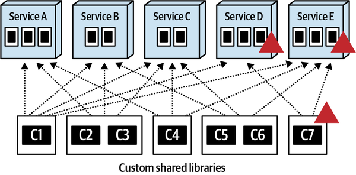

*Hình 8-5. Thay đổi đối với thư viện dùng chung fine-grained ảnh hưởng đến ít service hơn nhưng làm tăng phụ thuộc*

Lựa chọn granularity thư viện dùng chung có thể không quan trọng lắm khi chỉ có vài service, nhưng khi số lượng service tăng lên, các vấn đề gắn với kiểm soát thay đổi và quản lý phụ thuộc cũng tăng theo. Hãy tưởng tượng một hệ thống với 200 service và 40 thư viện dùng chung—nó sẽ nhanh chóng trở nên quá phức tạp và không thể bảo trì.

Xét các trade-offs này giữa kiểm soát thay đổi và quản lý phụ thuộc, lời khuyên của chúng tôi nhìn chung là tránh các thư viện dùng chung lớn, coarse-grained và cố gắng hướng tới các thư viện nhỏ hơn, được phân vùng theo chức năng bất cứ khi nào có thể, do đó ưu tiên kiểm soát thay đổi hơn quản lý phụ thuộc. Ví dụ, tách riêng các chức năng tương đối tĩnh như formatter và security (authentication và authorization) vào các thư viện dùng chung riêng của chúng giúp cô lập code tĩnh này, do đó giảm phạm vi testing và các lần deploy không cần thiết do deprecate phiên bản đối với các chức năng dùng chung khác.

<a id="idm45798378723768"></a>

### Các chiến lược versioning (Versioning Strategies)

Lời khuyên chung của chúng tôi về versioning thư viện dùng chung<a id="ch08-ver"></a><a id="ch08-ver2"></a><a id="ch08-ver3"></a><a id="idm45798378718088"></a> là *luôn dùng versioning!* Versioning các thư viện dùng chung không chỉ mang lại khả năng tương thích ngược, mà còn mang lại mức agility cao—khả năng phản ứng nhanh với thay đổi.

Để minh họa điểm này, hãy xét một thư viện dùng chung chứa các quy tắc kiểm tra hợp lệ trường dữ liệu chung tên *Validation.jar* được 10 service dùng. Giả sử một trong các service đó cần thay đổi ngay lập tức một trong các quy tắc kiểm tra hợp lệ. Bằng cách versioning file *Validation.jar*, service cần thay đổi có thể ngay lập tức đưa vào phiên bản *Validation.jar* mới và được deploy lên production ngay, mà không ảnh hưởng gì đến 9 service còn lại. Không có versioning, cả 10 service sẽ phải được test và deploy lại khi thực hiện thay đổi thư viện dùng chung, do đó làm tăng lượng thời gian và phối hợp cho thay đổi thư viện dùng chung (do đó kém agility hơn).

Dù lời khuyên trên có vẻ hiển nhiên, vẫn có trade-offs và độ phức tạp ẩn trong versioning. Thực tế, versioning có thể phức tạp đến mức các tác giả thường coi versioning là [ngụy biện của tính toán phân tán](https://oreil.ly/a9ADS) thứ chín: “versioning là đơn giản”

Một trong những độ phức tạp đầu tiên của versioning thư viện dùng chung là truyền đạt thay đổi phiên bản. Trong một architecture phân tán cao với nhiều team, thường khó truyền đạt thay đổi phiên bản của một thư viện dùng chung. Làm sao các team khác biết rằng *Validation.jar* vừa tăng lên phiên bản 1.5? Những thay đổi là gì? Những service nào bị ảnh hưởng? Những team nào bị ảnh hưởng? Ngay cả với vô số công cụ quản lý thư viện dùng chung, phiên bản và tài liệu thay đổi (như [JFrog Artifactory](https://jfrog.com/artifactory)), các thay đổi phiên bản vẫn phải được phối hợp và truyền đạt tới đúng người vào đúng thời điểm.

Một độ phức tạp khác là việc deprecate các phiên bản cũ của một <a id="idm45798378710216"></a>thư viện dùng chung—gỡ bỏ các phiên bản không còn được hỗ trợ sau một ngày nhất định. Các chiến lược deprecation dao động từ *tùy biến* (cho từng thư viện dùng chung riêng lẻ) cho đến *toàn cục* (cho mọi thư viện dùng chung). Và, không ngạc nhiên, cả hai cách tiếp cận đều có trade-offs.

Giao một chiến lược deprecation tùy biến cho mỗi thư viện dùng chung thường là cách tiếp cận được mong muốn vì các thư viện thay đổi với tốc độ khác nhau. Ví dụ, nếu một thư viện dùng chung *Security.jar* không thay đổi thường xuyên, chỉ duy trì hai hoặc ba phiên bản là một chiến lược hợp lý. Tuy nhiên, nếu thư viện dùng chung *Calculators.jar* thay đổi hằng tuần, chỉ duy trì hai hoặc ba phiên bản có nghĩa là mọi service dùng thư viện dùng chung đó sẽ phải đưa vào phiên bản mới hơn hằng tháng (hoặc thậm chí hằng tuần)—gây ra nhiều lần test lại và deploy lại thường xuyên không cần thiết. Do đó, duy trì 10 phiên bản *Calculators.jar* sẽ là một chiến lược hợp lý hơn nhiều vì tần suất thay đổi. Tuy nhiên, trade-off của cách tiếp cận này là phải có người duy trì và theo dõi việc deprecation cho *từng thư viện dùng chung*. Đây đôi khi có thể là một nhiệm vụ đáng ngại và chắc chắn không dành cho người yếu tim.

Vì mức thay đổi khác nhau giữa các thư viện dùng chung, chiến lược deprecation toàn cục, dù đơn giản hơn, là một cách tiếp cận kém hiệu quả hơn. Chiến lược deprecation toàn cục quy định rằng *mọi* thư viện dùng chung, bất kể tốc độ thay đổi, sẽ không hỗ trợ nhiều hơn một số lượng phiên bản cũ nhất định (ví dụ, bốn). Dù cách này dễ duy trì và quản trị, nó có thể gây ra *churn* (xáo trộn) đáng kể--việc liên tục test lại và deploy lại các service—chỉ để duy trì tương thích với phiên bản mới nhất của một thư viện dùng chung thay đổi thường xuyên. Điều này có thể khiến các team phát điên và giảm đáng kể tốc độ và năng suất tổng thể của team.

Bất kể chiến lược deprecation nào được dùng, các lỗi nghiêm trọng hoặc breaking change đối với code dùng chung đều làm vô hiệu bất kỳ chiến lược deprecation nào, khiến *mọi* service phải áp dụng phiên bản mới nhất của một thư viện dùng chung cùng lúc (hoặc trong một khoảng thời gian rất ngắn). Đây là một lý do khác khiến chúng tôi khuyến nghị giữ các thư viện dùng chung fine-grained ở mức phù hợp và tránh loại thư viện coarse-grained kiểu *SharedStuff.jar* chứa toàn bộ chức năng dùng chung trong hệ thống.

Một lời khuyên cuối cùng về versioning: tránh dùng<a id="idm45798378685032"></a><a id="idm45798378684168"></a> phiên bản `LATEST` khi chỉ định phiên bản thư viện mà một service cần. Theo kinh nghiệm của chúng tôi, các service dùng phiên bản `LATEST` gặp vấn đề khi thực hiện các bản sửa nhanh hoặc hot deployment khẩn cấp lên production, vì thứ gì đó trong phiên bản `LATEST` có thể không tương thích với service, do đó gây thêm công sức phát triển và testing cho team để release service lên production.

Dù kỹ thuật thư viện dùng chung cho phép versioning các thay đổi (do đó mang lại mức agility tốt cho các thay đổi code dùng chung), <a id="idm45798378681064"></a>quản lý phụ thuộc có thể khó khăn và rối rắm. [Bảng 8-2](#table-replication-sharedlib) liệt kê các trade-offs khác nhau gắn với kỹ thuật này.

> **Các đánh đổi (Trade-Offs)**
>
> <a id="table-replication-sharedlib"></a>
>
> <a id="table-replication-sharedlib"></a>*Bảng 8-2. Trade-offs của kỹ thuật thư viện dùng chung*
>
> | Ưu điểm | Nhược điểm |
> |---|---|
> | Có khả năng versioning các thay đổi | Phụ thuộc có thể khó quản lý |
> | Code dùng chung là compile-based (dựa trên biên dịch), giảm lỗi runtime | Trùng lặp code trong các codebase không đồng nhất |
> | Agility tốt cho các thay đổi code code dùng chung | Việc deprecate phiên bản có thể khó khăn |
> |  | Việc truyền đạt phiên bản có thể khó khăn |

<a id="idm45798378723144"></a>

### Khi nào nên dùng (When To Use)

Kỹ thuật thư viện dùng chung là một cách tiếp cận tốt cho các môi trường đồng nhất nơi mức thay đổi code dùng chung từ thấp đến trung bình. Khả năng versioning (dù đôi khi phức tạp) cho phép mức agility tốt khi thực hiện các thay đổi code dùng chung. Vì thư viện dùng chung thường được gắn với service tại thời điểm biên dịch, các đặc điểm vận hành như performance, scalability và fault tolerance không bị ảnh hưởng, và rủi ro làm hỏng các service khác do một thay đổi code chung là thấp nhờ versioning.<a id="idm45798378665832"></a><a id="idm45798378665128"></a><a id="idm45798378664456"></a>

<a id="idm45798378663528"></a>

## Service dùng chung (Shared Service)

Lựa chọn thay thế chính cho việc dùng thư viện dùng chung cho chức năng chung là dùng một service dùng chung. <a id="ch08-sscru"></a><a id="ch08-sscru2"></a><a id="ch08-sscru3"></a>Kỹ thuật *service dùng chung* (shared service), minh họa trong [Hình 8-6](#fig-reuse-patterns-service), tránh việc tái sử dụng bằng cách đặt chức năng dùng chung vào một service được deploy riêng.

<a id="fig-reuse-patterns-service"></a>

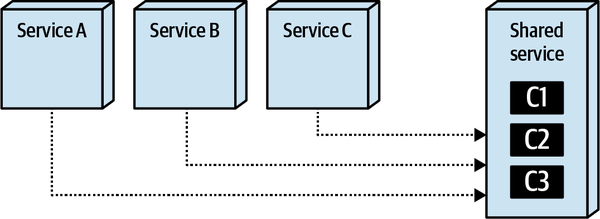

*Hình 8-6. Với kỹ thuật service dùng chung, chức năng chung được cung cấp tại runtime thông qua các service riêng biệt*

Một yếu tố phân biệt của kỹ thuật service dùng chung là <a id="idm45798378654104"></a><a id="idm45798378653160"></a><a id="idm45798378652456"></a><a id="idm45798378651752"></a><a id="idm45798378650792"></a><a id="idm45798378650120"></a>code dùng chung phải ở dạng *composition*, không phải *inheritance*. Dù có nhiều tranh luận về việc dùng composition thay vì inheritance xét từ góc độ *thiết kế* source code (xem bài viết của Thoughtworks [“Composition vs. Inheritance: How to Choose”](https://oreil.ly/LMmZH) và bài viết của Martin Fowler [“Designed Inheritance”](https://oreil.ly/bW8CH)), *về mặt kiến trúc* thì composition so với inheritance có ý nghĩa khi chọn một kỹ thuật code-reuse, đặc biệt với kỹ thuật service dùng chung.

Ngày trước, service dùng chung là một cách tiếp cận phổ biến để xử lý chức năng dùng chung trong một architecture phân tán. Các thay đổi đối với chức năng dùng chung không còn đòi hỏi deploy lại các service; thay vào đó, vì các thay đổi được cô lập trong một service riêng, chúng có thể được deploy mà không cần deploy lại các service khác cần chức năng dùng chung đó. Tuy nhiên, như mọi thứ trong software architecture, có nhiều trade-offs gắn với việc dùng service dùng chung, bao gồm rủi ro thay đổi, performance, scalability và fault tolerance.

<a id="idm45798378644632"></a>

### Rủi ro thay đổi (Change Risk)

Thay đổi chức năng dùng chung bằng kỹ thuật service dùng chung hóa ra là một con dao double-edged (hai lưỡi).<a id="idm45798378642504"></a><a id="idm45798378641512"></a> Như minh họa trong [Hình 8-7](#fig-reuse-patterns-service-change), thay đổi chức năng dùng chung chỉ đơn giản là sửa đổi code dùng chung chứa trong một service riêng (như một discount calculator), deploy lại service, và voila—các thay đổi giờ đã có sẵn cho mọi service, mà không phải test lại và deploy lại bất kỳ service nào khác cần chức năng dùng chung đó.

<a id="fig-reuse-patterns-service-change"></a>

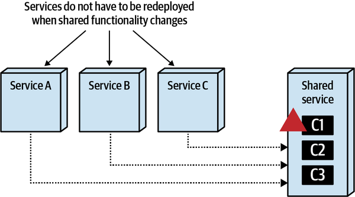

*Hình 8-7. Các thay đổi chức năng dùng chung chỉ được cô lập trong service dùng chung*

Giá mà cuộc đời đơn giản như vậy! Vấn đề, tất nhiên, là một<a id="idm45798378636536"></a><a id="idm45798378635736"></a> thay đổi đối với service dùng chung là một thay đổi *runtime*, trái ngược với một thay đổi *compile-based* với kỹ thuật thư viện dùng chung. Kết quả là, một thay đổi “đơn giản” trong một service dùng chung có thể làm sập toàn bộ hệ thống, như minh họa trong [Hình 8-8](#fig-reuse-patterns-service-change-break).

<a id="fig-reuse-patterns-service-change-break"></a>

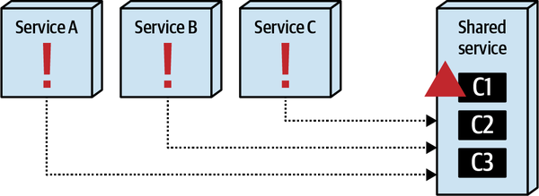

*Hình 8-8. Thay đổi đối với service dùng chung có thể làm hỏng các service khác tại runtime*

Điều này tất yếu đưa chủ đề versioning lên hàng đầu. Trong kỹ thuật thư viện dùng chung, versioning được quản lý thông qua các ràng buộc compile-time (lúc biên dịch), giảm đáng kể rủi ro gắn với một thay đổi trong thư viện dùng chung. Tuy nhiên, làm sao người ta versioning một thay đổi service dùng chung đơn giản?<a id="idm45798378629912"></a><a id="idm45798378628920"></a><a id="idm45798378627944"></a><a id="idm45798378626712"></a>

Phản ứng tức thời, tất nhiên, là dùng versioning API endpoint—nói cách khác, tạo một endpoint mới chứa mỗi thay đổi của service dùng chung, như thể hiện trong [Ví dụ 8-3](#source-version-endpoints).

<a id="source-version-endpoints"></a>

*Ví dụ 8-3. Discount calendar với versioning cho endpoint của service dùng chung*

```http
app/1.0/discountcalc?orderid=123
app/1.1/discountcalc?orderid=123
app/1.2/discountcalc?orderid=123
app/1.3/discountcalc?orderid=123
latest change -> app/1.4/discountcalc?orderid=123
```

Dùng cách tiếp cận này, mỗi khi một service dùng chung thay đổi, team sẽ tạo một API endpoint mới chứa một phiên bản URI mới. Không khó để thấy các vấn đề nảy sinh với thực hành này. Thứ nhất, các service truy cập discount calculator service (hoặc cấu hình tương ứng của mỗi service) phải thay đổi để trỏ tới đúng phiên bản. Thứ hai, khi nào team nên tạo một API endpoint mới? Còn một thay đổi thông báo lỗi đơn giản thì sao? Còn một phép tính mới thì sao? Versioning bắt đầu trở nên phần lớn mang tính chủ quan ở điểm này, *và* các service dùng service dùng chung vẫn phải thay đổi để trỏ tới đúng endpoint.

Một vấn đề khác với versioning API endpoint là nó giả định rằng mọi <a id="idm45798378619976"></a><a id="idm45798378618760"></a>truy cập vào service dùng chung đều thông qua một lời gọi RESTful API đi qua một gateway hoặc qua giao tiếp point-to-point (điểm-điểm). Tuy nhiên, trong một số trường hợp, việc truy cập service dùng chung thông qua giao tiếp interservice thường được thực hiện qua các loại <a id="idm45798378616072"></a>giao thức khác như messaging và [gRPC](https://grpc.io) (ngoài lời gọi RESTful API). Điều này làm phức tạp thêm chiến lược versioning cho một thay đổi, khiến khó phối hợp các phiên bản giữa nhiều giao thức.

Điểm mấu chốt là với kỹ thuật service dùng chung, các thay đổi đối với một service dùng chung nhìn chung mang bản chất runtime, và do đó mang nhiều rủi ro hơn nhiều so với thư viện dùng chung. Dù versioning có thể giúp giảm rủi ro này, nó phức tạp hơn nhiều để áp dụng và quản lý so với versioning thư viện dùng chung.

<a id="idm45798378644008"></a>

### Performance

Vì các service cần chức năng dùng chung phải thực hiện một<a id="idm45798378611736"></a><a id="idm45798378603768"></a><a id="idm45798378602808"></a><a id="idm45798378601848"></a> lời gọi interservice tới service dùng chung, performance bị ảnh hưởng vì network latency (và security latency, giả sử các endpoint tới service dùng chung được bảo mật). Loại trade-off này, thể hiện trong [Hình 8-9](#fig-reuse-patterns-service-performance), không tồn tại với kỹ thuật thư viện dùng chung khi truy cập code dùng chung.

<a id="fig-reuse-patterns-service-performance"></a>

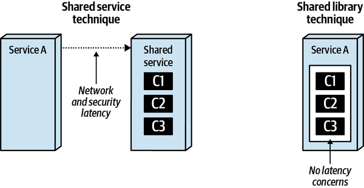

*Hình 8-9. Service dùng chung đưa vào network latency và security latency*

Việc dùng gRPC có thể giúp giảm thiểu một số<a id="idm45798378581512"></a> vấn đề performance bằng cách giảm đáng kể network latency, cũng như việc dùng các <a id="idm45798378580248"></a><a id="idm45798378579560"></a><a id="idm45798378578328"></a><a id="idm45798378577656"></a><a id="idm45798378576968"></a>giao thức bất đồng bộ như messaging. Với messaging, service cần chức năng dùng chung có thể gửi một request qua một request queue, thực hiện công việc khác, và khi cần, có thể lấy kết quả qua một reply queue riêng bằng correlation ID (xem [*Java Message Service*, Second Edition](https://www.oreilly.com/library/view/java-message-service/9780596802264) của Mark Richards và cộng sự (O’Reilly) để có thêm thông tin về các kỹ thuật messaging).

<a id="idm45798378573704"></a>

### Scalability

Một nhược điểm khác của kỹ thuật service dùng chung là service dùng chung<a id="idm45798378572104"></a><a id="idm45798378571128"></a><a id="idm45798378570216"></a> phải scale theo khi các service dùng nó scale. Điều này đôi khi có thể là một mớ hỗn độn khó quản lý, đặc biệt khi nhiều service đồng thời truy cập cùng một service dùng chung. Tuy nhiên, như minh họa trong [Hình 8-10](#fig-reuse-patterns-service-scalability), kỹ thuật thư viện dùng chung không gặp vấn đề này vì chức năng dùng chung được chứa trong service tại thời điểm biên dịch.

<a id="fig-reuse-patterns-service-scalability"></a>

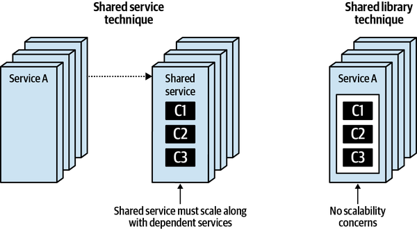

*Hình 8-10. Service dùng chung phải scale theo khi các service phụ thuộc scale*

<a id="idm45798378548888"></a>

### Fault Tolerance

Dù các vấn đề fault-tolerance thường có thể được giảm thiểu thông qua<a id="idm45798378547320"></a><a id="idm45798378546344"></a><a id="idm45798378545384"></a> nhiều instance của một service, đó vẫn là một trade-off cần xem xét khi dùng kỹ thuật service dùng chung. Như minh họa trong [Hình 8-11](#fig-reuse-patterns-service-ft), nếu service dùng chung trở nên không khả dụng, các service cần chức năng dùng chung trở nên không vận hành được cho đến khi service dùng chung khả dụng trở lại. <a id="idm45798378542888"></a><a id="idm45798378541944"></a>Kỹ thuật thư viện dùng chung không gặp vấn đề này vì chức năng dùng chung được chứa trong service tại thời điểm biên dịch, và do đó được truy cập thông qua các lời gọi method hoặc hàm tiêu chuẩn.

<a id="fig-reuse-patterns-service-ft"></a>

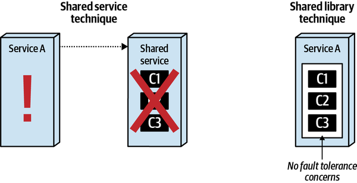

*Hình 8-11. Service dùng chung đưa vào các vấn đề fault-tolerance*

Dù kỹ thuật service dùng chung giữ được bounded context và tốt cho code dùng chung thay đổi thường xuyên, các đặc điểm vận hành như performance, scalability và availability lại bị ảnh hưởng. [Bảng 8-3](#table-replication-sharedservice) liệt kê các trade-offs khác nhau gắn với kỹ thuật này.

> **Các đánh đổi (Trade-Offs)**
>
> <a id="table-replication-sharedservice"></a>
>
> <a id="table-replication-sharedservice"></a>*Bảng 8-3. Trade-offs của kỹ thuật service dùng chung*
>
> | Ưu điểm | Nhược điểm |
> |---|---|
> | Tốt khi code volatility cao | Versioning các thay đổi có thể khó khăn |
> | Không trùng lặp code trong các codebase không đồng nhất | Performance bị ảnh hưởng do latency |
> | Giữ được bounded context | Vấn đề fault tolerance và availability do phụ thuộc service |
> | Không dùng chung code tĩnh | Vấn đề scalability và throughput do phụ thuộc service |
> |  | Rủi ro tăng do các thay đổi runtime |

<a id="idm45798378524056"></a>

### Khi nào nên dùng (When to Use)

Kỹ thuật service dùng chung nên dùng trong các môi trường polyglot cao (những môi trường có nhiều ngôn ngữ và nền tảng không đồng nhất), và cả khi chức năng dùng chung có xu hướng thay đổi thường xuyên. Dù các thay đổi trong một service dùng chung có xu hướng agile hơn nhiều về tổng thể so với kỹ thuật thư viện dùng chung, hãy cẩn thận với các side-effects (tác dụng phụ) runtime và rủi ro đối với các service cần chức năng dùng chung.<a id="idm45798378522104"></a><a id="idm45798378521400"></a><a id="idm45798378520728"></a>

<a id="sec-sidecar-pattern"></a>

## Sidecar và service mesh (Sidecars and Service Mesh)

Có lẽ câu trả lời phổ biến nhất cho bất kỳ câu hỏi nào được đặt ra cho một kiến trúc sư là “Còn tùy!” Không vấn đề nào trong architecture phân tán minh họa sự mơ hồ này rõ hơn operational coupling.<a id="ch08-ssm"></a><a id="ch08-ssm2"></a><a id="ch08-ssm4"></a><a id="ch08-ssm5"></a><a id="ch08-ssm6"></a><a id="ch08-ssmc"></a>

Một trong các mục tiêu thiết kế của microservices architecture là mức decoupling cao, thường được thể hiện trong lời khuyên “Trùng lặp còn hơn coupling.” Ví dụ, giả sử hai service Sysops Squad cần truyền thông tin khách hàng, nhưng bounded context của domain-driven design lại đòi hỏi các chi tiết hiện thực phải được giữ riêng tư trong service. Do đó, một giải pháp phổ biến cho phép mỗi service có cách biểu diễn nội bộ riêng cho các thực thể như `Customer`, truyền thông tin đó theo những cách loosely coupled như các cặp name-value trong JSON. Lưu ý rằng điều này cho phép mỗi service thay đổi cách biểu diễn nội bộ của mình tùy ý, kể cả technology stack, mà không làm hỏng việc tích hợp. Kiến trúc sư nhìn chung không ưa trùng lặp code vì nó gây ra vấn đề đồng bộ hóa, trôi dạt ngữ nghĩa, và hàng loạt vấn đề khác, nhưng đôi khi tồn tại những lực còn tệ hơn các vấn đề của trùng lặp, và coupling trong microservices thường rơi vào trường hợp đó. Do đó, trong microservices architecture, câu trả lời cho câu hỏi “chúng ta nên trùng lặp hay couple với một năng lực nào đó?” nhiều khả năng là *trùng lặp*, trong khi ở một architecture style khác như service-based architecture, câu trả lời đúng nhiều khả năng là *couple*. Còn tùy!

Khi thiết kế microservices, kiến trúc sư đã chấp nhận thực tế của việc trùng lặp hiện thực để giữ decoupling. Nhưng còn loại năng lực *được lợi* từ coupling cao thì sao? Ví dụ, hãy xét các năng lực vận hành chung như monitoring, logging, authentication và authorization, circuit breaker, và hàng loạt khả năng vận hành khác mà mỗi service nên có. Nhưng để mỗi team tự quản lý những phụ thuộc này thường dẫn đến hỗn loạn. Ví dụ, hãy xét một công ty như Penultimate Electronics đang cố chuẩn hóa một giải pháp monitoring chung để dễ vận hành hóa các service khác nhau. Nhưng nếu mỗi team chịu trách nhiệm hiện thực monitoring cho service của mình, làm sao team vận hành có thể chắc chắn họ đã làm? Ngoài ra, còn các vấn đề như nâng cấp thống nhất thì sao? Nếu công cụ monitoring cần nâng cấp trên toàn tổ chức, làm sao các team có thể phối hợp việc đó?

Giải pháp phổ biến đã xuất hiện trong hệ sinh thái microservices vài năm gần đây giải quyết vấn đề này theo một cách <a id="idm45798378505160"></a><a id="idm45798378504456"></a>thanh lịch, bằng cách dùng Sidecar pattern. Pattern này dựa trên một architecture pattern sớm hơn nhiều do Alistair Cockburn định nghĩa, được biết đến với tên *hexagonal architecture*, minh họa trong [Hình 8-12](#fig-reuse-patterns-hexagonal).

Trong Hexagonal pattern này, cái mà giờ chúng ta gọi là domain logic nằm ở trung tâm hình lục giác, được bao quanh bởi các port và adaptor tới các phần khác của hệ sinh thái (thực tế, <a id="idm45798378501608"></a>pattern này còn được gọi là *Ports and Adaptors Pattern*). Dù có trước microservices một số năm, pattern này có những điểm tương đồng với microservices hiện đại, với một khác biệt đáng kể: độ trung thực của dữ liệu. Hexagonal architecture coi database chỉ là một adaptor khác có thể cắm vào, nhưng một trong những hiểu biết sâu sắc từ DDD gợi ý rằng data schema và tính transaction nên nằm bên trong phần lõi—giống như microservices.

<a id="fig-reuse-patterns-hexagonal"></a>

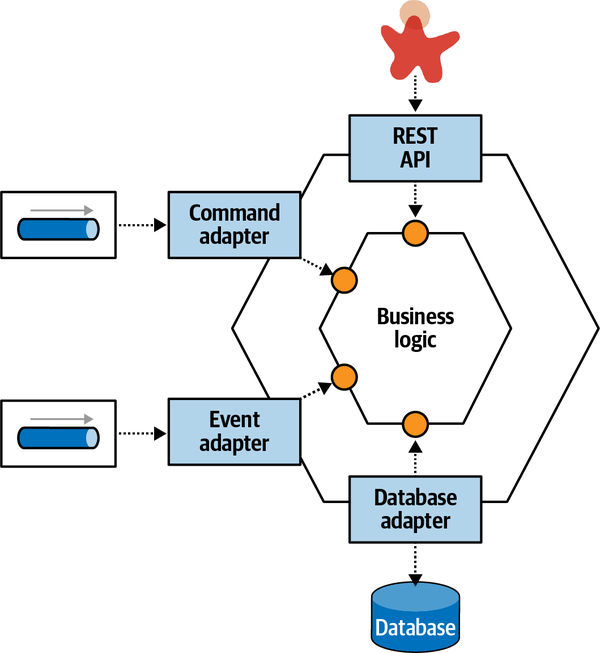

*Hình 8-12. Hexagonal pattern tách domain logic khỏi coupling kỹ thuật*

*Sidecar pattern* tận dụng cùng khái niệm như hexagonal architecture ở chỗ nó decouple domain logic khỏi logic kỹ thuật (hạ tầng). Ví dụ, hãy xét hai microservice, như thể hiện trong [Hình 8-13](#fig-reuse-patterns-ms-premesh).

<a id="fig-reuse-patterns-ms-premesh"></a>

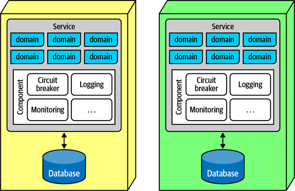

*Hình 8-13. Hai microservice dùng chung cùng các năng lực vận hành*

Ở đây, mỗi service bao gồm sự phân chia giữa các mối quan tâm vận hành (các component lớn hơn ở phía dưới service) và các mối quan tâm domain, được vẽ trong các hộp ở phía trên service có nhãn “domain.” Nếu kiến trúc sư mong muốn sự nhất quán trong các năng lực vận hành, các phần tách được sẽ đi vào một component sidecar, được đặt tên theo ẩn dụ [thùng xe sidecar gắn vào xe máy](https://oreil.ly/EcBuk), mà việc hiện thực của nó hoặc là trách nhiệm chung giữa các team hoặc được quản lý bởi một nhóm hạ tầng tập trung. Nếu kiến trúc sư có thể giả định rằng mọi service đều bao gồm sidecar, nó tạo thành một giao diện vận hành nhất quán giữa các service, thường được gắn qua một service plane, thể hiện trong [Hình 8-14](#fig-reuse-patterns-sidecar-service-pane).

<a id="fig-reuse-patterns-sidecar-service-pane"></a>

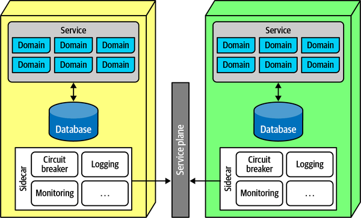

*Hình 8-14. Khi mỗi microservice bao gồm một component chung, kiến trúc sư có thể thiết lập liên kết giữa chúng để kiểm soát nhất quán*

Nếu kiến trúc sư và bộ phận vận hành có thể giả định an toàn rằng mọi service đều bao gồm <a id="ch08-ssm3"></a><a id="ch08-ssmb"></a>component sidecar (được quản trị bằng fitness function), nó tạo thành một service mesh, minh họa trong [Hình 8-15](#fig-reuse-patterns-servicemesh). Các hộp ở bên phải mỗi service đều kết nối với nhau, tạo thành một “mesh” (lưới).

Có một mesh cho phép kiến trúc sư và DevOps tạo dashboard, kiểm soát các đặc điểm vận hành như scale, và hàng loạt năng lực khác.

Sidecar pattern cho phép các nhóm governance như enterprise architect kiềm chế hợp lý đối với việc có quá nhiều môi trường polyglot: một trong những lợi thế của microservices là dựa vào tích hợp thay vì một nền tảng chung, cho phép các team chọn mức độ phức tạp và năng lực đúng theo kiểu service-by-service (từng service một). Tuy nhiên, khi số lượng nền tảng tăng lên, governance thống nhất trở nên khó khăn hơn. Do đó, các team thường dùng tính nhất quán của service mesh như một động lực để hỗ trợ hạ tầng và các mối quan tâm cross-cutting khác trên nhiều nền tảng không đồng nhất. Ví dụ, nếu không có service mesh, khi enterprise architect muốn thống nhất quanh một giải pháp monitoring chung, các team phải xây dựng một sidecar cho mỗi nền tảng hỗ trợ giải pháp đó.

<a id="fig-reuse-patterns-servicemesh"></a>

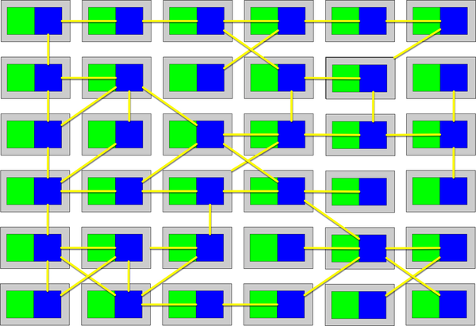

*Hình 8-15. Service mesh là một liên kết vận hành giữa các service*

Sidecar pattern không chỉ biểu thị một cách decouple các năng lực vận hành khỏi domain—nó là <a id="idm45798378480744"></a><a id="idm45798378479752"></a><a id="idm45798378479064"></a><a id="idm45798378478120"></a>một pattern *orthogonal reuse* (tái sử dụng trực giao) để xử lý một loại coupling cụ thể (xem [“Orthogonal Coupling”](#sb-orthogonal-coupling)). Thường thì các giải pháp kiến trúc đòi hỏi nhiều loại coupling, như ví dụ hiện tại của chúng tôi về domain coupling so với operational coupling. Một pattern orthogonal reuse đưa ra cách tái sử dụng một khía cạnh nào đó ngược với một hoặc nhiều đường nối trong architecture. Ví dụ, microservices architecture được tổ chức quanh domain, nhưng operational coupling đòi hỏi cắt ngang các domain đó. Một sidecar cho phép kiến trúc sư cô lập các mối quan tâm đó trong một layer cross-cutting, nhưng nhất quán, xuyên suốt architecture.

> <a id="sb-orthogonal-coupling"></a>
>
> **Coupling trực giao (Orthogonal Coupling)**
>
> Trong toán học, hai đường thẳng là *trực giao* (orthogonal) nếu chúng cắt nhau theo góc vuông, điều này cũng hàm ý tính độc lập. Trong software architecture, hai phần của một architecture có thể *coupled trực giao* (orthogonally coupled): hai mục đích riêng biệt vẫn phải giao nhau để hình thành một giải pháp hoàn chỉnh. Ví dụ hiển nhiên từ chương này là một mối quan tâm vận hành như monitoring, thứ cần thiết nhưng độc lập với hành vi domain, như thanh toán catalog. Nhận ra orthogonal coupling cho phép kiến trúc sư tìm các điểm giao gây ít rối rắm nhất giữa các mối quan tâm.

Dù Sidecar pattern mang lại một sự trừu tượng hóa tốt, nó có trade-offs như mọi cách tiếp cận kiến trúc khác, thể hiện trong [Bảng 8-4](#table-replication-mesh).

> **Các đánh đổi (Trade-Offs)**
>
> <a id="table-replication-mesh"></a>
>
> <a id="table-replication-mesh"></a>*Bảng 8-4. Trade-offs của kỹ thuật Sidecar pattern / service mesh*
>
> | Ưu điểm | Nhược điểm |
> |---|---|
> | Mang lại cách nhất quán để tạo coupling được cô lập | Phải hiện thực một sidecar cho mỗi nền tảng |
> | Cho phép phối hợp hạ tầng nhất quán | Component sidecar có thể trở nên lớn/phức tạp |
> | Sở hữu theo team, tập trung, hoặc kết hợp |  |

<a id="idm45798378460824"></a>

### Khi nào nên dùng (When to Use)

Sidecar pattern và service mesh mang lại một cách gọn gàng để trải một loại mối quan tâm cross-cutting nào đó khắp một architecture phân tán, và có thể được dùng cho nhiều thứ hơn chứ không chỉ operational coupling (xem [Chương 14](ch14_managing_analytical_data.vi.md#ch14-data-mesh)). <a id="idm45798378458232"></a><a id="idm45798378457512"></a>Nó cung cấp một tương đương kiến trúc của [Decorator Design Pattern](https://oreil.ly/4hYmI) từ cuốn sách *Design Patterns* của Gang of Four (Addison Wesley)—nó cho phép kiến trúc sư “trang trí” hành vi khắp một architecture phân tán độc lập với kết nối thông thường.<a id="idm45798378455128"></a><a id="idm45798378454424"></a><a id="idm45798378453752"></a><a id="idm45798378453080"></a><a id="idm45798378452408"></a><a id="idm45798378451736"></a><a id="idm45798378451064"></a><a id="idm45798378450392"></a>

<a id="idm45798378519016"></a>

## Sysops Squad Saga: Logic hạ tầng chung (Sysops Squad Saga: Common Infrastructure Logic)

`Thursday, February 10, 10:34`

Sydney ló đầu vào văn phòng của Taylen vào một buổi sáng mù sương. “Này, cậu có đang dùng thư viện Message Dispatch dùng chung không?”<a id="idm45798378446808"></a><a id="idm45798378445496"></a><a id="idm45798378444264"></a><a id="idm45798378443032"></a><a id="idm45798378442088"></a><a id="idm45798378441144"></a><a id="idm45798378440200"></a>

Taylen đáp, “Có, chúng tôi đang cố hợp nhất vào đó để có sự nhất quán trong việc phân giải message.”

Sydney nói, “OK, nhưng giờ chúng ta đang bị log message trùng lặp—có vẻ thư viện ghi vào log, nhưng service của chúng ta cũng ghi vào log. Như vậy có đúng không?”

“Không,” Taylen đáp. “Chúng ta chắc chắn không muốn các mục log trùng lặp. Điều đó chỉ làm mọi thứ rối rắm. Chúng ta nên hỏi Addison về chuyện đó.”

Vì vậy, Sydney và Taylen xuất hiện trước cửa phòng Addison. “Này, cậu có một phút không?”

Addison đáp, “Với các cậu thì lúc nào cũng có—có chuyện gì vậy?”

Sydney nói, “Chúng tôi đang hợp nhất một loạt code trùng lặp vào các thư viện dùng chung, và việc đó đang diễn ra tốt—chúng tôi ngày càng giỏi hơn trong việc xác định các phần hiếm khi thay đổi. Nhưng, giờ chúng tôi gặp vấn đề khiến chúng tôi đến đây—ai là người phải ghi log message? Thư viện, service, hay thứ gì khác? Và, làm sao chúng ta có thể làm điều đó nhất quán?”

Addison nói, “Chúng ta đã đụng phải hành vi vận hành dùng chung. Logging chỉ là một trong số đó. Còn monitoring, service discovery, circuit breaker, thậm chí một số hàm tiện ích của chúng ta, như thư viện `JSONtoXML` mà một vài team đang dùng chung thì sao? Chúng ta cần một cách tốt hơn để xử lý việc này nhằm ngăn ngừa vấn đề. Đó là lý do chúng tôi đang trong quá trình hiện thực một service mesh với hành vi chung này trong một component sidecar.”

Sydney nói, “Tôi đã đọc về sidecar và service mesh—đó là một cách để dùng chung mọi thứ giữa một loạt microservice, đúng không?”

Addison nói, “Gần như vậy, nhưng không phải mọi loại *thứ*. Mục đích của service mesh và sidecar là hợp nhất operational coupling, không phải domain coupling. Ví dụ, giống như trường hợp của chúng ta, chúng ta muốn sự nhất quán cho logging và monitoring trên mọi service, nhưng không muốn mỗi team phải lo về điều đó. Nếu chúng ta hợp nhất code logging vào sidecar chung mà mọi service hiện thực, chúng ta có thể áp đặt sự nhất quán.”

Taylen hỏi, “Ai sở hữu thư viện dùng chung? Trách nhiệm chung của tất cả các team?”

Addison đáp, “Chúng tôi đã nghĩ về điều đó, nhưng giờ chúng ta có đủ team; chúng tôi đã xây dựng một team hạ tầng dùng chung sẽ quản lý và duy trì component sidecar. Họ đã xây dựng deployment pipeline để tự động test sidecar một khi nó được gắn vào service, với một tập fitness function.”

Sydney nói, “Vậy nếu chúng tôi cần dùng chung thư viện giữa các service, chỉ cần nhờ họ đưa nó vào sidecar?”

Addison nói, “Cẩn thận—sidecar không dành để dùng cho bất cứ thứ gì, chỉ cho operational coupling.”

“Tôi không chắc sự phân biệt đó là gì,” Taylen nói.

“Operational coupling bao gồm những thứ chúng ta vừa thảo luận—logging, monitoring, service discovery, authentication và authorization, v.v. Về cơ bản, nó bao gồm mọi phần đường ống của hạ tầng không có trách nhiệm domain. Nhưng các cậu không bao giờ nên đặt các component domain dùng chung, như class `Address` hay `Customer`, vào sidecar.”

Sydney hỏi, “Nhưng tại sao? Nếu tôi cần cùng một định nghĩa class trong hai service thì sao? Đặt nó vào sidecar chẳng phải sẽ giúp cả hai đều dùng được sao?”

Addison đáp, “Đúng, nhưng giờ cậu đang tăng coupling theo đúng cách mà chúng ta cố tránh trong microservices. Trong hầu hết các architecture, một hiện thực duy nhất của service đó sẽ được dùng chung giữa các team cần nó. Tuy nhiên, trong microservices, điều đó tạo ra một điểm coupling, ràng buộc nhiều service với nhau theo cách không mong muốn—nếu một team thay đổi code dùng chung, mọi team đều phải phối hợp với thay đổi đó. Tuy nhiên, kiến trúc sư có thể quyết định đặt thư viện dùng chung vào sidecar—suy cho cùng, nó là một năng lực kỹ thuật. Không câu trả lời nào đúng một cách rõ ràng, khiến đây là một quyết định của kiến trúc sư và đáng để phân tích trade-off. Ví dụ, nếu class `Address` thay đổi và cả hai service đều dựa vào nó, cả hai đều phải thay đổi—chính là định nghĩa của coupling. Chúng ta xử lý những vấn đề đó bằng contract. Vấn đề còn lại liên quan đến kích thước: chúng ta không muốn sidecar trở thành phần lớn nhất của architecture. Ví dụ, hãy xét thư viện `JSONtoXML` chúng ta vừa bàn. Có bao nhiêu team dùng nó?”

Taylen nói, “Chà, bất kỳ team nào phải tích hợp với hệ thống mainframe cho bất cứ việc gì—có lẽ 5 trên, xem nào, 16 hay 17 team?”

Addison nói, “Tuyệt. OK, trade-off của việc đặt `JSONtoXML` vào sidecar là gì?”

Sydney trả lời, “Chà, điều đó có nghĩa là mọi team tự động có thư viện và không phải nối nó vào thông qua phụ thuộc.”

“Còn mặt xấu?” Addison hỏi.

“Chà, thêm nó vào sidecar làm sidecar lớn hơn, nhưng không nhiều—đó là một thư viện nhỏ.” Sydney nói.

“Đó là trade-off then chốt cho code tiện ích dùng chung—có bao nhiêu team cần nó so với nó thêm bao nhiêu overhead cho mọi service, đặc biệt là những service không cần nó.”

“Và nếu ít hơn one-half (một nửa) số team dùng nó, có lẽ không đáng với overhead,” Sydney nói.

“Đúng! Vậy, hiện tại, chúng ta sẽ để nó ngoài sidecar và có thể đánh giá lại trong tương lai,” Addison nói.

> <a id="adr_8"></a>
>
> *ADR: Dùng sidecar cho operational coupling*
>
> *Bối cảnh (Context)*<br>
> Mỗi service trong microservices architecture của chúng tôi đòi hỏi hành vi vận hành chung và nhất quán; để trách nhiệm đó cho từng team gây ra sự thiếu nhất quán và các vấn đề phối hợp.
>
> *Quyết định (Decision)*<br>
> Chúng tôi sẽ dùng một component sidecar cùng với một service mesh để hợp nhất operational coupling dùng chung.
>
> Team hạ tầng dùng chung sẽ sở hữu và duy trì sidecar cho các team service; các team service đóng vai trò khách hàng của họ. Các dịch vụ sau sẽ được sidecar cung cấp:
>
> - Monitoring
> - Logging
> - Service discovery
> - Authentication
> - Authorization
>
> *Hệ quả (Consequences)*<br>
> Các team không nên thêm domain class vào sidecar, điều này khuyến khích coupling không phù hợp.
>
> Các team làm việc với team hạ tầng dùng chung để đặt các thư viện *vận hành* dùng chung vào sidecar nếu đủ nhiều team cần.

<a id="idm45798378447464"></a>

## Tái sử dụng code: Khi nào nó tạo ra giá trị? (Code Reuse: When Does It Add Value?)

Nhiều kiến trúc sư không đánh giá đúng các trade-offs khi họ<a id="idm45798378406056"></a> gặp một số tình huống, điều đó không nhất thiết là một khiếm khuyết—nhiều trade-offs chỉ trở nên hiển nhiên sau khi sự việc đã xảy ra.

*Tái sử dụng* là một trong những sự trừu tượng hóa bị lạm dụng nhiều nhất, vì quan điểm chung trong các tổ chức là *tái sử dụng* đại diện cho một mục tiêu đáng khen mà các team nên phấn đấu. Tuy nhiên, việc không đánh giá mọi trade-offs gắn với tái sử dụng có thể dẫn đến những vấn đề nghiêm trọng trong architecture.

Mối nguy của việc tái sử dụng quá mức là một trong những bài học mà nhiều kiến trúc sư đã học được từ xu hướng orchestration-driven service-oriented architecture đầu thế kỷ 20, nơi một trong những mục tiêu chính của nhiều tổ chức là tối đa hóa tái sử dụng.

Hãy xét kịch bản từ một công ty bảo hiểm, minh họa trong [Hình 8-16](#fig-reuse-patterns-shared-customer).

<a id="fig-reuse-patterns-shared-customer"></a>


*Hình 8-16. Mỗi domain trong một công ty bảo hiểm lớn có một góc nhìn về khách hàng*

Mỗi bộ phận trong công ty có một khía cạnh nào đó về khách hàng mà nó quan tâm. Nhiều năm trước, kiến trúc sư được hướng dẫn để mắt tới loại điểm chung này; một khi phát hiện ra, mục tiêu là hợp nhất góc nhìn của tổ chức về khách hàng vào một service duy nhất, thể hiện trong [Hình 8-17](#fig-reuse-patterns-shared-customer-centralized).

<a id="fig-reuse-patterns-shared-customer-centralized"></a>

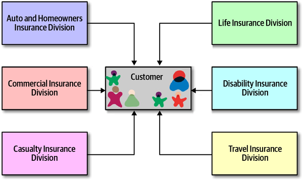

*Hình 8-17. Thống nhất vào một service Customer tập trung*

Dù bức tranh trong [Hình 8-17](#fig-reuse-patterns-shared-customer-centralized) có vẻ hợp lý, đó là một thảm họa kiến trúc vì hai lý do. Thứ nhất, nếu mọi thông tin tổ chức về một thực thể then chốt như Customer phải nằm ở một nơi duy nhất, thực thể đó phải đủ phức tạp để xử lý mọi domain và kịch bản, khiến nó khó dùng cho những việc đơn giản.

Thứ hai, nó tạo ra *tính giòn* (brittleness) trong architecture.<a id="idm45798378393048"></a><a id="idm45798378392072"></a> Nếu mọi domain cần thông tin khách hàng đều phải lấy nó từ một nơi duy nhất, khi nơi đó thay đổi, mọi thứ đều hỏng. Ví dụ, trong ví dụ của chúng tôi, điều gì xảy ra khi `CustomerService` cần thêm năng lực mới thay mặt cho một trong các domain? Thay đổi đó có thể ảnh hưởng đến mọi domain khác, đòi hỏi phối hợp và testing để bảo đảm thay đổi không “lan tỏa” khắp architecture.

Điều mà kiến trúc sư không nhận ra là tái sử dụng có hai khía cạnh quan trọng; họ đã đúng ở khía cạnh thứ nhất: trừu tượng hóa. Cách kiến trúc sư và developer phát hiện các ứng viên cho tái sử dụng là thông qua trừu tượng hóa. Tuy nhiên, khía cạnh thứ hai mới là khía cạnh quyết định tính hữu dụng và giá trị: *tốc độ thay đổi*.

Việc quan sát thấy một số kiểu tái sử dụng gây ra tính giòn đặt ra câu hỏi về việc loại tái sử dụng đó khác thế nào với những loại mà chúng ta rõ ràng được lợi. Hãy xét những thứ mà mọi người đều tái sử dụng thành công: hệ điều hành, framework và thư viện open source, v.v. Điều gì phân biệt chúng với những tài sản mà các team dự án xây dựng? Câu trả lời là *tốc độ thay đổi chậm*. Chúng ta được lợi từ coupling kỹ thuật, như hệ điều hành và framework bên ngoài, vì chúng có tốc độ thay đổi và nhịp cập nhật well-understood (được hiểu rõ). Các năng lực domain nội bộ hoặc các framework kỹ thuật quick-changing (thay đổi nhanh) là những mục tiêu coupling tồi tệ.

> **Mẹo**
>
> Tái sử dụng có được nhờ trừu tượng hóa nhưng được vận hành hóa nhờ tốc độ thay đổi chậm.

<a id="idm45798378386488"></a>

### Tái sử dụng qua nền tảng (Reuse via Platforms)

Có rất nhiều bài báo ca ngợi ưu điểm của các nền tảng trong tổ chức,<a id="idm45798378385160"></a><a id="idm45798378383912"></a><a id="idm45798378383224"></a> gần như đến mức [*semantic diffusion*](https://oreil.ly/oYla7) (khuếch tán ngữ nghĩa). Tuy nhiên, hầu hết đều đồng ý rằng *nền tảng* là mục tiêu mới của tái sử dụng trong tổ chức, nghĩa là với mỗi năng lực domain phân biệt được, tổ chức xây dựng một nền tảng với một API well-defined để ẩn các chi tiết hiện thực.

Tốc độ thay đổi chậm thúc đẩy lập luận này. Như chúng tôi thảo luận trong [Chương 13](ch13_contracts.vi.md#ch13-contracts), một API có thể được thiết kế để coupling khá lỏng với bên gọi, cho phép tốc độ thay đổi nội bộ mạnh mẽ của các chi tiết hiện thực mà không làm hỏng API. Tất nhiên, điều này không bảo vệ tổ chức khỏi các thay đổi về ngữ nghĩa của thông tin mà nó phải truyền giữa các domain, nhưng bằng cách thiết kế cẩn thận việc đóng gói và contract, kiến trúc sư có thể hạn chế lượng breaking change và tính giòn trong integration architecture.

<a id="idm45798378406840"></a>

## Sysops Squad Saga: Chức năng domain dùng chung (Sysops Squad Saga: Shared Domain Functionality)

`Tuesday, February 8, 12:50`

Với sự chấp thuận của Addison, development team đã quyết định chia<a id="idm45798378375576"></a><a id="idm45798378374536"></a><a id="idm45798378373304"></a><a id="idm45798378372072"></a> chức năng ticket cốt lõi thành ba service riêng biệt: một service Ticket Creation customer-facing (hướng tới khách hàng), một service Ticket Assignment, và một service Ticket Completion. Tuy nhiên, cả ba service đều dùng logic database chung (truy vấn và cập nhật) và dùng chung một tập bảng database trong data domain ticket.

Taylen muốn tạo một data service dùng chung chứa logic database chung, từ đó hình thành một database abstraction layer, như thể hiện trong [Hình 8-18](#fig-reuse-patterns-ss-domain-svc).

<a id="fig-reuse-patterns-ss-domain-svc"></a>

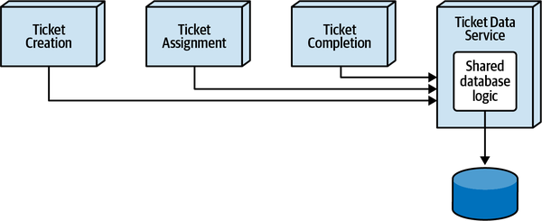

*Hình 8-18. Phương án dùng một service Ticket Data dùng chung cho logic database chung của các service ticket Sysops Squad*

Skyler ghét ý tưởng đó và muốn dùng một thư viện dùng chung duy nhất (DLL) mà mỗi service sẽ đưa vào như một phần của build và deployment, như minh họa trong [Hình 8-19](#fig-reuse-patterns-ss-domain-lib).

<a id="fig-reuse-patterns-ss-domain-lib"></a>

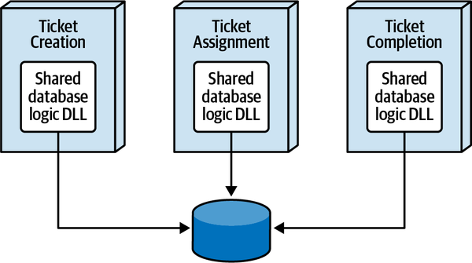

*Hình 8-19. Phương án dùng một thư viện dùng chung cho logic database chung của các service ticket Sysops Squad*

Cả hai developer gặp Addison để giải quyết sự bế tắc này.

“Vậy, Addison, ý kiến của cậu là gì? Logic database dùng chung nên nằm trong một data service dùng chung hay một thư viện dùng chung?” Taylen hỏi.

“Đây không phải chuyện ý kiến,” Addison nói. “Đây là chuyện phân tích các trade-offs để đi đến giải pháp phù hợp nhất cho chức năng database ticket dùng chung cốt lõi. Hãy làm theo cách tiếp cận hypothesis-based (dựa trên giả thuyết) và giả thuyết rằng giải pháp phù hợp nhất là dùng data service dùng chung.”

“Khoan đã,” Skyler nói. “Nó đơn giản không phải là một giải pháp kiến trúc tốt cho vấn đề này.”

“Tại sao?” Addison hỏi, khuyến khích Skyler bắt đầu suy nghĩ theo hướng trade-offs.

“Trước hết,” Skyler nói, “cả ba service sẽ cần thực hiện một lời gọi interservice tới data service dùng chung cho *mọi* truy vấn hay cập nhật database. Chúng ta sẽ chịu một cú giảm performance nghiêm trọng nếu làm vậy. Hơn nữa, nếu data service dùng chung sập, cả ba service đó đều không vận hành được.”

“Thì sao?” Taylen nói. “Toàn là chức năng backend, vậy ai quan tâm chứ? Chức năng backend đâu cần nhanh đến thế, và các service khởi động lại khá nhanh nếu chúng bị lỗi.”

“Thực ra,” Addison nói, “không phải toàn là chức năng backend. Đừng quên, service Ticket Creation hướng tới khách hàng, và nó sẽ dùng cùng data service dùng chung như chức năng ticket backend.”

“Ừ, nhưng *phần lớn* chức năng vẫn là backend,” Taylen nói, với chút kém tự tin hơn trước.

“Cho đến giờ,” Addison nói, “có vẻ trade-off của việc dùng data service dùng chung là performance và fault tolerance của các service ticket.”

“Cũng đừng quên rằng mọi thay đổi đối với data service dùng chung đều là thay đổi runtime. Nói cách khác,” Skyler nói, “nếu chúng ta thực hiện một thay đổi và deploy data service dùng chung, chúng ta có thể làm hỏng thứ gì đó.”

“Đó là lý do chúng ta test,” Taylen nói.

“Ừ, nhưng nếu cậu muốn giảm rủi ro, cậu sẽ phải test tất cả các service ticket cho mọi thay đổi đối với data service dùng chung, điều này làm tăng đáng kể thời gian testing. Với một DLL dùng chung, chúng ta có thể versioning thư viện dùng chung để mang lại khả năng tương thích ngược,” Skyler nói.

“OK, chúng ta cũng sẽ thêm rủi ro gia tăng khi thay đổi và công sức testing gia tăng vào danh sách trade-offs,” Addison nói. “Ngoài ra, đừng quên rằng chúng ta sẽ phải phối hợp thêm về mặt scalability. Mỗi khi tạo thêm instance của service ticket creation, chúng ta sẽ phải bảo đảm tạo thêm instance của data service dùng chung nữa.”

“Đừng cứ tập trung quá nhiều vào mặt tiêu cực nữa.” Taylen nói. “Còn mặt tích cực của việc dùng data service dùng chung thì sao?”

“OK,” Addison nói, “hãy nói về lợi ích của việc dùng data service dùng chung.”

“Trừu tượng hóa dữ liệu, tất nhiên,” Taylen nói. “Các service sẽ không phải lo về bất kỳ logic database nào. Tất cả những gì chúng phải làm là thực hiện một lời gọi service từ xa tới data service dùng chung.”

“Còn lợi ích nào khác không?” Addison hỏi.

“Chà,” Taylen nói, “tôi định nói là connection pooling tập trung, nhưng dù sao chúng ta cũng sẽ cần nhiều instance để hỗ trợ service tạo ticket của khách hàng. Nó sẽ giúp ích, nhưng không phải là yếu tố thay đổi cuộc chơi lớn vì chỉ có ba service mà mỗi service không có nhiều instance. Tuy nhiên, kiểm soát thay đổi sẽ dễ hơn rất nhiều với một data service dùng chung. Chúng ta sẽ không phải deploy lại bất kỳ service ticket nào cho các thay đổi logic database.”

“Hãy xem các file class dùng chung đó trong repository và xem về mặt lịch sử code đó thực sự thay đổi nhiều đến mức nào,” Addison nói.

Addison, Taylen và Skyler cùng xem lịch sử repository của các file class logic dữ liệu dùng chung.

“Hmm…” Taylen nói, “tôi tưởng code đó thay đổi nhiều hơn nhiều so với những gì hiện trong repo. OK, vậy tôi đoán rốt cuộc các thay đổi đối với logic database dùng chung khá ít.”

Qua cuộc trò chuyện thảo luận về trade-offs, Taylen bắt đầu nhận ra rằng mặt tiêu cực của một service dùng chung dường như lớn hơn mặt tích cực, và không có lý do biện minh thực sự thuyết phục nào cho việc đặt logic database dùng chung vào một service dùng chung. Taylen đồng ý đặt logic database dùng chung vào một DLL dùng chung, và Addison viết một ADR cho architecture decision này:

> <a id="adr_9"></a>
>
> *ADR: Dùng thư viện dùng chung cho logic database ticket chung*<br>
>
>
> *Bối cảnh (Context)*<br>
> Chức năng ticket được chia thành ba service: Ticket Creation, Ticket Assignment và Ticket Completion. Cả ba service đều dùng code chung cho phần lớn các truy vấn database và câu lệnh cập nhật. Hai lựa chọn là dùng một thư viện dùng chung hoặc tạo một data service dùng chung.<br>
>
>
> *Quyết định (Decision)*<br>
> Chúng tôi sẽ dùng một thư viện dùng chung cho logic database ticket chung.<br>
>
>
> Dùng thư viện dùng chung sẽ cải thiện performance, scalability và fault tolerance của service Ticket Creation customer-facing, cũng như của service Ticket Assignment.<br>
>
>
> Chúng tôi nhận thấy code logic database chung không thay đổi nhiều và do đó là code khá ổn định. Hơn nữa, thay đổi ít rủi ro hơn đối với logic database chung vì các service sẽ cần được test và deploy lại. Nếu cần thay đổi, chúng tôi sẽ áp dụng versioning ở những chỗ phù hợp để không phải deploy lại mọi service khi logic database chung thay đổi.<br>
>
>
> Dùng thư viện dùng chung giảm coupling giữa các service và loại bỏ các phụ thuộc service bổ sung, HTTP traffic, và băng thông tổng thể.<br>
>
>
> *Hệ quả (Consequences)*<br>
> Các thay đổi đối với logic database chung trong DLL dùng chung sẽ đòi hỏi các service ticket được test và deploy, do đó giảm agility tổng thể cho logic database chung của chức năng ticket.<br>
>
>
> Các instance service sẽ cần tự quản lý database connection pool của riêng mình.
