<a id="ch09-data-update"></a>

# Chương 9. Quyền sở hữu dữ liệu và transaction phân tán (Data Ownership and Distributed Transactions)

`Friday, December 10 09:12`

Trong khi team database làm việc để phân rã database monolith<a id="idm45798378335528"></a><a id="idm45798378334552"></a><a id="idm45798378333336"></a><a id="idm45798378329624"></a><a id="idm45798378328392"></a><a id="idm45798378327176"></a> của Sysops Squad, development team của Sysops Squad, cùng với Addison, kiến trúc sư của Sysops Squad, bắt đầu làm việc để hình thành các bounded context giữa các service và dữ liệu, đồng thời giao quyền sở hữu bảng cho các service trong quá trình đó.

“Tại sao cậu lại thêm bảng expert profile vào bounded context của service Ticket Assignment?” Addison hỏi.

“Bởi vì,” Sydney nói, “việc giao ticket dựa vào bảng đó cho các thuật toán giao. Nó liên tục truy vấn bảng đó để lấy thông tin vị trí và kỹ năng của chuyên gia.”

“Nhưng nó chỉ thực hiện truy vấn tới bảng expert,” Addison nói. “Service User Maintenance chứa chức năng thực hiện cập nhật database để duy trì thông tin đó. Do đó, theo tôi thấy bảng expert profile nên thuộc sở hữu của service User Maintenance và được đặt trong bounded context đó.”

“Tôi không đồng ý,” Sydney nói. “Chúng ta đơn giản là không thể để assignment service thực hiện lời gọi từ xa tới service User Maintenance cho mọi truy vấn nó cần. Như vậy đơn giản là sẽ không chạy được.”

“Trong trường hợp đó, cậu hình dung việc cập nhật bảng diễn ra thế nào khi một chuyên gia có thêm kỹ năng mới hoặc thay đổi khu vực phục vụ? Và còn khi chúng ta tuyển một chuyên gia mới thì sao?” Addison hỏi. “Việc đó sẽ hoạt động thế nào?”

“Đơn giản,” Sydney nói. “Service User Maintenance vẫn có thể truy cập bảng expert. Tất cả những gì nó cần làm là kết nối tới một database khác. Có gì to tát đâu?”

“Cậu không nhớ Dana đã nói gì trước đó sao? Nhiều service kết nối tới cùng một database schema thì được, nhưng một service kết nối tới nhiều database hoặc schema thì không được. Dana đã nói đó là điều no-go (không thể chấp nhận) và sẽ không cho phép điều đó xảy ra,” Addison nói.

“À, đúng rồi, tôi quên mất quy tắc đó. Vậy chúng ta làm gì?” Sydney hỏi. “Chúng ta có một service cần thỉnh thoảng cập nhật, và một service hoàn toàn khác trong một domain hoàn toàn khác thường xuyên đọc từ bảng.”

“Tôi không biết câu trả lời đúng là gì,” Addison nói. “Rõ ràng việc này sẽ đòi hỏi team database và chúng ta cộng tác nhiều hơn để tìm ra cách giải quyết. Để tôi xem Dana có thể cho lời khuyên gì về việc này không.”

Một khi dữ liệu đã được tách ra, nó phải được khâu lại với nhau để hệ thống hoạt động. Điều này có nghĩa là phải tìm ra service nào sở hữu dữ liệu nào, cách quản lý transaction phân tán, và cách các service có thể truy cập dữ liệu chúng cần (nhưng không còn sở hữu). Trong chương này, chúng tôi khám phá các khía cạnh quyền sở hữu và transaction của việc ghép dữ liệu phân tán trở lại với nhau.

<a id="idm45798378318712"></a>

## Giao quyền sở hữu dữ liệu (Assigning Data Ownership)

Sau khi tách dữ liệu trong một architecture phân tán, kiến trúc sư<a id="idm45798378317336"></a><a id="idm45798378316088"></a><a id="idm45798378315144"></a> phải xác định service nào sở hữu dữ liệu nào. Đáng tiếc là việc giao quyền sở hữu dữ liệu cho một service không dễ như nghe, và trở thành thêm một phần khó nữa của software architecture.

Quy tắc kinh nghiệm chung cho việc giao quyền sở hữu bảng nói rằng các service thực hiện thao tác ghi vào một bảng thì sở hữu bảng đó. Dù quy tắc kinh nghiệm chung này hoạt động tốt với sở hữu đơn (chỉ một service ghi vào một bảng), mọi thứ trở nên rối rắm khi các team có sở hữu chung (nhiều service ghi vào cùng một bảng) hoặc tệ hơn nữa, sở hữu phổ biến (hầu hết hoặc mọi service ghi vào bảng).

> **Mẹo**
>
> Quy tắc kinh nghiệm chung cho quyền sở hữu dữ liệu là service thực hiện thao tác ghi vào một bảng là chủ sở hữu của bảng đó. Tuy nhiên, sở hữu chung khiến quy tắc đơn giản này trở nên phức tạp!

Để minh họa một số độ phức tạp của quyền sở hữu dữ liệu, hãy xét ví dụ minh họa trong [Hình 9-1](#fig-data-access-and-update-ownership-before) thể hiện ba service: một Wishlist Service quản lý mọi wish list của khách hàng, một Catalog Service duy trì danh mục sản phẩm, và một Inventory Service duy trì chức năng tồn kho và bổ sung hàng cho mọi sản phẩm trong danh mục sản phẩm.

<a id="fig-data-access-and-update-ownership-before"></a>

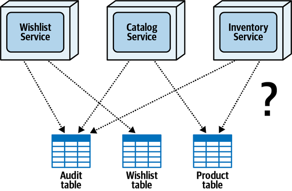

*Hình 9-1. Một khi dữ liệu được tách ra, các bảng phải được giao cho các service sở hữu chúng*

Để phức tạp thêm, hãy để ý rằng Wishlist Service ghi vào cả bảng Audit và bảng Wishlist, Catalog Service ghi vào bảng Audit và bảng Product, và Inventory Service ghi vào bảng Audit và bảng Product. Đột nhiên, ví dụ real-world đơn giản này khiến việc giao quyền sở hữu dữ liệu trở thành một nhiệm vụ phức tạp và khó hiểu.

Trong chương này, chúng tôi gỡ rối độ phức tạp này bằng cách thảo luận ba kịch bản gặp phải khi giao quyền sở hữu dữ liệu cho các service (sở hữu đơn, sở hữu phổ biến và sở hữu chung), và khám phá các kỹ thuật giải quyết những kịch bản này, dùng [Hình 9-1](#fig-data-access-and-update-ownership-before) làm điểm tham chiếu chung.

<a id="idm45798378305192"></a>

## Kịch bản sở hữu đơn (Single Ownership Scenario)

*Sở hữu bảng đơn* (single table ownership) xảy ra khi chỉ một service ghi vào một<a id="idm45798378303400"></a><a id="idm45798378302152"></a><a id="idm45798378301208"></a> bảng. Đây là kịch bản quyền sở hữu dữ liệu đơn giản nhất và tương đối dễ giải quyết. Nhìn lại [Hình 9-1](#fig-data-access-and-update-ownership-before), hãy để ý rằng bảng Wishlist chỉ có một service duy nhất ghi vào nó—Wishlist Service.

Trong kịch bản này, rõ ràng Wishlist Service nên là chủ sở hữu của bảng Wishlist (bất kể các service khác cần quyền truy cập read-only vào bảng Wishlist), xem [Hình 9-2](#fig-data-access-and-update-single-owner). Hãy để ý rằng ở phía bên phải của sơ đồ này, bảng Wishlist trở thành một phần của bounded context của Wishlist Service. Kỹ thuật vẽ sơ đồ này là một cách hiệu quả để biểu thị quyền sở hữu bảng và bounded context được hình thành giữa service và dữ liệu tương ứng của nó.

<a id="fig-data-access-and-update-single-owner"></a>

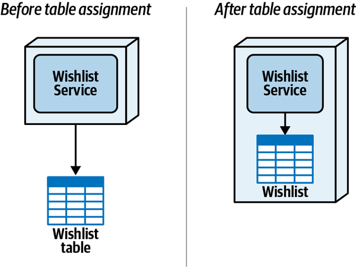

*Hình 9-2. Với sở hữu đơn, service ghi vào bảng trở thành chủ sở hữu bảng*

Vì sự đơn giản của kịch bản này, chúng tôi khuyến nghị xử lý các quan hệ sở hữu bảng đơn trước để dọn sạch sân chơi nhằm xử lý tốt hơn các kịch bản phức tạp hơn phát sinh: sở hữu phổ biến và sở hữu chung.

<a id="idm45798378294232"></a>

## Kịch bản sở hữu phổ biến (Common Ownership Scenario)

*Sở hữu bảng phổ biến* (common table ownership) xảy ra khi hầu hết (hoặc mọi) service cần ghi vào cùng một bảng.<a id="idm45798378292312"></a><a id="idm45798378291064"></a><a id="idm45798378290120"></a> Ví dụ, [Hình 9-1](#fig-data-access-and-update-ownership-before) cho thấy mọi service (Wishlist, Catalog và Inventory) đều cần ghi vào bảng Audit để ghi lại hành động do người dùng thực hiện. Vì mọi service đều cần ghi vào bảng, khó xác định ai thực sự nên sở hữu bảng Audit. Dù ví dụ đơn giản này chỉ gồm ba service, hãy tưởng tượng một ví dụ thực tế hơn nơi có khả năng hàng trăm (hoặc thậm chí hàng nghìn) service phải ghi vào cùng bảng Audit.

Giải pháp đơn giản đặt bảng Audit vào một database dùng chung hoặc schema dùng chung được mọi service dùng, đáng tiếc lại đưa trở lại mọi vấn đề data-sharing (dùng chung dữ liệu) được mô tả ở đầu [Chương 6](ch06_pulling_apart_operational_data.vi.md#ch06-decomposing-operational-data), bao gồm kiểm soát thay đổi, cạn kiệt connection, scalability và fault tolerance. Do đó, cần một giải pháp khác để giải quyết quyền sở hữu dữ liệu phổ biến.

Một kỹ thuật phổ biến để xử lý sở hữu bảng phổ biến là giao một service chuyên trách duy nhất làm chủ sở hữu chính (và duy nhất) của dữ liệu đó, nghĩa là chỉ một service chịu trách nhiệm ghi dữ liệu vào bảng. <a id="idm45798378285288"></a><a id="idm45798378284024"></a>Các service khác cần thực hiện hành động ghi sẽ gửi thông tin tới service chuyên trách, rồi service đó thực hiện thao tác ghi thực tế vào bảng.

Nếu các service gửi dữ liệu không cần thông tin hay xác nhận nào, các service có thể dùng persisted queue cho messaging fire-and-forget (gửi rồi quên) bất đồng bộ. Ngoài ra, nếu cần trả thông tin về cho bên gọi dựa trên một hành động ghi (như trả về một số xác nhận hoặc database key), các service có thể dùng thứ như REST, gRPC, hoặc messaging request-reply (giả đồng bộ) cho một lời gọi đồng bộ.

Quay lại ví dụ bảng Audit, hãy để ý trong [Hình 9-3](#fig-data-access-and-update-common-owner) rằng kiến trúc sư đã tạo một Audit Service mới và giao cho nó quyền sở hữu bảng Audit, nghĩa là nó là service duy nhất thực hiện hành động đọc hoặc ghi trên bảng. Trong ví dụ này, vì không cần thông tin trả về, kiến trúc sư dùng messaging fire-and-forget bất đồng bộ với một persistent queue để Wishlist Service, Catalog Service và Inventory Service không phải chờ bản ghi audit được ghi vào bảng. Làm cho queue bền vững (nghĩa là message được broker lưu trên đĩa) mang lại sự bảo đảm giao nhận trong trường hợp service hoặc broker gặp lỗi và giúp bảo đảm không message nào bị mất.

<a id="fig-data-access-and-update-common-owner"></a>

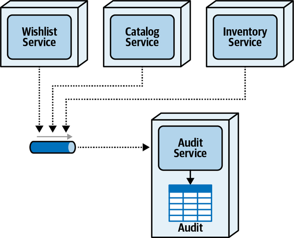

*Hình 9-3. Sở hữu phổ biến dùng một service chủ sở hữu chuyên trách*

Trong một số trường hợp, các service có thể cần đọc dữ liệu chung mà chúng không sở hữu. Các kỹ thuật truy cập read-only này được mô tả chi tiết trong [Chương 10](ch10_distributed_data_access.vi.md#ch10-data-access).

<a id="idm45798378275800"></a>

## Kịch bản sở hữu chung (Joint Ownership Scenario)

Một trong những kịch bản phổ biến (và phức tạp) hơn liên quan đến quyền<a id="ch09-jnoi"></a><a id="idm45798378272664"></a><a id="idm45798378271448"></a><a id="ch09-jnoi2"></a> sở hữu dữ liệu là *sở hữu chung* (joint ownership), xảy ra khi nhiều service thực hiện hành động ghi trên cùng một bảng. Kịch bản này khác với kịch bản sở hữu phổ biến trước đó ở chỗ với sở hữu chung, chỉ một vài service trong cùng một domain ghi vào cùng một bảng, trong khi với sở hữu phổ biến, hầu hết hoặc mọi service đều thực hiện thao tác ghi trên cùng một bảng. Ví dụ, hãy để ý trong [Hình 9-1](#fig-data-access-and-update-ownership-before) rằng mọi service đều thực hiện thao tác ghi trên bảng Audit (sở hữu phổ biến), trong khi chỉ các service Catalog và Inventory thực hiện thao tác ghi trên bảng Product (sở hữu chung).

[Hình 9-4](#fig-data-access-and-update-joint-ownership) thể hiện ví dụ sở hữu chung được tách riêng từ [Hình 9-1](#fig-data-access-and-update-ownership-before). Catalog Service chèn sản phẩm mới vào bảng, gỡ bỏ các sản phẩm không còn được bán, và cập nhật thông tin sản phẩm tĩnh khi nó thay đổi, trong khi Inventory Service chịu trách nhiệm đọc và cập nhật lượng tồn kho hiện tại cho mỗi sản phẩm khi sản phẩm được truy vấn, bán hoặc trả lại.

<a id="fig-data-access-and-update-joint-ownership"></a>

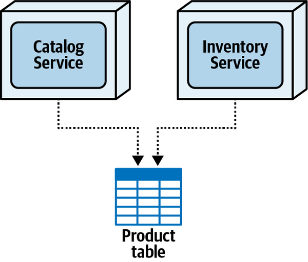

*Hình 9-4. Sở hữu chung xảy ra khi nhiều service trong cùng một domain thực hiện thao tác ghi trên cùng một bảng*

May mắn là có một số kỹ thuật để xử lý loại kịch bản sở hữu này—kỹ thuật table split, kỹ thuật data domain, kỹ thuật delegation, và kỹ thuật service consolidation. Mỗi kỹ thuật được thảo luận chi tiết trong các phần sau.

<a id="sec-cap-theorem"></a>

### Kỹ thuật tách bảng (Table Split Technique)

*Kỹ thuật table split* (tách bảng) chia một bảng duy nhất thành nhiều bảng<a id="ch09-tst"></a><a id="ch09-tst2"></a><a id="ch09-tst3"></a> để mỗi service sở hữu một phần dữ liệu mà nó chịu trách nhiệm. Kỹ thuật này được mô tả chi tiết trong cuốn sách *Refactoring Databases* và trên [website đi kèm](https://oreil.ly/WJ2kt).

Để minh họa kỹ thuật table split, hãy xét ví dụ bảng Product minh họa trong [Hình 9-4](#fig-data-access-and-update-joint-ownership). Trong trường hợp này, kiến trúc sư hoặc developer trước tiên sẽ tạo một bảng Inventory riêng chứa product ID (key) và lượng tồn kho (số mặt hàng có sẵn), pre-populate (điền trước) bảng Inventory bằng dữ liệu từ bảng Product hiện có, rồi cuối cùng gỡ cột lượng tồn kho khỏi bảng Product. Đoạn source trong [Ví dụ 9-1](#source-table-split) cho thấy kỹ thuật này có thể được hiện thực thế nào bằng data definition language (DDL) trong một relational database điển hình.

<a id="source-table-split"></a>

*Ví dụ 9-1. Source code DDL để tách bảng Product và chuyển lượng tồn kho sang một bảng Inventory mới*

```perl
CREATE TABLE Inventory
(
product_id VARCHAR(10),
inv_cnt INT
);

INSERT INTO Inventory VALUES (product_id, inv_cnt)
AS SELECT product_id, inv_cnt FROM Product;

COMMIT;

ALTER TABLE Product DROP COLUMN inv_cnt;
```

Tách bảng database chuyển sở hữu chung thành một kịch bản sở hữu bảng đơn: Catalog Service sở hữu dữ liệu trong bảng Product, và Inventory Service sở hữu dữ liệu trong bảng Inventory. Tuy nhiên, như thể hiện trong [Hình 9-5](#fig-data-access-and-update-joint-table-split), kỹ thuật này đòi hỏi giao tiếp giữa Catalog Service và Inventory Service khi sản phẩm được tạo hoặc gỡ bỏ để bảo đảm dữ liệu luôn nhất quán giữa hai bảng.

<a id="fig-data-access-and-update-joint-table-split"></a>

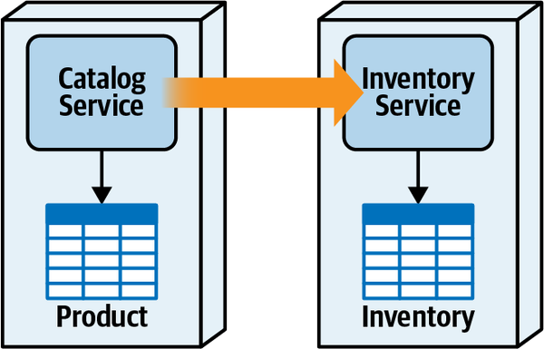

*Hình 9-5. Sở hữu chung có thể được xử lý bằng cách tách bảng dùng chung*

Ví dụ, nếu một sản phẩm mới được thêm vào, Catalog Service tạo một product ID và chèn sản phẩm mới vào bảng Product. Sau đó Catalog Service phải gửi product ID mới đó (và có thể cả lượng tồn kho ban đầu) tới Inventory Service. Nếu một sản phẩm bị gỡ bỏ, Catalog Service trước tiên gỡ sản phẩm khỏi bảng Product, rồi phải thông báo cho Inventory Service để gỡ hàng tồn kho khỏi bảng Inventory.

Đồng bộ dữ liệu giữa các bảng được tách không phải chuyện đơn giản. Giao tiếp giữa Catalog Service và Inventory Service nên đồng bộ hay bất đồng bộ? Catalog Service nên làm gì khi thêm hoặc gỡ một sản phẩm và phát hiện Inventory Service không khả dụng? Đây là những câu hỏi khó trả lời, và thường được dẫn dắt bởi trade-off truyền thống *availability* so với *consistency* thường gặp trong các architecture phân tán. Chọn availability nghĩa là điều quan trọng hơn là Catalog Service luôn có thể thêm hoặc gỡ sản phẩm, dù bản ghi tồn kho tương ứng có thể không được tạo trong bảng Inventory. Chọn consistency nghĩa là điều quan trọng hơn là hai bảng luôn đồng bộ với nhau, điều này sẽ khiến thao tác tạo hoặc gỡ sản phẩm thất bại nếu Inventory Service không khả dụng. Vì network partitioning là tất yếu trong các architecture phân tán, [CAP theorem](https://oreil.ly/R1fXW) phát biểu rằng chỉ một trong hai lựa chọn này (consistency hoặc availability) là khả thi.

Loại giao thức giao tiếp (đồng bộ so với bất đồng bộ) cũng quan trọng khi tách một bảng. Catalog Service có cần xác nhận rằng bản ghi Inventory tương ứng đã được thêm khi tạo một sản phẩm mới không? Nếu có, thì cần giao tiếp đồng bộ, mang lại tính nhất quán dữ liệu tốt hơn với cái giá là performance. Nếu không cần xác nhận, Catalog Service có thể dùng giao tiếp fire-and-forget bất đồng bộ, mang lại performance tốt hơn với cái giá là tính nhất quán dữ liệu. Có quá nhiều trade-offs cần cân nhắc!

[Bảng 9-1](#table-ownership-split-trade-offs) tóm tắt các trade-offs gắn với kỹ thuật table split cho sở hữu chung. <a id="idm45798378203064"></a><a id="idm45798378202392"></a><a id="idm45798378201720"></a>

> **Các đánh đổi (Trade-Offs)**
>
> <a id="table-ownership-split-trade-offs"></a>
>
> <a id="table-ownership-split-trade-offs"></a>*Bảng 9-1. Các trade-offs của kỹ thuật table split cho sở hữu chung*
>
> | Ưu điểm | Nhược điểm |
> |---|---|
> | Giữ được bounded context | Các bảng phải được sửa đổi và tái cấu trúc |
> | Sở hữu dữ liệu đơn | Có thể có vấn đề về tính nhất quán dữ liệu |
> |  | Không có transaction ACID giữa các cập nhật bảng |
> |  | Đồng bộ dữ liệu khó khăn |
> |  | Có thể xảy ra nhân bản dữ liệu giữa các bảng |

<a id="sec-data-update-data-domain"></a>

### Kỹ thuật data domain (Data Domain Technique)

Một kỹ thuật khác cho sở hữu chung là tạo một *data domain* dùng chung. <a id="ch09-ddt"></a><a id="ch09-ddt2"></a><a id="ch09-ddt3"></a><a id="ch09-ddt4"></a>Điều này được hình thành khi quyền sở hữu dữ liệu được chia sẻ giữa các service, nhờ đó tạo ra nhiều chủ sở hữu cho bảng. Với kỹ thuật này, các bảng được cùng các service dùng chung được đặt vào cùng một schema hoặc database, do đó hình thành một bounded context rộng hơn giữa các service và dữ liệu.

Hãy để ý rằng [Hình 9-6](#fig-data-access-and-update-joint-domain) trông gần giống sơ đồ ban đầu trong [Hình 9-4](#fig-data-access-and-update-joint-ownership) với một khác biệt đáng chú ý—sơ đồ data domain đặt bảng Product trong một hộp riêng bên ngoài bối cảnh của mỗi service sở hữu. Kỹ thuật vẽ sơ đồ này làm rõ rằng bảng không thuộc sở hữu hay không thuộc bounded context của service nào, mà được chia sẻ giữa chúng trong một bounded context rộng hơn.

<a id="fig-data-access-and-update-joint-domain"></a>

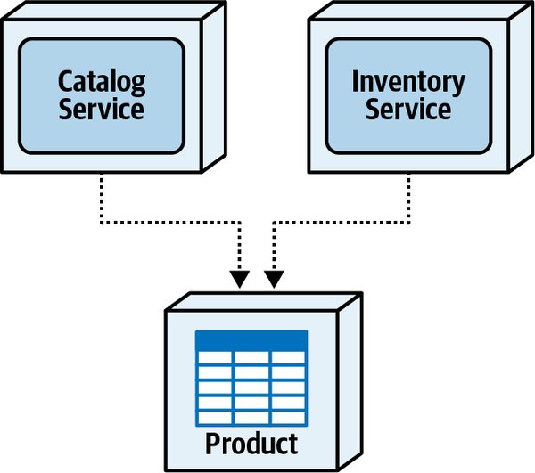

*Hình 9-6. Với sở hữu chung, các service có thể dùng chung dữ liệu bằng kỹ thuật data domain (schema dùng chung)*

Dù việc dùng chung dữ liệu nhìn chung không được khuyến khích trong các architecture phân tán<a id="idm45798378175928"></a> (đặc biệt với microservices), nó giải quyết được một số vấn đề về performance, availability và tính nhất quán dữ liệu gặp phải trong các kỹ thuật sở hữu chung khác. Vì các service không phụ thuộc vào nhau, Catalog Service có thể tạo hoặc gỡ sản phẩm mà không cần phối hợp với Inventory Service, và Inventory Service có thể điều chỉnh tồn kho mà không cần Catalog Service. Cả hai service trở nên hoàn toàn độc lập với nhau.

> **Mẹo**
>
> Khi chọn kỹ thuật data domain, hãy luôn đánh giá lại vì sao cần các service<a id="idm45798378173352"></a> riêng biệt khi dữ liệu là chung cho mỗi service. Các lý do biện minh có thể bao gồm khác biệt về scalability, nhu cầu fault-tolerance, khác biệt về throughput, hoặc cô lập code volatility (xem [Chương 7](ch07_service_granularity.vi.md#ch07-service-granularity)).

Đáng tiếc là việc dùng chung dữ liệu trong một architecture phân tán đưa vào một số vấn đề, vấn đề đầu tiên là công sức gia tăng cho các thay đổi đối với cấu trúc dữ liệu (như thay đổi schema của một bảng). Vì một bounded context rộng hơn được hình thành giữa các service và dữ liệu, các thay đổi đối với cấu trúc bảng dùng chung có thể đòi hỏi những thay đổi đó được phối hợp giữa nhiều service. Điều này làm tăng công sức phát triển, phạm vi testing và rủi ro deployment.

Một vấn đề khác với kỹ thuật data domain liên quan đến quyền sở hữu dữ liệu là kiểm soát service nào có trách nhiệm ghi vào dữ liệu nào. Trong một số trường hợp, điều này có thể không quan trọng, nhưng nếu việc kiểm soát thao tác ghi vào một số dữ liệu nhất định là quan trọng, cần thêm công sức để áp dụng các quy tắc governance cụ thể nhằm duy trì quyền sở hữu ghi cụ thể theo bảng hoặc cột.

[Bảng 9-2](#table-ownership-domain-trade-offs) tóm tắt các trade-offs gắn với kỹ thuật data domain cho kịch bản sở hữu chung.<a id="idm45798378133016"></a><a id="idm45798378132344"></a><a id="idm45798378131672"></a><a id="idm45798378131000"></a>

> **Các đánh đổi (Trade-Offs)**
>
> <a id="table-ownership-domain-trade-offs"></a>
>
> <a id="table-ownership-domain-trade-offs"></a>*Bảng 9-2. Các trade-offs của kỹ thuật data-domain cho sở hữu chung*
>
> | Ưu điểm | Nhược điểm |
> |---|---|
> | Performance truy cập dữ liệu tốt | Thay đổi data schema liên quan đến nhiều service hơn |
> | Không có vấn đề scalability và throughput | Phạm vi testing tăng cho các thay đổi data schema |
> | Dữ liệu luôn nhất quán | Governance quyền sở hữu dữ liệu (trách nhiệm ghi) |
> | Không phụ thuộc service | Rủi ro deployment tăng cho các thay đổi data schema |

<a id="idm45798378188392"></a>

### Kỹ thuật ủy quyền (Delegate Technique)

Một phương pháp thay thế để xử lý kịch bản sở hữu chung là *kỹ thuật delegate* (ủy quyền). <a id="ch09-dtjd"></a><a id="ch09-dtjd2"></a><a id="ch09-dtjd3"></a>Với kỹ thuật này, một service được giao quyền sở hữu đơn đối với bảng và trở thành delegate, còn service kia (hoặc các service khác) giao tiếp với delegate để thực hiện cập nhật thay mặt cho mình.

Một trong những thách thức của kỹ thuật delegate là biết nên giao service nào làm delegate (chủ sở hữu duy nhất của bảng). Lựa chọn thứ nhất, gọi là *primary domain priority* (ưu tiên domain chính), giao quyền sở hữu bảng cho service đại diện gần nhất cho domain chính của dữ liệu—nói cách khác, service thực hiện phần lớn các thao tác CRUD trên thực thể chính cho thực thể cụ thể trong domain đó. Lựa chọn thứ hai, gọi là *operational characteristics priority* (ưu tiên đặc điểm vận hành), giao quyền sở hữu bảng cho service cần các architecture characteristic vận hành cao hơn, như performance, scalability, availability và throughput.

Để minh họa hai lựa chọn này và các trade-offs tương ứng gắn với từng lựa chọn, hãy xét kịch bản sở hữu chung giữa Catalog Service và Inventory Service thể hiện trong [Hình 9-4](#fig-data-access-and-update-joint-ownership). Trong ví dụ này, Catalog Service chịu trách nhiệm tạo, cập nhật và gỡ bỏ sản phẩm, cũng như truy xuất thông tin sản phẩm; Inventory Service chịu trách nhiệm truy xuất và cập nhật lượng tồn kho sản phẩm cũng như biết khi nào cần bổ sung hàng nếu tồn kho quá thấp.

Với lựa chọn primary domain priority, service thực hiện phần lớn các thao tác CRUD trên thực thể chính trở thành chủ sở hữu của bảng. Như minh họa trong [Hình 9-7](#fig-data-access-and-update-joint-delegate-catalog), vì Catalog Service thực hiện phần lớn các thao tác CRUD trên thông tin sản phẩm, Catalog Service sẽ được giao làm chủ sở hữu duy nhất của bảng. Điều này có nghĩa là Inventory service phải giao tiếp với Catalog Service để truy xuất hoặc cập nhật lượng tồn kho vì nó không sở hữu bảng.

<a id="fig-data-access-and-update-joint-delegate-catalog"></a>

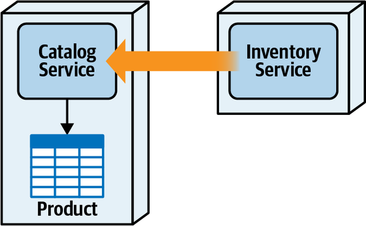

*Hình 9-7. Quyền sở hữu bảng được giao cho Catalog service vì ưu tiên domain*

Giống như kịch bản sở hữu phổ biến được mô tả trước đó, kỹ thuật delegate<a id="idm45798378104984"></a><a id="idm45798378103656"></a> luôn buộc phải có giao tiếp interservice giữa các service khác cần cập nhật dữ liệu. Hãy để ý trong [Hình 9-7](#fig-data-access-and-update-joint-delegate-catalog) rằng Inventory Service phải gửi các cập nhật tồn kho qua một loại giao thức truy cập từ xa nào đó tới Catalog Service để nó có thể thực hiện các cập nhật và đọc tồn kho thay mặt cho Inventory Service. <a id="idm45798378101112"></a><a id="idm45798378100136"></a>Giao tiếp này có thể đồng bộ hoặc bất đồng bộ. Như mọi khi trong software architecture, lại thêm phân tích trade-off cần xem xét.

Với giao tiếp đồng bộ, Inventory Service phải chờ Catalog Service cập nhật tồn kho, điều này ảnh hưởng đến performance tổng thể nhưng bảo đảm tính nhất quán dữ liệu. Dùng giao tiếp bất đồng bộ để gửi các cập nhật tồn kho khiến Inventory Service hoạt động nhanh hơn nhiều, nhưng dữ liệu chỉ nhất quán cuối cùng (eventually consistent). Hơn nữa, với giao tiếp bất đồng bộ, vì có thể xảy ra lỗi trong Catalog Service khi đang cố cập nhật tồn kho, Inventory Service không có gì bảo đảm rằng tồn kho đã từng được cập nhật, ảnh hưởng đến cả tính toàn vẹn dữ liệu.

Với lựa chọn operational characteristics priority, vai trò sở hữu sẽ bị đảo ngược vì các cập nhật tồn kho xảy ra với tốc độ nhanh hơn nhiều so với dữ liệu sản phẩm tĩnh. Trong trường hợp này, quyền sở hữu bảng sẽ được giao cho Inventory Service, với lý do biện minh là việc cập nhật tồn kho sản phẩm là một phần của xử lý transaction real-time thường xuyên khi mua sản phẩm, trái ngược với tác vụ quản trị ít thường xuyên hơn là cập nhật thông tin sản phẩm hoặc thêm và gỡ sản phẩm (xem [Hình 9-8](#fig-data-access-and-update-joint-delegate-inventory)).

Với lựa chọn này, các cập nhật thường xuyên đối với lượng tồn kho có thể dùng lời gọi database trực tiếp thay vì các giao thức truy cập từ xa, do đó làm cho các thao tác tồn kho nhanh hơn nhiều và đáng tin cậy hơn. Ngoài ra, dữ liệu biến động nhất (lượng tồn kho) được giữ ở mức nhất quán cao.

<a id="fig-data-access-and-update-joint-delegate-inventory"></a>

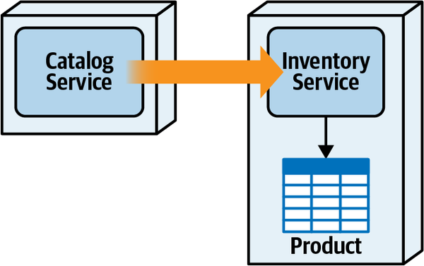

*Hình 9-8. Quyền sở hữu bảng được giao cho Inventory Service vì ưu tiên đặc điểm vận hành*

Tuy nhiên, một vấn đề lớn với sơ đồ minh họa trong [Hình 9-8](#fig-data-access-and-update-joint-delegate-inventory) là trách nhiệm quản lý domain. Inventory Service chịu trách nhiệm quản lý tồn kho sản phẩm, chứ không phải hoạt động database (và xử lý lỗi tương ứng) cho việc thêm, gỡ bỏ và cập nhật thông tin sản phẩm tĩnh. Vì lý do này, chúng tôi thường khuyến nghị lựa chọn domain priority, và tận dụng những thứ như in-memory cache được replicate hoặc distributed cache để giúp xử lý các vấn đề về performance và fault-tolerance.

Bất kể service nào được giao làm delegate (chủ sở hữu bảng duy nhất), kỹ thuật delegate có một số nhược điểm, lớn nhất là coupling giữa các service và nhu cầu giao tiếp interservice. Điều này đến lượt nó dẫn đến các vấn đề khác cho các service không phải delegate, bao gồm việc thiếu atomic transaction khi thực hiện thao tác ghi, performance thấp do latency mạng và xử lý, và fault tolerance thấp. Vì những vấn đề này, kỹ thuật delegate nhìn chung phù hợp hơn cho các kịch bản ghi database không đòi hỏi atomic transaction và có thể chấp nhận eventual consistency thông qua giao tiếp bất đồng bộ.<a id="idm45798378090232"></a><a id="idm45798378089528"></a>

[Bảng 9-3](#table-ownership-delegate-trade-offs) tóm tắt các trade-offs tổng thể của kỹ thuật delegate.<a id="idm45798378087480"></a><a id="idm45798378086808"></a><a id="idm45798378086136"></a>

> **Các đánh đổi (Trade-Offs)**
>
> <a id="table-ownership-delegate-trade-offs"></a>
>
> <a id="table-ownership-delegate-trade-offs"></a>*Bảng 9-3. Các trade-offs của kỹ thuật delegate cho sở hữu chung*
>
> | Ưu điểm | Nhược điểm |
> |---|---|
> | Hình thành sở hữu bảng đơn | Mức coupling giữa các service cao |
> | Kiểm soát thay đổi data schema tốt | Performance thấp cho thao tác ghi của bên không sở hữu |
> | Trừu tượng hóa cấu trúc dữ liệu khỏi các service khác | Không có atomic transaction cho thao tác ghi của bên không sở hữu |
> |  | Fault tolerance thấp cho các service không sở hữu |

<a id="idm45798378118280"></a>

## Kỹ thuật hợp nhất service (Service Consolidation Technique)

Cách tiếp cận delegate được thảo luận ở phần trước làm nổi bật<a id="idm45798378072184"></a><a id="idm45798378071448"></a><a id="idm45798378070232"></a><a id="idm45798378069272"></a><a id="idm45798378068040"></a><a id="idm45798378066808"></a> vấn đề chính gắn với sở hữu chung—phụ thuộc service. *Kỹ thuật service consolidation* (hợp nhất service) giải quyết phụ thuộc service và xử lý sở hữu chung bằng cách gộp nhiều chủ sở hữu bảng (service) thành một service hợp nhất duy nhất, nhờ đó chuyển sở hữu chung thành một kịch bản sở hữu đơn (xem [Hình 9-9](#fig-data-access-and-update-joint-consolidate)).

<a id="fig-data-access-and-update-joint-consolidate"></a>

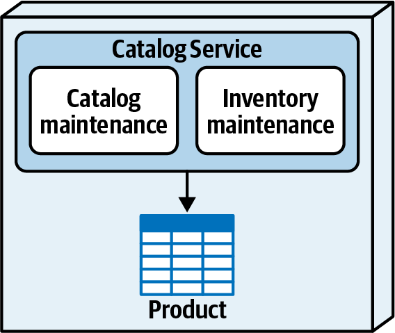

*Hình 9-9. Quyền sở hữu bảng được giải quyết bằng cách gộp các service*

Giống như kỹ thuật data domain, kỹ thuật này giải quyết các vấn đề gắn với phụ thuộc service và performance, đồng thời xử lý vấn đề sở hữu chung. Tuy nhiên, giống như các kỹ thuật khác, nó cũng có phần trade-offs của riêng mình.

Gộp các service tạo ra một service coarse-grained hơn, do đó làm tăng phạm vi testing tổng thể cũng như rủi ro deployment tổng thể (khả năng làm hỏng thứ gì đó khác trong service khi thêm một tính năng mới hoặc sửa một bug). Hợp nhất service cũng có thể ảnh hưởng đến fault tolerance tổng thể vì mọi phần của service cùng thất bại.

Scalability tổng thể cũng bị ảnh hưởng khi dùng kỹ thuật service consolidation<a id="idm45798378060520"></a> vì *mọi* phần của service phải scale như nhau, dù một số chức năng có thể không cần scale ở cùng mức với các chức năng khác. Ví dụ, trong [Hình 9-9](#fig-data-access-and-update-joint-consolidate), chức năng duy trì catalog (trước đây nằm trong một service `Catalog` riêng) phải scale một cách không cần thiết để đáp ứng nhu cầu cao của chức năng truy xuất và cập nhật tồn kho.

[Bảng 9-4](#table-ownership-consolidation-trade-offs) tóm tắt các trade-offs tổng thể của kỹ thuật service consolidation.

> **Các đánh đổi (Trade-Offs)**
>
> <a id="table-ownership-consolidation-trade-offs"></a>
>
> <a id="table-ownership-consolidation-trade-offs"></a>*Bảng 9-4. Các trade-offs của kỹ thuật service consolidation cho sở hữu chung*
>
> | Ưu điểm | Nhược điểm |
> |---|---|
> | Giữ được atomic transaction | Scalability coarse-grained hơn |
> | Performance tổng thể tốt | Fault tolerance kém hơn |
> |  | Rủi ro deployment tăng |
> |  | Phạm vi testing tăng |

<a id="idm45798378045016"></a>

## Tóm tắt quyền sở hữu dữ liệu (Data Ownership Summary)

[Hình 9-10](#fig-data-access-and-update-ownership-after) thể hiện kết quả<a id="idm45798378042952"></a><a id="idm45798378041704"></a><a id="idm45798378040760"></a> giao quyền sở hữu bảng từ [Hình 9-1](#fig-data-access-and-update-ownership-before) sau khi áp dụng các kỹ thuật được mô tả trong phần này. Với kịch bản bảng đơn liên quan đến Wishlist Service, chúng tôi chỉ đơn giản giao quyền sở hữu cho Wishlist Service, hình thành một bounded context chặt chẽ giữa service và bảng. Với kịch bản sở hữu phổ biến liên quan đến bảng audit, chúng tôi tạo một Audit Service mới, với mọi service khác gửi một message bất đồng bộ tới một persisted queue. Cuối cùng, với kịch bản sở hữu chung phức tạp hơn liên quan đến bảng product với Catalog Service và Inventory Service, chúng tôi chọn dùng kỹ thuật delegate, giao quyền sở hữu đơn bảng product cho Catalog Service, với Inventory Service gửi các request cập nhật tới Catalog Service.

Một khi quyền sở hữu bảng đã được giao cho các service, kiến trúc sư phải kiểm chứng việc giao quyền sở hữu bảng bằng cách phân tích các workflow nghiệp vụ và các yêu cầu transaction tương ứng của chúng.

<a id="fig-data-access-and-update-ownership-after"></a>

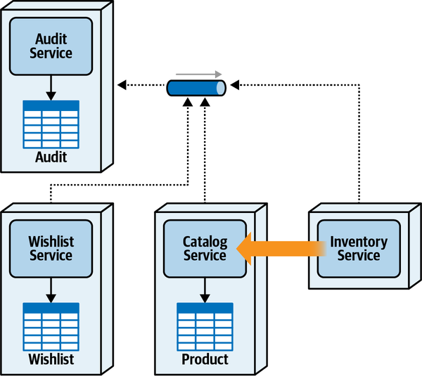

*Hình 9-10. Quyền sở hữu dữ liệu kết quả dùng kỹ thuật delegate cho sở hữu chung*

<a id="sec-acid-vs-base"></a>

## Transaction phân tán (Distributed Transactions)

Khi kiến trúc sư và developer nghĩ về transaction, họ thường <a id="ch09-acid"></a><a id="ch09-acid3"></a><a id="ch09-acid2"></a>nghĩ về một đơn vị công việc nguyên tử duy nhất trong đó nhiều cập nhật database hoặc được commit cùng nhau hoặc tất cả bị rollback khi xảy ra lỗi. Loại atomic transaction này thường được gọi là *ACID transaction*. Như đã lưu ý trong Chương 6, ACID là một từ viết tắt mô tả các thuộc tính cơ bản của một database transaction nguyên tử single-unit-of-work: atomicity, consistency, isolation và durability.

Để hiểu transaction phân tán hoạt động thế nào và các trade-offs liên quan khi dùng transaction phân tán, cần hiểu đầy đủ bốn thuộc tính của một ACID transaction. Chúng tôi tin chắc rằng không hiểu ACID transaction, kiến trúc sư không thể thực hiện phân tích trade-off cần thiết để biết khi nào (và khi nào không) nên dùng transaction phân tán. Do đó, chúng tôi sẽ đi sâu vào chi tiết của ACID transaction trước, rồi mô tả chúng khác với transaction phân tán thế nào.<a id="idm45798378026584"></a>

*Atomicity* (tính nguyên tử) nghĩa là một transaction phải hoặc commit hoặc rollback *toàn bộ* các cập nhật của nó trong một đơn vị công việc duy nhất, bất kể số lượng cập nhật được thực hiện trong transaction đó. Nói cách khác, mọi cập nhật được coi là một tổng thể chung, nên mọi thay đổi hoặc được commit hoặc bị rollback như một đơn vị. Ví dụ, giả sử việc đăng ký một khách hàng bao gồm chèn thông tin hồ sơ khách hàng vào bảng Customer Profile, chèn thông tin thẻ tín dụng vào bảng Wallet, và chèn thông tin security-related vào bảng Security. Giả sử thông tin hồ sơ và thẻ tín dụng được chèn thành công, nhưng việc chèn thông tin security thất bại. Với atomicity, các thao tác chèn hồ sơ và thẻ tín dụng sẽ bị rollback, giữ các bảng database đồng bộ.

*Consistency* (tính nhất quán) nghĩa là trong suốt quá trình một transaction,<a id="idm45798378023016"></a> database sẽ không bao giờ bị để ở trạng thái không nhất quán hoặc vi phạm bất kỳ ràng buộc toàn vẹn nào được chỉ định trong database. Ví dụ, trong một ACID transaction, hệ thống không thể thêm một bản ghi chi tiết (như một item) mà không thêm bản ghi tổng hợp tương ứng trước (như một order). Dù một số database trì hoãn việc kiểm tra này đến thời điểm commit, nhìn chung lập trình viên không thể vi phạm các ràng buộc nhất quán như ràng buộc foreign-key trong quá trình một transaction.

*Isolation* (tính cô lập) chỉ mức độ mà các transaction <a id="idm45798378020664"></a>riêng lẻ tương tác với nhau. Isolation bảo vệ dữ liệu transaction chưa commit khỏi bị các transaction khác nhìn thấy trong quá trình request nghiệp vụ. Ví dụ, trong quá trình một ACID transaction, khi thông tin hồ sơ khách hàng được chèn vào bảng Customer Profile, không service nào khác bên ngoài phạm vi ACID transaction có thể truy cập thông tin mới chèn cho đến khi toàn bộ transaction được commit.

*Durability* (tính bền vững) nghĩa là một khi có phản hồi thành công từ một<a id="idm45798378017896"></a> lần commit transaction, *mọi* cập nhật dữ liệu được bảo đảm là vĩnh viễn, bất kể các sự cố hệ thống sau đó.

Để minh họa một ACID transaction, giả sử một khách hàng đăng ký ứng dụng Sysops Squad<a id="idm45798378015272"></a><a id="idm45798378013976"></a><a id="idm45798378012744"></a> nhập toàn bộ thông tin hồ sơ, các sản phẩm điện tử họ muốn gói hỗ trợ bao phủ, và thông tin thanh toán trên một màn hình giao diện người dùng duy nhất. Thông tin này sau đó được gửi tới Customer Service duy nhất, như thể hiện trong [Hình 9-11](#fig-data-access-and-update-acid-transaction), service này sau đó thực hiện toàn bộ hoạt động database gắn với request nghiệp vụ đăng ký khách hàng.

<a id="fig-data-access-and-update-acid-transaction"></a>

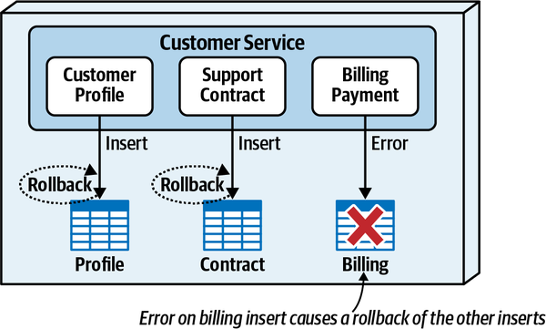

*Hình 9-11. Với ACID transaction, một lỗi khi chèn thông tin thanh toán gây rollback các thao tác chèn vào các bảng khác*

Trước hết, hãy để ý rằng với ACID transaction, vì xảy ra lỗi khi cố chèn thông tin thanh toán, cả thông tin hồ sơ lẫn thông tin hợp đồng hỗ trợ đã được chèn trước đó giờ đều bị rollback (đó là phần *atomicity* và *consistency* của ACID). Dù không được minh họa trong sơ đồ, dữ liệu được chèn vào mỗi bảng trong quá trình transaction không hiển thị với các request khác (đó là phần *isolation* của ACID).

Lưu ý rằng ACID transaction có thể tồn tại *trong bối cảnh của mỗi service* trong một architecture phân tán, nhưng chỉ khi database tương ứng cũng hỗ trợ các thuộc tính ACID. Mỗi service có thể thực hiện commit và rollback của riêng mình đối với các bảng nó sở hữu trong phạm vi business transaction nguyên tử. <a id="idm45798378004712"></a><a id="idm45798378003704"></a><a id="idm45798378002472"></a>Tuy nhiên, nếu request nghiệp vụ trải qua nhiều service, bản thân toàn bộ request nghiệp vụ không thể là một ACID transaction—thay vào đó, nó trở thành một *transaction phân tán* (distributed transaction).

Transaction phân tán xảy ra khi một request nghiệp vụ nguyên tử chứa nhiều cập nhật database được thực hiện bởi các service từ xa được deploy riêng. Hãy để ý trong [Hình 9-12](#fig-data-access-and-update-distributed-transaction) rằng cùng request đăng ký khách hàng mới (được biểu thị bằng hình laptop đại diện cho khách hàng gửi request) giờ được trải qua ba service được deploy riêng—một Customer Profile Service, một Support Contract Service, và một Billing Payment Service.

<a id="fig-data-access-and-update-distributed-transaction"></a>

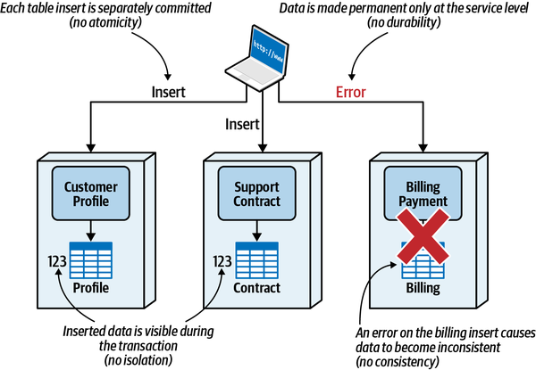

*Hình 9-12. Transaction phân tán không hỗ trợ các thuộc tính ACID*

Như bạn thấy, transaction phân tán không hỗ trợ các thuộc tính ACID.

*Atomicity* không được hỗ trợ vì mỗi service được deploy riêng<a id="idm45798377995592"></a> commit dữ liệu của riêng nó và chỉ thực hiện một phần của request nghiệp vụ nguyên tử tổng thể. Trong một transaction phân tán, atomicity gắn với *service*, không phải với *request nghiệp vụ* (như đăng ký khách hàng).

*Consistency* không được hỗ trợ vì một lỗi ở một service khiến<a id="idm45798377992744"></a> dữ liệu mất đồng bộ giữa các bảng chịu trách nhiệm cho request nghiệp vụ. Như thể hiện trong [Hình 9-12](#fig-data-access-and-update-distributed-transaction), vì thao tác chèn của Billing Payment Service thất bại, bảng Profile và bảng Contract giờ mất đồng bộ với bảng Billing (chúng tôi sẽ trình bày cách xử lý những vấn đề này ở phần sau của mục này). Consistency cũng bị ảnh hưởng vì các ràng buộc relational database truyền thống (như foreign key luôn khớp với một primary key) không thể được áp dụng trong mỗi lần commit của từng service riêng lẻ.

*Isolation* không được hỗ trợ vì một khi Customer Profile Service chèn<a id="idm45798377989144"></a> dữ liệu hồ sơ trong quá trình một transaction phân tán để đăng ký khách hàng, thông tin hồ sơ đó có sẵn cho bất kỳ service hay request nào khác, dù quy trình đăng ký khách hàng (transaction hiện tại) chưa hoàn tất.

*Durability* không được hỗ trợ xuyên suốt request nghiệp vụ—nó chỉ được hỗ trợ cho từng service riêng lẻ.<a id="idm45798377986888"></a> Nói cách khác, bất kỳ lần commit dữ liệu riêng lẻ nào cũng không bảo đảm rằng *mọi* dữ liệu trong phạm vi toàn bộ business transaction là vĩnh viễn.

Thay vì ACID, transaction phân tán hỗ trợ một thứ gọi là *BASE*. <a id="idm45798377984072"></a><a id="idm45798377982824"></a><a id="idm45798377981864"></a><a id="idm45798377981224"></a>Trong hóa học, một chất *acid* và một chất *base* hoàn toàn đối lập nhau. Điều tương tự cũng đúng với atomic transaction và transaction phân tán—ACID transaction đối lập với BASE transaction. BASE mô tả các thuộc tính của một transaction phân tán: basic availability, soft state và eventual consistency.

*Basic availability* (phần “BA” của BASE) nghĩa là mọi<a id="idm45798377978360"></a> service hoặc hệ thống trong transaction phân tán đều được kỳ vọng sẵn sàng để tham gia vào transaction phân tán. Dù giao tiếp bất đồng bộ có thể giúp decouple các service và xử lý các vấn đề availability gắn với các bên tham gia transaction phân tán, đáng tiếc là nó ảnh hưởng đến thời gian để dữ liệu trở nên nhất quán đối với business transaction nguyên tử (xem eventual consistency ở phần sau của mục này).

*Soft state* (phần *S* của BASE) mô tả tình huống một<a id="idm45798377975416"></a> transaction phân tán đang diễn ra và trạng thái của request nghiệp vụ nguyên tử chưa hoàn tất (hoặc trong một số trường hợp thậm chí còn chưa biết). Trong ví dụ đăng ký khách hàng thể hiện ở [Hình 9-12](#fig-data-access-and-update-distributed-transaction), soft state xảy ra khi thông tin hồ sơ khách hàng đã được chèn (và commit) vào bảng Profile, nhưng thông tin hợp đồng hỗ trợ và thanh toán thì chưa. Phần chưa biết của soft state có thể xảy ra nếu, dùng cùng ví dụ, cả ba service làm việc song song để chèn dữ liệu tương ứng của chúng—trạng thái chính xác của request nghiệp vụ nguyên tử không được biết tại bất kỳ thời điểm nào cho đến khi *cả ba* service báo lại rằng dữ liệu đã được xử lý thành công. Trong trường hợp một workflow dùng giao tiếp bất đồng bộ (xem [Chương 11](ch11_managing_distributed_workflows.vi.md#ch11-managing-workflows)), trạng thái in-progress (đang diễn ra) hoặc trạng thái cuối cùng của transaction phân tán thường khó xác định.

*Eventual consistency* (phần *E* của BASE) nghĩa là khi có đủ thời gian, <a id="idm45798377970616"></a><a id="idm45798377969640"></a>mọi phần của transaction phân tán sẽ hoàn tất thành công và mọi dữ liệu đều đồng bộ với nhau. Loại eventual consistency pattern được dùng và cách xử lý lỗi quyết định sẽ mất bao lâu để mọi nguồn dữ liệu tham gia transaction phân tán trở nên nhất quán.

Phần tiếp theo mô tả ba loại eventual consistency pattern và các trade-offs tương ứng gắn với từng pattern.<a id="idm45798377967416"></a><a id="idm45798377966712"></a><a id="idm45798377966040"></a>

<a id="idm45798378034040"></a>

## Các pattern eventual consistency (Eventual Consistency Patterns)

Các architecture phân tán dựa nhiều vào eventual consistency như một<a id="idm45798377964168"></a><a id="idm45798377962824"></a><a id="idm45798377961608"></a><a id="idm45798377960664"></a><a id="idm45798377959448"></a><a id="idm45798377957944"></a> trade-off để có các architecture characteristic vận hành tốt hơn như performance, scalability, elasticity, fault tolerance và availability. Dù có nhiều cách để đạt được eventual consistency giữa các nguồn dữ liệu và hệ thống, ba pattern chính đang được dùng ngày nay là background synchronization pattern, orchestrated request-based pattern, và event-based pattern.

Để mô tả rõ hơn từng pattern và minh họa cách chúng hoạt động, hãy xét lại quy trình đăng ký khách hàng từ ứng dụng Sysops Squad mà chúng tôi đã thảo luận trước đó trong [Hình 9-13](#fig-data-access-and-update-base-example). Trong ví dụ này, ba service riêng biệt tham gia quy trình đăng ký khách hàng: một Customer Profile Service duy trì thông tin hồ sơ cơ bản, một Support Contract Service duy trì các sản phẩm được gói sửa chữa Sysops Squad bao phủ cho mỗi khách hàng, và một Billing Payment Service thu phí khách hàng cho gói hỗ trợ. Hãy để ý trong hình rằng khách hàng 123 là người đăng ký dịch vụ Sysops Squad, và do đó có dữ liệu trong mỗi bảng tương ứng thuộc sở hữu của mỗi service.

<a id="fig-data-access-and-update-base-example"></a>

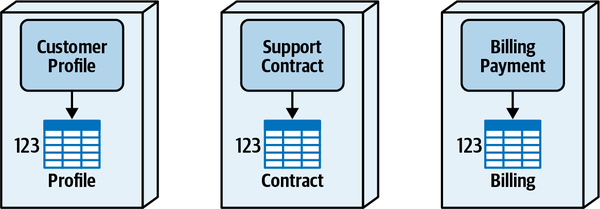

*Hình 9-13. Khách hàng 123 là người đăng ký trong ứng dụng Sysops Squad*

Khách hàng 123 quyết định họ không còn quan tâm đến gói hỗ trợ Sysops Squad, nên họ hủy đăng ký dịch vụ. Như thể hiện trong [Hình 9-14](#fig-data-access-and-update-base-unsubscribe), Customer Profile Service nhận request này từ giao diện người dùng, gỡ khách hàng khỏi bảng Profile, và trả về xác nhận cho khách hàng rằng họ đã hủy đăng ký thành công và sẽ không bị tính phí nữa. Tuy nhiên, dữ liệu của khách hàng đó vẫn còn tồn tại trong bảng Contract thuộc sở hữu của Support Contract Service và bảng Billing thuộc sở hữu của Billing Payment Service.

<a id="fig-data-access-and-update-base-unsubscribe"></a>

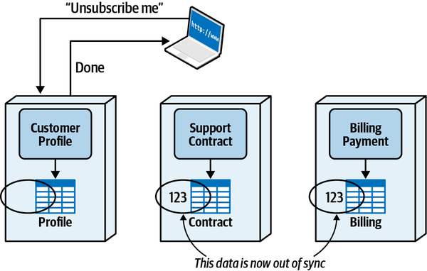

*Hình 9-14. Dữ liệu mất đồng bộ sau khi khách hàng hủy đăng ký gói hỗ trợ*

Chúng tôi sẽ dùng kịch bản này để mô tả từng eventual consistency pattern nhằm đưa mọi dữ liệu về trạng thái đồng bộ cho request nghiệp vụ nguyên tử này.

<a id="idm45798377947608"></a>

### Pattern đồng bộ nền (Background Synchronization Pattern)

*Background synchronization pattern* (pattern đồng bộ nền) dùng một service<a id="ch09-eve"></a><a id="ch09-eve2"></a><a id="ch09-eve3"></a> hoặc tiến trình bên ngoài riêng biệt để định kỳ kiểm tra các nguồn dữ liệu và giữ chúng đồng bộ với nhau. Khoảng thời gian để các nguồn dữ liệu trở nên nhất quán cuối cùng khi dùng pattern này có thể khác nhau tùy theo tiến trình nền được hiện thực như một batch job chạy vào khoảng giữa đêm, hay một service thức dậy định kỳ (chẳng hạn, mỗi giờ) để kiểm tra tính nhất quán của các nguồn dữ liệu.

Bất kể tiến trình nền được hiện thực thế nào (batch hằng đêm hay định kỳ), pattern này thường có khoảng thời gian dài nhất để các nguồn dữ liệu trở nên nhất quán. Tuy nhiên, trong nhiều trường hợp, các nguồn dữ liệu không cần được giữ đồng bộ ngay lập tức. Hãy xét ví dụ khách hàng hủy đăng ký trong [Hình 9-14](#fig-data-access-and-update-base-unsubscribe). Một khi khách hàng hủy đăng ký, việc thông tin hợp đồng hỗ trợ và thanh toán của khách hàng đó vẫn còn tồn tại thực sự không quan trọng. Trong trường hợp này, eventual consistency được thực hiện trong đêm là khoảng thời gian đủ để đưa dữ liệu về đồng bộ.

Một trong những thách thức của pattern này là tiến trình nền dùng để giữ mọi dữ liệu đồng bộ phải biết dữ liệu nào đã thay đổi. Việc này có thể được thực hiện thông qua một event stream, một database trigger, hoặc đọc dữ liệu từ các bảng nguồn và căn chỉnh các bảng đích theo dữ liệu nguồn. Bất kể kỹ thuật nào được dùng để xác định thay đổi, tiến trình nền phải có kiến thức về mọi bảng và nguồn dữ liệu tham gia transaction.

[Hình 9-15](#fig-data-access-and-update-base-background) minh họa việc dùng background synchronization pattern cho ví dụ hủy đăng ký của Sysops Squad. Hãy để ý rằng lúc 11:23:00 khách hàng gửi request hủy đăng ký gói hỗ trợ. Customer Profile Service nhận request, gỡ dữ liệu, và một giây sau (11:23:01) phản hồi lại khách hàng rằng họ đã được hủy đăng ký thành công khỏi hệ thống. Sau đó, lúc 23:00 tiến trình đồng bộ batch nền bắt đầu. Tiến trình đồng bộ nền phát hiện rằng khách hàng 123 đã bị gỡ bỏ, thông qua event streaming hoặc qua chênh lệch giữa bảng chính và bảng phụ, và xóa dữ liệu khỏi các bảng Contract và Billing.

Pattern này tốt cho khả năng phản hồi tổng thể vì người dùng cuối không phải chờ toàn bộ business transaction hoàn tất (trong trường hợp này là hủy đăng ký gói hỗ trợ). Nhưng, đáng tiếc là có một số trade-offs nghiêm trọng với eventual consistency pattern này.

<a id="fig-data-access-and-update-base-background"></a>

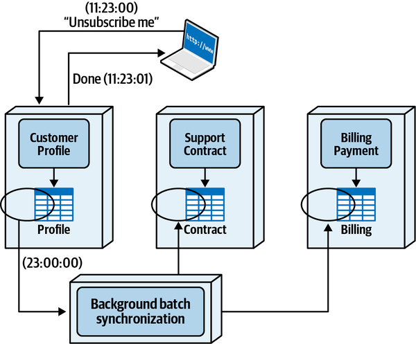

*Hình 9-15. Background synchronization pattern dùng một tiến trình bên ngoài để bảo đảm tính nhất quán dữ liệu*

Nhược điểm lớn nhất của background synchronization pattern là nó couple mọi nguồn dữ liệu với nhau, do đó phá vỡ mọi bounded context giữa dữ liệu và các service. Hãy để ý trong [Hình 9-16](#fig-data-access-and-update-base-background-issue) rằng tiến trình đồng bộ batch nền phải có quyền ghi vào từng bảng thuộc sở hữu của các service tương ứng, nghĩa là mọi bảng thực tế đều có quyền sở hữu chung giữa các service và tiến trình đồng bộ nền.

Quyền sở hữu dữ liệu chung giữa các service và tiến trình đồng bộ nền này đầy rẫy vấn đề, và nhấn mạnh nhu cầu về các bounded context chặt chẽ trong một architecture phân tán. Các thay đổi cấu trúc đối với các bảng thuộc sở hữu của mỗi service (đổi tên cột, xóa cột, v.v.) cũng phải được phối hợp với một tiến trình nền bên ngoài, khiến các thay đổi trở nên khó khăn và time-consuming (tốn thời gian).

Ngoài những khó khăn với kiểm soát thay đổi, còn xảy ra vấn đề liên quan đến business logic bị trùng lặp. Nhìn vào [Hình 9-15](#fig-data-access-and-update-base-background), có vẻ khá đơn giản rằng tiến trình nền sẽ chỉ thực hiện thao tác `DELETE` trên mọi hàng trong các bảng Contract và Billing chứa khách hàng 123. Tuy nhiên, có thể tồn tại một số business rule trong các service này đối với thao tác cụ thể đó.

<a id="fig-data-access-and-update-base-background-issue"></a>

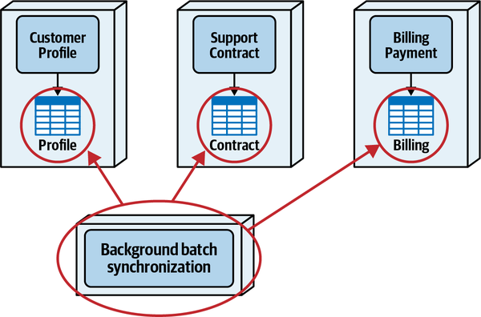

*Hình 9-16. Background synchronization pattern bị coupled với các nguồn dữ liệu, do đó phá vỡ bounded context và quyền sở hữu dữ liệu*

Ví dụ, khi một khách hàng hủy đăng ký, các hợp đồng hỗ trợ và lịch sử thanh toán hiện có của họ được giữ lại trong ba tháng phòng trường hợp khách hàng quyết định đăng ký lại gói hỗ trợ. Do đó, thay vì xóa các hàng trong những bảng đó, một cột `remove_date` được đặt bằng một giá trị long biểu thị ngày các hàng nên được gỡ bỏ (giá trị không trong cột này biểu thị khách hàng đang hoạt động). Cả hai service đều kiểm tra `remove_date` hằng ngày để xác định hàng nào nên được gỡ khỏi bảng tương ứng của chúng. Câu hỏi là, business logic đó nằm ở đâu? Câu trả lời, tất nhiên, là trong Support Contract Service và Billing Payment Service—ồ, và *cả trong tiến trình batch nền nữa!*

Background synchronization eventual consistency pattern không phù hợp với các architecture phân tán đòi hỏi bounded context chặt chẽ (như microservices) nơi coupling giữa quyền sở hữu dữ liệu và chức năng là một phần then chốt của architecture. Những tình huống mà pattern này hữu ích là các hệ thống không đồng nhất khép kín (self-contained) không giao tiếp với nhau hay dùng chung dữ liệu.

Ví dụ, hãy xét một hệ thống nhập đơn hàng của nhà thầu chấp nhận đơn đặt vật liệu xây dựng, và một hệ thống riêng biệt khác (được hiện thực trên một nền tảng khác) thực hiện lập hóa đơn cho nhà thầu. Một khi nhà thầu đặt vật tư, một tiến trình đồng bộ nền chuyển các đơn hàng đó sang hệ thống lập hóa đơn để tạo hóa đơn. Khi nhà thầu thay đổi hoặc hủy một đơn hàng, tiến trình đồng bộ nền chuyển những thay đổi đó sang hệ thống lập hóa đơn để cập nhật hóa đơn. Đây là một ví dụ tốt về các hệ thống trở nên *nhất quán cuối cùng* (eventually consistent), với đơn hàng của nhà thầu luôn đồng bộ giữa hai hệ thống.

[Bảng 9-5](#table-ec-background-trade-offs) tóm tắt các trade-offs của background synchronization pattern cho eventual consistency.<a id="idm45798377920616"></a><a id="idm45798377919944"></a><a id="idm45798377919272"></a>

> **Các đánh đổi (Trade-Offs)**
>
> <a id="table-ec-background-trade-offs"></a>
>
> <a id="table-ec-background-trade-offs"></a>*Bảng 9-5. Các trade-offs của background synchronization pattern*
>
> | Ưu điểm | Nhược điểm |
> |---|---|
> | Các service được decouple | Coupling giữa các nguồn dữ liệu |
> | Khả năng phản hồi tốt | Hiện thực phức tạp |
> |  | Phá vỡ bounded context |
> |  | Business logic có thể bị trùng lặp |
> |  | Eventual consistency chậm |

<a id="idm45798377946984"></a>

### Pattern dựa trên request có orchestration (Orchestrated Request-Based Pattern)

Một cách tiếp cận phổ biến để quản lý transaction phân tán là bảo đảm<a id="ch09-orch"></a><a id="ch09-orch2"></a><a id="ch09-orch3"></a><a id="ch09-orch4"></a> mọi nguồn dữ liệu được đồng bộ trong quá trình request nghiệp vụ (nói cách khác, trong khi người dùng cuối đang chờ). Cách tiếp cận này được hiện thực thông qua cái được gọi là *orchestrated request-based pattern*.

Khác với background synchronization pattern trước đó hay event-based pattern được mô tả trong phần tiếp theo, orchestrated request-based pattern cố gắng xử lý toàn bộ transaction phân tán *trong quá trình request nghiệp vụ*, và do đó đòi hỏi một loại orchestrator nào đó để quản lý transaction phân tán. Orchestrator, có thể là một service hiện có được chỉ định hoặc một service riêng biệt mới, chịu trách nhiệm quản lý mọi công việc cần thiết để xử lý request, bao gồm kiến thức về quy trình nghiệp vụ, kiến thức về các bên tham gia, logic multicast, xử lý lỗi và quyền sở hữu contract.

Một cách để hiện thực pattern này là chỉ định một trong các service chính (giả sử có một service như vậy) để quản lý transaction phân tán. Kỹ thuật này, minh họa trong [Hình 9-17](#fig-data-access-and-update-base-choreographed-request), chỉ định một trong các service đảm nhận vai trò orchestrator bên cạnh các trách nhiệm khác của nó, trong trường hợp này là Customer Profile Service.

<a id="fig-data-access-and-update-base-choreographed-request"></a>

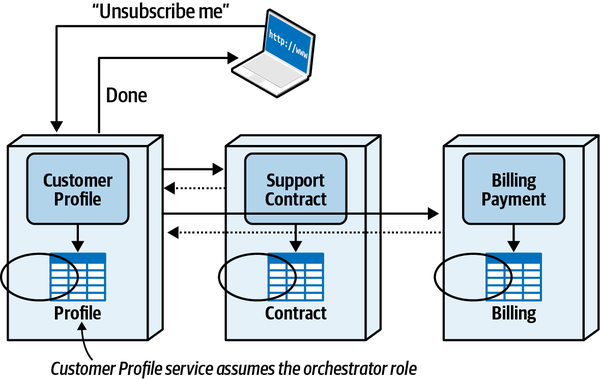

*Hình 9-17. Customer Profile Service đảm nhận vai trò orchestrator cho transaction phân tán*

Dù cách tiếp cận này tránh được nhu cầu về một orchestration service riêng, nó có xu hướng làm quá tải trách nhiệm của service được chỉ định làm orchestrator của transaction phân tán. Ngoài vai trò orchestrator, service được chỉ định quản lý transaction phân tán còn phải thực hiện các trách nhiệm của riêng nó. Một nhược điểm khác của cách tiếp cận này là nó dễ dẫn đến coupling chặt và các phụ thuộc đồng bộ giữa các service.

Cách tiếp cận mà chúng tôi nhìn chung ưa thích khi dùng orchestrated request-based pattern là dùng một orchestration service chuyên trách cho request nghiệp vụ. Cách tiếp cận này, minh họa trong [Hình 9-18](#fig-data-access-and-update-base-orchestrated-request), giải phóng Customer Profile Service khỏi trách nhiệm quản lý transaction phân tán và đặt trách nhiệm đó lên một orchestration service riêng biệt.

Chúng tôi sẽ dùng cách tiếp cận orchestration service riêng biệt này để mô tả eventual consistency pattern này hoạt động thế nào và các trade-offs tương ứng của pattern này.

<a id="fig-data-access-and-update-base-orchestrated-request"></a>

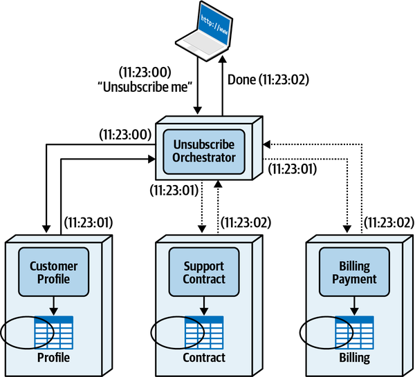

*Hình 9-18. Một orchestration service chuyên trách đảm nhận vai trò orchestrator cho transaction phân tán*

Hãy để ý rằng lúc 11:23:00 khách hàng gửi request hủy đăng ký gói hỗ trợ Sysops Squad. Request được Unsubscribe Orchestrator Service nhận, service này sau đó chuyển tiếp request một cách đồng bộ tới Customer Profile Service để gỡ khách hàng khỏi bảng Profile. Một giây sau, Customer Profile Service gửi lại xác nhận cho Unsubscribe Orchestrator Service, service này sau đó gửi các request song song (thông qua thread hoặc một loại giao thức bất đồng bộ nào đó) tới cả Support Contract Service và Billing Payment Service. Cả hai service này xử lý request hủy đăng ký, rồi gửi lại xác nhận một giây sau đó tới Unsubscribe Orchestrator Service cho biết chúng đã xử lý xong request. Giờ khi mọi dữ liệu đã đồng bộ, Unsubscribe Orchestrator Service phản hồi lại client lúc 11:23:02 (hai giây sau khi request ban đầu được gửi), cho khách hàng biết họ đã hủy đăng ký thành công.

Về trade-off đầu tiên cần quan sát, cách tiếp cận orchestration nhìn chung ưu tiên tính nhất quán dữ liệu hơn khả năng phản hồi. Thêm một orchestration service chuyên trách không chỉ thêm các network hop và lời gọi service bổ sung, mà tùy thuộc vào việc orchestrator thực thi các lời gọi tuần tự hay song song, còn cần thêm thời gian cho giao tiếp back-and-forth (qua lại) giữa orchestrator và các service nó đang gọi.

Thời gian phản hồi có thể được cải thiện trong [Hình 9-18](#fig-data-access-and-update-base-orchestrated-request) bằng cách thực thi request Customer Profile cùng lúc với các service khác, nhưng chúng tôi chọn thực hiện thao tác đó một cách đồng bộ vì lý do xử lý lỗi và tính nhất quán. Ví dụ, nếu khách hàng không thể bị xóa khỏi bảng Profile vì một khoản phí thanh toán còn tồn đọng, thì không cần hành động nào khác để đảo ngược các thao tác trong Support Contract Service và Billing Payment Service. Đây là một ví dụ khác về việc ưu tiên tính nhất quán hơn khả năng phản hồi.

Bên cạnh khả năng phản hồi, trade-off còn lại của pattern này là xử lý lỗi phức tạp. Dù orchestrated request-based pattern có vẻ đơn giản, hãy xét điều gì xảy ra khi khách hàng đã bị gỡ khỏi bảng Profile và bảng Contract, nhưng xảy ra lỗi khi cố gỡ thông tin thanh toán khỏi bảng Billing, như minh họa trong [Hình 9-19](#fig-data-access-and-update-base-orchestrated-request-issue). Vì Profile Service và Support Contract Service đã commit riêng các thao tác của mình, Unsubscribe Orchestrator Service giờ phải quyết định hành động gì *trong khi khách hàng đang chờ request được xử lý*:

1. Orchestrator có nên gửi lại request tới Billing Payment Service để thử lại không?
2. Orchestrator có nên thực hiện một compensating transaction và yêu cầu Support Contract Service và Customer Profile Service đảo ngược các thao tác cập nhật của chúng không?
3. Orchestrator có nên phản hồi cho khách hàng rằng đã xảy ra lỗi và chờ một chút trước khi thử lại, trong khi cố gắng sửa chữa sự không nhất quán không?
4. Orchestrator có nên bỏ qua lỗi với hy vọng một tiến trình khác sẽ xử lý vấn đề và phản hồi cho khách hàng rằng họ đã hủy đăng ký thành công không?

Kịch bản real-world này tạo ra một tình huống rắc rối cho orchestrator. Vì đây *là* eventual consistency pattern được dùng, không có phương tiện nào khác để sửa dữ liệu và đưa mọi thứ về đồng bộ (do đó loại bỏ các lựa chọn 3 và 4 trong danh sách trên). Trong trường hợp này, <a id="idm45798377874552"></a><a id="idm45798377873288"></a><a id="idm45798377872328"></a>lựa chọn thực sự duy nhất cho orchestrator là cố gắng đảo ngược transaction phân tán—nói cách khác, gửi một *compensating update* để chèn lại khách hàng vào bảng Profile và đặt lại cột `remove_date` trong bảng Contract về không. Điều này sẽ đòi hỏi orchestrator có mọi thông tin cần thiết để chèn lại khách hàng, và không có tác dụng phụ nào xảy ra khi tạo khách hàng mới (như khởi tạo thông tin thanh toán hoặc hợp đồng hỗ trợ).

<a id="fig-data-access-and-update-base-orchestrated-request-issue"></a>

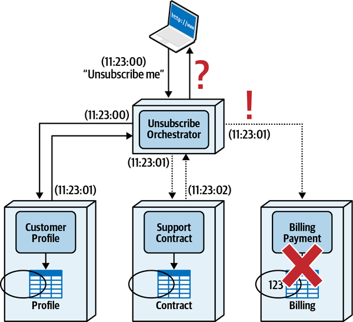

*Hình 9-19. Các điều kiện lỗi rất khó xử lý khi dùng orchestrated request-based pattern*

Một sự phức tạp khác với compensating transaction trong một architecture phân tán là các lỗi xảy ra trong quá trình bù trừ. Ví dụ, giả sử một compensating transaction được gửi tới Customer Profile Service để chèn lại khách hàng, và thao tác đó thất bại. Giờ thì sao? Giờ dữ liệu thực sự mất đồng bộ, và không có service hay tiến trình nào khác để sửa chữa vấn đề. Hầu hết những trường hợp như thế này thường đòi hỏi con người can thiệp để sửa chữa các nguồn dữ liệu và đưa chúng về đồng bộ. Chúng tôi đi sâu hơn vào chi tiết về compensating transaction và transactional saga trong [“Transactional Saga Patterns”](ch12_transactional_sagas.vi.md#sec-transactional-sagas).

[Bảng 9-6](#table-ec-orchestrated-trade-offs) tóm tắt các trade-offs của orchestrated request-based pattern cho eventual consistency.<a id="idm45798377864824"></a><a id="idm45798377864152"></a><a id="idm45798377863480"></a><a id="idm45798377862808"></a>

> **Các đánh đổi (Trade-Offs)**
>
> <a id="table-ec-orchestrated-trade-offs"></a>
>
> <a id="table-ec-orchestrated-trade-offs"></a>*Bảng 9-6. Các trade-offs của orchestrated request-based pattern*
>
> | Ưu điểm | Nhược điểm |
> |---|---|
> | Các service được decouple | Phản hồi chậm hơn |
> | Tính nhất quán dữ liệu kịp thời | Xử lý lỗi phức tạp |
> | Request nghiệp vụ nguyên tử | Thường đòi hỏi compensating transaction |

<a id="idm45798377905704"></a>

### Pattern dựa trên sự kiện (Event-Based Pattern)

Pattern *event-based* (dựa trên sự kiện) là một trong những eventual consistency pattern phổ biến và đáng tin cậy nhất<a id="ch09evpat4"></a><a id="ch09evpat"></a><a id="ch09evpat2"></a><a id="ch09evpat3"></a><a id="idm45798377844648"></a><a id="idm45798377843672"></a><a id="idm45798377842984"></a><a id="idm45798377842024"></a><a id="idm45798377841048"></a> cho hầu hết các architecture phân tán hiện đại, bao gồm microservices và event-driven architecture. Với pattern này, sự kiện được dùng cùng với một mô hình messaging publish-and-subscribe (pub/sub) bất đồng bộ để đăng các sự kiện (như `customer unsubscribed`) hoặc command message (như `unsubscribe customer`) lên một topic hoặc event stream. Các service tham gia transaction phân tán lắng nghe một số sự kiện nhất định và phản hồi những sự kiện đó.

Thời gian eventual consistency thường ngắn để đạt được tính nhất quán dữ liệu nhờ bản chất song song và decoupled của việc xử lý message bất đồng bộ. Các service được decouple cao với nhau với pattern này, và khả năng phản hồi tốt vì service kích hoạt sự kiện eventual consistency không phải chờ việc đồng bộ dữ liệu diễn ra trước khi trả thông tin về cho khách hàng.

[Hình 9-20](#fig-data-access-and-update-base-event) minh họa event-based pattern cho eventual consistency hoạt động thế nào. Hãy để ý rằng khách hàng gửi request hủy đăng ký tới Customer Profile Service lúc 11:23:00. Customer Profile Service nhận request, gỡ khách hàng khỏi bảng Profile, publish một message lên một message topic hoặc event stream, và trả thông tin một giây sau đó cho khách hàng biết họ đã hủy đăng ký thành công. Vào khoảng cùng thời điểm điều này xảy ra, cả Support Contract Service và Billing Payment Service đều nhận sự kiện hủy đăng ký và thực hiện bất kỳ chức năng nào cần thiết để hủy đăng ký khách hàng, làm cho mọi nguồn dữ liệu nhất quán cuối cùng.

<a id="fig-data-access-and-update-base-event"></a>

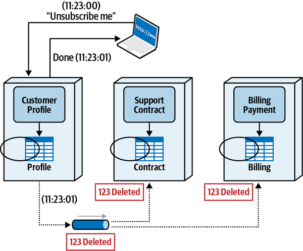

*Hình 9-20. Pattern event-based dùng messaging publish-and-subscribe bất đồng bộ hoặc event stream để đạt được eventual consistency*

Với các cách hiện thực dùng messaging publish-and-subscribe topic-based (dựa trên topic)<a id="idm45798377832616"></a><a id="idm45798377831336"></a><a id="idm45798377830376"></a><a id="idm45798377829144"></a><a id="idm45798377827896"></a> tiêu chuẩn (như ActiveMQ, RabbitMQ, AmazonMQ, v.v.), các service phản hồi sự kiện phải được thiết lập là *durable subscriber* để bảo đảm không message nào bị mất nếu message broker hoặc service nhận message gặp lỗi. Một durable subscriber có khái niệm tương tự persistent queue ở chỗ subscriber (trong trường hợp này là Support Contract Service và Billing Payment Service) không cần phải khả dụng tại thời điểm message được publish, và các subscriber được bảo đảm sẽ nhận được message một khi chúng khả dụng. Trong trường hợp các cách hiện thực event streaming, message broker (như Apache Kafka) phải luôn lưu bền vững message và bảo đảm nó có sẵn trong topic trong một khoảng thời gian hợp lý.

Lợi thế của event-based pattern là khả năng phản hồi, tính nhất quán dữ liệu kịp thời, và việc decouple các service. Tuy nhiên, tương tự mọi eventual consistency pattern, trade-off chính của pattern này là xử lý lỗi. Nếu một trong các service (ví dụ, Billing Payment Service minh họa trong [Hình 9-20](#fig-data-access-and-update-base-event)) không khả dụng, việc nó là một durable subscriber nghĩa là *cuối cùng* nó sẽ nhận và xử lý sự kiện khi nó khả dụng. Tuy nhiên, nếu service đang xử lý sự kiện và gặp lỗi, mọi thứ nhanh chóng trở nên phức tạp.

Hầu hết message broker sẽ thử gửi một message một số lần nhất định,<a id="idm45798377822776"></a><a id="idm45798377821496"></a><a id="idm45798377820264"></a><a id="idm45798377819304"></a><a id="idm45798377818056"></a> và sau nhiều lần thất bại phía bên nhận, broker sẽ gửi message tới một *dead letter queue* (*DLQ*). Đây là một đích có thể cấu hình nơi sự kiện được lưu cho đến khi một tiến trình tự động đọc message và cố sửa vấn đề. Nếu không thể sửa theo chương trình, message sau đó thường được gửi tới con người để xử lý thủ công.

[Bảng 9-7](#table-ec-event-trade-offs) liệt kê các trade-offs của event-based pattern cho eventual consistency.<a id="idm45798377815256"></a><a id="idm45798377814584"></a><a id="idm45798377813912"></a><a id="idm45798377813240"></a>

> **Các đánh đổi (Trade-Offs)**
>
> <a id="table-ec-event-trade-offs"></a>
>
> <a id="table-ec-event-trade-offs"></a>*Bảng 9-7. Các trade-offs của event-based pattern*
>
> | Ưu điểm | Nhược điểm |
> |---|---|
> | Các service được decouple | Xử lý lỗi phức tạp |
> | Tính nhất quán dữ liệu kịp thời |  |
> | Phản hồi nhanh |  |

<a id="idm45798377965240"></a>

## Sysops Squad Saga: Quyền sở hữu dữ liệu cho xử lý ticket (Sysops Squad Saga: Data Ownership for Ticket Processing)

`Tuesday, January 18, 09:14`

Sau khi nói chuyện với Dana và tìm hiểu về quyền sở hữu dữ liệu và<a id="ch09-ssdodt7"></a><a id="ch09-ssdodt"></a><a id="ch09-ssdodt2"></a><a id="ch09-ssdodt3"></a><a id="ch09-ssdodt4"></a><a id="ch09-ssdodt5"></a><a id="ch09-ssdodt6"></a> quản lý transaction phân tán, Sydney và Addison nhanh chóng nhận ra rằng việc tách dữ liệu và giao quyền sở hữu dữ liệu để hình thành các bounded context chặt chẽ là không thể nếu cả hai team không cộng tác về giải pháp.

“Chẳng trách ở đây chẳng có gì chạy được,” Sydney nhận xét. “Chúng ta luôn có vấn đề và tranh cãi với team database, và giờ tôi thấy hậu quả của việc công ty coi chúng ta là hai team riêng biệt.”

“Chính xác,” Addison nói. “Tôi mừng là giờ chúng ta đang làm việc gần gũi hơn với team dữ liệu. Vậy, theo những gì Dana nói, service thực hiện hành động ghi trên bảng dữ liệu sở hữu bảng đó, bất kể các service khác cần truy cập dữ liệu theo kiểu read-only. Trong trường hợp đó, có vẻ User Maintenance Service cần sở hữu dữ liệu.”

Sydney đồng ý, và Addison tạo một architecture decision record chung mô tả việc cần làm cho các kịch bản sở hữu single-table (bảng đơn):

> <a id="adr_10"></a>
>
> *ADR: Sở hữu bảng đơn cho bounded context*<br>
>
>
> *Bối cảnh (Context)*<br>
> Khi hình thành bounded context giữa các service và dữ liệu, các bảng phải được giao quyền sở hữu cho một service hoặc nhóm service cụ thể.<br>
>
>
> *Quyết định (Decision)*<br>
> Khi chỉ một service ghi vào một bảng, bảng đó sẽ được giao quyền sở hữu cho service đó. Hơn nữa, các service cần quyền truy cập read-only vào một bảng trong bounded context khác không được truy cập trực tiếp database hoặc schema chứa bảng đó.<br>
>
>
> Theo team database, quyền sở hữu bảng được định nghĩa là service thực hiện thao tác ghi trên một bảng. Do đó, với các kịch bản sở hữu bảng đơn, bất kể có bao nhiêu service khác cần truy cập bảng, chỉ một service được giao làm chủ sở hữu, và chủ sở hữu đó là service duy trì dữ liệu.<br>
>
>
> *Hệ quả (Consequences)*<br>
> Tùy thuộc vào kỹ thuật được dùng, các service cần quyền truy cập read-only vào một bảng trong bounded context khác có thể gặp các vấn đề performance và fault-tolerance khi truy cập dữ liệu trong một bounded context khác.<br>
>

Giờ khi Sydney và Addison đã hiểu rõ hơn về quyền sở hữu bảng và cách hình thành bounded context giữa service và dữ liệu, họ bắt đầu làm việc với chức năng khảo sát. Ticket Completion Service sẽ ghi timestamp ticket được hoàn tất và chuyên gia đã thực hiện công việc vào bảng survey. Survey Service sẽ ghi timestamp khảo sát được gửi tới khách hàng, và cũng chèn toàn bộ kết quả khảo sát một khi nhận được khảo sát.

“Chuyện này không quá khó khi tôi đã hiểu rõ hơn về bounded context và quyền sở hữu bảng,” Sydney nói.

“OK, hãy chuyển sang chức năng khảo sát,” Addison nói.

“Ối,” Sydney nói. “Cả Ticket Completion Service và Survey Service đều ghi vào bảng Survey.”

“Đó là cái mà Dana gọi là sở hữu joint-table (bảng chung),” Addison nói.

“Vậy, chúng ta có những lựa chọn nào?” Sydney hỏi.

“Vì tách bảng sẽ không hiệu quả, thực sự chỉ còn lại hai lựa chọn,” Addison nói. “Chúng ta có thể dùng một data domain chung để cả hai service cùng sở hữu dữ liệu, hoặc chúng ta có thể dùng kỹ thuật delegate và chỉ giao một service làm chủ sở hữu.”

“Tôi thích data domain chung. Để cả hai service ghi vào bảng và dùng chung một schema,” Sydney nói.

“Có điều cách đó sẽ không hiệu quả trong kịch bản này,” Addison nói. “Ticket Completion Service đã đang giao tiếp với data domain ticket chung. Nhớ nhé, một service không thể kết nối tới nhiều schema.”

“À, đúng rồi,” Sydney nói. “Khoan, tôi biết rồi, chỉ cần thêm các bảng survey vào schema của data domain ticket.”

“Nhưng giờ chúng ta lại bắt đầu gộp tất cả các bảng trở lại với nhau.” Addison nói. “Chẳng mấy chốc chúng ta sẽ lại quay về với một database monolith.”

“Vậy chúng ta làm gì?” Sydney hỏi.

“Khoan, tôi nghĩ tôi thấy một giải pháp tốt ở đây,” Addison nói. “Cậu biết Ticket Completion Service dù sao cũng phải gửi một message tới Survey Service để khởi động quy trình khảo sát một khi ticket hoàn tất chứ? Nếu chúng ta truyền dữ liệu cần thiết kèm theo message đó để Survey Service có thể chèn dữ liệu khi nó tạo khảo sát khách hàng thì sao?”

“Tuyệt vời,” Sydney nói. “Bằng cách đó, Ticket Completion không cần bất kỳ quyền truy cập nào vào bảng Survey.”

Addison và Sydney đồng ý rằng Survey Service sẽ sở hữu bảng Survey, và sẽ dùng kỹ thuật delegation để truyền dữ liệu khi bảng thông báo cho Survey Service khởi động quy trình khảo sát, như minh họa trong [Hình 9-21](#fig-data-access-and-update-ss-survey). Addison viết một architecture decision record cho quyết định này.

<a id="fig-data-access-and-update-ss-survey"></a>

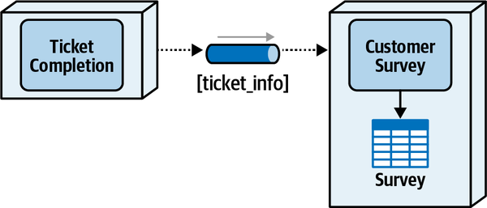

*Hình 9-21. Survey Service sở hữu dữ liệu bằng kỹ thuật delegation*

> <a id="adr_11"></a>
>
> *ADR: Survey Service sở hữu bảng Survey*<br>
>
>
> *Bối cảnh (Context)*<br>
> Cả Ticket Completion Service và Survey Service đều ghi vào bảng Survey. Vì đây là kịch bản sở hữu chung, các lựa chọn thay thế là dùng một data domain dùng chung hoặc dùng kỹ thuật delegation. Tách bảng không phải là một lựa chọn vì cấu trúc của bảng Survey.<br>
>
>
> *Quyết định (Decision)*<br>
> Survey Service sẽ là chủ sở hữu duy nhất của bảng Survey, nghĩa là nó là service duy nhất có thể thực hiện thao tác ghi vào bảng đó.<br>
>
>
> Một khi ticket được đánh dấu hoàn tất và được hệ thống chấp nhận, Ticket Completion Service cần gửi một message tới Survey Service để khởi động việc xử lý khảo sát khách hàng. Vì Ticket Completion Service đã đang gửi một sự kiện thông báo, thông tin ticket cần thiết có thể được truyền kèm theo sự kiện đó, nhờ đó loại bỏ nhu cầu Ticket Completion Service phải có bất kỳ quyền truy cập nào vào bảng Survey.<br>
>
>
> *Hệ quả (Consequences)*<br>
> Mọi dữ liệu cần thiết mà Ticket Completion Service cần chèn vào bảng Survey sẽ cần được gửi như một phần của payload khi kích hoạt quy trình khảo sát khách hàng.<br>
>
>
> Trong hệ thống monolith, phần hoàn tất ticket chèn bản ghi khảo sát như một phần của quy trình hoàn tất. Với quyết định này, việc tạo bản ghi khảo sát là một hoạt động tách biệt với quy trình tạo ticket và giờ được Survey Service xử lý.<a id="idm45798377762440"></a><a id="idm45798377761736"></a><a id="idm45798377761064"></a><a id="idm45798377760392"></a><a id="idm45798377759720"></a><a id="idm45798377759048"></a><a id="idm45798377758376"></a>
