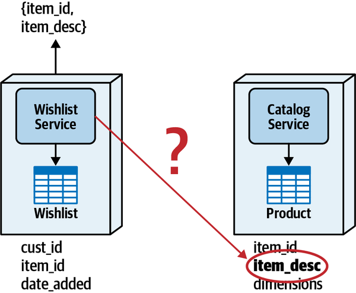
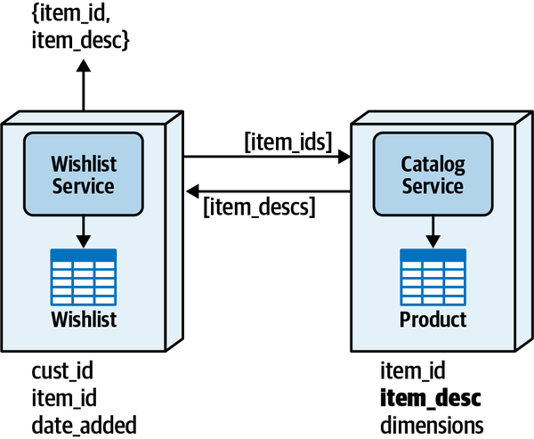
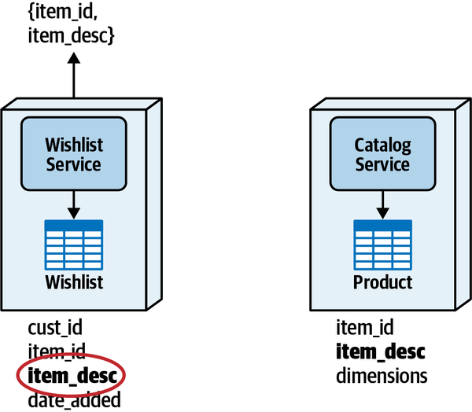
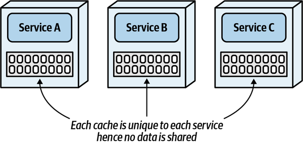
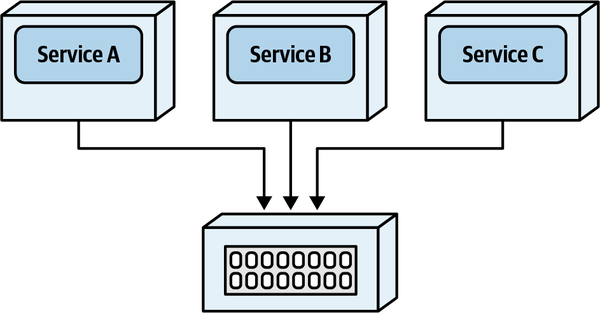
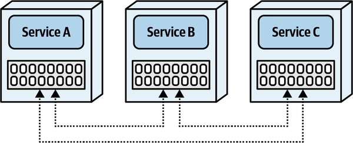
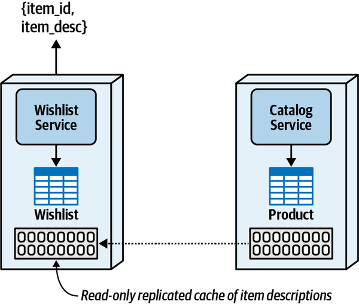
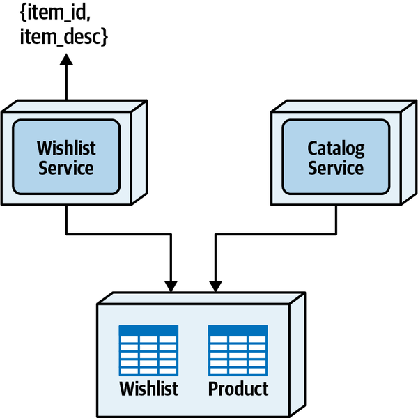

# Chương 10. Truy cập dữ liệu phân tán (Distributed Data Access)

`Monday, January 3, 12:43`

“Giờ khi chúng ta đã giao quyền sở hữu bảng expert profile cho User Management Service,” Sydney nói, “Ticket Assignment Service nên lấy dữ liệu vị trí và kỹ năng của chuyên gia bằng cách nào? Như tôi đã nói trước đó, với số lần đọc mà nó thực hiện tới database, thực sự không khả thi khi phải thực hiện một lời gọi từ xa mỗi lần nó cần truy vấn bảng.”

“Cậu có thể sửa đổi cách thuật toán giao hoạt động để chúng ta giảm số truy vấn nó cần không?” Addison hỏi.

“Chịu,” Sydney đáp. “Taylen là người thường duy trì các thuật toán đó.”

Addison và Sydney gặp Taylen để thảo luận vấn đề truy cập dữ liệu và xem Taylen có thể sửa đổi các thuật toán giao chuyên gia để giảm số lời gọi database tới bảng expert profile không.

“Các cậu đùa tôi à?” Taylen hỏi. “Không đời nào tôi có thể viết lại các thuật toán giao để làm điều các cậu đang yêu cầu. Tuyệt đối không thể.”

“Nhưng lựa chọn duy nhất còn lại của chúng ta là thực hiện lời gọi từ xa tới User Management Service mỗi khi thuật toán giao cần dữ liệu chuyên gia,” Addison nói.

“Cái gì?” Taylen hét lên. “Chúng ta không thể làm thế!”

“Đó là điều tôi cũng đã nói,” Sydney nói. “Điều đó có nghĩa là chúng ta lại quay về vạch xuất phát. Mấy thứ architecture phân tán này khó thật. Tôi ghét phải nói điều này, nhưng tôi thực sự bắt đầu nhớ ứng dụng monolith rồi. Khoan, tôi biết rồi. Nếu chúng ta thực hiện các lời gọi messaging tới User Maintenance Service thay vì dùng REST thì sao?”

“Đó là cùng một thứ,” Taylen nói. “Tôi vẫn phải chờ thông tin trả về, dù chúng ta dùng messaging, REST, hay bất kỳ giao thức truy cập từ xa nào khác. Bảng đó đơn giản là cần nằm trong cùng data domain với các bảng ticket.”

“Phải có giải pháp khác để truy cập dữ liệu mà chúng ta không còn sở hữu,” Addison nói. “Để tôi hỏi Logan.”

Trong hầu hết các hệ thống monolith dùng một database duy nhất, developer không cần nghĩ đến lần thứ hai về việc đọc các bảng database. Các join bảng SQL là chuyện thường ngày, và với một truy vấn đơn giản, mọi dữ liệu cần thiết có thể được lấy trong một lời gọi database duy nhất. Tuy nhiên, khi dữ liệu được tách thành các database hoặc schema riêng biệt thuộc sở hữu của các service khác nhau, việc truy cập dữ liệu cho thao tác đọc bắt đầu trở nên khó khăn.

Chương này mô tả các cách khác nhau mà service có thể có quyền đọc dữ liệu chúng không sở hữu—nói cách khác, dữ liệu nằm ngoài bounded context của các service cần dữ liệu đó. Bốn pattern truy cập dữ liệu chúng tôi thảo luận trong chương này bao gồm Inter-service Communication pattern, Column Schema Replication pattern, Replicated Cache pattern, và Data Domain pattern.

Mỗi pattern truy cập dữ liệu này đều có phần ưu điểm và nhược điểm riêng. Đúng vậy, một lần nữa, *trade-offs*. Để mô tả rõ hơn từng pattern, chúng tôi sẽ quay lại ví dụ Wishlist Service và Catalog Service từ [Chương 9](ch09_data_ownership_and_distributed_transactions.vi.md#ch09-data-update). Wishlist Service thể hiện trong [Hình 10-1](#fig-data-access-and-update-access) duy trì danh sách các mặt hàng mà khách hàng có thể muốn mua sau này, và chứa customer ID, item ID, và ngày mặt hàng được thêm vào trong bảng Wishlist tương ứng. Catalog Service chịu trách nhiệm duy trì mọi mặt hàng mà công ty bán, và bao gồm item ID, mô tả mặt hàng, và thông tin kích thước sản phẩm tĩnh, như trọng lượng, chiều cao, chiều dài, v.v.

Trong ví dụ này, khi khách hàng gửi request để hiển thị wish list của họ, cả item ID *và* mô tả mặt hàng (`item_desc`) đều được trả về cho khách hàng. Tuy nhiên, Wishlist Service không có mô tả mặt hàng trong bảng của nó; dữ liệu đó thuộc sở hữu của Catalog Service trong một bounded context được hình thành chặt chẽ, mang lại khả năng kiểm soát thay đổi và quyền sở hữu dữ liệu. Do đó, kiến trúc sư phải dùng một trong các pattern truy cập dữ liệu được nêu trong chương này để bảo đảm Wishlist Service có thể lấy được mô tả sản phẩm từ Catalog Service.

*Hình 10-1. Wishlist Service cần mô tả mặt hàng nhưng không có quyền truy cập bảng product chứa dữ liệu đó*

## Pattern giao tiếp giữa các service (Interservice Communication Pattern)

*Interservice Communication pattern* (pattern giao tiếp giữa các service) cho đến nay là pattern phổ biến nhất để truy cập dữ liệu trong một hệ thống phân tán. Nếu một service (hoặc hệ thống) cần đọc dữ liệu mà nó không thể truy cập trực tiếp, nó chỉ đơn giản *yêu cầu* service hoặc hệ thống sở hữu cung cấp dữ liệu đó bằng một loại giao thức truy cập từ xa nào đó. Còn gì đơn giản hơn?

Như hầu hết mọi thứ trong software architecture, mọi chuyện không như vẻ ngoài. Dù đơn giản, kỹ thuật truy cập dữ liệu phổ biến này đáng tiếc lại đầy rẫy nhược điểm. Hãy xét [Hình 10-2](#fig-data-access-and-update-access-interservice): Wishlist Service thực hiện một lời gọi truy cập từ xa đồng bộ tới Catalog Service, truyền vào một danh sách item ID để đổi lấy danh sách mô tả mặt hàng tương ứng.

Hãy để ý rằng với *mỗi* request lấy wish list của khách hàng, Wishlist Service phải thực hiện một lời gọi từ xa tới Catalog Service để lấy mô tả mặt hàng. Vấn đề đầu tiên xảy ra với pattern này là performance chậm hơn do network latency, security latency và data latency. *Network latency* là thời gian truyền gói tin tới và từ một service (thường ở khoảng giữa 30 ms và 300 ms). Security latency xảy ra khi endpoint tới service đích đòi hỏi thêm authorization để thực hiện request. *Security latency* có thể khác nhau rất nhiều tùy theo mức security trên endpoint được truy cập, nhưng có thể ở bất kỳ đâu giữa 20 ms và 400 ms đối với hầu hết hệ thống. *Data latency* mô tả tình huống cần thực hiện nhiều lời gọi database để lấy thông tin cần thiết trả về cho người dùng cuối. Trong trường hợp này, thay vì một câu lệnh SQL join bảng duy nhất, Catalog Service phải thực hiện thêm một lời gọi database để lấy mô tả mặt hàng. Điều này có thể thêm từ 10 ms đến 50 ms thời gian xử lý. Cộng tất cả lại, latency có thể lên tới một giây chỉ để lấy mô tả mặt hàng.

*Hình 10-2. Pattern truy cập dữ liệu giao tiếp giữa các service*

Một nhược điểm lớn khác của pattern này là coupling giữa các service. Vì Wishlist phải dựa vào việc Catalog Service khả dụng, các service do đó coupled cả về ngữ nghĩa lẫn về mặt tĩnh, nghĩa là nếu Catalog Service không khả dụng, Wishlist Service cũng không. Hơn nữa, vì static coupling chặt giữa Wishlist Service và Catalog Service, khi Wishlist Service scale để đáp ứng thêm lượng nhu cầu, Catalog Service cũng phải scale theo.

[Bảng 10-1](#table-assign-interservice-trade-offs) tóm tắt các trade-offs gắn với pattern truy cập dữ liệu giao tiếp giữa các service.

> **Các đánh đổi (Trade-Offs)**
>
> 
>
> *Bảng 10-1. Trade-offs của pattern truy cập dữ liệu Interservice Communication*
>
> | Ưu điểm | Nhược điểm |
> |---|---|
> | Đơn giản | Network latency, data latency và security latency (performance) |
> | Không có vấn đề về khối lượng dữ liệu | Vấn đề scalability và throughput |
> |  | Không có fault tolerance (vấn đề availability) |
> |  | Đòi hỏi contract giữa các service |

## Pattern nhân bản cột schema (Column Schema Replication Pattern)

Với *Column Schema Replication pattern* (pattern nhân bản cột schema), các cột được nhân bản giữa các bảng, nhờ đó nhân bản dữ liệu và cung cấp nó cho các bounded context khác. Như thể hiện trong [Hình 10-3](#fig-data-access-and-update-access-replicate), cột `item_desc` được thêm vào bảng Wishlist, giúp Wishlist Service có dữ liệu đó mà không phải yêu cầu Catalog Service cung cấp.

*Hình 10-3. Với pattern truy cập dữ liệu Column Schema Replication, dữ liệu được nhân bản sang các bảng khác*

Đồng bộ dữ liệu và tính nhất quán dữ liệu là hai vấn đề lớn nhất gắn với pattern truy cập dữ liệu Column Schema Replication. Bất cứ khi nào một sản phẩm được tạo, bị gỡ khỏi catalog, hoặc mô tả sản phẩm thay đổi, Catalog Service phải bằng cách nào đó cho Wishlist Service (và bất kỳ service nào khác nhân bản dữ liệu) biết về thay đổi đó. Việc này thường được thực hiện thông qua giao tiếp bất đồng bộ dùng queue, topic hoặc event streaming. Trừ khi cần đồng bộ transaction *ngay lập tức*, giao tiếp bất đồng bộ là lựa chọn được ưu tiên hơn giao tiếp đồng bộ vì nó tăng khả năng phản hồi và giảm sự phụ thuộc về availability giữa các service.

Một thách thức khác với pattern này là đôi khi khó quản trị quyền sở hữu dữ liệu. Vì dữ liệu được nhân bản trong các bảng thuộc về các service khác, những service đó có thể cập nhật dữ liệu, dù chúng không chính thức *sở hữu* dữ liệu. Điều này đến lượt nó tạo ra thêm nhiều vấn đề về tính nhất quán dữ liệu.

Dù các service vẫn coupled vì đồng bộ dữ liệu, service cần quyền đọc có quyền truy cập dữ liệu ngay lập tức, và có thể thực hiện các SQL join hoặc truy vấn đơn giản tới bảng của chính mình để lấy dữ liệu. Điều này tăng performance, fault tolerance và scalability, tất cả những thứ từng là nhược điểm với interservice communication pattern.

Dù nhìn chung chúng tôi khuyên thận trọng khi dùng pattern truy cập dữ liệu này cho các kịch bản như ví dụ Wishlist Service và Catalog Service, một số tình huống có thể cân nhắc pattern này là tổng hợp dữ liệu, báo cáo, hoặc các tình huống mà các pattern truy cập dữ liệu khác không phù hợp vì khối lượng dữ liệu lớn, yêu cầu khả năng phản hồi cao, hoặc yêu cầu high-fault tolerance (fault tolerance cao).

[Bảng 10-2](#table-assign-replication-trade-offs) tóm tắt các trade-offs gắn với pattern truy cập dữ liệu Column Schema Replication.

> **Các đánh đổi (Trade-Offs)**
>
> 
>
> *Bảng 10-2. Trade-offs của pattern truy cập dữ liệu Column Schema Replication*
>
> | Ưu điểm | Nhược điểm |
> |---|---|
> | Performance truy cập dữ liệu tốt | Vấn đề về tính nhất quán dữ liệu |
> | Không có vấn đề scalability và throughput | Vấn đề về quyền sở hữu dữ liệu |
> | Không có vấn đề fault-tolerance | Cần đồng bộ dữ liệu |
> | Không phụ thuộc service |  |

## Pattern cache được nhân bản (Replicated Caching Pattern)

Hầu hết developer và kiến trúc sư nghĩ về caching như một kỹ thuật để tăng khả năng phản hồi tổng thể. Bằng cách lưu dữ liệu trong một in-memory cache, việc truy xuất dữ liệu đi từ hàng chục mili giây xuống chỉ vài nano giây. Tuy nhiên, caching cũng có thể là một công cụ hiệu quả để truy cập và chia sẻ dữ liệu phân tán. Pattern này tận dụng *replicated in-memory caching* (cache trong bộ nhớ được nhân bản) để dữ liệu mà các service khác cần có sẵn cho mỗi service mà chúng không phải yêu cầu. Một replicated cache khác với các mô hình caching khác ở chỗ dữ liệu được giữ in-memory bên trong mỗi service và được đồng bộ liên tục để mọi service luôn có chính xác cùng dữ liệu tại mọi thời điểm.

Để hiểu rõ hơn mô hình replicated caching, sẽ hữu ích khi so sánh nó với các mô hình caching khác để thấy sự khác biệt giữa chúng. Mô hình caching *single in-memory* là dạng caching đơn giản nhất, trong đó mỗi service có in-memory cache nội bộ riêng. Với mô hình caching này (minh họa trong [Hình 10-4](#fig-data-access-and-update-cache-single)), dữ liệu in-memory không được đồng bộ giữa các cache, nghĩa là mỗi service có dữ liệu độc nhất riêng dành cho service đó. Dù mô hình caching này giúp tăng khả năng phản hồi và scalability trong mỗi service, nó không hữu ích cho việc chia sẻ dữ liệu giữa các service vì thiếu đồng bộ cache giữa các service.

*Hình 10-4. Với single in-memory cache, mỗi service chứa dữ liệu độc nhất của riêng nó*

Mô hình caching còn lại được dùng trong các architecture phân tán là *distributed caching*. Như minh họa trong [Hình 10-5](#fig-data-access-and-update-cache-distributed), với mô hình caching này, dữ liệu không được giữ in-memory bên trong mỗi service, mà được giữ bên ngoài trong một caching server. Các service, dùng một giao thức độc quyền, gửi request tới caching server để lấy hoặc cập nhật dữ liệu dùng chung. Lưu ý rằng khác với mô hình caching single in-memory, dữ liệu có thể được chia sẻ giữa các service.

Mô hình distributed cache không phải là mô hình caching hiệu quả để dùng cho pattern truy cập dữ liệu replicated caching vì một số lý do. Thứ nhất, nó không mang lại lợi ích gì đối với các vấn đề fault-tolerance gặp phải với Interservice Communication pattern. Thay vì phụ thuộc vào một service để lấy dữ liệu, sự phụ thuộc chỉ đơn thuần chuyển sang caching server.

Vì dữ liệu cache được tập trung và dùng chung, mô hình distributed cache cho phép các service khác cập nhật dữ liệu, do đó phá vỡ bounded context liên quan đến quyền sở hữu dữ liệu. Điều này có thể gây ra sự không nhất quán dữ liệu giữa cache và database sở hữu. Dù đôi khi điều này có thể được giải quyết thông qua governance nghiêm ngặt, nó vẫn là một vấn đề với mô hình caching này.

Cuối cùng, vì việc truy cập distributed cache tập trung là thông qua một lời gọi từ xa, network latency làm tăng thêm thời gian truy xuất dữ liệu, do đó ảnh hưởng đến khả năng phản hồi tổng thể so với một in-memory replicated cache.

*Hình 10-5. Distributed cache nằm bên ngoài các service*

Với replicated caching, mỗi service có dữ liệu in-memory riêng được giữ đồng bộ giữa các service, cho phép cùng một dữ liệu được chia sẻ giữa nhiều service. Hãy để ý trong [Hình 10-6](#fig-data-access-and-update-cache-replicated) rằng không có phụ thuộc cache bên ngoài nào. Mỗi cache instance giao tiếp với instance khác để khi có cập nhật đối với một cache, cập nhật đó ngay lập tức (ở hậu trường) được lan truyền bất đồng bộ tới các service khác dùng cùng cache.

*Hình 10-6. Với replicated cache, mỗi service chứa cùng dữ liệu in-memory*

Không phải mọi sản phẩm caching đều hỗ trợ replicated caching, nên điều quan trọng là kiểm tra với nhà cung cấp sản phẩm caching để bảo đảm hỗ trợ mô hình replicated caching. Một số sản phẩm phổ biến có hỗ trợ replicated caching bao gồm [Hazelcast](https://hazelcast.com), [Apache Ignite](https://ignite.apache.org), và [Oracle Coherence](https://oreil.ly/ISDkz).

Để thấy replicated caching có thể giải quyết việc truy cập dữ liệu phân tán thế nào, chúng ta sẽ quay lại ví dụ Wishlist Service và Catalog Service. Trong [Hình 10-7](#fig-data-access-and-update-access-cache), Catalog Service sở hữu một in-memory cache chứa mô tả sản phẩm (nghĩa là nó là service duy nhất có thể sửa đổi cache), và Wishlist Service chứa một bản sao in-memory read-only của cùng cache đó.

*Hình 10-7. Pattern truy cập dữ liệu replicated caching*

Với pattern này, Wishlist Service không còn cần gọi Catalog Service để lấy mô tả sản phẩm—chúng đã có sẵn in-memory bên trong Wishlist Service. Khi Catalog Service cập nhật mô tả sản phẩm, sản phẩm caching sẽ cập nhật cache trong Wishlist Service để dữ liệu nhất quán.

Những lợi thế rõ ràng của replicated caching pattern là khả năng phản hồi, fault tolerance và scalability. Vì không cần giao tiếp interservice tường minh giữa các service, dữ liệu luôn sẵn sàng *in-memory*, mang lại khả năng truy cập nhanh nhất có thể vào dữ liệu mà service không sở hữu. Fault tolerance cũng được hỗ trợ tốt với pattern này. Ngay cả khi Catalog Service sập, Wishlist Service vẫn có thể tiếp tục vận hành. Một khi Catalog Service hoạt động trở lại, các cache kết nối với nhau mà không gây gián đoạn nào cho Wishlist Service. Cuối cùng, với pattern này, Wishlist Service có thể scale độc lập với Catalog Service.

Với tất cả những lợi thế rõ ràng này, làm sao pattern này có thể có trade-off? Như *định luật thứ nhất của software architecture* phát biểu trong cuốn sách của chúng tôi, [*The Fundamentals of Software Architecture*](https://oreil.ly/J8FPY), mọi thứ trong software architecture đều là trade-off, và nếu một kiến trúc sư nghĩ họ đã phát hiện ra thứ gì đó *không phải* là trade-off, điều đó có nghĩa là họ chỉ chưa *xác định* được trade-off mà thôi.

Điểm trade-off đầu tiên với pattern này là sự phụ thuộc service liên quan đến dữ liệu cache và thời điểm khởi động. Vì Catalog Service sở hữu cache và chịu trách nhiệm điền dữ liệu vào cache, nó phải đang chạy khi Wishlist Service ban đầu khởi động. Nếu Catalog Service không khả dụng, Wishlist Service ban đầu phải vào trạng thái chờ cho đến khi thiết lập được kết nối với Catalog Service. Hãy để ý rằng chỉ instance Wishlist Service *ban đầu* bị ảnh hưởng bởi phụ thuộc khởi động này; nếu Catalog Service sập, các instance Wishlist khác vẫn có thể được khởi động, với dữ liệu cache được chuyển từ một trong các instance Wishlist khác. Cũng cần lưu ý rằng một khi Wishlist Service khởi động và có dữ liệu trong cache, Catalog Service *không* cần phải khả dụng. Một khi cache có sẵn trong Wishlist Service, Catalog Service có thể lên xuống mà không ảnh hưởng đến Wishlist Service (hay bất kỳ instance nào của nó).

Điểm trade-off thứ hai với pattern này là khối lượng dữ liệu. Nếu khối lượng dữ liệu quá lớn (như vượt quá 500 MB), tính khả thi của pattern này giảm nhanh chóng, đặc biệt liên quan đến nhiều instance của các service cần dữ liệu. Mỗi instance service có replicated cache riêng, nghĩa là nếu kích thước cache là 500 MB và cần 5 instance của một service, tổng bộ nhớ được dùng là 2.5 GB. Kiến trúc sư phải phân tích cả kích thước cache *lẫn* tổng số instance service cần dữ liệu được cache để xác định tổng yêu cầu bộ nhớ cho replicated cache.

Điểm trade-off thứ ba là mô hình replicated caching thường không thể giữ dữ liệu đồng bộ hoàn toàn giữa các service nếu tốc độ thay đổi của dữ liệu (tốc độ cập nhật) quá cao. Điều này khác nhau tùy theo kích thước dữ liệu và replication latency, nhưng nhìn chung pattern này không phù hợp với dữ liệu biến động cao (như lượng tồn kho sản phẩm). Tuy nhiên, với dữ liệu tương đối tĩnh (như mô tả sản phẩm), pattern này hoạt động tốt.

Điểm trade-off cuối cùng gắn với pattern này là quản lý cấu hình và thiết lập. Các service biết về nhau trong mô hình replicated caching thông qua TCP/IP broadcast và lookup. Nếu phạm vi TCI/IP broadcast và lookup quá rộng, có thể mất nhiều thời gian để thiết lập handshake socket-level (mức socket) giữa các service. Các môi trường cloud-based và containerized khiến điều này đặc biệt thách thức vì thiếu kiểm soát đối với địa chỉ IP và bản chất động của các địa chỉ IP gắn với những môi trường này.

[Bảng 10-3](#table-assign-cache-trade-offs) liệt kê các trade-offs gắn với pattern truy cập dữ liệu replicated cache.

> **Các đánh đổi (Trade-Offs)**
>
> 
>
> *Bảng 10-3. Trade-offs gắn với pattern truy cập dữ liệu replicated caching*
>
> | Ưu điểm | Nhược điểm |
> |---|---|
> | Performance truy cập dữ liệu tốt | Cấu hình cloud và containerized có thể khó |
> | Không có vấn đề scalability và throughput | Không tốt cho khối lượng dữ liệu lớn |
> | Mức fault tolerance tốt | Không tốt cho tốc độ cập nhật cao |
> | Dữ liệu luôn nhất quán | Phụ thuộc khởi động service ban đầu |
> | Quyền sở hữu dữ liệu được giữ nguyên |  |

## Pattern data domain (Data Domain Pattern)

Trong chương trước, chúng tôi đã thảo luận việc dùng một *data domain* để giải quyết sở hữu chung, nơi nhiều service cùng cần ghi dữ liệu vào cùng một bảng. Các bảng được dùng chung giữa các service được đặt vào một schema duy nhất mà sau đó được cả hai service dùng chung. Cùng pattern đó cũng có thể được dùng cho truy cập dữ liệu.

Hãy xét lại vấn đề Wishlist Service và Catalog Service, nơi Wishlist Service cần truy cập mô tả sản phẩm nhưng không có quyền truy cập bảng chứa các mô tả đó. Giả sử Interservice Communication pattern không phải là giải pháp khả thi vì các vấn đề về reliability với Catalog Service cũng như các vấn đề performance với network latency và việc truy xuất dữ liệu bổ sung. Cũng giả sử việc dùng Column Schema Replication pattern không khả thi vì cần mức tính nhất quán dữ liệu cao. Cuối cùng, giả sử Replicated Cache pattern không phải là lựa chọn vì khối lượng dữ liệu lớn. Giải pháp duy nhất còn lại là tạo một data domain, gộp các bảng Wishlist và Product vào cùng một schema dùng chung, mà cả Wishlist Service và Catalog Service đều truy cập được.

[Hình 10-8](#fig-data-access-and-update-access-domain) minh họa việc dùng pattern truy cập dữ liệu này. Hãy để ý rằng các bảng Wishlist và Product không còn thuộc sở hữu của service nào, mà được dùng chung giữa chúng, hình thành một bounded context rộng hơn. Với pattern này, việc truy cập mô tả sản phẩm trong Wishlist Service chỉ là một SQL join đơn giản giữa hai bảng.

*Hình 10-8. Pattern truy cập dữ liệu data domain*

Dù việc dùng chung dữ liệu nhìn chung không được khuyến khích trong architecture phân tán, pattern này có những lợi ích to lớn so với các pattern truy cập dữ liệu khác. Thứ nhất, các service hoàn toàn decoupled với nhau, nhờ đó giải quyết mọi vấn đề về phụ thuộc availability, khả năng phản hồi, throughput và scalability. Khả năng phản hồi rất tốt với pattern này vì dữ liệu có sẵn thông qua một lời gọi SQL bình thường, loại bỏ nhu cầu thực hiện thêm việc tổng hợp dữ liệu trong chức năng của service (như yêu cầu với Replicated Cache pattern).

Cả tính nhất quán dữ liệu lẫn tính toàn vẹn dữ liệu đều được đánh giá rất cao với Data Domain pattern. Vì nhiều service truy cập cùng các bảng dữ liệu, dữ liệu không cần được chuyển, nhân bản hay đồng bộ. Tính toàn vẹn dữ liệu được giữ trong pattern này theo nghĩa các ràng buộc foreign-key giờ có thể được thực thi giữa các bảng. Ngoài ra, các artifact database khác, như view, stored procedure và trigger, có thể tồn tại trong data domain. Thực tế, việc giữ lại các ràng buộc toàn vẹn và artifact database này là một động lực khác cho việc dùng Data Domain pattern.

Với pattern này, không cần contract bổ sung nào để chuyển dữ liệu giữa các service—schema bảng trở thành contract. Dù đây là một lợi thế của pattern này, nó cũng là một trade-off. Các contract được dùng với interservice communication pattern và Replicated Cache pattern hình thành một abstraction layer trên schema bảng, cho phép các thay đổi đối với cấu trúc bảng được giữ trong một bounded context chặt chẽ và không ảnh hưởng đến các service khác. Tuy nhiên, pattern này hình thành một bounded context rộng hơn, đòi hỏi nhiều service có thể phải thay đổi khi cấu trúc của bất kỳ bảng nào trong data domain thay đổi.

Một nhược điểm khác của pattern này là nó có thể mở ra các vấn đề security liên quan đến truy cập dữ liệu. Ví dụ, trong [Hình 10-8](#fig-data-access-and-update-access-domain), Wishlist Service có toàn quyền truy cập *mọi* dữ liệu trong data domain. Dù điều này ổn trong ví dụ Wishlist và Catalog Service, có thể có những lúc các service truy cập data domain không nên có quyền truy cập một số dữ liệu nhất định. Một bounded context chặt chẽ hơn với quyền sở hữu service nghiêm ngặt có thể ngăn các service khác truy cập một số dữ liệu nhất định thông qua các contract dùng để truyền dữ liệu qua lại.

[Bảng 10-4](#table-assign-domain-trade-offs) liệt kê các trade-offs gắn với pattern truy cập dữ liệu data domain.

> **Các đánh đổi (Trade-Offs)**
>
> 
>
> *Bảng 10-4. Trade-offs gắn với pattern truy cập dữ liệu data domain*
>
> | Ưu điểm | Nhược điểm |
> |---|---|
> | Performance truy cập dữ liệu tốt | Bounded context rộng hơn khi quản lý thay đổi dữ liệu |
> | Không có vấn đề scalability và throughput | Governance quyền sở hữu dữ liệu |
> | Không có vấn đề fault tolerance | Security truy cập dữ liệu |
> | Không phụ thuộc service |  |
> | Dữ liệu luôn nhất quán |  |

## Sysops Squad Saga: Truy cập dữ liệu cho việc giao ticket (Sysops Squad Saga: Data Access for Ticket Assignment)

`Thursday, March 3, 14:59`

Logan giải thích các phương pháp truy cập dữ liệu khác nhau trong một architecture phân tán, và cũng nêu các trade-offs tương ứng của từng kỹ thuật. Addison, Sydney và Taylen sau đó phải đi đến quyết định về việc dùng kỹ thuật nào.

“Trừ khi chúng ta bắt đầu hợp nhất tất cả các service này, tôi đoán chúng ta bị kẹt với thực tế là Ticket Assignment cần bằng cách nào đó lấy được dữ liệu expert profile, và phải nhanh,” Taylen nói.

“OK,” Addison nói. “Vậy hợp nhất service bị loại vì các service này nằm trong các domain hoàn toàn khác nhau, và lựa chọn data domain dùng chung cũng bị loại vì cùng lý do chúng ta đã nói trước đó—chúng ta không thể để Ticket Assignment Service kết nối tới hai database khác nhau.”

“Vậy, còn lại một trong hai lựa chọn.” Sydney nói. “Hoặc chúng ta dùng interservice communication hoặc replicated caching.”

“Khoan. Hãy khám phá lựa chọn replicated caching một chút,” Taylen nói. “Chúng ta đang nói về bao nhiêu dữ liệu ở đây?”

“Chà,” Sydney nói, “chúng ta có 900 chuyên gia trong database. Ticket Assignment Service cần dữ liệu gì từ bảng expert profile?”

“Phần lớn là thông tin tĩnh vì chúng ta lấy luồng dữ liệu vị trí hiện tại của chuyên gia từ nơi khác. Vậy, đó sẽ là kỹ năng của chuyên gia, các vùng phục vụ của họ, và lịch sẵn sàng tiêu chuẩn của họ,” Taylen nói.

“OK, vậy đó là khoảng 1.3 KB dữ liệu cho mỗi chuyên gia. Và vì chúng ta có tổng cộng 900 chuyên gia, đó sẽ là…khoảng 1200 KB dữ liệu tổng cộng. Và dữ liệu tương đối tĩnh,” Sydney nói.

“Hmm, đó không phải là nhiều dữ liệu để lưu trong bộ nhớ,” Taylen nói.

“Đừng quên rằng nếu dùng replicated cache, chúng ta sẽ phải tính đến số instance mà chúng ta có cho User Management Service cũng như Ticket Assignment Service,” Addison nói. “Để an toàn, chúng ta nên dùng số instance tối đa mà chúng ta dự kiến cho mỗi service.”

“Tôi có thông tin đó,” Taylen nói. “Chúng ta dự kiến chỉ có tối đa hai instance của User Management Service, và tối đa bốn instance vào lúc cao điểm nhất cho Ticket Assignment Service.”

“Tổng dữ liệu in-memory như vậy không nhiều,” Sydney nhận xét.

“Không, không nhiều,” Addison nói. “OK, hãy phân tích các trade-offs bằng cách tiếp cận hypothesis-based (dựa trên giả thuyết) mà chúng ta đã thử trước đó. Tôi đề xuất chúng ta nên chọn lựa chọn in-memory replicated cache để chỉ cache dữ liệu cần thiết cho Ticket Assignment Service. Các cậu có nghĩ ra trade-offs nào khác không?”

Cả Taylen và Sydney ngồi đó một lúc cố nghĩ ra một số mặt tiêu cực của cách tiếp cận replicated cache.

“Nếu User Management Service sập thì sao?” Sydney hỏi.

“Miễn là cache đã được điền dữ liệu, thì Ticket Assignment Service sẽ ổn,” Addison nói.

“Khoan, ý cậu là dữ liệu sẽ nằm in-memory, ngay cả khi User Management Service không khả dụng?” Taylen hỏi.

“Miễn là User Management Service khởi động trước Ticket Assignment Service, thì đúng vậy,” Addison nói.

“À!” Taylen nói. “Vậy đó là trade-off đầu tiên của chúng ta. Ticket assignment không thể hoạt động trừ khi User Management Service đã được khởi động. Như vậy không tốt.”

“Nhưng,” Addison nói, “nếu chúng ta thực hiện lời gọi từ xa tới User Management Service và nó sập, Ticket Assignment Service sẽ không vận hành được. Ít nhất với lựa chọn replicated cache, một khi User Management đã hoạt động, chúng ta không còn phụ thuộc vào nó. Vậy, replicated caching thực ra có fault tolerance tốt hơn trong trường hợp này.”

“Đúng vậy,” Taylen nói. “Chúng ta chỉ cần cẩn thận về phụ thuộc khởi động.”

“Các cậu còn nghĩ ra điều gì khác là mặt tiêu cực không?” Addison hỏi, biết một trade-off hiển nhiên khác nhưng muốn development team tự nghĩ ra.

“Ừm,” Sydney nói, “có. Tôi có một cái. Chúng ta sẽ dùng sản phẩm caching nào?”

“À,” Addison nói, “đó thực sự là một trade-off khác. Các cậu đã ai từng làm replicated caching chưa? Hay bất kỳ ai trong development team?”

Cả Taylen và Sydney đều lắc đầu.

“Vậy chúng ta có một chút rủi ro ở đây,” Addison nói.

“Thực ra,” Taylen nói, “tôi đã nghe nhiều về kỹ thuật caching này một thời gian và rất muốn thử nó. Tôi xin tình nguyện tìm hiểu một số sản phẩm và làm một số proof-of-concepts (bản thử nghiệm khái niệm) cho cách tiếp cận này.”

“Tuyệt,” Addison nói. “Trong lúc đó, tôi sẽ tìm hiểu chi phí license cho những sản phẩm đó, và xem có giới hạn kỹ thuật nào liên quan đến môi trường deployment của chúng ta không. Cậu biết đấy, những thứ như việc vượt qua availability zone, firewall, đại loại vậy.”

Team bắt đầu công việc tìm hiểu và proof-of-concept, và nhận thấy rằng đây thực sự không chỉ là một giải pháp khả thi về chi phí và công sức, mà còn giải quyết được vấn đề truy cập dữ liệu vào bảng expert profile. Addison thảo luận cách tiếp cận này với Logan, người đã phê duyệt giải pháp. Addison tạo một ADR nêu và biện minh cho quyết định này.

> 
>
> *ADR: Dùng in-memory replicated caching cho dữ liệu expert profile*
>
> *Bối cảnh (Context)* 
> Ticket Assignment Service cần truy cập liên tục vào bảng expert profile, vốn thuộc sở hữu của User Management Service trong một bounded context riêng. Việc truy cập thông tin expert profile có thể được thực hiện thông qua interservice communication, in-memory replicated caching, hoặc một data domain chung.
>
> *Quyết định (Decision)* 
> Chúng tôi sẽ dùng replicated caching giữa User Management Service và Ticket Assignment Service, với User Management Service là chủ sở hữu duy nhất cho các thao tác ghi.
>
> Vì Ticket Assignment Service đã kết nối tới schema của data domain ticket dùng chung, nó không thể kết nối tới một schema bổ sung. Ngoài ra, vì chức năng quản lý người dùng và chức năng ticket cốt lõi nằm trong hai domain riêng biệt, chúng tôi không muốn gộp các bảng dữ liệu vào một schema duy nhất. Do đó, dùng một data domain chung không phải là một lựa chọn.
>
> Dùng một in-memory replicated cache giải quyết các vấn đề performance và fault-tolerance gắn với lựa chọn interservice communication.
>
> *Hệ quả (Consequences)* 
> Ít nhất một instance của User Management Service phải đang chạy khi khởi động instance đầu tiên của Ticket Assignment Service.
>
> Lựa chọn này sẽ đòi hỏi chi phí license cho sản phẩm caching.
