

# Chương 11. Quản lý workflow phân tán (Managing Distributed Workflows)

`Tuesday, February 15, 14:34`

Austen lao vào văn phòng của Logan ngay sau bữa trưa. “Tôi đã xem các thiết kế architecture mới, và tôi muốn giúp một tay. Anh có cần tôi viết vài ADR hay giúp làm vài spike không? Tôi rất sẵn lòng viết ADR nêu rằng chúng ta sẽ chỉ dùng choreography trong architecture mới để giữ mọi thứ decoupled.”

“Ối, khoan đã, cậu nhóc điên rồ,” Logan nói. “Cậu nghe điều đó ở đâu vậy? Điều gì khiến cậu có ấn tượng đó?”

“Chà, tôi đã đọc rất nhiều về microservices, và lời khuyên của mọi người dường như là giữ mọi thứ decoupled cao. Khi tôi xem các pattern giao tiếp, có vẻ choreography là decoupled nhất, vậy chúng ta nên luôn dùng nó, đúng không?”

"*Luôn luôn* là một từ khó nhằn trong software architecture. Tôi từng có một người thầy với một góc nhìn đáng nhớ về điều này, ông ấy luôn nói, *Đừng bao giờ dùng những điều tuyệt đối khi nói về architecture, trừ khi đang nói về những điều tuyệt đối.* Nói cách khác, *đừng bao giờ* nói *không bao giờ*. Tôi không nghĩ ra được nhiều quyết định trong architecture mà *luôn luôn* hay *không bao giờ* áp dụng được.”

“OK,” Austen nói. “Vậy kiến trúc sư *thực sự* quyết định giữa các communication pattern khác nhau như thế nào?”

Là một phần của việc phân tích liên tục các trade-offs gắn với các architecture phân tán hiện đại, chúng ta đến phần *dynamic* của quantum coupling, hiện thực hóa nhiều pattern mà chúng tôi đã mô tả và đặt tên trong [Chương 2](ch02_discerning_coupling_in_software_architecture.vi.md#ch02-discerning). Thực tế, ngay cả các pattern chúng tôi đặt tên cũng chỉ chạm tới một phần trong vô số hoán vị khả dĩ với các architecture hiện đại. Do đó, kiến trúc sư nên hiểu các lực đang tác động để có thể thực hiện một phân tích trade-off khách quan nhất.

Trong [Chương 2](ch02_discerning_coupling_in_software_architecture.vi.md#ch02-discerning), chúng tôi đã xác định ba lực coupling khi xem xét các mô hình tương tác trong architecture phân tán: giao tiếp, tính nhất quán và phối hợp, thể hiện trong [Hình 11-1](#fig-workflows-dimensions).

*Hình 11-1. Các chiều của dynamic quantum coupling*

Trong chương này, chúng tôi thảo luận về *phối hợp* (coordination): kết hợp hai hoặc nhiều service trong một architecture phân tán để hình thành một công việc domain-specific (đặc thù domain) nào đó, cùng với nhiều vấn đề đi kèm.

Có hai coordination pattern nền tảng trong các architecture phân tán: orchestration và choreography. Những khác biệt về topology nền tảng giữa hai style này được minh họa trong [Hình 11-2](#fig-managing-workflows-orch-and-choreo).

Orchestration được phân biệt bởi việc dùng một orchestrator, trong khi một giải pháp choreographed không dùng orchestrator.

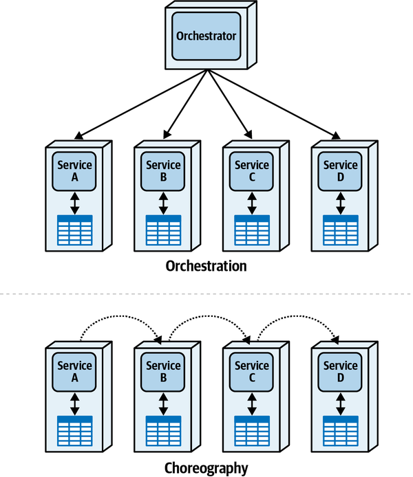

*Hình 11-2. Orchestration so với choreography trong architecture phân tán*

## Kiểu giao tiếp orchestration (Orchestration Communication Style)

*Orchestration pattern* dùng một component *orchestrator* (đôi khi gọi là *mediator*) để quản lý trạng thái workflow, hành vi tùy chọn, xử lý lỗi, thông báo, và hàng loạt công việc duy trì workflow khác. Nó được đặt tên theo đặc điểm phân biệt của một dàn nhạc giao hưởng (orchestra), nơi dùng một nhạc trưởng để đồng bộ các phần chưa hoàn chỉnh của tổng phổ nhằm tạo ra một bản nhạc thống nhất. Orchestration được minh họa ở dạng biểu diễn chung nhất trong [Hình 11-3](#fig-managing-workflows-orch-iso).

Trong ví dụ này, các service A-D là domain service, mỗi service chịu trách nhiệm cho bounded context, dữ liệu và hành vi riêng của nó. Component Orchestrator nhìn chung không bao gồm bất kỳ hành vi domain nào ngoài workflow mà nó điều phối. Hãy để ý rằng microservices architecture có một orchestrator cho mỗi workflow, *không phải* một orchestrator toàn cục như một [*enterprise service bus* (ESB)](https://oreil.ly/KTGrU). Một trong những mục tiêu chính của microservices architecture style là decoupling, và việc dùng một component toàn cục như ESB tạo ra một điểm coupling không mong muốn. Do đó, microservices có xu hướng có một orchestrator cho mỗi workflow.

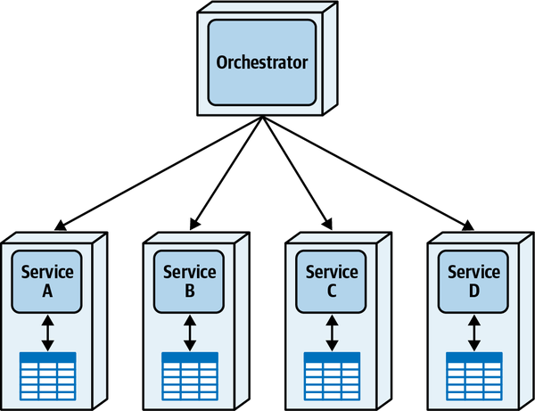

*Hình 11-3. Orchestration giữa các microservice phân tán*

Orchestration hữu ích khi kiến trúc sư phải mô hình hóa một workflow phức tạp bao gồm không chỉ một “happy path” (đường đi suôn sẻ) duy nhất, mà còn các đường đi thay thế và các điều kiện lỗi. Tuy nhiên, để hiểu hình dạng cơ bản của pattern, chúng tôi bắt đầu với happy path không có lỗi. Hãy xét một ví dụ rất đơn giản về việc Penultimate Electronics bán một thiết bị cho một trong các khách hàng trực tuyến của mình, thể hiện trong [Hình 11-4](#fig-managing-workflows-orch-happy).

Hệ thống này chuyển request Place Order tới Order Placement Orchestrator, orchestrator này thực hiện một lời gọi đồng bộ tới Order Placement Service, service này ghi lại đơn hàng và trả về một message trạng thái. Tiếp theo, mediator gọi Payment Service, service này cập nhật thông tin thanh toán. Tiếp theo, orchestrator thực hiện một lời gọi bất đồng bộ tới Fulfillment Service để xử lý đơn hàng. Lời gọi là bất đồng bộ vì không có phụ thuộc thời gian chặt chẽ nào đối với việc thực hiện đơn hàng, khác với việc xác minh thanh toán. Ví dụ, nếu việc thực hiện đơn hàng chỉ diễn ra vài lần một ngày, không có lý do gì để chịu overhead của một lời gọi đồng bộ. Tương tự, orchestrator sau đó gọi Email Service để thông báo cho người dùng về một đơn hàng điện tử thành công.

Nếu thế giới chỉ gồm các happy path, software architecture sẽ dễ dàng. Tuy nhiên, một trong những phần khó chính của software architecture là các điều kiện lỗi và các lối đi xử lý lỗi.

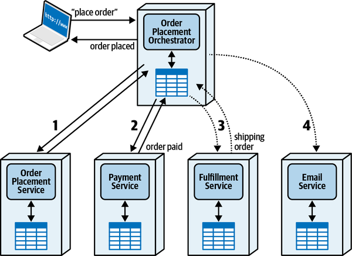

*Hình 11-4. Một workflow “happy path” dùng orchestrator để mua thiết bị điện tử (lưu ý các lời gọi bất đồng bộ được biểu thị bằng đường chấm cho các lời gọi ít time-sensitive (nhạy cảm về thời gian) hơn)*

Hãy xét hai kịch bản lỗi tiềm năng cho việc mua đồ điện tử. Thứ nhất, điều gì xảy ra nếu phương thức thanh toán của khách hàng bị từ chối? Kịch bản lỗi này xuất hiện trong [Hình 11-5](#fig-managing-workflows-orch-error-pay).

Ở đây, Order Placement Orchestrator cập nhật đơn hàng qua Order Placement Service như trước. Tuy nhiên, khi cố áp dụng thanh toán, nó bị payment service từ chối, có lẽ vì số thẻ tín dụng đã hết hạn. Trong trường hợp đó, Payment Service thông báo cho orchestrator, orchestrator sau đó thực hiện một lời gọi (thường là) bất đồng bộ để gửi message tới Email Service nhằm thông báo cho khách hàng về đơn hàng thất bại. Ngoài ra, orchestrator cập nhật trạng thái của Order Placement Service, vốn vẫn nghĩ đây là một đơn hàng đang hoạt động.

Hãy để ý trong ví dụ này chúng tôi cho phép mỗi service duy trì trạng thái transaction riêng của nó, mô hình hóa [“Fairy Tale Saga(seo) Pattern”](ch12_transactional_sagas.vi.md#sec-fairy-tale-saga) của chúng tôi. Một trong những phần khó nhất của các architecture hiện đại là quản lý transaction, điều chúng tôi đề cập trong [Chương 12](ch12_transactional_sagas.vi.md#ch12-transactional-sagas).

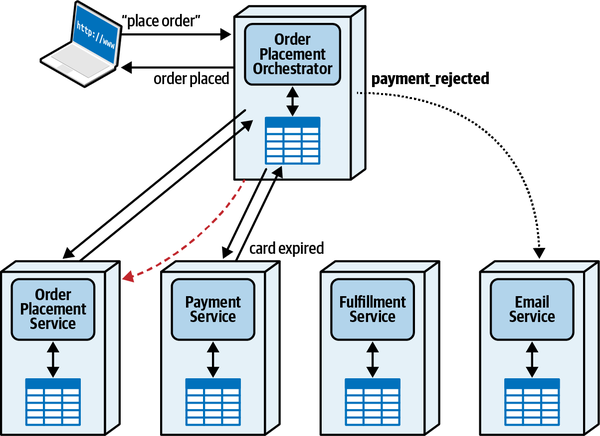

*Hình 11-5. Điều kiện lỗi thanh toán bị từ chối*

Trong kịch bản lỗi thứ hai, workflow đã tiến xa hơn: điều gì xảy ra khi Fulfillment Service báo cáo một back order (đơn hàng chờ do hết hàng)? Kịch bản lỗi này xuất hiện trong [Hình 11-6](#fig-managing-workflows-orch-error-backorder).

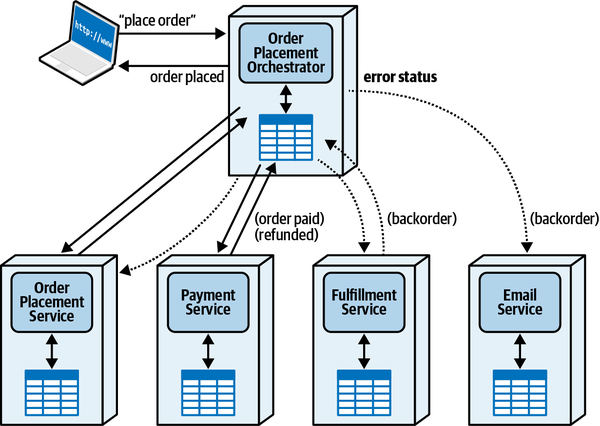

*Hình 11-6. Khi một mặt hàng bị back-ordered (hết hàng phải đặt chờ), orchestrator phải điều chỉnh lại trạng thái*

Như bạn thấy, workflow diễn ra bình thường cho đến khi Fulfillment Service thông báo cho orchestrator rằng mặt hàng hiện tại đã hết hàng, đòi hỏi một back order. Trong trường hợp đó, orchestrator phải hoàn tiền thanh toán (đây là lý do nhiều dịch vụ trực tuyến không thu tiền cho đến khi giao hàng, chứ không phải lúc đặt hàng) và cập nhật trạng thái của Order Placement Service.

Một đặc điểm thú vị cần lưu ý trong [Hình 11-6](#fig-managing-workflows-orch-error-backorder): ngay cả trong những kịch bản lỗi phức tạp nhất, kiến trúc sư cũng không phải thêm các đường giao tiếp bổ sung nào chưa có sẵn để hỗ trợ workflow bình thường, điều này khác với [“Choreography Communication Style”](#sec-choreography).

Các ưu điểm chung của kiểu giao tiếp orchestration bao gồm:

**Workflow tập trung (Centralized workflow)**

Khi độ phức tạp tăng lên, việc có một component thống nhất cho trạng thái và hành vi trở nên có lợi.

**Xử lý lỗi (Error handling)**

Xử lý lỗi là một phần lớn của nhiều domain workflow, được hỗ trợ bằng việc có một chủ sở hữu trạng thái cho workflow.

**Khả năng phục hồi (Recoverability)**

Vì orchestrator giám sát trạng thái của workflow, kiến trúc sư có thể thêm logic thử lại nếu một hoặc nhiều domain service gặp sự cố ngừng hoạt động short-term (ngắn hạn).

**Quản lý trạng thái (State management)**

Có một orchestrator giúp trạng thái của workflow có thể truy vấn được, cung cấp một nơi cho các workflow khác và các trạng thái tạm thời khác.

Các nhược điểm chung của kiểu giao tiếp orchestration bao gồm:

**Khả năng phản hồi (Responsiveness)**

Mọi giao tiếp đều phải đi qua mediator, tạo ra một nút thắt cổ chai throughput tiềm năng có thể làm hại khả năng phản hồi.

**Fault tolerance**

Dù orchestration tăng cường khả năng phục hồi cho các domain service, nó tạo ra một single point of failure tiềm năng cho workflow, điều có thể được giải quyết bằng dự phòng nhưng làm tăng thêm độ phức tạp.

**Scalability**

Kiểu giao tiếp này không scale tốt bằng choreography vì nó có nhiều điểm phối hợp hơn (orchestrator), làm giảm khả năng song song tiềm năng. Như chúng tôi đã thảo luận trong [Chương 2](ch02_discerning_coupling_in_software_architecture.vi.md#ch02-discerning), một số dynamic coupling pattern dùng choreography và do đó đạt được scale cao hơn (đáng chú ý là [“Time Travel Saga(sec) Pattern”](ch12_transactional_sagas.vi.md#sec-time-travel-saga) và [“Anthology Saga(aec) Pattern”](ch12_transactional_sagas.vi.md#sec-anthology-saga)).

**Coupling giữa các service (Service coupling)**

Có một orchestrator trung tâm tạo ra coupling cao hơn giữa nó và các domain component, điều đôi khi là cần thiết. Các trade-offs của kiểu giao tiếp orchestration xuất hiện trong [Bảng 11-1](#total-orch-tradeoffs).

> **Các đánh đổi (Trade-Offs)**
>
> 
>
> *Bảng 11-1. Trade-offs của orchestration*
>
> | Ưu điểm | Nhược điểm |
> |---|---|
> | Workflow tập trung | Khả năng phản hồi |
> | Xử lý lỗi | Fault tolerance |
> | Khả năng phục hồi | Scalability |
> | Quản lý trạng thái | Coupling giữa các service |

## Kiểu giao tiếp choreography (Choreography Communication Style)

Trong khi Orchestration Communication Style được đặt tên theo sự phối hợp trung tâm mang tính ẩn dụ do một orchestrator cung cấp, pattern *choreography* (biên đạo múa) minh họa trực quan ý đồ của kiểu giao tiếp không có phối hợp trung tâm. Thay vào đó, mỗi service tham gia cùng các service khác, tương tự những bạn nhảy. Đó không phải là một màn trình diễn ngẫu hứng—các bước nhảy đã được choreographer/architect lên kế hoạch từ trước nhưng được thực hiện mà không có người điều phối trung tâm.

[Hình 11-4](#fig-managing-workflows-orch-happy) mô tả workflow orchestrated cho việc một khách hàng mua đồ điện tử từ Penultimate Electronics; cùng workflow đó được mô hình hóa theo kiểu giao tiếp choreography xuất hiện trong [Hình 11-7](#fig-managing-workflows-simple-choreo).

Trong workflow này, request khởi đầu đi tới service đầu tiên trong chuỗi trách nhiệm—trong trường hợp này là Order Placement Service. Một khi nó đã cập nhật các bản ghi nội bộ về đơn hàng, nó gửi một request bất đồng bộ mà Payment Service nhận. Một khi thanh toán đã được áp dụng, Payment Service tạo ra một message được Fulfillment Service nhận, service này lên kế hoạch giao hàng và gửi một message tới Email Service.

Thoạt nhìn, giải pháp choreography có vẻ đơn giản hơn—ít service hơn (không có orchestrator), và một chuỗi sự kiện/lệnh (message) đơn giản. Tuy nhiên, như nhiều vấn đề trong software architecture, khó khăn không nằm ở các đường đi mặc định mà ở các điều kiện biên và điều kiện lỗi.

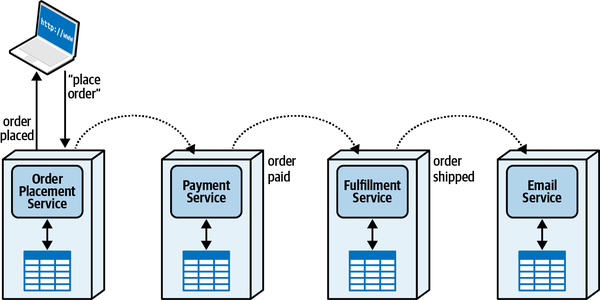

*Hình 11-7. Mua đồ điện tử dùng choreography*

Như trong phần trước, chúng tôi đề cập hai kịch bản lỗi tiềm năng. Kịch bản thứ nhất là do thanh toán thất bại, như minh họa trong [Hình 11-8](#fig-managing-workflows-chor-error-pay).

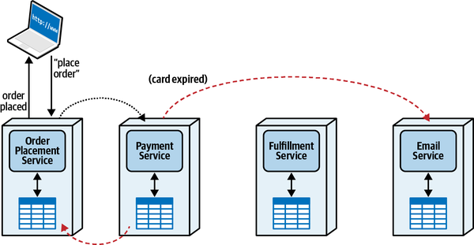

*Hình 11-8. Lỗi thanh toán trong choreography*

Thay vì gửi một message dành cho Fulfillment Service, Payment service gửi các message báo thất bại tới Email Service và ngược lại tới Order Placement Service để cập nhật trạng thái đơn hàng. Workflow thay thế này có vẻ không quá phức tạp, với một liên kết giao tiếp mới duy nhất chưa từng tồn tại trước đó.

Tuy nhiên, hãy xét độ phức tạp gia tăng do kịch bản lỗi còn lại gây ra cho một back order sản phẩm, thể hiện trong [Hình 11-9](#fig-managing-workflows-chor-error-backorder).

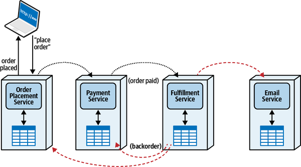

*Hình 11-9. Quản lý điều kiện lỗi workflow của product backlog*

Nhiều bước của workflow này đã hoàn tất trước sự kiện (hết hàng) gây ra lỗi. Vì mỗi service này triển khai tính transaction riêng của nó (đây là một ví dụ về [“Anthology Saga(aec) Pattern”](ch12_transactional_sagas.vi.md#sec-anthology-saga)), khi xảy ra lỗi, mỗi service phải gửi các message bù trừ tới các service khác. Một khi Fulfillment Service nhận ra điều kiện lỗi, nó nên tạo ra các sự kiện phù hợp với bounded context của mình, có lẽ là một message broadcast mà các service Email, Payment và Order Placement đăng ký nhận.

Ví dụ thể hiện trong [Hình 11-9](#fig-managing-workflows-chor-error-backorder) minh họa sự phụ thuộc giữa các workflow phức tạp và mediator. Dù workflow ban đầu trong choreography minh họa ở [Hình 11-7](#fig-managing-workflows-simple-choreo) có vẻ đơn giản hơn [Hình 11-4](#fig-managing-workflows-orch-happy), trường hợp lỗi (và các trường hợp khác) liên tục làm tăng thêm độ phức tạp cho giải pháp choreographed. Trong [Hình 11-10](#fig-managing-workflows-chor-error-add-comm), mỗi kịch bản lỗi buộc các domain service phải tương tác với nhau, thêm các liên kết giao tiếp vốn không cần thiết cho happy path.

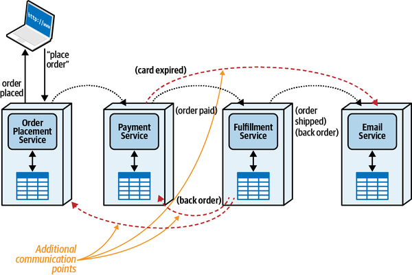

*Hình 11-10. Các điều kiện lỗi trong choreography thường thêm liên kết giao tiếp*

Mọi workflow mà kiến trúc sư cần mô hình hóa trong phần mềm đều có một lượng *semantic coupling* (coupling ngữ nghĩa) nhất định—coupling vốn có tồn tại trong problem domain. Ví dụ, quy trình giao một ticket cho một thành viên Sysops Squad có một workflow nhất định: một client phải yêu cầu dịch vụ, kỹ năng phải được khớp với các chuyên gia cụ thể, rồi cross-referenced (đối chiếu chéo) với lịch làm việc và địa điểm. Cách kiến trúc sư mô hình hóa tương tác đó là *implementation coupling* (coupling triển khai).

Semantic coupling của một workflow được quy định bởi các yêu cầu domain của giải pháp và phải được mô hình hóa bằng cách nào đó. Dù kiến trúc sư khéo léo đến đâu, họ cũng không thể giảm lượng semantic coupling, nhưng các lựa chọn triển khai của họ có thể làm tăng nó. Điều này không có nghĩa là kiến trúc sư không thể phản đối những ngữ nghĩa phi thực tế hoặc bất khả thi do người dùng nghiệp vụ định nghĩa—một số yêu cầu domain tạo ra những vấn đề cực kỳ khó trong architecture.

Đây là một ví dụ phổ biến. Hãy xét layered monolithic architecture tiêu chuẩn so với style hiện đại hơn là modular monolith, thể hiện trong [Hình 11-11](#fig-managing-workflows-tech-domain-part-one).

Architecture bên trái biểu thị layered architecture truyền thống, được phân tách theo các năng lực *kỹ thuật* như persistence, business rule, v.v. Bên phải, cùng giải pháp đó xuất hiện, nhưng được phân tách theo các mối quan tâm *domain* như `Catalog Checkout` và `Update Inventory` thay vì các năng lực kỹ thuật.

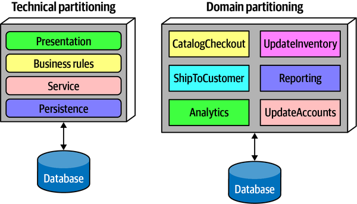

*Hình 11-11. Phân vùng theo kỹ thuật so với theo domain trong architecture*

Cả hai topology đều là những cách hợp lý để tổ chức một codebase. Tuy nhiên, hãy xét các khái niệm domain như `Catalog Checkout` nằm ở đâu trong mỗi architecture, minh họa trong [Hình 11-12](#fig-managing-workflows-tech-domain-part-two).

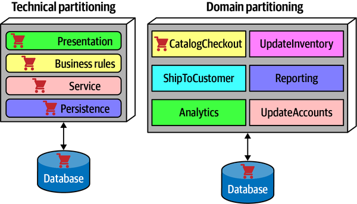

*Hình 11-12. Catalog Checkout bị trải nhòe qua các layer triển khai trong một architecture phân vùng theo kỹ thuật*

`Catalog Checkout` bị “trải nhòe” qua các layer của technical architecture, trong khi nó chỉ xuất hiện trong domain component và database tương ứng trong ví dụ phân vùng theo domain. Tất nhiên, việc sắp domain khớp với domain partitioned architecture không phải là một phát hiện mới—một trong những hiểu biết sâu sắc của domain-driven design là vị trí hàng đầu của các domain workflow. Dù thế nào đi nữa, nếu kiến trúc sư muốn mô hình hóa một workflow, họ phải làm cho các bộ phận chuyển động đó hoạt động cùng nhau. Nếu kiến trúc sư đã tổ chức architecture của mình giống với các domain, việc triển khai workflow sẽ có độ phức tạp tương tự. Tuy nhiên, nếu kiến trúc sư đã áp đặt thêm các layer (như trong phân vùng theo kỹ thuật, thể hiện trong [Hình 11-12](#fig-managing-workflows-tech-domain-part-two)), nó làm tăng độ phức tạp triển khai tổng thể vì giờ kiến trúc sư phải thiết kế cho độ phức tạp *ngữ nghĩa* cùng với độ phức tạp *triển khai* bổ sung.

Đôi khi độ phức tạp thêm vào là có cơ sở. Ví dụ, nhiều layered architecture xuất phát từ mong muốn của kiến trúc sư muốn tiết kiệm chi phí bằng cách hợp nhất các architecture pattern, như database connection pooling. Trong trường hợp đó, kiến trúc sư đã cân nhắc các trade-offs giữa khoản tiết kiệm chi phí gắn với việc phân vùng kỹ thuật cho kết nối database so với độ phức tạp và chi phí phải gánh thêm, và khoản tiết kiệm đã thắng trong nhiều trường hợp.

Bài học lớn nhất của thập kỷ qua trong thiết kế architecture là mô hình hóa *ngữ nghĩa* của workflow càng sát với việc triển khai càng tốt.

> **Mẹo**
>
> Kiến trúc sư không bao giờ có thể giảm semantic coupling thông qua việc triển khai, nhưng họ có thể làm nó tệ hơn.

Do đó, chúng ta có thể thiết lập một quan hệ giữa semantic coupling và nhu cầu phối hợp—workflow càng đòi hỏi nhiều bước, càng xuất hiện nhiều đường đi lỗi và các đường đi tùy chọn khác.

### Quản lý trạng thái workflow (Workflow State Management)

Hầu hết workflow bao gồm trạng thái tạm thời về tình trạng của workflow: những phần tử nào đã thực thi, phần tử nào còn lại, thứ tự, các điều kiện lỗi, các lần thử lại, v.v. Với các giải pháp orchestrated, chủ sở hữu trạng thái workflow hiển nhiên là orchestrator (dù một số giải pháp kiến trúc tạo ra các orchestrator stateless để có scale cao hơn). Tuy nhiên, với choreography, không có chủ sở hữu hiển nhiên nào cho trạng thái workflow. Có nhiều lựa chọn phổ biến để quản lý trạng thái trong choreography; đây là ba lựa chọn phổ biến.

Thứ nhất, *Front Controller pattern* đặt trách nhiệm về trạng thái lên service được gọi đầu tiên trong chuỗi trách nhiệm, trong trường hợp này là Order Placement Service. Nếu service đó chứa thông tin về cả đơn hàng lẫn trạng thái của workflow, một số domain service phải có liên kết giao tiếp để truy vấn và cập nhật trạng thái đơn hàng, như minh họa trong [Hình 11-13](#fig-managing-workflows-chor-state).

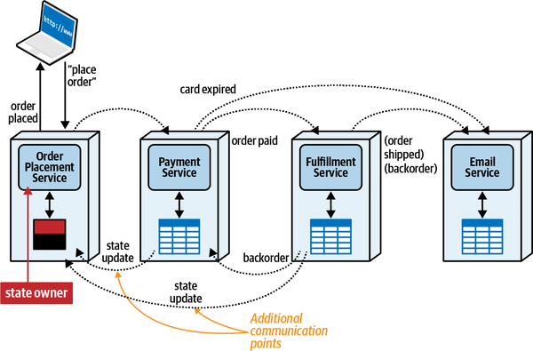

*Hình 11-13. Trong choreography, một *Front Controller* là một domain service sở hữu trạng thái workflow bên cạnh hành vi domain*

Trong kịch bản này, một số service phải giao tiếp ngược lại với Order Placement Service để cập nhật trạng thái đơn hàng, vì nó là chủ sở hữu trạng thái. Dù điều này đơn giản hóa workflow, nó làm tăng overhead giao tiếp và khiến Order Placement Service phức tạp hơn một service chỉ xử lý hành vi domain. Dù Front Controller pattern có một số đặc điểm có lợi, nó cũng có trade-offs, như thể hiện trong [Bảng 11-2](#total-front-controller).

> **Các đánh đổi (Trade-Offs)**
>
> 
>
> *Bảng 11-2. Trade-offs của Front Controller pattern*
>
> | Ưu điểm | Nhược điểm |
> |---|---|
> | Tạo ra một pseudo-orchestrator (orchestrator giả) trong choreography | Thêm trạng thái workflow vào một domain service |
> | Giúp việc truy vấn trạng thái đơn hàng trở nên đơn giản | Tăng overhead giao tiếp |
> |  | Có hại cho performance và scale vì làm tăng lượng giao tiếp tích hợp qua lại |

Cách thứ hai để kiến trúc sư quản lý trạng thái transaction là hoàn toàn không giữ trạng thái workflow tạm thời nào, dựa vào việc truy vấn từng service riêng lẻ để xây dựng một snapshot real-time. Điều này được gọi là *stateless choreography*. Dù điều này đơn giản hóa trạng thái của service đầu tiên, nó làm tăng đáng kể overhead mạng về lượng giao tiếp qua lại giữa các service để xây dựng một snapshot có trạng thái. Ví dụ, hãy xét một workflow như happy path choreography đơn giản trong [Hình 11-7](#fig-managing-workflows-simple-choreo) không có trạng thái bổ sung. Nếu khách hàng muốn biết trạng thái đơn hàng của họ, kiến trúc sư phải xây dựng một workflow truy vấn trạng thái của từng domain service để xác định trạng thái đơn hàng up-to-date (mới nhất). Dù điều này tạo ra một giải pháp rất linh hoạt, việc xây dựng lại trạng thái có thể phức tạp và tốn kém về các architecture characteristic vận hành như scalability và performance. Stateless choreography đánh đổi performance cao lấy khả năng kiểm soát workflow, như minh họa trong [Bảng 11-3](#total-stateless).

> **Các đánh đổi (Trade-Offs)**
>
> 
>
> *Bảng 11-3. Các trade-offs của stateless choreography*
>
> | Ưu điểm | Nhược điểm |
> |---|---|
> | Mang lại performance và scale cao | Trạng thái workflow phải được xây dựng tức thời |
> | Decoupled ở mức cực cao | Độ phức tạp tăng nhanh với các workflow phức tạp |

Giải pháp thứ ba dùng *stamp coupling* (được mô tả chi tiết hơn trong [“Stamp Coupling for Workflow Management”](ch13_contracts.vi.md#sec-stamp-coupling)), lưu thêm trạng thái workflow trong message contract được gửi giữa các service. Mỗi domain service cập nhật phần của nó trong trạng thái tổng thể và truyền nó cho service tiếp theo trong chuỗi trách nhiệm. Do đó, bất kỳ consumer nào của contract đó đều có thể kiểm tra trạng thái của workflow mà không cần truy vấn từng service.

Đây là một giải pháp một phần, vì nó vẫn không cung cấp một nơi duy nhất để người dùng truy vấn trạng thái của workflow đang diễn ra. Tuy nhiên, nó cung cấp một cách truyền trạng thái giữa các service như một phần của workflow, mang lại cho mỗi service thêm bối cảnh có thể hữu ích. Như mọi tính năng trong software architecture, stamp coupling có những đặc điểm tốt và xấu, thể hiện trong [Bảng 11-4](#total-stamp-coupling).

> **Các đánh đổi (Trade-Offs)**
>
> 
>
> *Bảng 11-4. Các trade-offs của stamp coupling*
>
> | Ưu điểm | Nhược điểm |
> |---|---|
> | Cho phép các domain service truyền trạng thái workflow mà không cần truy vấn thêm tới chủ sở hữu trạng thái | Contract phải lớn hơn để chứa trạng thái workflow |
> | Loại bỏ nhu cầu về front controller | Không cung cấp truy vấn trạng thái just-in-time (tức thời) |

Trong [Chương 13](ch13_contracts.vi.md#ch13-contracts), chúng tôi thảo luận cách contract có thể giảm hoặc tăng workflow coupling trong các giải pháp choreographed.

Các ưu điểm của kiểu giao tiếp choreography bao gồm:

**Khả năng phản hồi (Responsiveness)**

Kiểu giao tiếp này có ít điểm nghẽn đơn hơn, do đó mang lại nhiều cơ hội song song hơn.

**Scalability**

Tương tự khả năng phản hồi, việc thiếu các điểm phối hợp như orchestrator cho phép scale độc lập hơn.

**Fault tolerance**

Việc không có một orchestrator duy nhất cho phép kiến trúc sư tăng cường fault tolerance bằng cách dùng nhiều instance.

**Decoupling giữa các service (Service decoupling)**

Không có orchestrator nghĩa là ít coupling hơn.

Các nhược điểm của kiểu giao tiếp choreography bao gồm:

**Workflow phân tán (Distributed workflow)**

Không có chủ sở hữu workflow khiến việc quản lý lỗi và các điều kiện biên khác trở nên khó khăn hơn.

**Quản lý trạng thái (State management)**

Không có nơi giữ trạng thái tập trung cản trở việc quản lý trạng thái liên tục.

**Xử lý lỗi (Error handling)**

Xử lý lỗi trở nên khó khăn hơn khi không có orchestrator vì các domain service phải có nhiều kiến thức về workflow hơn.

**Khả năng phục hồi (Recoverability)**

Tương tự, khả năng phục hồi trở nên khó khăn hơn khi không có orchestrator để thử lại và thực hiện các nỗ lực khắc phục khác.

Giống như [“Orchestration Communication Style”](#sec-orchestrator), choreography có một số trade-offs tốt và xấu, thường đối lập nhau, được tóm tắt trong [Bảng 11-5](#total-choreography).

> **Các đánh đổi (Trade-Offs)**
>
> 
>
> *Bảng 11-5. Trade-offs của kiểu giao tiếp choreography*
>
> | Ưu điểm | Nhược điểm |
> |---|---|
> | Khả năng phản hồi | Workflow phân tán |
> | Scalability | Quản lý trạng thái |
> | Fault tolerance | Xử lý lỗi |
> | Decoupling giữa các service | Khả năng phục hồi |

## Đánh đổi giữa orchestration và choreography (Trade-Offs Between Orchestration and Choreography)

Như mọi thứ trong software architecture, cả orchestration lẫn choreography đều không phải là giải pháp hoàn hảo cho mọi khả năng. Một số trade-offs then chốt, bao gồm một số được nêu ở đây, sẽ dẫn kiến trúc sư tới một trong hai giải pháp này.

### Chủ sở hữu trạng thái và coupling (State Owner and Coupling)

Như minh họa trong [Hình 11-13](#fig-managing-workflows-chor-state), quyền sở hữu trạng thái thường nằm ở đâu đó, hoặc trong một mediator chính thức đóng vai trò orchestrator, hoặc trong một front controller trong giải pháp choreographed. Trong giải pháp choreographed, việc bỏ mediator buộc phải có mức giao tiếp cao hơn giữa các service. Đây có thể là một trade-off hoàn toàn phù hợp. Ví dụ, nếu kiến trúc sư có một workflow cần scale cao hơn và thường có ít điều kiện lỗi, có thể đáng để đánh đổi scale cao hơn của choreography với độ phức tạp của xử lý lỗi.

Tuy nhiên, khi độ phức tạp của workflow tăng lên, nhu cầu về một orchestrator tăng theo tỉ lệ, như minh họa trong [Hình 11-14](#fig-managing-workflows-complexity-orch).

Ngoài ra, workflow chứa càng nhiều độ phức tạp ngữ nghĩa, orchestrator càng hữu dụng. Hãy nhớ, implementation coupling không thể làm semantic coupling tốt hơn, chỉ có thể làm tệ hơn.

Rốt cuộc, điểm lý tưởng cho choreography nằm ở các workflow cần khả năng phản hồi và scalability, và hoặc không có kịch bản lỗi phức tạp hoặc các kịch bản lỗi hiếm khi xảy ra. Kiểu giao tiếp này cho phép throughput cao; nó được các dynamic coupling pattern [“Phone Tag Saga(sac) Pattern”](ch12_transactional_sagas.vi.md#sec-phone-tag-saga), [“Time Travel Saga(sec) Pattern”](ch12_transactional_sagas.vi.md#sec-time-travel-saga), và [“Anthology Saga(aec) Pattern”](ch12_transactional_sagas.vi.md#sec-anthology-saga) dùng. Tuy nhiên, nó cũng có thể dẫn đến những cách triển khai cực kỳ khó khăn khi các lực khác bị trộn vào, dẫn đến [“Horror Story(aac) Pattern”](ch12_transactional_sagas.vi.md#sec-horror-story).

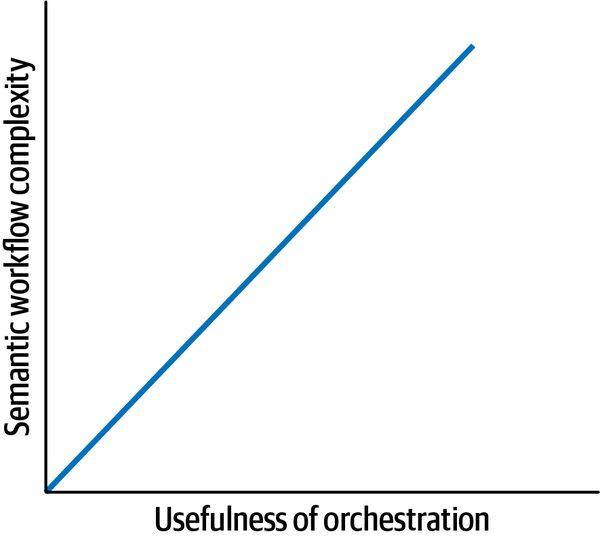

*Hình 11-14. Khi độ phức tạp của workflow tăng lên, orchestration trở nên hữu ích hơn*

Mặt khác, *orchestration* phù hợp nhất cho các workflow phức tạp bao gồm các điều kiện biên và điều kiện lỗi. Dù style này không mang lại nhiều scale bằng choreography, nó giảm đáng kể độ phức tạp trong hầu hết trường hợp. Kiểu giao tiếp này xuất hiện trong [“Epic Saga(sao) Pattern”](ch12_transactional_sagas.vi.md#sec-epic-saga), [“Fairy Tale Saga(seo) Pattern”](ch12_transactional_sagas.vi.md#sec-fairy-tale-saga), [“Fantasy Fiction Saga(aao) Pattern”](ch12_transactional_sagas.vi.md#sec-fantasy-fiction-saga), và [“Parallel Saga(aeo) Pattern”](ch12_transactional_sagas.vi.md#sec-parallel-saga).

*Phối hợp* (coordination) là một trong những lực chính tạo ra độ phức tạp cho kiến trúc sư khi xác định cách tốt nhất để giao tiếp giữa các microservice. Tiếp theo, chúng tôi tìm hiểu lực này giao nhau thế nào với một lực chính khác, *tính nhất quán* (consistency).

## Sysops Squad Saga: Quản lý workflow (Sysops Squad Saga: Managing Workflows)

`Thursday, March 15, 11:00`

Addison và Austen đến văn phòng của Logan đúng giờ, mang theo một bài trình bày và bình cà phê theo thông lệ từ nhà bếp.

“Anh sẵn sàng chưa?” Addison hỏi.

“Chắc chắn rồi,” Logan nói. “Đúng lúc lắm—tôi vừa xong một cuộc họp qua điện thoại. Các cậu sẵn sàng bàn về các lựa chọn workflow cho luồng ticket chính chưa?”

“Rồi!” Austen nói. “Tôi nghĩ chúng ta nên dùng choreography, nhưng Addison nghĩ là orchestration, và chúng tôi không thể quyết định.”

“Cho tôi một cái nhìn tổng quan về workflow mà chúng ta đang xem xét.”

“Đó là workflow ticket chính,” Addison nói. “Nó liên quan đến bốn service; đây là các bước.”

*Các thao tác customer-facing (hướng tới khách hàng)*

1. Khách hàng gửi một trouble ticket thông qua Ticket Management Service và nhận một số ticket.

*Các thao tác nền*

1. Ticket Assignment Service tìm chuyên gia Sysops phù hợp cho trouble ticket.
2. Ticket Assignment Service định tuyến trouble ticket tới thiết bị di động của chuyên gia hệ thống.
3. Khách hàng được thông báo qua Notification Service rằng chuyên gia Sysops đang trên đường đến để sửa sự cố.
4. Chuyên gia sửa sự cố và đánh dấu ticket là hoàn tất, thông tin này được gửi tới Ticket Management Service.
5. Ticket Management Service giao tiếp với Survey Service để yêu cầu khách hàng điền khảo sát.

“Các cậu đã mô hình hóa cả hai giải pháp chưa?” Logan hỏi.

“Rồi. Bản vẽ cho choreography nằm trong [Hình 11-15](#fig-managing-workflows-ss-choreography).”

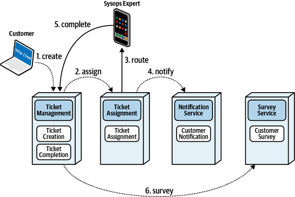

*Hình 11-15. Luồng ticket chính được mô hình hóa theo choreography*

“…và mô hình cho orchestration nằm trong [Hình 11-16](#fig-managing-workflows-ss-orch).”

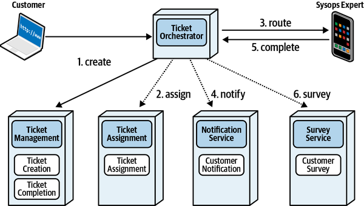

*Hình 11-16. Workflow ticket chính được mô hình hóa theo orchestration*

Logan suy ngẫm về các sơ đồ một lúc, rồi tuyên bố, “Chà, có vẻ không có người thắng rõ ràng ở đây. Các cậu biết điều đó nghĩa là gì mà.”

Austen lên tiếng, “Trade-offs!”

“Tất nhiên,” Logan cười. " Hãy nghĩ về các kịch bản có khả năng xảy ra và xem mỗi giải pháp phản ứng với chúng thế nào. Những vấn đề chính mà các cậu quan tâm là gì?”

“Thứ nhất là ticket bị mất hoặc bị định tuyến sai. Phía nghiệp vụ đã phàn nàn về điều đó, và nó đã trở thành ưu tiên,” Addison nói.

“OK, cái nào xử lý vấn đề đó tốt hơn—orchestration hay choreography?”

“Kiểm soát workflow dễ hơn nghe có vẻ phiên bản orchestrator tốt hơn—chúng ta có thể xử lý mọi vấn đề workflow ở đó,” Austen xung phong.

“OK, hãy xây dựng một bảng các vấn đề và giải pháp được ưu tiên trong [Bảng 11-6](#tbl-ss-wf-one).”

> **Các đánh đổi (Trade-Offs)**
>
> 
>
> *Bảng 11-6. Trade-off giữa orchestration và choreography cho workflow ticket*
>
> | Orchestration | Choreography |
> |---|---|
> | Kiểm soát workflow |  |

“Vấn đề tiếp theo chúng ta nên mô hình hóa là gì?” Addison hỏi.

“Chúng ta cần biết trạng thái của một trouble ticket tại bất kỳ thời điểm nào—phía nghiệp vụ đã yêu cầu tính năng này, và nó giúp theo dõi một số metric dễ hơn. Điều đó hàm ý chúng ta cần một orchestrator để có thể truy vấn trạng thái của workflow.”

“Nhưng cậu không cần phải có orchestrator cho việc đó—chúng ta có thể truy vấn bất kỳ service nào để xem nó đã xử lý một phần cụ thể của workflow chưa, hoặc dùng stamp coupling,” Addison nói.

“Đúng vậy—đây không phải là một trò chơi zero-sum (tổng bằng không),” Logan nói. “Có thể cả hai hoặc không cái nào hoạt động tốt như nhau. Chúng ta sẽ ghi điểm cho cả hai giải pháp trong bảng cập nhật ở [Bảng 11-7](#tbl-ss-wf-two).”

> **Các đánh đổi (Trade-Offs)**
>
> 
>
> *Bảng 11-7. Các trade-offs cập nhật giữa orchestration và choreography cho workflow ticket*
>
> | Orchestration | Choreography |
> |---|---|
> | Kiểm soát workflow |  |
> | Truy vấn trạng thái | Truy vấn trạng thái |

“OK, còn gì nữa?”

“Chỉ còn một cái nữa mà tôi nghĩ ra,” Addison nói. “Ticket có thể bị khách hàng hủy, và ticket có thể bị giao lại vì lịch sẵn sàng của chuyên gia, mất kết nối tới thiết bị di động của chuyên gia, hoặc chuyên gia bị chậm trễ tại địa điểm của khách hàng. Do đó, xử lý lỗi đúng cách là quan trọng. Điều đó có nghĩa là orchestration?”

“Đúng vậy, nhìn chung. Các workflow phức tạp phải nằm ở đâu đó, hoặc trong một orchestrator hoặc rải rác qua các service. Thật tốt khi có một nơi duy nhất để hợp nhất xử lý lỗi. Và choreography chắc chắn không ghi điểm tốt ở đây, nên chúng ta sẽ cập nhật bảng trong [Bảng 11-8](#tbl-ss-wf-three).”

> **Các đánh đổi (Trade-Offs)**
>
> 
>
> *Bảng 11-8. Các trade-offs cuối cùng giữa orchestration và choreography cho workflow ticket*
>
> | Orchestration | Choreography |
> |---|---|
> | Kiểm soát workflow |  |
> | Truy vấn trạng thái | Truy vấn trạng thái |
> | Xử lý lỗi |  |

“Trông khá tốt đấy. Còn gì nữa không?”

“Không có gì ngoài những thứ hiển nhiên,” Addison nói. “Chúng tôi sẽ viết điều này vào một ADR; nếu nghĩ ra vấn đề nào khác, chúng tôi có thể thêm vào đó.”

> 
>
> *ADR: Dùng orchestration cho workflow ticket chính*
>
> *Bối cảnh (Context)* 
> Với workflow ticket chính, architecture phải hỗ trợ việc dễ dàng theo dõi các message bị mất hoặc bị theo dõi sai, xử lý lỗi xuất sắc, và khả năng theo dõi trạng thái ticket. Hoặc một giải pháp orchestration minh họa trong [Hình 11-16](#fig-managing-workflows-ss-orch) hoặc một giải pháp choreography minh họa trong [Hình 11-15](#fig-managing-workflows-ss-choreography) đều sẽ hoạt động.
>
> *Quyết định (Decision)* 
> Chúng tôi sẽ dùng orchestration cho workflow ticket chính.
>
> Chúng tôi đã mô hình hóa orchestration và choreography và đi đến các trade-offs trong [Bảng 11-8](#tbl-ss-wf-three).
>
> *Hệ quả (Consequences)* 
> Workflow ticket có thể gặp vấn đề scalability quanh một orchestrator duy nhất, điều này nên được xem xét lại nếu các yêu cầu scalability hiện tại thay đổi.
